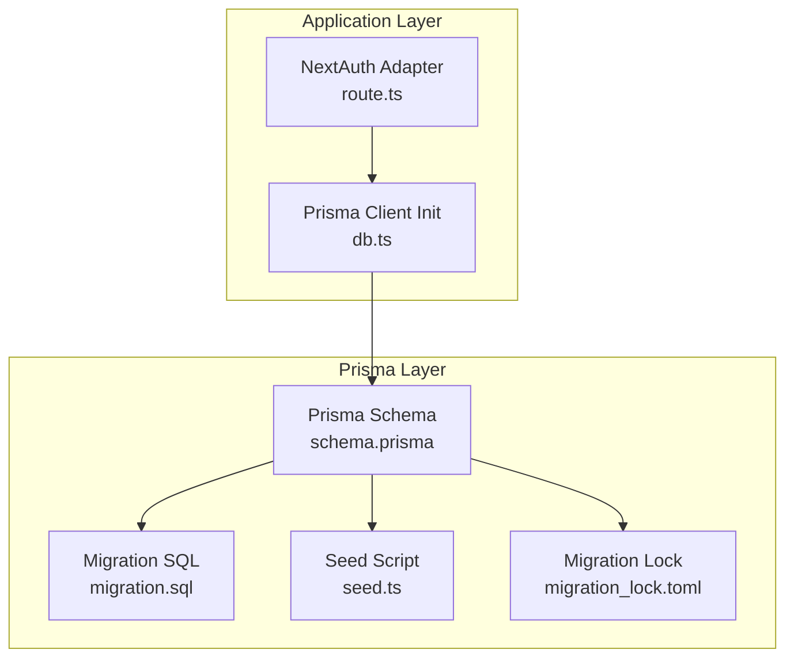
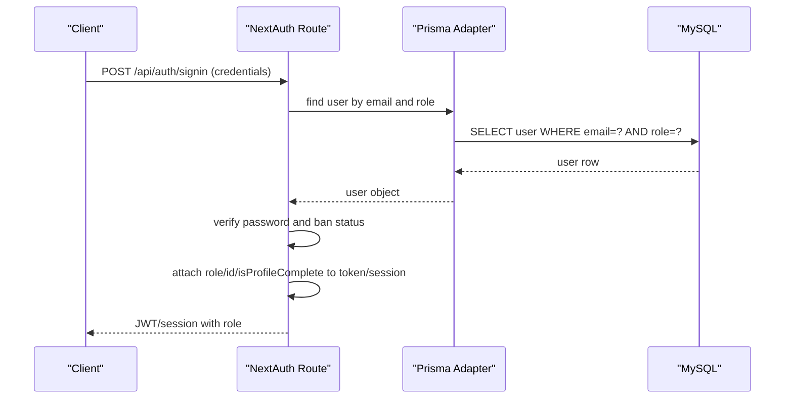
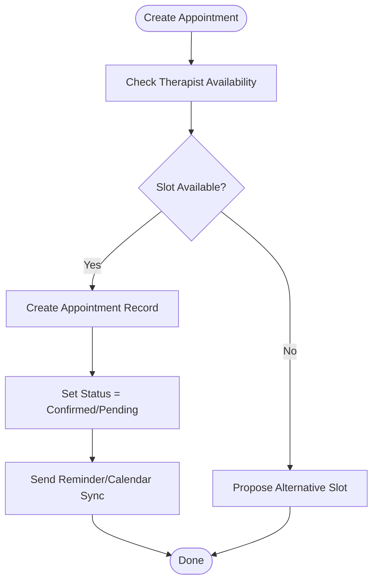
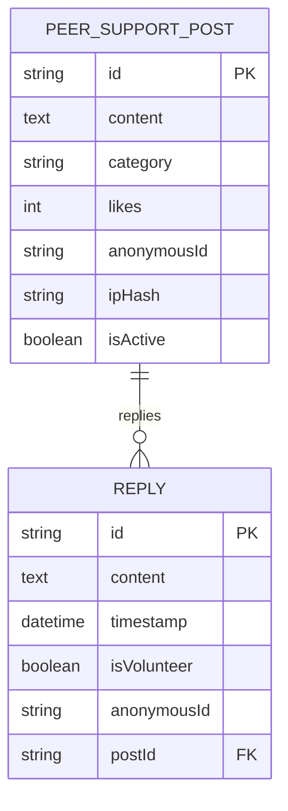
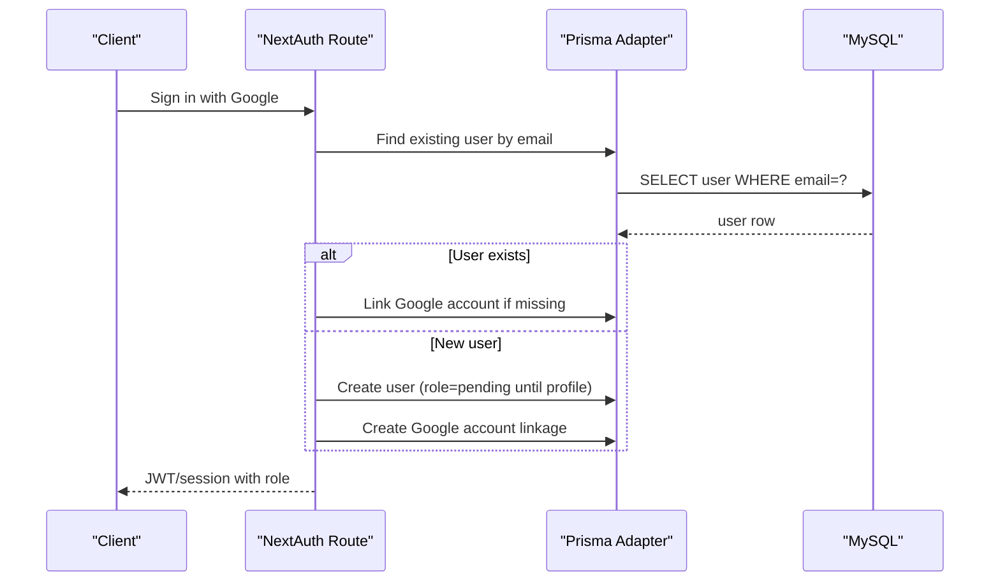
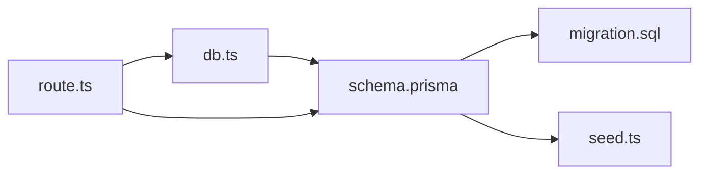

# Database Design

<cite>
**Referenced Files in This Document**
- [schema.prisma](file://WEBAPP/prisma/schema.prisma)
- [migration.sql](file://WEBAPP/prisma/migrations/20251105192017_add_therapy_models/migration.sql)
- [seed.ts](file://WEBAPP/prisma/seed.ts)
- [db.ts](file://WEBAPP/src/lib/db.ts)
- [route.ts](file://WEBAPP/src/app/api/auth/[...nextauth]/route.ts)
- [migration_lock.toml](file://WEBAPP/prisma/migrations/migration_lock.toml)
</cite>

## Table of Contents
1. [Introduction](#introduction)
2. [Project Structure](#project-structure)
3. [Core Components](#core-components)
4. [Architecture Overview](#architecture-overview)
5. [Detailed Component Analysis](#detailed-component-analysis)
6. [Dependency Analysis](#dependency-analysis)
7. [Performance Considerations](#performance-considerations)
8. [Troubleshooting Guide](#troubleshooting-guide)
9. [Conclusion](#conclusion)
10. [Appendices](#appendices)

## Introduction
This document provides comprehensive database design documentation for the MindBridge application. It details the data model for Users, Patients, Therapists, Sessions, Messages, Posts, and Analytics, along with Prisma schema definitions, migration strategies, and data seeding. It also explains role-based access control via user roles and permissions, constraints, referential integrity, indexing strategies, and performance considerations tailored for healthcare data management.

## Project Structure
The database layer is defined and managed by Prisma ORM with a MySQL provider. The schema file defines models and relations, migrations capture the evolving database structure, and a seed script initializes test data. Authentication integrates with NextAuth.js using a Prisma adapter.



**Diagram sources**
- [schema.prisma](file://WEBAPP/prisma/schema.prisma#L1-L330)
- [migration.sql](file://WEBAPP/prisma/migrations/20251105192017_add_therapy_models/migration.sql#L1-L206)
- [seed.ts](file://WEBAPP/prisma/seed.ts#L1-L168)
- [migration_lock.toml](file://WEBAPP/prisma/migrations/migration_lock.toml#L1-L4)
- [route.ts](file://WEBAPP/src/app/api/auth/[...nextauth]/route.ts#L1-L240)
- [db.ts](file://WEBAPP/src/lib/db.ts#L1-L15)

**Section sources**
- [schema.prisma](file://WEBAPP/prisma/schema.prisma#L1-L330)
- [migration.sql](file://WEBAPP/prisma/migrations/20251105192017_add_therapy_models/migration.sql#L1-L206)
- [seed.ts](file://WEBAPP/prisma/seed.ts#L1-L168)
- [db.ts](file://WEBAPP/src/lib/db.ts#L1-L15)
- [route.ts](file://WEBAPP/src/app/api/auth/[...nextauth]/route.ts#L1-L240)
- [migration_lock.toml](file://WEBAPP/prisma/migrations/migration_lock.toml#L1-L4)

## Core Components
This section outlines the core entities and their relationships, focusing on primary/foreign keys, constraints, and indexes.

- Users
  - Role-based access control: role defaults to "patient" and supports "therapist" and "admin".
  - Relations: accounts, sessions, chatMessages, chatSessions, therapySessions (as therapist/patient), appointments, availability, patientProfile, mentalHealthAnalytics, assessmentSessions, otpTokens.
  - Constraints: unique email; default timestamps; isProfileComplete and isBanned flags.

- Patients and Therapists
  - PatientDetails: one-to-one with User via userId unique index.
  - TherapistProfile: one-to-one with User via userId unique index; includes verification fields.

- Therapy and Scheduling
  - TherapySession: many-to-many via User relations (therapist and patient), with status and timing fields.
  - Appointment: links therapist and patient to scheduled slots; includes status and reminders.
  - TherapistAvailability: defines weekly or specific-date availability slots.

- Messaging and Analytics
  - ChatSession: user-owned conversations with isActive flag and timestamps.
  - ChatMessage: belongs to User and optional ChatSession; includes role and metadata.
  - MentalHealthAnalytics: daily computed metrics per user; supports composite index on (userId, date).
  - AssessmentSession: stores scored assessments with answers as JSON.

- Peer Support
  - PeerSupportPost: categorized posts with likes and anonymous identifiers; indexed by category and createdAt.
  - Reply: nested under posts with volunteer flag and anonymousId.

- Authentication and Sessions
  - Account and Session: NextAuth models; foreign keys to User with cascade deletes.
  - VerificationToken: unique token per identifier.
  - AdminUser: dedicated admin records.

**Section sources**
- [schema.prisma](file://WEBAPP/prisma/schema.prisma#L12-L329)

## Architecture Overview
The database architecture centers around a central User entity that polymorphically relates to profiles, therapy sessions, appointments, availability, analytics, and messaging. Prisma manages schema evolution through migrations and seeds test data. NextAuth integrates with the User model for authentication and session management.

```mermaid
erDiagram
USER {
string id PK
string email UK
string role
boolean isProfileComplete
boolean isBanned
datetime createdAt
}
PATIENT_DETAILS {
string id PK
string userId UK
string fullName
datetime dateOfBirth
string gender
int age
}
THERAPIST_PROFILE {
string id PK
string userId UK
string fullName
datetime dateOfBirth
string gender
int age
string degree
string experience
text hospitalAffiliation
longtext photoUrl
boolean isVerified
string verificationStatus
}
THERAPY_SESSION {
string id PK
string therapistId FK
string patientId FK
datetime startTime
datetime endTime
int duration
json emotionsSummary
int messageCount
string status
}
APPOINTMENT {
string id PK
string therapistId FK
string patientId FK
datetime scheduledTime
int duration
string status
string type
}
THERAPIST_AVAILABILITY {
string id PK
string therapistId FK
int dayOfWeek
string startTime
string endTime
boolean isRecurring
datetime specificDate
boolean isBooked
boolean isActive
}
CHAT_SESSION {
string id PK
string userId FK
string title
boolean isActive
}
CHAT_MESSAGE {
string id PK
string userId FK
string sessionId FK
string role
text content
json metadata
}
PEER_SUPPORT_POST {
string id PK
text content
string category
int likes
string anonymousId
string ipHash
boolean isActive
}
REPLY {
string id PK
text content
datetime timestamp
boolean isVolunteer
string anonymousId
string postId FK
}
MENTAL_HEALTH_ANALYTICS {
string id PK
string userId FK
datetime date
int mentalHealthLevel
string levelLabel
json keywordsDetected
json keywordCounts
int totalMessages
int positiveCount
int negativeCount
json riskFlags
string source
}
ASSESSMENT_SESSION {
string id PK
string userId FK
int totalScore
int maxScore
int mentalHealthLevel
string levelLabel
json answers
}
ACCOUNT {
string id PK
string userId FK
string provider
string providerAccountId
}
SESSION {
string id PK
string sessionToken UK
string userId FK
datetime expires
}
VERIFICATION_TOKEN {
string identifier
string token UK
datetime expires
}
ADMIN_USER {
string id PK
string adminId UK
}
USER ||--o{ PATIENT_DETAILS : "has"
USER ||--o{ THERAPIST_PROFILE : "has"
USER ||--o{ THERAPY_SESSION : "therapist"
USER ||--o{ THERAPY_SESSION : "patient"
USER ||--o{ APPOINTMENT : "therapist"
USER ||--o{ APPOINTMENT : "patient"
USER ||--o{ THERAPIST_AVAILABILITY : "has"
USER ||--o{ CHAT_SESSION : "owns"
USER ||--o{ CHAT_MESSAGE : "author"
PEER_SUPPORT_POST ||--o{ REPLY : "replies"
USER ||--o{ MENTAL_HEALTH_ANALYTICS : "analytics"
USER ||--o{ ASSESSMENT_SESSION : "assessment"
USER ||--o{ ACCOUNT : "oauth"
USER ||--o{ SESSION : "session"
USER ||--o{ VERIFICATION_TOKEN : "otp"
```



**Diagram sources**
- [schema.prisma](file://WEBAPP/prisma/schema.prisma#L12-L329)

## Detailed Component Analysis

### Users and Roles
- Role-based access control:
  - role defaults to "patient"; supported values include "patient", "therapist", and "admin".
  - During authentication, the system retrieves the user’s role and attaches it to JWT/session tokens for downstream authorization checks.
- Constraints and defaults:
  - Unique email; createdAt default; isProfileComplete and isBanned flags.
- Authentication integration:
  - NextAuth adapter uses the User model; credentials provider filters by email and role; Google provider creates or links accounts and defaults new users to "patient" until profile completion.



**Diagram sources**
- [route.ts](file://WEBAPP/src/app/api/auth/[...nextauth]/route.ts#L62-L97)
- [schema.prisma](file://WEBAPP/prisma/schema.prisma#L39-L69)

**Section sources**
- [schema.prisma](file://WEBAPP/prisma/schema.prisma#L39-L69)
- [route.ts](file://WEBAPP/src/app/api/auth/[...nextauth]/route.ts#L62-L97)

### Therapy Sessions and Appointments
- TherapySession:
  - Many-to-many via User relations for therapist and patient.
  - Status lifecycle: scheduled, active, completed, cancelled.
  - Emotion summary and message count support analytics.
- Appointment:
  - Links to therapist, patient, and optional availability slot.
  - Status lifecycle: pending, confirmed, cancelled, completed.
- TherapistAvailability:
  - Weekly recurring or specific-date slots; tracks isBooked and isActive.



**Diagram sources**
- [schema.prisma](file://WEBAPP/prisma/schema.prisma#L140-L211)

**Section sources**
- [schema.prisma](file://WEBAPP/prisma/schema.prisma#L140-L211)

### Messaging and Analytics
- ChatSession:
  - User-owned conversations with isActive and timestamps.
- ChatMessage:
  - Role-based distinction ("user" or "therapist"); optional session association; metadata JSON for emotion/context.
- MentalHealthAnalytics:
  - Daily aggregates per user; composite index on (userId, date) for efficient queries.
- AssessmentSession:
  - Stores scored Q&A; derived mental health level and label.

```mermaid
classDiagram
class User {
+string id
+string email
+string role
+boolean isProfileComplete
}
class ChatSession {
+string id
+string userId
+string title
+boolean isActive
}
class ChatMessage {
+string id
+string userId
+string sessionId
+string role
+text content
+json metadata
}
class MentalHealthAnalytics {
+string id
+string userId
+datetime date
+int mentalHealthLevel
+json keywordCounts
}
class AssessmentSession {
+string id
+string userId
+int totalScore
+int mentalHealthLevel
+json answers
}
User "1" --o{ ChatSession : "owns"
User "1" --o{ ChatMessage : "author"
ChatSession "1" --o{ ChatMessage : "contains"
User "1" --o{ MentalHealthAnalytics : "analyzed"
User "1" --o{ AssessmentSession : "assessed"
```

**Diagram sources**
- [schema.prisma](file://WEBAPP/prisma/schema.prisma#L108-L266)

**Section sources**
- [schema.prisma](file://WEBAPP/prisma/schema.prisma#L108-L266)

### Peer Support
- PeerSupportPost:
  - Indexed by category and createdAt for fast retrieval.
- Reply:
  - Nested under posts; includes volunteer flag and anonymousId.



**Diagram sources**
- [schema.prisma](file://WEBAPP/prisma/schema.prisma#L79-L106)

**Section sources**
- [schema.prisma](file://WEBAPP/prisma/schema.prisma#L79-L106)

### Authentication and Sessions
- Account and Session:
  - NextAuth models with unique constraints and cascading deletes.
- VerificationToken:
  - Unique token per identifier for secure password resets.
- AdminUser:
  - Dedicated admin records separate from User model.



**Diagram sources**
- [route.ts](file://WEBAPP/src/app/api/auth/[...nextauth]/route.ts#L100-L172)
- [schema.prisma](file://WEBAPP/prisma/schema.prisma#L12-L37)

**Section sources**
- [schema.prisma](file://WEBAPP/prisma/schema.prisma#L12-L37)
- [route.ts](file://WEBAPP/src/app/api/auth/[...nextauth]/route.ts#L100-L172)

## Dependency Analysis
- Internal dependencies:
  - Prisma schema defines models and relations; migration SQL reflects the current database state; seed script depends on schema for upserts and creates.
  - Application code initializes Prisma client and uses it for database operations.
  - NextAuth adapter relies on the User model for authentication and session management.
- External dependencies:
  - MySQL provider for Prisma.
  - NextAuth providers (Google and credentials) integrated via the route.



**Diagram sources**
- [schema.prisma](file://WEBAPP/prisma/schema.prisma#L1-L330)
- [migration.sql](file://WEBAPP/prisma/migrations/20251105192017_add_therapy_models/migration.sql#L1-L206)
- [seed.ts](file://WEBAPP/prisma/seed.ts#L1-L168)
- [db.ts](file://WEBAPP/src/lib/db.ts#L1-L15)
- [route.ts](file://WEBAPP/src/app/api/auth/[...nextauth]/route.ts#L1-L240)

**Section sources**
- [schema.prisma](file://WEBAPP/prisma/schema.prisma#L1-L330)
- [migration.sql](file://WEBAPP/prisma/migrations/20251105192017_add_therapy_models/migration.sql#L1-L206)
- [seed.ts](file://WEBAPP/prisma/seed.ts#L1-L168)
- [db.ts](file://WEBAPP/src/lib/db.ts#L1-L15)
- [route.ts](file://WEBAPP/src/app/api/auth/[...nextauth]/route.ts#L1-L240)

## Performance Considerations
- Indexing strategy:
  - Composite index on (userId, date) for MentalHealthAnalytics enables efficient per-user daily analytics queries.
  - Single-column indexes on frequently filtered/sorted fields: TherapySession (status, startTime), Appointment (status, scheduledTime), ChatMessage (timestamp), PeerSupportPost (category, createdAt).
- Data types:
  - JSON fields (emotionsSummary, keywordCounts, riskFlags) enable flexible analytics storage; consider validating JSON structure at write time.
  - LongText for images and documents; ensure storage and retrieval performance aligns with healthcare data policies.
- Query patterns:
  - Prefer filtered queries by userId, status, and date ranges for therapy and analytics.
  - Use pagination for ChatMessage and PeerSupportPost listings.
- Concurrency and locks:
  - Use Prisma transactions for multi-step operations (e.g., booking an appointment and updating availability).
- Logging and monitoring:
  - Development logs include Prisma query/error/warn; production should focus on errors and security events.

[No sources needed since this section provides general guidance]

## Troubleshooting Guide
- Authentication issues:
  - Verify user role filtering during credentials sign-in; ensure isBanned is respected.
  - For Google sign-in, confirm account linking and default role assignment.
- Migration conflicts:
  - Ensure migration_lock.toml is present and unmodified; avoid manual edits to migration SQL.
- Seed failures:
  - Confirm bcrypt hashing and unique constraints; adjust seed data to prevent duplicates.
- Session and token handling:
  - Review NextAuth callbacks for token/session propagation; check expiration handling.

**Section sources**
- [route.ts](file://WEBAPP/src/app/api/auth/[...nextauth]/route.ts#L62-L97)
- [migration_lock.toml](file://WEBAPP/prisma/migrations/migration_lock.toml#L1-L4)
- [seed.ts](file://WEBAPP/prisma/seed.ts#L1-L168)

## Conclusion
MindBridge’s database design leverages Prisma ORM with a MySQL backend to support a healthcare-focused platform. The schema emphasizes role-based access control, robust therapy and messaging workflows, and analytics-driven insights. Migrations and seeding streamline development and testing, while indexing and constraints ensure referential integrity and query performance. The integration with NextAuth provides secure, extensible authentication aligned with the application’s roles.

[No sources needed since this section summarizes without analyzing specific files]

## Appendices

### Prisma Schema Definitions
- Provider and datasource configuration define MySQL usage and environment variable URL.
- Models and relations enumerate entities and foreign keys.
- Indexes specify performance-critical fields.

**Section sources**
- [schema.prisma](file://WEBAPP/prisma/schema.prisma#L1-L330)

### Migration Strategy
- Initial migration captures the base schema and foreign key constraints.
- Migration lock prevents concurrent writes and ensures deterministic deployments.

**Section sources**
- [migration.sql](file://WEBAPP/prisma/migrations/20251105192017_add_therapy_models/migration.sql#L1-L206)
- [migration_lock.toml](file://WEBAPP/prisma/migrations/migration_lock.toml#L1-L4)

### Data Seeding
- Seed script creates therapists, patients, profiles, therapy sessions, and appointments.
- Demonstrates upsert patterns and JSON field usage for analytics and assessments.

**Section sources**
- [seed.ts](file://WEBAPP/prisma/seed.ts#L1-L168)