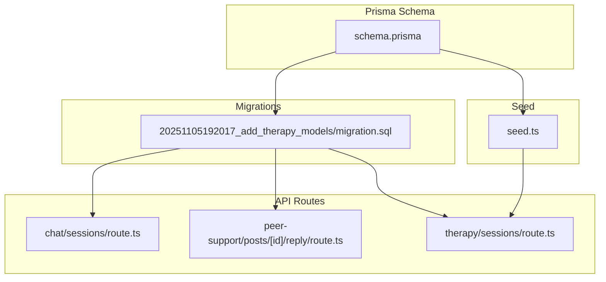
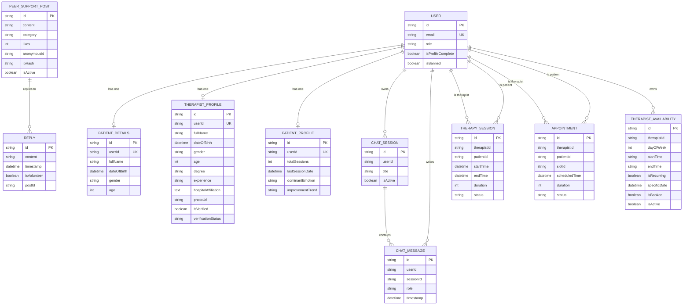
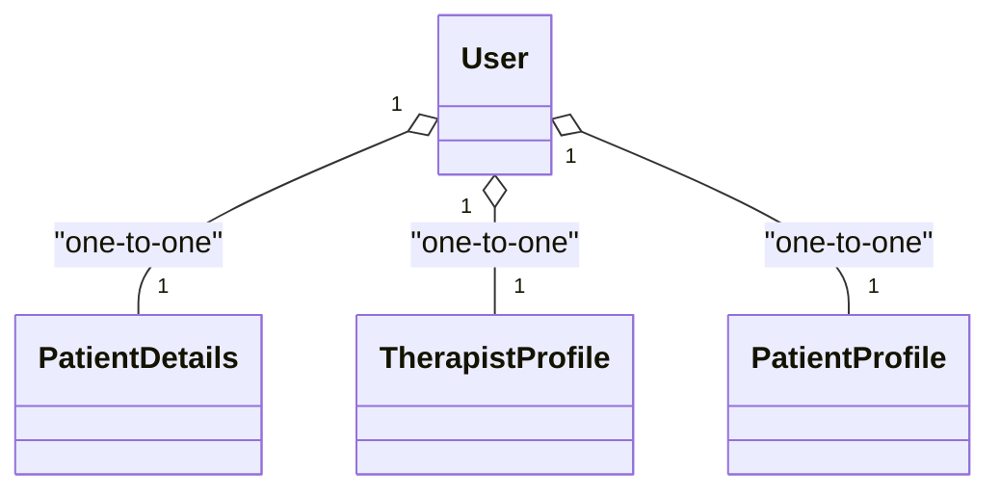
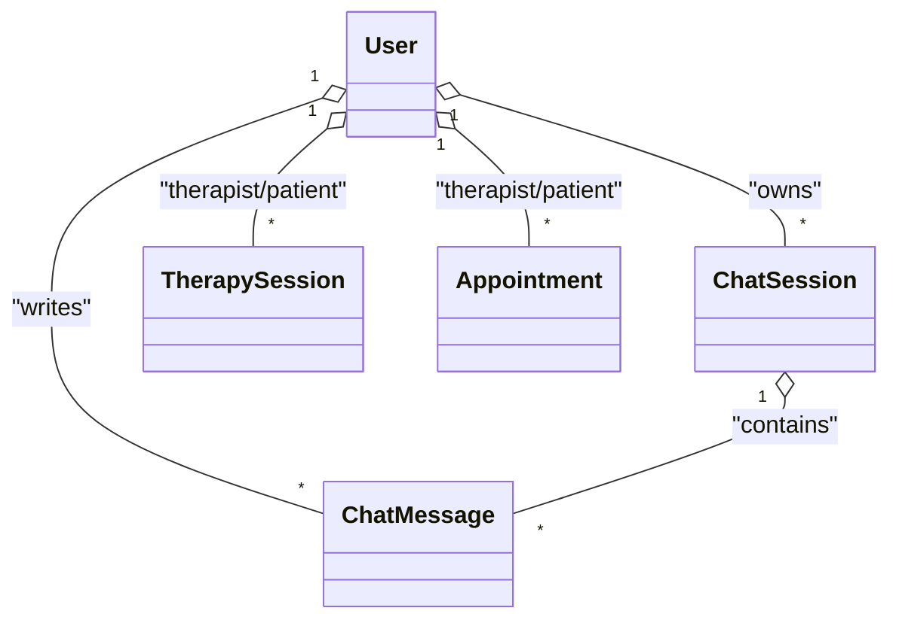
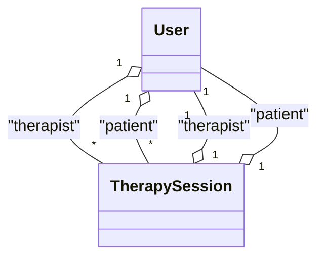
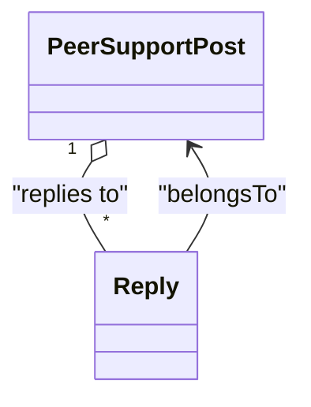
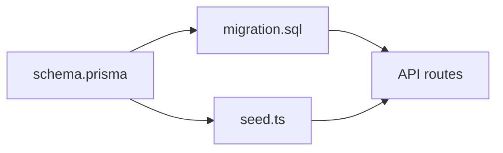

# Entity Relationships

<cite>
**Referenced Files in This Document**
- [schema.prisma](file://WEBAPP/prisma/schema.prisma)
- [migration.sql](file://WEBAPP/prisma/migrations/20251105192017_add_therapy_models/migration.sql)
- [seed.ts](file://WEBAPP/prisma/seed.ts)
- [sessions.route.ts](file://WEBAPP/src/app/api/chat/sessions/route.ts)
- [reply.route.ts](file://WEBAPP/src/app/api/peer-support/posts/[id]/reply/route.ts)
- [therapy.sessions.route.ts](file://WEBAPP/src/app/api/therapy/sessions/route.ts)
</cite>

## Table of Contents
1. [Introduction](#introduction)
2. [Project Structure](#project-structure)
3. [Core Components](#core-components)
4. [Architecture Overview](#architecture-overview)
5. [Detailed Component Analysis](#detailed-component-analysis)
6. [Dependency Analysis](#dependency-analysis)
7. [Performance Considerations](#performance-considerations)
8. [Troubleshooting Guide](#troubleshooting-guide)
9. [Conclusion](#conclusion)

## Introduction
This document explains the entity relationships and associations in the MindBridge database. It focuses on:
- One-to-one relationships (e.g., PatientDetails–PatientProfile via User)
- One-to-many relationships (e.g., User–ChatSessions, User–TherapySessions)
- Many-to-many through relations (e.g., Therapist–Patient sessions via TherapySession)
- Self-referencing relationships (e.g., Reply–PeerSupportPost)
- Foreign key constraints, cascade behaviors, and referential integrity rules
- Relationship naming conventions and Prisma relation syntax

## Project Structure
The database schema is defined in Prisma’s declarative schema and enforced by generated migrations. The relevant files are:
- Prisma schema: defines models, relations, and constraints
- Migration SQL: creates tables and enforces foreign keys and indexes
- Seed script: demonstrates many-to-many usage and one-to-one creation
- API routes: show runtime usage of relationships

**Diagram sources**
- [schema.prisma](file://WEBAPP/prisma/schema.prisma#L1-L330)
- [migration.sql](file://WEBAPP/prisma/migrations/20251105192017_add_therapy_models/migration.sql#L1-L206)
- [seed.ts](file://WEBAPP/prisma/seed.ts#L1-L168)
- [sessions.route.ts](file://WEBAPP/src/app/api/chat/sessions/route.ts#L1-L187)
- [reply.route.ts](file://WEBAPP/src/app/api/peer-support/posts/[id]/reply/route.ts#L1-L100)
- [therapy.sessions.route.ts](file://WEBAPP/src/app/api/therapy/sessions/route.ts#L1-L80)

**Section sources**
- [schema.prisma](file://WEBAPP/prisma/schema.prisma#L1-L330)
- [migration.sql](file://WEBAPP/prisma/migrations/20251105192017_add_therapy_models/migration.sql#L1-L206)
- [seed.ts](file://WEBAPP/prisma/seed.ts#L1-L168)
- [sessions.route.ts](file://WEBAPP/src/app/api/chat/sessions/route.ts#L1-L187)
- [reply.route.ts](file://WEBAPP/src/app/api/peer-support/posts/[id]/reply/route.ts#L1-L100)
- [therapy.sessions.route.ts](file://WEBAPP/src/app/api/therapy/sessions/route.ts#L1-L80)

## Core Components
- User: central identity with role-based access (patient, therapist, admin). Has one-to-one profiles and one-to-many relationships to chats, therapy sessions, and appointments.
- PatientDetails and PatientProfile: one-to-one via User (each user has at most one of each).
- TherapySession: many-to-many between User (as therapist and patient) via dual foreign keys.
- Appointment: links User (therapist and patient) and optionally TherapistAvailability (slot).
- ChatSession and ChatMessage: one-to-many User–ChatSession and optional one-to-many ChatSession–ChatMessage.
- PeerSupportPost and Reply: one-to-many Post–Reply with self-referencing behavior via nested writes.

**Section sources**
- [schema.prisma](file://WEBAPP/prisma/schema.prisma#L39-L69)
- [schema.prisma](file://WEBAPP/prisma/schema.prisma#L282-L321)
- [schema.prisma](file://WEBAPP/prisma/schema.prisma#L140-L161)
- [schema.prisma](file://WEBAPP/prisma/schema.prisma#L186-L211)
- [schema.prisma](file://WEBAPP/prisma/schema.prisma#L108-L138)
- [schema.prisma](file://WEBAPP/prisma/schema.prisma#L79-L106)

## Architecture Overview
The schema enforces referential integrity through foreign keys and Prisma relations. Runtime APIs demonstrate how relationships are queried and created.

**Diagram sources**
- [schema.prisma](file://WEBAPP/prisma/schema.prisma#L39-L69)
- [schema.prisma](file://WEBAPP/prisma/schema.prisma#L282-L321)
- [schema.prisma](file://WEBAPP/prisma/schema.prisma#L108-L138)
- [schema.prisma](file://WEBAPP/prisma/schema.prisma#L79-L106)
- [schema.prisma](file://WEBAPP/prisma/schema.prisma#L140-L161)
- [schema.prisma](file://WEBAPP/prisma/schema.prisma#L186-L211)
- [schema.prisma](file://WEBAPP/prisma/schema.prisma#L163-L184)

## Detailed Component Analysis

### One-to-One Relationships
- PatientDetails–User: one-to-one via unique userId foreign key; deletion cascades.
- TherapistProfile–User: one-to-one via unique userId foreign key; deletion cascades.
- PatientProfile–User: one-to-one via unique userId foreign key; deletion cascades.

**Diagram sources**
- [schema.prisma](file://WEBAPP/prisma/schema.prisma#L282-L321)

**Section sources**
- [schema.prisma](file://WEBAPP/prisma/schema.prisma#L282-L321)
- [migration.sql](file://WEBAPP/prisma/migrations/20251105192017_add_therapy_models/migration.sql#L174-L205)

### One-to-Many Relationships
- User–ChatSession: one user owns many sessions; deletion cascades.
- User–ChatMessage: one user writes many messages; deletion cascades.
- User–TherapySession: one user can be therapist or patient in many sessions; deletion cascades.
- User–Appointment: one user can be therapist or patient in many appointments; deletion cascades.
- ChatSession–ChatMessage: one session contains many messages; deletion cascades.

**Diagram sources**
- [schema.prisma](file://WEBAPP/prisma/schema.prisma#L108-L138)
- [schema.prisma](file://WEBAPP/prisma/schema.prisma#L140-L161)
- [schema.prisma](file://WEBAPP/prisma/schema.prisma#L186-L211)

**Section sources**
- [schema.prisma](file://WEBAPP/prisma/schema.prisma#L108-L138)
- [schema.prisma](file://WEBAPP/prisma/schema.prisma#L140-L161)
- [schema.prisma](file://WEBAPP/prisma/schema.prisma#L186-L211)
- [migration.sql](file://WEBAPP/prisma/migrations/20251105192017_add_therapy_models/migration.sql#L183-L190)

### Many-to-Many Through Relations
- Therapist–Patient sessions via TherapySession: dual foreign keys (therapistId, patientId) create a many-to-many relationship through the join table.

**Diagram sources**
- [schema.prisma](file://WEBAPP/prisma/schema.prisma#L140-L161)

**Section sources**
- [schema.prisma](file://WEBAPP/prisma/schema.prisma#L140-L161)
- [seed.ts](file://WEBAPP/prisma/seed.ts#L100-L146)

### Self-Referencing Relationship
- Reply–PeerSupportPost: Reply.postId references PeerSupportPost.id; deletion cascades.

**Diagram sources**
- [schema.prisma](file://WEBAPP/prisma/schema.prisma#L79-L106)

**Section sources**
- [schema.prisma](file://WEBAPP/prisma/schema.prisma#L79-L106)
- [migration.sql](file://WEBAPP/prisma/migrations/20251105192017_add_therapy_models/migration.sql#L180-L181)

### Relationship Naming Conventions and Prisma Relation Syntax
- Named relations: explicit relation names are used for clarity (e.g., “PatientSessions”, “TherapistSessions”, “SlotAppointments”).
- Field-level foreign keys: Prisma’s @relation(fields:[...], references:[...]) explicitly maps foreign keys.
- Deletion behavior: onDelete: Cascade or onDelete: SetNull are used depending on whether the relation is mandatory or optional.

Examples from the schema:
- Named relations on User for TherapySession and Appointment
- Named relations on Appointment for SlotAppointments
- Field-level foreign keys with onDelete behavior

**Section sources**
- [schema.prisma](file://WEBAPP/prisma/schema.prisma#L59-L63)
- [schema.prisma](file://WEBAPP/prisma/schema.prisma#L143-L145)
- [schema.prisma](file://WEBAPP/prisma/schema.prisma#L189-L194)

### Foreign Keys, Cascade Behaviors, and Referential Integrity
- User–Account and User–Session: onDelete: Cascade ensures child records are removed when a user is deleted.
- PeerSupportPost–Reply: onDelete: Cascade ensures replies are removed when a post is deleted.
- ChatSession–ChatMessage: onDelete: Cascade for both user and session foreign keys.
- TherapySession: onDelete: Cascade for both therapist and patient foreign keys.
- Appointment: onDelete: Cascade for therapist and patient; onDelete: SetNull for optional slotId.
- PatientProfile: onDelete: Cascade for userId.

These constraints are declared in both Prisma schema and enforced by migration SQL.

**Section sources**
- [schema.prisma](file://WEBAPP/prisma/schema.prisma#L25-L36)
- [schema.prisma](file://WEBAPP/prisma/schema.prisma#L102-L130)
- [schema.prisma](file://WEBAPP/prisma/schema.prisma#L143-L146)
- [schema.prisma](file://WEBAPP/prisma/schema.prisma#L189-L194)
- [schema.prisma](file://WEBAPP/prisma/schema.prisma#L216-L217)
- [migration.sql](file://WEBAPP/prisma/migrations/20251105192017_add_therapy_models/migration.sql#L174-L205)

### Runtime Usage Patterns
- Chat sessions: API fetches and creates sessions linked to the authenticated user.
- Replies: API creates nested replies under a post, leveraging Prisma’s nested write.
- Therapy sessions: API filters sessions by therapistId or patientId and includes related user details.

**Section sources**
- [sessions.route.ts](file://WEBAPP/src/app/api/chat/sessions/route.ts#L22-L35)
- [reply.route.ts](file://WEBAPP/src/app/api/peer-support/posts/[id]/reply/route.ts#L44-L62)
- [therapy.sessions.route.ts](file://WEBAPP/src/app/api/therapy/sessions/route.ts#L24-L35)

## Dependency Analysis
The relationships depend on:
- Prisma schema for modeling and relation names
- Migration SQL for foreign key enforcement and indexes
- Seed script for demonstrating many-to-many and one-to-one creation
- API routes for runtime usage of relationships

**Diagram sources**
- [schema.prisma](file://WEBAPP/prisma/schema.prisma#L1-L330)
- [migration.sql](file://WEBAPP/prisma/migrations/20251105192017_add_therapy_models/migration.sql#L1-L206)
- [seed.ts](file://WEBAPP/prisma/seed.ts#L1-L168)
- [sessions.route.ts](file://WEBAPP/src/app/api/chat/sessions/route.ts#L1-L187)
- [reply.route.ts](file://WEBAPP/src/app/api/peer-support/posts/[id]/reply/route.ts#L1-L100)
- [therapy.sessions.route.ts](file://WEBAPP/src/app/api/therapy/sessions/route.ts#L1-L80)

**Section sources**
- [schema.prisma](file://WEBAPP/prisma/schema.prisma#L1-L330)
- [migration.sql](file://WEBAPP/prisma/migrations/20251105192017_add_therapy_models/migration.sql#L1-L206)
- [seed.ts](file://WEBAPP/prisma/seed.ts#L1-L168)
- [sessions.route.ts](file://WEBAPP/src/app/api/chat/sessions/route.ts#L1-L187)
- [reply.route.ts](file://WEBAPP/src/app/api/peer-support/posts/[id]/reply/route.ts#L1-L100)
- [therapy.sessions.route.ts](file://WEBAPP/src/app/api/therapy/sessions/route.ts#L1-L80)

## Performance Considerations
- Indexes on foreign keys and frequently filtered columns improve query performance (e.g., ChatSession(userId), ChatMessage(sessionId), TherapySession(therapistId, patientId)).
- Denormalized fields (e.g., PatientProfile totals) reduce joins for analytics.
- Prefer selective includes and where clauses in API routes to limit payload size.

[No sources needed since this section provides general guidance]

## Troubleshooting Guide
Common issues and resolutions:
- Deleting a user deletes related records due to cascade rules; confirm cascade behavior aligns with business logic.
- Attempting to create a reply without an existing post results in a not-found error; ensure post existence before nested create.
- Creating therapy sessions requires both therapistId and patientId; missing fields cause validation errors.

**Section sources**
- [migration.sql](file://WEBAPP/prisma/migrations/20251105192017_add_therapy_models/migration.sql#L174-L205)
- [reply.route.ts](file://WEBAPP/src/app/api/peer-support/posts/[id]/reply/route.ts#L35-L42)
- [therapy.sessions.route.ts](file://WEBAPP/src/app/api/therapy/sessions/route.ts#L52-L56)

## Conclusion
MindBridge’s schema models a robust healthcare ecosystem with clear role-based relationships:
- One-to-one profiles per user
- One-to-many ownership of sessions and messages
- Many-to-many between therapists and patients via TherapySession
- Self-referencing replies under peer support posts
- Explicit Prisma relation names and field-level foreign keys with well-defined cascade behaviors ensure referential integrity and predictable data lifecycle.