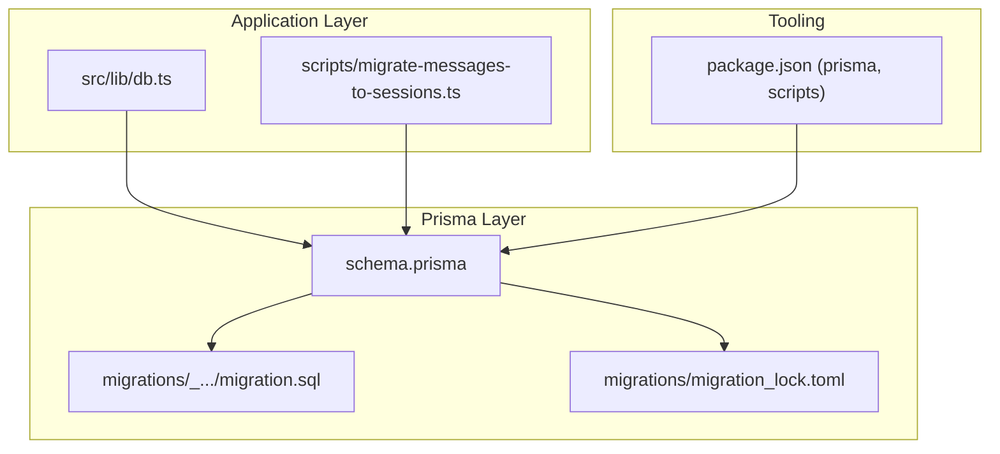
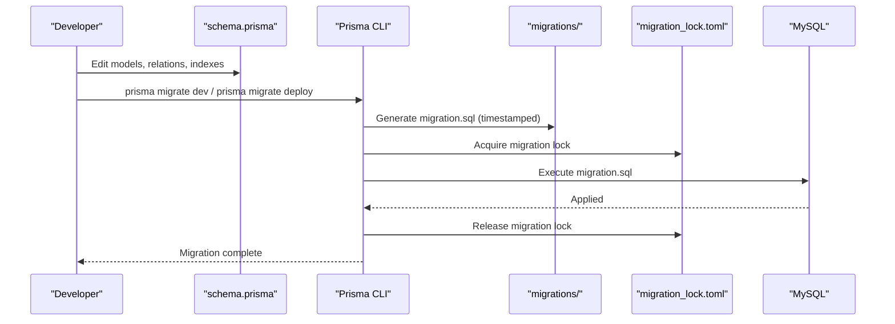
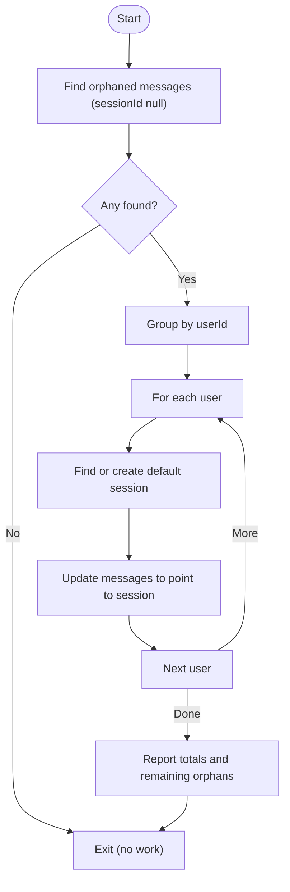
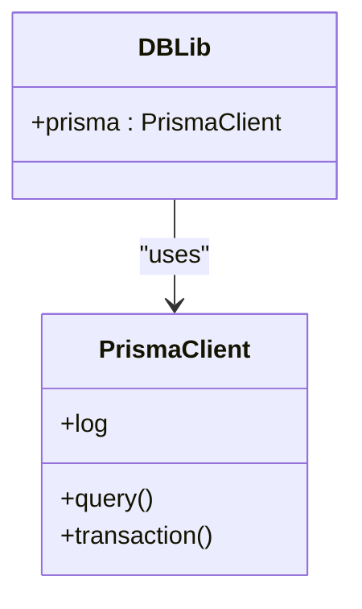
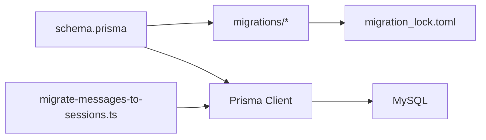

# Migration Strategies

<cite>
**Referenced Files in This Document**
- [schema.prisma](file://WEBAPP/prisma/schema.prisma)
- [migration_lock.toml](file://WEBAPP/prisma/migrations/migration_lock.toml)
- [migration.sql](file://WEBAPP/prisma/migrations/20251105192017_add_therapy_models/migration.sql)
- [migrate-messages-to-sessions.ts](file://WEBAPP/scripts/migrate-messages-to-sessions.ts)
- [db.ts](file://WEBAPP/src/lib/db.ts)
- [package.json](file://WEBAPP/package.json)
- [README.md](file://README.md)
</cite>

## Table of Contents
1. [Introduction](#introduction)
2. [Project Structure](#project-structure)
3. [Core Components](#core-components)
4. [Architecture Overview](#architecture-overview)
5. [Detailed Component Analysis](#detailed-component-analysis)
6. [Dependency Analysis](#dependency-analysis)
7. [Performance Considerations](#performance-considerations)
8. [Troubleshooting Guide](#troubleshooting-guide)
9. [Conclusion](#conclusion)

## Introduction
This document explains Prisma migration strategies and database evolution in MindBridge. It covers the declarative schema-first approach, migration file structure and versioning, SQL generation, deployment workflows, and practical data migration scripts. It also provides best practices for healthcare applications, including data preservation, constraint validation, production safety, migration locks, collaborative development, and troubleshooting.

## Project Structure
MindBridge uses Prisma’s schema-driven migrations for MySQL. The schema defines models and relations, while migrations are stored under the Prisma directory. A dedicated migration script handles data-only transformations that cannot be expressed in the schema alone.

**Diagram sources**
- [schema.prisma](file://WEBAPP/prisma/schema.prisma#L1-L330)
- [migration_lock.toml](file://WEBAPP/prisma/migrations/migration_lock.toml#L1-L4)
- [migration.sql](file://WEBAPP/prisma/migrations/20251105192017_add_therapy_models/migration.sql#L1-L200)
- [migrate-messages-to-sessions.ts](file://WEBAPP/scripts/migrate-messages-to-sessions.ts#L1-L141)
- [db.ts](file://WEBAPP/src/lib/db.ts#L1-L14)
- [package.json](file://WEBAPP/package.json#L1-L88)

**Section sources**
- [schema.prisma](file://WEBAPP/prisma/schema.prisma#L1-L330)
- [migration_lock.toml](file://WEBAPP/prisma/migrations/migration_lock.toml#L1-L4)
- [migration.sql](file://WEBAPP/prisma/migrations/20251105192017_add_therapy_models/migration.sql#L1-L200)
- [migrate-messages-to-sessions.ts](file://WEBAPP/scripts/migrate-messages-to-sessions.ts#L1-L141)
- [db.ts](file://WEBAPP/src/lib/db.ts#L1-L14)
- [package.json](file://WEBAPP/package.json#L1-L88)

## Core Components
- Prisma schema: Declares models, relations, indexes, and constraints. It is the single source of truth for database structure.
- Migrations: Generated SQL files representing incremental changes to the database. They are versioned by timestamp prefixes.
- Migration lock: A marker file indicating migration activity and preventing concurrent operations.
- Data migration script: A one-time or occasional script to move or transform data when schema changes require it.
- Application client: The Prisma Client connection used by the app to apply migrations and query the database.

Key responsibilities:
- schema.prisma: Define entities and relationships; drive Prisma Migrate.
- migrations: Persist schema diffs as SQL; track applied changes.
- migration_lock.toml: Prevent concurrent migration runs.
- migrate-messages-to-sessions.ts: Apply data-only changes after schema updates.
- db.ts: Provide a shared Prisma Client instance to the app.

**Section sources**
- [schema.prisma](file://WEBAPP/prisma/schema.prisma#L1-L330)
- [migration_lock.toml](file://WEBAPP/prisma/migrations/migration_lock.toml#L1-L4)
- [migration.sql](file://WEBAPP/prisma/migrations/20251105192017_add_therapy_models/migration.sql#L1-L200)
- [migrate-messages-to-sessions.ts](file://WEBAPP/scripts/migrate-messages-to-sessions.ts#L1-L141)
- [db.ts](file://WEBAPP/src/lib/db.ts#L1-L14)

## Architecture Overview
The migration workflow follows a schema-first approach: change the schema, generate SQL via Prisma Migrate, review, and deploy. For data-only changes, run a dedicated script against the target database.

**Diagram sources**
- [schema.prisma](file://WEBAPP/prisma/schema.prisma#L1-L330)
- [migration_lock.toml](file://WEBAPP/prisma/migrations/migration_lock.toml#L1-L4)
- [migration.sql](file://WEBAPP/prisma/migrations/20251105192017_add_therapy_models/migration.sql#L1-L200)

## Detailed Component Analysis

### Prisma Schema and Indexes
The schema defines models and indexes. Indexes are declared per-model to optimize queries on frequently filtered or joined columns. Examples include user identifiers, timestamps, and composite keys.

Highlights:
- Unique and composite indexes are declared explicitly to enforce constraints and speed up lookups.
- Relations define foreign keys and cascades, ensuring referential integrity.
- JSON fields store structured analytics and metadata.

Best practices derived from the schema:
- Add indexes for columns used in WHERE clauses and JOINs.
- Keep unique constraints for sensitive identifiers (e.g., email).
- Use relation directives to maintain referential integrity.

**Section sources**
- [schema.prisma](file://WEBAPP/prisma/schema.prisma#L1-L330)

### Migration File Structure and Versioning
Prisma migrations are timestamped directories containing a migration.sql file. The directory name encodes a timestamp to ensure ordering. The migration_lock.toml file prevents concurrent migration runs.

Structure:
- migrations/<timestamp>_.../
  - migration.sql
- migrations/migration_lock.toml

Versioning:
- Timestamp prefix ensures deterministic order.
- Each diff produces a new migration directory.

Lock mechanism:
- migration_lock.toml indicates provider and prevents concurrent operations.

**Section sources**
- [migration_lock.toml](file://WEBAPP/prisma/migrations/migration_lock.toml#L1-L4)
- [migration.sql](file://WEBAPP/prisma/migrations/20251105192017_add_therapy_models/migration.sql#L1-L200)

### Data Migration Script: Orphaned Messages to Sessions
A custom script migrates legacy chat messages into default sessions after introducing session support. It:
- Finds orphaned messages (without sessionId).
- Groups by user.
- Creates or reuses a default session per user.
- Updates messages to point to the session.
- Reports counts before and after.

**Diagram sources**
- [migrate-messages-to-sessions.ts](file://WEBAPP/scripts/migrate-messages-to-sessions.ts#L1-L141)

**Section sources**
- [migrate-messages-to-sessions.ts](file://WEBAPP/scripts/migrate-messages-to-sessions.ts#L1-L141)

### Prisma Client Integration
The application uses a shared Prisma Client instance configured with environment-specific logging. This instance is used by the app to connect to the database and apply migrations.

**Diagram sources**
- [db.ts](file://WEBAPP/src/lib/db.ts#L1-L14)

**Section sources**
- [db.ts](file://WEBAPP/src/lib/db.ts#L1-L14)

### Package Scripts and Seed
The project defines a seed script for initial data population and includes Prisma as a dev dependency. While migration commands are not explicitly listed in scripts, the presence of Prisma and the seed script indicates a schema-driven workflow.

**Section sources**
- [package.json](file://WEBAPP/package.json#L1-L88)

## Dependency Analysis
- schema.prisma depends on the datasource provider (MySQL) and drives migration generation.
- migrations depend on schema.prisma diffs and are applied in timestamp order.
- migration_lock.toml protects concurrent operations.
- migrate-messages-to-sessions.ts depends on Prisma Client and schema-defined relations.
- db.ts provides the Prisma Client used by the app.

**Diagram sources**
- [schema.prisma](file://WEBAPP/prisma/schema.prisma#L1-L330)
- [migration_lock.toml](file://WEBAPP/prisma/migrations/migration_lock.toml#L1-L4)
- [migration.sql](file://WEBAPP/prisma/migrations/20251105192017_add_therapy_models/migration.sql#L1-L200)
- [migrate-messages-to-sessions.ts](file://WEBAPP/scripts/migrate-messages-to-sessions.ts#L1-L141)
- [db.ts](file://WEBAPP/src/lib/db.ts#L1-L14)

**Section sources**
- [schema.prisma](file://WEBAPP/prisma/schema.prisma#L1-L330)
- [migration_lock.toml](file://WEBAPP/prisma/migrations/migration_lock.toml#L1-L4)
- [migration.sql](file://WEBAPP/prisma/migrations/20251105192017_add_therapy_models/migration.sql#L1-L200)
- [migrate-messages-to-sessions.ts](file://WEBAPP/scripts/migrate-messages-to-sessions.ts#L1-L141)
- [db.ts](file://WEBAPP/src/lib/db.ts#L1-L14)

## Performance Considerations
- Indexes: The schema declares multiple indexes to optimize reads. Ensure new columns used in filters or joins receive appropriate indexes.
- Composite indexes: Consider composite indexes for frequent multi-column filters (e.g., user-date combinations).
- Batch operations: Prefer batch updates in data migration scripts to minimize round-trips.
- Logging: Adjust Prisma Client log levels in development to monitor slow queries without impacting production.

[No sources needed since this section provides general guidance]

## Troubleshooting Guide
Common issues and resolutions:
- Migration lock conflicts: If migration_lock.toml exists, remove it only after verifying no migration is running. Re-run the migration command.
- Failed migration: Review the generated migration.sql for errors. Fix schema inconsistencies and retry.
- Data-only changes: Use the provided data migration script to handle pre-existing data after schema changes.
- Production safety: Always preview and review migration.sql before applying. Back up the database prior to production deployment.
- Collaborative development: Treat migrations as code; review diffs in pull requests. Avoid editing applied migrations.

**Section sources**
- [migration_lock.toml](file://WEBAPP/prisma/migrations/migration_lock.toml#L1-L4)
- [migration.sql](file://WEBAPP/prisma/migrations/20251105192017_add_therapy_models/migration.sql#L1-L200)
- [migrate-messages-to-sessions.ts](file://WEBAPP/scripts/migrate-messages-to-sessions.ts#L1-L141)

## Conclusion
MindBridge employs a robust, schema-first migration strategy with Prisma. The combination of declarative schema, timestamped SQL migrations, a migration lock, and targeted data migration scripts enables safe, reproducible database evolution. For healthcare systems, this approach supports data integrity, auditability, and controlled deployments—key requirements for compliance and reliability.

[No sources needed since this section summarizes without analyzing specific files]