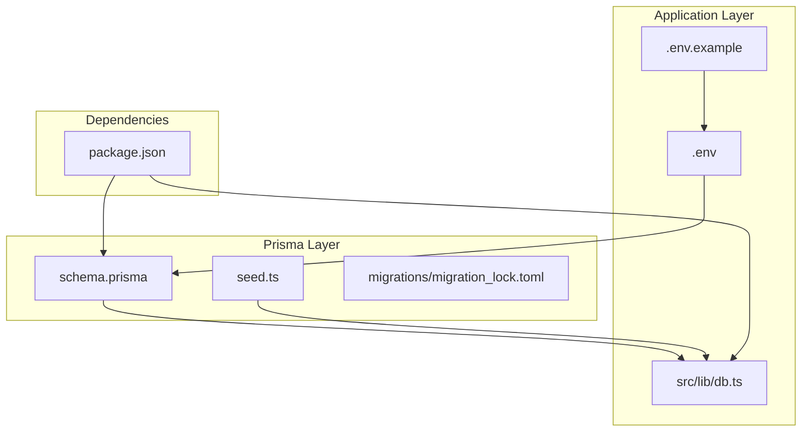
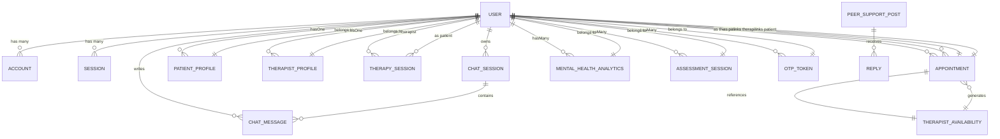
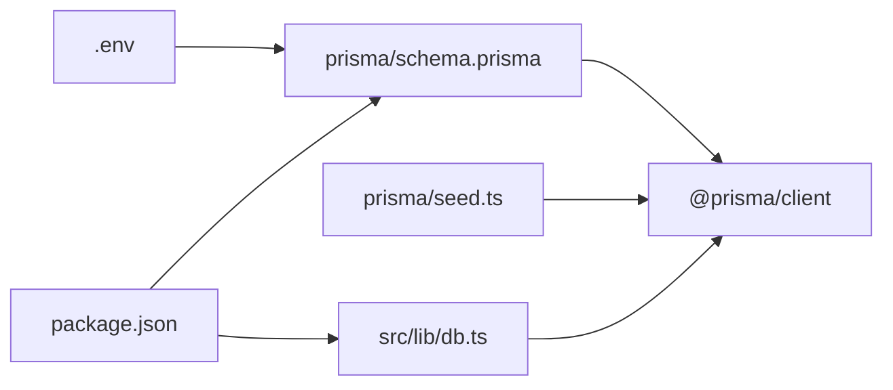

# Prisma Schema Definition

<cite>
**Referenced Files in This Document**
- [schema.prisma](file://WEBAPP/prisma/schema.prisma)
- [.env](file://WEBAPP/.env)
- [.env.example](file://WEBAPP/.env.example)
- [seed.ts](file://WEBAPP/prisma/seed.ts)
- [db.ts](file://WEBAPP/src/lib/db.ts)
- [package.json](file://WEBAPP/package.json)
- [migration_lock.toml](file://WEBAPP/prisma/migrations/migration_lock.toml)
</cite>

## Table of Contents
1. [Introduction](#introduction)
2. [Project Structure](#project-structure)
3. [Core Components](#core-components)
4. [Architecture Overview](#architecture-overview)
5. [Detailed Component Analysis](#detailed-component-analysis)
6. [Dependency Analysis](#dependency-analysis)
7. [Performance Considerations](#performance-considerations)
8. [Troubleshooting Guide](#troubleshooting-guide)
9. [Conclusion](#conclusion)
10. [Appendices](#appendices)

## Introduction
This document provides comprehensive documentation for the Prisma schema used in MindBridge. It explains the complete schema structure across 20+ models, including Users, Accounts, Sessions, Chat, Therapy, Patient Profiles, Mental Health Analytics, Peer Support, and administrative entities. It details field definitions, data types, constraints, and relationships between entities. It also covers Prisma-specific configurations such as generators, datasources, and unique/index specifications, along with environment variable usage for MySQL, and practical guidance for schema evolution, versioning, and best practices for healthcare data modeling.

## Project Structure
The Prisma schema resides under the Next.js application’s prisma directory and integrates with the application via a dedicated Prisma client initialization module. Seed scripts are included to bootstrap test data. Environment variables define the database connection and other integrations.

**Diagram sources**
- [schema.prisma](file://WEBAPP/prisma/schema.prisma#L1-L330)
- [seed.ts](file://WEBAPP/prisma/seed.ts#L1-L168)
- [migration_lock.toml](file://WEBAPP/prisma/migrations/migration_lock.toml#L1-L4)
- [db.ts](file://WEBAPP/src/lib/db.ts#L1-L15)
- [.env](file://WEBAPP/.env#L1-L31)
- [.env.example](file://WEBAPP/.env.example#L1-L16)
- [package.json](file://WEBAPP/package.json#L1-L88)

**Section sources**
- [schema.prisma](file://WEBAPP/prisma/schema.prisma#L1-L330)
- [db.ts](file://WEBAPP/src/lib/db.ts#L1-L15)
- [.env](file://WEBAPP/.env#L1-L31)
- [.env.example](file://WEBAPP/.env.example#L1-L16)
- [package.json](file://WEBAPP/package.json#L1-L88)

## Core Components
This section outlines the primary Prisma models and their roles within the MindBridge ecosystem. Each model is described by its purpose, key fields, data types, and constraints.

- Generator and Datasource
  - Provider: prisma-client-js
  - Datasource: MySQL
  - URL: DATABASE_URL environment variable

- NextAuth Models
  - Account: OAuth account records with provider-specific identifiers and tokens
  - Session: Session tokens bound to users
  - User: Core identity with role, profile completeness, and relations to other entities
  - VerificationToken: One-time tokens for email verification

- Peer Support Models
  - PeerSupportPost: Community posts with categories, likes, and replies
  - Reply: Replies to posts with timestamps and optional volunteer tagging

- Chat Models
  - ChatSession: Channels associated with users and activity flags
  - ChatMessage: Messages with roles, content, and metadata

- Therapy Models
  - TherapySession: Scheduled sessions between therapists and patients with status and analytics
  - TherapistAvailability: Recurring or one-off availability slots
  - Appointment: Booked sessions linking users, slots, and scheduling metadata

- Patient and Profile Models
  - PatientProfile: Aggregate analytics and trends per user
  - MentalHealthAnalytics: Daily computed metrics per user
  - AssessmentSession: Screening assessments with scored answers
  - OtpToken: Temporary tokens for password reset
  - PatientDetails: Demographics collected during initial registration
  - TherapistProfile: Verified professional profiles with hospital affiliations
  - AdminUser: Administrative credentials for backend management

Constraints and indexes are defined per model to ensure referential integrity and efficient querying. Unique constraints apply to provider-account combinations, session tokens, user emails, and more.

**Section sources**
- [schema.prisma](file://WEBAPP/prisma/schema.prisma#L1-L330)

## Architecture Overview
The Prisma schema defines a cohesive relational model for MindBridge. The architecture emphasizes:
- Strong user identity with role-based access
- Secure authentication via NextAuth-compatible models
- Structured chat and therapy workflows
- Healthcare-focused analytics and assessment
- Scalable peer support community features

**Diagram sources**
- [schema.prisma](file://WEBAPP/prisma/schema.prisma#L11-L330)

## Detailed Component Analysis

### Authentication and Identity Models
- Account
  - Purpose: Store OAuth provider credentials and tokens
  - Constraints: Unique provider/providerAccountId
  - Relation: Belongs to User
- Session
  - Purpose: Manage session tokens for authenticated access
  - Constraints: Unique sessionToken
  - Relation: Belongs to User
- User
  - Purpose: Central identity with role, profile completion, and ban flag
  - Relations: Accounts, Sessions, ChatSessions, ChatMessages, PatientProfile, TherapistProfile, TherapySessions, Appointments, Availability, MentalHealthAnalytics, AssessmentSessions, OtpTokens
- VerificationToken
  - Purpose: One-time tokens for email verification
  - Constraints: Composite unique(identifier, token)

Best practices:
- Use @id @default(cuid()) for globally unique identifiers
- Apply onDelete Cascade for referential cleanup where appropriate
- Keep sensitive fields encrypted or tokenized

**Section sources**
- [schema.prisma](file://WEBAPP/prisma/schema.prisma#L11-L77)

### Peer Support Models
- PeerSupportPost
  - Purpose: Community posts with categorization and engagement metrics
  - Indexes: category, createdAt
  - Relations: Replies
- Reply
  - Purpose: Responses to posts with optional volunteer tagging
  - Index: postId
  - Relations: Post

Operational notes:
- Anonymous identifiers and IP hashing help protect privacy
- Indexes optimize filtering and chronological retrieval

**Section sources**
- [schema.prisma](file://WEBAPP/prisma/schema.prisma#L79-L106)

### Chat Models
- ChatSession
  - Purpose: Logical grouping of conversations per user
  - Indexes: userId, createdAt
  - Relations: Messages
- ChatMessage
  - Purpose: Individual messages with roles and metadata
  - Indexes: userId, sessionId, timestamp
  - Relations: Session

Privacy and performance:
- Metadata JSON enables extensibility for emotion and context tagging
- Timestamp indexing supports real-time chat queries

**Section sources**
- [schema.prisma](file://WEBAPP/prisma/schema.prisma#L108-L138)

### Therapy Workflow Models
- TherapySession
  - Purpose: Track scheduled, active, completed, or cancelled sessions
  - Indexes: therapistId, patientId, status, startTime
  - Relations: Patient and Therapist (via User)
- TherapistAvailability
  - Purpose: Define recurring or one-off availability windows
  - Indexes: therapistId, dayOfWeek, isBooked, isActive, specificDate
  - Relations: Appointments
- Appointment
  - Purpose: Booked sessions with scheduling and reminders
  - Indexes: therapistId, patientId, slotId, status, scheduledTime, reminderSent
  - Relations: Slot (TherapistAvailability), Patient, Therapist

Workflow considerations:
- Status lifecycle management ensures accurate reporting
- ReminderSent flag supports external notification systems

**Section sources**
- [schema.prisma](file://WEBAPP/prisma/schema.prisma#L140-L211)

### Patient and Profile Models
- PatientProfile
  - Purpose: Aggregate session counts, last session date, dominant emotion, and trend
  - Index: userId
  - Relations: User
- MentalHealthAnalytics
  - Purpose: Daily computed metrics including severity levels and keyword analytics
  - Indexes: userId, date, composite(userId, date)
  - Relations: User
- AssessmentSession
  - Purpose: Screenings with scored answers and computed levels
  - Indexes: userId, completedAt
  - Relations: User
- OtpToken
  - Purpose: Temporary tokens for secure password resets
  - Indexes: userId, otp
  - Relations: User
- PatientDetails
  - Purpose: Demographic data collected during registration
  - Index: userId
  - Relations: User
- TherapistProfile
  - Purpose: Verified professional profiles with hospital affiliations and verification status
  - Indexes: userId, isVerified, verificationStatus
  - Relations: User
- AdminUser
  - Purpose: Administrative credentials for backend operations
  - Constraints: Unique adminId

**Section sources**
- [schema.prisma](file://WEBAPP/prisma/schema.prisma#L213-L330)

### Prisma Configuration and Environment Variables
- Generator
  - Provider: prisma-client-js
- Datasource
  - Provider: mysql
  - URL: DATABASE_URL environment variable
- Environment Variables
  - DATABASE_URL: MySQL connection string
  - NEXTAUTH_URL and NEXTAUTH_SECRET: NextAuth configuration
  - Optional: Google Calendar, Email, Stripe, AI/ML backend URLs

Initialization
- PrismaClient is initialized in the application with development logging enabled conditionally

**Section sources**
- [schema.prisma](file://WEBAPP/prisma/schema.prisma#L1-L9)
- [.env](file://WEBAPP/.env#L1-L31)
- [.env.example](file://WEBAPP/.env.example#L1-L16)
- [db.ts](file://WEBAPP/src/lib/db.ts#L1-L15)

### Migration and Seeding
- Migration Lock
  - Confirms provider is MySQL
- Seeding
  - Creates test users, patient profiles, therapy sessions, and appointments
  - Demonstrates upsert patterns and hashed passwords

**Section sources**
- [migration_lock.toml](file://WEBAPP/prisma/migrations/migration_lock.toml#L1-L4)
- [seed.ts](file://WEBAPP/prisma/seed.ts#L1-L168)
- [package.json](file://WEBAPP/package.json#L12-L14)

## Dependency Analysis
This section maps Prisma’s internal dependencies and runtime integration.

**Diagram sources**
- [schema.prisma](file://WEBAPP/prisma/schema.prisma#L1-L330)
- [seed.ts](file://WEBAPP/prisma/seed.ts#L1-L168)
- [db.ts](file://WEBAPP/src/lib/db.ts#L1-L15)
- [.env](file://WEBAPP/.env#L1-L31)
- [package.json](file://WEBAPP/package.json#L1-L88)

**Section sources**
- [schema.prisma](file://WEBAPP/prisma/schema.prisma#L1-L330)
- [db.ts](file://WEBAPP/src/lib/db.ts#L1-L15)
- [package.json](file://WEBAPP/package.json#L1-L88)

## Performance Considerations
- Indexes
  - Strategic indexes on foreign keys and frequently queried fields improve join and filter performance
  - Composite indexes (e.g., userId + date) optimize analytics queries
- Data Types
  - Use @db.Text and @db.LongText for large textual content (tokens, images)
  - JSON fields enable flexible analytics storage without normalization overhead
- Logging
  - Enable development logs for diagnostics; restrict in production
- Cascading Deletes
  - Use onDelete Cascade judiciously to maintain referential integrity while avoiding orphaned records

[No sources needed since this section provides general guidance]

## Troubleshooting Guide
- Connection Issues
  - Verify DATABASE_URL format and accessibility
  - Confirm MySQL server is reachable and credentials are correct
- Migration Problems
  - Ensure migration_lock.toml reflects MySQL provider
  - Re-run migrations after schema changes
- Authentication Errors
  - Validate NEXTAUTH_URL and NEXTAUTH_SECRET
  - Confirm Account and Session models align with NextAuth expectations
- Seeding Failures
  - Check bcrypt hashing and seed script permissions
  - Confirm Prisma client initialization order

**Section sources**
- [schema.prisma](file://WEBAPP/prisma/schema.prisma#L1-L9)
- [db.ts](file://WEBAPP/src/lib/db.ts#L1-L15)
- [seed.ts](file://WEBAPP/prisma/seed.ts#L1-L168)
- [migration_lock.toml](file://WEBAPP/prisma/migrations/migration_lock.toml#L1-L4)

## Conclusion
MindBridge’s Prisma schema establishes a robust, healthcare-focused relational model supporting secure authentication, structured chat and therapy workflows, scalable peer support, and comprehensive analytics. By leveraging unique constraints, strategic indexes, and clear relationship definitions, the schema balances performance, compliance, and extensibility. Adhering to the recommended practices for schema evolution and environment management ensures reliable operation across development and production environments.

[No sources needed since this section summarizes without analyzing specific files]

## Appendices

### Appendix A: Model Declaration Patterns
- Unique Constraints
  - Use @@unique([...]) for composite or single-field uniqueness
- Index Specifications
  - Use @@index([...]) for single or composite fields
- Relation Definitions
  - Use @relation(fields: [...], references: [...], onDelete: ...)
- Default Values and Timestamps
  - Use @default(...) for constants and temporal defaults
  - Use @updatedAt for automatic timestamp updates

**Section sources**
- [schema.prisma](file://WEBAPP/prisma/schema.prisma#L11-L330)

### Appendix B: Environment Variable Reference
- DATABASE_URL: MySQL connection string
- NEXTAUTH_URL: NextAuth base URL
- NEXTAUTH_SECRET: Secret for signing NextAuth tokens
- Optional Integrations: Google Calendar, Email, Stripe, AI/ML backend URLs

**Section sources**
- [.env](file://WEBAPP/.env#L1-L31)
- [.env.example](file://WEBAPP/.env.example#L1-L16)