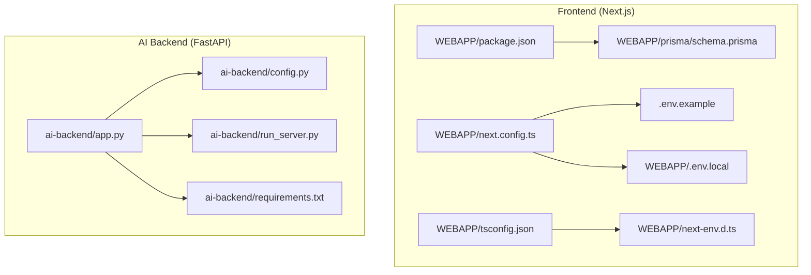
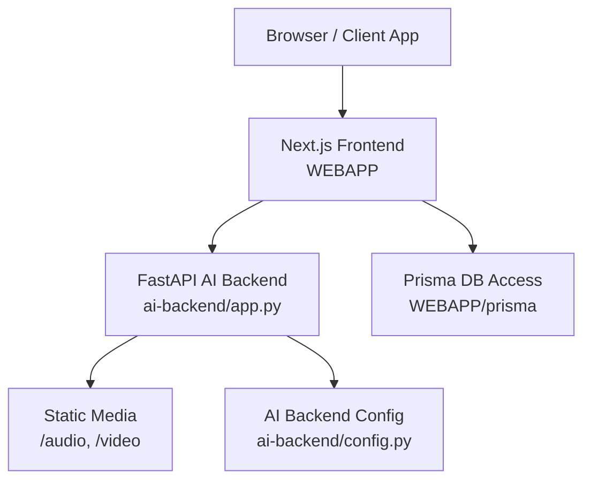
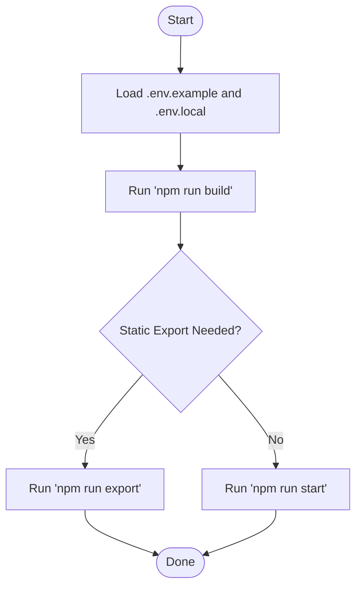
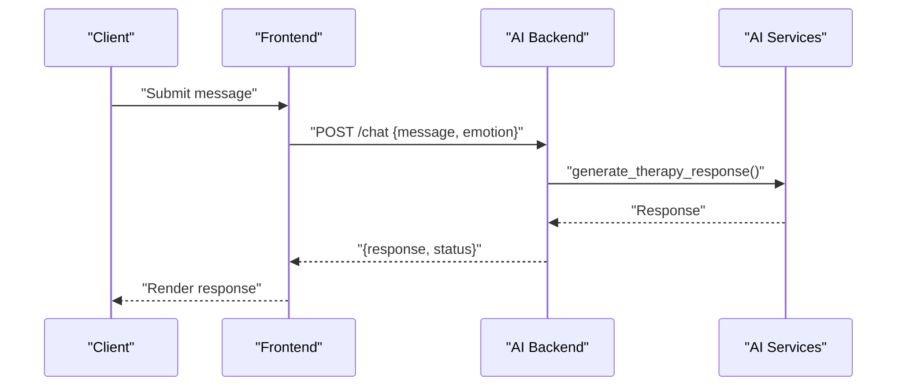
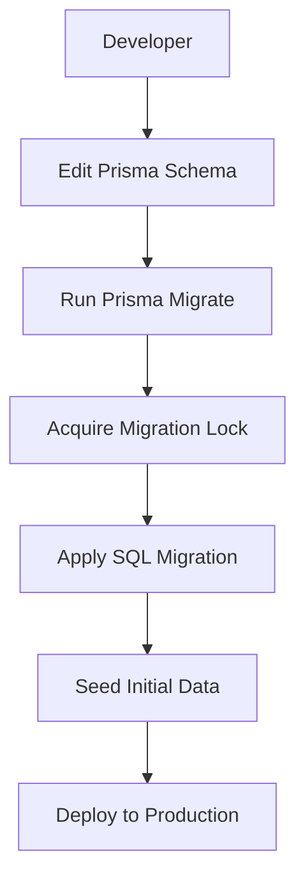

# Deployment & Operations

<cite>
**Referenced Files in This Document**
- [README.md](file://README.md)
- [package.json](file://WEBAPP/package.json)
- [next.config.ts](file://WEBAPP/next.config.ts)
- [.env.example](file://WEBAPP/.env.example)
- [.env.local](file://WEBAPP/.env.local)
- [tsconfig.json](file://WEBAPP/tsconfig.json)
- [next-env.d.ts](file://WEBAPP/next-env.d.ts)
- [app.py](file://ai-backend/app.py)
- [config.py](file://ai-backend/config.py)
- [run_server.py](file://ai-backend/run_server.py)
- [requirements.txt](file://ai-backend/requirements.txt)
- [schema.prisma](file://WEBAPP/prisma/schema.prisma)
- [migration_lock.toml](file://WEBAPP/prisma/migrations/migration_lock.toml)
- [20251105192017_add_therapy_models/migration.sql](file://WEBAPP/prisma/migrations/20251105192017_add_therapy_models/migration.sql)
- [seed.ts](file://WEBAPP/prisma/seed.ts)
</cite>

## Table of Contents
1. [Introduction](#introduction)
2. [Project Structure](#project-structure)
3. [Core Components](#core-components)
4. [Architecture Overview](#architecture-overview)
5. [Detailed Component Analysis](#detailed-component-analysis)
6. [Environment Configuration Management](#environment-configuration-management)
7. [Containerization and Orchestration](#containerization-and-orchestration)
8. [CI/CD Pipeline Setup](#cicd-pipeline-setup)
9. [Monitoring and Logging](#monitoring-and-logging)
10. [Performance Metrics and Alerting](#performance-metrics-and-alerting)
11. [Backup and Disaster Recovery](#backup-and-disaster-recovery)
12. [Security Hardening and Compliance](#security-hardening-and-compliance)
13. [Troubleshooting Guide](#troubleshooting-guide)
14. [Conclusion](#conclusion)

## Introduction
This document provides comprehensive deployment and operational procedures for the MindBridge platform, covering frontend and backend services, environment configuration, containerization, orchestration, CI/CD, monitoring, logging, performance, backups, security, and compliance. It synthesizes the available repository artifacts to define repeatable, scalable, and secure operational practices suitable for development, staging, and production environments.

## Project Structure
The repository comprises:
- Frontend: Next.js application under WEBAPP with TypeScript, Prisma ORM, and environment configuration.
- AI Backend: FastAPI service under ai-backend with Python dependencies and runtime configuration.
- ML Backend: Placeholder noted in repository structure; not present in current workspace snapshot.
- Prisma Migrations and Seed: Database schema and initial data management for the frontend application.

**Diagram sources**
- [package.json](file://WEBAPP/package.json#L1-L88)
- [next.config.ts](file://WEBAPP/next.config.ts#L1-L45)
- [.env.example](file://WEBAPP/.env.example#L1-L16)
- [.env.local](file://WEBAPP/.env.local#L1-L20)
- [tsconfig.json](file://WEBAPP/tsconfig.json#L1-L42)
- [next-env.d.ts](file://WEBAPP/next-env.d.ts#L1-L7)
- [schema.prisma](file://WEBAPP/prisma/schema.prisma)
- [app.py](file://ai-backend/app.py#L1-L154)
- [config.py](file://ai-backend/config.py#L1-L49)
- [run_server.py](file://ai-backend/run_server.py#L1-L21)
- [requirements.txt](file://ai-backend/requirements.txt)

**Section sources**
- [README.md](file://README.md#L1-L3)
- [package.json](file://WEBAPP/package.json#L1-L88)
- [next.config.ts](file://WEBAPP/next.config.ts#L1-L45)
- [.env.example](file://WEBAPP/.env.example#L1-L16)
- [.env.local](file://WEBAPP/.env.local#L1-L20)
- [tsconfig.json](file://WEBAPP/tsconfig.json#L1-L42)
- [next-env.d.ts](file://WEBAPP/next-env.d.ts#L1-L7)
- [schema.prisma](file://WEBAPP/prisma/schema.prisma)
- [app.py](file://ai-backend/app.py#L1-L154)
- [config.py](file://ai-backend/config.py#L1-L49)
- [run_server.py](file://ai-backend/run_server.py#L1-L21)

## Core Components
- Frontend (Next.js):
  - Build and runtime scripts defined in package.json.
  - Environment variables for database, authentication, and backend service URLs.
  - Image optimization and CORS headers configured via next.config.ts.
  - TypeScript configuration and generated types.
- AI Backend (FastAPI):
  - Application entrypoint with health checks, chat, TTS, and avatar endpoints.
  - Lazy service initialization and static file serving for audio/video assets.
  - Uvicorn server configuration and environment-driven settings.

Operational responsibilities:
- Frontend: Build, export, and serve static assets; proxy or integrate with backend APIs.
- AI Backend: Host AI/ML services, manage media assets, expose health and feature endpoints.

**Section sources**
- [package.json](file://WEBAPP/package.json#L5-L11)
- [next.config.ts](file://WEBAPP/next.config.ts#L7-L42)
- [tsconfig.json](file://WEBAPP/tsconfig.json#L26-L30)
- [app.py](file://ai-backend/app.py#L17-L80)
- [app.py](file://ai-backend/app.py#L96-L122)
- [app.py](file://ai-backend/app.py#L147-L153)

## Architecture Overview
High-level runtime architecture:
- Frontend Next.js app communicates with AI backend via HTTP endpoints.
- AI backend orchestrates AI services (Groq, ElevenLabs) and serves generated media.
- Database access is managed by Prisma in the frontend app; AI backend maintains its own configuration.

**Diagram sources**
- [app.py](file://ai-backend/app.py#L38-L40)
- [app.py](file://ai-backend/app.py#L77-L79)
- [app.py](file://ai-backend/app.py#L81-L94)
- [app.py](file://ai-backend/app.py#L96-L108)
- [app.py](file://ai-backend/app.py#L110-L122)
- [config.py](file://ai-backend/config.py#L5-L48)
- [schema.prisma](file://WEBAPP/prisma/schema.prisma)

## Detailed Component Analysis

### Frontend (Next.js) Deployment
- Build and export:
  - Scripts for development, production build, and static export are defined in package.json.
  - Production optimizations enabled via next.config.ts (compression, header hardening).
- Environment configuration:
  - DATABASE_URL, NEXTAUTH_URL, NEXTAUTH_SECRET, NODE_ENV, and backend service URLs are defined in .env.example and .env.local.
- Type safety and routing:
  - TypeScript configuration and generated types ensure type-safe builds.

**Diagram sources**
- [package.json](file://WEBAPP/package.json#L5-L11)
- [next.config.ts](file://WEBAPP/next.config.ts#L11-L19)
- [.env.example](file://WEBAPP/.env.example#L1-L16)
- [.env.local](file://WEBAPP/.env.local#L1-L20)

**Section sources**
- [package.json](file://WEBAPP/package.json#L5-L11)
- [next.config.ts](file://WEBAPP/next.config.ts#L7-L42)
- [.env.example](file://WEBAPP/.env.example#L1-L16)
- [.env.local](file://WEBAPP/.env.local#L1-L20)
- [tsconfig.json](file://WEBAPP/tsconfig.json#L26-L30)
- [next-env.d.ts](file://WEBAPP/next-env.d.ts#L1-L7)

### AI Backend (FastAPI) Deployment
- Application lifecycle:
  - Health endpoint and core endpoints for chat, TTS, and avatar generation.
  - Static file mounts for audio and video assets.
- Runtime and configuration:
  - Uvicorn server runs on host/port from environment; worker count set to 1 for stability.
  - Alternative startup script avoids multiprocessing issues on Windows.
  - Pydantic settings encapsulate environment-driven configuration.

**Diagram sources**
- [app.py](file://ai-backend/app.py#L81-L94)
- [app.py](file://ai-backend/app.py#L147-L153)

**Section sources**
- [app.py](file://ai-backend/app.py#L17-L80)
- [app.py](file://ai-backend/app.py#L81-L122)
- [app.py](file://ai-backend/app.py#L147-L153)
- [config.py](file://ai-backend/config.py#L5-L48)
- [run_server.py](file://ai-backend/run_server.py#L10-L20)

### Database and Migration Management
- Prisma schema defines the data model and migrations.
- Migration lock prevents concurrent migrations.
- SQL migration adds therapy-related models.
- Seed script initializes baseline data.

**Diagram sources**
- [schema.prisma](file://WEBAPP/prisma/schema.prisma)
- [migration_lock.toml](file://WEBAPP/prisma/migrations/migration_lock.toml)
- [20251105192017_add_therapy_models/migration.sql](file://WEBAPP/prisma/migrations/20251105192017_add_therapy_models/migration.sql)
- [seed.ts](file://WEBAPP/prisma/seed.ts)

**Section sources**
- [schema.prisma](file://WEBAPP/prisma/schema.prisma)
- [migration_lock.toml](file://WEBAPP/prisma/migrations/migration_lock.toml)
- [20251105192017_add_therapy_models/migration.sql](file://WEBAPP/prisma/migrations/20251105192017_add_therapy_models/migration.sql)
- [seed.ts](file://WEBAPP/prisma/seed.ts)

## Environment Configuration Management
- Development:
  - Local database connection, localhost NextAuth URL, and backend service URLs.
- Staging and Production:
  - Override secrets and URLs via environment variables; maintain strict separation of credentials.
- Frontend:
  - DATABASE_URL, NEXTAUTH_URL, NEXTAUTH_SECRET, NODE_ENV, NEXT_PUBLIC_AI_BACKEND_URL, NEXT_PUBLIC_ML_BACKEND_URL.
- AI Backend:
  - GROQ_API_KEY, ELEVENLABS_API_KEY, MONGODB_URL, PORT, DEBUG, and optional OpenAI fallback.

Recommended practices:
- Store secrets in secure vaults; never commit secrets to source control.
- Use distinct environment files per stage and enforce validation at startup.

**Section sources**
- [.env.example](file://WEBAPP/.env.example#L1-L16)
- [.env.local](file://WEBAPP/.env.local#L1-L20)
- [config.py](file://ai-backend/config.py#L5-L48)

## Containerization and Orchestration
- Frontend:
  - Build a minimal image using the production build and serve via a lightweight web server.
  - Mount Prisma client and static export outputs appropriately.
- AI Backend:
  - Pin Python dependencies; install requirements in a virtual environment.
  - Expose health and feature endpoints; mount temporary media directory for audio/video.
- Orchestration:
  - Deploy frontend and backend behind a reverse proxy or ingress.
  - Use separate services for database and any external AI/ML providers.
  - Scale horizontally where appropriate; ensure stateless frontend and bounded state in backend.

[No sources needed since this section provides general guidance]

## CI/CD Pipeline Setup
Proposed stages:
- Build:
  - Frontend: run build and export steps; cache dependencies.
  - AI Backend: install Python dependencies and lint.
- Test:
  - Unit/integration tests for backend services.
  - Lint and type checks for frontend.
- Package:
  - Produce deployable artifacts (frontend static export, backend wheels/images).
- Deploy:
  - Deploy to staging; run smoke tests.
  - Promote to production after approvals.
- Rollback:
  - Maintain artifact versions; rollback to previous working version on failure.

[No sources needed since this section provides general guidance]

## Monitoring and Logging
- Frontend:
  - Enable structured logs in production; capture errors and performance metrics.
- AI Backend:
  - Log requests/responses, exceptions, and media generation outcomes.
  - Expose Prometheus-compatible metrics endpoint if needed.
- Observability:
  - Centralized logging and alerting; correlate logs with traces for debugging.

[No sources needed since this section provides general guidance]

## Performance Metrics and Alerting
- Metrics:
  - Request latency, throughput, error rates, and resource utilization.
- Alerts:
  - Threshold-based alerts for health failures, latency spikes, and resource exhaustion.
- Retries and timeouts:
  - Configure retry/backoff for AI provider calls; enforce client timeouts.

[No sources needed since this section provides general guidance]

## Backup and Disaster Recovery
- Data:
  - Database backups (logical/differential/full) with offsite retention.
  - Prisma migrations should be versioned and recoverable.
- Artifacts:
  - Store container images and static exports in secure registries.
- DR Plan:
  - Multi-region deployments; failover DNS; RTO/RPO aligned with SLAs.

[No sources needed since this section provides general guidance]

## Security Hardening and Compliance
- Secrets:
  - Enforce secret rotation; restrict access to environment variables.
- Network:
  - Restrict CORS origins; enable HTTPS; use secure cookies for authentication.
- Authentication:
  - Validate NextAuth configuration; enforce strong secrets and secure storage.
- Compliance:
  - HIPAA-ready controls for PHI handling; audit logs, encryption at rest/in transit, and access controls.

[No sources needed since this section provides general guidance]

## Troubleshooting Guide
- Frontend:
  - Verify environment variables and backend URLs; confirm build/export success.
- AI Backend:
  - Confirm health endpoint reachable; check service initialization and media directory permissions.
  - Validate API keys and provider endpoints.
- Database:
  - Ensure Prisma migrations applied and seed executed; verify connectivity and credentials.

**Section sources**
- [app.py](file://ai-backend/app.py#L77-L79)
- [app.py](file://ai-backend/app.py#L147-L153)
- [schema.prisma](file://WEBAPP/prisma/schema.prisma)
- [migration_lock.toml](file://WEBAPP/prisma/migrations/migration_lock.toml)

## Conclusion
This document outlines a practical, repeatable operational model for MindBridge, grounded in the repository’s existing configuration and code. By adopting the outlined environment management, containerization, CI/CD, monitoring, security, and compliance practices, teams can reliably deploy and operate the platform across environments while maintaining performance, resilience, and regulatory readiness.