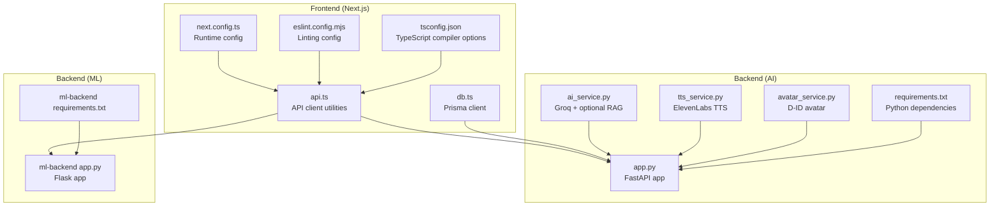
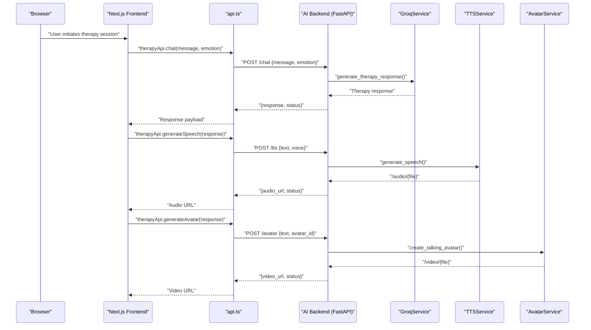
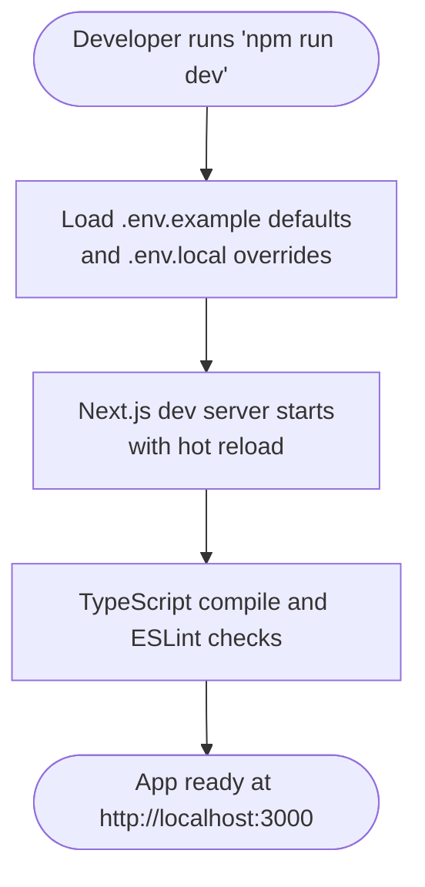
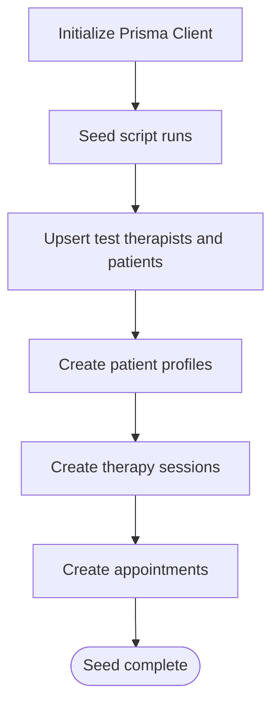
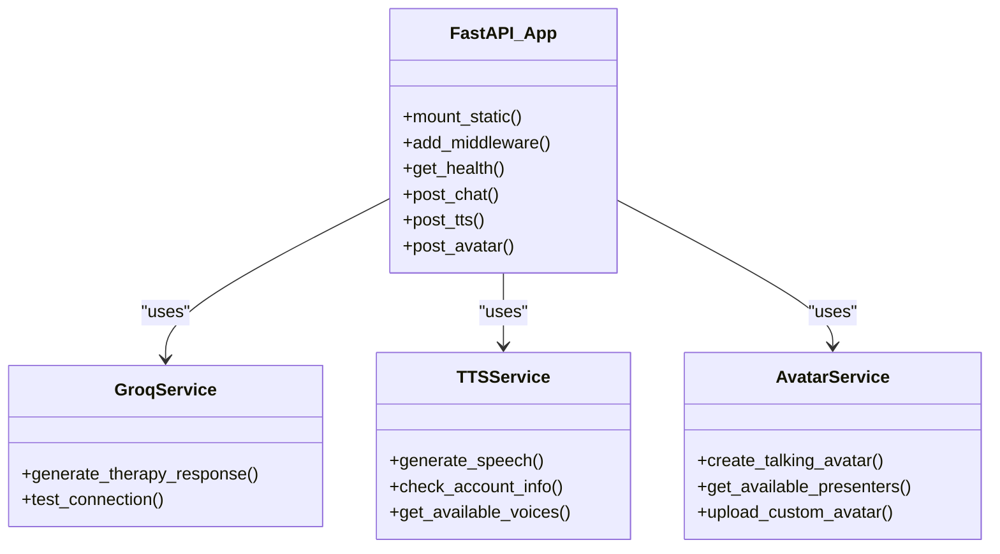
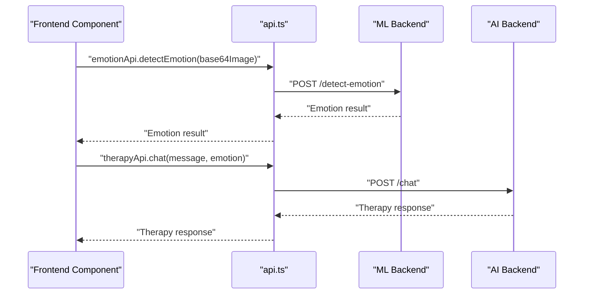
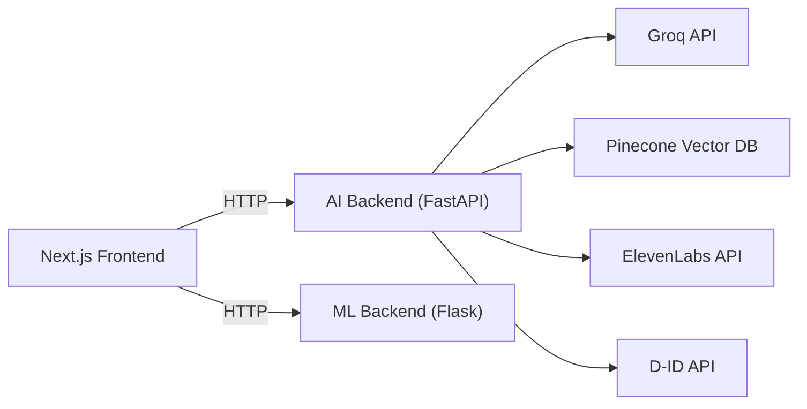

# Development & Testing

<cite>
**Referenced Files in This Document**
- [package.json](file://WEBAPP/package.json)
- [next.config.ts](file://WEBAPP/next.config.ts)
- [eslint.config.mjs](file://WEBAPP/eslint.config.mjs)
- [tsconfig.json](file://WEBAPP/tsconfig.json)
- [.env.example](file://WEBAPP/.env.example)
- [schema.prisma](file://WEBAPP/prisma/schema.prisma)
- [seed.ts](file://WEBAPP/prisma/seed.ts)
- [db.ts](file://WEBAPP/src/lib/db.ts)
- [api.ts](file://WEBAPP/src/lib/api.ts)
- [app.py](file://ai-backend/app.py)
- [requirements.txt](file://ai-backend/requirements.txt)
- [ai_service.py](file://ai-backend/services/ai_service.py)
- [tts_service.py](file://ai-backend/services/tts_service.py)
- [avatar_service.py](file://ai-backend/services/avatar_service.py)
- [test_endpoints.py](file://ai-backend/test_endpoints.py)
</cite>

## Table of Contents
1. [Introduction](#introduction)
2. [Project Structure](#project-structure)
3. [Core Components](#core-components)
4. [Architecture Overview](#architecture-overview)
5. [Detailed Component Analysis](#detailed-component-analysis)
6. [Dependency Analysis](#dependency-analysis)
7. [Performance Considerations](#performance-considerations)
8. [Troubleshooting Guide](#troubleshooting-guide)
9. [Conclusion](#conclusion)
10. [Appendices](#appendices)

## Introduction
This document provides comprehensive guidance for setting up the development environment and establishing robust testing strategies for the MindBridge project. It covers:
- Local development server setup, hot reloading, and debugging techniques
- Frontend and backend testing approaches (unit, integration, end-to-end)
- Continuous integration pipelines, automated testing, and quality assurance processes
- Code quality tools, linting, and style enforcement
- Performance testing, load testing, and security testing
- Testing data management, mock services, and test environment configuration

## Project Structure
MindBridge consists of:
- A Next.js frontend (WEBAPP) with TypeScript, Prisma ORM, and API integrations
- An AI backend (FastAPI) providing therapy chat, text-to-speech, and avatar generation
- An ML backend (Flask) for emotion detection and video analysis

**Diagram sources**
- [api.ts](file://WEBAPP/src/lib/api.ts#L1-L142)
- [db.ts](file://WEBAPP/src/lib/db.ts#L1-L15)
- [next.config.ts](file://WEBAPP/next.config.ts#L1-L45)
- [eslint.config.mjs](file://WEBAPP/eslint.config.mjs#L1-L26)
- [tsconfig.json](file://WEBAPP/tsconfig.json#L1-L42)
- [app.py](file://ai-backend/app.py#L1-L154)
- [requirements.txt](file://ai-backend/requirements.txt#L1-L81)
- [ai_service.py](file://ai-backend/services/ai_service.py#L1-L293)
- [tts_service.py](file://ai-backend/services/tts_service.py#L1-L280)
- [avatar_service.py](file://ai-backend/services/avatar_service.py#L1-L237)

**Section sources**
- [package.json](file://WEBAPP/package.json#L1-L88)
- [next.config.ts](file://WEBAPP/next.config.ts#L1-L45)
- [eslint.config.mjs](file://WEBAPP/eslint.config.mjs#L1-L26)
- [tsconfig.json](file://WEBAPP/tsconfig.json#L1-L42)
- [schema.prisma](file://WEBAPP/prisma/schema.prisma#L1-L330)
- [seed.ts](file://WEBAPP/prisma/seed.ts#L1-L168)
- [db.ts](file://WEBAPP/src/lib/db.ts#L1-L15)
- [api.ts](file://WEBAPP/src/lib/api.ts#L1-L142)
- [app.py](file://ai-backend/app.py#L1-L154)
- [requirements.txt](file://ai-backend/requirements.txt#L1-L81)
- [ai_service.py](file://ai-backend/services/ai_service.py#L1-L293)
- [tts_service.py](file://ai-backend/services/tts_service.py#L1-L280)
- [avatar_service.py](file://ai-backend/services/avatar_service.py#L1-L237)
- [test_endpoints.py](file://ai-backend/test_endpoints.py#L1-L90)

## Core Components
- Frontend development scripts and tooling:
  - Scripts for dev, build, start, lint, and Prisma seed
  - ESLint flat config extending Next.js recommended rules
  - TypeScript strict mode and bundler module resolution
- Database and ORM:
  - Prisma schema defines models for users, sessions, appointments, analytics, and more
  - Seed script provisions test users, profiles, sessions, and appointments
  - Prisma client configured with environment-aware logging
- API integrations:
  - API client utilities encapsulate base URLs and request helpers
  - Emotion and therapy endpoints integrate with AI and ML backends
- AI backend:
  - FastAPI app with CORS, static audio/video serving, and lazy-initialized services
  - Endpoints for health, chat, TTS, and avatar generation
  - Services for Groq, ElevenLabs, and D-ID with graceful fallbacks
- ML backend:
  - Flask app for emotion detection and video analysis (referenced in frontend)

**Section sources**
- [package.json](file://WEBAPP/package.json#L1-L88)
- [eslint.config.mjs](file://WEBAPP/eslint.config.mjs#L1-L26)
- [tsconfig.json](file://WEBAPP/tsconfig.json#L1-L42)
- [schema.prisma](file://WEBAPP/prisma/schema.prisma#L1-L330)
- [seed.ts](file://WEBAPP/prisma/seed.ts#L1-L168)
- [db.ts](file://WEBAPP/src/lib/db.ts#L1-L15)
- [api.ts](file://WEBAPP/src/lib/api.ts#L1-L142)
- [app.py](file://ai-backend/app.py#L1-L154)
- [ai_service.py](file://ai-backend/services/ai_service.py#L1-L293)
- [tts_service.py](file://ai-backend/services/tts_service.py#L1-L280)
- [avatar_service.py](file://ai-backend/services/avatar_service.py#L1-L237)

## Architecture Overview
The system integrates a Next.js frontend with two microservices:
- AI backend (FastAPI) for therapy chat, TTS, and avatar generation
- ML backend (Flask) for emotion detection and video analysis

**Diagram sources**
- [api.ts](file://WEBAPP/src/lib/api.ts#L75-L113)
- [app.py](file://ai-backend/app.py#L81-L122)
- [ai_service.py](file://ai-backend/services/ai_service.py#L131-L192)
- [tts_service.py](file://ai-backend/services/tts_service.py#L53-L144)
- [avatar_service.py](file://ai-backend/services/avatar_service.py#L19-L67)

## Detailed Component Analysis

### Frontend Development Workflow
- Local development server:
  - Use the Next.js dev script to launch the app locally
  - Environment variables sourced from .env files
- Hot reloading and debugging:
  - Next.js handles automatic page reloads during development
  - TypeScript strict mode and ESLint enforce code quality
- API configuration:
  - Base URLs for AI and ML backends configurable via environment variables
  - Unified API client with request helpers and error handling

**Diagram sources**
- [package.json](file://WEBAPP/package.json#L5-L11)
- [.env.example](file://WEBAPP/.env.example#L1-L16)
- [next.config.ts](file://WEBAPP/next.config.ts#L1-L45)
- [eslint.config.mjs](file://WEBAPP/eslint.config.mjs#L1-L26)
- [tsconfig.json](file://WEBAPP/tsconfig.json#L1-L42)

**Section sources**
- [package.json](file://WEBAPP/package.json#L5-L11)
- [.env.example](file://WEBAPP/.env.example#L1-L16)
- [next.config.ts](file://WEBAPP/next.config.ts#L1-L45)
- [eslint.config.mjs](file://WEBAPP/eslint.config.mjs#L1-L26)
- [tsconfig.json](file://WEBAPP/tsconfig.json#L1-L42)

### Database Setup and Seeding
- Prisma schema defines relational models for users, sessions, appointments, analytics, and profiles
- Seed script provisions therapists, patients, profiles, therapy sessions, and appointments
- Prisma client configured with environment-aware logging for development vs production

**Diagram sources**
- [schema.prisma](file://WEBAPP/prisma/schema.prisma#L1-L330)
- [seed.ts](file://WEBAPP/prisma/seed.ts#L1-L168)
- [db.ts](file://WEBAPP/src/lib/db.ts#L1-L15)

**Section sources**
- [schema.prisma](file://WEBAPP/prisma/schema.prisma#L1-L330)
- [seed.ts](file://WEBAPP/prisma/seed.ts#L1-L168)
- [db.ts](file://WEBAPP/src/lib/db.ts#L1-L15)

### AI Backend Services
- Lazy initialization of services to avoid import-time overhead
- CORS enabled for development and static file serving for audio/video
- Endpoints for health, chat, TTS, and avatar with robust error handling

**Diagram sources**
- [app.py](file://ai-backend/app.py#L1-L154)
- [ai_service.py](file://ai-backend/services/ai_service.py#L72-L192)
- [tts_service.py](file://ai-backend/services/tts_service.py#L10-L144)
- [avatar_service.py](file://ai-backend/services/avatar_service.py#L11-L67)

**Section sources**
- [app.py](file://ai-backend/app.py#L1-L154)
- [ai_service.py](file://ai-backend/services/ai_service.py#L1-L293)
- [tts_service.py](file://ai-backend/services/tts_service.py#L1-L280)
- [avatar_service.py](file://ai-backend/services/avatar_service.py#L1-L237)

### API Layer and Integrations
- Unified API client encapsulates base URLs and request helpers
- Emotion detection and therapy endpoints integrate with AI and ML backends
- Utilities for canvas-to-base64 conversion and emotion data formatting

**Diagram sources**
- [api.ts](file://WEBAPP/src/lib/api.ts#L54-L113)

**Section sources**
- [api.ts](file://WEBAPP/src/lib/api.ts#L1-L142)

## Dependency Analysis
- Frontend dependencies include Next.js, React, Prisma client, Radix UI, Tailwind, and Stripe
- AI backend Python dependencies include FastAPI, Uvicorn, Groq, Pinecone, LangChain, and PyPDF
- ML backend uses Flask and related packages for emotion detection and video analysis

**Diagram sources**
- [package.json](file://WEBAPP/package.json#L15-L86)
- [requirements.txt](file://ai-backend/requirements.txt#L70-L81)
- [api.ts](file://WEBAPP/src/lib/api.ts#L2-L5)

**Section sources**
- [package.json](file://WEBAPP/package.json#L15-L86)
- [requirements.txt](file://ai-backend/requirements.txt#L1-L81)

## Performance Considerations
- Frontend:
  - Next.js image optimization disabled for development; enable selectively for production
  - Compression enabled; powered-by header removed for performance
- Backend:
  - AI backend disables auto-reload to prevent multiprocessing issues
  - Static audio/video serving reduces latency for media assets
- Recommendations:
  - Use Next.js Image component in production with optimized domains
  - Implement CDN for media assets
  - Enable gzip/brotli compression at the reverse proxy level
  - Monitor API latency and implement circuit breakers for third-party services

[No sources needed since this section provides general guidance]

## Troubleshooting Guide
- Environment variables:
  - Ensure .env.local overrides .env.example values for DATABASE_URL, NEXTAUTH_URL, NEXTAUTH_SECRET, AI_BACKEND_URL, ML_BACKEND_URL
- Database:
  - Run migrations and seed after setting DATABASE_URL
  - Verify Prisma client logs in development mode
- AI backend:
  - Confirm GROQ_API_KEY and optional PINECONE_API_KEY are set
  - Use the endpoint tester script to validate TTS and avatar endpoints
  - Check static audio/video serving paths and permissions
- ML backend:
  - Confirm Flask app is running and accessible at ML_BACKEND_URL
  - Validate emotion detection and video analysis endpoints

**Section sources**
- [.env.example](file://WEBAPP/.env.example#L1-L16)
- [db.ts](file://WEBAPP/src/lib/db.ts#L1-L15)
- [schema.prisma](file://WEBAPP/prisma/schema.prisma#L1-L330)
- [seed.ts](file://WEBAPP/prisma/seed.ts#L1-L168)
- [app.py](file://ai-backend/app.py#L1-L154)
- [test_endpoints.py](file://ai-backend/test_endpoints.py#L1-L90)

## Conclusion
This guide outlines a complete development and testing strategy for MindBridge, covering environment setup, workflow, code quality, and service integrations. By following the outlined practices—leveraging Next.js dev server, Prisma migrations and seeding, FastAPI microservices with fallbacks, and robust API clients—you can efficiently develop, test, and iterate on the platform.

[No sources needed since this section summarizes without analyzing specific files]

## Appendices

### Development Environment Setup Checklist
- Install Node.js and Python runtime
- Install dependencies:
  - Frontend: npm ci
  - AI backend: pip install -r ai-backend/requirements.txt
  - ML backend: pip install -r ml-backend/requirements.txt
- Configure environment variables (.env.local) based on .env.example
- Initialize database:
  - Run Prisma migrations
  - Seed test data
- Start services:
  - Frontend: npm run dev
  - AI backend: python ai-backend/app.py
  - ML backend: python ml-backend/app.py

**Section sources**
- [package.json](file://WEBAPP/package.json#L1-L88)
- [requirements.txt](file://ai-backend/requirements.txt#L1-L81)
- [.env.example](file://WEBAPP/.env.example#L1-L16)
- [schema.prisma](file://WEBAPP/prisma/schema.prisma#L1-L330)
- [seed.ts](file://WEBAPP/prisma/seed.ts#L1-L168)
- [app.py](file://ai-backend/app.py#L1-L154)

### Testing Strategies

#### Frontend Testing
- Unit tests:
  - Use a testing framework (e.g., Jest or Vitest) with React testing utilities
  - Mock API client and services for isolated component tests
- Integration tests:
  - Test API client functions against mocked backend endpoints
  - Validate emotion detection and therapy flows with mock payloads
- End-to-end tests:
  - Use Playwright or Cypress to automate browser scenarios
  - Configure test environments with local backend URLs

#### Backend Testing
- AI backend:
  - Unit tests for GroqService, TTSService, and AvatarService
  - Integration tests for FastAPI endpoints using pytest and httpx
  - Use the endpoint tester script to validate audio/video accessibility
- ML backend:
  - Unit tests for emotion detection and video analysis functions
  - Integration tests for Flask endpoints

#### Automated Testing and CI
- CI pipeline stages:
  - Linting (ESLint)
  - Frontend build and type checks
  - Backend dependency installation and tests
  - Database migrations and seeding in ephemeral environments
  - E2E tests against staging-like environments
- Quality gates:
  - Enforce minimum coverage thresholds
  - Fail builds on lint errors or test failures

#### Code Quality Tools and Style Guides
- Linting:
  - ESLint with Next.js recommended rules
  - Ignore patterns for build artifacts and Next.js generated types
- Formatting:
  - Use Prettier or TypeScript formatter consistently
- Style guide:
  - Consistent naming conventions for APIs, components, and services
  - Centralized configuration via tsconfig.json and next.config.ts

#### Performance and Load Testing
- Frontend:
  - Measure bundle sizes and hydration times with Next.js profiler
  - Use Lighthouse for audits
- Backend:
  - Locust or k6 for synthetic load testing
  - Monitor API latency and error rates under load
  - Scale AI/ML service replicas behind a load balancer

#### Security Testing
- Static analysis:
  - SAST tools for JavaScript and Python
- Dynamic testing:
  - OWASP ZAP or Burp Suite for API scanning
- Secrets management:
  - Validate environment variables are not hardcoded in client-side code
  - Rotate API keys regularly

#### Testing Data Management and Mock Services
- Test data:
  - Use Prisma seed for deterministic test users and sessions
  - Maintain separate test databases for CI
- Mock services:
  - Replace external API calls with local mocks during tests
  - Use fixtures for emotion detection and therapy responses
- Test environment configuration:
  - Isolate test environments from production
  - Use environment-specific base URLs for AI and ML backends

[No sources needed since this section provides general guidance]