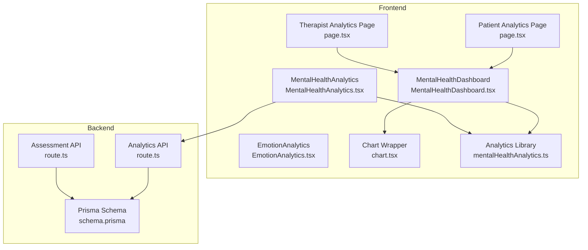
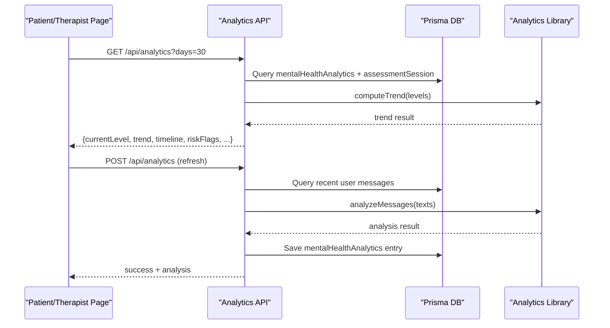
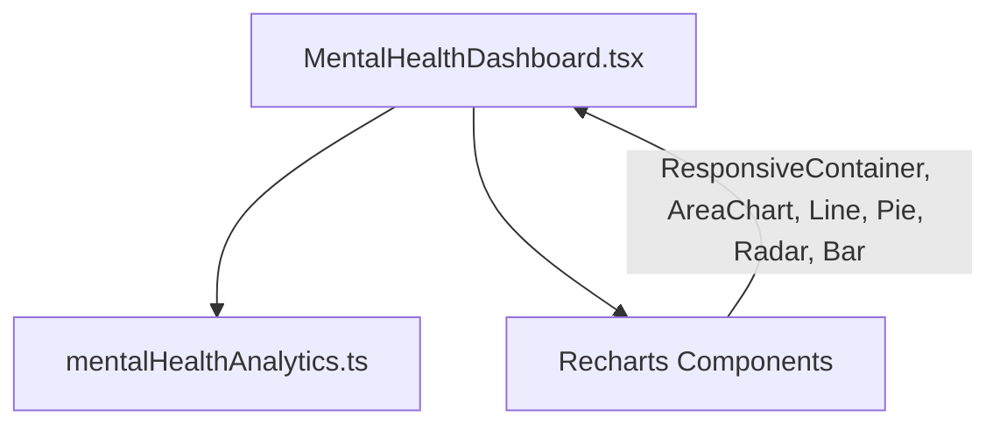
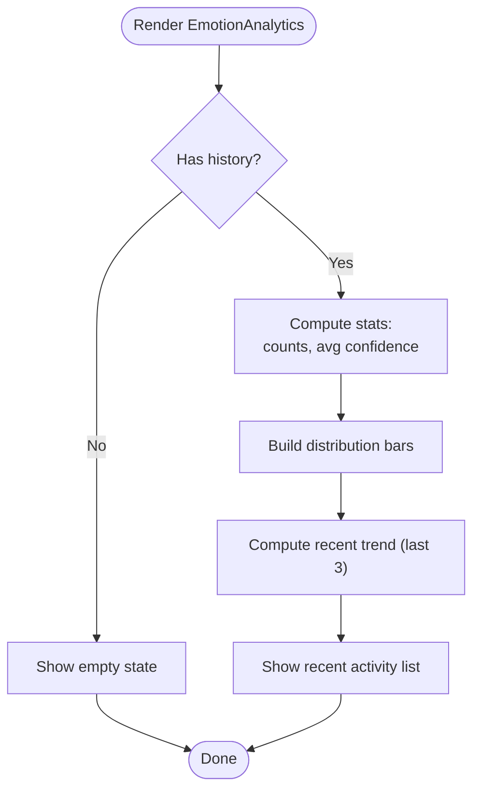
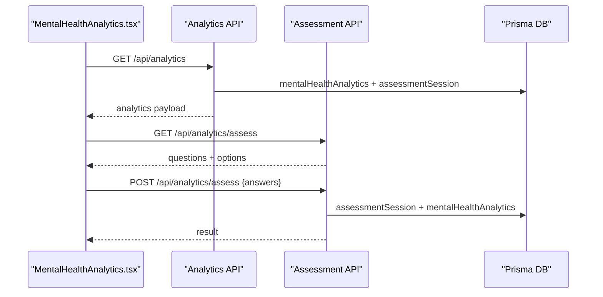
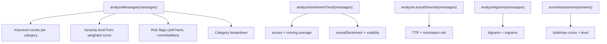
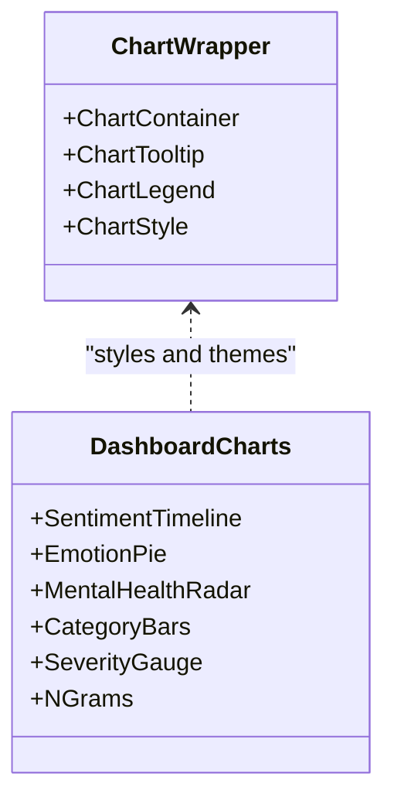
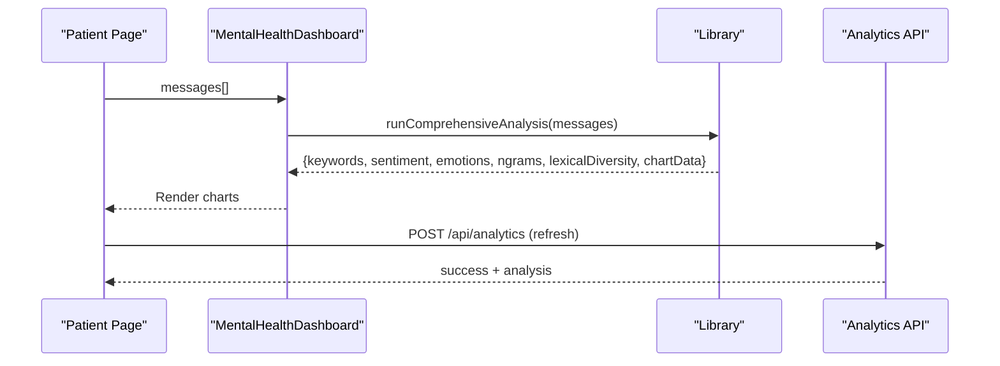
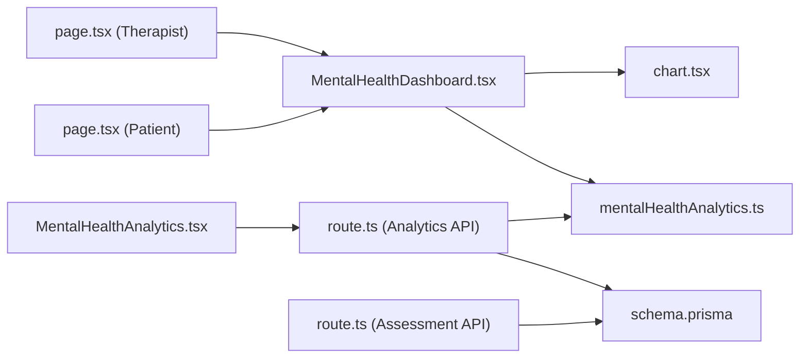

# Analytics & Visualization Components

<cite>
**Referenced Files in This Document**
- [MentalHealthDashboard.tsx](file://WEBAPP/src/components/analytics/MentalHealthDashboard.tsx)
- [EmotionAnalytics.tsx](file://WEBAPP/src/components/EmotionAnalytics.tsx)
- [MentalHealthAnalytics.tsx](file://WEBAPP/src/components/MentalHealthAnalytics.tsx)
- [mentalHealthAnalytics.ts](file://WEBAPP/src/lib/mentalHealthAnalytics.ts)
- [chart.tsx](file://WEBAPP/src/components/ui/chart.tsx)
- [page.tsx (Patient Analytics)](file://WEBAPP/src/app/patient/analytics/page.tsx)
- [page.tsx (Therapist Patient Analytics)](file://WEBAPP/src/app/therapist/patient-analytics/page.tsx)
- [route.ts (Analytics API)](file://WEBAPP/src/app/api/analytics/route.ts)
- [route.ts (Assessment API)](file://WEBAPP/src/app/api/analytics/assess/route.ts)
- [schema.prisma](file://WEBAPP/prisma/schema.prisma)
- [package.json](file://WEBAPP/package.json)
</cite>

## Table of Contents
1. [Introduction](#introduction)
2. [Project Structure](#project-structure)
3. [Core Components](#core-components)
4. [Architecture Overview](#architecture-overview)
5. [Detailed Component Analysis](#detailed-component-analysis)
6. [Dependency Analysis](#dependency-analysis)
7. [Performance Considerations](#performance-considerations)
8. [Troubleshooting Guide](#troubleshooting-guide)
9. [Conclusion](#conclusion)
10. [Appendices](#appendices)

## Introduction
This document explains the analytics and visualization components that power the mental health dashboard and emotion analytics. It covers:
- Data visualization charts (Recharts) for sentiment, emotions, radar, and keyword distributions
- Trend analysis and progress tracking over time
- Integration with backend analytics APIs for real-time data retrieval and refresh
- Chart configurations, data formatting utilities, and responsive design
- Performance optimization strategies for large datasets and interactive features
- Accessibility and export considerations

## Project Structure
The analytics stack spans frontend components, a reusable chart wrapper, and backend API endpoints backed by a Prisma schema.

**Diagram sources**
- [page.tsx (Patient Analytics)](file://WEBAPP/src/app/patient/analytics/page.tsx#L1-L127)
- [page.tsx (Therapist Patient Analytics)](file://WEBAPP/src/app/therapist/patient-analytics/page.tsx#L1-L417)
- [MentalHealthDashboard.tsx](file://WEBAPP/src/components/analytics/MentalHealthDashboard.tsx#L1-L541)
- [EmotionAnalytics.tsx](file://WEBAPP/src/components/EmotionAnalytics.tsx#L1-L212)
- [MentalHealthAnalytics.tsx](file://WEBAPP/src/components/MentalHealthAnalytics.tsx#L1-L942)
- [chart.tsx](file://WEBAPP/src/components/ui/chart.tsx#L1-L363)
- [mentalHealthAnalytics.ts](file://WEBAPP/src/lib/mentalHealthAnalytics.ts#L1-L884)
- [route.ts (Analytics API)](file://WEBAPP/src/app/api/analytics/route.ts#L1-L253)
- [route.ts (Assessment API)](file://WEBAPP/src/app/api/analytics/assess/route.ts#L1-L121)
- [schema.prisma](file://WEBAPP/prisma/schema.prisma#L1-L330)

**Section sources**
- [page.tsx (Patient Analytics)](file://WEBAPP/src/app/patient/analytics/page.tsx#L1-L127)
- [page.tsx (Therapist Patient Analytics)](file://WEBAPP/src/app/therapist/patient-analytics/page.tsx#L1-L417)
- [MentalHealthDashboard.tsx](file://WEBAPP/src/components/analytics/MentalHealthDashboard.tsx#L1-L541)
- [MentalHealthAnalytics.tsx](file://WEBAPP/src/components/MentalHealthAnalytics.tsx#L1-L942)
- [chart.tsx](file://WEBAPP/src/components/ui/chart.tsx#L1-L363)
- [mentalHealthAnalytics.ts](file://WEBAPP/src/lib/mentalHealthAnalytics.ts#L1-L884)
- [route.ts (Analytics API)](file://WEBAPP/src/app/api/analytics/route.ts#L1-L253)
- [route.ts (Assessment API)](file://WEBAPP/src/app/api/analytics/assess/route.ts#L1-L121)
- [schema.prisma](file://WEBAPP/prisma/schema.prisma#L1-L330)

## Core Components
- Mental Health Dashboard: Renders sentiment timelines, emotion distributions, keyword radar, category bars, severity gauges, n-gram phrases, and keyword lists.
- Emotion Analytics: Provides emotion distribution, current state, recent trends, and recent history for facial/emotion tracking.
- Mental Health Analytics Dashboard: Backend-driven analytics with assessment flow, timeline visualization, and risk alerts.
- Analytics Library: Implements keyword categorization, sentiment analysis, lexical diversity, n-gram extraction, and assessment scoring.
- Chart Wrapper: A Recharts wrapper for consistent theming and tooltips across components.

**Section sources**
- [MentalHealthDashboard.tsx](file://WEBAPP/src/components/analytics/MentalHealthDashboard.tsx#L1-L541)
- [EmotionAnalytics.tsx](file://WEBAPP/src/components/EmotionAnalytics.tsx#L1-L212)
- [MentalHealthAnalytics.tsx](file://WEBAPP/src/components/MentalHealthAnalytics.tsx#L1-L942)
- [mentalHealthAnalytics.ts](file://WEBAPP/src/lib/mentalHealthAnalytics.ts#L1-L884)
- [chart.tsx](file://WEBAPP/src/components/ui/chart.tsx#L1-L363)

## Architecture Overview
The frontend components fetch analytics data via Next.js API routes. The backend computes analytics using the library functions and persists results to the database. The mental health dashboard composes multiple chart types for comprehensive insights.

**Diagram sources**
- [route.ts (Analytics API)](file://WEBAPP/src/app/api/analytics/route.ts#L1-L253)
- [mentalHealthAnalytics.ts](file://WEBAPP/src/lib/mentalHealthAnalytics.ts#L1-L884)
- [schema.prisma](file://WEBAPP/prisma/schema.prisma#L229-L266)

**Section sources**
- [route.ts (Analytics API)](file://WEBAPP/src/app/api/analytics/route.ts#L1-L253)
- [mentalHealthAnalytics.ts](file://WEBAPP/src/lib/mentalHealthAnalytics.ts#L1-L884)
- [schema.prisma](file://WEBAPP/prisma/schema.prisma#L229-L266)

## Detailed Component Analysis

### Mental Health Dashboard
The dashboard renders:
- Top stats cards for severity level, overall sentiment, dominant emotion, and lexical diversity
- Risk flags banner when keywords indicate concern
- Sentiment timeline (area + line) with moving average
- Emotion pie chart using Plutchik’s wheel
- Mental health radar and category breakdown bar chart
- Severity gauge with level descriptions
- Bigrams/trigrams bar charts
- Keyword lists grouped by category
- Summary grid with counts

**Diagram sources**
- [MentalHealthDashboard.tsx](file://WEBAPP/src/components/analytics/MentalHealthDashboard.tsx#L1-L541)
- [mentalHealthAnalytics.ts](file://WEBAPP/src/lib/mentalHealthAnalytics.ts#L1-L884)

**Section sources**
- [MentalHealthDashboard.tsx](file://WEBAPP/src/components/analytics/MentalHealthDashboard.tsx#L1-L541)
- [mentalHealthAnalytics.ts](file://WEBAPP/src/lib/mentalHealthAnalytics.ts#L1-L884)

### Emotion Analytics
The emotion analytics component displays:
- Current emotion with confidence and timestamp
- Total readings and average confidence
- Emotion distribution with horizontal bars
- Recent trend (stable/changing) based on last three readings
- Recent activity list with timestamps

**Diagram sources**
- [EmotionAnalytics.tsx](file://WEBAPP/src/components/EmotionAnalytics.tsx#L1-L212)

**Section sources**
- [EmotionAnalytics.tsx](file://WEBAPP/src/components/EmotionAnalytics.tsx#L1-L212)

### Mental Health Analytics Dashboard (Backend-driven)
This component integrates with the backend to:
- Fetch analytics data and render cards/timeline
- Show risk alerts when flags are detected
- Provide an assessment flow with questions and scoring
- Allow manual refresh of analytics

**Diagram sources**
- [MentalHealthAnalytics.tsx](file://WEBAPP/src/components/MentalHealthAnalytics.tsx#L1-L942)
- [route.ts (Analytics API)](file://WEBAPP/src/app/api/analytics/route.ts#L1-L253)
- [route.ts (Assessment API)](file://WEBAPP/src/app/api/analytics/assess/route.ts#L1-L121)

**Section sources**
- [MentalHealthAnalytics.tsx](file://WEBAPP/src/components/MentalHealthAnalytics.tsx#L1-L942)
- [route.ts (Analytics API)](file://WEBAPP/src/app/api/analytics/route.ts#L1-L253)
- [route.ts (Assessment API)](file://WEBAPP/src/app/api/analytics/assess/route.ts#L1-L121)

### Analytics Library Functions
The library provides:
- Keyword categorization and severity computation
- Sentiment analysis with negation/intensifier handling
- Lexical diversity and rumination detection
- N-gram extraction for phrase frequency
- Assessment scoring and category-wise totals
- Trend computation across levels

**Diagram sources**
- [mentalHealthAnalytics.ts](file://WEBAPP/src/lib/mentalHealthAnalytics.ts#L1-L884)

**Section sources**
- [mentalHealthAnalytics.ts](file://WEBAPP/src/lib/mentalHealthAnalytics.ts#L1-L884)

### Chart Configurations and Utilities
- Recharts integration: AreaChart, LineChart, PieChart, RadarChart, BarChart
- Responsive containers and axis customization
- Tooltips and legends with consistent styling
- Theme-aware color mapping via the chart wrapper

**Diagram sources**
- [chart.tsx](file://WEBAPP/src/components/ui/chart.tsx#L1-L363)
- [MentalHealthDashboard.tsx](file://WEBAPP/src/components/analytics/MentalHealthDashboard.tsx#L1-L541)

**Section sources**
- [chart.tsx](file://WEBAPP/src/components/ui/chart.tsx#L1-L363)
- [MentalHealthDashboard.tsx](file://WEBAPP/src/components/analytics/MentalHealthDashboard.tsx#L1-L541)

### Data Flow and Real-time Updates
- Patient analytics page fetches messages and passes them to the dashboard for on-the-fly analysis.
- Backend analytics API supports manual refresh to re-analyze recent chat messages.
- Assessment API provides questions and scoring, persisting results for timeline inclusion.

**Diagram sources**
- [page.tsx (Patient Analytics)](file://WEBAPP/src/app/patient/analytics/page.tsx#L1-L127)
- [MentalHealthDashboard.tsx](file://WEBAPP/src/components/analytics/MentalHealthDashboard.tsx#L1-L541)
- [mentalHealthAnalytics.ts](file://WEBAPP/src/lib/mentalHealthAnalytics.ts#L1-L884)
- [route.ts (Analytics API)](file://WEBAPP/src/app/api/analytics/route.ts#L1-L253)

**Section sources**
- [page.tsx (Patient Analytics)](file://WEBAPP/src/app/patient/analytics/page.tsx#L1-L127)
- [MentalHealthDashboard.tsx](file://WEBAPP/src/components/analytics/MentalHealthDashboard.tsx#L1-L541)
- [route.ts (Analytics API)](file://WEBAPP/src/app/api/analytics/route.ts#L1-L253)

## Dependency Analysis
- Frontend depends on Recharts and the chart wrapper for visualization.
- Components depend on the analytics library for computations.
- Backend APIs depend on Prisma models for persistence.
- Pages orchestrate data fetching and pass props to components.

**Diagram sources**
- [page.tsx (Patient Analytics)](file://WEBAPP/src/app/patient/analytics/page.tsx#L1-L127)
- [page.tsx (Therapist Patient Analytics)](file://WEBAPP/src/app/therapist/patient-analytics/page.tsx#L1-L417)
- [MentalHealthDashboard.tsx](file://WEBAPP/src/components/analytics/MentalHealthDashboard.tsx#L1-L541)
- [MentalHealthAnalytics.tsx](file://WEBAPP/src/components/MentalHealthAnalytics.tsx#L1-L942)
- [chart.tsx](file://WEBAPP/src/components/ui/chart.tsx#L1-L363)
- [mentalHealthAnalytics.ts](file://WEBAPP/src/lib/mentalHealthAnalytics.ts#L1-L884)
- [route.ts (Analytics API)](file://WEBAPP/src/app/api/analytics/route.ts#L1-L253)
- [route.ts (Assessment API)](file://WEBAPP/src/app/api/analytics/assess/route.ts#L1-L121)
- [schema.prisma](file://WEBAPP/prisma/schema.prisma#L1-L330)

**Section sources**
- [package.json](file://WEBAPP/package.json#L67-L67)
- [schema.prisma](file://WEBAPP/prisma/schema.prisma#L1-L330)

## Performance Considerations
- Large dataset handling:
  - Use ResponsiveContainer to adapt chart sizes and reduce layout thrashing.
  - Limit visible data points (e.g., last N entries) to keep charts responsive.
  - Memoize computations and derived data to prevent unnecessary re-renders.
- Interactive features:
  - Debounce search/filter inputs (already applied in therapist analytics).
  - Virtualize long lists (e.g., recent activity) to minimize DOM nodes.
- Backend efficiency:
  - Paginate message fetches and limit analysis windows (e.g., last 500 messages).
  - Cache recent analytics results and invalidate on refresh requests.
- Rendering:
  - Dynamically import heavy chart libraries to avoid SSR overhead.
  - Prefer lightweight chart primitives for dense data.

[No sources needed since this section provides general guidance]

## Troubleshooting Guide
- Unauthorized access:
  - Ensure session validation in API routes and redirect unauthenticated users.
- Empty or stale data:
  - Verify message fetch limits and presence of user messages.
  - Use the refresh endpoint to re-analyze recent chats.
- Assessment submission errors:
  - Confirm answer arrays match expected length and score ranges.
- Chart rendering issues:
  - Confirm dynamic imports for Recharts and proper container sizing.
  - Validate data shapes passed to chart components (e.g., numeric axes).

**Section sources**
- [route.ts (Analytics API)](file://WEBAPP/src/app/api/analytics/route.ts#L1-L253)
- [route.ts (Assessment API)](file://WEBAPP/src/app/api/analytics/assess/route.ts#L1-L121)
- [page.tsx (Patient Analytics)](file://WEBAPP/src/app/patient/analytics/page.tsx#L1-L127)
- [page.tsx (Therapist Patient Analytics)](file://WEBAPP/src/app/therapist/patient-analytics/page.tsx#L1-L417)

## Conclusion
The analytics and visualization system combines robust frontend components with a backend-driven API to deliver actionable insights. The dashboard leverages Recharts for rich visualizations, while the analytics library provides deep linguistic and sentiment analysis. With thoughtful performance and UX considerations, the system scales to support both patient self-monitoring and therapist oversight.

[No sources needed since this section summarizes without analyzing specific files]

## Appendices

### API Definitions
- GET /api/analytics
  - Query params: days (default 30), refresh (boolean)
  - Returns: current level, trend, keyword counts, risk flags, timeline, counts, latest analysis/assessment
- POST /api/analytics
  - Triggers re-analysis of recent user messages
- GET /api/analytics/assess
  - Returns: questions, answer options, totals
- POST /api/analytics/assess
  - Body: answers array
  - Returns: assessment result and saved entries

**Section sources**
- [route.ts (Analytics API)](file://WEBAPP/src/app/api/analytics/route.ts#L1-L253)
- [route.ts (Assessment API)](file://WEBAPP/src/app/api/analytics/assess/route.ts#L1-L121)

### Database Models Involved
- User, ChatMessage, MentalHealthAnalytics, AssessmentSession
- Indexes optimized for queries by userId/date/status

**Section sources**
- [schema.prisma](file://WEBAPP/prisma/schema.prisma#L229-L266)