# Frontend Application

<cite>
**Referenced Files in This Document**
- [package.json](file://WEBAPP/package.json)
- [layout.tsx](file://WEBAPP/src/app/layout.tsx)
- [page.tsx](file://WEBAPP/src/app/page.tsx)
- [ThemeContext.tsx](file://WEBAPP/src/contexts/ThemeContext.tsx)
- [utils.ts](file://WEBAPP/src/lib/utils.ts)
- [button.tsx](file://WEBAPP/src/components/ui/button.tsx)
- [dialog.tsx](file://WEBAPP/src/components/ui/dialog.tsx)
- [patient/dashboard/page.tsx](file://WEBAPP/src/app/patient/dashboard/page.tsx)
- [therapist/dashboard/page.tsx](file://WEBAPP/src/app/therapist/dashboard/page.tsx)
- [admin/dashboard/page.tsx](file://WEBAPP/src/app/admin/dashboard/page.tsx)
- [auth/signin/page.tsx](file://WEBAPP/src/app/auth/signin/page.tsx)
- [useChat.ts](file://WEBAPP/src/hooks/useChat.ts)
- [ChatInterface.tsx](file://WEBAPP/src/components/ChatInterface.tsx)
- [VideoInterface.tsx](file://WEBAPP/src/components/VideoInterface.tsx)
- [sessionManager.ts](file://WEBAPP/src/lib/sessionManager.ts)
</cite>

## Table of Contents
1. [Introduction](#introduction)
2. [Project Structure](#project-structure)
3. [Core Components](#core-components)
4. [Architecture Overview](#architecture-overview)
5. [Detailed Component Analysis](#detailed-component-analysis)
6. [Dependency Analysis](#dependency-analysis)
7. [Performance Considerations](#performance-considerations)
8. [Troubleshooting Guide](#troubleshooting-guide)
9. [Conclusion](#conclusion)

## Introduction
This document explains the Next.js frontend application for MindBridge, focusing on the app directory structure, routing system, component architecture, and UI library. It covers the main pages for landing, authentication, patient dashboard, therapist interface, and admin panel. It also documents state management patterns using React Context and custom hooks, real-time communication for chat and video sessions, component composition patterns, theming, responsive design, accessibility, performance, and browser compatibility.

## Project Structure
The application follows Next.js App Router conventions with a strict separation between server-side layout and client-side pages. The root layout initializes providers for theming and session management, while individual pages under src/app define routes and page components. UI primitives are built with Radix UI and styled with Tailwind CSS. Shared components and utilities live under src/components and src/lib respectively.

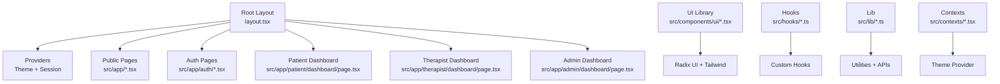

**Diagram sources**
- [layout.tsx](file://WEBAPP/src/app/layout.tsx#L1-L55)
- [button.tsx](file://WEBAPP/src/components/ui/button.tsx#L1-L60)
- [dialog.tsx](file://WEBAPP/src/components/ui/dialog.tsx#L1-L144)
- [ThemeContext.tsx](file://WEBAPP/src/contexts/ThemeContext.tsx#L1-L67)

**Section sources**
- [layout.tsx](file://WEBAPP/src/app/layout.tsx#L1-L55)
- [package.json](file://WEBAPP/package.json#L1-L88)

## Core Components
- Theming: A React Context provider manages light/dark mode, persists preference to localStorage, and applies the theme to the document root.
- UI Library: A set of composable UI primitives built with Radix UI and Tailwind CSS, including Button, Dialog, and others. They expose variant and size props and integrate with Tailwind merging utilities.
- Utilities: A shared cn() utility merges Tailwind classes safely.

Key implementation references:
- Theme provider and hook: [ThemeContext.tsx](file://WEBAPP/src/contexts/ThemeContext.tsx#L1-L67)
- UI Button primitive: [button.tsx](file://WEBAPP/src/components/ui/button.tsx#L1-L60)
- UI Dialog primitive: [dialog.tsx](file://WEBAPP/src/components/ui/dialog.tsx#L1-L144)
- Utility class merging: [utils.ts](file://WEBAPP/src/lib/utils.ts#L1-L7)

**Section sources**
- [ThemeContext.tsx](file://WEBAPP/src/contexts/ThemeContext.tsx#L1-L67)
- [button.tsx](file://WEBAPP/src/components/ui/button.tsx#L1-L60)
- [dialog.tsx](file://WEBAPP/src/components/ui/dialog.tsx#L1-L144)
- [utils.ts](file://WEBAPP/src/lib/utils.ts#L1-L7)

## Architecture Overview
The frontend is structured around:
- App Router: Routes are defined by file paths under src/app. Each page is a client component by default when marked with "use client".
- Providers: Root layout wraps children with ThemeProvider and ClientSessionProvider to share theme and session state across the app.
- Pages: Dedicated pages for landing, authentication, patient dashboard, therapist dashboard, and admin dashboard.
- UI Library: Composable primitives for dialogs, buttons, forms, and layouts.
- State Management: React Context for theme and custom hooks for chat and video features.
- Real-time Communication: Chat uses a custom hook to send/receive messages and optional TTS/avatar generation. Video uses webcam and emotion detection hooks.

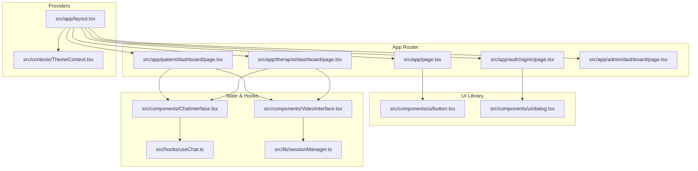

**Diagram sources**
- [layout.tsx](file://WEBAPP/src/app/layout.tsx#L1-L55)
- [ThemeContext.tsx](file://WEBAPP/src/contexts/ThemeContext.tsx#L1-L67)
- [page.tsx](file://WEBAPP/src/app/page.tsx#L1-L381)
- [auth/signin/page.tsx](file://WEBAPP/src/app/auth/signin/page.tsx#L1-L257)
- [patient/dashboard/page.tsx](file://WEBAPP/src/app/patient/dashboard/page.tsx#L1-L800)
- [therapist/dashboard/page.tsx](file://WEBAPP/src/app/therapist/dashboard/page.tsx#L1-L959)
- [admin/dashboard/page.tsx](file://WEBAPP/src/app/admin/dashboard/page.tsx#L1-L510)
- [button.tsx](file://WEBAPP/src/components/ui/button.tsx#L1-L60)
- [dialog.tsx](file://WEBAPP/src/components/ui/dialog.tsx#L1-L144)
- [useChat.ts](file://WEBAPP/src/hooks/useChat.ts#L1-L150)
- [ChatInterface.tsx](file://WEBAPP/src/components/ChatInterface.tsx#L1-L567)
- [VideoInterface.tsx](file://WEBAPP/src/components/VideoInterface.tsx#L1-L207)
- [sessionManager.ts](file://WEBAPP/src/lib/sessionManager.ts#L1-L78)

## Detailed Component Analysis

### Landing Page
The landing page serves as the entry point, featuring:
- Dynamic hero content with role-aware navigation and CTA.
- Feature highlights and technology stack presentation.
- Spline 3D background with overlay for readability.
- Theme toggle integration.

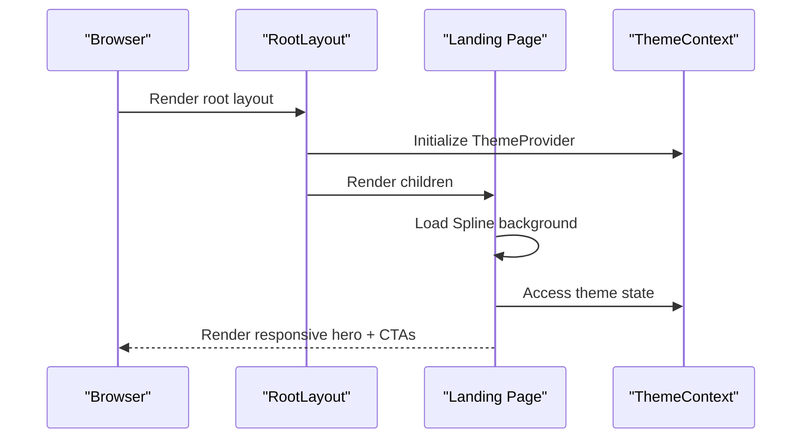

**Diagram sources**
- [layout.tsx](file://WEBAPP/src/app/layout.tsx#L1-L55)
- [page.tsx](file://WEBAPP/src/app/page.tsx#L1-L381)
- [ThemeContext.tsx](file://WEBAPP/src/contexts/ThemeContext.tsx#L1-L67)

**Section sources**
- [page.tsx](file://WEBAPP/src/app/page.tsx#L1-L381)
- [layout.tsx](file://WEBAPP/src/app/layout.tsx#L1-L55)

### Authentication Flow
Authentication integrates with NextAuth and supports:
- Credentials-based login with role selection.
- Google OAuth.
- Profile checks and redirects to appropriate dashboards.
- Role-specific navigation after sign-in.

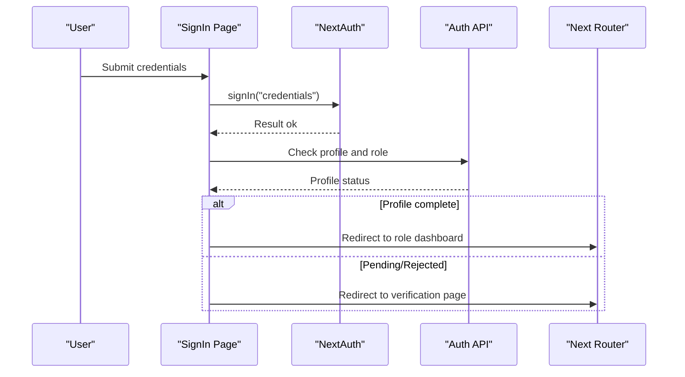

**Diagram sources**
- [auth/signin/page.tsx](file://WEBAPP/src/app/auth/signin/page.tsx#L1-L257)

**Section sources**
- [auth/signin/page.tsx](file://WEBAPP/src/app/auth/signin/page.tsx#L1-L257)

### Patient Dashboard
The patient dashboard aggregates:
- Session monitoring and time remaining.
- Analytics data including mental health levels, keyword breakdowns, and trends.
- Weekly progress and streak tracking.
- Quick actions to start sessions, view analytics, book appointments, and peer support.

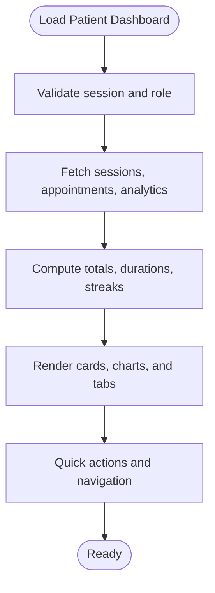

**Diagram sources**
- [patient/dashboard/page.tsx](file://WEBAPP/src/app/patient/dashboard/page.tsx#L1-L800)

**Section sources**
- [patient/dashboard/page.tsx](file://WEBAPP/src/app/patient/dashboard/page.tsx#L1-L800)

### Therapist Dashboard
The therapist dashboard provides:
- Patient management and session history.
- Today’s schedule with appointment statuses.
- Analytics and settings shortcuts.

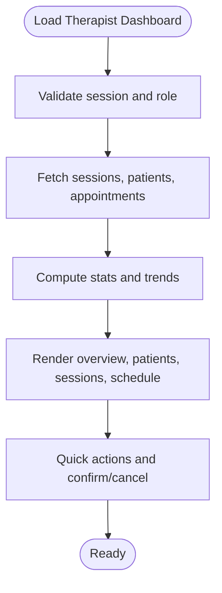

**Diagram sources**
- [therapist/dashboard/page.tsx](file://WEBAPP/src/app/therapist/dashboard/page.tsx#L1-L959)

**Section sources**
- [therapist/dashboard/page.tsx](file://WEBAPP/src/app/therapist/dashboard/page.tsx#L1-L959)

### Admin Panel
The admin panel enables:
- System analytics overview.
- Therapist verification workflows with approve/reject actions.
- User management with filtering, banning/unbanning, and deletion.

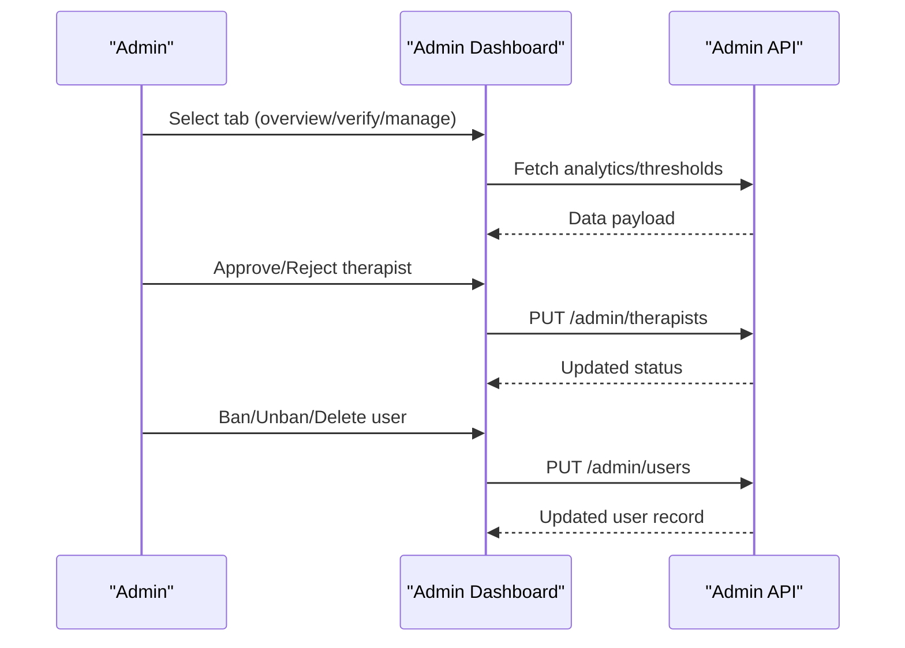

**Diagram sources**
- [admin/dashboard/page.tsx](file://WEBAPP/src/app/admin/dashboard/page.tsx#L1-L510)

**Section sources**
- [admin/dashboard/page.tsx](file://WEBAPP/src/app/admin/dashboard/page.tsx#L1-L510)

### Chat and Real-time Communication
The chat system is composed of:
- A reusable ChatInterface component that handles message lifecycle, persistence, and assessment flows.
- A custom useChat hook that encapsulates sending messages, optional TTS, and avatar generation.
- Optional integration with emotion detection via VideoInterface and webcam hooks.

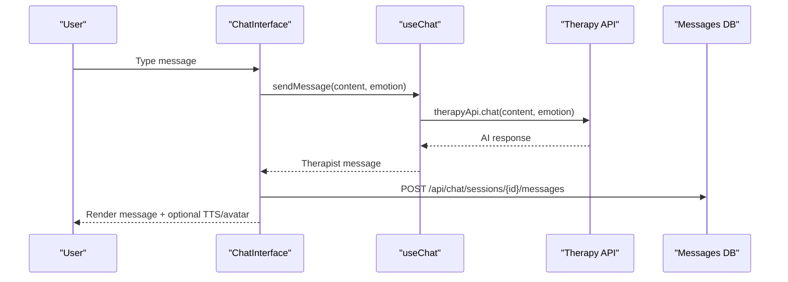

**Diagram sources**
- [ChatInterface.tsx](file://WEBAPP/src/components/ChatInterface.tsx#L1-L567)
- [useChat.ts](file://WEBAPP/src/hooks/useChat.ts#L1-L150)

**Section sources**
- [ChatInterface.tsx](file://WEBAPP/src/components/ChatInterface.tsx#L1-L567)
- [useChat.ts](file://WEBAPP/src/hooks/useChat.ts#L1-L150)

### Video Session and Emotion Detection
The video interface integrates:
- Webcam capture and emotion detection on intervals.
- Real-time emotion overlay and statistics.
- Parent callbacks for emotion updates.

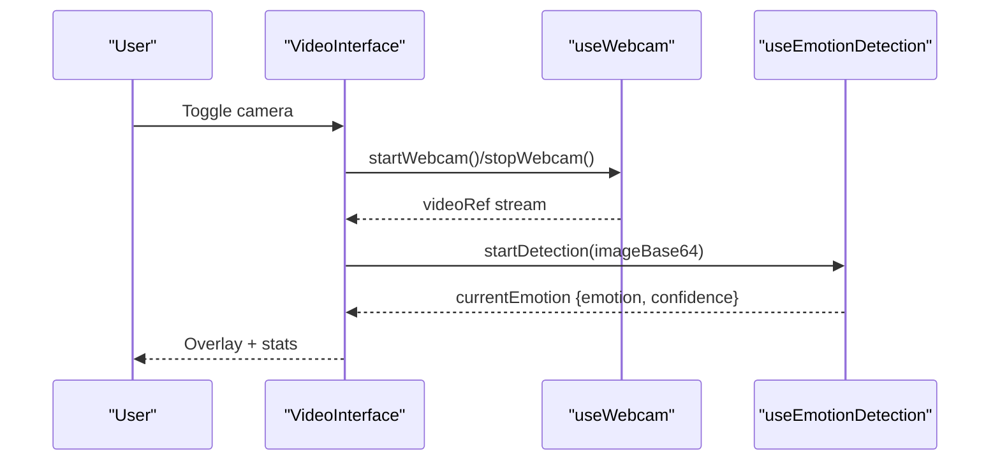

**Diagram sources**
- [VideoInterface.tsx](file://WEBAPP/src/components/VideoInterface.tsx#L1-L207)

**Section sources**
- [VideoInterface.tsx](file://WEBAPP/src/components/VideoInterface.tsx#L1-L207)

### UI Component Library and Composition Patterns
- Button: Variants and sizes with Radix slot composition and Tailwind merging.
- Dialog: Portal-based overlay with trigger/content/title/description composition.
- Composition: Components accept className and variant props, enabling consistent styling across the app.

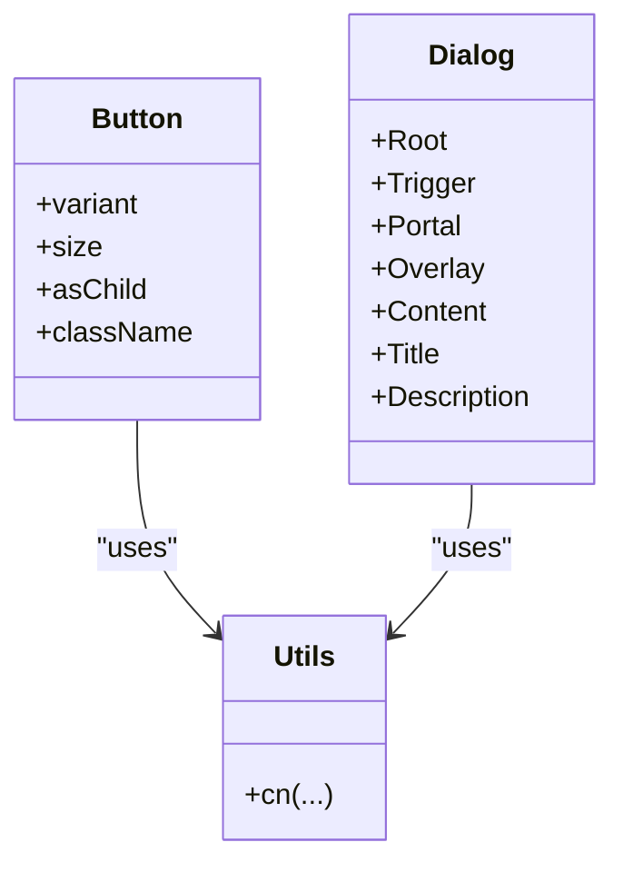

**Diagram sources**
- [button.tsx](file://WEBAPP/src/components/ui/button.tsx#L1-L60)
- [dialog.tsx](file://WEBAPP/src/components/ui/dialog.tsx#L1-L144)
- [utils.ts](file://WEBAPP/src/lib/utils.ts#L1-L7)

**Section sources**
- [button.tsx](file://WEBAPP/src/components/ui/button.tsx#L1-L60)
- [dialog.tsx](file://WEBAPP/src/components/ui/dialog.tsx#L1-L144)
- [utils.ts](file://WEBAPP/src/lib/utils.ts#L1-L7)

### Theming System and Responsive Design
- ThemeContext manages theme state, persists to localStorage, and applies the "dark" class to the document root.
- Responsive design leverages Tailwind utilities and component-level responsiveness (e.g., grids, spacing, and typography).
- The root layout sets fonts and viewport metadata for cross-device compatibility.

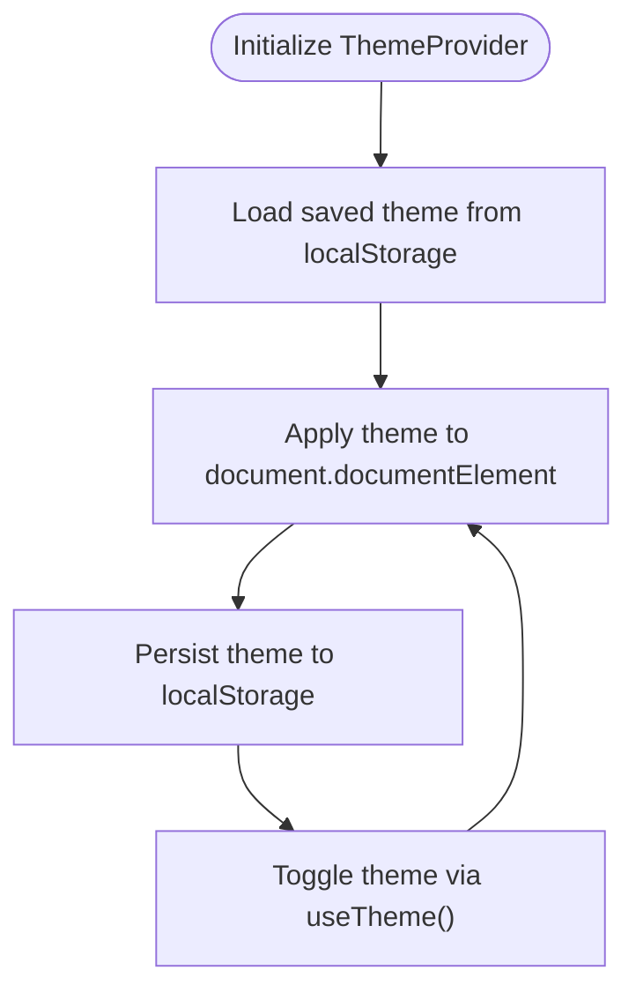

**Diagram sources**
- [ThemeContext.tsx](file://WEBAPP/src/contexts/ThemeContext.tsx#L1-L67)
- [layout.tsx](file://WEBAPP/src/app/layout.tsx#L1-L55)

**Section sources**
- [ThemeContext.tsx](file://WEBAPP/src/contexts/ThemeContext.tsx#L1-L67)
- [layout.tsx](file://WEBAPP/src/app/layout.tsx#L1-L55)

## Dependency Analysis
External dependencies relevant to the frontend include:
- UI primitives: @radix-ui packages for accessible base components.
- Styling: Tailwind CSS and related tooling.
- Icons: lucide-react for UI icons.
- State/session: next-auth and next-themes for authentication and theme switching.
- Media and animations: @splinetool/react-spline for 3D backgrounds.
- Utilities: class-variance-authority, clsx, tailwind-merge for component variants and class merging.

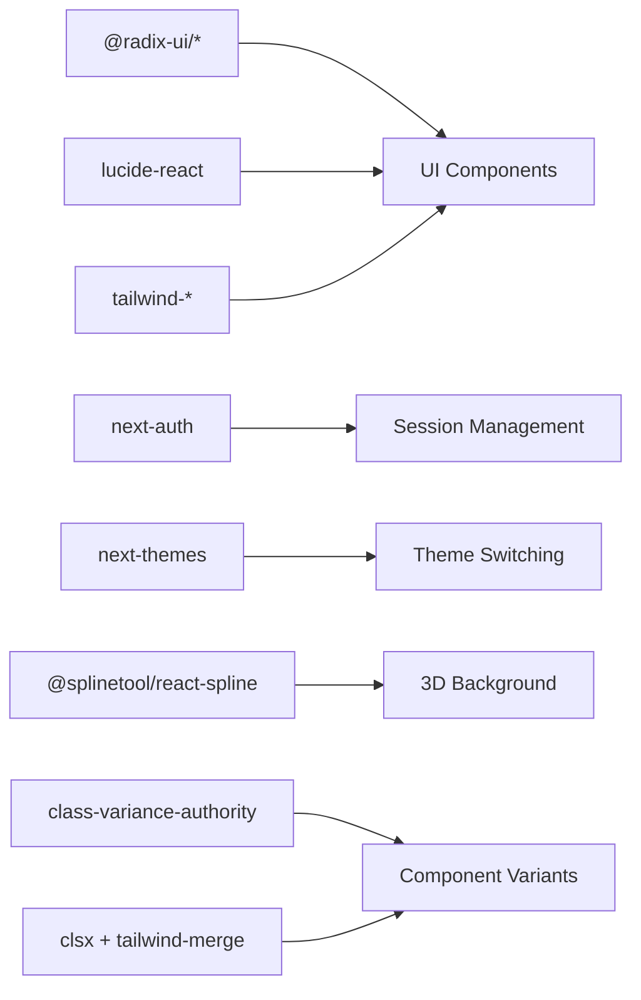

**Diagram sources**
- [package.json](file://WEBAPP/package.json#L15-L72)

**Section sources**
- [package.json](file://WEBAPP/package.json#L15-L72)

## Performance Considerations
- Client-side rendering: Pages use "use client" to enable interactivity and hooks.
- Lazy initialization: Spline background is initialized conditionally and disposed on unmount.
- Efficient re-renders: ChatInterface uses refs and memoized callbacks to avoid unnecessary renders.
- Class merging: cn() utility ensures minimal DOM churn by merging Tailwind classes efficiently.
- Session monitoring: Debounced updates and periodic checks prevent excessive network calls.

[No sources needed since this section provides general guidance]

## Troubleshooting Guide
- Session expiration and incognito detection: SessionManager monitors expiry, incognito mode, and reloads on storage changes.
- Chat errors: useChat surfaces errors and prevents concurrent sends.
- Video/webcam issues: VideoInterface displays errors and disables controls when inactive.

**Section sources**
- [sessionManager.ts](file://WEBAPP/src/lib/sessionManager.ts#L1-L78)
- [useChat.ts](file://WEBAPP/src/hooks/useChat.ts#L1-L150)
- [VideoInterface.tsx](file://WEBAPP/src/components/VideoInterface.tsx#L1-L207)

## Conclusion
The frontend leverages Next.js App Router, Radix UI, and Tailwind CSS to deliver a responsive, accessible, and extensible UI. React Context and custom hooks encapsulate state and cross-cutting concerns like theming, chat, and video. The architecture cleanly separates providers, pages, and composables, enabling maintainability and scalability across roles (patients, therapists, admins).