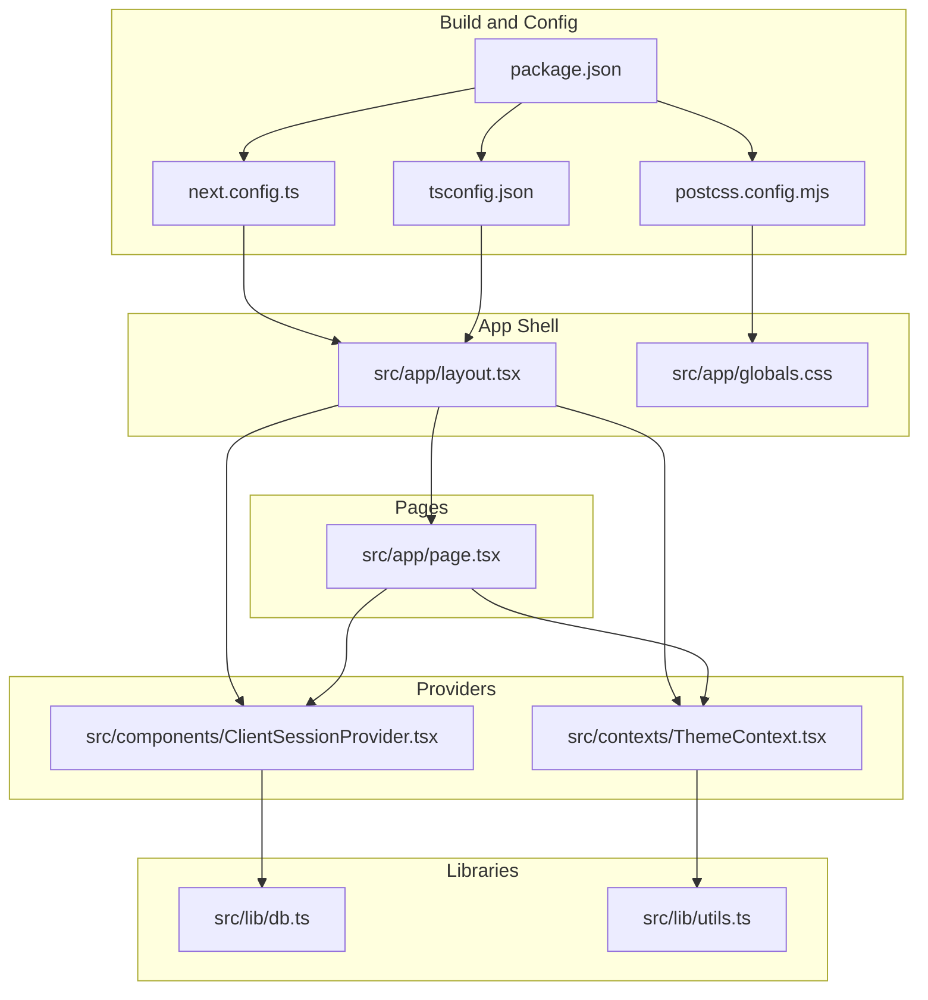
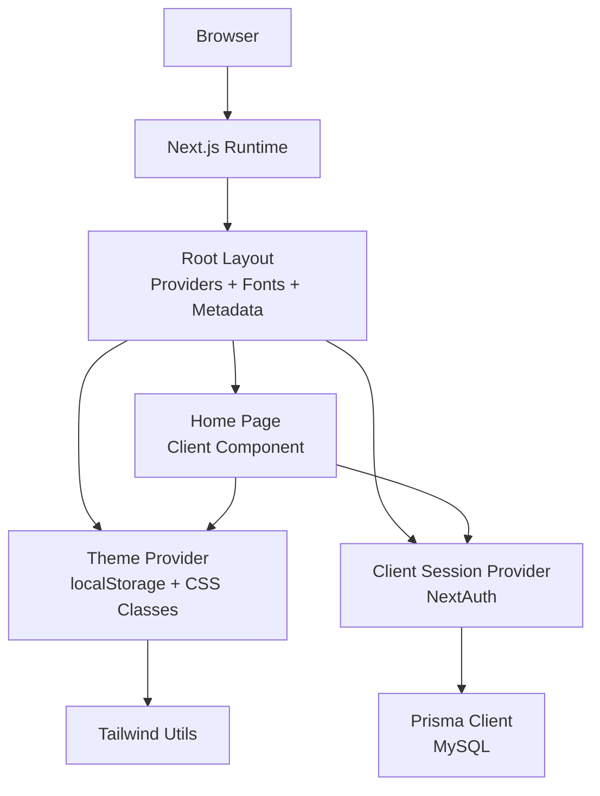
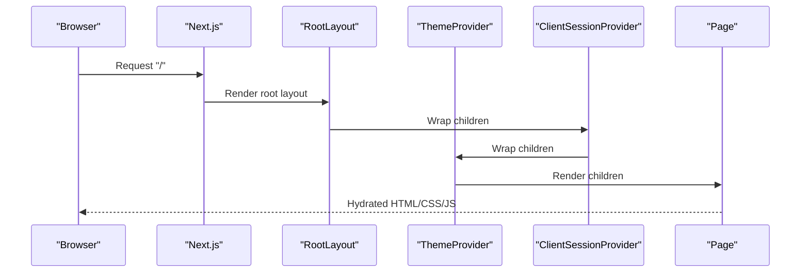
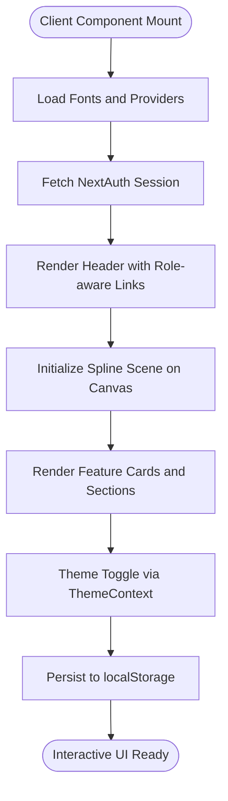
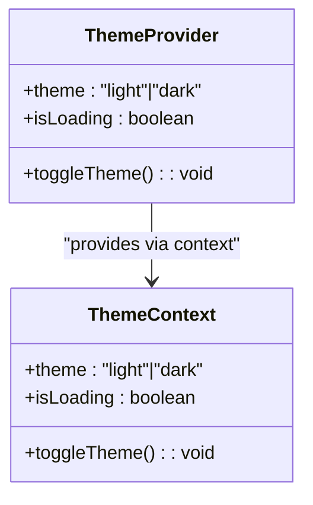
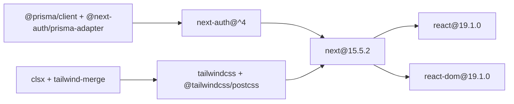

# Next.js Application Architecture

<cite>
**Referenced Files in This Document**
- [package.json](file://WEBAPP/package.json)
- [next.config.ts](file://WEBAPP/next.config.ts)
- [tsconfig.json](file://WEBAPP/tsconfig.json)
- [postcss.config.mjs](file://WEBAPP/postcss.config.mjs)
- [src/app/layout.tsx](file://WEBAPP/src/app/layout.tsx)
- [src/app/page.tsx](file://WEBAPP/src/app/page.tsx)
- [src/components/ClientSessionProvider.tsx](file://WEBAPP/src/components/ClientSessionProvider.tsx)
- [src/contexts/ThemeContext.tsx](file://WEBAPP/src/contexts/ThemeContext.tsx)
- [src/lib/db.ts](file://WEBAPP/src/lib/db.ts)
- [src/lib/utils.ts](file://WEBAPP/src/lib/utils.ts)
- [src/app/globals.css](file://WEBAPP/src/app/globals.css)
- [GOOGLE_OAUTH_SETUP.md](file://WEBAPP/GOOGLE_OAUTH_SETUP.md)
- [MY_SQL_INFO.md](file://WEBAPP/MY_SQL_INFO.md)
- [README.md](file://README.md)
</cite>

## Table of Contents
1. [Introduction](#introduction)
2. [Project Structure](#project-structure)
3. [Core Components](#core-components)
4. [Architecture Overview](#architecture-overview)
5. [Detailed Component Analysis](#detailed-component-analysis)
6. [Dependency Analysis](#dependency-analysis)
7. [Performance Considerations](#performance-considerations)
8. [Troubleshooting Guide](#troubleshooting-guide)
9. [Conclusion](#conclusion)
10. [Appendices](#appendices)

## Introduction
This document explains the Next.js application architecture powering MindBridge. It covers the app directory structure, file-based routing, modern Next.js 15+ features, root layout configuration, metadata and viewport management, build configuration (TypeScript, Tailwind CSS), hydration strategy, client-side rendering patterns, performance optimizations, folder organization, route groups, middleware integration, and deployment considerations.

## Project Structure
The application follows Next.js app directory conventions with a clear separation of concerns:
- App shell and pages under src/app
- Shared UI components under src/components
- Context providers under src/contexts
- Hooks under src/hooks
- Utilities and libraries under src/lib
- Global styles under src/app/globals.css
- Build and configuration files at the repository root (package.json, next.config.ts, tsconfig.json, postcss.config.mjs)

**Diagram sources**
- [package.json](file://WEBAPP/package.json#L1-L88)
- [next.config.ts](file://WEBAPP/next.config.ts#L1-L45)
- [tsconfig.json](file://WEBAPP/tsconfig.json#L1-L42)
- [postcss.config.mjs](file://WEBAPP/postcss.config.mjs#L1-L7)
- [src/app/layout.tsx](file://WEBAPP/src/app/layout.tsx#L1-L55)
- [src/app/globals.css](file://WEBAPP/src/app/globals.css#L1-L132)
- [src/app/page.tsx](file://WEBAPP/src/app/page.tsx#L1-L381)
- [src/contexts/ThemeContext.tsx](file://WEBAPP/src/contexts/ThemeContext.tsx#L1-L67)
- [src/components/ClientSessionProvider.tsx](file://WEBAPP/src/components/ClientSessionProvider.tsx#L1-L12)
- [src/lib/db.ts](file://WEBAPP/src/lib/db.ts#L1-L15)
- [src/lib/utils.ts](file://WEBAPP/src/lib/utils.ts#L1-L7)

**Section sources**
- [package.json](file://WEBAPP/package.json#L1-L88)
- [next.config.ts](file://WEBAPP/next.config.ts#L1-L45)
- [tsconfig.json](file://WEBAPP/tsconfig.json#L1-L42)
- [postcss.config.mjs](file://WEBAPP/postcss.config.mjs#L1-L7)
- [src/app/layout.tsx](file://WEBAPP/src/app/layout.tsx#L1-L55)
- [src/app/globals.css](file://WEBAPP/src/app/globals.css#L1-L132)
- [src/app/page.tsx](file://WEBAPP/src/app/page.tsx#L1-L381)
- [src/contexts/ThemeContext.tsx](file://WEBAPP/src/contexts/ThemeContext.tsx#L1-L67)
- [src/components/ClientSessionProvider.tsx](file://WEBAPP/src/components/ClientSessionProvider.tsx#L1-L12)
- [src/lib/db.ts](file://WEBAPP/src/lib/db.ts#L1-L15)
- [src/lib/utils.ts](file://WEBAPP/src/lib/utils.ts#L1-L7)

## Core Components
- Root layout and metadata: Defines global fonts, metadata, viewport, and wraps children with providers for theme and session management.
- Home page: Client component orchestrating Spline 3D background, responsive navigation, role-aware CTAs, and dark mode toggle.
- Providers:
  - Theme provider: Manages light/dark theme state, persists selection to localStorage, and applies CSS classes to document root.
  - Client session provider: Wraps children with NextAuth’s session provider for client-side session management.
- Utilities:
  - Database connection: Prisma client configured with development logging and global singleton pattern.
  - Utility functions: Tailwind merging and conditional class composition.

Key implementation references:
- Root layout and metadata: [src/app/layout.tsx](file://WEBAPP/src/app/layout.tsx#L1-L55)
- Home page client component: [src/app/page.tsx](file://WEBAPP/src/app/page.tsx#L1-L381)
- Theme provider: [src/contexts/ThemeContext.tsx](file://WEBAPP/src/contexts/ThemeContext.tsx#L1-L67)
- Client session provider: [src/components/ClientSessionProvider.tsx](file://WEBAPP/src/components/ClientSessionProvider.tsx#L1-L12)
- Database client: [src/lib/db.ts](file://WEBAPP/src/lib/db.ts#L1-L15)
- Tailwind utilities: [src/lib/utils.ts](file://WEBAPP/src/lib/utils.ts#L1-L7)

**Section sources**
- [src/app/layout.tsx](file://WEBAPP/src/app/layout.tsx#L1-L55)
- [src/app/page.tsx](file://WEBAPP/src/app/page.tsx#L1-L381)
- [src/contexts/ThemeContext.tsx](file://WEBAPP/src/contexts/ThemeContext.tsx#L1-L67)
- [src/components/ClientSessionProvider.tsx](file://WEBAPP/src/components/ClientSessionProvider.tsx#L1-L12)
- [src/lib/db.ts](file://WEBAPP/src/lib/db.ts#L1-L15)
- [src/lib/utils.ts](file://WEBAPP/src/lib/utils.ts#L1-L7)

## Architecture Overview
The runtime architecture centers on a root layout that injects providers and global styles, with client components handling interactive UI and session management. Routing is file-system based under src/app, enabling nested layouts and route groups.

**Diagram sources**
- [src/app/layout.tsx](file://WEBAPP/src/app/layout.tsx#L1-L55)
- [src/app/page.tsx](file://WEBAPP/src/app/page.tsx#L1-L381)
- [src/contexts/ThemeContext.tsx](file://WEBAPP/src/contexts/ThemeContext.tsx#L1-L67)
- [src/components/ClientSessionProvider.tsx](file://WEBAPP/src/components/ClientSessionProvider.tsx#L1-L12)
- [src/lib/db.ts](file://WEBAPP/src/lib/db.ts#L1-L15)
- [src/lib/utils.ts](file://WEBAPP/src/lib/utils.ts#L1-L7)

## Detailed Component Analysis

### Root Layout and Providers
The root layout configures:
- Fonts via Next Font (Geist Sans and Mono) with CSS variables
- Metadata and viewport for branding and device responsiveness
- Provider stack: ClientSessionProvider -> ThemeProvider -> children
- Global CSS via Tailwind layers and custom base utilities

**Diagram sources**
- [src/app/layout.tsx](file://WEBAPP/src/app/layout.tsx#L1-L55)
- [src/components/ClientSessionProvider.tsx](file://WEBAPP/src/components/ClientSessionProvider.tsx#L1-L12)
- [src/contexts/ThemeContext.tsx](file://WEBAPP/src/contexts/ThemeContext.tsx#L1-L67)
- [src/app/page.tsx](file://WEBAPP/src/app/page.tsx#L1-L381)

**Section sources**
- [src/app/layout.tsx](file://WEBAPP/src/app/layout.tsx#L1-L55)
- [src/app/globals.css](file://WEBAPP/src/app/globals.css#L1-L132)

### Home Page Client Component
The home page is a client component that:
- Uses next-auth hooks for session state
- Dynamically loads a Spline 3D scene
- Renders role-aware navigation and CTAs
- Integrates theme toggle and responsive design

**Diagram sources**
- [src/app/page.tsx](file://WEBAPP/src/app/page.tsx#L1-L381)
- [src/contexts/ThemeContext.tsx](file://WEBAPP/src/contexts/ThemeContext.tsx#L1-L67)

**Section sources**
- [src/app/page.tsx](file://WEBAPP/src/app/page.tsx#L1-L381)
- [src/contexts/ThemeContext.tsx](file://WEBAPP/src/contexts/ThemeContext.tsx#L1-L67)

### Theme Provider
The theme provider:
- Initializes theme from localStorage
- Applies dark class to document root
- Persists theme changes to localStorage
- Exposes a hook for consuming theme state

**Diagram sources**
- [src/contexts/ThemeContext.tsx](file://WEBAPP/src/contexts/ThemeContext.tsx#L1-L67)

**Section sources**
- [src/contexts/ThemeContext.tsx](file://WEBAPP/src/contexts/ThemeContext.tsx#L1-L67)

### Client Session Provider
Wraps children with NextAuth’s session provider to enable client-side session management and reactivity.

**Section sources**
- [src/components/ClientSessionProvider.tsx](file://WEBAPP/src/components/ClientSessionProvider.tsx#L1-L12)

### Database Client
Prisma client configured with:
- Development logging enabled
- Global singleton pattern to avoid multiple clients
- Exported as default for use across the app

**Section sources**
- [src/lib/db.ts](file://WEBAPP/src/lib/db.ts#L1-L15)

### Tailwind Utilities
Utility functions for composing and merging Tailwind classes efficiently.

**Section sources**
- [src/lib/utils.ts](file://WEBAPP/src/lib/utils.ts#L1-L7)

## Dependency Analysis
The application relies on Next.js 15+, React 19, TypeScript, Tailwind CSS v4, Prisma, and NextAuth. Dependencies are declared in package.json with dev dependencies for ESLint, PostCSS, Tailwind, and TypeScript.

**Diagram sources**
- [package.json](file://WEBAPP/package.json#L15-L86)

**Section sources**
- [package.json](file://WEBAPP/package.json#L1-L88)

## Performance Considerations
- Compression and headers: Compression enabled and CORS headers configured for external access.
- Images: Image optimization disabled via unoptimized flag; consider enabling optimized images in production and adding domains.
- Build flags: poweredByHeader disabled to reduce response headers overhead.
- Client hydration: Minimal client component usage (home page) reduces hydration cost; keep client components scoped.
- CSS: Tailwind layers and custom base utilities minimize runtime CSS generation overhead.
- Logging: Prisma logs reduced in production to limit IO overhead.

Recommendations:
- Enable image optimization and configure domains for external assets.
- Use dynamic imports for heavy client-only libraries.
- Split bundles with route-based code splitting (Next.js app directory supports this automatically).
- Monitor bundle size and enable tree-shaking via bundler module resolution.

**Section sources**
- [next.config.ts](file://WEBAPP/next.config.ts#L1-L45)
- [src/lib/db.ts](file://WEBAPP/src/lib/db.ts#L1-L15)

## Troubleshooting Guide
- Google OAuth setup: Follow the guide to configure client IDs, redirect URIs, and environment variables for local and production environments.
- Database initialization: Ensure MySQL is running, create the database, generate Prisma client, and push schema.
- Theme persistence: If theme does not persist, verify localStorage accessibility and browser privacy settings.
- NextAuth callbacks: Ensure NEXTAUTH_URL matches deployment origin and redirect URIs are whitelisted.

**Section sources**
- [GOOGLE_OAUTH_SETUP.md](file://WEBAPP/GOOGLE_OAUTH_SETUP.md#L1-L74)
- [MY_SQL_INFO.md](file://WEBAPP/MY_SQL_INFO.md#L1-L123)
- [src/contexts/ThemeContext.tsx](file://WEBAPP/src/contexts/ThemeContext.tsx#L1-L67)

## Conclusion
MindBridge leverages Next.js 15+ app directory conventions with a clean provider stack, robust TypeScript configuration, and Tailwind CSS v4 for styling. The architecture emphasizes client-side interactivity where needed, efficient hydration, and scalable routing. With proper image optimization, middleware integration, and production hardening, the application is well-positioned for growth and reliable deployments.

## Appendices

### Build Configuration Summary
- TypeScript: Strict mode, ESNext target, bundler module resolution, JSX preserve, path aliases (@/*).
- PostCSS: Tailwind CSS plugin and autoprefixer.
- Next.js: Compression enabled, CORS headers, unoptimized images, trailing slash disabled, custom env keys.

**Section sources**
- [tsconfig.json](file://WEBAPP/tsconfig.json#L1-L42)
- [postcss.config.mjs](file://WEBAPP/postcss.config.mjs#L1-L7)
- [next.config.ts](file://WEBAPP/next.config.ts#L1-L45)

### Deployment Checklist
- Environment variables: DATABASE_URL, NEXTAUTH_URL, and OAuth secrets.
- Static exports: If using next export, verify static generation compatibility.
- Middleware: Place middleware files in the app root if needed for redirects or auth guards.
- Route groups: Use parentheses in src/app to group routes without affecting URLs.
- Production build: Run next build and next start for production.

[No sources needed since this section provides general guidance]