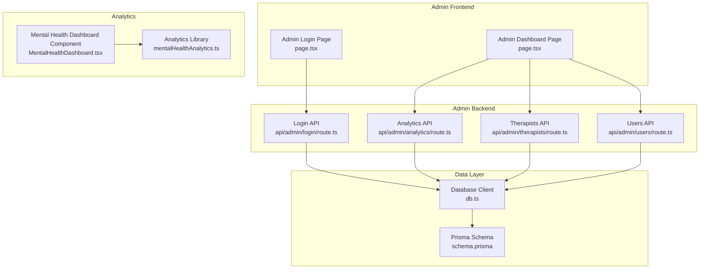
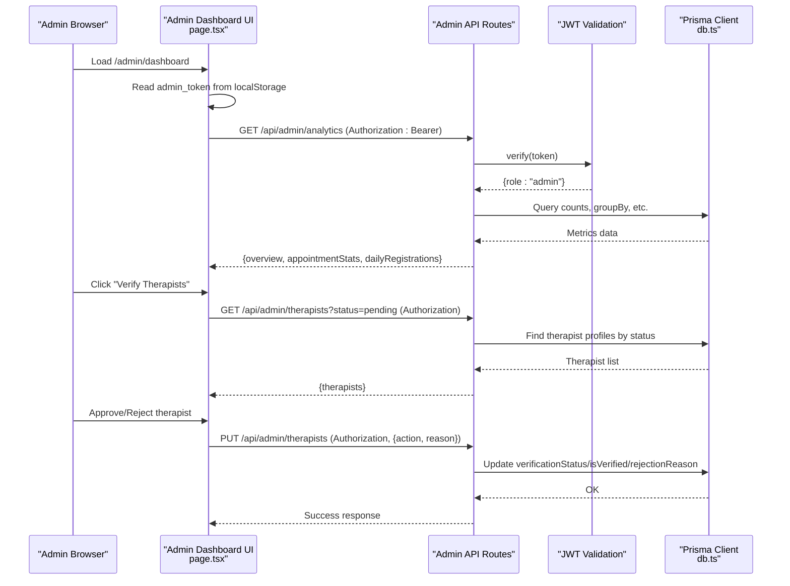
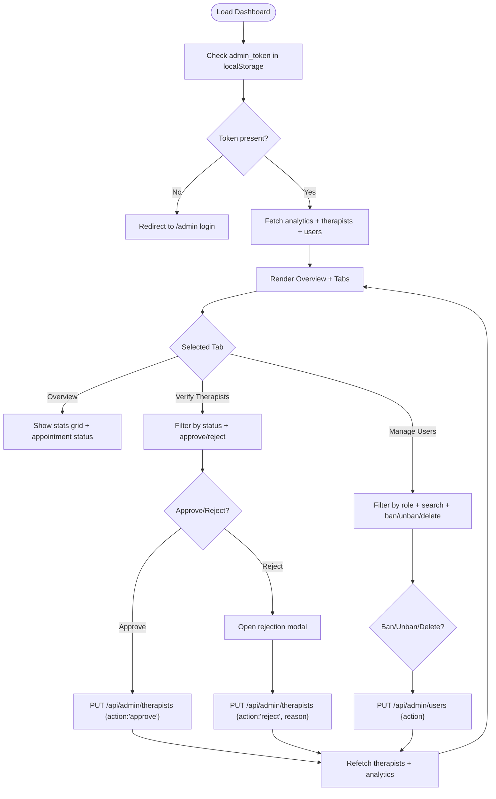
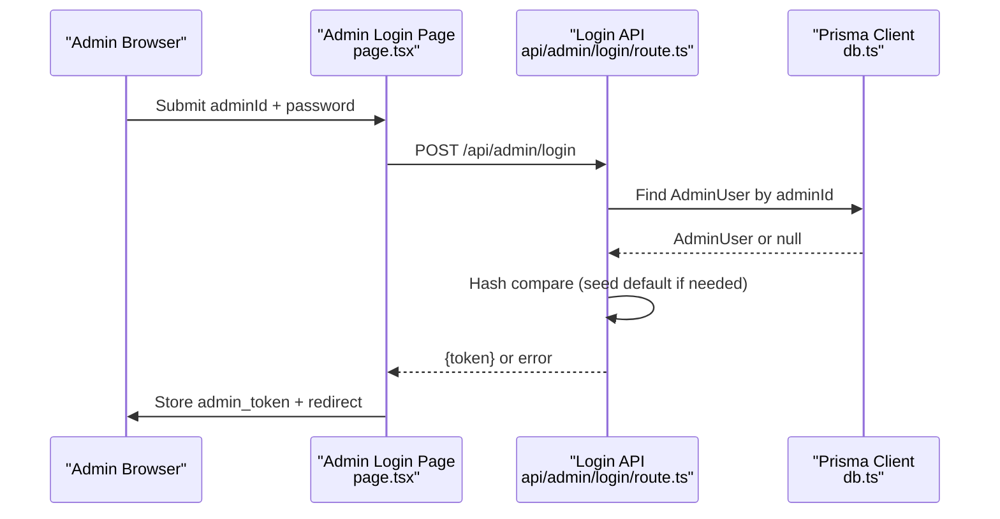
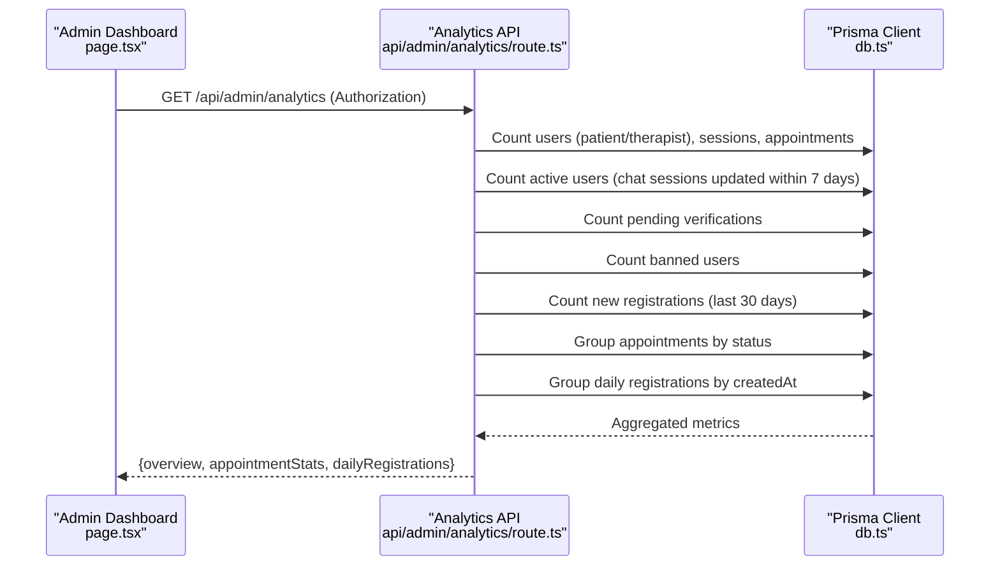
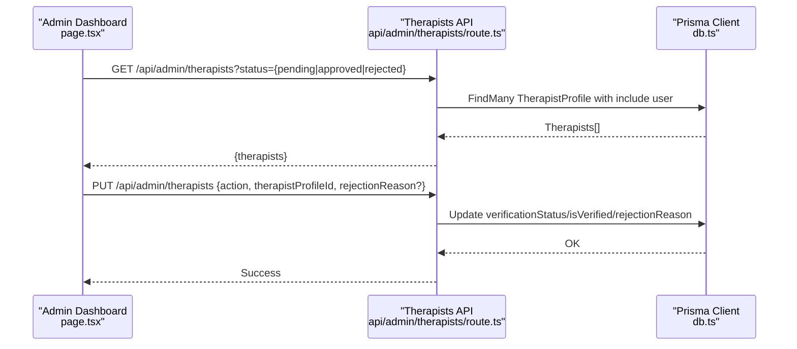
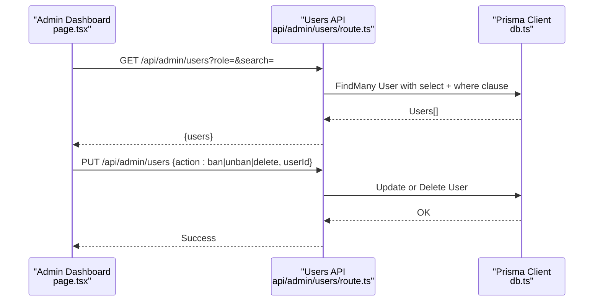
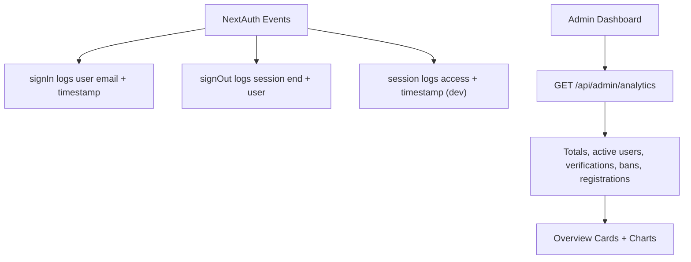
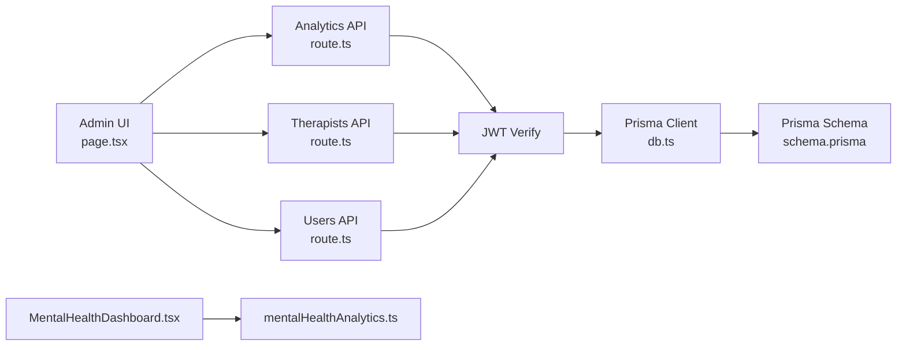
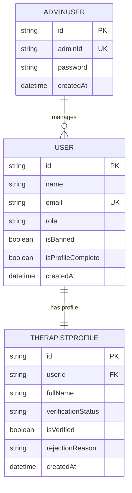

# Admin Panel

<cite>
**Referenced Files in This Document**
- [page.tsx](file://WEBAPP/src/app/admin/dashboard/page.tsx)
- [route.ts](file://WEBAPP/src/app/api/admin/analytics/route.ts)
- [route.ts](file://WEBAPP/src/app/api/admin/login/route.ts)
- [route.ts](file://WEBAPP/src/app/api/admin/therapists/route.ts)
- [route.ts](file://WEBAPP/src/app/api/admin/users/route.ts)
- [page.tsx](file://WEBAPP/src/app/admin/page.tsx)
- [schema.prisma](file://WEBAPP/prisma/schema.prisma)
- [db.ts](file://WEBAPP/src/lib/db.ts)
- [MentalHealthDashboard.tsx](file://WEBAPP/src/components/analytics/MentalHealthDashboard.tsx)
- [mentalHealthAnalytics.ts](file://WEBAPP/src/lib/mentalHealthAnalytics.ts)
- [route.ts](file://WEBAPP/src/app/api/auth/[...nextauth]/route.ts)
</cite>

## Table of Contents
1. [Introduction](#introduction)
2. [Project Structure](#project-structure)
3. [Core Components](#core-components)
4. [Architecture Overview](#architecture-overview)
5. [Detailed Component Analysis](#detailed-component-analysis)
6. [Dependency Analysis](#dependency-analysis)
7. [Performance Considerations](#performance-considerations)
8. [Troubleshooting Guide](#troubleshooting-guide)
9. [Conclusion](#conclusion)
10. [Appendices](#appendices)

## Introduction
This document describes the administrative panel system for MindBridge. It covers the admin dashboard, analytics, user and therapist management, administrative workflows, system monitoring, and security considerations. The admin panel provides:
- A dashboard with system overview and key metrics
- Therapist verification workflows
- User management (banning, unbanning, deletion)
- Analytics reporting and system health monitoring
- Security controls for admin access and audit logging

## Project Structure
The admin functionality spans frontend pages, backend API routes, and the Prisma data model:
- Admin UI: Next.js app pages under admin/
- Admin APIs: Next.js API routes under api/admin/*
- Data model: Prisma schema defines AdminUser, User, TherapistProfile, and related entities
- Analytics: Shared mental health analytics utilities and components

**Diagram sources**
- [page.tsx](file://WEBAPP/src/app/admin/dashboard/page.tsx#L61-L176)
- [page.tsx](file://WEBAPP/src/app/admin/page.tsx#L5-L83)
- [route.ts](file://WEBAPP/src/app/api/admin/login/route.ts#L9-L74)
- [route.ts](file://WEBAPP/src/app/api/admin/analytics/route.ts#L20-L108)
- [route.ts](file://WEBAPP/src/app/api/admin/therapists/route.ts#L21-L92)
- [route.ts](file://WEBAPP/src/app/api/admin/users/route.ts#L20-L107)
- [schema.prisma](file://WEBAPP/prisma/schema.prisma#L323-L330)
- [db.ts](file://WEBAPP/src/lib/db.ts#L6-L12)
- [MentalHealthDashboard.tsx](file://WEBAPP/src/components/analytics/MentalHealthDashboard.tsx#L47-L541)
- [mentalHealthAnalytics.ts](file://WEBAPP/src/lib/mentalHealthAnalytics.ts#L199-L289)

**Section sources**
- [page.tsx](file://WEBAPP/src/app/admin/dashboard/page.tsx#L61-L176)
- [page.tsx](file://WEBAPP/src/app/admin/page.tsx#L5-L83)
- [route.ts](file://WEBAPP/src/app/api/admin/analytics/route.ts#L20-L108)
- [route.ts](file://WEBAPP/src/app/api/admin/login/route.ts#L9-L74)
- [route.ts](file://WEBAPP/src/app/api/admin/therapists/route.ts#L21-L92)
- [route.ts](file://WEBAPP/src/app/api/admin/users/route.ts#L20-L107)
- [schema.prisma](file://WEBAPP/prisma/schema.prisma#L323-L330)
- [db.ts](file://WEBAPP/src/lib/db.ts#L6-L12)
- [MentalHealthDashboard.tsx](file://WEBAPP/src/components/analytics/MentalHealthDashboard.tsx#L47-L541)
- [mentalHealthAnalytics.ts](file://WEBAPP/src/lib/mentalHealthAnalytics.ts#L199-L289)

## Core Components
- Admin Dashboard (page.tsx): Renders overview statistics, manages therapist verification, and manages users. Handles admin auth via local storage and Bearer tokens.
- Admin Login (page.tsx + route.ts): Provides admin login UI and validates credentials against AdminUser records, issuing a JWT.
- Analytics API (route.ts): Computes system-wide metrics, including totals, activity, verification status, and daily registrations.
- Therapists API (route.ts): Lists therapists filtered by verification status and updates approval/rejection with optional rejection reason.
- Users API (route.ts): Lists users by role and search term, and performs ban/unban/delete operations.
- Data Model (schema.prisma): Defines AdminUser, User, TherapistProfile, and related entities.
- Analytics Utilities (MentalHealthDashboard.tsx + mentalHealthAnalytics.ts): Provides advanced analytics dashboards and analysis functions used elsewhere in the platform.

**Section sources**
- [page.tsx](file://WEBAPP/src/app/admin/dashboard/page.tsx#L61-L176)
- [page.tsx](file://WEBAPP/src/app/admin/page.tsx#L5-L83)
- [route.ts](file://WEBAPP/src/app/api/admin/analytics/route.ts#L20-L108)
- [route.ts](file://WEBAPP/src/app/api/admin/therapists/route.ts#L21-L92)
- [route.ts](file://WEBAPP/src/app/api/admin/users/route.ts#L20-L107)
- [schema.prisma](file://WEBAPP/prisma/schema.prisma#L323-L330)
- [MentalHealthDashboard.tsx](file://WEBAPP/src/components/analytics/MentalHealthDashboard.tsx#L47-L541)
- [mentalHealthAnalytics.ts](file://WEBAPP/src/lib/mentalHealthAnalytics.ts#L199-L289)

## Architecture Overview
The admin panel follows a client-server pattern:
- Client: Next.js app pages manage UI state, fetch data, and submit actions.
- Server: Next.js API routes validate admin JWT, query Prisma, and return structured data.
- Data: Prisma ORM connects to MySQL and exposes typed queries.

**Diagram sources**
- [page.tsx](file://WEBAPP/src/app/admin/dashboard/page.tsx#L92-L131)
- [route.ts](file://WEBAPP/src/app/api/admin/analytics/route.ts#L20-L108)
- [route.ts](file://WEBAPP/src/app/api/admin/therapists/route.ts#L52-L92)
- [db.ts](file://WEBAPP/src/lib/db.ts#L6-L12)

## Detailed Component Analysis

### Admin Dashboard
Responsibilities:
- Render overview statistics and appointment status breakdown
- Filter and approve/reject therapists
- Search and manage users (ban/unban/delete)
- Logout and token lifecycle

Key behaviors:
- On mount, reads admin_token from localStorage; redirects to login if missing
- Fetches analytics, therapists, and users concurrently
- Submits actions with Authorization header containing Bearer token
- Supports rejection reason capture for rejected therapists

**Diagram sources**
- [page.tsx](file://WEBAPP/src/app/admin/dashboard/page.tsx#L76-L168)

**Section sources**
- [page.tsx](file://WEBAPP/src/app/admin/dashboard/page.tsx#L61-L176)
- [page.tsx](file://WEBAPP/src/app/admin/dashboard/page.tsx#L133-L168)

### Admin Login
Responsibilities:
- Validate adminId and password against AdminUser
- Seed default admin credentials if applicable
- Issue JWT with role=admin and expiration

**Diagram sources**
- [page.tsx](file://WEBAPP/src/app/admin/page.tsx#L15-L37)
- [route.ts](file://WEBAPP/src/app/api/admin/login/route.ts#L9-L74)
- [schema.prisma](file://WEBAPP/prisma/schema.prisma#L323-L330)
- [db.ts](file://WEBAPP/src/lib/db.ts#L6-L12)

**Section sources**
- [page.tsx](file://WEBAPP/src/app/admin/page.tsx#L5-L83)
- [route.ts](file://WEBAPP/src/app/api/admin/login/route.ts#L9-L74)
- [schema.prisma](file://WEBAPP/prisma/schema.prisma#L323-L330)

### Analytics Reporting
Responsibilities:
- Aggregate system metrics: totals, active users, pending verifications, banned users, recent registrations
- Group appointment statuses and compute daily registrations for charts

**Diagram sources**
- [route.ts](file://WEBAPP/src/app/api/admin/analytics/route.ts#L20-L108)
- [db.ts](file://WEBAPP/src/lib/db.ts#L6-L12)

**Section sources**
- [route.ts](file://WEBAPP/src/app/api/admin/analytics/route.ts#L20-L108)

### Therapist Oversight Tools
Responsibilities:
- List therapists filtered by verification status
- Approve or reject with optional rejection reason
- Persist verification status and rejection reason

**Diagram sources**
- [route.ts](file://WEBAPP/src/app/api/admin/therapists/route.ts#L21-L92)
- [db.ts](file://WEBAPP/src/lib/db.ts#L6-L12)

**Section sources**
- [route.ts](file://WEBAPP/src/app/api/admin/therapists/route.ts#L21-L92)

### User Management
Responsibilities:
- Filter users by role and search by name/email
- Ban/unban or delete users
- Reflect changes in analytics

**Diagram sources**
- [route.ts](file://WEBAPP/src/app/api/admin/users/route.ts#L19-L107)
- [db.ts](file://WEBAPP/src/lib/db.ts#L6-L12)

**Section sources**
- [route.ts](file://WEBAPP/src/app/api/admin/users/route.ts#L19-L107)

### System Monitoring and Audit Trail
- NextAuth events log sign-in, sign-out, and session access (development) for monitoring.
- Admin analytics endpoint returns counts and groupings suitable for dashboards and alerts.

**Diagram sources**
- [route.ts](file://WEBAPP/src/app/api/auth/[...nextauth]/route.ts#L215-L233)
- [route.ts](file://WEBAPP/src/app/api/admin/analytics/route.ts#L20-L108)

**Section sources**
- [route.ts](file://WEBAPP/src/app/api/auth/[...nextauth]/route.ts#L215-L233)
- [route.ts](file://WEBAPP/src/app/api/admin/analytics/route.ts#L20-L108)

## Dependency Analysis
- Admin UI depends on:
  - Admin API routes for data and actions
  - Local storage for admin_token
- Admin API routes depend on:
  - JWT verification for admin role
  - Prisma client for database queries
- Prisma schema defines AdminUser and related entities used by APIs
- Mental health analytics components and libraries are shared across the platform and complement admin reporting

**Diagram sources**
- [page.tsx](file://WEBAPP/src/app/admin/dashboard/page.tsx#L86-L131)
- [route.ts](file://WEBAPP/src/app/api/admin/analytics/route.ts#L7-L17)
- [route.ts](file://WEBAPP/src/app/api/admin/therapists/route.ts#L8-L18)
- [route.ts](file://WEBAPP/src/app/api/admin/users/route.ts#L7-L17)
- [db.ts](file://WEBAPP/src/lib/db.ts#L6-L12)
- [schema.prisma](file://WEBAPP/prisma/schema.prisma#L323-L330)
- [MentalHealthDashboard.tsx](file://WEBAPP/src/components/analytics/MentalHealthDashboard.tsx#L47-L541)
- [mentalHealthAnalytics.ts](file://WEBAPP/src/lib/mentalHealthAnalytics.ts#L199-L289)

**Section sources**
- [page.tsx](file://WEBAPP/src/app/admin/dashboard/page.tsx#L86-L131)
- [route.ts](file://WEBAPP/src/app/api/admin/analytics/route.ts#L7-L17)
- [route.ts](file://WEBAPP/src/app/api/admin/therapists/route.ts#L8-L18)
- [route.ts](file://WEBAPP/src/app/api/admin/users/route.ts#L7-L17)
- [db.ts](file://WEBAPP/src/lib/db.ts#L6-L12)
- [schema.prisma](file://WEBAPP/prisma/schema.prisma#L323-L330)
- [MentalHealthDashboard.tsx](file://WEBAPP/src/components/analytics/MentalHealthDashboard.tsx#L47-L541)
- [mentalHealthAnalytics.ts](file://WEBAPP/src/lib/mentalHealthAnalytics.ts#L199-L289)

## Performance Considerations
- Concurrent data fetching: The dashboard fetches analytics, therapists, and users in parallel to reduce load time.
- Efficient database queries: GroupBy and count operations minimize payload sizes.
- Client-side caching: admin_token is reused across requests; consider adding request deduplication if needed.
- Recommendations:
  - Paginate user and therapist lists for large datasets.
  - Add server-side filtering and sorting for analytics exports.
  - Implement rate limiting on admin endpoints to prevent abuse.

[No sources needed since this section provides general guidance]

## Troubleshooting Guide
Common issues and resolutions:
- Unauthorized access:
  - Symptom: 401 responses from admin APIs
  - Cause: Missing or invalid admin_token
  - Resolution: Re-login via admin panel; ensure token is stored in localStorage
- Token expiration:
  - Symptom: Subsequent requests fail after token expiry
  - Cause: JWT has 8-hour TTL
  - Resolution: Re-authenticate to obtain a new token
- Database connectivity:
  - Symptom: 500 errors from admin APIs
  - Cause: Prisma client or database unreachable
  - Resolution: Check DATABASE_URL and service health
- Missing admin credentials:
  - Symptom: Login fails for default adminId
  - Cause: Admin account seeded only for adminId "123456"
  - Resolution: Use seeded credentials or contact system administrator

**Section sources**
- [page.tsx](file://WEBAPP/src/app/admin/dashboard/page.tsx#L92-L100)
- [route.ts](file://WEBAPP/src/app/api/admin/analytics/route.ts#L21-L23)
- [route.ts](file://WEBAPP/src/app/api/admin/login/route.ts#L43-L57)
- [db.ts](file://WEBAPP/src/lib/db.ts#L6-L12)

## Conclusion
The admin panel provides a secure, efficient interface for monitoring and managing the MindBridge platform. It leverages JWT-based admin authentication, robust API endpoints, and a clear separation of concerns between UI, API, and data layers. Extending the system with pagination, export capabilities, and enhanced audit logs will further strengthen operational oversight.

[No sources needed since this section summarizes without analyzing specific files]

## Appendices

### Data Model Overview (Admin and Related Entities)

**Diagram sources**
- [schema.prisma](file://WEBAPP/prisma/schema.prisma#L323-L330)
- [schema.prisma](file://WEBAPP/prisma/schema.prisma#L39-L69)
- [schema.prisma](file://WEBAPP/prisma/schema.prisma#L299-L321)