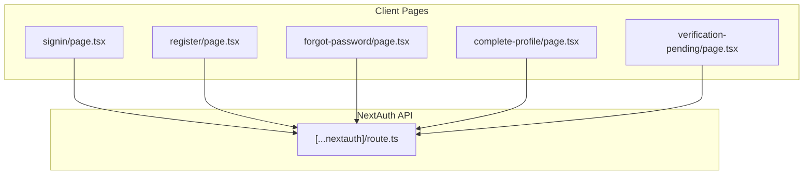
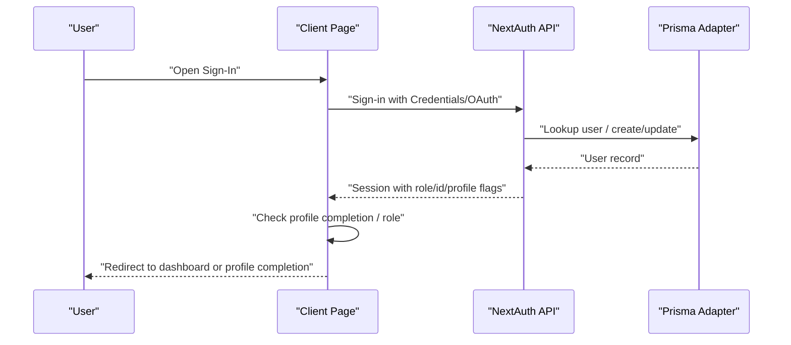
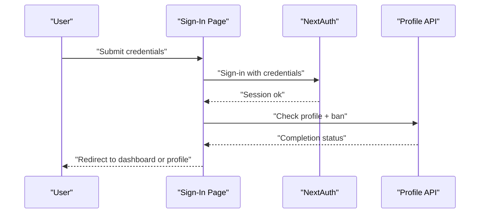
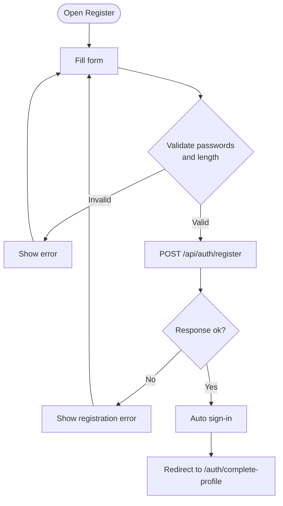
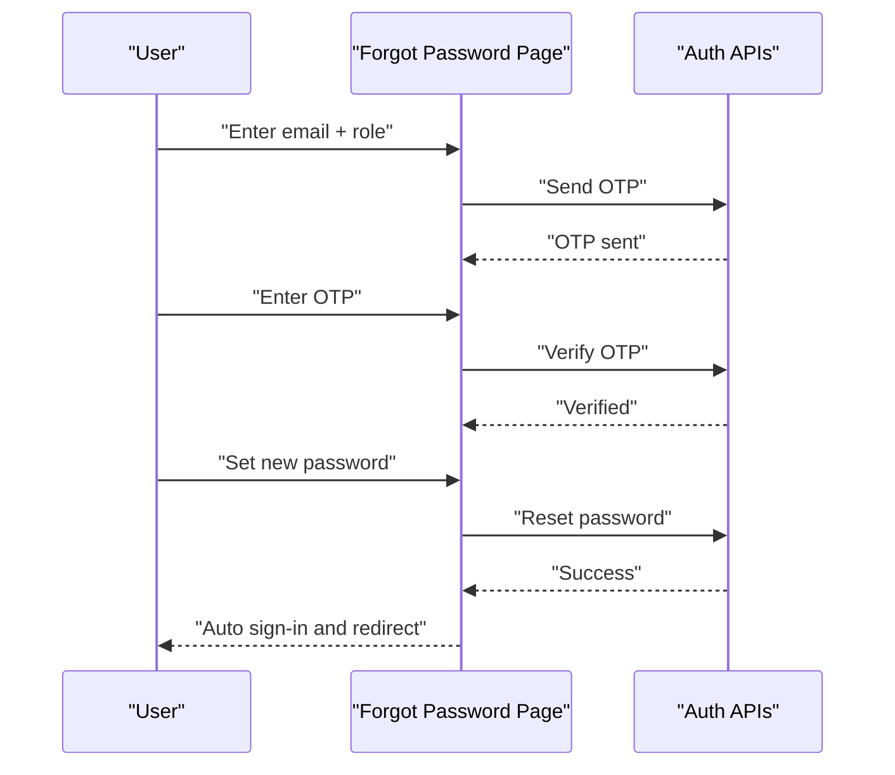
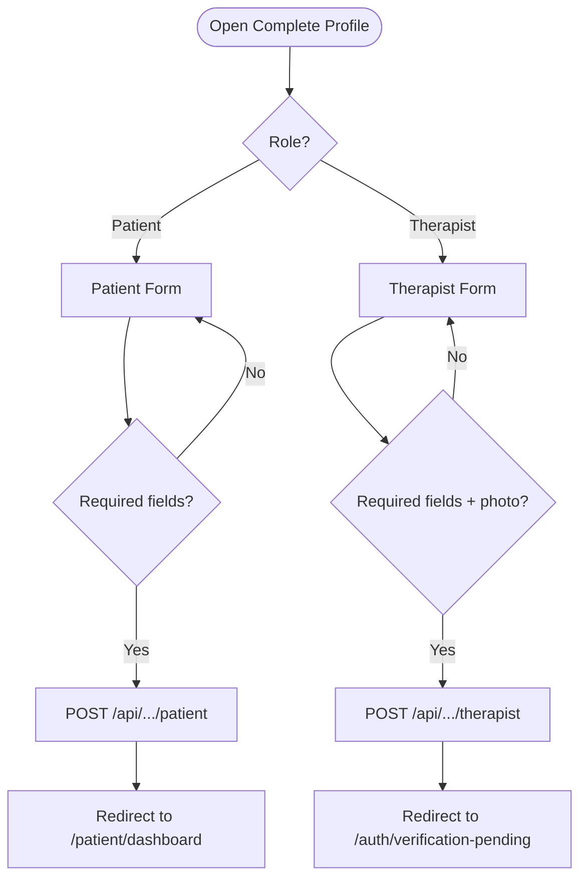
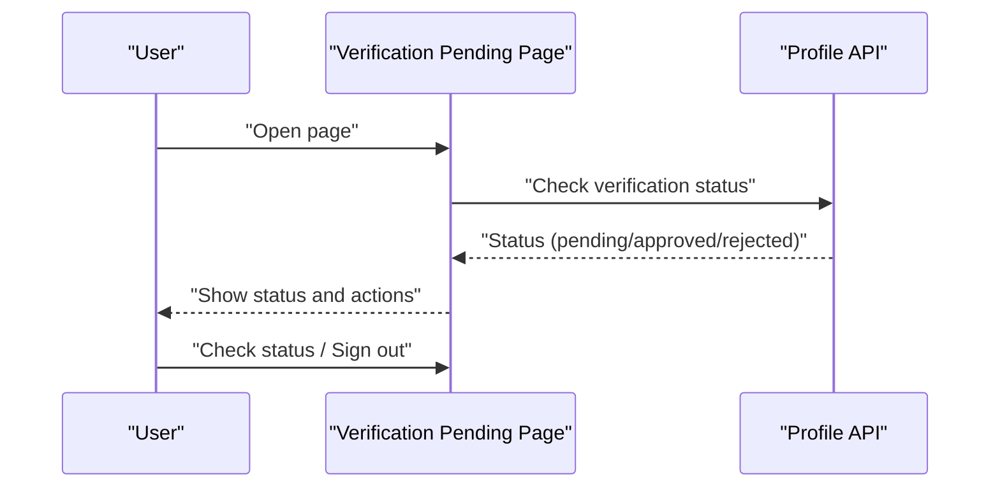
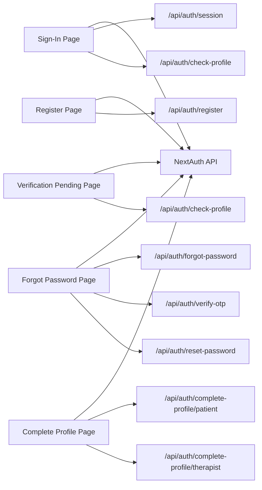

# Authentication Pages

<cite>
**Referenced Files in This Document**
- [route.ts](file://WEBAPP/src/app/api/auth/[...nextauth]/route.ts)
- [page.tsx](file://WEBAPP/src/app/auth/signin/page.tsx)
- [page.tsx](file://WEBAPP/src/app/auth/register/page.tsx)
- [page.tsx](file://WEBAPP/src/app/auth/forgot-password/page.tsx)
- [page.tsx](file://WEBAPP/src/app/auth/complete-profile/page.tsx)
- [page.tsx](file://WEBAPP/src/app/auth/verification-pending/page.tsx)
</cite>

## Table of Contents
1. [Introduction](#introduction)
2. [Project Structure](#project-structure)
3. [Core Components](#core-components)
4. [Architecture Overview](#architecture-overview)
5. [Detailed Component Analysis](#detailed-component-analysis)
6. [Dependency Analysis](#dependency-analysis)
7. [Performance Considerations](#performance-considerations)
8. [Troubleshooting Guide](#troubleshooting-guide)
9. [Conclusion](#conclusion)

## Introduction
This document explains the authentication pages system for the MindBridge web application. It covers sign-in, registration, password reset, profile completion, and verification flows. It also details NextAuth integration, OAuth providers, session management, role-based redirection, form validation, error handling, user feedback, security considerations, CSRF protection, and mobile-responsive design with accessibility features.

## Project Structure
Authentication-related pages and APIs are organized under the Next.js app router:
- NextAuth API endpoint: WEBAPP/src/app/api/auth/[...nextauth]/route.ts
- Client-side pages:
  - Sign-in: WEBAPP/src/app/auth/signin/page.tsx
  - Registration: WEBAPP/src/app/auth/register/page.tsx
  - Forgot password: WEBAPP/src/app/auth/forgot-password/page.tsx
  - Complete profile: WEBAPP/src/app/auth/complete-profile/page.tsx
  - Verification pending: WEBAPP/src/app/auth/verification-pending/page.tsx

**Diagram sources**
- [route.ts](file://WEBAPP/src/app/api/auth/[...nextauth]/route.ts#L1-L240)
- [page.tsx](file://WEBAPP/src/app/auth/signin/page.tsx#L1-L257)
- [page.tsx](file://WEBAPP/src/app/auth/register/page.tsx#L1-L266)
- [page.tsx](file://WEBAPP/src/app/auth/forgot-password/page.tsx#L1-L275)
- [page.tsx](file://WEBAPP/src/app/auth/complete-profile/page.tsx#L1-L358)
- [page.tsx](file://WEBAPP/src/app/auth/verification-pending/page.tsx#L1-L119)

**Section sources**
- [route.ts](file://WEBAPP/src/app/api/auth/[...nextauth]/route.ts#L1-L240)
- [page.tsx](file://WEBAPP/src/app/auth/signin/page.tsx#L1-L257)
- [page.tsx](file://WEBAPP/src/app/auth/register/page.tsx#L1-L266)
- [page.tsx](file://WEBAPP/src/app/auth/forgot-password/page.tsx#L1-L275)
- [page.tsx](file://WEBAPP/src/app/auth/complete-profile/page.tsx#L1-L358)
- [page.tsx](file://WEBAPP/src/app/auth/verification-pending/page.tsx#L1-L119)

## Core Components
- NextAuth configuration and callbacks for JWT/session propagation, provider linking, and role-aware redirects
- Client-side pages implementing form validation, user feedback, and role-based routing
- API endpoints invoked by client pages for registration, OTP-based password reset, and profile completion

Key capabilities:
- OAuth via Google with automatic user linking and initial role assignment
- Credentials-based sign-in with role selection and ban checks
- Multi-step password reset with OTP verification
- Role-specific profile completion and therapist verification workflow
- Session-based role-aware routing and profile completion enforcement

**Section sources**
- [route.ts](file://WEBAPP/src/app/api/auth/[...nextauth]/route.ts#L49-L98)
- [route.ts](file://WEBAPP/src/app/api/auth/[...nextauth]/route.ts#L99-L214)
- [page.tsx](file://WEBAPP/src/app/auth/signin/page.tsx#L20-L66)
- [page.tsx](file://WEBAPP/src/app/auth/register/page.tsx#L24-L76)
- [page.tsx](file://WEBAPP/src/app/auth/forgot-password/page.tsx#L25-L120)
- [page.tsx](file://WEBAPP/src/app/auth/complete-profile/page.tsx#L54-L87)
- [page.tsx](file://WEBAPP/src/app/auth/verification-pending/page.tsx#L15-L52)

## Architecture Overview
The authentication system integrates NextAuth with Prisma-backed providers and custom callbacks. Client pages trigger NextAuth flows and then coordinate role-aware routing and profile completion.

**Diagram sources**
- [route.ts](file://WEBAPP/src/app/api/auth/[...nextauth]/route.ts#L69-L96)
- [route.ts](file://WEBAPP/src/app/api/auth/[...nextauth]/route.ts#L100-L173)
- [page.tsx](file://WEBAPP/src/app/auth/signin/page.tsx#L68-L89)

## Detailed Component Analysis

### NextAuth Integration and Providers
- Providers:
  - Google OAuth with consent prompt and offline access
  - Credentials provider with email/password/role
- Sessions:
  - JWT strategy with 30-day max age and 24-hour refresh
  - Cookie configuration with SameSite lax and secure flag based on environment
- Callbacks:
  - signIn: Google sign-in user linking and creation, ban checks
  - jwt: attach role/id/isProfileComplete to token; rehydrate on Google sign-in
  - session: propagate role/id/isProfileComplete to session
- Events:
  - Logging for sign-out, session access, and sign-in events
- Pages:
  - Custom sign-in page mapped to "/auth/signin"

Security and UX highlights:
- Automatic user linking for Google accounts
- Ban enforcement during sign-in
- Role-aware routing after sign-in
- Token expiration logging for monitoring

**Section sources**
- [route.ts](file://WEBAPP/src/app/api/auth/[...nextauth]/route.ts#L8-L49)
- [route.ts](file://WEBAPP/src/app/api/auth/[...nextauth]/route.ts#L49-L98)
- [route.ts](file://WEBAPP/src/app/api/auth/[...nextauth]/route.ts#L99-L214)
- [route.ts](file://WEBAPP/src/app/api/auth/[...nextauth]/route.ts#L215-L237)

### Sign-In Flow
- Features:
  - Email/password with role selection
  - Google OAuth sign-in
  - Post-sign-in profile completion check and role-based redirect
  - Error messaging and loading states
- Validation:
  - Required fields and role selection
  - Ban check via profile endpoint
- Redirection:
  - Patient: "/patient/dashboard"
  - Therapist: "/therapist/dashboard"
  - Pending verification: "/auth/verification-pending"
  - Rejected verification: "/auth/complete-profile"

**Diagram sources**
- [page.tsx](file://WEBAPP/src/app/auth/signin/page.tsx#L68-L89)
- [page.tsx](file://WEBAPP/src/app/auth/signin/page.tsx#L20-L66)

**Section sources**
- [page.tsx](file://WEBAPP/src/app/auth/signin/page.tsx#L9-L257)

### Registration Flow
- Features:
  - Email/password registration with password confirmation and length checks
  - Google OAuth registration with automatic profile completion redirect
  - Auto sign-in after successful registration
- Validation:
  - Password match and minimum length
- Feedback:
  - Success/error notifications
  - Loading states

**Diagram sources**
- [page.tsx](file://WEBAPP/src/app/auth/register/page.tsx#L24-L76)

**Section sources**
- [page.tsx](file://WEBAPP/src/app/auth/register/page.tsx#L9-L266)

### Password Reset (Forgot Password)
- Steps:
  1) Enter email + role → send OTP
  2) Enter 6-digit OTP → verify OTP
  3) Set new password → reset password
  4) Auto sign-in and redirect to appropriate dashboard
- Validation:
  - OTP length and match
  - New password length and match
- Feedback:
  - Step indicators, success/error messages
  - Loading states

**Diagram sources**
- [page.tsx](file://WEBAPP/src/app/auth/forgot-password/page.tsx#L25-L120)

**Section sources**
- [page.tsx](file://WEBAPP/src/app/auth/forgot-password/page.tsx#L11-L275)

### Profile Completion (Patient and Therapist)
- Patient:
  - Required fields: full name, date of birth, gender, age
  - Optional: height, weight
  - Redirect to "/patient/dashboard" on success
- Therapist:
  - Required: doctor photo (base64), full name, DOB, gender, age, degree, experience, hospital affiliation
  - Redirect to "/auth/verification-pending" on success
- Shared:
  - Form validation and error feedback
  - Loading states

**Diagram sources**
- [page.tsx](file://WEBAPP/src/app/auth/complete-profile/page.tsx#L40-L87)
- [page.tsx](file://WEBAPP/src/app/auth/complete-profile/page.tsx#L174-L245)

**Section sources**
- [page.tsx](file://WEBAPP/src/app/auth/complete-profile/page.tsx#L9-L358)

### Verification Pending (Therapist)
- Purpose:
  - Inform therapist that profile is under admin review
  - Periodic status check against backend
- Actions:
  - Check status (polls backend)
  - Sign out
- Outcomes:
  - Approved: redirect to "/therapist/dashboard"
  - Rejected: redirect to "/auth/complete-profile" with rejection reason

**Diagram sources**
- [page.tsx](file://WEBAPP/src/app/auth/verification-pending/page.tsx#L15-L52)

**Section sources**
- [page.tsx](file://WEBAPP/src/app/auth/verification-pending/page.tsx#L9-L119)

## Dependency Analysis
- Client pages depend on NextAuth client hooks for session and sign-in
- Client pages call API endpoints for registration, OTP, password reset, and profile completion
- NextAuth API depends on Prisma adapter and bcrypt for user lookup and password comparison
- Role and profile completion flags flow from NextAuth callbacks to session and are used by client pages for routing

**Diagram sources**
- [page.tsx](file://WEBAPP/src/app/auth/signin/page.tsx#L24-L66)
- [page.tsx](file://WEBAPP/src/app/auth/register/page.tsx#L43-L76)
- [page.tsx](file://WEBAPP/src/app/auth/forgot-password/page.tsx#L31-L120)
- [page.tsx](file://WEBAPP/src/app/auth/complete-profile/page.tsx#L63-L87)
- [page.tsx](file://WEBAPP/src/app/auth/verification-pending/page.tsx#L26-L52)
- [route.ts](file://WEBAPP/src/app/api/auth/[...nextauth]/route.ts#L1-L240)

**Section sources**
- [page.tsx](file://WEBAPP/src/app/auth/signin/page.tsx#L1-L257)
- [page.tsx](file://WEBAPP/src/app/auth/register/page.tsx#L1-L266)
- [page.tsx](file://WEBAPP/src/app/auth/forgot-password/page.tsx#L1-L275)
- [page.tsx](file://WEBAPP/src/app/auth/complete-profile/page.tsx#L1-L358)
- [page.tsx](file://WEBAPP/src/app/auth/verification-pending/page.tsx#L1-L119)
- [route.ts](file://WEBAPP/src/app/api/auth/[...nextauth]/route.ts#L1-L240)

## Performance Considerations
- Session strategy: JWT with periodic refresh reduces database load
- Cookie configuration optimized for local development and HTTPS environments
- Client-side validation prevents unnecessary API calls
- Minimal re-renders using controlled form state and targeted error clearing

## Troubleshooting Guide
Common issues and remedies:
- Sign-in failures:
  - Invalid credentials or banned account: verify email/password and role
  - Redirect blocked: ensure session retrieval and profile check succeed
- Registration failures:
  - Password mismatch or length: fix form validation errors
  - Backend error: inspect returned error message and retry
- Password reset failures:
  - OTP invalid/expired: resend OTP and retry
  - New password mismatch/length: correct form fields
- Profile completion failures:
  - Missing required fields: ensure all mandatory inputs are filled
  - Therapist photo missing: upload a valid image under size limit
- Verification pending:
  - Status not updating: retry check; ensure session is present
  - Rejected verification: update profile per rejection reason

Operational logs:
- NextAuth events log sign-in, session access, and sign-out for monitoring

**Section sources**
- [page.tsx](file://WEBAPP/src/app/auth/signin/page.tsx#L79-L88)
- [page.tsx](file://WEBAPP/src/app/auth/register/page.tsx#L67-L75)
- [page.tsx](file://WEBAPP/src/app/auth/forgot-password/page.tsx#L63-L74)
- [page.tsx](file://WEBAPP/src/app/auth/forgot-password/page.tsx#L96-L120)
- [page.tsx](file://WEBAPP/src/app/auth/complete-profile/page.tsx#L57-L87)
- [page.tsx](file://WEBAPP/src/app/auth/complete-profile/page.tsx#L209-L245)
- [page.tsx](file://WEBAPP/src/app/auth/verification-pending/page.tsx#L33-L52)
- [route.ts](file://WEBAPP/src/app/api/auth/[...nextauth]/route.ts#L215-L237)

## Conclusion
The authentication system provides a robust, role-aware flow with OAuth and credentials-based sign-in, secure session management, and guided user journeys through registration, profile completion, and verification. Client pages offer responsive forms, clear feedback, and accessibility through semantic markup and keyboard-friendly controls. Security is reinforced by provider linking, ban checks, token-based sessions, and CSRF cookies configured for the environment.