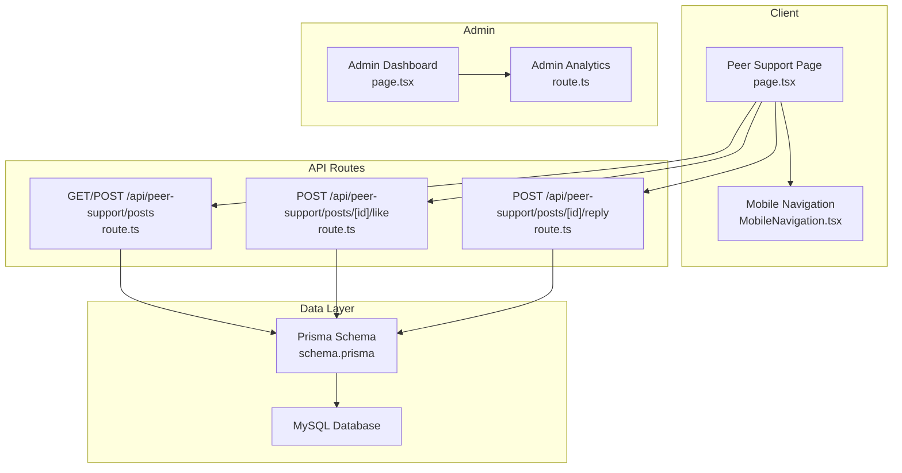
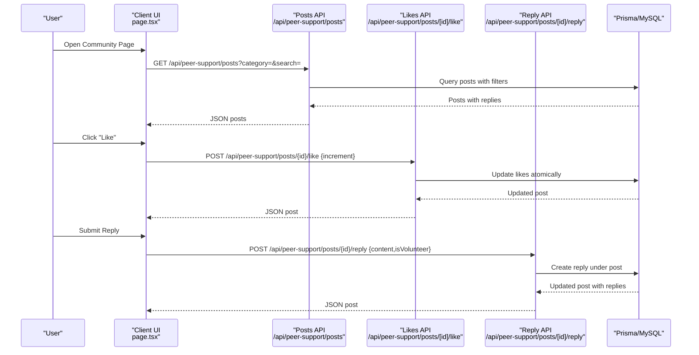
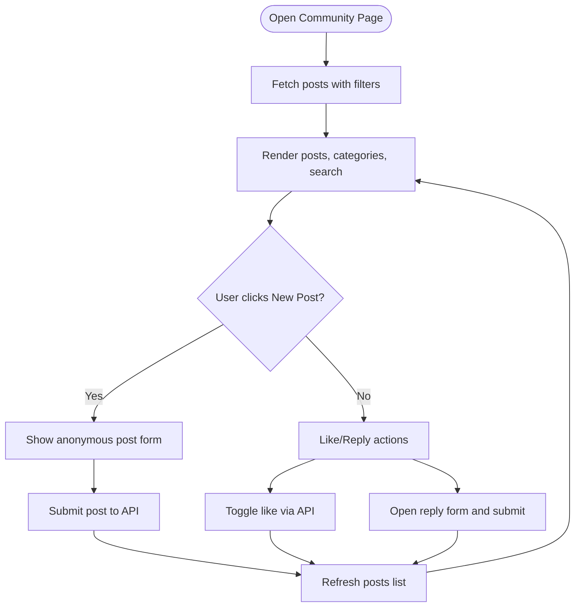
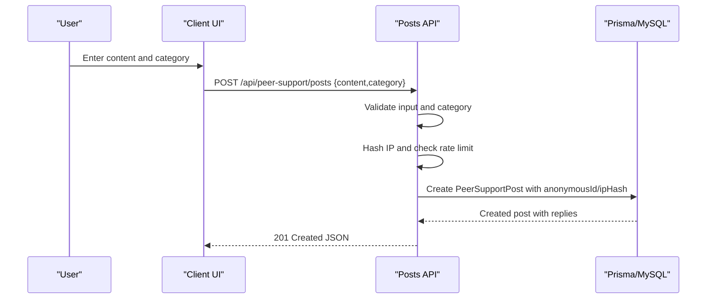
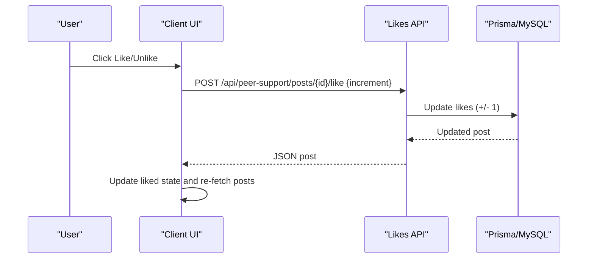
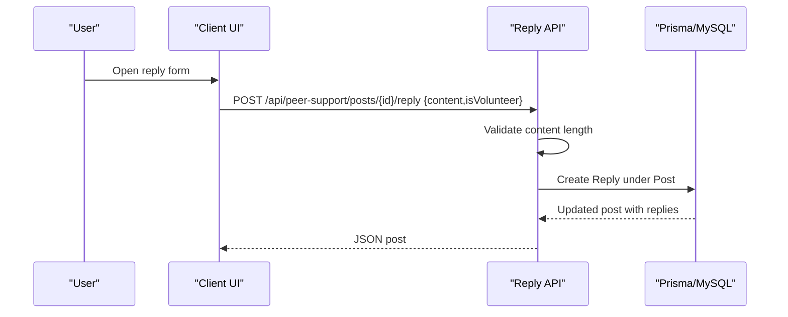
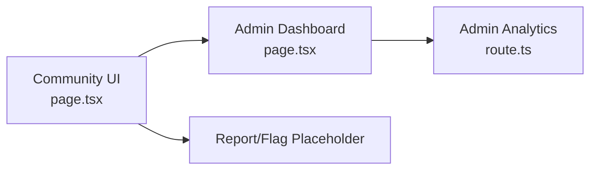
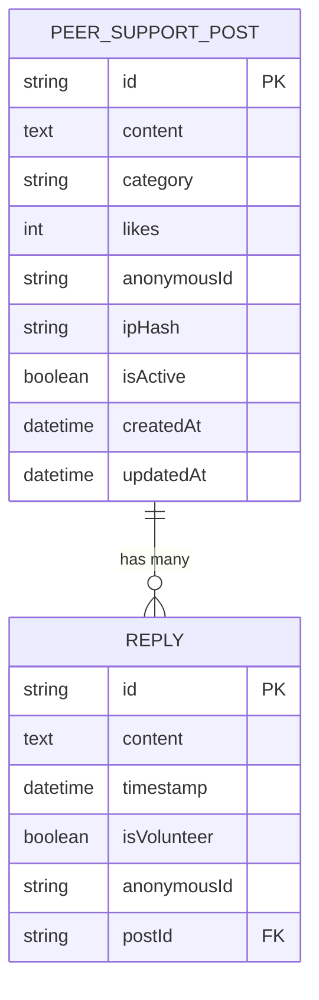
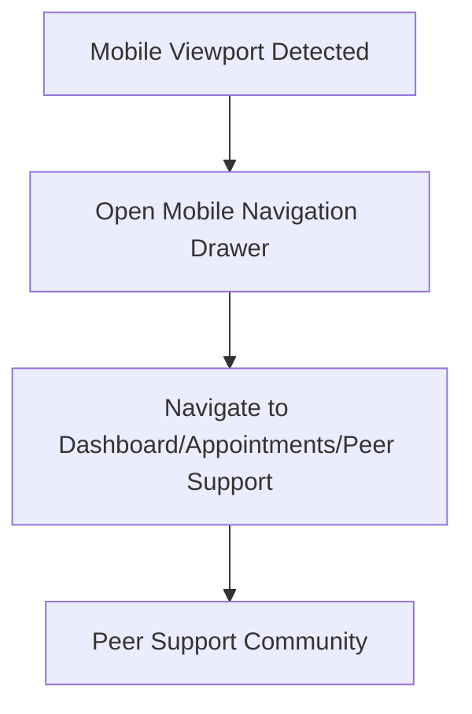
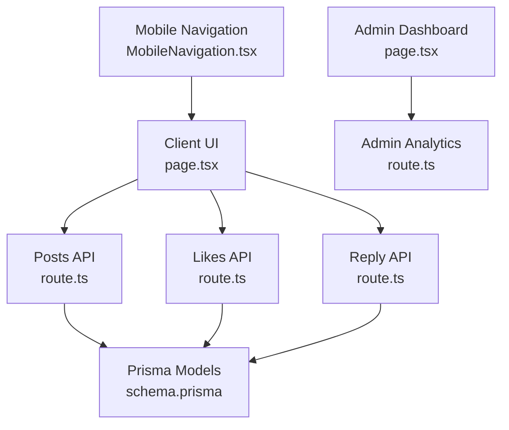

# Community Features

<cite>
**Referenced Files in This Document**
- [page.tsx](file://WEBAPP/src/app/peer-support/page.tsx)
- [route.ts](file://WEBAPP/src/app/api/peer-support/posts/route.ts)
- [route.ts](file://WEBAPP/src/app/api/peer-support/posts/[id]/like/route.ts)
- [route.ts](file://WEBAPP/src/app/api/peer-support/posts/[id]/reply/route.ts)
- [schema.prisma](file://WEBAPP/prisma/schema.prisma)
- [page.tsx](file://WEBAPP/src/app/admin/dashboard/page.tsx)
- [route.ts](file://WEBAPP/src/app/api/admin/analytics/route.ts)
- [page.tsx](file://WEBAPP/src/app/patient/appointments/page.tsx)
- [page.tsx](file://WEBAPP/src/app/patient/session/mobile-page.tsx)
- [MobileNavigation.tsx](file://WEBAPP/src/components/MobileNavigation.tsx)
- [use-mobile.tsx](file://WEBAPP/src/components/ui/use-mobile.tsx)
</cite>

## Table of Contents
1. [Introduction](#introduction)
2. [Project Structure](#project-structure)
3. [Core Components](#core-components)
4. [Architecture Overview](#architecture-overview)
5. [Detailed Component Analysis](#detailed-component-analysis)
6. [Dependency Analysis](#dependency-analysis)
7. [Performance Considerations](#performance-considerations)
8. [Troubleshooting Guide](#troubleshooting-guide)
9. [Conclusion](#conclusion)
10. [Appendices](#appendices)

## Introduction
This document describes the peer support community system, focusing on the community forum interface, post creation, anonymous posting, and community interaction features. It also covers post management, like/dislike systems, reply functionality, and community moderation tools. Privacy considerations for anonymous posting, content filtering, and community guidelines enforcement are detailed, along with mobile-responsive features and engagement analytics.

## Project Structure
The peer support community is implemented as a Next.js app with:
- A client-side React page that renders the forum UI and handles user interactions
- API routes under /api/peer-support for posts, likes, and replies
- Prisma models for PeerSupportPost and Reply persisted in MySQL
- Admin dashboard and analytics for moderation and oversight
- Mobile navigation and responsive utilities

**Diagram sources**
- [page.tsx](file://WEBAPP/src/app/peer-support/page.tsx#L39-L523)
- [route.ts](file://WEBAPP/src/app/api/peer-support/posts/route.ts#L21-L161)
- [route.ts](file://WEBAPP/src/app/api/peer-support/posts/[id]/like/route.ts#L4-L58)
- [route.ts](file://WEBAPP/src/app/api/peer-support/posts/[id]/reply/route.ts#L20-L100)
- [schema.prisma](file://WEBAPP/prisma/schema.prisma#L80-L106)
- [page.tsx](file://WEBAPP/src/app/admin/dashboard/page.tsx#L61-L510)
- [route.ts](file://WEBAPP/src/app/api/admin/analytics/route.ts#L19-L109)
- [MobileNavigation.tsx](file://WEBAPP/src/components/MobileNavigation.tsx#L14-L118)

**Section sources**
- [page.tsx](file://WEBAPP/src/app/peer-support/page.tsx#L39-L523)
- [route.ts](file://WEBAPP/src/app/api/peer-support/posts/route.ts#L21-L161)
- [route.ts](file://WEBAPP/src/app/api/peer-support/posts/[id]/like/route.ts#L4-L58)
- [route.ts](file://WEBAPP/src/app/api/peer-support/posts/[id]/reply/route.ts#L20-L100)
- [schema.prisma](file://WEBAPP/prisma/schema.prisma#L80-L106)
- [page.tsx](file://WEBAPP/src/app/admin/dashboard/page.tsx#L61-L510)
- [route.ts](file://WEBAPP/src/app/api/admin/analytics/route.ts#L19-L109)
- [MobileNavigation.tsx](file://WEBAPP/src/components/MobileNavigation.tsx#L14-L118)

## Core Components
- Peer Support Forum UI: renders posts, categories, search, filters, reply forms, and like toggles
- API Handlers: manage CRUD operations for posts, likes, and replies
- Data Models: PeerSupportPost and Reply with Prisma ORM
- Admin Dashboard: analytics and user moderation
- Mobile Responsiveness: navigation and breakpoints

Key capabilities:
- Anonymous posting with generated identifiers
- Category-based filtering and search
- Like/dislike with server-side updates
- Reply creation with validation
- Admin analytics and moderation controls

**Section sources**
- [page.tsx](file://WEBAPP/src/app/peer-support/page.tsx#L39-L523)
- [route.ts](file://WEBAPP/src/app/api/peer-support/posts/route.ts#L21-L161)
- [route.ts](file://WEBAPP/src/app/api/peer-support/posts/[id]/like/route.ts#L4-L58)
- [route.ts](file://WEBAPP/src/app/api/peer-support/posts/[id]/reply/route.ts#L20-L100)
- [schema.prisma](file://WEBAPP/prisma/schema.prisma#L80-L106)
- [page.tsx](file://WEBAPP/src/app/admin/dashboard/page.tsx#L61-L510)

## Architecture Overview
The system follows a client-server pattern:
- Client fetches and displays posts, applies filters, and submits new posts/replies/likes
- API routes validate inputs, enforce rate limits, and interact with Prisma
- Prisma models define the schema and relationships for posts and replies
- Admin routes provide analytics and moderation controls

**Diagram sources**
- [page.tsx](file://WEBAPP/src/app/peer-support/page.tsx#L53-L193)
- [route.ts](file://WEBAPP/src/app/api/peer-support/posts/route.ts#L21-L75)
- [route.ts](file://WEBAPP/src/app/api/peer-support/posts/[id]/like/route.ts#L4-L58)
- [route.ts](file://WEBAPP/src/app/api/peer-support/posts/[id]/reply/route.ts#L20-L72)

## Detailed Component Analysis

### Community Forum Interface
- Renders posts with anonymous identities, timestamps, categories, likes, and replies
- Provides category filters, global search, and refresh controls
- Supports anonymous post creation with category selection and content validation
- Allows replying to posts with a dedicated form

**Diagram sources**
- [page.tsx](file://WEBAPP/src/app/peer-support/page.tsx#L53-L193)

**Section sources**
- [page.tsx](file://WEBAPP/src/app/peer-support/page.tsx#L39-L523)

### Post Creation and Anonymous Posting
- Generates anonymous identifiers for posters and repliers
- Validates content length and category
- Enforces rate limiting per IP hash
- Stores isActive flag and hashes IP for spam prevention

**Diagram sources**
- [route.ts](file://WEBAPP/src/app/api/peer-support/posts/route.ts#L79-L129)
- [schema.prisma](file://WEBAPP/prisma/schema.prisma#L80-L94)

**Section sources**
- [route.ts](file://WEBAPP/src/app/api/peer-support/posts/route.ts#L79-L129)
- [schema.prisma](file://WEBAPP/prisma/schema.prisma#L80-L94)

### Like/Dislike System
- Toggle-like sends increment/decrement intent
- Server updates likes atomically and ensures non-negative counts
- Client updates local liked state and refreshes posts

**Diagram sources**
- [page.tsx](file://WEBAPP/src/app/peer-support/page.tsx#L168-L193)
- [route.ts](file://WEBAPP/src/app/api/peer-support/posts/[id]/like/route.ts#L4-L58)

**Section sources**
- [page.tsx](file://WEBAPP/src/app/peer-support/page.tsx#L168-L193)
- [route.ts](file://WEBAPP/src/app/api/peer-support/posts/[id]/like/route.ts#L4-L58)

### Reply Functionality
- Validates reply content length
- Creates replies under the target post with anonymous identifiers
- Returns updated post with replies ordered chronologically

**Diagram sources**
- [page.tsx](file://WEBAPP/src/app/peer-support/page.tsx#L138-L166)
- [route.ts](file://WEBAPP/src/app/api/peer-support/posts/[id]/reply/route.ts#L20-L72)

**Section sources**
- [page.tsx](file://WEBAPP/src/app/peer-support/page.tsx#L138-L166)
- [route.ts](file://WEBAPP/src/app/api/peer-support/posts/[id]/reply/route.ts#L20-L72)

### Community Interaction and Moderation Tools
- Community guidelines footer encourages respectful participation
- Flag button present in UI for reporting (placeholder in current implementation)
- Admin dashboard provides analytics and user moderation controls
- Admin analytics endpoint aggregates platform metrics and appointment statuses

**Diagram sources**
- [page.tsx](file://WEBAPP/src/app/peer-support/page.tsx#L500-L517)
- [page.tsx](file://WEBAPP/src/app/admin/dashboard/page.tsx#L61-L510)
- [route.ts](file://WEBAPP/src/app/api/admin/analytics/route.ts#L19-L109)

**Section sources**
- [page.tsx](file://WEBAPP/src/app/peer-support/page.tsx#L500-L517)
- [page.tsx](file://WEBAPP/src/app/admin/dashboard/page.tsx#L61-L510)
- [route.ts](file://WEBAPP/src/app/api/admin/analytics/route.ts#L19-L109)

### Data Models and Relationships

**Diagram sources**
- [schema.prisma](file://WEBAPP/prisma/schema.prisma#L80-L106)

**Section sources**
- [schema.prisma](file://WEBAPP/prisma/schema.prisma#L80-L106)

### Mobile-Responsive Community Features
- Mobile navigation drawer provides role-aware links and logout
- Utility hook detects mobile viewport for responsive behavior
- Peer support link integrated into patient navigation

**Diagram sources**
- [MobileNavigation.tsx](file://WEBAPP/src/components/MobileNavigation.tsx#L14-L118)
- [use-mobile.tsx](file://WEBAPP/src/components/ui/use-mobile.tsx#L1-L19)
- [page.tsx](file://WEBAPP/src/app/patient/appointments/page.tsx#L382-L387)

**Section sources**
- [MobileNavigation.tsx](file://WEBAPP/src/components/MobileNavigation.tsx#L14-L118)
- [use-mobile.tsx](file://WEBAPP/src/components/ui/use-mobile.tsx#L1-L19)
- [page.tsx](file://WEBAPP/src/app/patient/appointments/page.tsx#L382-L387)

## Dependency Analysis
- Client depends on API routes for all interactions
- API routes depend on Prisma for data access
- Admin dashboard depends on admin analytics route
- Mobile navigation integrates with NextAuth session and routing

**Diagram sources**
- [page.tsx](file://WEBAPP/src/app/peer-support/page.tsx#L39-L523)
- [route.ts](file://WEBAPP/src/app/api/peer-support/posts/route.ts#L21-L161)
- [route.ts](file://WEBAPP/src/app/api/peer-support/posts/[id]/like/route.ts#L4-L58)
- [route.ts](file://WEBAPP/src/app/api/peer-support/posts/[id]/reply/route.ts#L20-L100)
- [schema.prisma](file://WEBAPP/prisma/schema.prisma#L80-L106)
- [page.tsx](file://WEBAPP/src/app/admin/dashboard/page.tsx#L61-L510)
- [route.ts](file://WEBAPP/src/app/api/admin/analytics/route.ts#L19-L109)
- [MobileNavigation.tsx](file://WEBAPP/src/components/MobileNavigation.tsx#L14-L118)

**Section sources**
- [page.tsx](file://WEBAPP/src/app/peer-support/page.tsx#L39-L523)
- [route.ts](file://WEBAPP/src/app/api/peer-support/posts/route.ts#L21-L161)
- [route.ts](file://WEBAPP/src/app/api/peer-support/posts/[id]/like/route.ts#L4-L58)
- [route.ts](file://WEBAPP/src/app/api/peer-support/posts/[id]/reply/route.ts#L20-L100)
- [schema.prisma](file://WEBAPP/prisma/schema.prisma#L80-L106)
- [page.tsx](file://WEBAPP/src/app/admin/dashboard/page.tsx#L61-L510)
- [route.ts](file://WEBAPP/src/app/api/admin/analytics/route.ts#L19-L109)
- [MobileNavigation.tsx](file://WEBAPP/src/components/MobileNavigation.tsx#L14-L118)

## Performance Considerations
- Pagination and limit applied in posts API to avoid large payloads
- Indexes on category and createdAt improve query performance
- Client-side caching of liked state reduces redundant requests
- Rate limiting prevents spam and protects server resources

Recommendations:
- Consider server-side pagination with cursor-based offsets for deeper navigation
- Add server-side content filtering for sensitive terms
- Implement reply previews to reduce DOM bloat
- Cache frequently accessed categories and counts

**Section sources**
- [route.ts](file://WEBAPP/src/app/api/peer-support/posts/route.ts#L27-L75)
- [schema.prisma](file://WEBAPP/prisma/schema.prisma#L92-L94)

## Troubleshooting Guide
Common issues and resolutions:
- Post creation fails with validation errors: verify content length and category values
- Rate limit exceeded: wait for the hourly window or reduce posting frequency
- Like update errors: ensure post exists and increment is boolean
- Reply creation errors: confirm post exists and content meets minimum length
- Admin analytics unauthorized: verify JWT bearer token and role claims

Operational checks:
- Confirm Prisma client connectivity to MySQL
- Verify environment variables for NEXTAUTH_SECRET and DATABASE_URL
- Ensure API routes are reachable and CORS settings permit client origin

**Section sources**
- [route.ts](file://WEBAPP/src/app/api/peer-support/posts/route.ts#L132-L159)
- [route.ts](file://WEBAPP/src/app/api/peer-support/posts/[id]/like/route.ts#L13-L15)
- [route.ts](file://WEBAPP/src/app/api/peer-support/posts/[id]/reply/route.ts#L83-L99)
- [route.ts](file://WEBAPP/src/app/api/admin/analytics/route.ts#L7-L17)

## Conclusion
The peer support community system provides a secure, anonymous, and engaging platform for students to share experiences, receive support, and interact safely. Its modular architecture, robust moderation tools, and mobile responsiveness ensure scalability and usability. Future enhancements could include advanced content filtering, expanded reporting mechanisms, and richer engagement analytics.

## Appendices
- Anonymous identity generation: Student_{A-Z}{000-999}
- Categories supported: general, academic-stress, social-emotional, time-management, career-anxiety, relationships, health-wellness
- Admin analytics include totals, activity, verification status, and appointment breakdowns