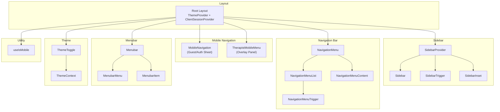
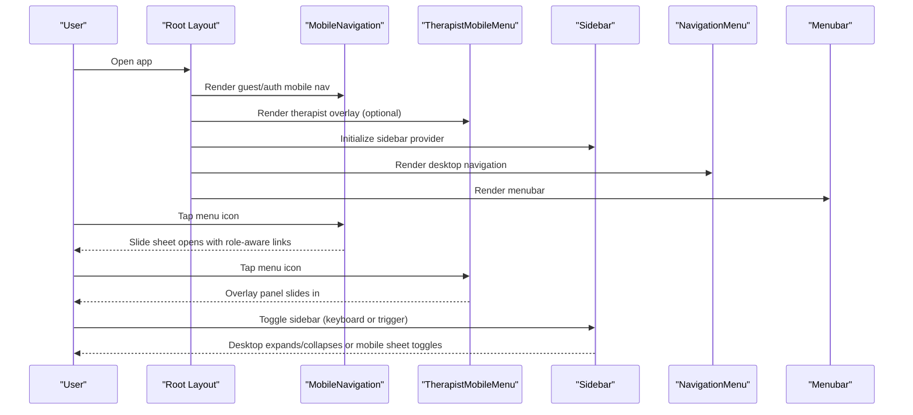
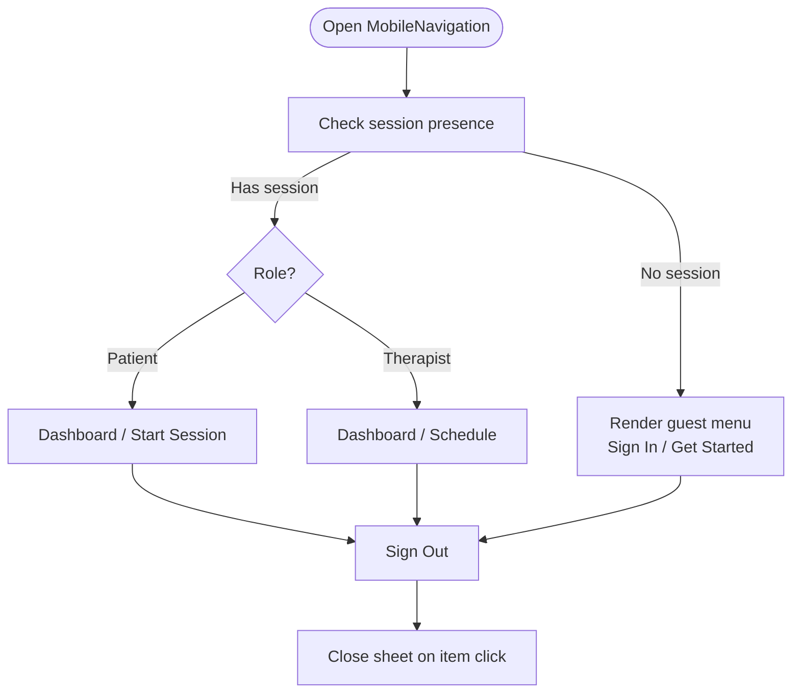
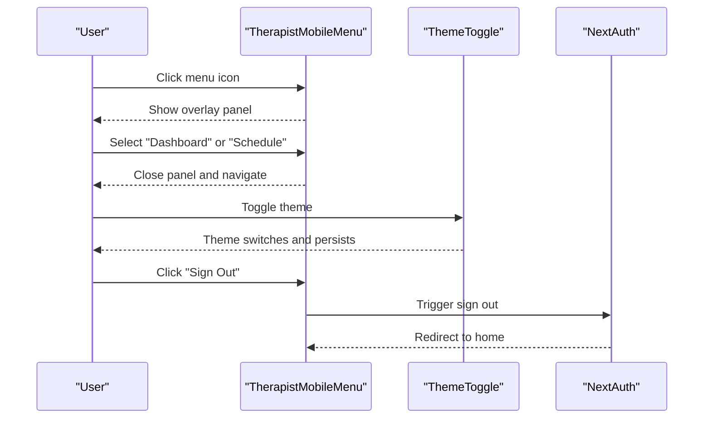
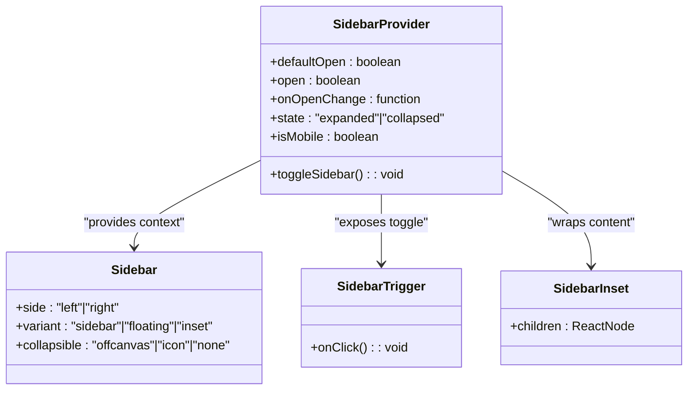
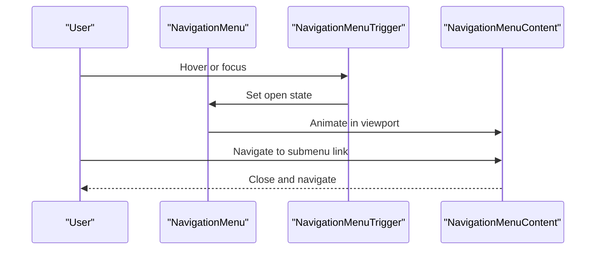
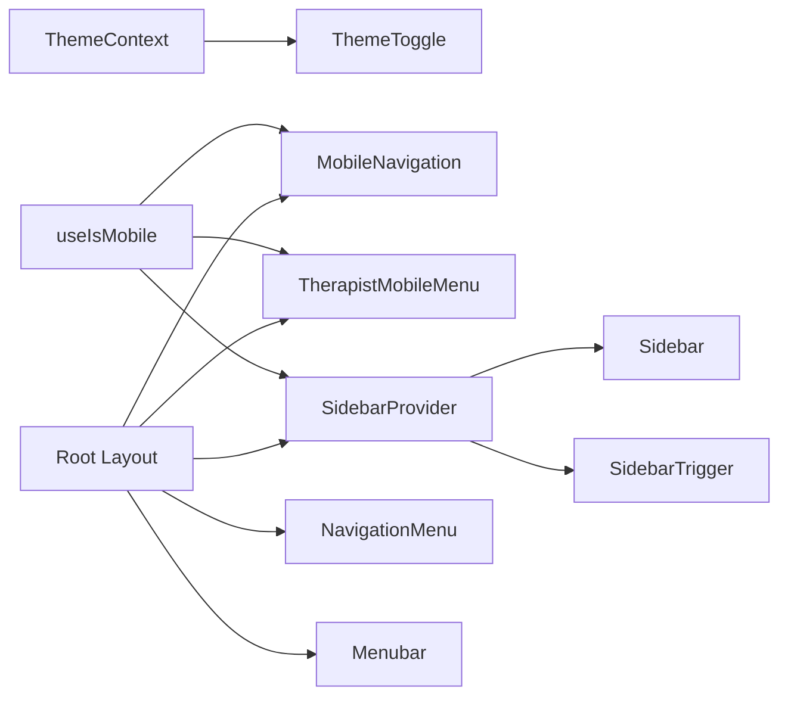

# Navigation Components

<cite>
**Referenced Files in This Document**
- [MobileNavigation.tsx](file://WEBAPP/src/components/MobileNavigation.tsx)
- [TherapistMobileMenu.tsx](file://WEBAPP/src/components/TherapistMobileMenu.tsx)
- [sidebar.tsx](file://WEBAPP/src/components/ui/sidebar.tsx)
- [navigation-menu.tsx](file://WEBAPP/src/components/ui/navigation-menu.tsx)
- [menubar.tsx](file://WEBAPP/src/components/ui/menubar.tsx)
- [use-mobile.tsx](file://WEBAPP/src/components/ui/use-mobile.tsx)
- [ThemeToggle.tsx](file://WEBAPP/src/components/ThemeToggle.tsx)
- [ThemeContext.tsx](file://WEBAPP/src/contexts/ThemeContext.tsx)
- [layout.tsx](file://WEBAPP/src/app/layout.tsx)
- [page.tsx](file://WEBAPP/src/app/patient/appointments/page.tsx)
</cite>

## Table of Contents
1. [Introduction](#introduction)
2. [Project Structure](#project-structure)
3. [Core Components](#core-components)
4. [Architecture Overview](#architecture-overview)
5. [Detailed Component Analysis](#detailed-component-analysis)
6. [Dependency Analysis](#dependency-analysis)
7. [Performance Considerations](#performance-considerations)
8. [Accessibility and UX Features](#accessibility-and-ux-features)
9. [Troubleshooting Guide](#troubleshooting-guide)
10. [Conclusion](#conclusion)

## Introduction
This document explains the navigation system across the MindBridge web application. It covers mobile navigation, sidebar menus, navigation bars, and responsive navigation patterns. It also details role-based navigation visibility, menu customization, navigation state management, mobile-first design patterns, hamburger menus, touch-friendly elements, and accessibility features including keyboard navigation and screen reader compatibility.

## Project Structure
The navigation system spans several UI components and shared utilities:
- Mobile navigation: a sheet-based drawer for guests and authenticated users with role-specific entries
- Sidebar: a responsive sidebar with provider, trigger, and content slots supporting desktop and mobile modes
- Navigation bar: a Radix-powered navigation menu for desktop-level navigation
- Menubar: a horizontal menubar for app-level actions and nested options
- Theme system: theme toggle and context for light/dark mode with persistence
- Utility hook: device detection for responsive behavior

**Diagram sources**
- [layout.tsx](file://WEBAPP/src/app/layout.tsx#L36-L54)
- [MobileNavigation.tsx](file://WEBAPP/src/components/MobileNavigation.tsx#L14-L118)
- [TherapistMobileMenu.tsx](file://WEBAPP/src/components/TherapistMobileMenu.tsx#L13-L129)
- [sidebar.tsx](file://WEBAPP/src/components/ui/sidebar.tsx#L56-L152)
- [navigation-menu.tsx](file://WEBAPP/src/components/ui/navigation-menu.tsx#L8-L30)
- [menubar.tsx](file://WEBAPP/src/components/ui/menubar.tsx#L9-L23)
- [ThemeToggle.tsx](file://WEBAPP/src/components/ThemeToggle.tsx#L10-L55)
- [ThemeContext.tsx](file://WEBAPP/src/contexts/ThemeContext.tsx#L23-L67)
- [use-mobile.tsx](file://WEBAPP/src/components/ui/use-mobile.tsx#L5-L19)

**Section sources**
- [layout.tsx](file://WEBAPP/src/app/layout.tsx#L36-L54)
- [MobileNavigation.tsx](file://WEBAPP/src/components/MobileNavigation.tsx#L14-L118)
- [TherapistMobileMenu.tsx](file://WEBAPP/src/components/TherapistMobileMenu.tsx#L13-L129)
- [sidebar.tsx](file://WEBAPP/src/components/ui/sidebar.tsx#L56-L152)
- [navigation-menu.tsx](file://WEBAPP/src/components/ui/navigation-menu.tsx#L8-L30)
- [menubar.tsx](file://WEBAPP/src/components/ui/menubar.tsx#L9-L23)
- [ThemeToggle.tsx](file://WEBAPP/src/components/ThemeToggle.tsx#L10-L55)
- [ThemeContext.tsx](file://WEBAPP/src/contexts/ThemeContext.tsx#L23-L67)
- [use-mobile.tsx](file://WEBAPP/src/components/ui/use-mobile.tsx#L5-L19)

## Core Components
- MobileNavigation: Sheet-based mobile drawer with role-aware links and sign out
- TherapistMobileMenu: Overlay panel with current page highlighting, theme toggle, and sign out
- Sidebar: Provider-driven sidebar with desktop and mobile off-canvas modes, keyboard shortcut, and cookie-backed persistence
- NavigationMenu: Desktop navigation bar with animated viewport and nested triggers
- Menubar: Horizontal menubar for app-level actions and submenus
- ThemeToggle and ThemeContext: Theme switching with persistence and accessibility attributes
- useIsMobile: Device breakpoint detection for responsive rendering

**Section sources**
- [MobileNavigation.tsx](file://WEBAPP/src/components/MobileNavigation.tsx#L14-L118)
- [TherapistMobileMenu.tsx](file://WEBAPP/src/components/TherapistMobileMenu.tsx#L13-L129)
- [sidebar.tsx](file://WEBAPP/src/components/ui/sidebar.tsx#L56-L152)
- [navigation-menu.tsx](file://WEBAPP/src/components/ui/navigation-menu.tsx#L8-L30)
- [menubar.tsx](file://WEBAPP/src/components/ui/menubar.tsx#L9-L23)
- [ThemeToggle.tsx](file://WEBAPP/src/components/ThemeToggle.tsx#L10-L55)
- [ThemeContext.tsx](file://WEBAPP/src/contexts/ThemeContext.tsx#L23-L67)
- [use-mobile.tsx](file://WEBAPP/src/components/ui/use-mobile.tsx#L5-L19)

## Architecture Overview
The navigation system is built around:
- A shared theme and session context enabling role-aware UI and persistent preferences
- Responsive hooks determining mobile vs desktop behavior
- Composable UI primitives for drawers, sidebars, and navigation bars
- Accessible patterns using ARIA attributes and keyboard shortcuts

**Diagram sources**
- [layout.tsx](file://WEBAPP/src/app/layout.tsx#L36-L54)
- [MobileNavigation.tsx](file://WEBAPP/src/components/MobileNavigation.tsx#L14-L118)
- [TherapistMobileMenu.tsx](file://WEBAPP/src/components/TherapistMobileMenu.tsx#L13-L129)
- [sidebar.tsx](file://WEBAPP/src/components/ui/sidebar.tsx#L56-L152)
- [navigation-menu.tsx](file://WEBAPP/src/components/ui/navigation-menu.tsx#L8-L30)
- [menubar.tsx](file://WEBAPP/src/components/ui/menubar.tsx#L9-L23)

## Detailed Component Analysis

### MobileNavigation
- Purpose: Provides a mobile-first sheet drawer for guest and authenticated users
- Role-based visibility: Renders different links depending on user role
- State management: Uses local state for open/close; integrates with NextAuth for session-awareness
- Accessibility: Includes screen-reader-only labels and semantic markup
- Touch-friendly: Large touch targets via button sizing and spacing

**Diagram sources**
- [MobileNavigation.tsx](file://WEBAPP/src/components/MobileNavigation.tsx#L14-L118)

**Section sources**
- [MobileNavigation.tsx](file://WEBAPP/src/components/MobileNavigation.tsx#L14-L118)

### TherapistMobileMenu
- Purpose: Overlay panel for therapists with current page highlighting, theme toggle, and sign out
- State management: Local state toggles the panel and closes on action
- Current page awareness: Highlights active link based on prop
- Accessibility: Proper ARIA labels and focus handling

**Diagram sources**
- [TherapistMobileMenu.tsx](file://WEBAPP/src/components/TherapistMobileMenu.tsx#L13-L129)
- [ThemeToggle.tsx](file://WEBAPP/src/components/ThemeToggle.tsx#L10-L55)

**Section sources**
- [TherapistMobileMenu.tsx](file://WEBAPP/src/components/TherapistMobileMenu.tsx#L13-L129)
- [ThemeToggle.tsx](file://WEBAPP/src/components/ThemeToggle.tsx#L10-L55)

### Sidebar
- Purpose: Desktop and mobile sidebar with collapsible behavior and keyboard shortcut
- State management: Provider manages expanded/collapsed state; cookie persists preference; mobile uses sheet
- Desktop behavior: Fixed container with collapsible variants and rail resizing affordance
- Mobile behavior: Off-canvas sheet with header and content slots
- Accessibility: Keyboard shortcut (Ctrl/Cmd + B), ARIA labels, and focus management

**Diagram sources**
- [sidebar.tsx](file://WEBAPP/src/components/ui/sidebar.tsx#L56-L152)
- [sidebar.tsx](file://WEBAPP/src/components/ui/sidebar.tsx#L154-L254)
- [sidebar.tsx](file://WEBAPP/src/components/ui/sidebar.tsx#L256-L280)
- [sidebar.tsx](file://WEBAPP/src/components/ui/sidebar.tsx#L307-L319)

**Section sources**
- [sidebar.tsx](file://WEBAPP/src/components/ui/sidebar.tsx#L56-L152)
- [sidebar.tsx](file://WEBAPP/src/components/ui/sidebar.tsx#L154-L254)
- [sidebar.tsx](file://WEBAPP/src/components/ui/sidebar.tsx#L256-L280)
- [sidebar.tsx](file://WEBAPP/src/components/ui/sidebar.tsx#L307-L319)

### NavigationMenu
- Purpose: Desktop navigation bar with animated viewport and nested triggers
- Behavior: Animated transitions for open/close; supports custom viewport visibility
- Accessibility: Uses Radix primitives with proper focus and state classes

**Diagram sources**
- [navigation-menu.tsx](file://WEBAPP/src/components/ui/navigation-menu.tsx#L8-L30)
- [navigation-menu.tsx](file://WEBAPP/src/components/ui/navigation-menu.tsx#L65-L83)
- [navigation-menu.tsx](file://WEBAPP/src/components/ui/navigation-menu.tsx#L85-L100)

**Section sources**
- [navigation-menu.tsx](file://WEBAPP/src/components/ui/navigation-menu.tsx#L8-L30)
- [navigation-menu.tsx](file://WEBAPP/src/components/ui/navigation-menu.tsx#L65-L83)
- [navigation-menu.tsx](file://WEBAPP/src/components/ui/navigation-menu.tsx#L85-L100)

### Menubar
- Purpose: Horizontal menubar for app-level actions and nested submenus
- Behavior: Supports checkboxes, radios, separators, and shortcuts
- Accessibility: Radix-based with proper ARIA roles and keyboard navigation

**Section sources**
- [menubar.tsx](file://WEBAPP/src/components/ui/menubar.tsx#L9-L23)
- [menubar.tsx](file://WEBAPP/src/components/ui/menubar.tsx#L51-L65)
- [menubar.tsx](file://WEBAPP/src/components/ui/menubar.tsx#L67-L89)
- [menubar.tsx](file://WEBAPP/src/components/ui/menubar.tsx#L91-L112)

### ThemeToggle and ThemeContext
- Purpose: Theme switching with persistence and accessibility attributes
- Behavior: Reads/writes theme to localStorage; applies class to document element
- Accessibility: ARIA labels and focus rings for keyboard users

**Section sources**
- [ThemeToggle.tsx](file://WEBAPP/src/components/ThemeToggle.tsx#L10-L55)
- [ThemeContext.tsx](file://WEBAPP/src/contexts/ThemeContext.tsx#L23-L67)

### useIsMobile
- Purpose: Detects mobile devices using a media query and window resize events
- Behavior: Returns boolean indicating mobile viewport; updates on change

**Section sources**
- [use-mobile.tsx](file://WEBAPP/src/components/ui/use-mobile.tsx#L5-L19)

## Dependency Analysis
The navigation components depend on:
- Shared theme and session contexts for role-aware UI and theme persistence
- Radix UI primitives for accessible navigation patterns
- Sheet and tooltip components for mobile overlays and tooltips
- Utility hook for responsive breakpoints

**Diagram sources**
- [ThemeContext.tsx](file://WEBAPP/src/contexts/ThemeContext.tsx#L23-L67)
- [ThemeToggle.tsx](file://WEBAPP/src/components/ThemeToggle.tsx#L10-L55)
- [layout.tsx](file://WEBAPP/src/app/layout.tsx#L36-L54)
- [MobileNavigation.tsx](file://WEBAPP/src/components/MobileNavigation.tsx#L14-L118)
- [TherapistMobileMenu.tsx](file://WEBAPP/src/components/TherapistMobileMenu.tsx#L13-L129)
- [sidebar.tsx](file://WEBAPP/src/components/ui/sidebar.tsx#L56-L152)
- [navigation-menu.tsx](file://WEBAPP/src/components/ui/navigation-menu.tsx#L8-L30)
- [menubar.tsx](file://WEBAPP/src/components/ui/menubar.tsx#L9-L23)
- [use-mobile.tsx](file://WEBAPP/src/components/ui/use-mobile.tsx#L5-L19)

**Section sources**
- [ThemeContext.tsx](file://WEBAPP/src/contexts/ThemeContext.tsx#L23-L67)
- [ThemeToggle.tsx](file://WEBAPP/src/components/ThemeToggle.tsx#L10-L55)
- [layout.tsx](file://WEBAPP/src/app/layout.tsx#L36-L54)
- [MobileNavigation.tsx](file://WEBAPP/src/components/MobileNavigation.tsx#L14-L118)
- [TherapistMobileMenu.tsx](file://WEBAPP/src/components/TherapistMobileMenu.tsx#L13-L129)
- [sidebar.tsx](file://WEBAPP/src/components/ui/sidebar.tsx#L56-L152)
- [navigation-menu.tsx](file://WEBAPP/src/components/ui/navigation-menu.tsx#L8-L30)
- [menubar.tsx](file://WEBAPP/src/components/ui/menubar.tsx#L9-L23)
- [use-mobile.tsx](file://WEBAPP/src/components/ui/use-mobile.tsx#L5-L19)

## Performance Considerations
- Prefer lazy loading for heavy navigation content (e.g., avoid rendering large menus until opened)
- Minimize re-renders by keeping navigation state local where possible (as in mobile menus)
- Use CSS containment for animated navigation areas to reduce layout thrash
- Debounce window resize handlers when adding custom logic beyond the provided hook
- Keep sidebar content optimized; collapse by default on mobile to reduce DOM size

## Accessibility and UX Features
- Keyboard navigation
  - Sidebar keyboard shortcut: Ctrl/Cmd + B to toggle sidebar
  - Focus management: Triggers and items maintain focus order
- Screen reader support
  - Hidden sheet headers for assistive technologies
  - Screen-reader-only labels for icons
  - Semantic markup and ARIA attributes
- Touch-friendly navigation
  - Large touch targets and hit areas
  - Overlay panels with backdrop close gestures
- Role-based visibility
  - Links conditionally rendered based on user role
- Theme accessibility
  - Clear focus indicators and high contrast states
  - Persistent theme preference stored locally

**Section sources**
- [sidebar.tsx](file://WEBAPP/src/components/ui/sidebar.tsx#L96-L110)
- [sidebar.tsx](file://WEBAPP/src/components/ui/sidebar.tsx#L198-L201)
- [MobileNavigation.tsx](file://WEBAPP/src/components/MobileNavigation.tsx#L27-L28)
- [MobileNavigation.tsx](file://WEBAPP/src/components/MobileNavigation.tsx#L57-L58)
- [TherapistMobileMenu.tsx](file://WEBAPP/src/components/TherapistMobileMenu.tsx#L35-L38)
- [TherapistMobileMenu.tsx](file://WEBAPP/src/components/TherapistMobileMenu.tsx#L67-L70)
- [ThemeToggle.tsx](file://WEBAPP/src/components/ThemeToggle.tsx#L32-L33)

## Troubleshooting Guide
- Mobile menu does not open
  - Verify the mobile breakpoint and device detection hook
  - Confirm the sheet trigger is present and not hidden by parent styles
- Sidebar not persisting state
  - Check cookie setting and retrieval logic
  - Ensure provider wraps the content requiring sidebar state
- Role-based links missing
  - Confirm session is loaded and user role is attached to session
  - Verify conditional rendering logic for each role
- Keyboard shortcut not working
  - Ensure modifier keys are pressed along with the shortcut
  - Check for conflicting global event listeners
- Theme toggle not applying
  - Confirm theme context is initialized and theme class is applied to document element
  - Verify localStorage access and error handling

**Section sources**
- [use-mobile.tsx](file://WEBAPP/src/components/ui/use-mobile.tsx#L5-L19)
- [sidebar.tsx](file://WEBAPP/src/components/ui/sidebar.tsx#L85-L87)
- [sidebar.tsx](file://WEBAPP/src/components/ui/sidebar.tsx#L96-L110)
- [MobileNavigation.tsx](file://WEBAPP/src/components/MobileNavigation.tsx#L20-L49)
- [ThemeContext.tsx](file://WEBAPP/src/contexts/ThemeContext.tsx#L28-L55)
- [ThemeToggle.tsx](file://WEBAPP/src/components/ThemeToggle.tsx#L42-L49)

## Conclusion
The navigation system combines mobile-first design with robust desktop patterns, leveraging composable UI primitives and shared contexts for theme and session. Role-based visibility, responsive breakpoints, and accessibility features ensure inclusive and efficient navigation across devices. The sidebar’s keyboard shortcut and cookie-backed persistence, combined with sheet-based mobile drawers and Radix-powered navigation, deliver a cohesive and accessible experience.