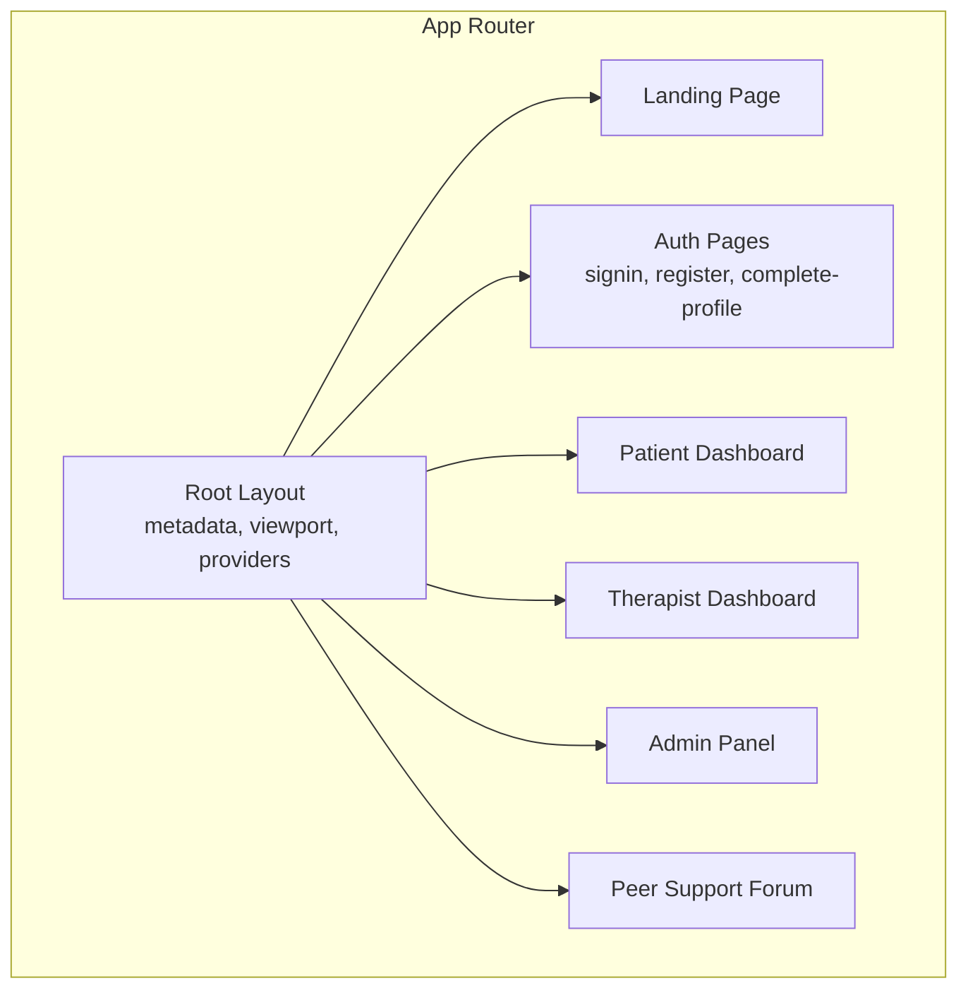
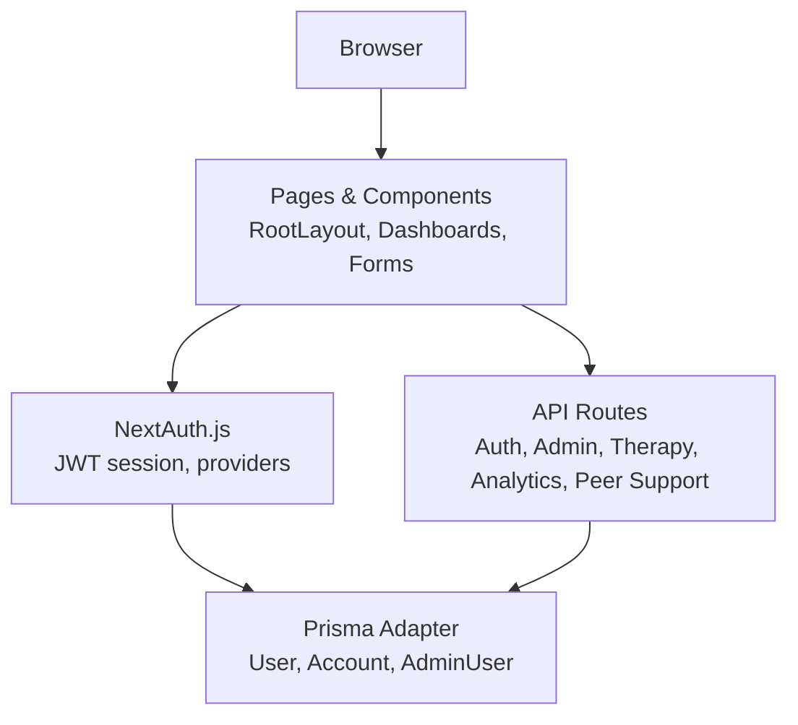
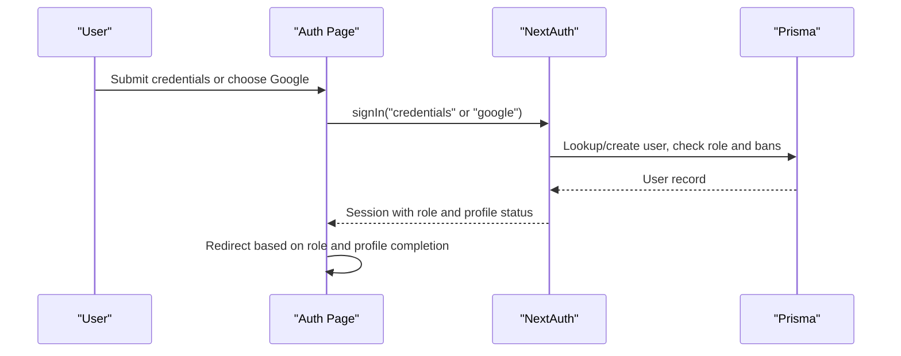
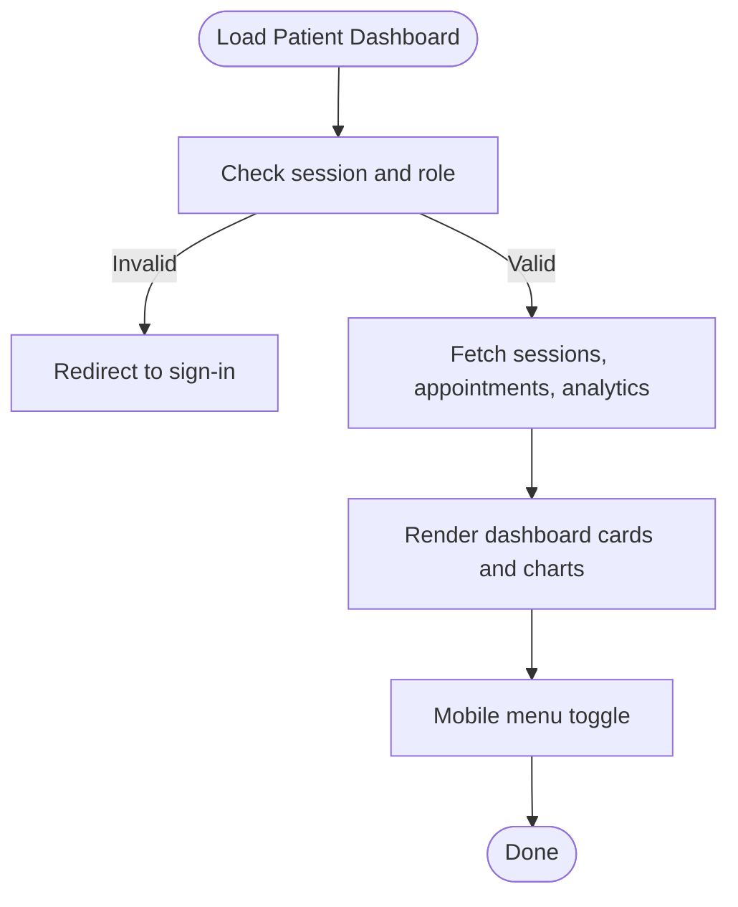
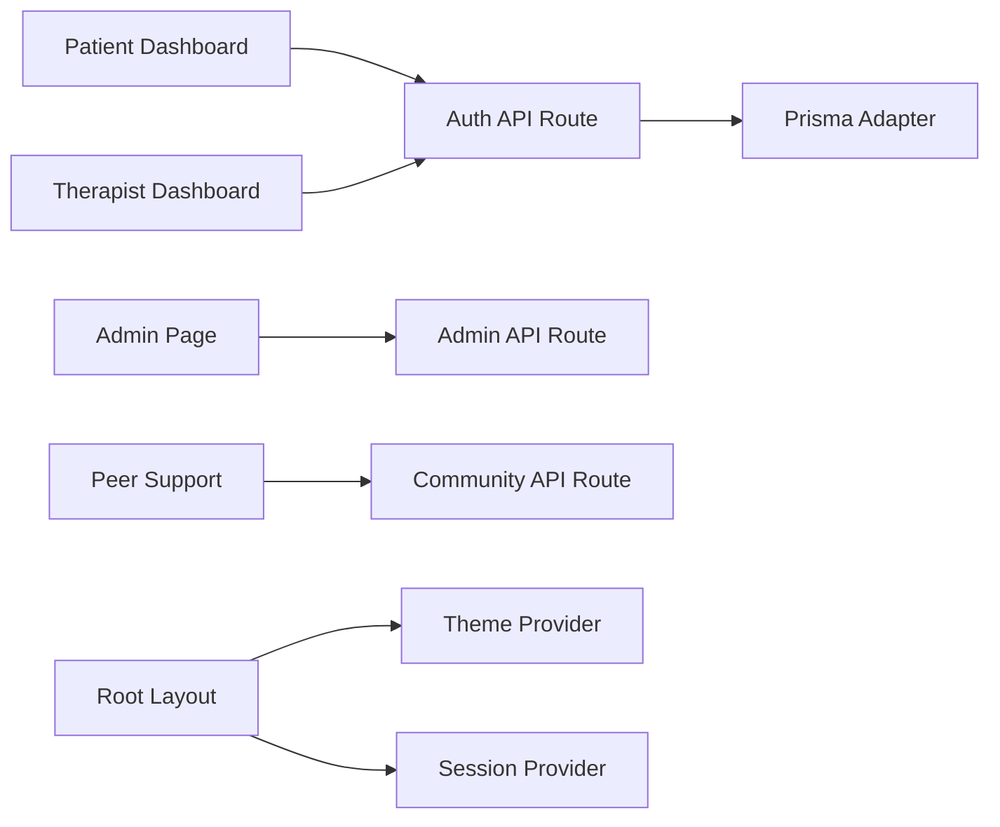

# Pages & Routing System

<cite>
**Referenced Files in This Document**
- [layout.tsx](file://WEBAPP/src/app/layout.tsx)
- [page.tsx](file://WEBAPP/src/app/page.tsx)
- [admin/page.tsx](file://WEBAPP/src/app/admin/page.tsx)
- [patient/dashboard/page.tsx](file://WEBAPP/src/app/patient/dashboard/page.tsx)
- [therapist/dashboard/page.tsx](file://WEBAPP/src/app/therapist/dashboard/page.tsx)
- [auth/signin/page.tsx](file://WEBAPP/src/app/auth/signin/page.tsx)
- [auth/register/page.tsx](file://WEBAPP/src/app/auth/register/page.tsx)
- [auth/complete-profile/page.tsx](file://WEBAPP/src/app/auth/complete-profile/page.tsx)
- [api/auth/[...nextauth]/route.ts](file://WEBAPP/src/app/api/auth/[...nextauth]/route.ts)
- [api/admin/login/route.ts](file://WEBAPP/src/app/api/admin/login/route.ts)
- [peer-support/page.tsx](file://WEBAPP/src/app/peer-support/page.tsx)
- [MobileNavigation.tsx](file://WEBAPP/src/components/MobileNavigation.tsx)
- [TherapistMobileMenu.tsx](file://WEBAPP/src/components/TherapistMobileMenu.tsx)
</cite>

## Table of Contents
1. [Introduction](#introduction)
2. [Project Structure](#project-structure)
3. [Core Components](#core-components)
4. [Architecture Overview](#architecture-overview)
5. [Detailed Component Analysis](#detailed-component-analysis)
6. [Dependency Analysis](#dependency-analysis)
7. [Performance Considerations](#performance-considerations)
8. [Troubleshooting Guide](#troubleshooting-guide)
9. [Conclusion](#conclusion)

## Introduction
This document explains the Next.js routing system and page structure for the MindBridge application. It covers all major pages, authentication flows, role-based dashboards (patient, therapist, admin), community features, navigation patterns, route protection, data fetching strategies, loading and error handling, responsive layouts, and SEO metadata. It also documents route groups, dynamic routing, and API route integration patterns.

## Project Structure
The application follows Next.js App Router conventions with a strict file-system-based routing model. Key routes include:
- Root landing page
- Authentication pages (sign-in, register, complete-profile)
- Role-specific dashboards (patient, therapist)
- Admin panel
- Community forum (peer support)
- API routes for authentication, admin, therapy, analytics, and peer support

**Diagram sources**
- [layout.tsx](file://WEBAPP/src/app/layout.tsx#L1-L55)
- [page.tsx](file://WEBAPP/src/app/page.tsx#L1-L381)
- [auth/signin/page.tsx](file://WEBAPP/src/app/auth/signin/page.tsx#L1-L257)
- [auth/register/page.tsx](file://WEBAPP/src/app/auth/register/page.tsx#L1-L266)
- [auth/complete-profile/page.tsx](file://WEBAPP/src/app/auth/complete-profile/page.tsx#L1-L358)
- [patient/dashboard/page.tsx](file://WEBAPP/src/app/patient/dashboard/page.tsx#L1-L800)
- [therapist/dashboard/page.tsx](file://WEBAPP/src/app/therapist/dashboard/page.tsx#L1-L800)
- [admin/page.tsx](file://WEBAPP/src/app/admin/page.tsx#L1-L84)
- [peer-support/page.tsx](file://WEBAPP/src/app/peer-support/page.tsx#L1-L523)

**Section sources**
- [layout.tsx](file://WEBAPP/src/app/layout.tsx#L1-L55)
- [page.tsx](file://WEBAPP/src/app/page.tsx#L1-L381)

## Core Components
- Root layout with metadata, viewport, theme provider, and session provider
- Landing page with role-aware navigation and CTA
- Authentication pages with credentials and Google OAuth
- Role-specific dashboards with protected routing and data fetching
- Admin login with JWT-based session
- Peer support forum with anonymous posting and replies
- Mobile navigation components for responsive UX

Key responsibilities:
- Route protection via client-side guards and server-side auth callbacks
- Role-based navigation and redirects
- Page-level data fetching and loading states
- Error handling and user feedback
- Responsive navigation with mobile sheets

**Section sources**
- [layout.tsx](file://WEBAPP/src/app/layout.tsx#L1-L55)
- [page.tsx](file://WEBAPP/src/app/page.tsx#L1-L381)
- [auth/signin/page.tsx](file://WEBAPP/src/app/auth/signin/page.tsx#L1-L257)
- [auth/register/page.tsx](file://WEBAPP/src/app/auth/register/page.tsx#L1-L266)
- [auth/complete-profile/page.tsx](file://WEBAPP/src/app/auth/complete-profile/page.tsx#L1-L358)
- [patient/dashboard/page.tsx](file://WEBAPP/src/app/patient/dashboard/page.tsx#L1-L800)
- [therapist/dashboard/page.tsx](file://WEBAPP/src/app/therapist/dashboard/page.tsx#L1-L800)
- [admin/page.tsx](file://WEBAPP/src/app/admin/page.tsx#L1-L84)
- [peer-support/page.tsx](file://WEBAPP/src/app/peer-support/page.tsx#L1-L523)
- [MobileNavigation.tsx](file://WEBAPP/src/components/MobileNavigation.tsx#L1-L120)
- [TherapistMobileMenu.tsx](file://WEBAPP/src/components/TherapistMobileMenu.tsx#L1-L129)

## Architecture Overview
The routing system integrates NextAuth.js for authentication and role-based access control, with API routes handling backend logic. The UI leverages a shared layout, theme provider, and session provider for consistent behavior across pages.

**Diagram sources**
- [api/auth/[...nextauth]/route.ts](file://WEBAPP/src/app/api/auth/[...nextauth]/route.ts#L1-L240)
- [api/admin/login/route.ts](file://WEBAPP/src/app/api/admin/login/route.ts#L1-L75)
- [layout.tsx](file://WEBAPP/src/app/layout.tsx#L1-L55)

## Detailed Component Analysis

### Root Layout and Metadata
- Provides global metadata (title, description, icons) and viewport settings
- Wraps children with theme provider and client session provider
- Ensures consistent branding and SEO across pages

**Section sources**
- [layout.tsx](file://WEBAPP/src/app/layout.tsx#L1-L55)

### Landing Page
- Role-aware navigation and CTAs
- Dynamic hero content and feature highlights
- Theme toggle integration

**Section sources**
- [page.tsx](file://WEBAPP/src/app/page.tsx#L1-L381)

### Authentication System
- Credentials provider with email/password and role selection
- Google OAuth provider with account linking and user creation
- Session callbacks inject role, user ID, and profile completion status
- Pages enforce profile completion and role redirection after sign-in

**Diagram sources**
- [auth/signin/page.tsx](file://WEBAPP/src/app/auth/signin/page.tsx#L1-L257)
- [api/auth/[...nextauth]/route.ts](file://WEBAPP/src/app/api/auth/[...nextauth]/route.ts#L1-L240)

**Section sources**
- [auth/signin/page.tsx](file://WEBAPP/src/app/auth/signin/page.tsx#L1-L257)
- [auth/register/page.tsx](file://WEBAPP/src/app/auth/register/page.tsx#L1-L266)
- [auth/complete-profile/page.tsx](file://WEBAPP/src/app/auth/complete-profile/page.tsx#L1-L358)
- [api/auth/[...nextauth]/route.ts](file://WEBAPP/src/app/api/auth/[...nextauth]/route.ts#L1-L240)

### Patient Dashboard
- Client-side guard ensures only authenticated patients can access
- Fetches sessions, appointments, and analytics via API
- Displays progress, mood trends, keyword breakdown, and quick actions
- Mobile-responsive with collapsible navigation

**Diagram sources**
- [patient/dashboard/page.tsx](file://WEBAPP/src/app/patient/dashboard/page.tsx#L1-L800)

**Section sources**
- [patient/dashboard/page.tsx](file://WEBAPP/src/app/patient/dashboard/page.tsx#L1-L800)
- [MobileNavigation.tsx](file://WEBAPP/src/components/MobileNavigation.tsx#L1-L120)

### Therapist Dashboard
- Client-side guard ensures only authenticated therapists can access
- Fetches sessions, patients, and appointments via API
- Displays schedule, patient list, and analytics
- Dedicated mobile menu component for therapist portal

**Section sources**
- [therapist/dashboard/page.tsx](file://WEBAPP/src/app/therapist/dashboard/page.tsx#L1-L800)
- [TherapistMobileMenu.tsx](file://WEBAPP/src/components/TherapistMobileMenu.tsx#L1-L129)

### Admin Panel
- Static login page with form validation
- Calls admin API route to authenticate and issue JWT
- Stores token in localStorage and redirects to admin dashboard

**Section sources**
- [admin/page.tsx](file://WEBAPP/src/app/admin/page.tsx#L1-L84)
- [api/admin/login/route.ts](file://WEBAPP/src/app/api/admin/login/route.ts#L1-L75)

### Peer Support Community
- Anonymous posting and replies
- Category filtering and search
- Like toggling and refresh capability
- Responsive design with mobile-friendly interactions

**Section sources**
- [peer-support/page.tsx](file://WEBAPP/src/app/peer-support/page.tsx#L1-L523)

## Dependency Analysis
- Authentication depends on NextAuth.js with Prisma adapter and providers
- Dashboards depend on API routes for therapy, analytics, and peer support
- Navigation components depend on session state and role
- Admin panel depends on JWT secret and admin user records

**Diagram sources**
- [api/auth/[...nextauth]/route.ts](file://WEBAPP/src/app/api/auth/[...nextauth]/route.ts#L1-L240)
- [api/admin/login/route.ts](file://WEBAPP/src/app/api/admin/login/route.ts#L1-L75)
- [patient/dashboard/page.tsx](file://WEBAPP/src/app/patient/dashboard/page.tsx#L1-L800)
- [therapist/dashboard/page.tsx](file://WEBAPP/src/app/therapist/dashboard/page.tsx#L1-L800)
- [peer-support/page.tsx](file://WEBAPP/src/app/peer-support/page.tsx#L1-L523)
- [layout.tsx](file://WEBAPP/src/app/layout.tsx#L1-L55)

**Section sources**
- [api/auth/[...nextauth]/route.ts](file://WEBAPP/src/app/api/auth/[...nextauth]/route.ts#L1-L240)
- [api/admin/login/route.ts](file://WEBAPP/src/app/api/admin/login/route.ts#L1-L75)
- [patient/dashboard/page.tsx](file://WEBAPP/src/app/patient/dashboard/page.tsx#L1-L800)
- [therapist/dashboard/page.tsx](file://WEBAPP/src/app/therapist/dashboard/page.tsx#L1-L800)
- [peer-support/page.tsx](file://WEBAPP/src/app/peer-support/page.tsx#L1-L523)
- [layout.tsx](file://WEBAPP/src/app/layout.tsx#L1-L55)

## Performance Considerations
- Client-side guards avoid unnecessary server requests for role checks
- Dashboard pages fetch data asynchronously and render skeletons/loading states
- Mobile menus use lightweight overlays and controlled open/close state
- API routes should implement pagination and filtering for large datasets (e.g., peer support posts)

## Troubleshooting Guide
Common issues and resolutions:
- Authentication failures: Verify provider credentials and database user records
- Role redirection loops: Ensure session callbacks populate role and ID correctly
- Dashboard data not loading: Check API route endpoints and CORS/headers
- Mobile menu not opening: Confirm sheet components and event handlers
- Admin login errors: Validate JWT secret and seeded admin credentials

**Section sources**
- [api/auth/[...nextauth]/route.ts](file://WEBAPP/src/app/api/auth/[...nextauth]/route.ts#L1-L240)
- [auth/signin/page.tsx](file://WEBAPP/src/app/auth/signin/page.tsx#L1-L257)
- [patient/dashboard/page.tsx](file://WEBAPP/src/app/patient/dashboard/page.tsx#L1-L800)
- [TherapistMobileMenu.tsx](file://WEBAPP/src/components/TherapistMobileMenu.tsx#L1-L129)
- [api/admin/login/route.ts](file://WEBAPP/src/app/api/admin/login/route.ts#L1-L75)

## Conclusion
The MindBridge routing system combines Next.js App Router with NextAuth.js for robust authentication and role-based access control. Pages are structured around clear responsibilities, with consistent navigation, responsive layouts, and practical data-fetching patterns. The admin panel and community features extend the platform’s capabilities while maintaining security and usability.