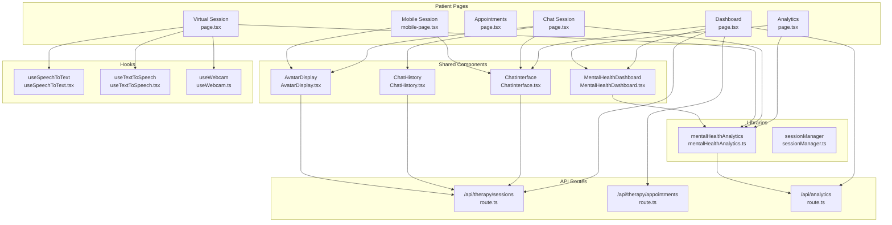
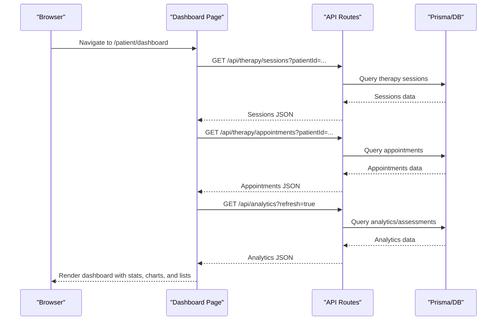
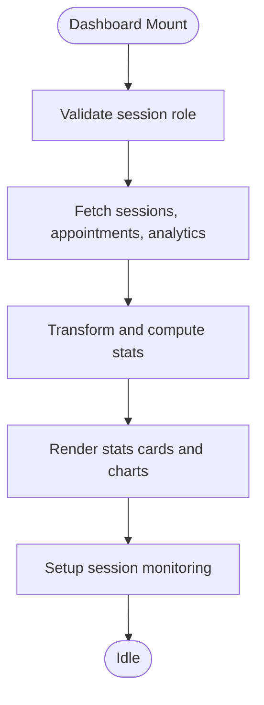
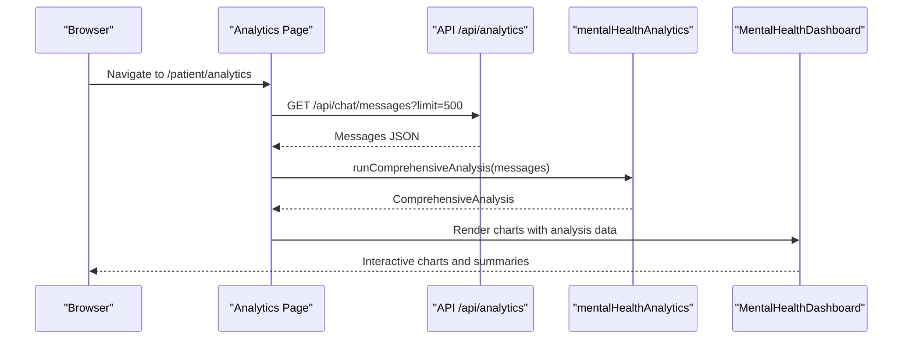
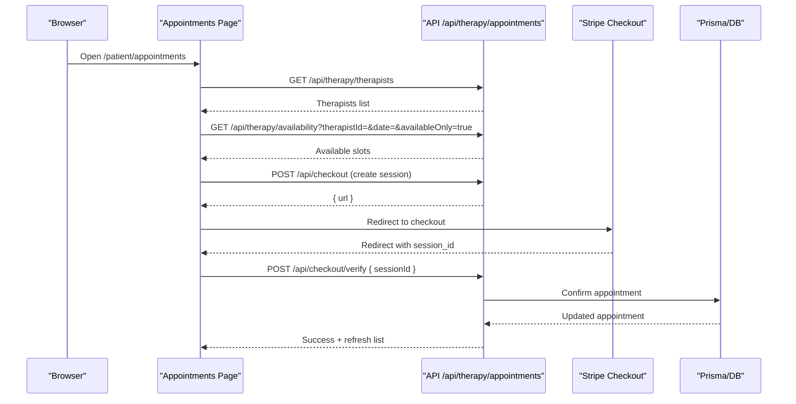
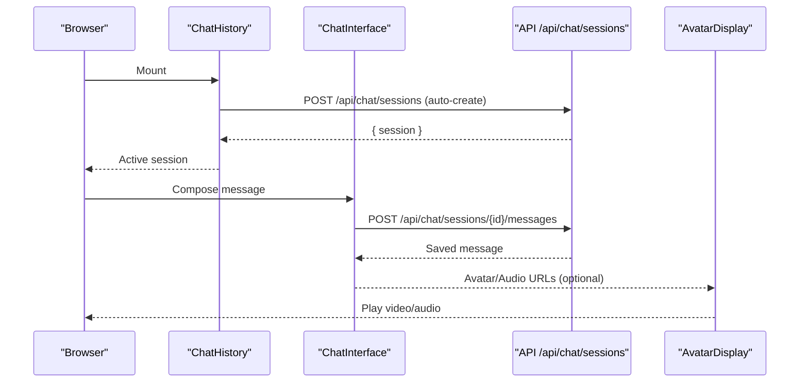
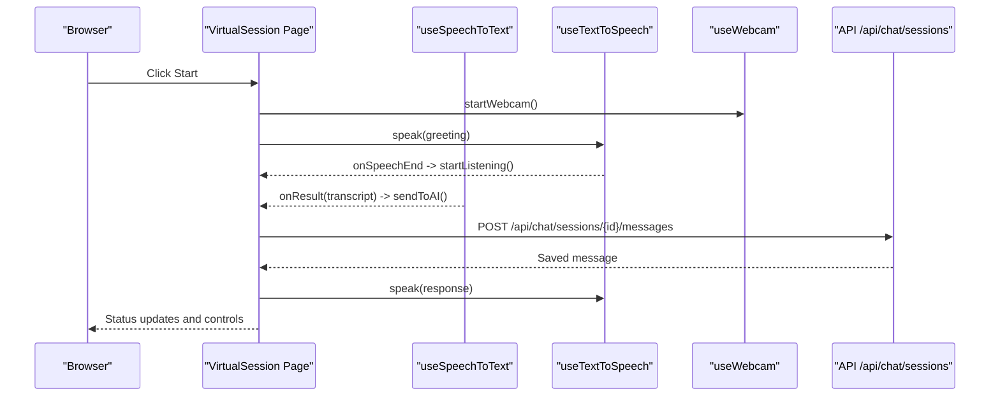
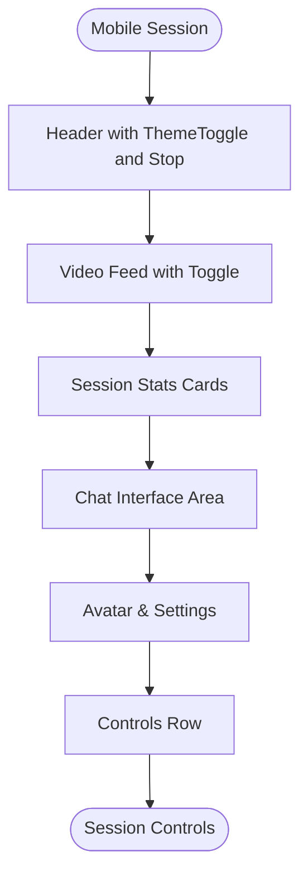
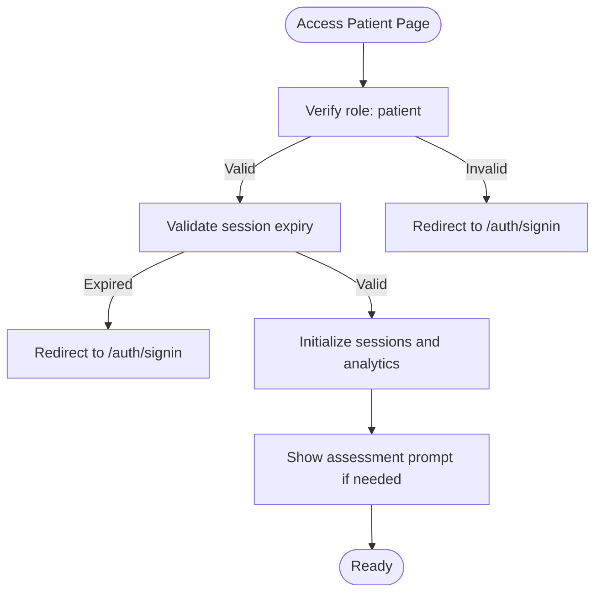
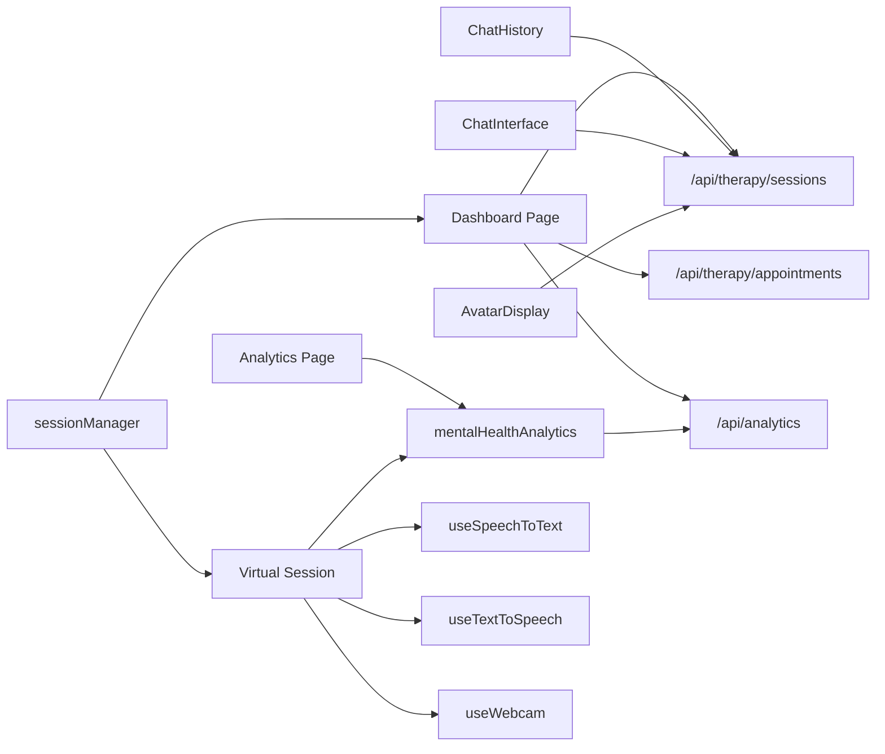

# Patient Dashboard

<cite>
**Referenced Files in This Document**
- [page.tsx](file://WEBAPP/src/app/patient/dashboard/page.tsx)
- [page.tsx](file://WEBAPP/src/app/patient/analytics/page.tsx)
- [page.tsx](file://WEBAPP/src/app/patient/appointments/page.tsx)
- [page.tsx](file://WEBAPP/src/app/patient/session/page.tsx)
- [page.tsx](file://WEBAPP/src/app/patient/virtual-session/page.tsx)
- [mobile-page.tsx](file://WEBAPP/src/app/patient/session/mobile-page.tsx)
- [MentalHealthDashboard.tsx](file://WEBAPP/src/components/analytics/MentalHealthDashboard.tsx)
- [ChatInterface.tsx](file://WEBAPP/src/components/ChatInterface.tsx)
- [ChatHistory.tsx](file://WEBAPP/src/components/ChatHistory.tsx)
- [AvatarDisplay.tsx](file://WEBAPP/src/components/AvatarDisplay.tsx)
- [sessionManager.ts](file://WEBAPP/src/lib/sessionManager.ts)
- [useSpeechToText.tsx](file://WEBAPP/src/hooks/useSpeechToText.tsx)
- [useTextToSpeech.tsx](file://WEBAPP/src/hooks/useTextToSpeech.tsx)
- [useWebcam.ts](file://WEBAPP/src/hooks/useWebcam.ts)
- [mentalHealthAnalytics.ts](file://WEBAPP/src/lib/mentalHealthAnalytics.ts)
- [route.ts](file://WEBAPP/src/app/api/therapy/sessions/route.ts)
- [route.ts](file://WEBAPP/src/app/api/therapy/appointments/route.ts)
- [route.ts](file://WEBAPP/src/app/api/analytics/route.ts)
</cite>

## Table of Contents
1. [Introduction](#introduction)
2. [Project Structure](#project-structure)
3. [Core Components](#core-components)
4. [Architecture Overview](#architecture-overview)
5. [Detailed Component Analysis](#detailed-component-analysis)
6. [Dependency Analysis](#dependency-analysis)
7. [Performance Considerations](#performance-considerations)
8. [Troubleshooting Guide](#troubleshooting-guide)
9. [Conclusion](#conclusion)

## Introduction
This document describes the patient dashboard system for MindBridge, covering the main dashboard interface, analytics visualization, appointment scheduling, and therapy session management. It explains how patient-specific data is presented, how progress tracking works, and the end-to-end session booking workflow. It also documents the virtual session interface, real-time communication features, session status management, mobile-responsive design patterns, and patient onboarding flows.

## Project Structure
The patient-facing application is organized around distinct pages and shared components:
- Dashboard page aggregates patient statistics, analytics, and quick actions
- Analytics page renders advanced NLP-driven insights
- Appointments page manages booking and cancellation with real-time updates
- Session pages provide two modes: text-based chat and immersive virtual sessions
- Shared components encapsulate reusable UI and logic (chat, analytics, avatars)
- Hooks provide real-time speech and webcam capabilities
- API routes connect frontend to backend services and databases

**Diagram sources**
- [page.tsx](file://WEBAPP/src/app/patient/dashboard/page.tsx#L1-L1172)
- [page.tsx](file://WEBAPP/src/app/patient/analytics/page.tsx#L1-L127)
- [page.tsx](file://WEBAPP/src/app/patient/appointments/page.tsx#L1-L1006)
- [page.tsx](file://WEBAPP/src/app/patient/session/page.tsx#L1-L283)
- [page.tsx](file://WEBAPP/src/app/patient/virtual-session/page.tsx#L1-L805)
- [mobile-page.tsx](file://WEBAPP/src/app/patient/session/mobile-page.tsx#L1-L237)
- [ChatInterface.tsx](file://WEBAPP/src/components/ChatInterface.tsx#L1-L567)
- [ChatHistory.tsx](file://WEBAPP/src/components/ChatHistory.tsx#L1-L417)
- [MentalHealthDashboard.tsx](file://WEBAPP/src/components/analytics/MentalHealthDashboard.tsx#L1-L541)
- [AvatarDisplay.tsx](file://WEBAPP/src/components/AvatarDisplay.tsx#L1-L210)
- [useSpeechToText.tsx](file://WEBAPP/src/hooks/useSpeechToText.tsx#L1-L129)
- [useTextToSpeech.tsx](file://WEBAPP/src/hooks/useTextToSpeech.tsx#L1-L42)
- [useWebcam.ts](file://WEBAPP/src/hooks/useWebcam.ts#L1-L89)
- [mentalHealthAnalytics.ts](file://WEBAPP/src/lib/mentalHealthAnalytics.ts#L1-L884)
- [sessionManager.ts](file://WEBAPP/src/lib/sessionManager.ts#L1-L78)
- [route.ts](file://WEBAPP/src/app/api/therapy/sessions/route.ts#L1-L80)
- [route.ts](file://WEBAPP/src/app/api/therapy/appointments/route.ts#L1-L181)
- [route.ts](file://WEBAPP/src/app/api/analytics/route.ts#L1-L253)

**Section sources**
- [page.tsx](file://WEBAPP/src/app/patient/dashboard/page.tsx#L1-L1172)
- [page.tsx](file://WEBAPP/src/app/patient/analytics/page.tsx#L1-L127)
- [page.tsx](file://WEBAPP/src/app/patient/appointments/page.tsx#L1-L1006)
- [page.tsx](file://WEBAPP/src/app/patient/session/page.tsx#L1-L283)
- [page.tsx](file://WEBAPP/src/app/patient/virtual-session/page.tsx#L1-L805)
- [mobile-page.tsx](file://WEBAPP/src/app/patient/session/mobile-page.tsx#L1-L237)

## Core Components
- Dashboard page: Aggregates session stats, analytics cards, progress visualization, and quick actions. Implements session monitoring and real-time updates.
- Analytics page: Renders advanced NLP insights using dynamic imports and responsive charts.
- Appointments page: Provides a three-step booking flow with therapist selection, slot availability, and Stripe payment integration.
- Chat session page: Manages chat history, real-time messaging, avatar generation, and optional TTS/AVATAR features.
- Virtual session page: Delivers immersive voice/video therapy with speech-to-text, text-to-speech, webcam, and session status management.
- Shared components: ChatInterface, ChatHistory, MentalHealthDashboard, AvatarDisplay encapsulate UI and logic reuse.
- Hooks: useSpeechToText, useTextToSpeech, useWebcam provide browser-native real-time capabilities.
- Libraries: mentalHealthAnalytics powers keyword detection, sentiment analysis, and severity scoring; sessionManager handles session lifecycle.

**Section sources**
- [page.tsx](file://WEBAPP/src/app/patient/dashboard/page.tsx#L45-L124)
- [page.tsx](file://WEBAPP/src/app/patient/analytics/page.tsx#L10-L18)
- [page.tsx](file://WEBAPP/src/app/patient/appointments/page.tsx#L61-L85)
- [page.tsx](file://WEBAPP/src/app/patient/session/page.tsx#L27-L118)
- [page.tsx](file://WEBAPP/src/app/patient/virtual-session/page.tsx#L89-L196)
- [ChatInterface.tsx](file://WEBAPP/src/components/ChatInterface.tsx#L42-L98)
- [ChatHistory.tsx](file://WEBAPP/src/components/ChatHistory.tsx#L42-L97)
- [MentalHealthDashboard.tsx](file://WEBAPP/src/components/analytics/MentalHealthDashboard.tsx#L47-L51)
- [AvatarDisplay.tsx](file://WEBAPP/src/components/AvatarDisplay.tsx#L12-L64)
- [useSpeechToText.tsx](file://WEBAPP/src/hooks/useSpeechToText.tsx#L56-L126)
- [useTextToSpeech.tsx](file://WEBAPP/src/hooks/useTextToSpeech.tsx#L3-L38)
- [useWebcam.ts](file://WEBAPP/src/hooks/useWebcam.ts#L9-L87)
- [mentalHealthAnalytics.ts](file://WEBAPP/src/lib/mentalHealthAnalytics.ts#L199-L289)
- [sessionManager.ts](file://WEBAPP/src/lib/sessionManager.ts#L3-L76)

## Architecture Overview
The system follows a Next.js app router pattern with server-side session validation and client-side reactive UI. Data flows from API routes to frontend components, with analytics computed client-side using reusable libraries.

**Diagram sources**
- [page.tsx](file://WEBAPP/src/app/patient/dashboard/page.tsx#L125-L276)
- [route.ts](file://WEBAPP/src/app/api/therapy/sessions/route.ts#L5-L42)
- [route.ts](file://WEBAPP/src/app/api/therapy/appointments/route.ts#L6-L36)
- [route.ts](file://WEBAPP/src/app/api/analytics/route.ts#L13-L161)

## Detailed Component Analysis

### Dashboard Interface
The dashboard aggregates:
- Stats cards: total sessions, total time, current streak, wellness score
- Mental health level visualization with trend and risk flags
- Weekly progress with a timeline of recent levels
- Keyword breakdown and current mood trend
- Quick actions to start sessions, view analytics, book appointments, and join peer support

**Diagram sources**
- [page.tsx](file://WEBAPP/src/app/patient/dashboard/page.tsx#L55-L93)
- [page.tsx](file://WEBAPP/src/app/patient/dashboard/page.tsx#L125-L276)

**Section sources**
- [page.tsx](file://WEBAPP/src/app/patient/dashboard/page.tsx#L45-L124)
- [page.tsx](file://WEBAPP/src/app/patient/dashboard/page.tsx#L125-L276)
- [sessionManager.ts](file://WEBAPP/src/lib/sessionManager.ts#L3-L76)

### Analytics Visualization
The advanced analytics page dynamically loads the MentalHealthDashboard component and displays:
- Severity level, overall sentiment, dominant emotion, lexical diversity
- Sentiment timeline (area + moving average), emotion pie chart, radar chart
- Keyword category breakdown, n-gram analysis, and risk flags
- Summary cards with message counts and counts of positive/negative messages

**Diagram sources**
- [page.tsx](file://WEBAPP/src/app/patient/analytics/page.tsx#L20-L59)
- [MentalHealthDashboard.tsx](file://WEBAPP/src/components/analytics/MentalHealthDashboard.tsx#L47-L51)
- [mentalHealthAnalytics.ts](file://WEBAPP/src/lib/mentalHealthAnalytics.ts#L845-L882)
- [route.ts](file://WEBAPP/src/app/api/analytics/route.ts#L13-L161)

**Section sources**
- [page.tsx](file://WEBAPP/src/app/patient/analytics/page.tsx#L10-L18)
- [MentalHealthDashboard.tsx](file://WEBAPP/src/components/analytics/MentalHealthDashboard.tsx#L47-L541)
- [mentalHealthAnalytics.ts](file://WEBAPP/src/lib/mentalHealthAnalytics.ts#L199-L289)

### Appointment Scheduling Workflow
The appointments page implements a three-step booking process:
1) Select therapist and date
2) Pick an available time slot (auto-refreshed)
3) Confirm and pay via Stripe

Real-time updates are polled every 30 seconds, and payment verification occurs after redirect.

**Diagram sources**
- [page.tsx](file://WEBAPP/src/app/patient/appointments/page.tsx#L61-L177)
- [page.tsx](file://WEBAPP/src/app/patient/appointments/page.tsx#L210-L258)
- [route.ts](file://WEBAPP/src/app/api/therapy/appointments/route.ts#L38-L181)

**Section sources**
- [page.tsx](file://WEBAPP/src/app/patient/appointments/page.tsx#L61-L177)
- [page.tsx](file://WEBAPP/src/app/patient/appointments/page.tsx#L179-L208)
- [page.tsx](file://WEBAPP/src/app/patient/appointments/page.tsx#L210-L258)
- [route.ts](file://WEBAPP/src/app/api/therapy/appointments/route.ts#L38-L181)

### Therapy Session Management
Two session modes are supported:

#### Text-Based Chat Session
- ChatHistory creates and manages sessions, auto-cleans empty ones, and supports renaming/deleting
- ChatInterface handles sending messages, loading session history, and optional avatar/TTS
- AvatarDisplay renders generated video/audio responses and provides playback controls

**Diagram sources**
- [ChatHistory.tsx](file://WEBAPP/src/components/ChatHistory.tsx#L75-L146)
- [ChatInterface.tsx](file://WEBAPP/src/components/ChatInterface.tsx#L105-L147)
- [AvatarDisplay.tsx](file://WEBAPP/src/components/AvatarDisplay.tsx#L37-L72)

**Section sources**
- [ChatHistory.tsx](file://WEBAPP/src/components/ChatHistory.tsx#L42-L146)
- [ChatInterface.tsx](file://WEBAPP/src/components/ChatInterface.tsx#L105-L147)
- [AvatarDisplay.tsx](file://WEBAPP/src/components/AvatarDisplay.tsx#L37-L72)

#### Virtual Session Interface
Immersive voice/video therapy with:
- Speech-to-text and text-to-speech hooks
- Webcam capture and controls
- Session status machine (idle, greeting, listening, processing, answering, paused, ended)
- Real-time transcription and therapist replies

**Diagram sources**
- [page.tsx](file://WEBAPP/src/app/patient/virtual-session/page.tsx#L280-L329)
- [useSpeechToText.tsx](file://WEBAPP/src/hooks/useSpeechToText.tsx#L56-L126)
- [useTextToSpeech.tsx](file://WEBAPP/src/hooks/useTextToSpeech.tsx#L3-L38)
- [useWebcam.ts](file://WEBAPP/src/hooks/useWebcam.ts#L17-L52)

**Section sources**
- [page.tsx](file://WEBAPP/src/app/patient/virtual-session/page.tsx#L89-L196)
- [useSpeechToText.tsx](file://WEBAPP/src/hooks/useSpeechToText.tsx#L56-L126)
- [useTextToSpeech.tsx](file://WEBAPP/src/hooks/useTextToSpeech.tsx#L3-L38)
- [useWebcam.ts](file://WEBAPP/src/hooks/useWebcam.ts#L17-L52)

### Mobile-Responsive Design Patterns
The mobile session page demonstrates:
- Compact layout with essential controls (camera toggle, microphone toggle, session duration)
- Emotion badge and session stats cards
- Integrated chat interface area
- Settings toggles for TTS and avatar responses

**Diagram sources**
- [mobile-page.tsx](file://WEBAPP/src/app/patient/session/mobile-page.tsx#L31-L237)

**Section sources**
- [mobile-page.tsx](file://WEBAPP/src/app/patient/session/mobile-page.tsx#L31-L237)

### Patient Onboarding Flows
- Role-based routing ensures only authenticated patients access patient pages
- Session monitoring detects expiration and incognito mode
- Auto-creation of chat sessions on first visit and cleanup of empty sessions
- Assessment prompts appear after periods of vague messaging to encourage structured reflection

**Diagram sources**
- [page.tsx](file://WEBAPP/src/app/patient/dashboard/page.tsx#L55-L70)
- [sessionManager.ts](file://WEBAPP/src/lib/sessionManager.ts#L3-L76)
- [ChatHistory.tsx](file://WEBAPP/src/components/ChatHistory.tsx#L75-L146)
- [ChatInterface.tsx](file://WEBAPP/src/components/ChatInterface.tsx#L153-L169)

**Section sources**
- [page.tsx](file://WEBAPP/src/app/patient/dashboard/page.tsx#L55-L70)
- [sessionManager.ts](file://WEBAPP/src/lib/sessionManager.ts#L3-L76)
- [ChatHistory.tsx](file://WEBAPP/src/components/ChatHistory.tsx#L75-L146)
- [ChatInterface.tsx](file://WEBAPP/src/components/ChatInterface.tsx#L153-L169)

## Dependency Analysis
Key dependencies and relationships:
- Dashboard depends on API routes for sessions, appointments, and analytics
- Analytics page depends on mentalHealthAnalytics library for computations
- Chat components depend on API routes for session/message persistence
- Virtual session depends on hooks for speech/webcam and mentalHealthAnalytics for assessment scoring
- Session manager provides cross-tab session validation and incognito detection

**Diagram sources**
- [page.tsx](file://WEBAPP/src/app/patient/dashboard/page.tsx#L125-L276)
- [page.tsx](file://WEBAPP/src/app/patient/analytics/page.tsx#L20-L59)
- [ChatHistory.tsx](file://WEBAPP/src/components/ChatHistory.tsx#L56-L146)
- [ChatInterface.tsx](file://WEBAPP/src/components/ChatInterface.tsx#L105-L147)
- [AvatarDisplay.tsx](file://WEBAPP/src/components/AvatarDisplay.tsx#L37-L72)
- [page.tsx](file://WEBAPP/src/app/patient/virtual-session/page.tsx#L89-L196)
- [useSpeechToText.tsx](file://WEBAPP/src/hooks/useSpeechToText.tsx#L56-L126)
- [useTextToSpeech.tsx](file://WEBAPP/src/hooks/useTextToSpeech.tsx#L3-L38)
- [useWebcam.ts](file://WEBAPP/src/hooks/useWebcam.ts#L17-L52)
- [sessionManager.ts](file://WEBAPP/src/lib/sessionManager.ts#L3-L76)

**Section sources**
- [page.tsx](file://WEBAPP/src/app/patient/dashboard/page.tsx#L125-L276)
- [page.tsx](file://WEBAPP/src/app/patient/analytics/page.tsx#L20-L59)
- [ChatHistory.tsx](file://WEBAPP/src/components/ChatHistory.tsx#L56-L146)
- [ChatInterface.tsx](file://WEBAPP/src/components/ChatInterface.tsx#L105-L147)
- [AvatarDisplay.tsx](file://WEBAPP/src/components/AvatarDisplay.tsx#L37-L72)
- [page.tsx](file://WEBAPP/src/app/patient/virtual-session/page.tsx#L89-L196)
- [useSpeechToText.tsx](file://WEBAPP/src/hooks/useSpeechToText.tsx#L56-L126)
- [useTextToSpeech.tsx](file://WEBAPP/src/hooks/useTextToSpeech.tsx#L3-L38)
- [useWebcam.ts](file://WEBAPP/src/hooks/useWebcam.ts#L17-L52)
- [sessionManager.ts](file://WEBAPP/src/lib/sessionManager.ts#L3-L76)

## Performance Considerations
- Dashboard uses client-side computation for stats and analytics to minimize server load; ensure efficient transforms and memoization where appropriate
- Analytics page uses dynamic imports to avoid SSR overhead and reduce initial bundle size
- Appointments page employs polling for real-time updates; tune intervals to balance responsiveness and network usage
- Virtual session integrates browser-native APIs; handle errors gracefully and provide fallbacks for unsupported environments
- Avatar playback and audio synchronization require careful timing; consider throttling and cleanup on unmount

## Troubleshooting Guide
Common issues and resolutions:
- Authentication failures: Ensure role validation redirects to sign-in when session is missing or role is not patient
- Session expiration: Use sessionManager to detect and redirect on expired sessions
- Empty chat sessions: ChatHistory auto-deletes sessions with zero messages to prevent clutter
- Payment failures: Appointments page surfaces Stripe errors and allows retry; verify payment verification flow
- Speech/webcam errors: Hooks provide error logging and alerts; verify permissions and browser support

**Section sources**
- [page.tsx](file://WEBAPP/src/app/patient/dashboard/page.tsx#L55-L70)
- [sessionManager.ts](file://WEBAPP/src/lib/sessionManager.ts#L3-L76)
- [ChatHistory.tsx](file://WEBAPP/src/components/ChatHistory.tsx#L99-L118)
- [page.tsx](file://WEBAPP/src/app/patient/appointments/page.tsx#L164-L179)
- [useSpeechToText.tsx](file://WEBAPP/src/hooks/useSpeechToText.tsx#L88-L96)
- [useWebcam.ts](file://WEBAPP/src/hooks/useWebcam.ts#L37-L40)

## Conclusion
The patient dashboard system combines a responsive UI with robust analytics, secure session management, and immersive therapy experiences. Its modular architecture enables scalable enhancements while maintaining a consistent user experience across desktop and mobile devices.