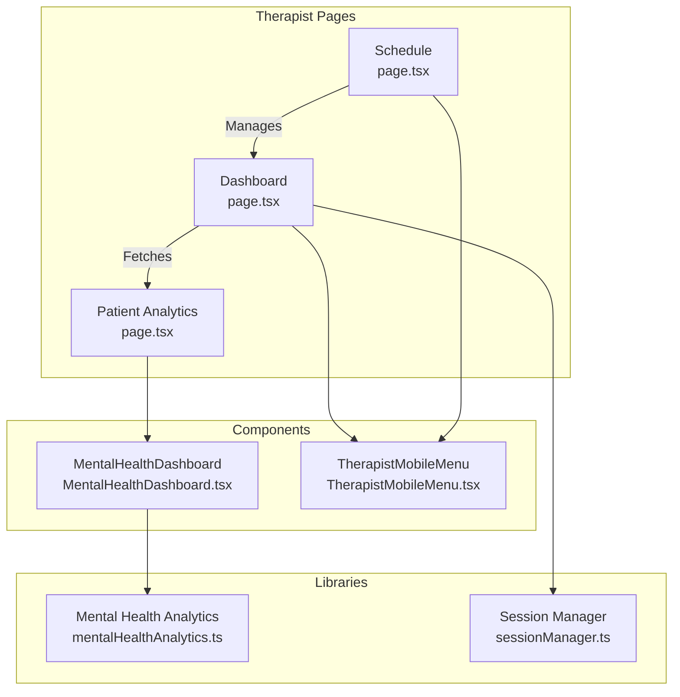
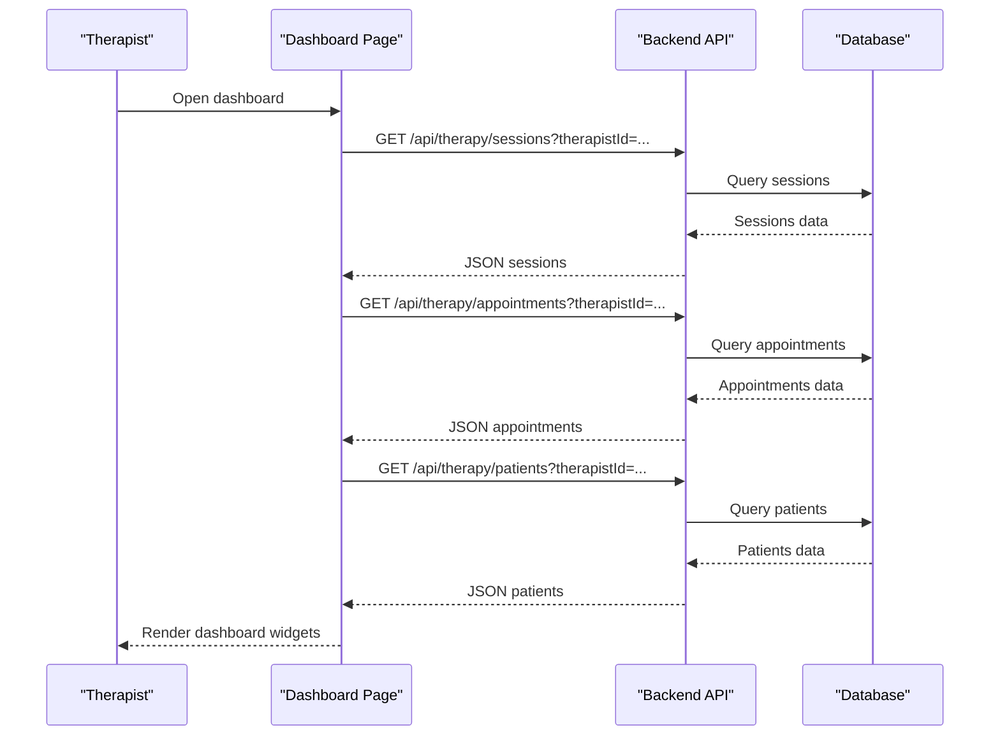
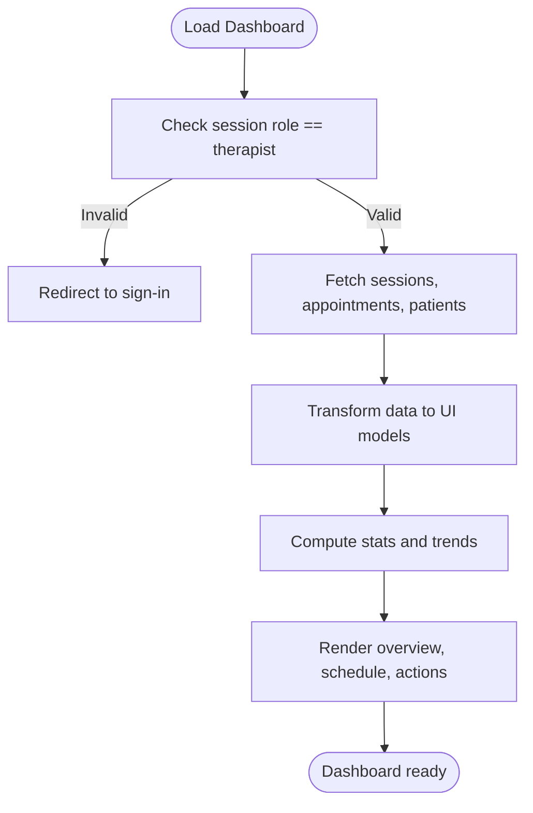
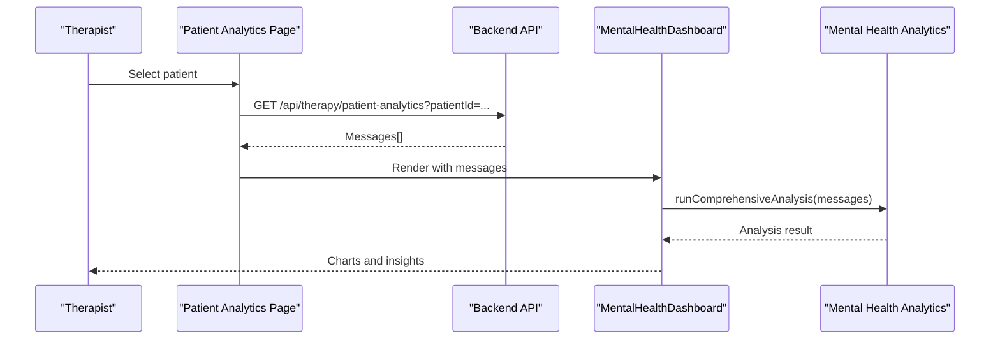
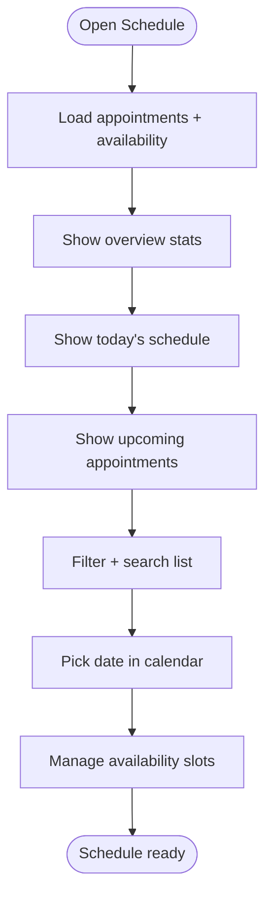
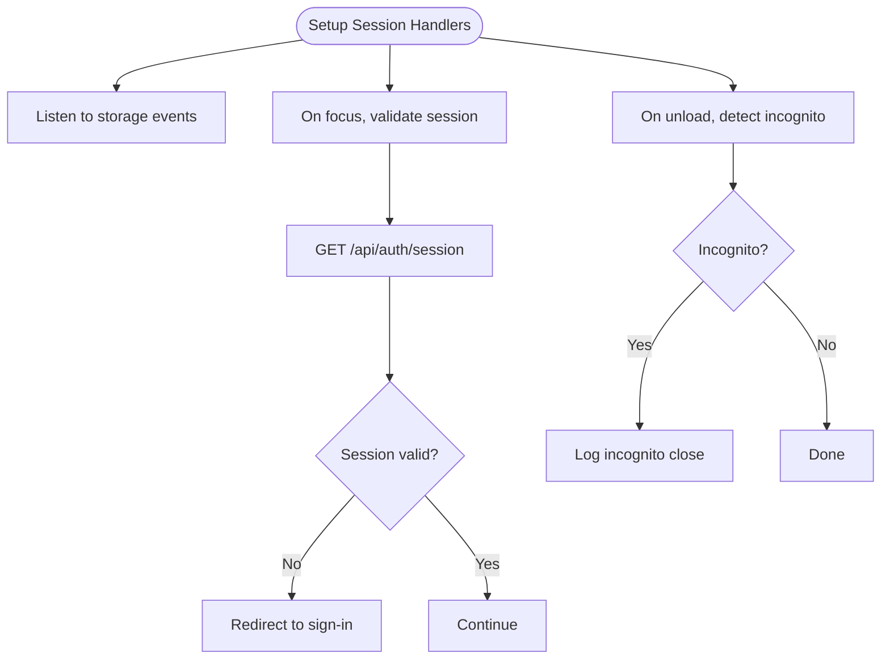
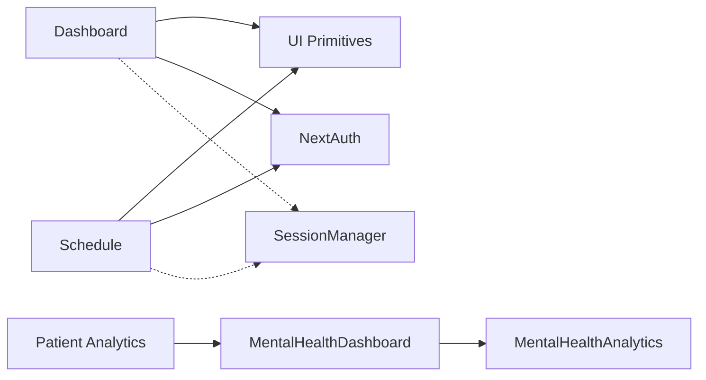

# Therapist Interface

<cite>
**Referenced Files in This Document**
- [dashboard/page.tsx](file://WEBAPP/src/app/therapist/dashboard/page.tsx)
- [patient-analytics/page.tsx](file://WEBAPP/src/app/therapist/patient-analytics/page.tsx)
- [schedule/page.tsx](file://WEBAPP/src/app/therapist/schedule/page.tsx)
- [MentalHealthDashboard.tsx](file://WEBAPP/src/components/analytics/MentalHealthDashboard.tsx)
- [TherapistMobileMenu.tsx](file://WEBAPP/src/components/TherapistMobileMenu.tsx)
- [mentalHealthAnalytics.ts](file://WEBAPP/src/lib/mentalHealthAnalytics.ts)
- [sessionManager.ts](file://WEBAPP/src/lib/sessionManager.ts)
</cite>

## Table of Contents
1. [Introduction](#introduction)
2. [Project Structure](#project-structure)
3. [Core Components](#core-components)
4. [Architecture Overview](#architecture-overview)
5. [Detailed Component Analysis](#detailed-component-analysis)
6. [Dependency Analysis](#dependency-analysis)
7. [Performance Considerations](#performance-considerations)
8. [Troubleshooting Guide](#troubleshooting-guide)
9. [Conclusion](#conclusion)

## Introduction
This document describes the therapist interface system, covering the therapist dashboard, patient analytics, scheduling interface, and session management tools. It explains patient monitoring capabilities, progress analytics, appointment coordination, therapist-patient communication features, session recording, and documentation workflows. Administrative tools for managing multiple patients and session scheduling are also detailed.

## Project Structure
The therapist interface is implemented as a Next.js application with TypeScript. Key pages include:
- Therapist Dashboard: overview of patients, sessions, and daily schedule
- Patient Analytics: advanced NLP-driven mental health analytics per patient
- Schedule Management: appointment booking, availability management, and calendar view
- Supporting components: mobile navigation, analytics dashboard, and session utilities

**Diagram sources**
- [dashboard/page.tsx](file://WEBAPP/src/app/therapist/dashboard/page.tsx#L68-L171)
- [patient-analytics/page.tsx](file://WEBAPP/src/app/therapist/patient-analytics/page.tsx#L48-L99)
- [schedule/page.tsx](file://WEBAPP/src/app/therapist/schedule/page.tsx#L74-L144)
- [MentalHealthDashboard.tsx](file://WEBAPP/src/components/analytics/MentalHealthDashboard.tsx#L47-L51)
- [mentalHealthAnalytics.ts](file://WEBAPP/src/lib/mentalHealthAnalytics.ts#L199-L289)
- [TherapistMobileMenu.tsx](file://WEBAPP/src/components/TherapistMobileMenu.tsx#L13-L27)
- [sessionManager.ts](file://WEBAPP/src/lib/sessionManager.ts#L3-L76)

**Section sources**
- [dashboard/page.tsx](file://WEBAPP/src/app/therapist/dashboard/page.tsx#L1-L959)
- [patient-analytics/page.tsx](file://WEBAPP/src/app/therapist/patient-analytics/page.tsx#L1-L417)
- [schedule/page.tsx](file://WEBAPP/src/app/therapist/schedule/page.tsx#L1-L992)
- [MentalHealthDashboard.tsx](file://WEBAPP/src/components/analytics/MentalHealthDashboard.tsx#L1-L541)
- [mentalHealthAnalytics.ts](file://WEBAPP/src/lib/mentalHealthAnalytics.ts#L1-L884)
- [TherapistMobileMenu.tsx](file://WEBAPP/src/components/TherapistMobileMenu.tsx#L1-L129)
- [sessionManager.ts](file://WEBAPP/src/lib/sessionManager.ts#L1-L78)

## Core Components
- Therapist Dashboard: displays statistics, today's schedule, quick actions, patient list, session history, and appointment controls.
- Patient Analytics: lists patients, supports search, and renders a comprehensive mental health analytics dashboard powered by NLP.
- Schedule Management: manages appointments, availability slots, calendar view, and status updates.
- Mental Health Analytics Engine: performs keyword-based analysis, sentiment scoring, emotion classification, and lexical diversity metrics.
- Session Utilities: handles session lifecycle checks, expiration warnings, and browser state detection.

**Section sources**
- [dashboard/page.tsx](file://WEBAPP/src/app/therapist/dashboard/page.tsx#L68-L398)
- [patient-analytics/page.tsx](file://WEBAPP/src/app/therapist/patient-analytics/page.tsx#L48-L142)
- [schedule/page.tsx](file://WEBAPP/src/app/therapist/schedule/page.tsx#L74-L386)
- [MentalHealthDashboard.tsx](file://WEBAPP/src/components/analytics/MentalHealthDashboard.tsx#L47-L541)
- [mentalHealthAnalytics.ts](file://WEBAPP/src/lib/mentalHealthAnalytics.ts#L199-L350)
- [sessionManager.ts](file://WEBAPP/src/lib/sessionManager.ts#L3-L76)

## Architecture Overview
The therapist interface follows a client-side React architecture with server-side data fetching via API routes. The dashboard and schedule pages fetch data from backend endpoints, transforming and displaying it. The analytics page dynamically loads a specialized dashboard component that runs NLP analysis on patient messages.

**Diagram sources**
- [dashboard/page.tsx](file://WEBAPP/src/app/therapist/dashboard/page.tsx#L96-L111)
- [schedule/page.tsx](file://WEBAPP/src/app/therapist/schedule/page.tsx#L105-L123)

## Detailed Component Analysis

### Therapist Dashboard
The dashboard aggregates therapist activity with:
- Statistics cards: total patients, completed sessions, average session duration, weekly appointments, active patients
- Today's schedule: upcoming appointments with status badges and action buttons
- Quick actions: links to analytics, scheduling, and settings
- Patient list: shows total sessions, last session, dominant emotion, and trend
- Session history: shows session duration, message count, dominant emotion, and status with actions

**Diagram sources**
- [dashboard/page.tsx](file://WEBAPP/src/app/therapist/dashboard/page.tsx#L68-L171)

**Section sources**
- [dashboard/page.tsx](file://WEBAPP/src/app/therapist/dashboard/page.tsx#L68-L398)

### Patient Analytics
The analytics page provides:
- Patient listing with search and filtering
- Selection of a patient to view NLP-driven analytics
- Dynamic dashboard rendering with charts and summary cards
- Risk flag detection and severity level computation

**Diagram sources**
- [patient-analytics/page.tsx](file://WEBAPP/src/app/therapist/patient-analytics/page.tsx#L112-L136)
- [MentalHealthDashboard.tsx](file://WEBAPP/src/components/analytics/MentalHealthDashboard.tsx#L47-L51)
- [mentalHealthAnalytics.ts](file://WEBAPP/src/lib/mentalHealthAnalytics.ts#L199-L289)

**Section sources**
- [patient-analytics/page.tsx](file://WEBAPP/src/app/therapist/patient-analytics/page.tsx#L48-L142)
- [MentalHealthDashboard.tsx](file://WEBAPP/src/components/analytics/MentalHealthDashboard.tsx#L47-L541)
- [mentalHealthAnalytics.ts](file://WEBAPP/src/lib/mentalHealthAnalytics.ts#L199-L350)

### Schedule Management
The schedule interface enables:
- Overview: total appointments, today’s count, pending, confirmed, active slots
- Today’s schedule: list of appointments with status controls
- Upcoming appointments: next 5 appointments with status controls
- All appointments: searchable and filterable list with status controls
- Calendar view: pick a date to view and act on appointments
- Availability management: add, delete, activate/deactivate recurring slots; auto-fill business hours

**Diagram sources**
- [schedule/page.tsx](file://WEBAPP/src/app/therapist/schedule/page.tsx#L74-L144)

**Section sources**
- [schedule/page.tsx](file://WEBAPP/src/app/therapist/schedule/page.tsx#L74-L992)

### Session Utilities
Session utilities support:
- Detecting impending session expiration
- Computing human-readable time remaining
- Detecting incognito/private browsing modes
- Setting up event handlers for session validation and cleanup

**Diagram sources**
- [sessionManager.ts](file://WEBAPP/src/lib/sessionManager.ts#L43-L76)

**Section sources**
- [sessionManager.ts](file://WEBAPP/src/lib/sessionManager.ts#L3-L76)

### Mobile Navigation
The mobile menu provides:
- Toggle overlay with themed options
- Links to dashboard and schedule
- Theme toggle and sign-out

**Section sources**
- [TherapistMobileMenu.tsx](file://WEBAPP/src/components/TherapistMobileMenu.tsx#L13-L129)

## Dependency Analysis
The therapist interface components depend on:
- UI primitives and shared components (Button, Card, Badge, Tabs, Calendar)
- Authentication state (next-auth)
- Analytics engine (mentalHealthAnalytics)
- Session utilities (sessionManager)

**Diagram sources**
- [dashboard/page.tsx](file://WEBAPP/src/app/therapist/dashboard/page.tsx#L9-L34)
- [patient-analytics/page.tsx](file://WEBAPP/src/app/therapist/patient-analytics/page.tsx#L8-L24)
- [schedule/page.tsx](file://WEBAPP/src/app/therapist/schedule/page.tsx#L9-L46)
- [MentalHealthDashboard.tsx](file://WEBAPP/src/components/analytics/MentalHealthDashboard.tsx#L26-L40)
- [mentalHealthAnalytics.ts](file://WEBAPP/src/lib/mentalHealthAnalytics.ts#L1-L10)
- [sessionManager.ts](file://WEBAPP/src/lib/sessionManager.ts#L1-L1)

**Section sources**
- [dashboard/page.tsx](file://WEBAPP/src/app/therapist/dashboard/page.tsx#L1-L50)
- [patient-analytics/page.tsx](file://WEBAPP/src/app/therapist/patient-analytics/page.tsx#L1-L30)
- [schedule/page.tsx](file://WEBAPP/src/app/therapist/schedule/page.tsx#L1-L50)
- [MentalHealthDashboard.tsx](file://WEBAPP/src/components/analytics/MentalHealthDashboard.tsx#L1-L50)
- [mentalHealthAnalytics.ts](file://WEBAPP/src/lib/mentalHealthAnalytics.ts#L1-L20)
- [sessionManager.ts](file://WEBAPP/src/lib/sessionManager.ts#L1-L10)

## Performance Considerations
- Client-side data fetching: dashboard and schedule pages fetch data on mount and periodically poll for updates. Consider debouncing and caching to reduce network overhead.
- Analytics rendering: the mental health dashboard uses chart libraries and runs NLP computations. Defer rendering until data is available and limit chart complexity for large datasets.
- Mobile responsiveness: the mobile menu overlays and responsive grids adapt well, but ensure touch targets remain usable on small screens.
- Session validation: frequent polling for session validity can be optimized to reduce unnecessary requests.

[No sources needed since this section provides general guidance]

## Troubleshooting Guide
Common issues and resolutions:
- Role-based access: dashboard and schedule pages redirect unauthenticated or non-therapist users to sign-in.
- Network errors: analytics and schedule pages display error states when API calls fail; verify backend endpoints and network connectivity.
- Availability management: adding or toggling slots may fail due to invalid inputs; confirm day, time, and recurrence settings.
- Session expiration: session utilities detect expiring sessions and validate on focus; ensure proper redirects and notifications.

**Section sources**
- [dashboard/page.tsx](file://WEBAPP/src/app/therapist/dashboard/page.tsx#L68-L77)
- [schedule/page.tsx](file://WEBAPP/src/app/therapist/schedule/page.tsx#L245-L274)
- [sessionManager.ts](file://WEBAPP/src/lib/sessionManager.ts#L61-L76)

## Conclusion
The therapist interface provides a comprehensive toolkit for managing patients, sessions, and schedules while offering deep mental health insights through NLP-powered analytics. Its modular design, robust session utilities, and responsive UI enable efficient therapeutic workflows and informed clinical decisions.