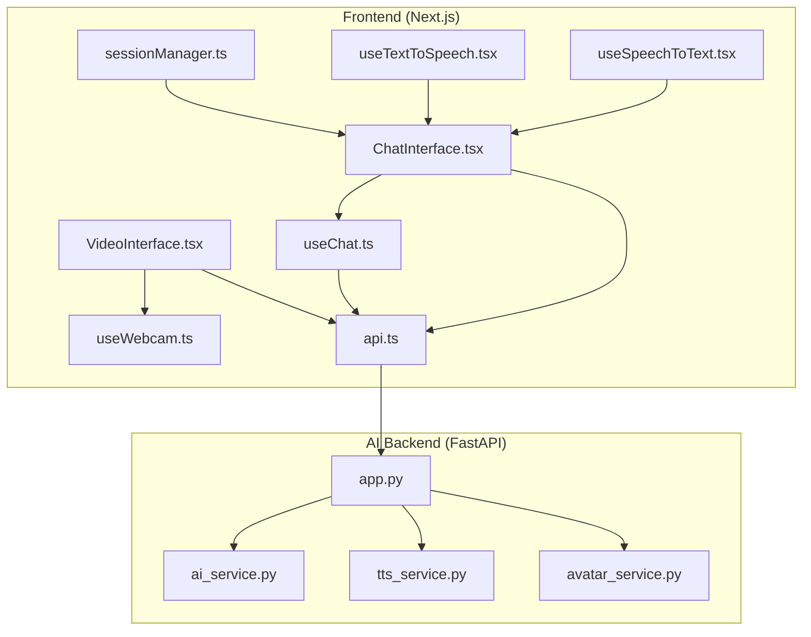
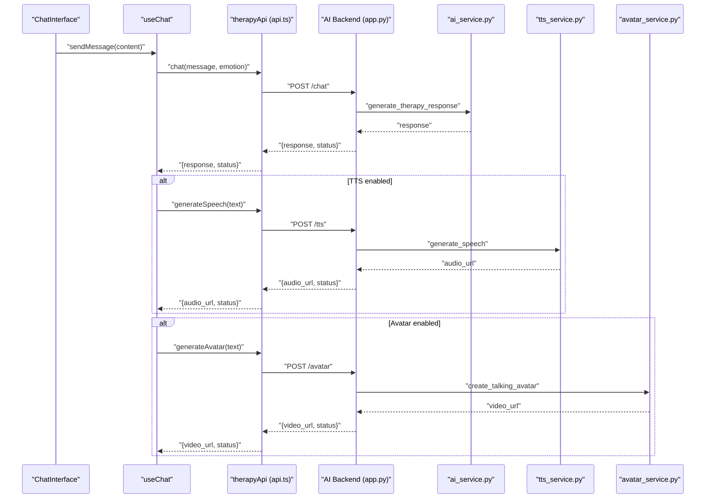
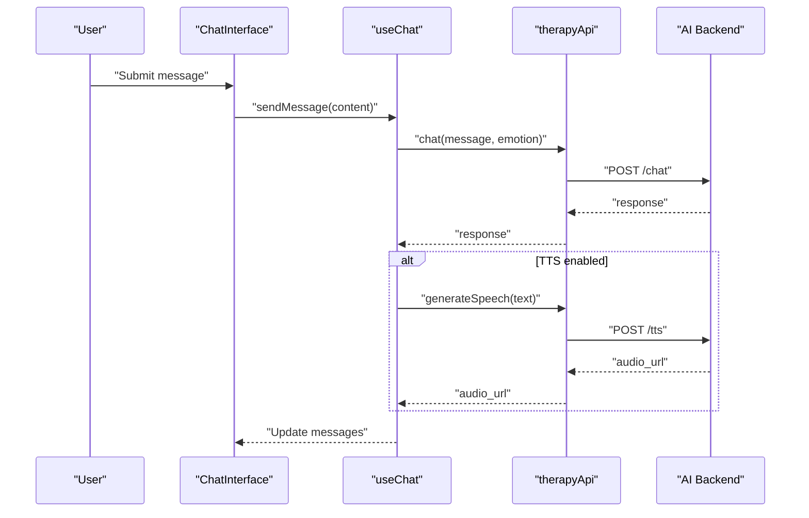
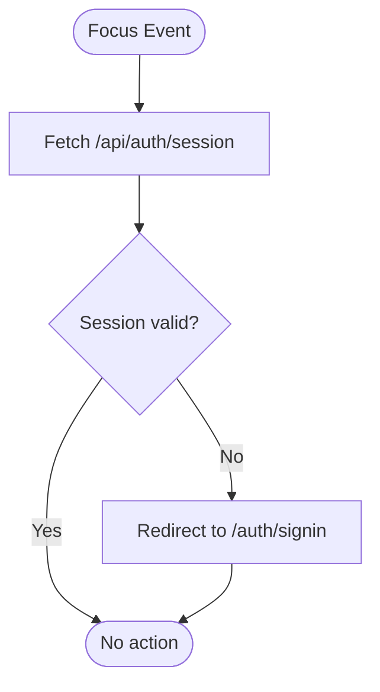
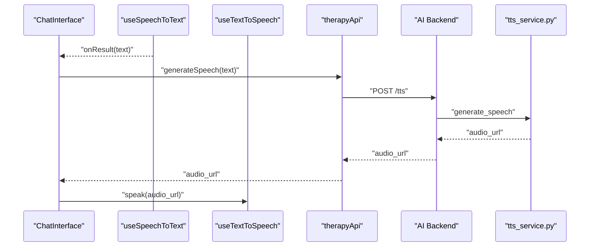
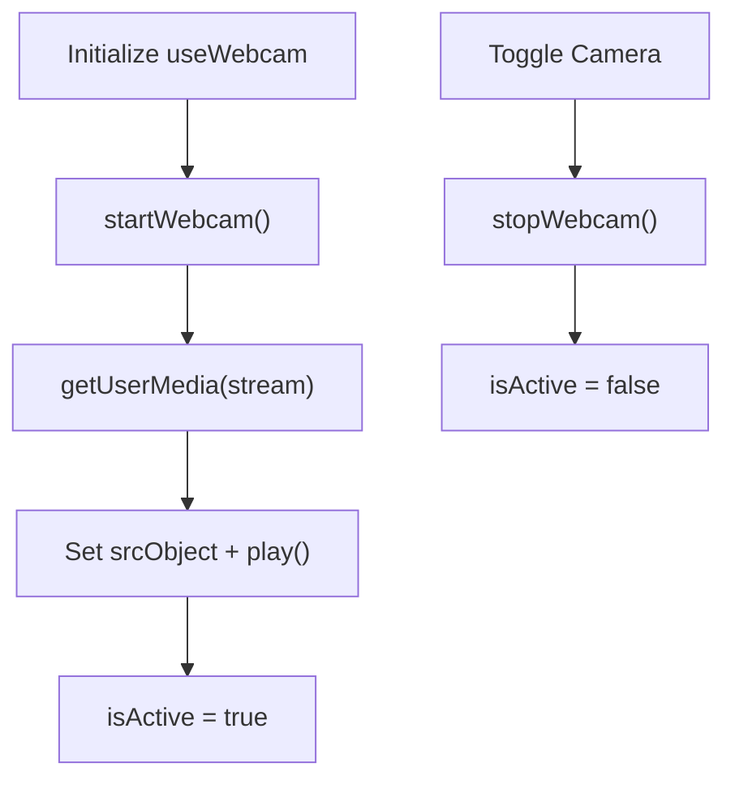
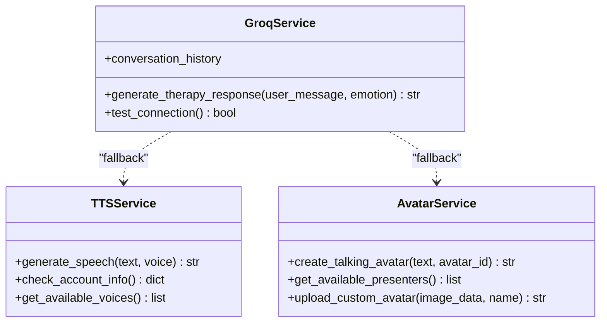
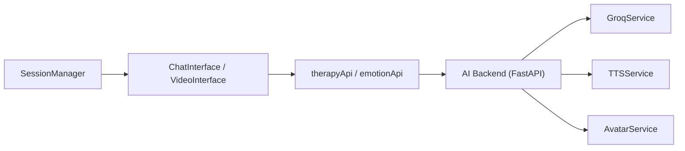

# Real-time Communication

<cite>
**Referenced Files in This Document**
- [ChatInterface.tsx](file://WEBAPP/src/components/ChatInterface.tsx)
- [useChat.ts](file://WEBAPP/src/hooks/useChat.ts)
- [api.ts](file://WEBAPP/src/lib/api.ts)
- [sessionManager.ts](file://WEBAPP/src/lib/sessionManager.ts)
- [useSpeechToText.tsx](file://WEBAPP/src/hooks/useSpeechToText.tsx)
- [useTextToSpeech.tsx](file://WEBAPP/src/hooks/useTextToSpeech.tsx)
- [useWebcam.ts](file://WEBAPP/src/hooks/useWebcam.ts)
- [VideoInterface.tsx](file://WEBAPP/src/components/VideoInterface.tsx)
- [ai_service.py](file://ai-backend/services/ai_service.py)
- [tts_service.py](file://ai-backend/services/tts_service.py)
- [avatar_service.py](file://ai-backend/services/avatar_service.py)
- [app.py](file://ai-backend/app.py)
- [page.tsx](file://WEBAPP/src/app/patient/virtual-session/page.tsx)
</cite>

## Table of Contents
1. [Introduction](#introduction)
2. [Project Structure](#project-structure)
3. [Core Components](#core-components)
4. [Architecture Overview](#architecture-overview)
5. [Detailed Component Analysis](#detailed-component-analysis)
6. [Dependency Analysis](#dependency-analysis)
7. [Performance Considerations](#performance-considerations)
8. [Troubleshooting Guide](#troubleshooting-guide)
9. [Conclusion](#conclusion)

## Introduction
This document explains the real-time communication features implemented in the MindBridge platform. It covers chat functionality, session management, speech-to-text and text-to-speech integration with AI services, and the video interface for therapy sessions. It also outlines connection handling, retry strategies, offline fallbacks, and security considerations for protecting user privacy during real-time interactions.

## Project Structure
The real-time capabilities span three layers:
- Frontend (Next.js) components and hooks for chat, speech, and video
- AI backend services (Python/FastAPI) for therapy responses, TTS, and avatar generation
- Session management utilities for authentication and session lifecycle

**Diagram sources**
- [ChatInterface.tsx](file://WEBAPP/src/components/ChatInterface.tsx#L1-L567)
- [useChat.ts](file://WEBAPP/src/hooks/useChat.ts#L1-L150)
- [api.ts](file://WEBAPP/src/lib/api.ts#L1-L142)
- [sessionManager.ts](file://WEBAPP/src/lib/sessionManager.ts#L1-L78)
- [useSpeechToText.tsx](file://WEBAPP/src/hooks/useSpeechToText.tsx#L1-L129)
- [useTextToSpeech.tsx](file://WEBAPP/src/hooks/useTextToSpeech.tsx#L1-L42)
- [useWebcam.ts](file://WEBAPP/src/hooks/useWebcam.ts#L1-L89)
- [VideoInterface.tsx](file://WEBAPP/src/components/VideoInterface.tsx#L1-L207)
- [ai_service.py](file://ai-backend/services/ai_service.py#L1-L293)
- [tts_service.py](file://ai-backend/services/tts_service.py#L1-L280)
- [avatar_service.py](file://ai-backend/services/avatar_service.py#L1-L237)
- [app.py](file://ai-backend/app.py#L82-L118)

**Section sources**
- [ChatInterface.tsx](file://WEBAPP/src/components/ChatInterface.tsx#L1-L567)
- [api.ts](file://WEBAPP/src/lib/api.ts#L1-L142)
- [ai_service.py](file://ai-backend/services/ai_service.py#L1-L293)
- [tts_service.py](file://ai-backend/services/tts_service.py#L1-L280)
- [avatar_service.py](file://ai-backend/services/avatar_service.py#L1-L237)
- [VideoInterface.tsx](file://WEBAPP/src/components/VideoInterface.tsx#L1-L207)

## Core Components
- ChatInterface: Manages chat UI, message persistence, assessment prompts, and integration with AI backend via useChat.
- useChat: Orchestrates message sending, TTS, and avatar generation through therapyApi.
- api.ts: Provides typed clients for AI and ML backends, and exposes therapyApi endpoints.
- sessionManager: Handles session expiration checks, incognito detection, and focus/fetch-based validation.
- Speech and Text-to-Speech: useSpeechToText for browser-based STT; useTextToSpeech for browser TTS.
- Video Interface: useWebcam for camera access and VideoInterface for rendering and emotion overlay.
- AI Backend: FastAPI app exposing /chat, /tts, and /avatar endpoints backed by ai_service.py, tts_service.py, and avatar_service.py.

**Section sources**
- [ChatInterface.tsx](file://WEBAPP/src/components/ChatInterface.tsx#L1-L567)
- [useChat.ts](file://WEBAPP/src/hooks/useChat.ts#L1-L150)
- [api.ts](file://WEBAPP/src/lib/api.ts#L1-L142)
- [sessionManager.ts](file://WEBAPP/src/lib/sessionManager.ts#L1-L78)
- [useSpeechToText.tsx](file://WEBAPP/src/hooks/useSpeechToText.tsx#L1-L129)
- [useTextToSpeech.tsx](file://WEBAPP/src/hooks/useTextToSpeech.tsx#L1-L42)
- [useWebcam.ts](file://WEBAPP/src/hooks/useWebcam.ts#L1-L89)
- [VideoInterface.tsx](file://WEBAPP/src/components/VideoInterface.tsx#L1-L207)
- [ai_service.py](file://ai-backend/services/ai_service.py#L1-L293)
- [tts_service.py](file://ai-backend/services/tts_service.py#L1-L280)
- [avatar_service.py](file://ai-backend/services/avatar_service.py#L1-L237)
- [app.py](file://ai-backend/app.py#L82-L118)

## Architecture Overview
The frontend communicates with the AI backend through typed API clients. The AI backend integrates external services (Groq for therapy responses, ElevenLabs for TTS, D-ID for avatars) with robust fallbacks.

**Diagram sources**
- [ChatInterface.tsx](file://WEBAPP/src/components/ChatInterface.tsx#L255-L310)
- [useChat.ts](file://WEBAPP/src/hooks/useChat.ts#L40-L116)
- [api.ts](file://WEBAPP/src/lib/api.ts#L76-L113)
- [app.py](file://ai-backend/app.py#L82-L118)
- [ai_service.py](file://ai-backend/services/ai_service.py#L131-L192)
- [tts_service.py](file://ai-backend/services/tts_service.py#L53-L144)
- [avatar_service.py](file://ai-backend/services/avatar_service.py#L19-L67)

## Detailed Component Analysis

### Chat Implementation and Message Flow
- Connection management: The frontend loads session messages via a GET endpoint and persists new messages via POST endpoints. There is no WebSocket connection in the current implementation.
- Message handling: useChat orchestrates sending, TTS generation, and optional avatar generation. Errors are surfaced to the UI.
- Assessment flow: The UI conditionally triggers assessment prompts and collects answers, posting results to analytics endpoints.

**Diagram sources**
- [ChatInterface.tsx](file://WEBAPP/src/components/ChatInterface.tsx#L255-L310)
- [useChat.ts](file://WEBAPP/src/hooks/useChat.ts#L40-L116)
- [api.ts](file://WEBAPP/src/lib/api.ts#L76-L113)
- [app.py](file://ai-backend/app.py#L82-L108)

**Section sources**
- [ChatInterface.tsx](file://WEBAPP/src/components/ChatInterface.tsx#L105-L147)
- [useChat.ts](file://WEBAPP/src/hooks/useChat.ts#L40-L116)
- [api.ts](file://WEBAPP/src/lib/api.ts#L76-L113)

### Session Management for Therapy Sessions
- Expiration checks: Utilities compute remaining time and detect imminent expiry.
- Incognito detection: Estimates storage quota to infer private browsing.
- Focus validation: Periodically validates session state via a dedicated endpoint.
- Storage and unload handlers: Reacts to storage events and beforeunload to maintain consistency.

**Diagram sources**
- [sessionManager.ts](file://WEBAPP/src/lib/sessionManager.ts#L60-L74)

**Section sources**
- [sessionManager.ts](file://WEBAPP/src/lib/sessionManager.ts#L1-L78)

### Speech-to-Text and Text-to-Speech Integration
- Browser-based STT: useSpeechToText wraps the Web Speech API for continuous recognition and error handling.
- Browser-based TTS: useTextToSpeech uses the Web Speech API for synthesis with callbacks on completion.
- AI-backed TTS: therapyApi.generateSpeech delegates to the AI backend, which uses ElevenLabs with fallbacks to dummy audio.

**Diagram sources**
- [useSpeechToText.tsx](file://WEBAPP/src/hooks/useSpeechToText.tsx#L56-L126)
- [useTextToSpeech.tsx](file://WEBAPP/src/hooks/useTextToSpeech.tsx#L1-L42)
- [useChat.ts](file://WEBAPP/src/hooks/useChat.ts#L82-L101)
- [api.ts](file://WEBAPP/src/lib/api.ts#L85-L90)
- [app.py](file://ai-backend/app.py#L96-L108)
- [tts_service.py](file://ai-backend/services/tts_service.py#L53-L144)

**Section sources**
- [useSpeechToText.tsx](file://WEBAPP/src/hooks/useSpeechToText.tsx#L1-L129)
- [useTextToSpeech.tsx](file://WEBAPP/src/hooks/useTextToSpeech.tsx#L1-L42)
- [useChat.ts](file://WEBAPP/src/hooks/useChat.ts#L82-L101)
- [tts_service.py](file://ai-backend/services/tts_service.py#L53-L144)

### Video Interface Implementation
- Camera access: useWebcam requests media permissions and manages stream lifecycle.
- Rendering and controls: VideoInterface renders the video element, toggles camera, and displays emotion overlays.
- Emotion detection: VideoInterface coordinates emotion detection via captured frames and displays confidence metrics.

**Diagram sources**
- [useWebcam.ts](file://WEBAPP/src/hooks/useWebcam.ts#L17-L52)
- [VideoInterface.tsx](file://WEBAPP/src/components/VideoInterface.tsx#L52-L68)

**Section sources**
- [useWebcam.ts](file://WEBAPP/src/hooks/useWebcam.ts#L1-L89)
- [VideoInterface.tsx](file://WEBAPP/src/components/VideoInterface.tsx#L1-L207)

### AI Backend Services
- Therapy responses: ai_service.py integrates Groq with optional RAG retrieval and maintains conversation history.
- TTS: tts_service.py generates speech via ElevenLabs with fallback to dummy audio and periodic cleanup.
- Avatar: avatar_service.py creates talking avatar videos via D-ID with fallback to a pre-packaged video.

**Diagram sources**
- [ai_service.py](file://ai-backend/services/ai_service.py#L72-L192)
- [tts_service.py](file://ai-backend/services/tts_service.py#L10-L144)
- [avatar_service.py](file://ai-backend/services/avatar_service.py#L11-L67)

**Section sources**
- [ai_service.py](file://ai-backend/services/ai_service.py#L1-L293)
- [tts_service.py](file://ai-backend/services/tts_service.py#L1-L280)
- [avatar_service.py](file://ai-backend/services/avatar_service.py#L1-L237)
- [app.py](file://ai-backend/app.py#L82-L118)

## Dependency Analysis
- Frontend depends on typed API clients for AI and ML backends.
- AI backend depends on external providers (Groq, ElevenLabs, D-ID) with graceful fallbacks.
- Session management is decoupled and relies on NextAuth session validation.

**Diagram sources**
- [api.ts](file://WEBAPP/src/lib/api.ts#L50-L113)
- [sessionManager.ts](file://WEBAPP/src/lib/sessionManager.ts#L43-L75)
- [ai_service.py](file://ai-backend/services/ai_service.py#L72-L192)
- [tts_service.py](file://ai-backend/services/tts_service.py#L10-L144)
- [avatar_service.py](file://ai-backend/services/avatar_service.py#L11-L67)

**Section sources**
- [api.ts](file://WEBAPP/src/lib/api.ts#L1-L142)
- [sessionManager.ts](file://WEBAPP/src/lib/sessionManager.ts#L1-L78)

## Performance Considerations
- STT/TTS latency: Prefer browser APIs for immediate feedback; offload heavy synthesis to the AI backend.
- Streaming: The current implementation does not use WebRTC or WebSocket streaming; consider adding for live audio/video.
- Retry and backoff: Implement exponential backoff for external API calls with jitter to reduce thundering herd.
- Caching: Cache frequently used TTS audio files keyed by text hash to minimize redundant generations.
- Cleanup: The AI backend cleans up old audio files; ensure retention policies align with user privacy.

[No sources needed since this section provides general guidance]

## Troubleshooting Guide
- Authentication and session:
  - If the session expires while the tab is idle, the focus handler redirects to sign-in.
  - Storage events trigger reloads to reflect cookie changes across tabs.
- Camera and permissions:
  - useWebcam stops tracks and clears srcObject on teardown; ensure to stop streams on unmount.
  - VideoInterface disables emotion overlay controls when camera is inactive.
- Speech services:
  - useSpeechToText logs errors and sets listening state to false on exceptions.
  - useTextToSpeech cancels ongoing speech and fires completion callbacks.
- AI backend:
  - TTS fallback returns a dummy audio URL when ElevenLabs is unavailable.
  - Avatar fallback serves a pre-packaged video when D-ID credentials are missing.
- Analytics and emotion:
  - emotionApi.analyzeVideo uses multipart/form-data; ensure FormData is constructed properly.

**Section sources**
- [sessionManager.ts](file://WEBAPP/src/lib/sessionManager.ts#L43-L75)
- [useWebcam.ts](file://WEBAPP/src/hooks/useWebcam.ts#L43-L52)
- [VideoInterface.tsx](file://WEBAPP/src/components/VideoInterface.tsx#L131-L140)
- [useSpeechToText.tsx](file://WEBAPP/src/hooks/useSpeechToText.tsx#L88-L96)
- [useTextToSpeech.tsx](file://WEBAPP/src/hooks/useTextToSpeech.tsx#L18-L30)
- [tts_service.py](file://ai-backend/services/tts_service.py#L107-L144)
- [avatar_service.py](file://ai-backend/services/avatar_service.py#L24-L67)

## Conclusion
MindBridge implements a robust real-time chat experience with integrated speech and video capabilities. While the current chat relies on HTTP endpoints rather than WebSocket, the architecture supports future enhancements such as connection pooling, retry/backoff, and offline fallback strategies. The AI backend provides resilient fallbacks for TTS and avatar generation, ensuring continuity even when external services are unavailable. Security and privacy are addressed through session validation, browser-native APIs, and controlled asset serving.