# State Management & Context

<cite>
**Referenced Files in This Document**
- [ThemeContext.tsx](file://WEBAPP/src/contexts/ThemeContext.tsx)
- [ClientSessionProvider.tsx](file://WEBAPP/src/components/ClientSessionProvider.tsx)
- [layout.tsx](file://WEBAPP/src/app/layout.tsx)
- [useChat.ts](file://WEBAPP/src/hooks/useChat.ts)
- [useSpeechToText.tsx](file://WEBAPP/src/hooks/useSpeechToText.tsx)
- [useTextToSpeech.tsx](file://WEBAPP/src/hooks/useTextToSpeech.tsx)
- [useWebcam.ts](file://WEBAPP/src/hooks/useWebcam.ts)
- [api.ts](file://WEBAPP/src/lib/api.ts)
- [ChatInterface.tsx](file://WEBAPP/src/components/ChatInterface.tsx)
- [VideoInterface.tsx](file://WEBAPP/src/components/VideoInterface.tsx)
- [sessionManager.ts](file://WEBAPP/src/lib/sessionManager.ts)
- [ChatHistory.tsx](file://WEBAPP/src/components/ChatHistory.tsx)
- [AvatarDisplay.tsx](file://WEBAPP/src/components/AvatarDisplay.tsx)
- [mentalHealthAnalytics.ts](file://WEBAPP/src/lib/mentalHealthAnalytics.ts)
- [virtual-session/page.tsx](file://WEBAPP/src/app/patient/virtual-session/page.tsx)
- [patient-session/page.tsx](file://WEBAPP/src/app/patient/session/page.tsx)
</cite>

## Table of Contents
1. [Introduction](#introduction)
2. [Project Structure](#project-structure)
3. [Core Components](#core-components)
4. [Architecture Overview](#architecture-overview)
5. [Detailed Component Analysis](#detailed-component-analysis)
6. [Dependency Analysis](#dependency-analysis)
7. [Performance Considerations](#performance-considerations)
8. [Troubleshooting Guide](#troubleshooting-guide)
9. [Conclusion](#conclusion)

## Introduction
This document explains the state management patterns used in the frontend application, focusing on React Context for theme and session management, custom hooks for media and AI interactions, and mechanisms for synchronizing state between the frontend and AI/ML backend services. It also covers real-time state updates for chat and video sessions, authentication state handling, component-local state, and practical guidance on performance, provider hierarchies, and persistence strategies.

## Project Structure
The frontend is a Next.js application with a clear separation of concerns:
- Providers: Theme and session providers wrap the entire app.
- Hooks: Custom hooks encapsulate media APIs and AI integrations.
- Components: UI components orchestrate state via hooks and props.
- Libraries: API clients and analytics utilities centralize cross-cutting concerns.
- Pages: Route handlers manage authentication guards and session lifecycle.

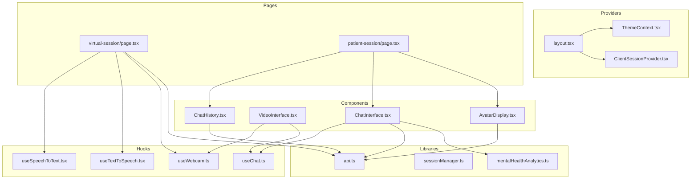

**Diagram sources**
- [layout.tsx](file://WEBAPP/src/app/layout.tsx#L36-L54)
- [ThemeContext.tsx](file://WEBAPP/src/contexts/ThemeContext.tsx#L23-L66)
- [ClientSessionProvider.tsx](file://WEBAPP/src/components/ClientSessionProvider.tsx#L10-L12)
- [useChat.ts](file://WEBAPP/src/hooks/useChat.ts#L33-L149)
- [useSpeechToText.tsx](file://WEBAPP/src/hooks/useSpeechToText.tsx#L56-L126)
- [useTextToSpeech.tsx](file://WEBAPP/src/hooks/useTextToSpeech.tsx#L3-L42)
- [useWebcam.ts](file://WEBAPP/src/hooks/useWebcam.ts#L9-L89)
- [ChatInterface.tsx](file://WEBAPP/src/components/ChatInterface.tsx#L42-L567)
- [VideoInterface.tsx](file://WEBAPP/src/components/VideoInterface.tsx#L18-L207)
- [ChatHistory.tsx](file://WEBAPP/src/components/ChatHistory.tsx#L42-L417)
- [AvatarDisplay.tsx](file://WEBAPP/src/components/AvatarDisplay.tsx#L12-L210)
- [api.ts](file://WEBAPP/src/lib/api.ts#L76-L113)
- [sessionManager.ts](file://WEBAPP/src/lib/sessionManager.ts#L3-L78)
- [mentalHealthAnalytics.ts](file://WEBAPP/src/lib/mentalHealthAnalytics.ts#L199-L289)
- [virtual-session/page.tsx](file://WEBAPP/src/app/patient/virtual-session/page.tsx#L89-L800)
- [patient-session/page.tsx](file://WEBAPP/src/app/patient/session/page.tsx#L27-L283)

**Section sources**
- [layout.tsx](file://WEBAPP/src/app/layout.tsx#L36-L54)
- [ThemeContext.tsx](file://WEBAPP/src/contexts/ThemeContext.tsx#L23-L66)
- [ClientSessionProvider.tsx](file://WEBAPP/src/components/ClientSessionProvider.tsx#L10-L12)

## Core Components
- Theme Provider: Manages light/dark theme with persistence and DOM class updates.
- Session Provider: Wraps the app with NextAuth’s session provider for authentication state.
- useChat: Centralizes chat state, message lifecycle, and AI backend integration.
- Media and Speech Hooks: Encapsulate browser APIs for webcam, speech-to-text, and text-to-speech.
- API Clients: Typed clients for AI and ML backends.
- Analytics Utilities: Keyword-based analysis and assessment scoring for mental health insights.

Key responsibilities:
- ThemeContext: theme state, toggle, and persistence.
- ClientSessionProvider: exposes NextAuth session to components.
- useChat: maintains messages, loading/error states, and orchestrates AI/TTS/avatar flows.
- useSpeechToText/useTextToSpeech/useWebcam: manage browser media APIs and expose state/callbacks.
- api.ts: typed endpoints for chat, TTS, avatar, and ML emotion/video analysis.
- mentalHealthAnalytics.ts: keyword and sentiment analysis for chat and assessment.

**Section sources**
- [ThemeContext.tsx](file://WEBAPP/src/contexts/ThemeContext.tsx#L7-L66)
- [ClientSessionProvider.tsx](file://WEBAPP/src/components/ClientSessionProvider.tsx#L3-L12)
- [useChat.ts](file://WEBAPP/src/hooks/useChat.ts#L4-L149)
- [useSpeechToText.tsx](file://WEBAPP/src/hooks/useSpeechToText.tsx#L56-L126)
- [useTextToSpeech.tsx](file://WEBAPP/src/hooks/useTextToSpeech.tsx#L3-L42)
- [useWebcam.ts](file://WEBAPP/src/hooks/useWebcam.ts#L9-L89)
- [api.ts](file://WEBAPP/src/lib/api.ts#L76-L113)
- [mentalHealthAnalytics.ts](file://WEBAPP/src/lib/mentalHealthAnalytics.ts#L199-L350)

## Architecture Overview
The app composes providers at the root and uses custom hooks to manage state locally within components. Data flows from UI actions to hooks, which call API clients, and responses update component state and UI.

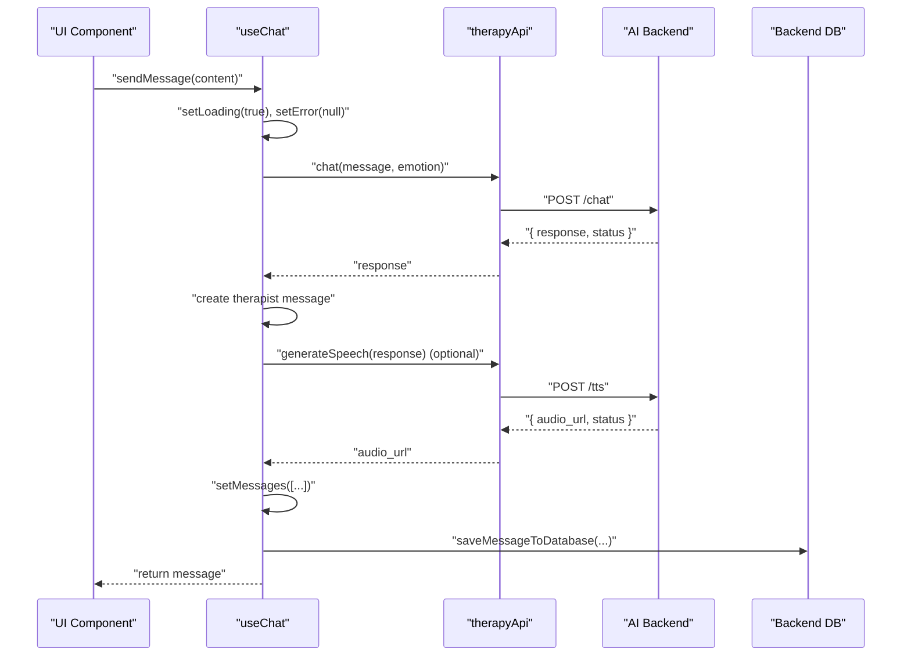

**Diagram sources**
- [useChat.ts](file://WEBAPP/src/hooks/useChat.ts#L40-L116)
- [api.ts](file://WEBAPP/src/lib/api.ts#L76-L90)
- [ChatInterface.tsx](file://WEBAPP/src/components/ChatInterface.tsx#L134-L147)

**Section sources**
- [useChat.ts](file://WEBAPP/src/hooks/useChat.ts#L40-L116)
- [api.ts](file://WEBAPP/src/lib/api.ts#L76-L90)
- [ChatInterface.tsx](file://WEBAPP/src/components/ChatInterface.tsx#L134-L147)

## Detailed Component Analysis

### Theme Management with React Context
- Provider: Initializes theme from localStorage, applies class to document root, and persists changes.
- Hook: Provides theme state and toggle function with runtime validation.
- Persistence: Uses localStorage to maintain user preference across sessions.

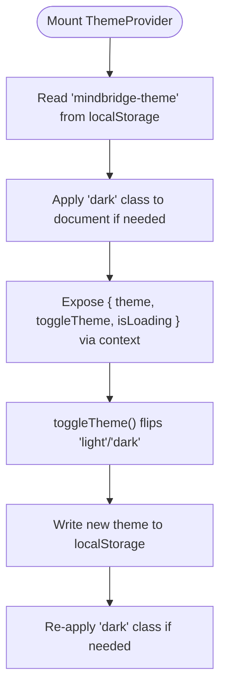

**Diagram sources**
- [ThemeContext.tsx](file://WEBAPP/src/contexts/ThemeContext.tsx#L23-L66)

**Section sources**
- [ThemeContext.tsx](file://WEBAPP/src/contexts/ThemeContext.tsx#L7-L66)

### Authentication and Session State
- Root provider: Wraps the app with NextAuth’s SessionProvider to expose session state.
- Session manager: Handles session expiration checks, incognito detection, and storage/focus events.
- Page guards: Pages validate session roles and redirect unauthorized users.

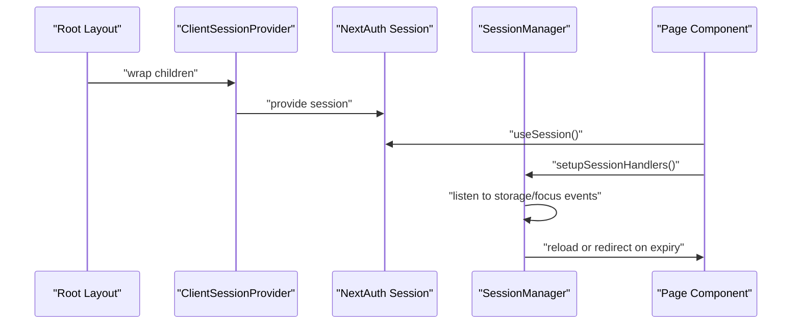

**Diagram sources**
- [layout.tsx](file://WEBAPP/src/app/layout.tsx#L46-L50)
- [ClientSessionProvider.tsx](file://WEBAPP/src/components/ClientSessionProvider.tsx#L10-L12)
- [sessionManager.ts](file://WEBAPP/src/lib/sessionManager.ts#L43-L75)
- [patient-session/page.tsx](file://WEBAPP/src/app/patient/session/page.tsx#L28-L36)

**Section sources**
- [layout.tsx](file://WEBAPP/src/app/layout.tsx#L46-L50)
- [ClientSessionProvider.tsx](file://WEBAPP/src/components/ClientSessionProvider.tsx#L3-L12)
- [sessionManager.ts](file://WEBAPP/src/lib/sessionManager.ts#L3-L78)
- [patient-session/page.tsx](file://WEBAPP/src/app/patient/session/page.tsx#L28-L36)

### Custom Hook: useChat
- Responsibilities:
  - Manage messages, loading, and error states.
  - Send user messages to AI backend and receive therapist replies.
  - Optional TTS and avatar generation.
  - Assessment flow helpers for prompts, questions, and results.
  - Local-only messages for assessment steps without backend calls.
- Data model: ChatMessage with optional metadata for audio and avatar.
- Integration: Calls therapyApi.chat, therapyApi.generateSpeech, and saves to DB.

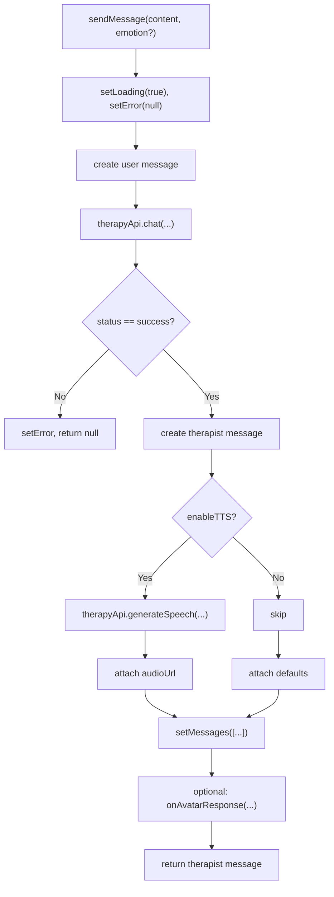

**Diagram sources**
- [useChat.ts](file://WEBAPP/src/hooks/useChat.ts#L40-L116)
- [api.ts](file://WEBAPP/src/lib/api.ts#L76-L90)

**Section sources**
- [useChat.ts](file://WEBAPP/src/hooks/useChat.ts#L4-L149)
- [api.ts](file://WEBAPP/src/lib/api.ts#L76-L113)

### Custom Hook: useSpeechToText
- Initializes SpeechRecognition, manages listening lifecycle, and exposes transcript and callbacks.
- Uses refs to safely capture callbacks across renders.

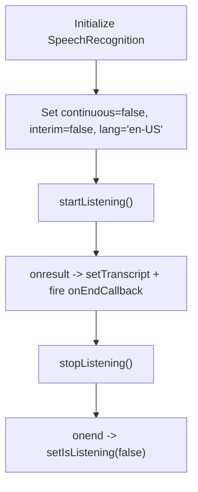

**Diagram sources**
- [useSpeechToText.tsx](file://WEBAPP/src/hooks/useSpeechToText.tsx#L62-L97)
- [useSpeechToText.tsx](file://WEBAPP/src/hooks/useSpeechToText.tsx#L99-L125)

**Section sources**
- [useSpeechToText.tsx](file://WEBAPP/src/hooks/useSpeechToText.tsx#L56-L126)

### Custom Hook: useTextToSpeech
- Uses window.speechSynthesis to speak text, tracks speaking state, and supports callback on speech end.

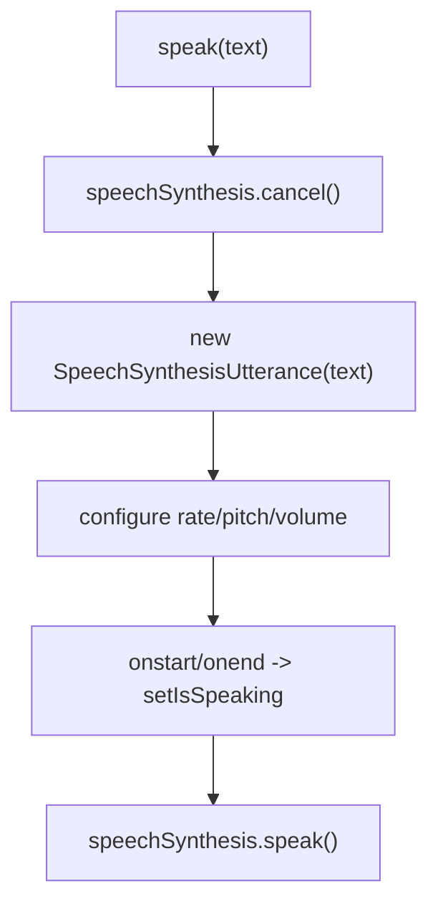

**Diagram sources**
- [useTextToSpeech.tsx](file://WEBAPP/src/hooks/useTextToSpeech.tsx#L7-L31)
- [useTextToSpeech.tsx](file://WEBAPP/src/hooks/useTextToSpeech.tsx#L33-L39)

**Section sources**
- [useTextToSpeech.tsx](file://WEBAPP/src/hooks/useTextToSpeech.tsx#L3-L42)

### Custom Hook: useWebcam
- Manages camera permissions, starts/stops streams, and captures images to data URLs.
- Ensures cleanup on unmount.

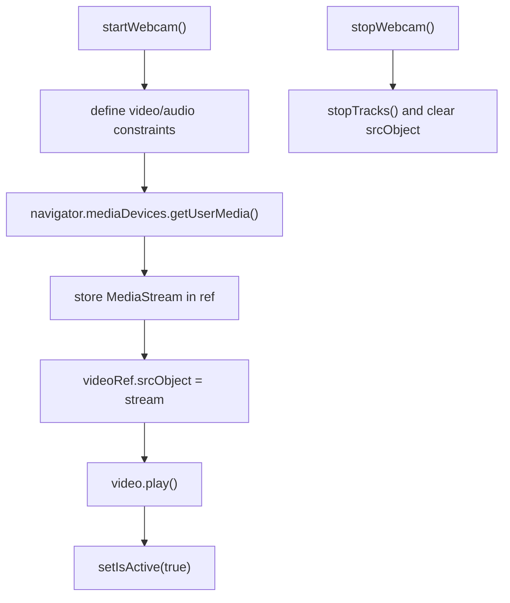

**Diagram sources**
- [useWebcam.ts](file://WEBAPP/src/hooks/useWebcam.ts#L17-L52)
- [useWebcam.ts](file://WEBAPP/src/hooks/useWebcam.ts#L73-L77)

**Section sources**
- [useWebcam.ts](file://WEBAPP/src/hooks/useWebcam.ts#L9-L89)

### Real-Time State Updates for Chat and Video Sessions
- ChatInterface:
  - Loads session messages from DB on sessionId change.
  - Saves each message to DB immediately after sending.
  - Integrates assessment flow with local-only messages and backend submission.
- VideoInterface:
  - Starts webcam and emotion detection on demand.
  - Displays current emotion overlay and statistics.
- Virtual Session Page:
  - Orchestrates speech-to-text, text-to-speech, webcam, and AI chat in a cohesive flow.
  - Uses refs to keep latest state in callbacks for reliable sequencing.

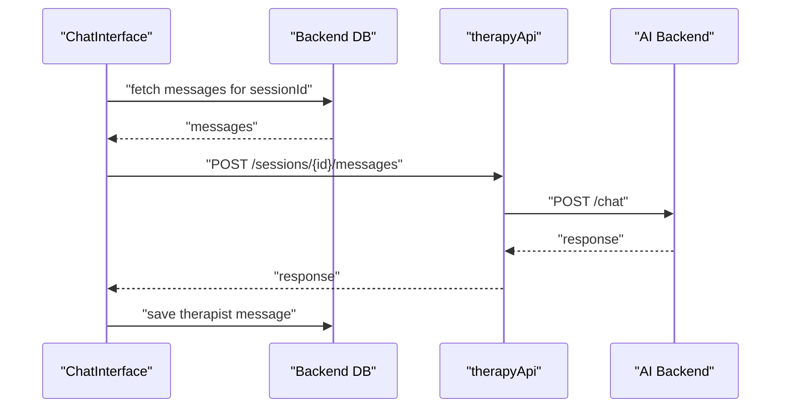

**Diagram sources**
- [ChatInterface.tsx](file://WEBAPP/src/components/ChatInterface.tsx#L106-L132)
- [ChatInterface.tsx](file://WEBAPP/src/components/ChatInterface.tsx#L134-L147)
- [api.ts](file://WEBAPP/src/lib/api.ts#L76-L90)

**Section sources**
- [ChatInterface.tsx](file://WEBAPP/src/components/ChatInterface.tsx#L81-L132)
- [ChatInterface.tsx](file://WEBAPP/src/components/ChatInterface.tsx#L134-L147)
- [virtual-session/page.tsx](file://WEBAPP/src/app/patient/virtual-session/page.tsx#L220-L277)

### State Synchronization Between Frontend and AI/ML Backends
- API clients:
  - therapyApi: chat, TTS, avatar endpoints.
  - emotionApi: ML backend for emotion detection and video analysis.
- Data persistence:
  - ChatHistory auto-creates sessions and cleans up empty ones.
  - ChatInterface persists messages immediately upon send.
- Analytics:
  - mentalHealthAnalytics provides keyword and sentiment analysis for messages and assessment scoring.

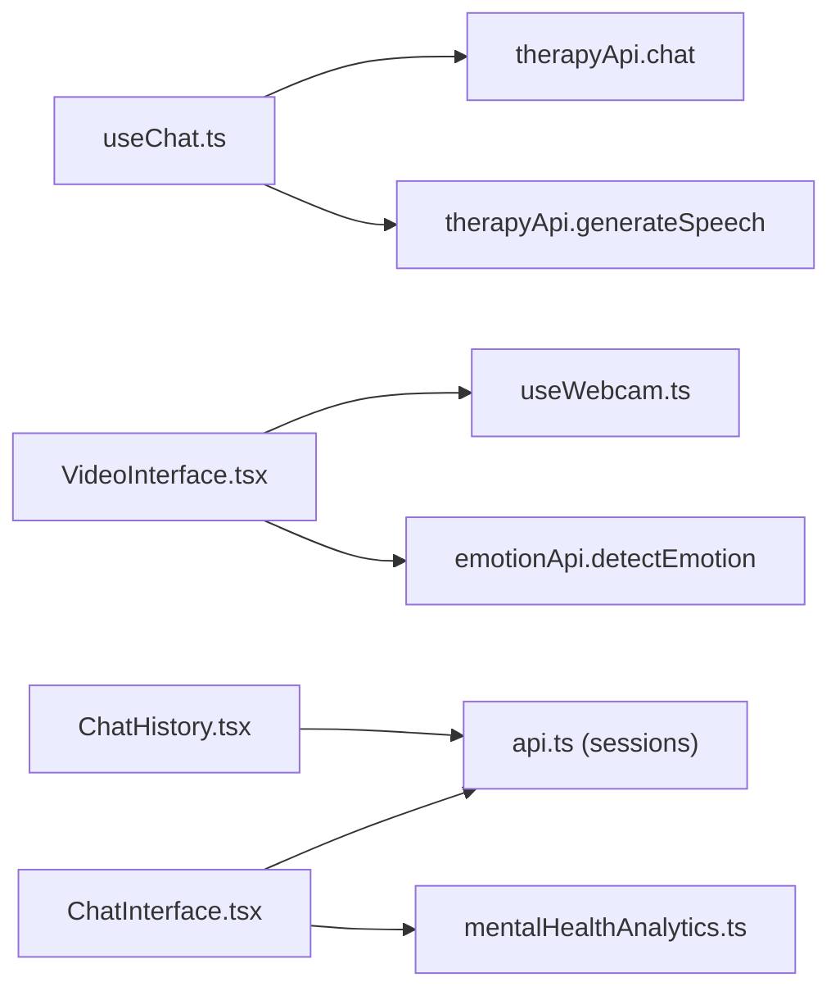

**Diagram sources**
- [useChat.ts](file://WEBAPP/src/hooks/useChat.ts#L63-L101)
- [api.ts](file://WEBAPP/src/lib/api.ts#L76-L113)
- [VideoInterface.tsx](file://WEBAPP/src/components/VideoInterface.tsx#L25-L43)
- [ChatHistory.tsx](file://WEBAPP/src/components/ChatHistory.tsx#L121-L146)
- [ChatInterface.tsx](file://WEBAPP/src/components/ChatInterface.tsx#L190-L250)
- [mentalHealthAnalytics.ts](file://WEBAPP/src/lib/mentalHealthAnalytics.ts#L199-L350)

**Section sources**
- [api.ts](file://WEBAPP/src/lib/api.ts#L54-L113)
- [ChatHistory.tsx](file://WEBAPP/src/components/ChatHistory.tsx#L121-L146)
- [ChatInterface.tsx](file://WEBAPP/src/components/ChatInterface.tsx#L190-L250)
- [mentalHealthAnalytics.ts](file://WEBAPP/src/lib/mentalHealthAnalytics.ts#L199-L350)

### Managing User Authentication State, Session Data, and Component-Local State
- Authentication:
  - NextAuth session exposed via ClientSessionProvider.
  - Pages guard role and redirect unauthorized users.
- Session data:
  - ChatHistory creates and cleans sessions; persists titles and counts.
  - VirtualSession page creates a session and manages transcript and timing.
- Component-local state:
  - useChat manages messages and flags.
  - useSpeechToText/useTextToSpeech manage listening and speaking state.
  - useWebcam manages activity and error state.
  - VirtualSession page maintains session status and elapsed time.

**Section sources**
- [ClientSessionProvider.tsx](file://WEBAPP/src/components/ClientSessionProvider.tsx#L3-L12)
- [patient-session/page.tsx](file://WEBAPP/src/app/patient/session/page.tsx#L28-L36)
- [ChatHistory.tsx](file://WEBAPP/src/components/ChatHistory.tsx#L121-L146)
- [virtual-session/page.tsx](file://WEBAPP/src/app/patient/virtual-session/page.tsx#L104-L110)

## Dependency Analysis
- Provider hierarchy: layout.tsx composes ThemeProvider and ClientSessionProvider; components consume context and hooks.
- Hook-to-API coupling: useChat depends on therapyApi; VideoInterface depends on useWebcam and emotionApi; VirtualSession page depends on all three media hooks plus therapyApi.
- Cross-cutting utilities: mentalHealthAnalytics is used by ChatInterface for assessment and analytics.

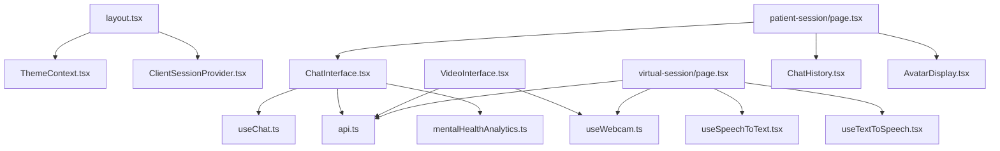

**Diagram sources**
- [layout.tsx](file://WEBAPP/src/app/layout.tsx#L46-L50)
- [ChatInterface.tsx](file://WEBAPP/src/components/ChatInterface.tsx#L66-L79)
- [VideoInterface.tsx](file://WEBAPP/src/components/VideoInterface.tsx#L25-L43)
- [virtual-session/page.tsx](file://WEBAPP/src/app/patient/virtual-session/page.tsx#L112-L129)
- [patient-session/page.tsx](file://WEBAPP/src/app/patient/session/page.tsx#L172-L201)

**Section sources**
- [layout.tsx](file://WEBAPP/src/app/layout.tsx#L46-L50)
- [ChatInterface.tsx](file://WEBAPP/src/components/ChatInterface.tsx#L66-L79)
- [VideoInterface.tsx](file://WEBAPP/src/components/VideoInterface.tsx#L25-L43)
- [virtual-session/page.tsx](file://WEBAPP/src/app/patient/virtual-session/page.tsx#L112-L129)
- [patient-session/page.tsx](file://WEBAPP/src/app/patient/session/page.tsx#L172-L201)

## Performance Considerations
- Minimize re-renders:
  - Use useCallback for event handlers and memoized callbacks (e.g., useChat’s sendMessage, ChatInterface’s handlers).
  - Keep heavy computations in hooks and memoize derived values.
- Efficient state updates:
  - Prefer immutable updates (e.g., spreading arrays) to preserve referential equality where possible.
- Media resources:
  - Stop streams and cancel synthesis on unmount or pause to free resources.
  - Avoid unnecessary re-renders by passing stable refs to DOM elements.
- API calls:
  - Debounce or batch UI-triggered requests where appropriate.
  - Use isLoading flags to prevent concurrent operations.
- Persistence:
  - Persist messages and sessions asynchronously to avoid blocking UI.

[No sources needed since this section provides general guidance]

## Troubleshooting Guide
- Theme not persisting:
  - Verify localStorage access and that the provider applies the 'dark' class to document.documentElement.
- Session invalid or expired:
  - Confirm session validation on focus and storage events; ensure redirects to sign-in when session.user is missing.
- Chat not saving messages:
  - Check DB endpoints and network errors; confirm sessionId is present before saving.
- Speech/Sound issues:
  - Ensure browser support for Web Speech APIs; handle errors and fallbacks gracefully.
- Webcam errors:
  - Inspect constraints and error messages; verify permissions and device availability.

**Section sources**
- [ThemeContext.tsx](file://WEBAPP/src/contexts/ThemeContext.tsx#L28-L55)
- [sessionManager.ts](file://WEBAPP/src/lib/sessionManager.ts#L52-L75)
- [ChatInterface.tsx](file://WEBAPP/src/components/ChatInterface.tsx#L134-L147)
- [useSpeechToText.tsx](file://WEBAPP/src/hooks/useSpeechToText.tsx#L88-L91)
- [useTextToSpeech.tsx](file://WEBAPP/src/hooks/useTextToSpeech.tsx#L28-L30)
- [useWebcam.ts](file://WEBAPP/src/hooks/useWebcam.ts#L37-L40)

## Conclusion
The frontend employs a clean separation of concerns: providers manage global state (theme, session), hooks encapsulate browser APIs and AI integrations, and components orchestrate flows with minimal duplication. The design emphasizes persistence, real-time updates, and robust error handling, enabling scalable enhancements for chat, video, and analytics features.