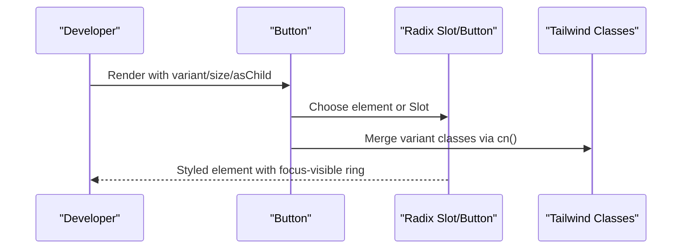
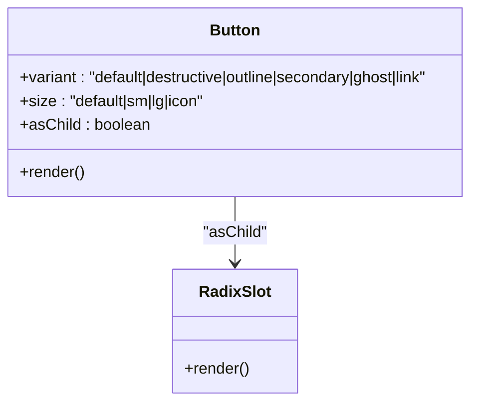
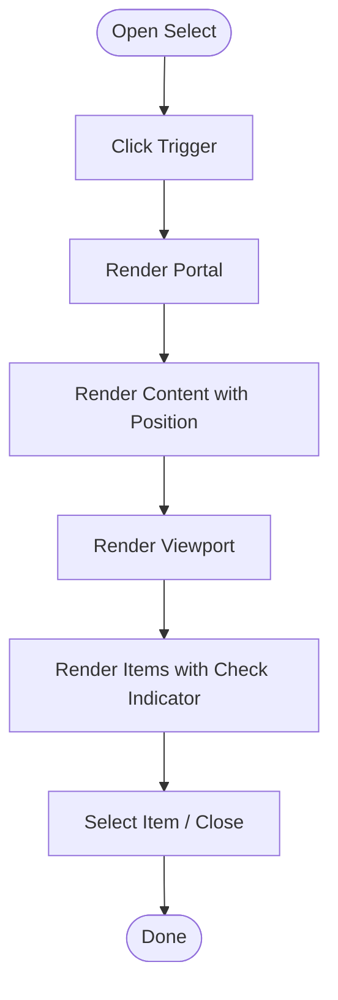
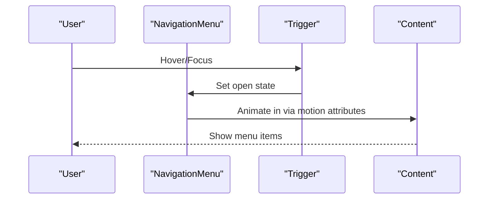
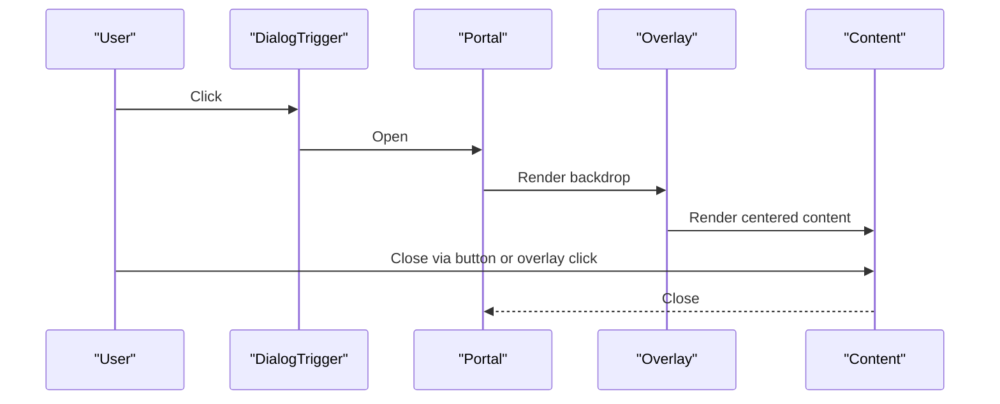
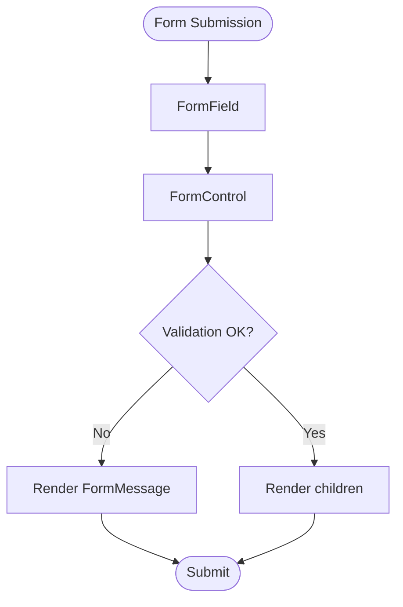
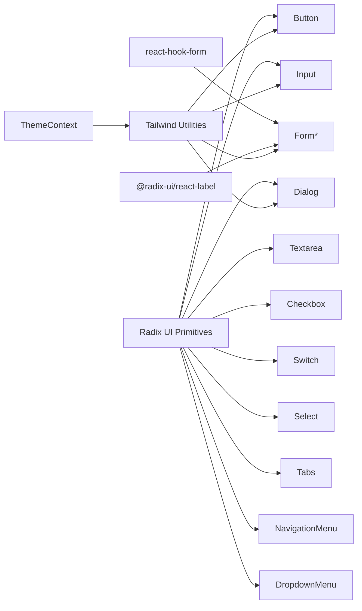

# UI Component Library

<cite>
**Referenced Files in This Document**
- [button.tsx](file://WEBAPP/src/components/ui/button.tsx)
- [input.tsx](file://WEBAPP/src/components/ui/input.tsx)
- [dialog.tsx](file://WEBAPP/src/components/ui/dialog.tsx)
- [form.tsx](file://WEBAPP/src/components/ui/form.tsx)
- [table.tsx](file://WEBAPP/src/components/ui/table.tsx)
- [navigation-menu.tsx](file://WEBAPP/src/components/ui/navigation-menu.tsx)
- [dropdown-menu.tsx](file://WEBAPP/src/components/ui/dropdown-menu.tsx)
- [card.tsx](file://WEBAPP/src/components/ui/card.tsx)
- [badge.tsx](file://WEBAPP/src/components/ui/badge.tsx)
- [avatar.tsx](file://WEBAPP/src/components/ui/avatar.tsx)
- [tabs.tsx](file://WEBAPP/src/components/ui/tabs.tsx)
- [switch.tsx](file://WEBAPP/src/components/ui/switch.tsx)
- [select.tsx](file://WEBAPP/src/components/ui/select.tsx)
- [textarea.tsx](file://WEBAPP/src/components/ui/textarea.tsx)
- [checkbox.tsx](file://WEBAPP/src/components/ui/checkbox.tsx)
- [label.tsx](file://WEBAPP/src/components/ui/label.tsx)
- [tooltip.tsx](file://WEBAPP/src/components/ui/tooltip.tsx)
- [progress.tsx](file://WEBAPP/src/components/ui/progress.tsx)
- [slider.tsx](file://WEBAPP/src/components/ui/slider.tsx)
- [toggle.tsx](file://WEBAPP/src/components/ui/toggle.tsx)
- [toggle-group.tsx](file://WEBAPP/src/components/ui/toggle-group.tsx)
- [popover.tsx](file://WEBAPP/src/components/ui/popover.tsx)
- [menubar.tsx](file://WEBAPP/src/components/ui/menubar.tsx)
- [scroll-area.tsx](file://WEBAPP/src/components/ui/scroll-area.tsx)
- [resizable.tsx](file://WEBAPP/src/components/ui/resizable.tsx)
- [sheet.tsx](file://WEBAPP/src/components/ui/sheet.tsx)
- [drawer.tsx](file://WEBAPP/src/components/ui/drawer.tsx)
- [calendar.tsx](file://WEBAPP/src/components/ui/calendar.tsx)
- [pagination.tsx](file://WEBAPP/src/components/ui/pagination.tsx)
- [breadcrumb.tsx](file://WEBAPP/src/components/ui/breadcrumb.tsx)
- [separator.tsx](file://WEBAPP/src/components/ui/separator.tsx)
- [aspect-ratio.tsx](file://WEBAPP/src/components/ui/aspect-ratio.tsx)
- [alert.tsx](file://WEBAPP/src/components/ui/alert.tsx)
- [alert-dialog.tsx](file://WEBAPP/src/components/ui/alert-dialog.tsx)
- [sonner.tsx](file://WEBAPP/src/components/ui/sonner.tsx)
- [toast.tsx](file://WEBAPP/src/components/ui/toast.tsx)
- [toaster.tsx](file://WEBAPP/src/components/ui/toaster.tsx)
- [accordion.tsx](file://WEBAPP/src/components/ui/accordion.tsx)
- [collapsible.tsx](file://WEBAPP/src/components/ui/collapsible.tsx)
- [context-menu.tsx](file://WEBAPP/src/components/ui/context-menu.tsx)
- [hover-card.tsx](file://WEBAPP/src/components/ui/hover-card.tsx)
- [use-toast.ts](file://WEBAPP/src/components/ui/use-toast.ts)
- [use-mobile.tsx](file://WEBAPP/src/components/ui/use-mobile.tsx)
- [sidebar.tsx](file://WEBAPP/src/components/ui/sidebar.tsx)
- [chart.tsx](file://WEBAPP/src/components/ui/chart.tsx)
- [skeleton.tsx](file://WEBAPP/src/components/ui/skeleton.tsx)
- [input-otp.tsx](file://WEBAPP/src/components/ui/input-otp.tsx)
- [globals.css](file://WEBAPP/src/app/globals.css)
- [ThemeContext.tsx](file://WEBAPP/src/contexts/ThemeContext.tsx)
- [ThemeToggle.tsx](file://WEBAPP/src/components/ThemeToggle.tsx)
</cite>

## Table of Contents
1. [Introduction](#introduction)
2. [Project Structure](#project-structure)
3. [Core Components](#core-components)
4. [Architecture Overview](#architecture-overview)
5. [Detailed Component Analysis](#detailed-component-analysis)
6. [Dependency Analysis](#dependency-analysis)
7. [Performance Considerations](#performance-considerations)
8. [Troubleshooting Guide](#troubleshooting-guide)
9. [Conclusion](#conclusion)
10. [Appendices](#appendices)

## Introduction
This document describes the custom UI component library built with Radix UI primitives and Tailwind CSS. It covers reusable components for buttons, inputs, dialogs, navigation menus, forms, and data display, along with their props, styling variants, accessibility features, composition patterns, states/animations, and theming integration including dark mode support. Guidance is also provided for customization and extension while preserving accessibility and consistent design.

## Project Structure
The UI components live under WEBAPP/src/components/ui and are thin wrappers around Radix UI primitives, styled with Tailwind utility classes and composed via class merging helpers. Many components are client components (marked with "use client") to enable interactivity and animations. The design tokens (colors, typography, spacing) are applied consistently across components and are influenced by the global CSS and theme context.

```mermaid
graph TB
subgraph "UI Components"
Btn["Button"]
Inp["Input"]
Txt["Textarea"]
Chk["Checkbox"]
Swi["Switch"]
Sel["Select"]
Tab["Tabs"]
Nav["NavigationMenu"]
Drp["DropdownMenu"]
Dia["Dialog"]
Frm["Form*"]
Tbl["Table*"]
Ctx["Card*"]
Bad["Badge"]
Ava["Avatar"]
Tooltip["Tooltip"]
Progress["Progress"]
Slider["Slider"]
Toggle["Toggle"]
ToggleGroup["ToggleGroup"]
Popover["Popover"]
Menubar["Menubar"]
ScrollArea["ScrollArea"]
Resizable["Resizable"]
Sheet["Sheet"]
Drawer["Drawer"]
Calendar["Calendar"]
Pagination["Pagination"]
Breadcrumb["Breadcrumb"]
Separator["Separator"]
AspectRatio["AspectRatio"]
Alert["Alert"]
AlertDialog["AlertDialog"]
Sonner["Sonner"]
Toast["Toast"]
Toaster["Toaster"]
Accordion["Accordion"]
Collapsible["Collapsible"]
ContextMenu["ContextMenu"]
HoverCard["HoverCard"]
UseToast["use-toast"]
UseMobile["use-mobile"]
Sidebar["Sidebar"]
Chart["Chart"]
Skeleton["Skeleton"]
InputOTP["InputOTP"]
end
subgraph "Styling"
Tailwind["Tailwind Utilities"]
CN["cn() merge"]
Globals["globals.css"]
ThemeCtx["ThemeContext"]
end
Btn --> Tailwind
Inp --> Tailwind
Txt --> Tailwind
Chk --> Tailwind
Swi --> Tailwind
Sel --> Tailwind
Tab --> Tailwind
Nav --> Tailwind
Drp --> Tailwind
Dia --> Tailwind
Frm --> Tailwind
Tbl --> Tailwind
Ctx --> Tailwind
Bad --> Tailwind
Ava --> Tailwind
Tooltip --> Tailwind
Progress --> Tailwind
Slider --> Tailwind
Toggle --> Tailwind
ToggleGroup --> Tailwind
Popover --> Tailwind
Menubar --> Tailwind
ScrollArea --> Tailwind
Resizable --> Tailwind
Sheet --> Tailwind
Drawer --> Tailwind
Calendar --> Tailwind
Pagination --> Tailwind
Breadcrumb --> Tailwind
Separator --> Tailwind
AspectRatio --> Tailwind
Alert --> Tailwind
AlertDialog --> Tailwind
Sonner --> Tailwind
Toast --> Tailwind
Toaster --> Tailwind
Accordion --> Tailwind
Collapsible --> Tailwind
ContextMenu --> Tailwind
HoverCard --> Tailwind
Sidebar --> Tailwind
Chart --> Tailwind
Skeleton --> Tailwind
InputOTP --> Tailwind
CN --> Btn
CN --> Inp
CN --> Dia
CN --> Frm
CN --> Tbl
CN --> Nav
CN --> Drp
CN --> Sel
CN --> Tab
CN --> Ctx
CN --> Bad
CN --> Ava
CN --> Tooltip
CN --> Progress
CN --> Slider
CN --> Toggle
CN --> ToggleGroup
CN --> Popover
CN --> Menubar
CN --> ScrollArea
CN --> Resizable
CN --> Sheet
CN --> Drawer
CN --> Calendar
CN --> Pagination
CN --> Breadcrumb
CN --> Separator
CN --> AspectRatio
CN --> Alert
CN --> AlertDialog
CN --> Sonner
CN --> Toast
CN --> Toaster
CN --> Accordion
CN --> Collapsible
CN --> ContextMenu
CN --> HoverCard
CN --> Sidebar
CN --> Chart
CN --> Skeleton
CN --> InputOTP
Globals --> Tailwind
ThemeCtx --> Globals
```

**Diagram sources**
- [button.tsx](file://WEBAPP/src/components/ui/button.tsx#L1-L60)
- [input.tsx](file://WEBAPP/src/components/ui/input.tsx#L1-L22)
- [dialog.tsx](file://WEBAPP/src/components/ui/dialog.tsx#L1-L144)
- [form.tsx](file://WEBAPP/src/components/ui/form.tsx#L1-L168)
- [table.tsx](file://WEBAPP/src/components/ui/table.tsx#L1-L117)
- [navigation-menu.tsx](file://WEBAPP/src/components/ui/navigation-menu.tsx#L1-L169)
- [dropdown-menu.tsx](file://WEBAPP/src/components/ui/dropdown-menu.tsx#L1-L258)
- [select.tsx](file://WEBAPP/src/components/ui/select.tsx#L1-L186)
- [tabs.tsx](file://WEBAPP/src/components/ui/tabs.tsx#L1-L67)
- [card.tsx](file://WEBAPP/src/components/ui/card.tsx#L1-L93)
- [badge.tsx](file://WEBAPP/src/components/ui/badge.tsx#L1-L47)
- [avatar.tsx](file://WEBAPP/src/components/ui/avatar.tsx#L1-L54)
- [textarea.tsx](file://WEBAPP/src/components/ui/textarea.tsx#L1-L19)
- [checkbox.tsx](file://WEBAPP/src/components/ui/checkbox.tsx#L1-L33)
- [switch.tsx](file://WEBAPP/src/components/ui/switch.tsx#L1-L32)
- [tooltip.tsx](file://WEBAPP/src/components/ui/tooltip.tsx)
- [progress.tsx](file://WEBAPP/src/components/ui/progress.tsx)
- [slider.tsx](file://WEBAPP/src/components/ui/slider.tsx)
- [toggle.tsx](file://WEBAPP/src/components/ui/toggle.tsx)
- [toggle-group.tsx](file://WEBAPP/src/components/ui/toggle-group.tsx)
- [popover.tsx](file://WEBAPP/src/components/ui/popover.tsx)
- [menubar.tsx](file://WEBAPP/src/components/ui/menubar.tsx)
- [scroll-area.tsx](file://WEBAPP/src/components/ui/scroll-area.tsx)
- [resizable.tsx](file://WEBAPP/src/components/ui/resizable.tsx)
- [sheet.tsx](file://WEBAPP/src/components/ui/sheet.tsx)
- [drawer.tsx](file://WEBAPP/src/components/ui/drawer.tsx)
- [calendar.tsx](file://WEBAPP/src/components/ui/calendar.tsx)
- [pagination.tsx](file://WEBAPP/src/components/ui/pagination.tsx)
- [breadcrumb.tsx](file://WEBAPP/src/components/ui/breadcrumb.tsx)
- [separator.tsx](file://WEBAPP/src/components/ui/separator.tsx)
- [aspect-ratio.tsx](file://WEBAPP/src/components/ui/aspect-ratio.tsx)
- [alert.tsx](file://WEBAPP/src/components/ui/alert.tsx)
- [alert-dialog.tsx](file://WEBAPP/src/components/ui/alert-dialog.tsx)
- [sonner.tsx](file://WEBAPP/src/components/ui/sonner.tsx)
- [toast.tsx](file://WEBAPP/src/components/ui/toast.tsx)
- [toaster.tsx](file://WEBAPP/src/components/ui/toaster.tsx)
- [accordion.tsx](file://WEBAPP/src/components/ui/accordion.tsx)
- [collapsible.tsx](file://WEBAPP/src/components/ui/collapsible.tsx)
- [context-menu.tsx](file://WEBAPP/src/components/ui/context-menu.tsx)
- [hover-card.tsx](file://WEBAPP/src/components/ui/hover-card.tsx)
- [use-toast.ts](file://WEBAPP/src/components/ui/use-toast.ts)
- [use-mobile.tsx](file://WEBAPP/src/components/ui/use-mobile.tsx)
- [sidebar.tsx](file://WEBAPP/src/components/ui/sidebar.tsx)
- [chart.tsx](file://WEBAPP/src/components/ui/chart.tsx)
- [skeleton.tsx](file://WEBAPP/src/components/ui/skeleton.tsx)
- [input-otp.tsx](file://WEBAPP/src/components/ui/input-otp.tsx)
- [globals.css](file://WEBAPP/src/app/globals.css)
- [ThemeContext.tsx](file://WEBAPP/src/contexts/ThemeContext.tsx)
- [ThemeToggle.tsx](file://WEBAPP/src/components/ThemeToggle.tsx)

**Section sources**
- [button.tsx](file://WEBAPP/src/components/ui/button.tsx#L1-L60)
- [input.tsx](file://WEBAPP/src/components/ui/input.tsx#L1-L22)
- [dialog.tsx](file://WEBAPP/src/components/ui/dialog.tsx#L1-L144)
- [form.tsx](file://WEBAPP/src/components/ui/form.tsx#L1-L168)
- [table.tsx](file://WEBAPP/src/components/ui/table.tsx#L1-L117)
- [navigation-menu.tsx](file://WEBAPP/src/components/ui/navigation-menu.tsx#L1-L169)
- [dropdown-menu.tsx](file://WEBAPP/src/components/ui/dropdown-menu.tsx#L1-L258)
- [select.tsx](file://WEBAPP/src/components/ui/select.tsx#L1-L186)
- [tabs.tsx](file://WEBAPP/src/components/ui/tabs.tsx#L1-L67)
- [card.tsx](file://WEBAPP/src/components/ui/card.tsx#L1-L93)
- [badge.tsx](file://WEBAPP/src/components/ui/badge.tsx#L1-L47)
- [avatar.tsx](file://WEBAPP/src/components/ui/avatar.tsx#L1-L54)
- [textarea.tsx](file://WEBAPP/src/components/ui/textarea.tsx#L1-L19)
- [checkbox.tsx](file://WEBAPP/src/components/ui/checkbox.tsx#L1-L33)
- [switch.tsx](file://WEBAPP/src/components/ui/switch.tsx#L1-L32)
- [globals.css](file://WEBAPP/src/app/globals.css)
- [ThemeContext.tsx](file://WEBAPP/src/contexts/ThemeContext.tsx)
- [ThemeToggle.tsx](file://WEBAPP/src/components/ThemeToggle.tsx)

## Core Components
This section summarizes the primary categories of components and their roles in the design system.

- Buttons and Pills: Variants and sizes with focus/ring states and dark mode support.
- Inputs and Textareas: Consistent focus states, invalid states, and placeholder styles.
- Menus and Navigation: Dropdowns, navigation menus, and contextual menus with motion variants.
- Forms: Integrated label, control, description, and error messaging with accessibility attributes.
- Data Display: Tables with responsive containers and selection states.
- Cards and Badges: Content containers and status indicators with variant styling.
- Interactive Controls: Switches, checkboxes, selects, sliders, toggles, and popovers.
- Overlays and Sheets: Dialogs, drawers, and sheets with overlay animations.
- Feedback and Indicators: Alerts, progress bars, tooltips, and notifications.
- Layout and Composition: Avatars, breadcrumbs, separators, aspect ratios, and skeletons.
- Specialized: Calendar, pagination, scroll areas, resizables, sidebars, charts, and OTP inputs.

**Section sources**
- [button.tsx](file://WEBAPP/src/components/ui/button.tsx#L1-L60)
- [input.tsx](file://WEBAPP/src/components/ui/input.tsx#L1-L22)
- [dialog.tsx](file://WEBAPP/src/components/ui/dialog.tsx#L1-L144)
- [form.tsx](file://WEBAPP/src/components/ui/form.tsx#L1-L168)
- [table.tsx](file://WEBAPP/src/components/ui/table.tsx#L1-L117)
- [navigation-menu.tsx](file://WEBAPP/src/components/ui/navigation-menu.tsx#L1-L169)
- [dropdown-menu.tsx](file://WEBAPP/src/components/ui/dropdown-menu.tsx#L1-L258)
- [select.tsx](file://WEBAPP/src/components/ui/select.tsx#L1-L186)
- [tabs.tsx](file://WEBAPP/src/components/ui/tabs.tsx#L1-L67)
- [card.tsx](file://WEBAPP/src/components/ui/card.tsx#L1-L93)
- [badge.tsx](file://WEBAPP/src/components/ui/badge.tsx#L1-L47)
- [avatar.tsx](file://WEBAPP/src/components/ui/avatar.tsx#L1-L54)
- [textarea.tsx](file://WEBAPP/src/components/ui/textarea.tsx#L1-L19)
- [checkbox.tsx](file://WEBAPP/src/components/ui/checkbox.tsx#L1-L33)
- [switch.tsx](file://WEBAPP/src/components/ui/switch.tsx#L1-L32)
- [tooltip.tsx](file://WEBAPP/src/components/ui/tooltip.tsx)
- [progress.tsx](file://WEBAPP/src/components/ui/progress.tsx)
- [slider.tsx](file://WEBAPP/src/components/ui/slider.tsx)
- [toggle.tsx](file://WEBAPP/src/components/ui/toggle.tsx)
- [toggle-group.tsx](file://WEBAPP/src/components/ui/toggle-group.tsx)
- [popover.tsx](file://WEBAPP/src/components/ui/popover.tsx)
- [menubar.tsx](file://WEBAPP/src/components/ui/menubar.tsx)
- [scroll-area.tsx](file://WEBAPP/src/components/ui/scroll-area.tsx)
- [resizable.tsx](file://WEBAPP/src/components/ui/resizable.tsx)
- [sheet.tsx](file://WEBAPP/src/components/ui/sheet.tsx)
- [drawer.tsx](file://WEBAPP/src/components/ui/drawer.tsx)
- [calendar.tsx](file://WEBAPP/src/components/ui/calendar.tsx)
- [pagination.tsx](file://WEBAPP/src/components/ui/pagination.tsx)
- [breadcrumb.tsx](file://WEBAPP/src/components/ui/breadcrumb.tsx)
- [separator.tsx](file://WEBAPP/src/components/ui/separator.tsx)
- [aspect-ratio.tsx](file://WEBAPP/src/components/ui/aspect-ratio.tsx)
- [alert.tsx](file://WEBAPP/src/components/ui/alert.tsx)
- [alert-dialog.tsx](file://WEBAPP/src/components/ui/alert-dialog.tsx)
- [sonner.tsx](file://WEBAPP/src/components/ui/sonner.tsx)
- [toast.tsx](file://WEBAPP/src/components/ui/toast.tsx)
- [toaster.tsx](file://WEBAPP/src/components/ui/toaster.tsx)
- [accordion.tsx](file://WEBAPP/src/components/ui/accordion.tsx)
- [collapsible.tsx](file://WEBAPP/src/components/ui/collapsible.tsx)
- [context-menu.tsx](file://WEBAPP/src/components/ui/context-menu.tsx)
- [hover-card.tsx](file://WEBAPP/src/components/ui/hover-card.tsx)
- [use-toast.ts](file://WEBAPP/src/components/ui/use-toast.ts)
- [use-mobile.tsx](file://WEBAPP/src/components/ui/use-mobile.tsx)
- [sidebar.tsx](file://WEBAPP/src/components/ui/sidebar.tsx)
- [chart.tsx](file://WEBAPP/src/components/ui/chart.tsx)
- [skeleton.tsx](file://WEBAPP/src/components/ui/skeleton.tsx)
- [input-otp.tsx](file://WEBAPP/src/components/ui/input-otp.tsx)

## Architecture Overview
The component library follows a consistent pattern:
- Each component wraps a Radix UI primitive and adds Tailwind styling and optional variants.
- Props are passed through to the underlying primitive, with extra props documented per component.
- Focus-visible rings, disabled states, and aria-invalid states are standardized for accessibility.
- Dark mode variants are integrated via Tailwind’s dark: prefix and theme-aware tokens.

**Diagram sources**
- [button.tsx](file://WEBAPP/src/components/ui/button.tsx#L38-L57)

**Section sources**
- [button.tsx](file://WEBAPP/src/components/ui/button.tsx#L1-L60)

## Detailed Component Analysis

### Button
- Purpose: Primary action with multiple variants and sizes.
- Props:
  - variant: default, destructive, outline, secondary, ghost, link
  - size: default, sm, lg, icon
  - asChild: render as child element
  - Additional button props
- Accessibility: Focus-visible ring, disabled state, aria-invalid ring for form integration.
- Composition: Uses cva for variants and cn for class merging.

**Diagram sources**
- [button.tsx](file://WEBAPP/src/components/ui/button.tsx#L38-L57)

**Section sources**
- [button.tsx](file://WEBAPP/src/components/ui/button.tsx#L1-L60)

### Input
- Purpose: Text input with consistent focus and invalid states.
- Props: type, plus standard input props.
- Accessibility: Focus-visible ring, aria-invalid ring, placeholder styling.

**Section sources**
- [input.tsx](file://WEBAPP/src/components/ui/input.tsx#L1-L22)

### Textarea
- Purpose: Multi-line text input with consistent focus and invalid states.

**Section sources**
- [textarea.tsx](file://WEBAPP/src/components/ui/textarea.tsx#L1-L19)

### Checkbox
- Purpose: Binary selection with indicator.
- Props: standard checkbox props.
- Accessibility: Focus-visible ring, disabled state, aria-invalid ring.

**Section sources**
- [checkbox.tsx](file://WEBAPP/src/components/ui/checkbox.tsx#L1-L33)

### Switch
- Purpose: Toggle control with thumb animation.
- Props: standard switch props.
- Accessibility: Focus-visible ring, disabled state.

**Section sources**
- [switch.tsx](file://WEBAPP/src/components/ui/switch.tsx#L1-L32)

### Select
- Purpose: Single/multi-selection with scrollable content and icons.
- Props:
  - size: sm, default
  - position: popper or item-aligned
  - Additional select props
- Features: Group, Label, Item, Separator, ScrollUp/Down buttons, Value.

**Diagram sources**
- [select.tsx](file://WEBAPP/src/components/ui/select.tsx#L53-L86)

**Section sources**
- [select.tsx](file://WEBAPP/src/components/ui/select.tsx#L1-L186)

### Tabs
- Purpose: Organize content into selectable sections.
- Props: standard tabs props.
- Accessibility: Focus-visible ring, disabled state.

**Section sources**
- [tabs.tsx](file://WEBAPP/src/components/ui/tabs.tsx#L1-L67)

### NavigationMenu
- Purpose: Horizontal navigation with animated dropdown content and viewport.
- Props:
  - viewport: boolean to include viewport
  - Additional menu props
- Features: List, Item, Trigger, Content, Link, Indicator, Viewport.

**Diagram sources**
- [navigation-menu.tsx](file://WEBAPP/src/components/ui/navigation-menu.tsx#L85-L100)

**Section sources**
- [navigation-menu.tsx](file://WEBAPP/src/components/ui/navigation-menu.tsx#L1-L169)

### DropdownMenu
- Purpose: Contextual menu with groups, labels, items, checkboxes, radios, and submenus.
- Props:
  - variant for items: default, destructive
  - inset for indented items
  - sideOffset for positioning
  - Additional menu props
- Features: Group, Label, Item, CheckboxItem, RadioGroup, RadioItem, Separator, Sub/SubTrigger/SubContent, Shortcut.

**Section sources**
- [dropdown-menu.tsx](file://WEBAPP/src/components/ui/dropdown-menu.tsx#L1-L258)

### Dialog
- Purpose: Modal overlay with animated content and optional close button.
- Props:
  - showCloseButton: boolean to show/hide close
  - Additional dialog props
- Features: Root, Trigger, Portal, Overlay, Content, Header/Footer, Title, Description, Close.

**Diagram sources**
- [dialog.tsx](file://WEBAPP/src/components/ui/dialog.tsx#L9-L81)

**Section sources**
- [dialog.tsx](file://WEBAPP/src/components/ui/dialog.tsx#L1-L144)

### Form
- Purpose: Integration with react-hook-form for labels, controls, descriptions, and error messages.
- Features: Form, FormItem, FormLabel, FormControl, FormDescription, FormMessage, FormField, useFormField.

**Diagram sources**
- [form.tsx](file://WEBAPP/src/components/ui/form.tsx#L32-L66)

**Section sources**
- [form.tsx](file://WEBAPP/src/components/ui/form.tsx#L1-L168)

### Table
- Purpose: Responsive data table with container and semantic cells.
- Features: Table, TableHeader, TableBody, TableFooter, TableRow, TableHead, TableCell, TableCaption.

**Section sources**
- [table.tsx](file://WEBAPP/src/components/ui/table.tsx#L1-L117)

### Card
- Purpose: Content container with header, title, description, action, content, footer.
- Features: Card, CardHeader, CardTitle, CardDescription, CardAction, CardContent, CardFooter.

**Section sources**
- [card.tsx](file://WEBAPP/src/components/ui/card.tsx#L1-L93)

### Badge
- Purpose: Status or metadata label with variants.
- Props:
  - variant: default, secondary, destructive, outline
  - asChild: render as child element
  - Additional span props

**Section sources**
- [badge.tsx](file://WEBAPP/src/components/ui/badge.tsx#L1-L47)

### Avatar
- Purpose: User image with fallback.
- Features: Avatar, AvatarImage, AvatarFallback.

**Section sources**
- [avatar.tsx](file://WEBAPP/src/components/ui/avatar.tsx#L1-L54)

### Additional Components (Overview)
- Interactive Controls: Switch, Checkbox, Select, Slider, Toggle, ToggleGroup, Popover, Menubar, ScrollArea, Resizable, Sheet, Drawer, Calendar, Pagination, Breadcrumb, Separator, AspectRatio, Alert, AlertDialog, Sonner, Toast, Toaster, Accordion, Collapsible, ContextMenu, HoverCard, Sidebar, Chart, Skeleton, InputOTP.
- All components follow similar patterns: wrap Radix primitives, apply Tailwind classes, pass through props, and integrate focus/invalid states and dark mode variants.

**Section sources**
- [tooltip.tsx](file://WEBAPP/src/components/ui/tooltip.tsx)
- [progress.tsx](file://WEBAPP/src/components/ui/progress.tsx)
- [slider.tsx](file://WEBAPP/src/components/ui/slider.tsx)
- [toggle.tsx](file://WEBAPP/src/components/ui/toggle.tsx)
- [toggle-group.tsx](file://WEBAPP/src/components/ui/toggle-group.tsx)
- [popover.tsx](file://WEBAPP/src/components/ui/popover.tsx)
- [menubar.tsx](file://WEBAPP/src/components/ui/menubar.tsx)
- [scroll-area.tsx](file://WEBAPP/src/components/ui/scroll-area.tsx)
- [resizable.tsx](file://WEBAPP/src/components/ui/resizable.tsx)
- [sheet.tsx](file://WEBAPP/src/components/ui/sheet.tsx)
- [drawer.tsx](file://WEBAPP/src/components/ui/drawer.tsx)
- [calendar.tsx](file://WEBAPP/src/components/ui/calendar.tsx)
- [pagination.tsx](file://WEBAPP/src/components/ui/pagination.tsx)
- [breadcrumb.tsx](file://WEBAPP/src/components/ui/breadcrumb.tsx)
- [separator.tsx](file://WEBAPP/src/components/ui/separator.tsx)
- [aspect-ratio.tsx](file://WEBAPP/src/components/ui/aspect-ratio.tsx)
- [alert.tsx](file://WEBAPP/src/components/ui/alert.tsx)
- [alert-dialog.tsx](file://WEBAPP/src/components/ui/alert-dialog.tsx)
- [sonner.tsx](file://WEBAPP/src/components/ui/sonner.tsx)
- [toast.tsx](file://WEBAPP/src/components/ui/toast.tsx)
- [toaster.tsx](file://WEBAPP/src/components/ui/toaster.tsx)
- [accordion.tsx](file://WEBAPP/src/components/ui/accordion.tsx)
- [collapsible.tsx](file://WEBAPP/src/components/ui/collapsible.tsx)
- [context-menu.tsx](file://WEBAPP/src/components/ui/context-menu.tsx)
- [hover-card.tsx](file://WEBAPP/src/components/ui/hover-card.tsx)
- [use-toast.ts](file://WEBAPP/src/components/ui/use-toast.ts)
- [use-mobile.tsx](file://WEBAPP/src/components/ui/use-mobile.tsx)
- [sidebar.tsx](file://WEBAPP/src/components/ui/sidebar.tsx)
- [chart.tsx](file://WEBAPP/src/components/ui/chart.tsx)
- [skeleton.tsx](file://WEBAPP/src/components/ui/skeleton.tsx)
- [input-otp.tsx](file://WEBAPP/src/components/ui/input-otp.tsx)

## Dependency Analysis
- Internal dependencies:
  - Components depend on Radix UI primitives for behavior and accessibility.
  - Components depend on cn() for safe class merging.
  - Form components depend on react-hook-form and @radix-ui/react-label.
- Theming and tokens:
  - Tailwind utilities define color, spacing, typography, and shadow tokens.
  - Dark mode is enabled via Tailwind’s dark: prefix and theme context.

**Diagram sources**
- [button.tsx](file://WEBAPP/src/components/ui/button.tsx#L1-L60)
- [input.tsx](file://WEBAPP/src/components/ui/input.tsx#L1-L22)
- [dialog.tsx](file://WEBAPP/src/components/ui/dialog.tsx#L1-L144)
- [form.tsx](file://WEBAPP/src/components/ui/form.tsx#L1-L168)
- [navigation-menu.tsx](file://WEBAPP/src/components/ui/navigation-menu.tsx#L1-L169)
- [dropdown-menu.tsx](file://WEBAPP/src/components/ui/dropdown-menu.tsx#L1-L258)
- [select.tsx](file://WEBAPP/src/components/ui/select.tsx#L1-L186)
- [tabs.tsx](file://WEBAPP/src/components/ui/tabs.tsx#L1-L67)
- [globals.css](file://WEBAPP/src/app/globals.css)
- [ThemeContext.tsx](file://WEBAPP/src/contexts/ThemeContext.tsx)

**Section sources**
- [button.tsx](file://WEBAPP/src/components/ui/button.tsx#L1-L60)
- [input.tsx](file://WEBAPP/src/components/ui/input.tsx#L1-L22)
- [dialog.tsx](file://WEBAPP/src/components/ui/dialog.tsx#L1-L144)
- [form.tsx](file://WEBAPP/src/components/ui/form.tsx#L1-L168)
- [navigation-menu.tsx](file://WEBAPP/src/components/ui/navigation-menu.tsx#L1-L169)
- [dropdown-menu.tsx](file://WEBAPP/src/components/ui/dropdown-menu.tsx#L1-L258)
- [select.tsx](file://WEBAPP/src/components/ui/select.tsx#L1-L186)
- [tabs.tsx](file://WEBAPP/src/components/ui/tabs.tsx#L1-L67)
- [globals.css](file://WEBAPP/src/app/globals.css)
- [ThemeContext.tsx](file://WEBAPP/src/contexts/ThemeContext.tsx)

## Performance Considerations
- Prefer asChild patterns where appropriate to avoid unnecessary DOM nodes.
- Use minimal class merging and avoid excessive nesting in Tailwind utilities.
- Keep animations scoped to overlays and menus to reduce layout thrashing.
- Defer heavy computations inside event handlers; leverage controlled components for large forms.

## Troubleshooting Guide
- Focus and keyboard navigation:
  - Ensure focus-visible rings are visible and not overridden by custom styles.
  - Verify aria-invalid is set on controls when validation fails.
- Dark mode:
  - Confirm dark: prefixes are present for focus/invalid states.
  - Ensure theme context updates Tailwind classes appropriately.
- Form integration:
  - Use Form, FormItem, FormLabel, FormControl, FormDescription, FormMessage in tandem.
  - Ensure ids and aria-describedby are correctly bound via useFormField.
- Overlays and portals:
  - Confirm Portal renders outside conflicting stacking contexts.
  - Ensure close triggers are reachable and accessible.

**Section sources**
- [form.tsx](file://WEBAPP/src/components/ui/form.tsx#L45-L66)
- [button.tsx](file://WEBAPP/src/components/ui/button.tsx#L7-L36)
- [input.tsx](file://WEBAPP/src/components/ui/input.tsx#L9-L15)
- [dialog.tsx](file://WEBAPP/src/components/ui/dialog.tsx#L33-L47)
- [ThemeContext.tsx](file://WEBAPP/src/contexts/ThemeContext.tsx)

## Conclusion
The UI component library leverages Radix UI primitives for robust accessibility and behavior, combined with Tailwind for consistent styling and dark mode support. Components are designed for composability, predictable variants, and seamless integration with forms and overlays. Following the patterns outlined here ensures maintainability, accessibility, and a cohesive user experience.

## Appendices

### Design Tokens and Theming
- Color scheme:
  - Primary, secondary, muted, accent, destructive, border, input, ring, card, background.
  - Dark mode variants via dark: prefix and theme-aware tokens.
- Typography:
  - Headings, base text, small/label sizes, and monospace for code-like elements.
- Spacing:
  - Consistent padding/margin scale across components.
- Breakpoints:
  - Responsive variants (e.g., md:) applied to inputs and tables.
- Global styles:
  - Tailwind utilities and theme tokens are applied globally via the app stylesheet.

**Section sources**
- [globals.css](file://WEBAPP/src/app/globals.css)
- [ThemeContext.tsx](file://WEBAPP/src/contexts/ThemeContext.tsx)
- [ThemeToggle.tsx](file://WEBAPP/src/components/ThemeToggle.tsx)

### Component Prop Reference Index
- Button: variant, size, asChild, additional button props
- Input: type, additional input props
- Textarea: additional textarea props
- Checkbox: additional checkbox props
- Switch: additional switch props
- Select: size, position, additional select props
- Tabs: additional tabs props
- NavigationMenu: viewport, additional menu props
- DropdownMenu: variant, inset, sideOffset, additional menu props
- Dialog: showCloseButton, additional dialog props
- Form: Form, FormItem, FormLabel, FormControl, FormDescription, FormMessage, FormField, useFormField
- Table: additional table/thead/tbody/tr/th/td/caption props
- Card: additional card props
- Badge: variant, asChild, additional span props
- Avatar: additional avatar props
- Others: SelectTrigger/Content/Item/Label/Separator/ScrollUp/ScrollDown, Tabs components, NavigationMenu components, DropdownMenu components, Dialog components, Form components, and specialized components follow similar patterns.

**Section sources**
- [button.tsx](file://WEBAPP/src/components/ui/button.tsx#L38-L57)
- [input.tsx](file://WEBAPP/src/components/ui/input.tsx#L5-L19)
- [textarea.tsx](file://WEBAPP/src/components/ui/textarea.tsx#L5-L18)
- [checkbox.tsx](file://WEBAPP/src/components/ui/checkbox.tsx#L9-L32)
- [switch.tsx](file://WEBAPP/src/components/ui/switch.tsx#L8-L31)
- [select.tsx](file://WEBAPP/src/components/ui/select.tsx#L27-L51)
- [tabs.tsx](file://WEBAPP/src/components/ui/tabs.tsx#L8-L66)
- [navigation-menu.tsx](file://WEBAPP/src/components/ui/navigation-menu.tsx#L8-L30)
- [dropdown-menu.tsx](file://WEBAPP/src/components/ui/dropdown-menu.tsx#L9-L52)
- [dialog.tsx](file://WEBAPP/src/components/ui/dialog.tsx#L9-L81)
- [form.tsx](file://WEBAPP/src/components/ui/form.tsx#L19-L167)
- [table.tsx](file://WEBAPP/src/components/ui/table.tsx#L7-L116)
- [card.tsx](file://WEBAPP/src/components/ui/card.tsx#L5-L92)
- [badge.tsx](file://WEBAPP/src/components/ui/badge.tsx#L28-L46)
- [avatar.tsx](file://WEBAPP/src/components/ui/avatar.tsx#L8-L53)