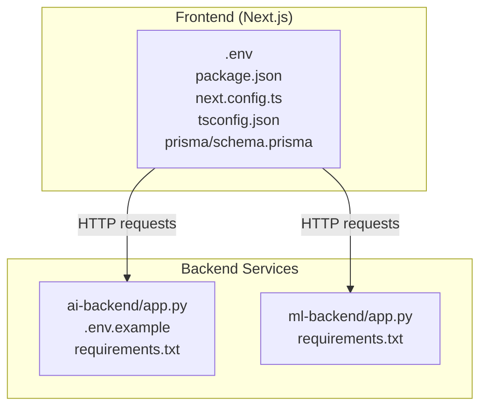
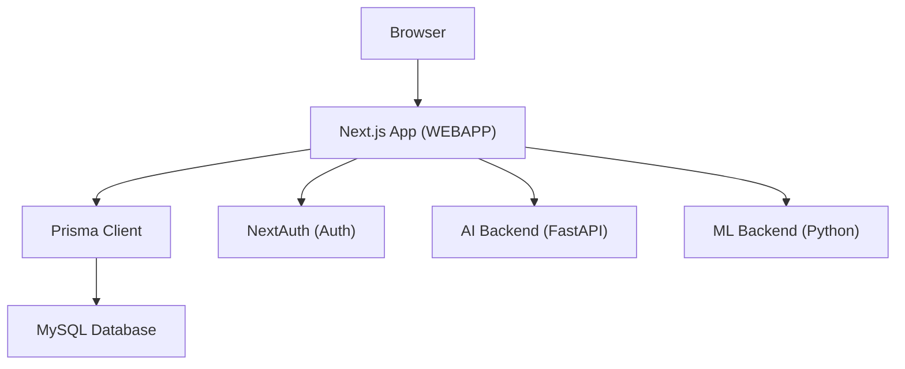
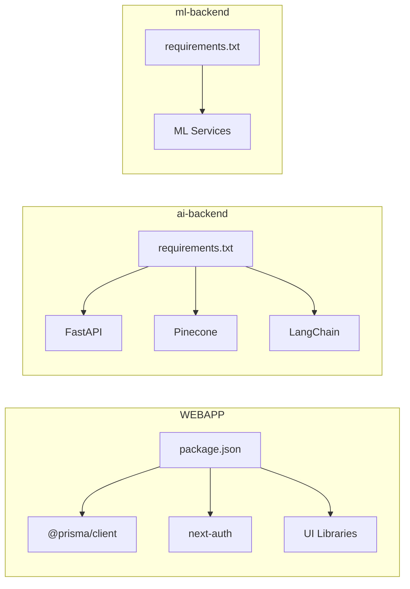
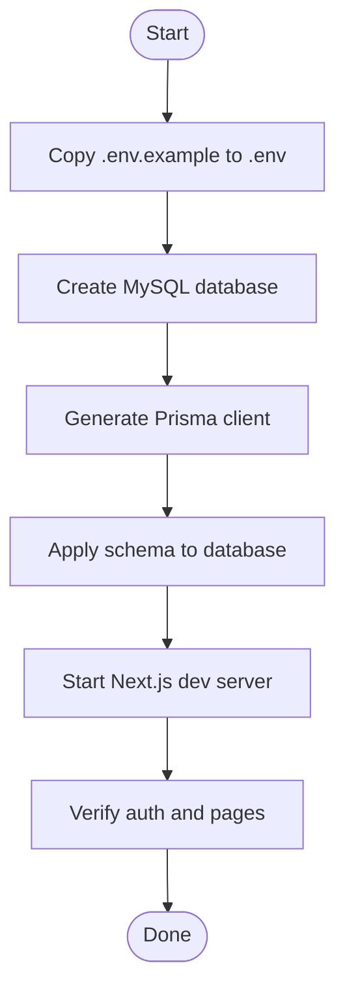

# Getting Started

<cite>
**Referenced Files in This Document**
- [README.md](file://README.md)
- [package.json](file://WEBAPP/package.json)
- [.env.example (WEBAPP)](file://WEBAPP/.env.example)
- [MY_SQL_INFO.md](file://WEBAPP/MY_SQL_INFO.md)
- [GOOGLE_OAUTH_SETUP.md](file://WEBAPP/GOOGLE_OAUTH_SETUP.md)
- [schema.prisma](file://WEBAPP/prisma/schema.prisma)
- [db.ts](file://WEBAPP/src/lib/db.ts)
- [next.config.ts](file://WEBAPP/next.config.ts)
- [tsconfig.json](file://WEBAPP/tsconfig.json)
- [layout.tsx](file://WEBAPP/src/app/layout.tsx)
- [requirements.txt (ai-backend)](file://ai-backend/requirements.txt)
- [.env.example (ai-backend)](file://ai-backend/.env.example)
- [app.py (ai-backend)](file://ai-backend/app.py)
- [requirements.txt (ml-backend)](file://ml-backend/requirements.txt)
- [app.py (ml-backend)](file://ml-backend/app.py)
</cite>

## Table of Contents
1. [Introduction](#introduction)
2. [Project Structure](#project-structure)
3. [Core Components](#core-components)
4. [Architecture Overview](#architecture-overview)
5. [Detailed Component Analysis](#detailed-component-analysis)
6. [Dependency Analysis](#dependency-analysis)
7. [Performance Considerations](#performance-considerations)
8. [Troubleshooting Guide](#troubleshooting-guide)
9. [Conclusion](#conclusion)
10. [Appendices](#appendices)

## Introduction
This guide helps you install, configure, and run the MindBridge AI platform locally. It covers:
- Frontend (Next.js) and backend service setup
- Environment configuration (.env files)
- Database initialization using Prisma
- Dependency installation for Node.js, Python, and databases
- Local development server startup
- Basic functionality verification
- Common setup issues and troubleshooting
- Quick start examples for accessing the platform and completing an initial therapy session

## Project Structure
MindBridge consists of:
- Frontend: Next.js application under WEBAPP
- AI backend: FastAPI service under ai-backend
- ML backend: Python service under ml-backend

**Diagram sources**
- [package.json](file://WEBAPP/package.json#L1-L88)
- [next.config.ts](file://WEBAPP/next.config.ts#L1-L45)
- [tsconfig.json](file://WEBAPP/tsconfig.json#L1-L42)
- [schema.prisma](file://WEBAPP/prisma/schema.prisma#L1-L330)
- [app.py (ai-backend)](file://ai-backend/app.py#L1-L154)
- [requirements.txt (ai-backend)](file://ai-backend/requirements.txt#L1-L81)
- [app.py (ml-backend)](file://ml-backend/app.py)
- [requirements.txt (ml-backend)](file://ml-backend/requirements.txt)

**Section sources**
- [README.md](file://README.md#L1-L3)
- [package.json](file://WEBAPP/package.json#L1-L88)
- [next.config.ts](file://WEBAPP/next.config.ts#L1-L45)
- [tsconfig.json](file://WEBAPP/tsconfig.json#L1-L42)
- [schema.prisma](file://WEBAPP/prisma/schema.prisma#L1-L330)
- [app.py (ai-backend)](file://ai-backend/app.py#L1-L154)
- [requirements.txt (ai-backend)](file://ai-backend/requirements.txt#L1-L81)
- [app.py (ml-backend)](file://ml-backend/app.py)
- [requirements.txt (ml-backend)](file://ml-backend/requirements.txt)

## Core Components
- Frontend (Next.js): Provides user interfaces for authentication, chat, therapy sessions, analytics, and admin panels. It connects to:
  - MySQL via Prisma
  - Authentication via NextAuth
  - AI backend (optional) for therapy responses
  - ML backend (optional) for analytics
- AI backend (FastAPI): Offers endpoints for therapy chat, text-to-speech, and avatar generation.
- ML backend (Python): Provides machine learning services for mental health analytics.

Key configuration touchpoints:
- WEBAPP .env for database, auth, and backend URLs
- ai-backend .env for AI APIs and server settings
- Prisma schema defines the MySQL model

**Section sources**
- [package.json](file://WEBAPP/package.json#L1-L88)
- [schema.prisma](file://WEBAPP/prisma/schema.prisma#L1-L330)
- [db.ts](file://WEBAPP/src/lib/db.ts#L1-L15)
- [.env.example (WEBAPP)](file://WEBAPP/.env.example#L1-L16)
- [.env.example (ai-backend)](file://ai-backend/.env.example#L1-L20)
- [app.py (ai-backend)](file://ai-backend/app.py#L1-L154)

## Architecture Overview
High-level runtime architecture:
- Client browser runs Next.js frontend
- Frontend communicates with:
  - NextAuth for authentication
  - Prisma for MySQL persistence
  - Optional AI backend for therapy responses
  - Optional ML backend for analytics

**Diagram sources**
- [layout.tsx](file://WEBAPP/src/app/layout.tsx#L1-L55)
- [db.ts](file://WEBAPP/src/lib/db.ts#L1-L15)
- [schema.prisma](file://WEBAPP/prisma/schema.prisma#L1-L330)
- [app.py (ai-backend)](file://ai-backend/app.py#L1-L154)
- [app.py (ml-backend)](file://ml-backend/app.py)

## Detailed Component Analysis

### Frontend (Next.js) Setup
- Dependencies and scripts are defined in the frontend package manifest.
- Prisma client is initialized and configured for development logging.
- Next.js configuration enables CORS headers and disables image optimization for local builds.
- TypeScript configuration sets module resolution and path aliases.

Installation and environment setup:
- Install Node.js and npm/yarn.
- From the WEBAPP directory:
  - Install dependencies using the package manager.
  - Copy the example environment file to .env and edit DATABASE_URL, NEXTAUTH_URL, NEXTAUTH_SECRET, and optional backend URLs.
  - Create the MySQL database and initialize Prisma schema.

Database initialization with Prisma:
- Generate Prisma client and apply schema to the database.
- Optionally launch Prisma Studio to inspect data.

Frontend development server:
- Start the Next.js development server.

Verification:
- Access the home page and sign in with Google OAuth (see OAuth setup below).

**Section sources**
- [package.json](file://WEBAPP/package.json#L1-L88)
- [db.ts](file://WEBAPP/src/lib/db.ts#L1-L15)
- [next.config.ts](file://WEBAPP/next.config.ts#L1-L45)
- [tsconfig.json](file://WEBAPP/tsconfig.json#L1-L42)
- [.env.example (WEBAPP)](file://WEBAPP/.env.example#L1-L16)
- [MY_SQL_INFO.md](file://WEBAPP/MY_SQL_INFO.md#L1-L123)

### AI Backend (FastAPI) Setup
- The AI backend is a FastAPI application with CORS enabled and static audio/video serving.
- Services are lazily initialized to avoid import issues.
- Exposes endpoints for health checks, therapy chat, text-to-speech, and avatar generation.
- Uses environment variables for API keys and server port.

Installation and environment setup:
- Install Python and pip.
- From the ai-backend directory:
  - Install dependencies from the requirements file.
  - Copy the example environment file to .env and set API keys, voice settings, MongoDB URL, and server port.

Server startup:
- Run the FastAPI application with Uvicorn.

Verification:
- Call the health endpoint and endpoints for chat, TTS, and avatar generation.

**Section sources**
- [app.py (ai-backend)](file://ai-backend/app.py#L1-L154)
- [.env.example (ai-backend)](file://ai-backend/.env.example#L1-L20)
- [requirements.txt (ai-backend)](file://ai-backend/requirements.txt#L1-L81)

### ML Backend (Python) Setup
- The ML backend exposes a Python service for mental health analytics.
- Requires installing dependencies from the requirements file.

Installation and environment setup:
- From the ml-backend directory:
  - Install dependencies from the requirements file.
  - Start the ML backend service.

Verification:
- Confirm the service responds to requests.

**Section sources**
- [app.py (ml-backend)](file://ml-backend/app.py)
- [requirements.txt (ml-backend)](file://ml-backend/requirements.txt)

### Authentication and OAuth
- NextAuth handles authentication and integrates with Prisma for user storage.
- Google OAuth requires setting up credentials and adding them to the frontend .env.
- The OAuth setup guide explains consent screen configuration, credential creation, and verification steps.

**Section sources**
- [GOOGLE_OAUTH_SETUP.md](file://WEBAPP/GOOGLE_OAUTH_SETUP.md#L1-L74)
- [.env.example (WEBAPP)](file://WEBAPP/.env.example#L6-L9)

## Dependency Analysis
Frontend dependencies include Next.js, Prisma client, NextAuth, UI libraries, and Stripe. Backend dependencies include FastAPI, HTTP clients, Pinecone, LangChain, and audio processing packages.

**Diagram sources**
- [package.json](file://WEBAPP/package.json#L1-L88)
- [requirements.txt (ai-backend)](file://ai-backend/requirements.txt#L1-L81)
- [requirements.txt (ml-backend)](file://ml-backend/requirements.txt)

**Section sources**
- [package.json](file://WEBAPP/package.json#L1-L88)
- [requirements.txt (ai-backend)](file://ai-backend/requirements.txt#L1-L81)
- [requirements.txt (ml-backend)](file://ml-backend/requirements.txt)

## Performance Considerations
- Keep development logs minimal in production-like environments.
- Disable image optimization during local builds if not needed.
- Use lazy initialization for heavy services in the AI backend to reduce cold-start overhead.
- Ensure database connections are pooled appropriately and queries are indexed as per Prisma schema.

[No sources needed since this section provides general guidance]

## Troubleshooting Guide
Common issues and resolutions:
- MySQL connection failures:
  - Ensure MySQL is running and the database exists.
  - Verify DATABASE_URL in the frontend .env matches your MySQL credentials.
  - Re-run Prisma client generation and schema push.
- Prisma client errors:
  - Regenerate Prisma client and restart the development server.
- OAuth redirect mismatch:
  - Confirm Authorized redirect URIs include the local callback URL.
  - Ensure NEXTAUTH_URL matches the origin used for OAuth.
- AI backend service not reachable:
  - Confirm PORT in the AI backend .env and that the service is running.
  - Verify CORS settings and network connectivity.
- ML backend service not reachable:
  - Confirm the service is running and responding to requests.

**Section sources**
- [MY_SQL_INFO.md](file://WEBAPP/MY_SQL_INFO.md#L97-L114)
- [GOOGLE_OAUTH_SETUP.md](file://WEBAPP/GOOGLE_OAUTH_SETUP.md#L70-L74)
- [.env.example (WEBAPP)](file://WEBAPP/.env.example#L14-L16)
- [.env.example (ai-backend)](file://ai-backend/.env.example#L18-L20)
- [app.py (ai-backend)](file://ai-backend/app.py#L143-L154)

## Conclusion
You now have the essentials to install, configure, and run MindBridge locally. Proceed to initialize the database, start the frontend and backend services, and verify authentication and therapy workflows.

[No sources needed since this section summarizes without analyzing specific files]

## Appendices

### Step-by-Step Development Setup
- Prerequisites:
  - Node.js and npm/yarn
  - Python and pip
  - MySQL server
  - Git (optional)
- Steps:
  1. Clone the repository.
  2. Install frontend dependencies in WEBAPP.
  3. Create and configure the MySQL database.
  4. Initialize Prisma schema and client.
  5. Start the Next.js development server.
  6. Install and start the AI backend service.
  7. Install and start the ML backend service.
  8. Verify authentication and basic functionality.

**Section sources**
- [MY_SQL_INFO.md](file://WEBAPP/MY_SQL_INFO.md#L56-L75)
- [package.json](file://WEBAPP/package.json#L5-L11)
- [app.py (ai-backend)](file://ai-backend/app.py#L143-L154)
- [app.py (ml-backend)](file://ml-backend/app.py)

### Environment Variables Reference
- WEBAPP .env:
  - DATABASE_URL: MySQL connection string
  - NEXTAUTH_URL: NextAuth base URL
  - NEXTAUTH_SECRET: Secret for session signing
  - NODE_ENV: Development or production
  - AI_BACKEND_URL, ML_BACKEND_URL: Optional backend service endpoints
- ai-backend .env:
  - GEMINI_API_KEY, GEMINI_MODEL
  - GROQ_API_KEY
  - ELEVENLABS_API_KEY, ELEVENLABS_VOICE_ID
  - MONGODB_URL
  - PORT, DEBUG

**Section sources**
- [.env.example (WEBAPP)](file://WEBAPP/.env.example#L1-L16)
- [.env.example (ai-backend)](file://ai-backend/.env.example#L1-L20)

### Database Initialization Flow

**Diagram sources**
- [MY_SQL_INFO.md](file://WEBAPP/MY_SQL_INFO.md#L35-L55)
- [schema.prisma](file://WEBAPP/prisma/schema.prisma#L1-L330)
- [db.ts](file://WEBAPP/src/lib/db.ts#L1-L15)

### Quick Start: Access Platform and Complete Initial Therapy Session
- Start services:
  - Frontend: WEBAPP development server
  - AI backend: FastAPI service
  - ML backend: Python service
- Access:
  - Open the frontend in a browser and sign in with Google OAuth.
  - Complete profile completion as prompted.
- Initial therapy session:
  - Navigate to the therapy interface.
  - Start a session and interact with the AI therapist.
  - Use the chat interface to send messages and receive responses.
  - Optionally generate audio or avatar content via backend services.

**Section sources**
- [GOOGLE_OAUTH_SETUP.md](file://WEBAPP/GOOGLE_OAUTH_SETUP.md#L56-L61)
- [app.py (ai-backend)](file://ai-backend/app.py#L81-L123)