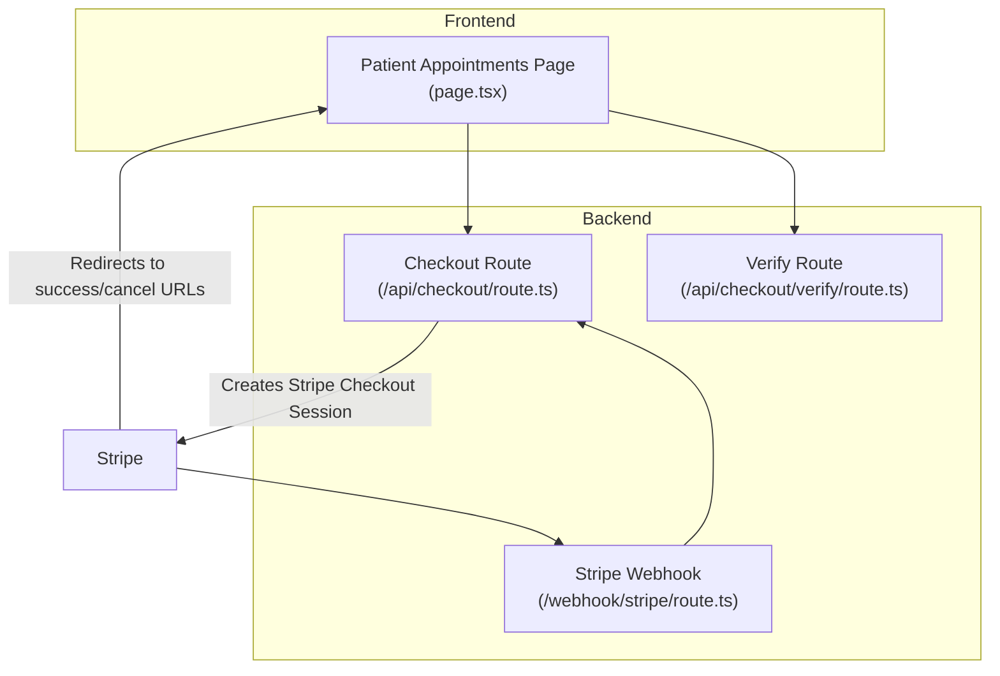
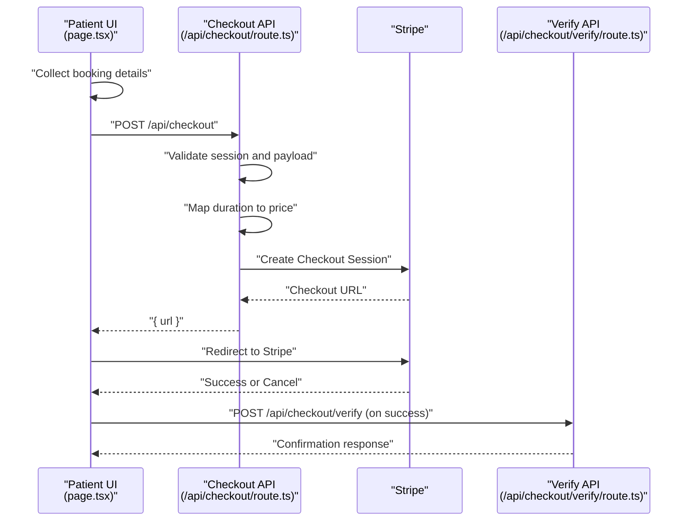
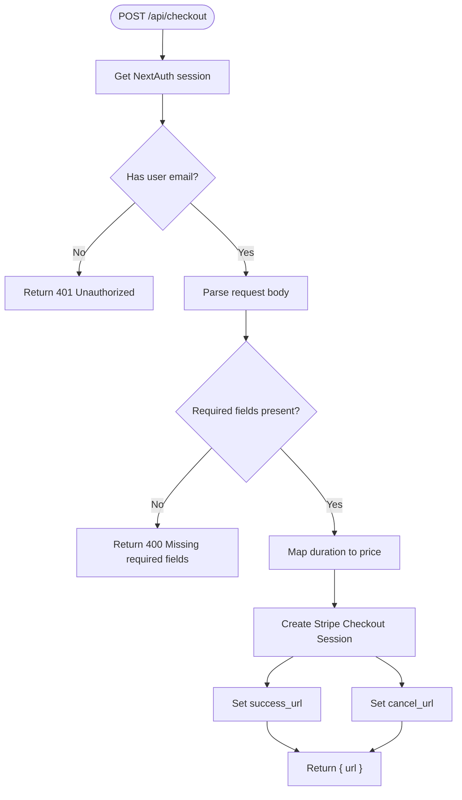
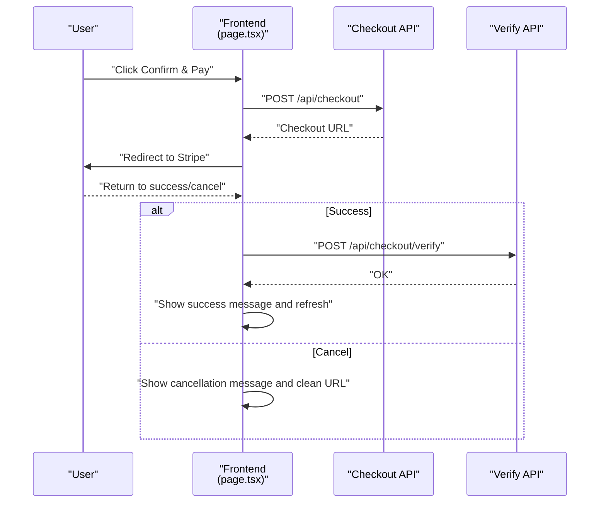
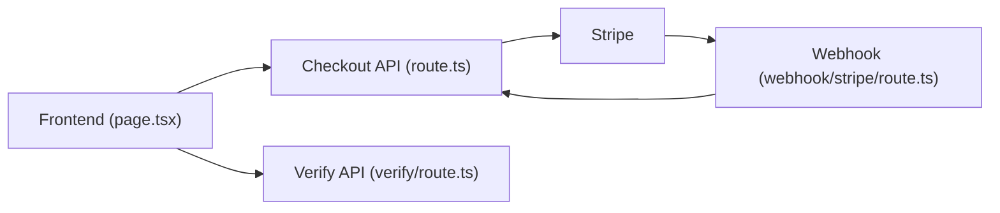

# Checkout Flow

<cite>
**Referenced Files in This Document**
- [route.ts](file://WEBAPP/src/app/api/checkout/route.ts)
- [verify/route.ts](file://WEBAPP/src/app/api/checkout/verify/route.ts)
- [page.tsx](file://WEBAPP/src/app/patient/appointments/page.tsx)
- [webhook/stripe/route.ts](file://WEBAPP/src/app/webhook/stripe/route.ts)
- [sessionManager.ts](file://WEBAPP/src/lib/sessionManager.ts)
</cite>

## Table of Contents
1. [Introduction](#introduction)
2. [Project Structure](#project-structure)
3. [Core Components](#core-components)
4. [Architecture Overview](#architecture-overview)
5. [Detailed Component Analysis](#detailed-component-analysis)
6. [Dependency Analysis](#dependency-analysis)
7. [Performance Considerations](#performance-considerations)
8. [Troubleshooting Guide](#troubleshooting-guide)
9. [Conclusion](#conclusion)

## Introduction
This document explains the complete payment checkout flow for MindBridge’s therapy session booking system. It covers the end-to-end journey from initiating a session with Stripe to confirming the transaction and updating the patient’s appointment record. It also documents required field validation, session duration mapping, price calculation logic, success and cancellation URL configurations, redirect handling, payment status verification, client-side integration patterns, loading states, and user experience considerations. Edge cases such as expired sessions, duplicate payments, and partial failures are addressed.

## Project Structure
The checkout flow spans backend API routes and the patient-facing frontend page:
- Backend
  - Checkout session creation endpoint
  - Payment verification endpoint
  - Stripe webhook handler
- Frontend
  - Patient appointments page orchestrating the booking and payment flow

**Diagram sources**
- [route.ts](file://WEBAPP/src/app/api/checkout/route.ts#L17-L81)
- [verify/route.ts](file://WEBAPP/src/app/api/checkout/verify/route.ts)
- [webhook/stripe/route.ts](file://WEBAPP/src/app/webhook/stripe/route.ts)
- [page.tsx](file://WEBAPP/src/app/patient/appointments/page.tsx#L90-L126)

**Section sources**
- [route.ts](file://WEBAPP/src/app/api/checkout/route.ts#L17-L81)
- [page.tsx](file://WEBAPP/src/app/patient/appointments/page.tsx#L90-L126)

## Core Components
- Backend checkout session creation
  - Validates request payload and user session
  - Maps session duration to price
  - Creates a Stripe Checkout Session with success and cancel URLs
  - Returns the Stripe-hosted checkout URL
- Payment verification
  - After Stripe redirects back, the frontend calls the verification endpoint
  - Confirms the payment and updates the appointment accordingly
- Stripe webhook
  - Receives asynchronous payment events from Stripe
  - Ensures eventual consistency and handles edge cases like delayed notifications
- Frontend orchestration
  - Collects booking details and redirects to Stripe
  - Handles success/cancel redirects and displays user feedback
  - Polls for real-time updates to reflect payment outcomes

**Section sources**
- [route.ts](file://WEBAPP/src/app/api/checkout/route.ts#L17-L81)
- [verify/route.ts](file://WEBAPP/src/app/api/checkout/verify/route.ts)
- [webhook/stripe/route.ts](file://WEBAPP/src/app/webhook/stripe/route.ts)
- [page.tsx](file://WEBAPP/src/app/patient/appointments/page.tsx#L90-L126)

## Architecture Overview
The checkout flow integrates Next.js server actions, Stripe Checkout, and asynchronous webhook processing to guarantee reliable payment confirmation.

**Diagram sources**
- [route.ts](file://WEBAPP/src/app/api/checkout/route.ts#L17-L81)
- [page.tsx](file://WEBAPP/src/app/patient/appointments/page.tsx#L224-L258)
- [verify/route.ts](file://WEBAPP/src/app/api/checkout/verify/route.ts)

## Detailed Component Analysis

### Backend Checkout Session Creation
Responsibilities:
- Authenticate the user via NextAuth session
- Validate required fields (therapistId, patientId, scheduledTime, slotId)
- Map session duration to price using a fixed mapping
- Build Stripe line item with product metadata
- Configure success and cancel URLs pointing back to the patient portal
- Return the Stripe checkout URL to the client

Key behaviors:
- Required fields enforced before creating the session
- Default fallback price if duration is not mapped
- Metadata stored on the Stripe session for downstream verification

**Diagram sources**
- [route.ts](file://WEBAPP/src/app/api/checkout/route.ts#L17-L81)

**Section sources**
- [route.ts](file://WEBAPP/src/app/api/checkout/route.ts#L17-L81)

### Payment Verification Endpoint
Responsibilities:
- Accepts a Stripe checkout session ID
- Verifies payment status with Stripe
- Updates the associated appointment record to confirmed if payment succeeded
- Returns appropriate success/failure signals to the frontend

Integration pattern:
- Called by the frontend after Stripe redirect on success
- Used to reconcile payment outcome and appointment state

**Section sources**
- [verify/route.ts](file://WEBAPP/src/app/api/checkout/verify/route.ts)

### Stripe Webhook Handler
Responsibilities:
- Receive Stripe webhook events (e.g., payment confirmation, failure)
- Validate webhook signature
- Update appointment records based on event data
- Ensure eventual consistency even if the initial verification fails

Integration pattern:
- Stripe posts events to the webhook endpoint
- Server-side reconciliation prevents race conditions and late notifications

**Section sources**
- [webhook/stripe/route.ts](file://WEBAPP/src/app/webhook/stripe/route.ts)

### Frontend Orchestration and User Experience
Responsibilities:
- Collect booking details (therapist, date, slot, type, duration)
- Initiate payment by calling the checkout endpoint
- Redirect to Stripe using the returned URL
- Handle success/cancel redirects:
  - On success, call the verification endpoint and refresh appointments
  - On cancel, display a friendly message and clean up URL params
- Provide loading states and user feedback during payment and verification
- Poll for real-time updates to reflect payment outcomes

**Diagram sources**
- [page.tsx](file://WEBAPP/src/app/patient/appointments/page.tsx#L224-L258)
- [page.tsx](file://WEBAPP/src/app/patient/appointments/page.tsx#L90-L126)
- [verify/route.ts](file://WEBAPP/src/app/api/checkout/verify/route.ts)

**Section sources**
- [page.tsx](file://WEBAPP/src/app/patient/appointments/page.tsx#L90-L126)
- [page.tsx](file://WEBAPP/src/app/patient/appointments/page.tsx#L224-L258)

## Dependency Analysis
- Frontend depends on:
  - NextAuth session for user identity
  - Stripe SDK for checkout session creation
  - Environment variables for Stripe secret and base URL
- Backend depends on:
  - Stripe SDK for checkout session management
  - NextAuth for session validation
  - Database/API for appointment persistence (via verification/webhook)

**Diagram sources**
- [page.tsx](file://WEBAPP/src/app/patient/appointments/page.tsx#L224-L258)
- [route.ts](file://WEBAPP/src/app/api/checkout/route.ts#L17-L81)
- [verify/route.ts](file://WEBAPP/src/app/api/checkout/verify/route.ts)
- [webhook/stripe/route.ts](file://WEBAPP/src/app/webhook/stripe/route.ts)

**Section sources**
- [page.tsx](file://WEBAPP/src/app/patient/appointments/page.tsx#L224-L258)
- [route.ts](file://WEBAPP/src/app/api/checkout/route.ts#L17-L81)

## Performance Considerations
- Minimize network latency by batching frontend requests and avoiding redundant calls.
- Use client-side caching judiciously for therapist and slot data to reduce repeated fetches.
- Implement efficient polling intervals for real-time updates (already set to 30 seconds) and adjust dynamically based on user activity.
- Ensure Stripe session creation errors are handled gracefully to avoid blocking the UI.

## Troubleshooting Guide
Common issues and resolutions:
- Unauthorized access
  - Cause: Missing or invalid NextAuth session
  - Resolution: Redirect to sign-in; ensure session is validated before calling checkout
- Missing required fields
  - Cause: Missing therapistId, patientId, scheduledTime, or slotId
  - Resolution: Validate inputs on the client and show clear error messages
- Payment cancellation
  - Behavior: Redirected with payment=cancelled; frontend cleans URL and shows message
  - Resolution: Persist the message and allow retry
- Payment success without immediate confirmation
  - Behavior: Frontend calls verification endpoint; if not yet confirmed, shows “payment received” message and continues polling
  - Resolution: Ensure verification endpoint and webhook handler are both active
- Expired sessions
  - Behavior: Stripe checkout sessions expire per Stripe policy; re-initiate payment if needed
  - Resolution: Inform user and guide them to re-book
- Duplicate payments
  - Prevention: Use Stripe’s idempotency and session metadata; deduplicate by checking existing appointment status and payment reference
- Partial failures
  - Prevention: Use webhook handler to reconcile state asynchronously; ensure verification endpoint guards against inconsistent states

**Section sources**
- [route.ts](file://WEBAPP/src/app/api/checkout/route.ts#L17-L81)
- [page.tsx](file://WEBAPP/src/app/patient/appointments/page.tsx#L90-L126)
- [verify/route.ts](file://WEBAPP/src/app/api/checkout/verify/route.ts)
- [webhook/stripe/route.ts](file://WEBAPP/src/app/webhook/stripe/route.ts)

## Conclusion
The checkout flow combines a straightforward server-side Stripe integration with robust frontend orchestration and asynchronous reconciliation via webhooks. By validating required fields, mapping durations to prices, configuring success/cancel URLs, and implementing verification and polling, the system delivers a resilient and user-friendly payment experience. Proper handling of edge cases ensures reliability under real-world conditions.