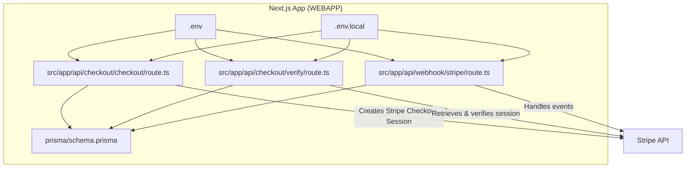
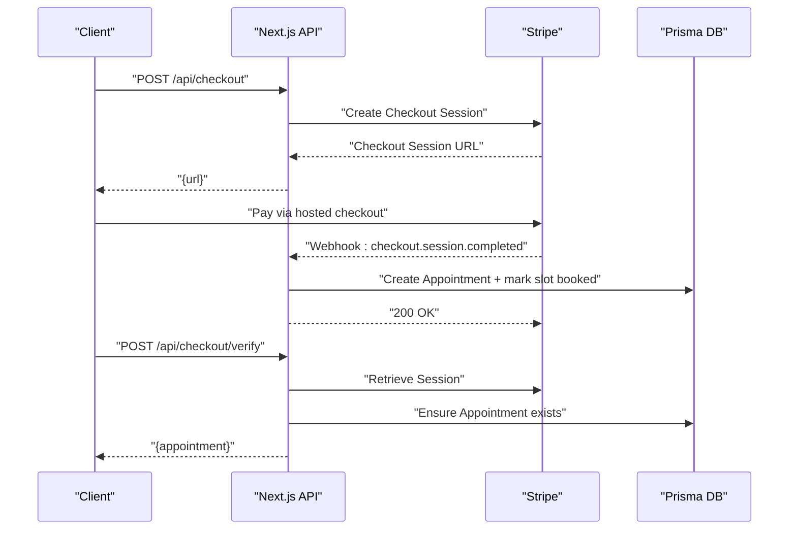
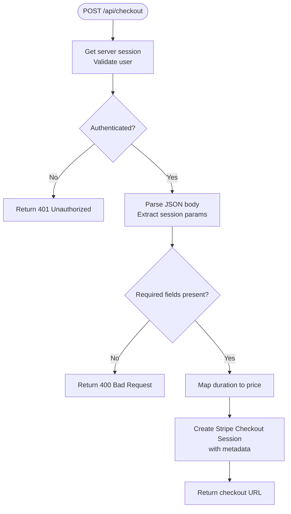
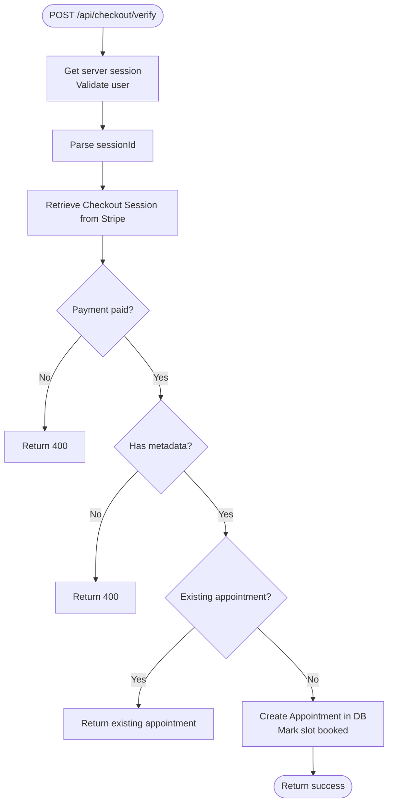
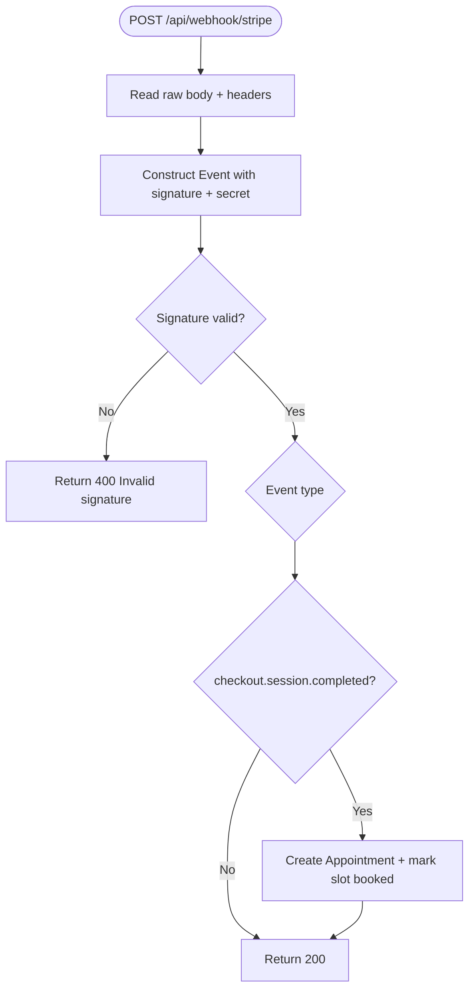
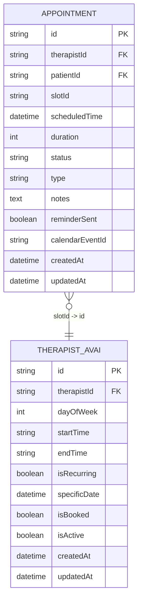
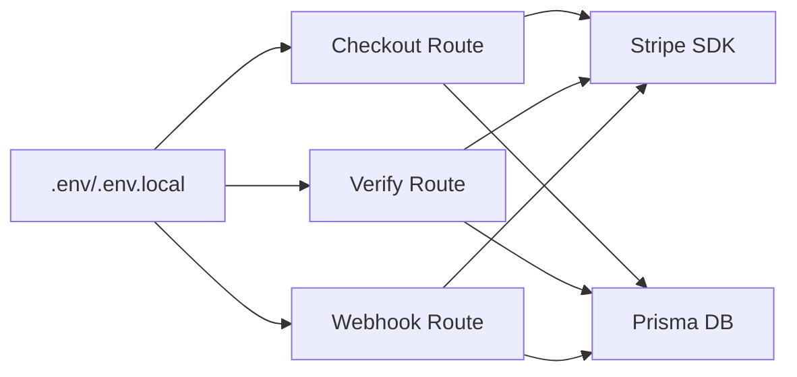

# Payment & Subscription System

<cite>
**Referenced Files in This Document**
- [.env](file://WEBAPP/.env)
- [.env.local](file://WEBAPP/.env.local)
- [checkout/route.ts](file://WEBAPP/src/app/api/checkout/checkout/route.ts)
- [checkout/verify/route.ts](file://WEBAPP/src/app/api/checkout/verify/route.ts)
- [webhook/stripe/route.ts](file://WEBAPP/src/app/api/webhook/stripe/route.ts)
- [schema.prisma](file://WEBAPP/prisma/schema.prisma)
</cite>

## Table of Contents
1. [Introduction](#introduction)
2. [Project Structure](#project-structure)
3. [Core Components](#core-components)
4. [Architecture Overview](#architecture-overview)
5. [Detailed Component Analysis](#detailed-component-analysis)
6. [Dependency Analysis](#dependency-analysis)
7. [Performance Considerations](#performance-considerations)
8. [Troubleshooting Guide](#troubleshooting-guide)
9. [Conclusion](#conclusion)
10. [Appendices](#appendices)

## Introduction
This document explains the payment and subscription management system built with Stripe for secure payment processing, appointment booking, and webhook-driven event handling. It covers the checkout flow, payment verification, database persistence, webhook processing, and operational guidance for PCI compliance, error handling, retries, and international considerations.

## Project Structure
The payment system spans API routes for initiating checkout, verifying payments, and processing Stripe webhooks, backed by a Prisma schema that models appointments and related entities.

**Diagram sources**
- [checkout/route.ts](file://WEBAPP/src/app/api/checkout/checkout/route.ts#L1-L82)
- [checkout/verify/route.ts](file://WEBAPP/src/app/api/checkout/verify/route.ts#L1-L94)
- [webhook/stripe/route.ts](file://WEBAPP/src/app/api/webhook/stripe/route.ts#L1-L67)
- [schema.prisma](file://WEBAPP/prisma/schema.prisma#L186-L211)
- [.env](file://WEBAPP/.env#L29-L31)
- [.env.local](file://WEBAPP/.env.local#L1-L20)

**Section sources**
- [checkout/route.ts](file://WEBAPP/src/app/api/checkout/checkout/route.ts#L1-L82)
- [checkout/verify/route.ts](file://WEBAPP/src/app/api/checkout/verify/route.ts#L1-L94)
- [webhook/stripe/route.ts](file://WEBAPP/src/app/api/webhook/stripe/route.ts#L1-L67)
- [schema.prisma](file://WEBAPP/prisma/schema.prisma#L186-L211)
- [.env](file://WEBAPP/.env#L29-L31)
- [.env.local](file://WEBAPP/.env.local#L1-L20)

## Core Components
- Stripe integration via secret key and webhook secret configured in environment variables.
- Checkout initiation API that creates a Stripe Checkout Session with session metadata.
- Payment verification API that validates payment completion and creates an appointment.
- Webhook handler that processes checkout completion to finalize appointment creation and mark availability slots.

Key responsibilities:
- Enforce authentication and session checks.
- Map durations to prices and construct line items.
- Persist appointment records and availability bookings.
- Verify webhook signatures and handle events safely.

**Section sources**
- [checkout/route.ts](file://WEBAPP/src/app/api/checkout/checkout/route.ts#L17-L81)
- [checkout/verify/route.ts](file://WEBAPP/src/app/api/checkout/verify/route.ts#L10-L93)
- [webhook/stripe/route.ts](file://WEBAPP/src/app/api/webhook/stripe/route.ts#L11-L66)
- [.env](file://WEBAPP/.env#L29-L31)

## Architecture Overview
End-to-end flow from client to Stripe and back to the application.

**Diagram sources**
- [checkout/route.ts](file://WEBAPP/src/app/api/checkout/checkout/route.ts#L43-L71)
- [webhook/stripe/route.ts](file://WEBAPP/src/app/api/webhook/stripe/route.ts#L24-L63)
- [checkout/verify/route.ts](file://WEBAPP/src/app/api/checkout/verify/route.ts#L24-L85)

## Detailed Component Analysis

### Checkout Session Creation
Purpose:
- Build a Stripe Checkout Session for a therapy session with mapped pricing and metadata.
- Redirect to success/cancel URLs with session identifiers.

Implementation highlights:
- Validates session and required fields.
- Uses a fixed currency and constructs line items with product metadata.
- Sets success and cancel URLs pointing to the frontend.

**Diagram sources**
- [checkout/route.ts](file://WEBAPP/src/app/api/checkout/checkout/route.ts#L17-L71)

**Section sources**
- [checkout/route.ts](file://WEBAPP/src/app/api/checkout/checkout/route.ts#L17-L81)

### Payment Verification
Purpose:
- Confirm payment completion and ensure the appointment record exists.
- Idempotently create an appointment if missing.

Implementation highlights:
- Retrieves session from Stripe and checks payment status.
- Queries existing appointment using metadata to avoid duplication.
- Creates appointment and marks slot as booked.

**Diagram sources**
- [checkout/verify/route.ts](file://WEBAPP/src/app/api/checkout/verify/route.ts#L10-L85)

**Section sources**
- [checkout/verify/route.ts](file://WEBAPP/src/app/api/checkout/verify/route.ts#L10-L93)

### Webhook Processing
Purpose:
- Process Stripe events to finalize appointment creation and availability booking.
- Verify webhook signatures using the webhook secret.

Implementation highlights:
- Verifies signature using Stripe’s webhook construction.
- Handles checkout.session.completed to create appointment and book slot.
- Returns success response to acknowledge receipt.

**Diagram sources**
- [webhook/stripe/route.ts](file://WEBAPP/src/app/api/webhook/stripe/route.ts#L11-L66)

**Section sources**
- [webhook/stripe/route.ts](file://WEBAPP/src/app/api/webhook/stripe/route.ts#L11-L66)

### Data Model: Appointments and Availability
The Prisma schema defines appointment and availability entities used by the payment flow.

**Diagram sources**
- [schema.prisma](file://WEBAPP/prisma/schema.prisma#L186-L211)

**Section sources**
- [schema.prisma](file://WEBAPP/prisma/schema.prisma#L186-L211)

## Dependency Analysis
- Environment variables:
  - STRIPE_SECRET_KEY and STRIPE_WEBHOOK_SECRET are required for Stripe operations.
  - NEXTAUTH_URL is used in success/cancel URLs.
- Runtime dependencies:
  - Stripe SDK initialized with API version aligned to the backend.
  - Prisma client used for database operations.

**Diagram sources**
- [.env](file://WEBAPP/.env#L29-L31)
- [.env.local](file://WEBAPP/.env.local#L1-L20)
- [checkout/route.ts](file://WEBAPP/src/app/api/checkout/checkout/route.ts#L5-L7)
- [checkout/verify/route.ts](file://WEBAPP/src/app/api/checkout/verify/route.ts#L6-L8)
- [webhook/stripe/route.ts](file://WEBAPP/src/app/api/webhook/stripe/route.ts#L5-L9)

**Section sources**
- [.env](file://WEBAPP/.env#L29-L31)
- [.env.local](file://WEBAPP/.env.local#L1-L20)
- [checkout/route.ts](file://WEBAPP/src/app/api/checkout/checkout/route.ts#L5-L7)
- [checkout/verify/route.ts](file://WEBAPP/src/app/api/checkout/verify/route.ts#L6-L8)
- [webhook/stripe/route.ts](file://WEBAPP/src/app/api/webhook/stripe/route.ts#L5-L9)

## Performance Considerations
- Minimize synchronous work in webhook handlers; keep them idempotent and fast.
- Use database indexes on frequently queried fields (e.g., appointment timestamps, statuses).
- Cache Stripe product/pricing lookups when extending to subscriptions.
- Batch availability updates and avoid N+1 queries when scaling.

## Troubleshooting Guide
Common issues and resolutions:
- Signature verification failures:
  - Ensure webhook secret matches the Stripe Dashboard configuration.
  - Verify the raw body and header are passed correctly to the verification function.
- Missing or invalid session metadata:
  - Confirm checkout session creation includes all required metadata fields.
  - On verification, ensure sessionId is provided and corresponds to a paid session.
- Duplicate appointments:
  - The verification route checks for existing appointments; ensure metadata uniqueness.
- Database errors:
  - Validate Prisma model relationships and indexes.
  - Confirm availability slot updates occur only when slotId is present.

Operational tips:
- Enable logging around webhook receipts and database writes.
- Add circuit breakers for external Stripe calls under load.
- Implement idempotency keys for retries if integrating subscription billing later.

**Section sources**
- [webhook/stripe/route.ts](file://WEBAPP/src/app/api/webhook/stripe/route.ts#L17-L22)
- [checkout/verify/route.ts](file://WEBAPP/src/app/api/checkout/verify/route.ts#L36-L52)
- [schema.prisma](file://WEBAPP/prisma/schema.prisma#L186-L211)

## Conclusion
The system integrates Stripe securely for session-based payments, persists appointment data, and handles webhook events to finalize bookings. It enforces authentication, validates payment status, and maintains referential integrity with availability slots. Extending to recurring billing and subscriptions would involve adding Stripe Billing products and subscription webhooks while preserving current verification and persistence patterns.

## Appendices

### Pricing and Currency
- Current implementation uses a fixed price mapping per session duration and USD as currency.
- Extend by mapping Stripe product/prices dynamically and supporting multiple currencies with Stripe’s multi-currency features.

**Section sources**
- [checkout/route.ts](file://WEBAPP/src/app/api/checkout/checkout/route.ts#L9-L15)
- [checkout/route.ts](file://WEBAPP/src/app/api/checkout/checkout/route.ts#L50)

### PCI Compliance and Security
- Never handle raw card details; rely on Stripe-hosted checkout.
- Use HTTPS and secure cookies; configure NextAuth appropriately.
- Store only minimal sensitive data and leverage Stripe’s shared responsibility model.

**Section sources**
- [.env](file://WEBAPP/.env#L29-L31)
- [.env.local](file://WEBAPP/.env.local#L1-L20)

### International Payments and Refunds
- Multi-currency: Configure Stripe pricing per region and use checkout session currency selection.
- Refunds: Process refunds via Stripe Dashboard or API; track refund events via webhooks and update appointment status accordingly.

[No sources needed since this section provides general guidance]