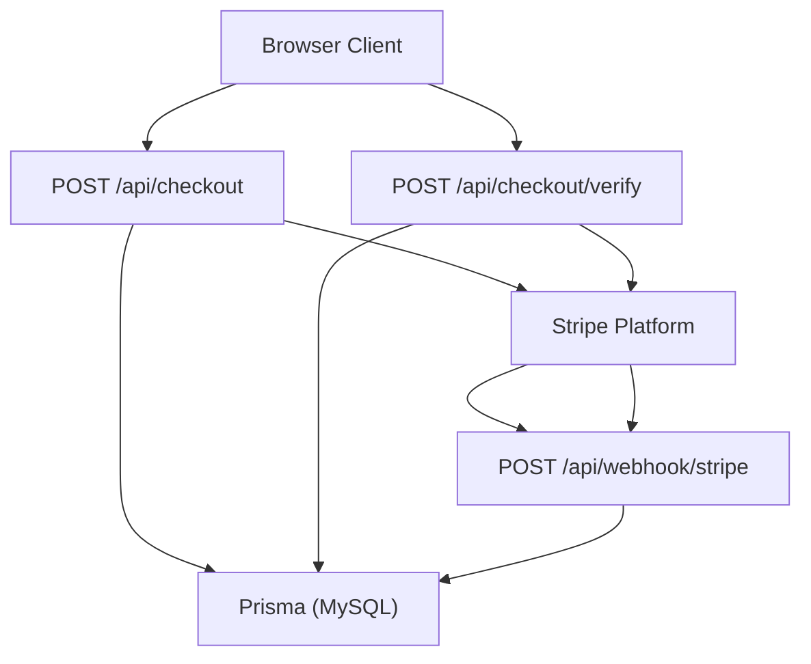
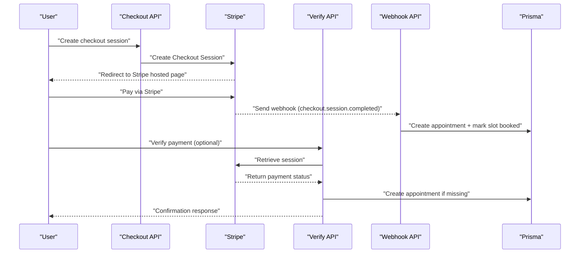
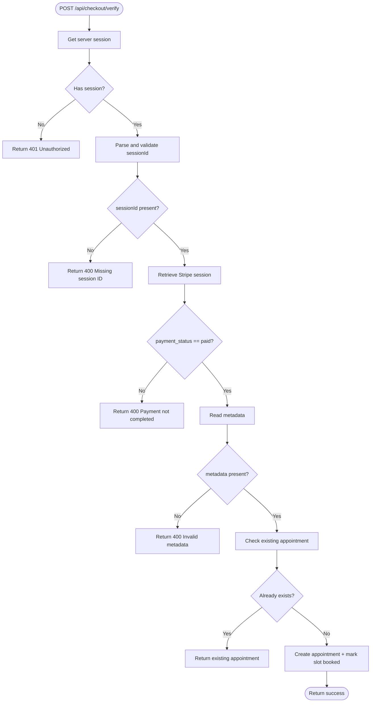
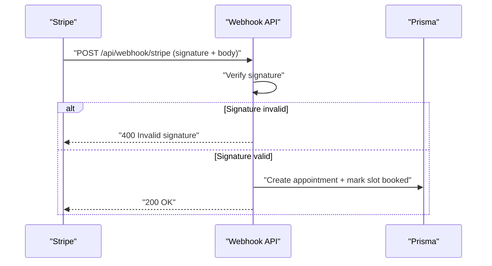
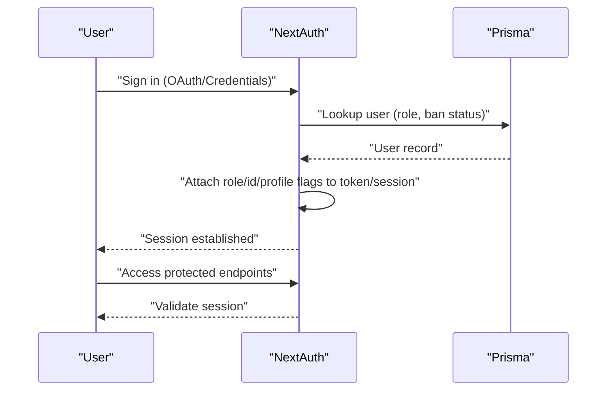
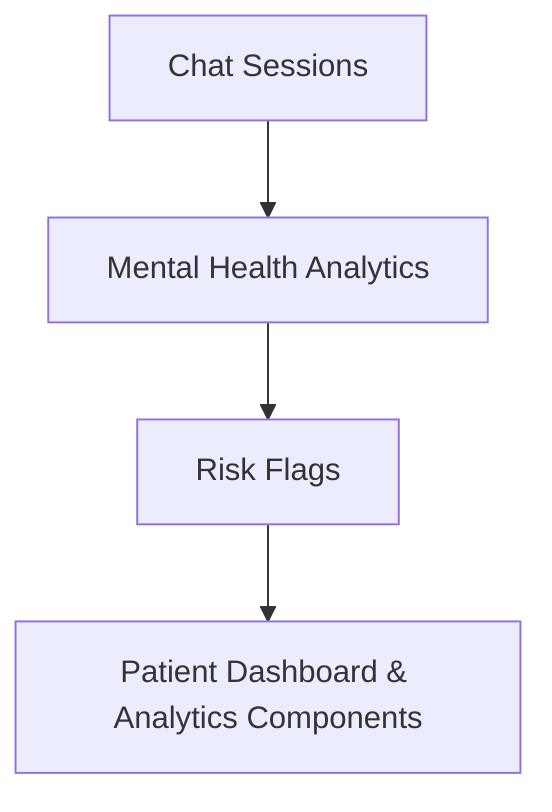
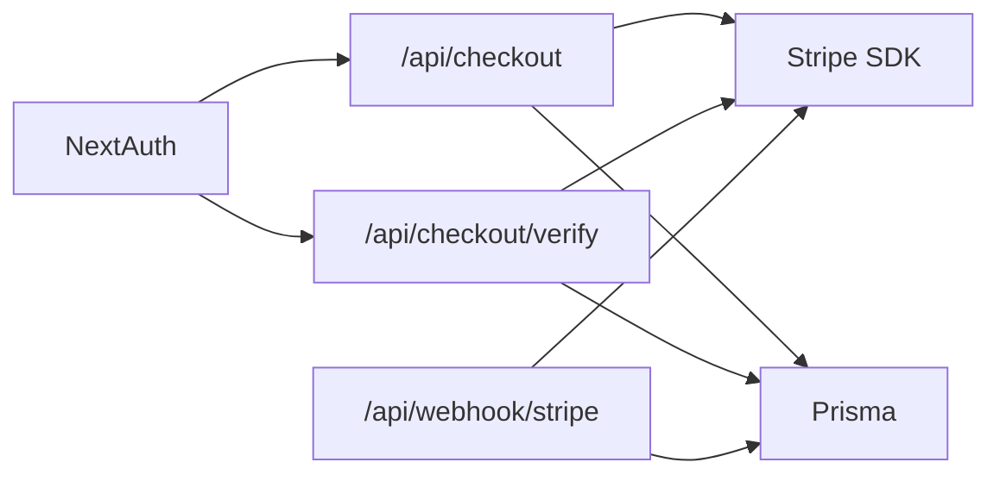

# Payment Security

<cite>
**Referenced Files in This Document**
- [route.ts](file://WEBAPP/src/app/api/checkout/route.ts)
- [route.ts](file://WEBAPP/src/app/api/checkout/verify/route.ts)
- [route.ts](file://WEBAPP/src/app/api/webhook/stripe/route.ts)
- [.env](file://WEBAPP/.env)
- [.env.example](file://WEBAPP/.env.example)
- [route.ts](file://WEBAPP/src/app/api/auth/[...nextauth]/route.ts)
- [db.ts](file://WEBAPP/src/lib/db.ts)
- [schema.prisma](file://WEBAPP/prisma/schema.prisma)
- [page.tsx](file://WEBAPP/src/app/patient/dashboard/page.tsx)
- [MentalHealthAnalytics.tsx](file://WEBAPP/src/components/MentalHealthAnalytics.tsx)
</cite>

## Table of Contents
1. [Introduction](#introduction)
2. [Project Structure](#project-structure)
3. [Core Components](#core-components)
4. [Architecture Overview](#architecture-overview)
5. [Detailed Component Analysis](#detailed-component-analysis)
6. [Dependency Analysis](#dependency-analysis)
7. [Performance Considerations](#performance-considerations)
8. [Troubleshooting Guide](#troubleshooting-guide)
9. [Conclusion](#conclusion)
10. [Appendices](#appendices)

## Introduction
This document explains the payment security model and compliance posture for handling payments in the application. It focuses on how Stripe-hosted checkout is used to meet PCI DSS requirements, how payment data is transmitted securely, and how session validation, authentication, and authorization controls protect the system. It also documents webhook-driven reconciliation, fraud monitoring signals surfaced in the UI, and operational best practices for API keys, environment variables, and error logging.

## Project Structure
The payment flow spans three primary backend endpoints and integrates with NextAuth for session validation and Prisma for persistence:
- Stripe checkout session creation
- Payment verification against Stripe
- Stripe webhook for asynchronous reconciliation
- NextAuth for session and identity validation
- Prisma for appointment and availability updates

**Diagram sources**
- [route.ts](file://WEBAPP/src/app/api/checkout/route.ts#L17-L81)
- [route.ts](file://WEBAPP/src/app/api/checkout/verify/route.ts#L10-L93)
- [route.ts](file://WEBAPP/src/app/api/webhook/stripe/route.ts#L11-L66)
- [db.ts](file://WEBAPP/src/lib/db.ts#L1-L15)
- [schema.prisma](file://WEBAPP/prisma/schema.prisma#L186-L211)

**Section sources**
- [route.ts](file://WEBAPP/src/app/api/checkout/route.ts#L1-L82)
- [route.ts](file://WEBAPP/src/app/api/checkout/verify/route.ts#L1-L94)
- [route.ts](file://WEBAPP/src/app/api/webhook/stripe/route.ts#L1-L67)
- [db.ts](file://WEBAPP/src/lib/db.ts#L1-L15)
- [schema.prisma](file://WEBAPP/prisma/schema.prisma#L186-L211)

## Core Components
- Stripe checkout session creation with server-side session validation
- Payment verification endpoint to reconcile Stripe state and create appointments
- Stripe webhook to finalize booking after payment completion
- NextAuth session validation and JWT lifecycle
- Prisma-backed appointment and availability persistence
- Risk flags surfaced in the UI for suspicious activity monitoring

**Section sources**
- [route.ts](file://WEBAPP/src/app/api/checkout/route.ts#L17-L81)
- [route.ts](file://WEBAPP/src/app/api/checkout/verify/route.ts#L10-L93)
- [route.ts](file://WEBAPP/src/app/api/webhook/stripe/route.ts#L11-L66)
- [route.ts](file://WEBAPP/src/app/api/auth/[...nextauth]/route.ts#L1-L240)
- [db.ts](file://WEBAPP/src/lib/db.ts#L1-L15)
- [schema.prisma](file://WEBAPP/prisma/schema.prisma#L186-L211)
- [page.tsx](file://WEBAPP/src/app/patient/dashboard/page.tsx#L569-L594)
- [MentalHealthAnalytics.tsx](file://WEBAPP/src/components/MentalHealthAnalytics.tsx#L380-L384)

## Architecture Overview
The system delegates card collection to Stripe’s PCI-compliant hosted interface, ensuring no sensitive card data touches the application servers. Payments are verified server-side via Stripe APIs, and a webhook ensures eventual consistency for booking creation.

**Diagram sources**
- [route.ts](file://WEBAPP/src/app/api/checkout/route.ts#L17-L81)
- [route.ts](file://WEBAPP/src/app/api/checkout/verify/route.ts#L10-L93)
- [route.ts](file://WEBAPP/src/app/api/webhook/stripe/route.ts#L11-L66)
- [schema.prisma](file://WEBAPP/prisma/schema.prisma#L186-L211)

## Detailed Component Analysis

### Stripe Hosted Checkout and PCI DSS Compliance
- Card collection occurs in Stripe’s PCI-compliant hosted interface; the application never receives raw PAN or CVV.
- Checkout session creation sets payment_method_types to card and includes metadata for downstream reconciliation.
- Success and cancel URLs embed placeholders for session identifiers to support post-payment verification.

Security outcomes:
- No card data stored on application servers
- PCI SAQ A eligibility for merchant-level compliance
- Reduced attack surface for payment flows

**Section sources**
- [route.ts](file://WEBAPP/src/app/api/checkout/route.ts#L43-L71)

### Payment Verification Endpoint
- Enforces server-side session validation via NextAuth before proceeding.
- Retrieves the Stripe checkout session and validates payment_status.
- Creates an appointment record and marks the availability slot as booked.
- Includes deduplication checks to avoid race conditions.

**Diagram sources**
- [route.ts](file://WEBAPP/src/app/api/checkout/verify/route.ts#L10-L93)

**Section sources**
- [route.ts](file://WEBAPP/src/app/api/checkout/verify/route.ts#L10-L93)

### Stripe Webhook Reconciliation
- Verifies webhook signatures using the webhook secret.
- On checkout.session.completed, creates the appointment and marks the slot as booked.
- Logs errors and returns appropriate HTTP responses.

**Diagram sources**
- [route.ts](file://WEBAPP/src/app/api/webhook/stripe/route.ts#L11-L66)
- [schema.prisma](file://WEBAPP/prisma/schema.prisma#L186-L211)

**Section sources**
- [route.ts](file://WEBAPP/src/app/api/webhook/stripe/route.ts#L11-L66)

### Session Validation, Authentication, and Authorization
- NextAuth manages session tokens and enforces JWT-based session validation.
- Cookie configuration respects secure flags based on NEXTAUTH_URL scheme.
- Callbacks attach role and profile completeness to tokens and sessions.
- Sign-in/sign-out/session access events are logged for monitoring.

**Diagram sources**
- [route.ts](file://WEBAPP/src/app/api/auth/[...nextauth]/route.ts#L8-L240)
- [schema.prisma](file://WEBAPP/prisma/schema.prisma#L39-L69)

**Section sources**
- [route.ts](file://WEBAPP/src/app/api/auth/[...nextauth]/route.ts#L8-L240)
- [schema.prisma](file://WEBAPP/prisma/schema.prisma#L39-L69)

### Fraud Prevention and Suspicious Activity Monitoring
- Risk flags are computed and stored in analytics records.
- UI surfaces risk indicators for patients and supports awareness.
- While Stripe Radar and advanced AVS/CVV checks are configured in Stripe, the repository does not expose explicit server-side risk scoring endpoints.

**Diagram sources**
- [page.tsx](file://WEBAPP/src/app/patient/dashboard/page.tsx#L569-L594)
- [MentalHealthAnalytics.tsx](file://WEBAPP/src/components/MentalHealthAnalytics.tsx#L380-L384)

**Section sources**
- [page.tsx](file://WEBAPP/src/app/patient/dashboard/page.tsx#L569-L594)
- [MentalHealthAnalytics.tsx](file://WEBAPP/src/components/MentalHealthAnalytics.tsx#L380-L384)

### Data Encryption and Secure Transmission
- HTTPS is enforced for cookies when NEXTAUTH_URL uses https.
- Stripe secret and webhook secrets are loaded from environment variables.
- Database connection uses Prisma with environment-configured URL.

**Section sources**
- [route.ts](file://WEBAPP/src/app/api/auth/[...nextauth]/route.ts#L16-L48)
- [.env](file://WEBAPP/.env#L29-L31)
- [db.ts](file://WEBAPP/src/lib/db.ts#L6-L10)

## Dependency Analysis
- Payment endpoints depend on Stripe SDK and NextAuth for session validation.
- Webhook endpoint depends on Stripe SDK and Prisma for persistence.
- Prisma schema defines appointment and availability relationships used by checkout and webhook flows.

**Diagram sources**
- [route.ts](file://WEBAPP/src/app/api/checkout/route.ts#L1-L82)
- [route.ts](file://WEBAPP/src/app/api/checkout/verify/route.ts#L1-L94)
- [route.ts](file://WEBAPP/src/app/api/webhook/stripe/route.ts#L1-L67)
- [db.ts](file://WEBAPP/src/lib/db.ts#L1-L15)

**Section sources**
- [route.ts](file://WEBAPP/src/app/api/checkout/route.ts#L1-L82)
- [route.ts](file://WEBAPP/src/app/api/checkout/verify/route.ts#L1-L94)
- [route.ts](file://WEBAPP/src/app/api/webhook/stripe/route.ts#L1-L67)
- [db.ts](file://WEBAPP/src/lib/db.ts#L1-L15)

## Performance Considerations
- Minimize synchronous Stripe calls in hot paths; leverage webhooks for eventual consistency.
- Cache frequently accessed user and availability data to reduce database load.
- Keep session token lifetimes reasonable to balance security and UX.

## Troubleshooting Guide
Common issues and resolutions:
- Invalid webhook signature: Verify STRIPE_WEBHOOK_SECRET matches the value configured in Stripe.
- Missing or invalid session ID: Ensure the client passes the session identifier returned by Stripe.
- Payment not marked as paid: Confirm the session reached the paid state before attempting verification.
- Duplicate appointment creation: Webhook and verification both guard against duplicates; investigate race conditions if conflicts occur.
- Environment variables not applied: Confirm .env values are present and Next.js reloads environment variables.

Operational logging:
- Webhook signature failures and internal errors are logged; review server logs for details.
- NextAuth events (sign-in, sign-out, session access) are logged for monitoring.

**Section sources**
- [route.ts](file://WEBAPP/src/app/api/webhook/stripe/route.ts#L17-L22)
- [route.ts](file://WEBAPP/src/app/api/checkout/verify/route.ts#L86-L92)
- [route.ts](file://WEBAPP/src/app/api/auth/[...nextauth]/route.ts#L215-L233)

## Conclusion
By delegating payment capture to Stripe’s hosted interface and validating sessions server-side, the system achieves strong PCI DSS alignment and reduces in-scope card handling. NextAuth governs session validation and authorization, while webhooks and verification endpoints ensure reliable, idempotent booking creation. Risk flags and UI alerts support ongoing suspicious activity monitoring. Adhering to the environment variable and logging best practices outlined below will further strengthen security.

## Appendices

### Security Best Practices Checklist
- API keys and secrets
  - Store STRIPE_SECRET_KEY and STRIPE_WEBHOOK_SECRET in environment variables; never commit to source control.
  - Rotate keys regularly and restrict permissions to least privilege.
- Environment variables
  - Use .env.example to define required variables; ensure CI/CD injects secrets at deploy time.
  - Validate presence of critical variables at startup.
- Error logging
  - Avoid logging sensitive data (tokens, personally identifiable information).
  - Centralize logs and monitor for anomalies (failed webhook verifications, repeated unauthorized requests).
- Transport security
  - Enforce HTTPS and secure cookies for production deployments.
- Session and authorization
  - Enforce NextAuth session validation on payment endpoints.
  - Apply role-based access controls for administrative actions.

**Section sources**
- [.env](file://WEBAPP/.env#L29-L31)
- [.env.example](file://WEBAPP/.env.example#L1-L16)
- [route.ts](file://WEBAPP/src/app/api/auth/[...nextauth]/route.ts#L16-L48)
- [route.ts](file://WEBAPP/src/app/api/webhook/stripe/route.ts#L17-L22)