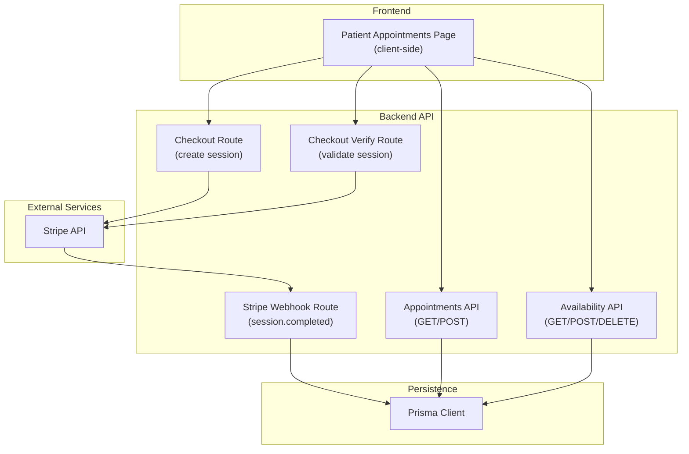
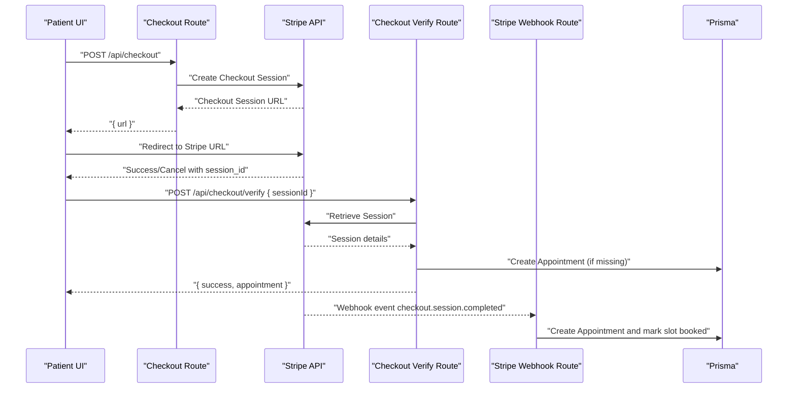
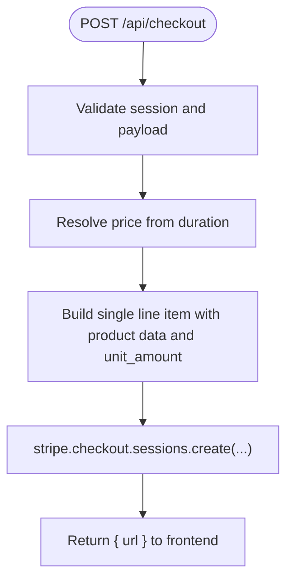
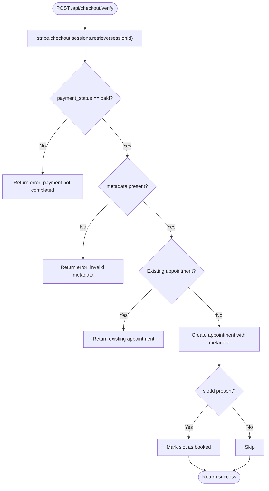
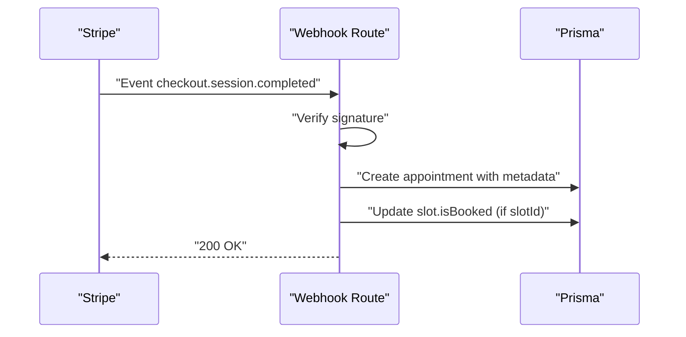
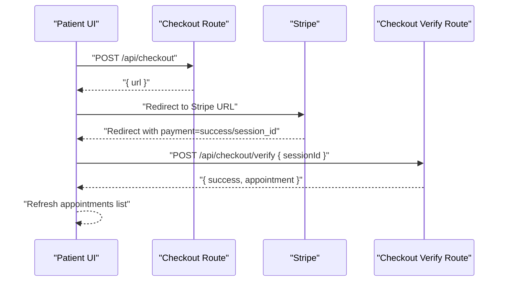
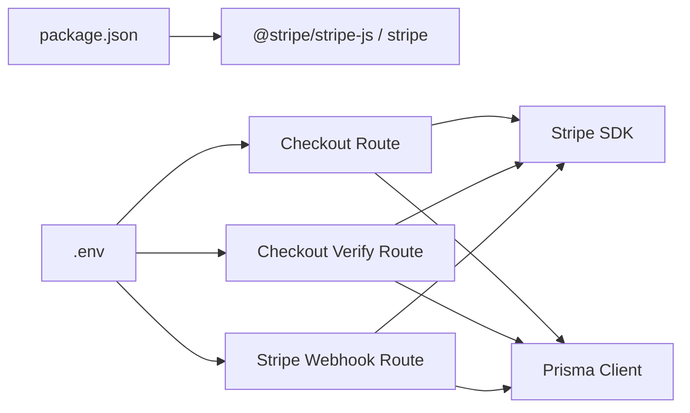

# Stripe Integration

<cite>
**Referenced Files in This Document**
- [.env](file://WEBAPP/.env)
- [checkout route](file://WEBAPP/src/app/api/checkout/route.ts)
- [checkout verify route](file://WEBAPP/src/app/api/checkout/verify/route.ts)
- [stripe webhook route](file://WEBAPP/src/app/api/webhook/stripe/route.ts)
- [patient appointments page](file://WEBAPP/src/app/patient/appointments/page.tsx)
- [db client](file://WEBAPP/src/lib/db.ts)
- [appointments API route](file://WEBAPP/src/app/api/therapy/appointments/route.ts)
- [availability API route](file://WEBAPP/src/app/api/therapy/availability/route.ts)
- [package.json](file://WEBAPP/package.json)
</cite>

## Table of Contents
1. [Introduction](#introduction)
2. [Project Structure](#project-structure)
3. [Core Components](#core-components)
4. [Architecture Overview](#architecture-overview)
5. [Detailed Component Analysis](#detailed-component-analysis)
6. [Dependency Analysis](#dependency-analysis)
7. [Performance Considerations](#performance-considerations)
8. [Troubleshooting Guide](#troubleshooting-guide)
9. [Conclusion](#conclusion)

## Introduction
This document explains the Stripe payment integration in the MindBridge project. It covers SDK configuration, API version management, secret key handling, checkout session creation (including price mapping, line items, and metadata), supported payment methods, currency configuration, customer email management, error handling strategies, and the session metadata structure used to persist appointment information through the payment flow.

## Project Structure
The Stripe integration spans backend API routes and the patient-facing UI:
- Backend API routes create Stripe Checkout Sessions, verify payments, and process webhooks.
- The frontend patient appointments page initiates payment and handles redirects.
- Environment variables store Stripe keys and URLs.
- Prisma is used to persist appointment records and availability.

**Diagram sources**
- [checkout route](file://WEBAPP/src/app/api/checkout/route.ts#L17-L81)
- [checkout verify route](file://WEBAPP/src/app/api/checkout/verify/route.ts#L10-L93)
- [stripe webhook route](file://WEBAPP/src/app/api/webhook/stripe/route.ts#L11-L66)
- [patient appointments page](file://WEBAPP/src/app/patient/appointments/page.tsx#L224-L258)
- [db client](file://WEBAPP/src/lib/db.ts#L1-L15)
- [appointments API route](file://WEBAPP/src/app/api/therapy/appointments/route.ts#L6-L36)
- [availability API route](file://WEBAPP/src/app/api/therapy/availability/route.ts#L6-L94)

**Section sources**
- [checkout route](file://WEBAPP/src/app/api/checkout/route.ts#L1-L82)
- [checkout verify route](file://WEBAPP/src/app/api/checkout/verify/route.ts#L1-L94)
- [stripe webhook route](file://WEBAPP/src/app/api/webhook/stripe/route.ts#L1-L67)
- [patient appointments page](file://WEBAPP/src/app/patient/appointments/page.tsx#L1-L1006)
- [db client](file://WEBAPP/src/lib/db.ts#L1-L15)
- [appointments API route](file://WEBAPP/src/app/api/therapy/appointments/route.ts#L1-L181)
- [availability API route](file://WEBAPP/src/app/api/therapy/availability/route.ts#L1-L217)

## Core Components
- Stripe SDK initialization with secret key and API version.
- Checkout session creation with price mapping, line items, and metadata.
- Payment verification endpoint to confirm paid sessions and create appointments.
- Stripe webhook to finalize appointment creation upon session completion.
- Frontend integration to redirect users to Stripe and poll for confirmation.
- Prisma-backed persistence for appointments and availability.

**Section sources**
- [checkout route](file://WEBAPP/src/app/api/checkout/route.ts#L5-L7)
- [checkout verify route](file://WEBAPP/src/app/api/checkout/verify/route.ts#L6-L8)
- [stripe webhook route](file://WEBAPP/src/app/api/webhook/stripe/route.ts#L5-L7)
- [patient appointments page](file://WEBAPP/src/app/patient/appointments/page.tsx#L90-L126)

## Architecture Overview
The payment flow consists of:
- Frontend collects booking details and triggers session creation.
- Backend creates a Stripe Checkout Session and returns the Stripe-hosted URL.
- User completes payment on Stripe; Stripe redirects back to the app.
- Frontend verifies the session and confirms the appointment.
- Stripe webhook ensures finalization even if the initial verification fails.

**Diagram sources**
- [checkout route](file://WEBAPP/src/app/api/checkout/route.ts#L17-L81)
- [checkout verify route](file://WEBAPP/src/app/api/checkout/verify/route.ts#L10-L93)
- [stripe webhook route](file://WEBAPP/src/app/api/webhook/stripe/route.ts#L11-L66)
- [patient appointments page](file://WEBAPP/src/app/patient/appointments/page.tsx#L90-L126)

## Detailed Component Analysis

### Stripe SDK Configuration and Secret Key Handling
- The Stripe client is initialized with the secret key from environment variables and a specific API version.
- The webhook secret is loaded from environment variables for signature verification.
- The frontend does not handle secret keys; all sensitive operations occur server-side.

Key configuration points:
- SDK initialization with secret key and API version.
- Webhook secret for verifying event signatures.
- Environment variables for keys and URLs.

**Section sources**
- [checkout route](file://WEBAPP/src/app/api/checkout/route.ts#L5-L7)
- [checkout verify route](file://WEBAPP/src/app/api/checkout/verify/route.ts#L6-L8)
- [stripe webhook route](file://WEBAPP/src/app/api/webhook/stripe/route.ts#L5-L9)
- [.env](file://WEBAPP/.env#L29-L31)

### API Version Management
- The Stripe SDK is configured with a specific API version string.
- This ensures compatibility and predictable behavior for session creation and webhook events.

**Section sources**
- [checkout route](file://WEBAPP/src/app/api/checkout/route.ts#L6-L6)
- [checkout verify route](file://WEBAPP/src/app/api/checkout/verify/route.ts#L7-L7)
- [stripe webhook route](file://WEBAPP/src/app/api/webhook/stripe/route.ts#L6-L6)

### Checkout Session Creation
- Price mapping: Sessions are priced per duration using a fixed map; default fallback is applied if duration is unsupported.
- Line items: One-line-item model with dynamic product name/description and unit amount derived from price map.
- Currency: USD is enforced.
- Payment method types: Card payments only.
- Customer email: Set from the authenticated session.
- Metadata: Encodes therapist, patient, timing, duration, type, notes, and slot identifiers for later use.
- Success and cancel URLs: Redirect back to the patient UI with session_id for verification.

**Diagram sources**
- [checkout route](file://WEBAPP/src/app/api/checkout/route.ts#L17-L81)

**Section sources**
- [checkout route](file://WEBAPP/src/app/api/checkout/route.ts#L9-L15)
- [checkout route](file://WEBAPP/src/app/api/checkout/route.ts#L43-L71)

### Payment Method Types, Currency, and Customer Email
- Payment method types: Card.
- Currency: USD.
- Customer email: Derived from the authenticated NextAuth session.

**Section sources**
- [checkout route](file://WEBAPP/src/app/api/checkout/route.ts#L44-L46)

### Metadata Handling for Appointment Information
Metadata stored in the Stripe session includes:
- therapistId, patientId, scheduledTime, duration, type, notes, slotId.

The backend uses this metadata to:
- Create the appointment record.
- Mark the availability slot as booked (when applicable).
- Derive pricing and product details for the line item.

**Section sources**
- [checkout route](file://WEBAPP/src/app/api/checkout/route.ts#L60-L68)
- [checkout verify route](file://WEBAPP/src/app/api/checkout/verify/route.ts#L31-L44)
- [stripe webhook route](file://WEBAPP/src/app/api/webhook/stripe/route.ts#L24-L47)

### Payment Verification Endpoint
- Retrieves the session from Stripe.
- Confirms payment_status is paid.
- Checks for presence of metadata.
- Prevents duplicate creation by checking for an existing appointment with matching identifiers.
- Creates the appointment and marks the slot as booked if present.

**Diagram sources**
- [checkout verify route](file://WEBAPP/src/app/api/checkout/verify/route.ts#L10-L93)

**Section sources**
- [checkout verify route](file://WEBAPP/src/app/api/checkout/verify/route.ts#L10-L93)

### Stripe Webhook Processing
- Verifies webhook signature using the webhook secret.
- On checkout.session.completed, reads metadata and creates the appointment.
- Marks the associated availability slot as booked.
- Returns success response.

**Diagram sources**
- [stripe webhook route](file://WEBAPP/src/app/api/webhook/stripe/route.ts#L11-L66)

**Section sources**
- [stripe webhook route](file://WEBAPP/src/app/api/webhook/stripe/route.ts#L11-L66)

### Frontend Integration and User Flow
- The patient UI collects booking details and triggers session creation.
- On success, it calls the verification endpoint and refreshes the appointments list.
- On cancellation, it displays a user-friendly message.

**Diagram sources**
- [patient appointments page](file://WEBAPP/src/app/patient/appointments/page.tsx#L90-L126)
- [checkout route](file://WEBAPP/src/app/api/checkout/route.ts#L17-L81)
- [checkout verify route](file://WEBAPP/src/app/api/checkout/verify/route.ts#L10-L93)

**Section sources**
- [patient appointments page](file://WEBAPP/src/app/patient/appointments/page.tsx#L90-L126)
- [patient appointments page](file://WEBAPP/src/app/patient/appointments/page.tsx#L224-L258)

## Dependency Analysis
- Stripe SDK version is declared in dependencies.
- Prisma client is used for database operations triggered by both verification and webhooks.
- Environment variables provide Stripe keys and URLs.

**Diagram sources**
- [package.json](file://WEBAPP/package.json#L69-L69)
- [.env](file://WEBAPP/.env#L29-L31)
- [checkout route](file://WEBAPP/src/app/api/checkout/route.ts#L1-L7)
- [checkout verify route](file://WEBAPP/src/app/api/checkout/verify/route.ts#L1-L8)
- [stripe webhook route](file://WEBAPP/src/app/api/webhook/stripe/route.ts#L1-L9)
- [db client](file://WEBAPP/src/lib/db.ts#L1-L15)

**Section sources**
- [package.json](file://WEBAPP/package.json#L69-L69)
- [db client](file://WEBAPP/src/lib/db.ts#L1-L15)
- [.env](file://WEBAPP/.env#L29-L31)

## Performance Considerations
- Use a single line item for simplicity and lower overhead.
- Avoid redundant checks by verifying session payment status early.
- Minimize database writes by batching operations within transactions where appropriate (as seen in the appointments route).
- Keep API version aligned with Stripe’s latest stable release to benefit from performance improvements and bug fixes.

## Troubleshooting Guide
Common failure modes and strategies:
- Authentication errors
  - Ensure the NextAuth session is present and contains an email.
  - Unauthorized responses are returned when session is missing or invalid.
- Invalid requests
  - Missing required fields (e.g., therapistId, patientId, scheduledTime, slotId) trigger 400 responses.
- Stripe API failures
  - Catch and log errors during session creation and retrieval.
  - Return structured 500 responses with error messages.
- Webhook signature verification failures
  - Signature mismatch results in 400 with “Invalid signature”.
- Duplicate appointment creation
  - Verification checks for existing appointments before creating.
  - Webhook also guards against duplicates and marks slots.

**Section sources**
- [checkout route](file://WEBAPP/src/app/api/checkout/route.ts#L18-L80)
- [checkout verify route](file://WEBAPP/src/app/api/checkout/verify/route.ts#L10-L93)
- [stripe webhook route](file://WEBAPP/src/app/api/webhook/stripe/route.ts#L17-L22)
- [appointments API route](file://WEBAPP/src/app/api/therapy/appointments/route.ts#L38-L180)

## Conclusion
The Stripe integration in MindBridge follows a robust pattern:
- Secure server-side handling of secret keys and API interactions.
- Clear metadata-driven mapping of appointment details to Stripe sessions.
- Dual-path confirmation via direct verification and webhook processing.
- Strong error handling and user feedback in the frontend.

This design balances simplicity, reliability, and extensibility for therapy session bookings.