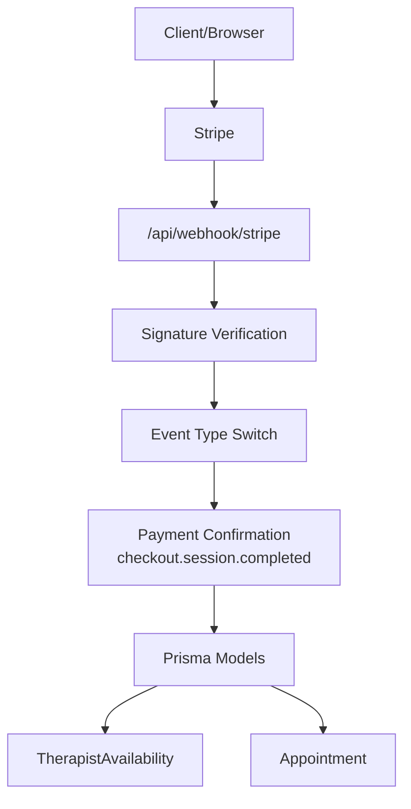
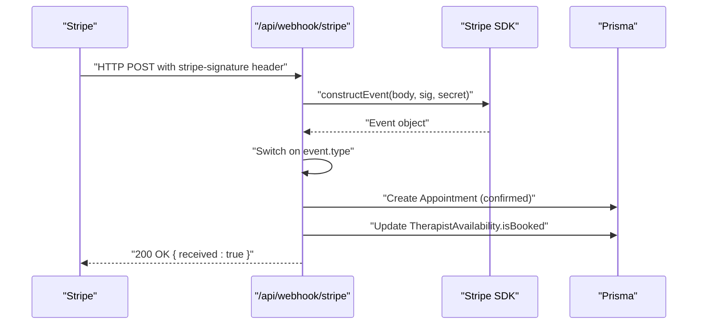
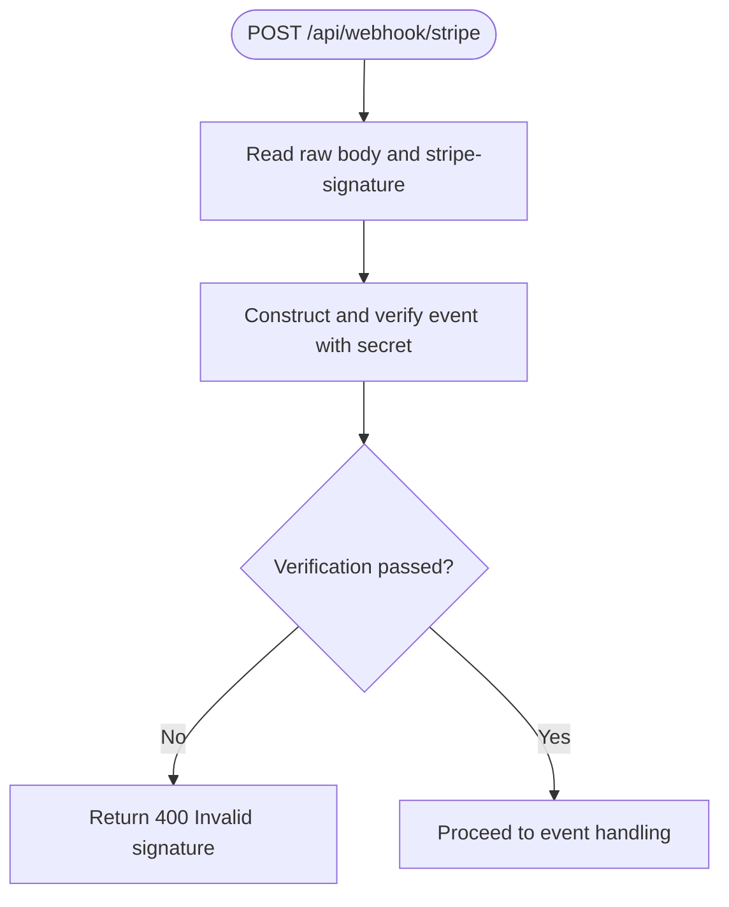
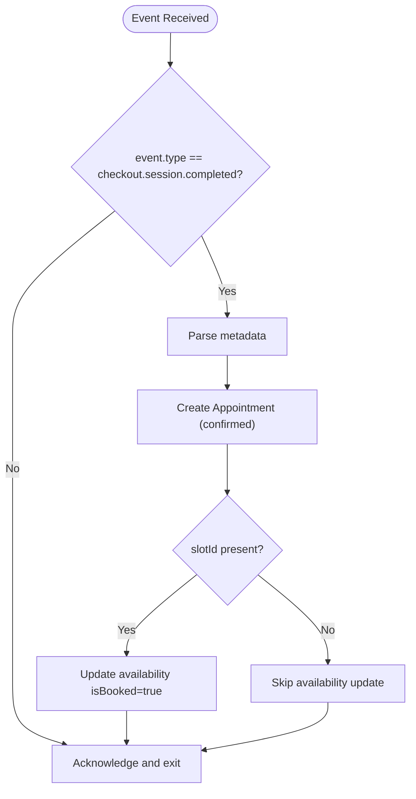
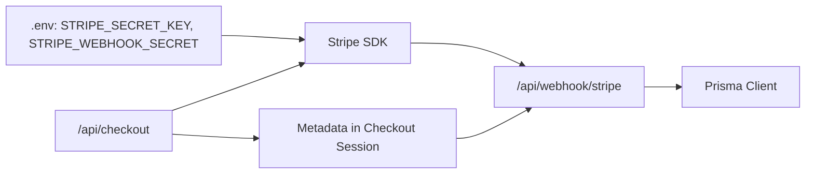

# Webhook Processing

<cite>
**Referenced Files in This Document**
- [route.ts](file://WEBAPP/src/app/api/webhook/stripe/route.ts)
- [.env](file://WEBAPP/.env)
- [schema.prisma](file://WEBAPP/prisma/schema.prisma)
- [route.ts](file://WEBAPP/src/app/api/checkout/route.ts)
- [route.ts](file://WEBAPP/src/app/api/checkout/verify/route.ts)
</cite>

## Table of Contents
1. [Introduction](#introduction)
2. [Project Structure](#project-structure)
3. [Core Components](#core-components)
4. [Architecture Overview](#architecture-overview)
5. [Detailed Component Analysis](#detailed-component-analysis)
6. [Dependency Analysis](#dependency-analysis)
7. [Performance Considerations](#performance-considerations)
8. [Troubleshooting Guide](#troubleshooting-guide)
9. [Conclusion](#conclusion)

## Introduction
This document explains the Stripe webhook processing system in the project. It covers endpoint configuration, signature verification, event type handling, payload parsing, validation, and database updates. It also documents payment confirmation events, subscription status changes, and refund notifications, along with error handling, retry mechanisms, and dead letter queue management. Security considerations for preventing replay attacks are included.

## Project Structure
The webhook endpoint is implemented as a Next.js Route Handler under the API surface. Supporting components include environment configuration, Prisma database models, and checkout flows that populate metadata used by the webhook.

**Diagram sources**
- [route.ts](file://WEBAPP/src/app/api/webhook/stripe/route.ts#L11-L66)
- [.env](file://WEBAPP/.env#L29-L31)
- [schema.prisma](file://WEBAPP/prisma/schema.prisma#L163-L211)

**Section sources**
- [route.ts](file://WEBAPP/src/app/api/webhook/stripe/route.ts#L1-L67)
- [.env](file://WEBAPP/.env#L29-L31)
- [schema.prisma](file://WEBAPP/prisma/schema.prisma#L163-L211)

## Core Components
- Stripe webhook endpoint: Validates signatures and handles supported events.
- Environment variables: Stripe secret key and webhook signing secret.
- Prisma models: Appointment and TherapistAvailability used for updates.
- Checkout flow: Creates Stripe Checkout Sessions with metadata for downstream webhook processing.
- Verification endpoint: Idempotent confirmation of payment and appointment creation.

Key implementation references:
- Webhook endpoint and signature verification: [route.ts](file://WEBAPP/src/app/api/webhook/stripe/route.ts#L11-L22)
- Payment confirmation handling: [route.ts](file://WEBAPP/src/app/api/webhook/stripe/route.ts#L24-L63)
- Environment configuration: [.env](file://WEBAPP/.env#L29-L31)
- Prisma models: [schema.prisma](file://WEBAPP/prisma/schema.prisma#L163-L211)
- Checkout session creation with metadata: [route.ts](file://WEBAPP/src/app/api/checkout/route.ts#L42-L71)
- Verification endpoint logic: [route.ts](file://WEBAPP/src/app/api/checkout/verify/route.ts#L36-L80)

**Section sources**
- [route.ts](file://WEBAPP/src/app/api/webhook/stripe/route.ts#L11-L66)
- [.env](file://WEBAPP/.env#L29-L31)
- [schema.prisma](file://WEBAPP/prisma/schema.prisma#L163-L211)
- [route.ts](file://WEBAPP/src/app/api/checkout/route.ts#L42-L71)
- [route.ts](file://WEBAPP/src/app/api/checkout/verify/route.ts#L36-L80)

## Architecture Overview
The webhook endpoint receives signed events from Stripe, verifies the signature using the configured secret, parses the event payload, and performs database updates based on event type. The checkout flow sets metadata that the webhook consumes to create appointments and mark availability slots as booked.

**Diagram sources**
- [route.ts](file://WEBAPP/src/app/api/webhook/stripe/route.ts#L11-L66)
- [.env](file://WEBAPP/.env#L29-L31)
- [schema.prisma](file://WEBAPP/prisma/schema.prisma#L163-L211)

## Detailed Component Analysis

### Webhook Endpoint Configuration
- Endpoint path: /api/webhook/stripe
- Method: POST
- Required headers: stripe-signature
- Stripe SDK configuration: apiVersion aligned with the project’s Stripe version
- Webhook secret: loaded from environment variable

Implementation references:
- Endpoint handler: [route.ts](file://WEBAPP/src/app/api/webhook/stripe/route.ts#L11-L13)
- SDK initialization: [route.ts](file://WEBAPP/src/app/api/webhook/stripe/route.ts#L5-L7)
- Webhook secret: [route.ts](file://WEBAPP/src/app/api/webhook/stripe/route.ts#L9)
- Environment variables: [.env](file://WEBAPP/.env#L29-L31)

Security note:
- The endpoint requires the stripe-signature header and validates it against the stored webhook secret.

**Section sources**
- [route.ts](file://WEBAPP/src/app/api/webhook/stripe/route.ts#L5-L13)
- [.env](file://WEBAPP/.env#L29-L31)

### Signature Verification
- Uses Stripe SDK constructEvent to verify the signature.
- On failure, returns 400 with an invalid signature error.
- On success, proceeds to event handling.

Implementation references:
- Verification logic: [route.ts](file://WEBAPP/src/app/api/webhook/stripe/route.ts#L17-L22)

**Diagram sources**
- [route.ts](file://WEBAPP/src/app/api/webhook/stripe/route.ts#L11-L22)

**Section sources**
- [route.ts](file://WEBAPP/src/app/api/webhook/stripe/route.ts#L17-L22)

### Event Type Handling
Supported event type:
- checkout.session.completed: Triggered when a Checkout Session payment completes.

Behavior:
- Parses metadata from the event payload.
- Creates an Appointment record with status confirmed.
- Marks the associated TherapistAvailability slot as booked if present.
- Returns a success response.

Implementation references:
- Event switch and handling: [route.ts](file://WEBAPP/src/app/api/webhook/stripe/route.ts#L24-L63)
- Appointment creation: [route.ts](file://WEBAPP/src/app/api/webhook/stripe/route.ts#L31-L47)
- Slot booking: [route.ts](file://WEBAPP/src/app/api/webhook/stripe/route.ts#L50-L55)

**Diagram sources**
- [route.ts](file://WEBAPP/src/app/api/webhook/stripe/route.ts#L24-L63)
- [schema.prisma](file://WEBAPP/prisma/schema.prisma#L186-L211)

**Section sources**
- [route.ts](file://WEBAPP/src/app/api/webhook/stripe/route.ts#L24-L63)
- [schema.prisma](file://WEBAPP/prisma/schema.prisma#L186-L211)

### Payment Confirmation Events
- Event: checkout.session.completed
- Purpose: Confirm payment and create an appointment.
- Metadata consumption: therapistId, patientId, scheduledTime, duration, type, notes, slotId.
- Database updates:
  - Insert Appointment with status confirmed.
  - Optionally update TherapistAvailability.isBooked.

Implementation references:
- Metadata usage: [route.ts](file://WEBAPP/src/app/api/webhook/stripe/route.ts#L26-L39)
- Appointment creation: [route.ts](file://WEBAPP/src/app/api/webhook/stripe/route.ts#L31-L47)
- Slot booking: [route.ts](file://WEBAPP/src/app/api/webhook/stripe/route.ts#L50-L55)

**Section sources**
- [route.ts](file://WEBAPP/src/app/api/webhook/stripe/route.ts#L24-L63)

### Subscription Status Changes
- Current implementation does not handle subscription-related events.
- To support subscriptions, add event type checks for subscription lifecycle events and implement corresponding database updates (e.g., updating user roles or entitlements).

[No sources needed since this section provides general guidance]

### Refund Notifications
- Current implementation does not handle refund events.
- To support refunds, add event type checks for refund-related events and implement database updates (e.g., updating appointment status or financial records).

[No sources needed since this section provides general guidance]

### Webhook Payload Parsing and Validation
- Raw body is read and parsed into a Stripe.Event via constructEvent.
- Metadata is extracted from the event payload for downstream processing.
- Validation includes presence of required metadata fields before proceeding with database operations.

Implementation references:
- Payload parsing: [route.ts](file://WEBAPP/src/app/api/webhook/stripe/route.ts#L15-L18)
- Metadata extraction: [route.ts](file://WEBAPP/src/app/api/webhook/stripe/route.ts#L26-L39)

**Section sources**
- [route.ts](file://WEBAPP/src/app/api/webhook/stripe/route.ts#L15-L39)

### Database Update Procedures
- Appointment creation: Inserts a new appointment with fields derived from metadata.
- Availability update: Marks the associated slot as booked when slotId is present.
- Includes: Fetches therapist details alongside the appointment for downstream use.

Implementation references:
- Appointment insert: [route.ts](file://WEBAPP/src/app/api/webhook/stripe/route.ts#L31-L47)
- Availability update: [route.ts](file://WEBAPP/src/app/api/webhook/stripe/route.ts#L50-L55)
- Includes: [route.ts](file://WEBAPP/src/app/api/webhook/stripe/route.ts#L42-L46)

**Section sources**
- [route.ts](file://WEBAPP/src/app/api/webhook/stripe/route.ts#L31-L55)
- [schema.prisma](file://WEBAPP/prisma/schema.prisma#L186-L211)

### Error Handling for Webhook Failures
- Signature verification failures return 400 with an invalid signature error.
- Database errors during appointment creation return 500 with a failure message.
- Successful processing returns 200 with a received acknowledgment.

Implementation references:
- Signature error: [route.ts](file://WEBAPP/src/app/api/webhook/stripe/route.ts#L19-L22)
- Database error: [route.ts](file://WEBAPP/src/app/api/webhook/stripe/route.ts#L58-L61)
- Success response: [route.ts](file://WEBAPP/src/app/api/webhook/stripe/route.ts#L65)

**Section sources**
- [route.ts](file://WEBAPP/src/app/api/webhook/stripe/route.ts#L19-L22)
- [route.ts](file://WEBAPP/src/app/api/webhook/stripe/route.ts#L58-L61)
- [route.ts](file://WEBAPP/src/app/api/webhook/stripe/route.ts#L65)

### Retry Mechanisms and Dead Letter Queue Management
- The current implementation does not implement explicit retry logic or dead letter queue handling for webhook failures.
- Recommended approach:
  - Store webhook events with delivery attempts and timestamps.
  - Retry failed deliveries with exponential backoff.
  - Move unrecoverable events to a dead letter queue for manual inspection.

[No sources needed since this section provides general guidance]

### Security Considerations and Replay Attack Prevention
- Signature verification: Implemented via constructEvent with the webhook secret.
- Header requirement: stripe-signature must be present.
- Best practices:
  - Use HTTPS for the endpoint.
  - Rotate webhook secrets periodically.
  - Log and monitor signature verification failures.
  - Consider idempotency keys for deduplication.

Implementation references:
- Signature verification: [route.ts](file://WEBAPP/src/app/api/webhook/stripe/route.ts#L17-L22)
- Environment secret: [.env](file://WEBAPP/.env#L30)

**Section sources**
- [route.ts](file://WEBAPP/src/app/api/webhook/stripe/route.ts#L17-L22)
- [.env](file://WEBAPP/.env#L30)

## Dependency Analysis
- The webhook endpoint depends on:
  - Stripe SDK for signature verification and event construction.
  - Prisma client for database operations.
  - Environment variables for credentials and secrets.
- Checkout flow provides metadata consumed by the webhook.

**Diagram sources**
- [.env](file://WEBAPP/.env#L29-L31)
- [route.ts](file://WEBAPP/src/app/api/webhook/stripe/route.ts#L5-L9)
- [route.ts](file://WEBAPP/src/app/api/checkout/route.ts#L42-L71)

**Section sources**
- [.env](file://WEBAPP/.env#L29-L31)
- [route.ts](file://WEBAPP/src/app/api/webhook/stripe/route.ts#L5-L9)
- [route.ts](file://WEBAPP/src/app/api/checkout/route.ts#L42-L71)

## Performance Considerations
- Keep webhook handlers synchronous and fast; avoid long-running operations.
- Use database transactions for related writes (already present for availability updates).
- Monitor Stripe event delivery latency and adjust retry policies accordingly.

[No sources needed since this section provides general guidance]

## Troubleshooting Guide
Common issues and resolutions:
- Invalid signature error (400): Verify the webhook secret and ensure stripe-signature header is present.
- Database creation errors (500): Check metadata completeness and Prisma model constraints.
- Missing appointment after payment: Confirm checkout.session.completed event was delivered and processed.

Implementation references:
- Signature error: [route.ts](file://WEBAPP/src/app/api/webhook/stripe/route.ts#L19-L22)
- Database error: [route.ts](file://WEBAPP/src/app/api/webhook/stripe/route.ts#L58-L61)

**Section sources**
- [route.ts](file://WEBAPP/src/app/api/webhook/stripe/route.ts#L19-L22)
- [route.ts](file://WEBAPP/src/app/api/webhook/stripe/route.ts#L58-L61)

## Conclusion
The webhook processing system currently supports payment confirmation via checkout.session.completed, creates appointments, and marks availability slots as booked. It includes signature verification and basic error handling. To enhance robustness, implement subscription and refund handling, add retry and dead letter queue mechanisms, and strengthen security with idempotency and periodic secret rotation.