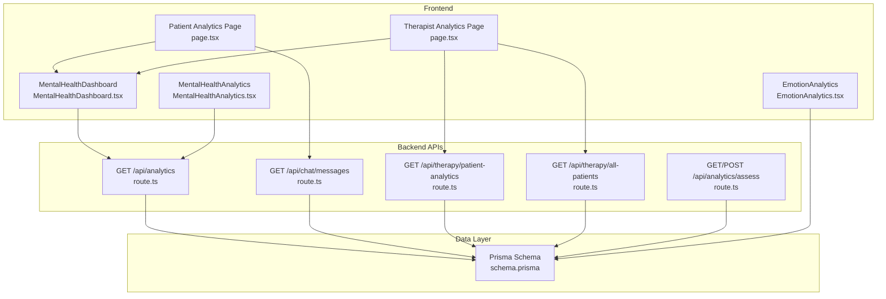
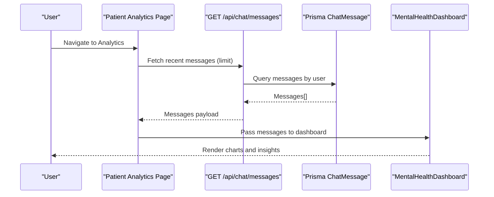
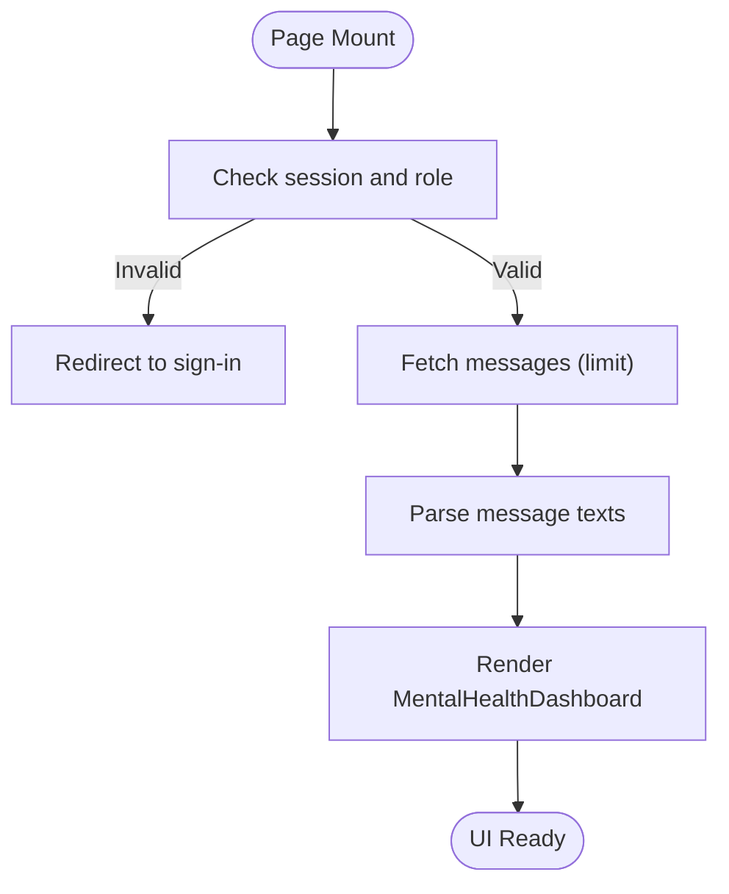
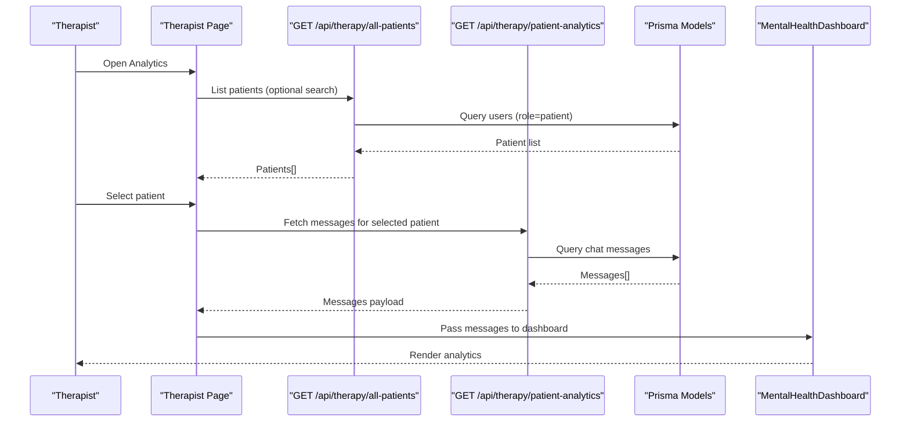
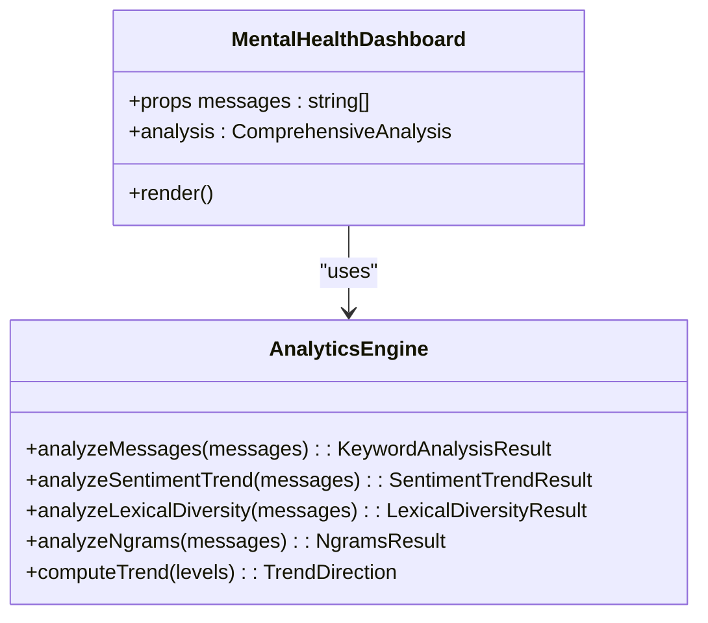
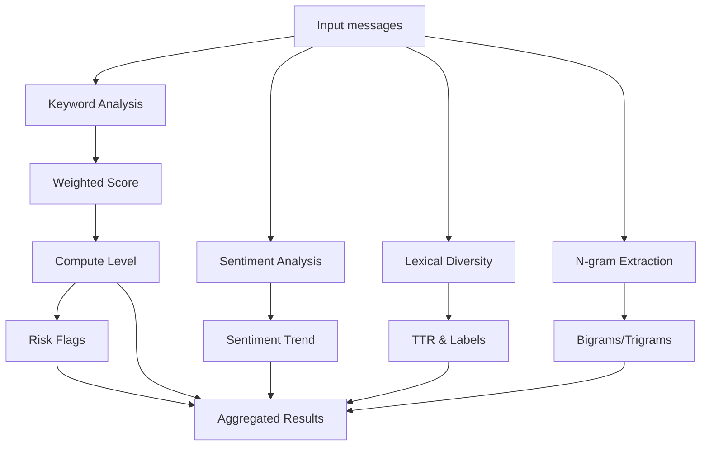
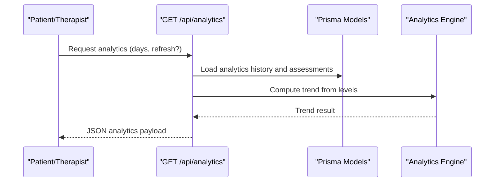
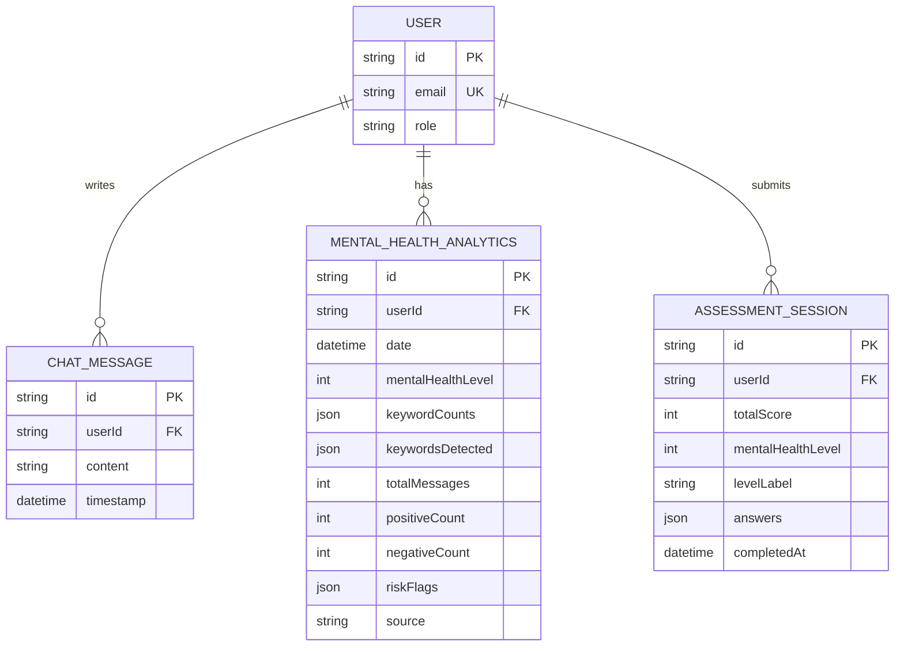

# Analytics and Reporting

<cite>
**Referenced Files in This Document**
- [page.tsx](file://WEBAPP/src/app/patient/analytics/page.tsx)
- [page.tsx](file://WEBAPP/src/app/therapist/patient-analytics/page.tsx)
- [MentalHealthDashboard.tsx](file://WEBAPP/src/components/analytics/MentalHealthDashboard.tsx)
- [mentalHealthAnalytics.ts](file://WEBAPP/src/lib/mentalHealthAnalytics.ts)
- [route.ts](file://WEBAPP/src/app/api/analytics/route.ts)
- [route.ts](file://WEBAPP/src/app/api/therapy/all-patients/route.ts)
- [route.ts](file://WEBAPP/src/app/api/therapy/patient-analytics/route.ts)
- [route.ts](file://WEBAPP/src/app/api/chat/messages/route.ts)
- [route.ts](file://WEBAPP/src/app/api/analytics/assess/route.ts)
- [schema.prisma](file://WEBAPP/prisma/schema.prisma)
- [MentalHealthAnalytics.tsx](file://WEBAPP/src/components/MentalHealthAnalytics.tsx)
- [EmotionAnalytics.tsx](file://WEBAPP/src/components/EmotionAnalytics.tsx)
</cite>

## Table of Contents
1. [Introduction](#introduction)
2. [Project Structure](#project-structure)
3. [Core Components](#core-components)
4. [Architecture Overview](#architecture-overview)
5. [Detailed Component Analysis](#detailed-component-analysis)
6. [Dependency Analysis](#dependency-analysis)
7. [Performance Considerations](#performance-considerations)
8. [Troubleshooting Guide](#troubleshooting-guide)
9. [Privacy and Security Measures](#privacy-and-security-measures)
10. [Conclusion](#conclusion)

## Introduction
This document explains the analytics and reporting system for mental health insights. It covers:
- The patient analytics dashboard for tracking individual progress, mood patterns, and treatment effectiveness
- Visualization components (charts, graphs, and progress indicators)
- Data aggregation methods for computing improvement trends, emotion tracking, and session outcomes
- Integration between clinical data and analytics (sessions, messages, assessments)
- Reporting capabilities for summaries, progress documentation, and outcome assessments
- Privacy and security safeguards for sensitive patient data

## Project Structure
The analytics system spans frontend pages, visualization components, and backend APIs backed by Prisma ORM and a MySQL database. Key areas:
- Frontend pages for patients and therapists to view analytics
- Mental health visualization dashboard built with reusable chart components
- Analytics engine for keyword detection, sentiment, lexical diversity, and n-gram analysis
- Backend APIs for fetching analytics, running analyses, and retrieving patient data
- Prisma models for storing chat messages, therapy sessions, mental health analytics, and assessments

**Diagram sources**
- [page.tsx](file://WEBAPP/src/app/patient/analytics/page.tsx#L1-L127)
- [page.tsx](file://WEBAPP/src/app/therapist/patient-analytics/page.tsx#L1-L417)
- [MentalHealthDashboard.tsx](file://WEBAPP/src/components/analytics/MentalHealthDashboard.tsx#L1-L541)
- [MentalHealthAnalytics.tsx](file://WEBAPP/src/components/MentalHealthAnalytics.tsx#L1-L942)
- [EmotionAnalytics.tsx](file://WEBAPP/src/components/EmotionAnalytics.tsx#L1-L212)
- [route.ts](file://WEBAPP/src/app/api/analytics/route.ts#L1-L253)
- [route.ts](file://WEBAPP/src/app/api/chat/messages/route.ts#L1-L91)
- [route.ts](file://WEBAPP/src/app/api/therapy/patient-analytics/route.ts#L1-L74)
- [route.ts](file://WEBAPP/src/app/api/therapy/all-patients/route.ts#L1-L82)
- [route.ts](file://WEBAPP/src/app/api/analytics/assess/route.ts#L1-L121)
- [schema.prisma](file://WEBAPP/prisma/schema.prisma#L1-L330)

**Section sources**
- [page.tsx](file://WEBAPP/src/app/patient/analytics/page.tsx#L1-L127)
- [page.tsx](file://WEBAPP/src/app/therapist/patient-analytics/page.tsx#L1-L417)
- [MentalHealthDashboard.tsx](file://WEBAPP/src/components/analytics/MentalHealthDashboard.tsx#L1-L541)
- [MentalHealthAnalytics.tsx](file://WEBAPP/src/components/MentalHealthAnalytics.tsx#L1-L942)
- [EmotionAnalytics.tsx](file://WEBAPP/src/components/EmotionAnalytics.tsx#L1-L212)
- [route.ts](file://WEBAPP/src/app/api/analytics/route.ts#L1-L253)
- [route.ts](file://WEBAPP/src/app/api/chat/messages/route.ts#L1-L91)
- [route.ts](file://WEBAPP/src/app/api/therapy/patient-analytics/route.ts#L1-L74)
- [route.ts](file://WEBAPP/src/app/api/therapy/all-patients/route.ts#L1-L82)
- [route.ts](file://WEBAPP/src/app/api/analytics/assess/route.ts#L1-L121)
- [schema.prisma](file://WEBAPP/prisma/schema.prisma#L1-L330)

## Core Components
- Patient Analytics Page: Loads user chat messages and renders the Mental Health Dashboard.
- Therapist Analytics Page: Lists patients, allows selection, and renders the Mental Health Dashboard for a chosen patient.
- Mental Health Dashboard: Visualizes severity level, sentiment over time, emotion distribution, keyword categories, radar chart, n-grams, and summary cards.
- Analytics Engine: Provides keyword analysis, sentiment scoring, lexical diversity, n-gram extraction, and trend computation.
- Backend APIs: Serve analytics data, run fresh analyses, fetch messages, and manage assessments.
- Prisma Models: Store users, chat messages, therapy sessions, mental health analytics, and assessments.

**Section sources**
- [page.tsx](file://WEBAPP/src/app/patient/analytics/page.tsx#L1-L127)
- [page.tsx](file://WEBAPP/src/app/therapist/patient-analytics/page.tsx#L1-L417)
- [MentalHealthDashboard.tsx](file://WEBAPP/src/components/analytics/MentalHealthDashboard.tsx#L1-L541)
- [mentalHealthAnalytics.ts](file://WEBAPP/src/lib/mentalHealthAnalytics.ts#L1-L884)
- [route.ts](file://WEBAPP/src/app/api/analytics/route.ts#L1-L253)
- [schema.prisma](file://WEBAPP/prisma/schema.prisma#L213-L266)

## Architecture Overview
The system integrates clinical data (chat messages, therapy sessions, assessments) into a unified analytics pipeline. Data flows from the client to backend APIs, which compute insights using the analytics engine and persist results to the database. Visualizations render the computed analytics for patients and therapists.

**Diagram sources**
- [page.tsx](file://WEBAPP/src/app/patient/analytics/page.tsx#L27-L59)
- [route.ts](file://WEBAPP/src/app/api/chat/messages/route.ts#L48-L90)
- [MentalHealthDashboard.tsx](file://WEBAPP/src/components/analytics/MentalHealthDashboard.tsx#L47-L51)

**Section sources**
- [page.tsx](file://WEBAPP/src/app/patient/analytics/page.tsx#L27-L59)
- [route.ts](file://WEBAPP/src/app/api/chat/messages/route.ts#L48-L90)
- [MentalHealthDashboard.tsx](file://WEBAPP/src/components/analytics/MentalHealthDashboard.tsx#L47-L51)

## Detailed Component Analysis

### Patient Analytics Dashboard
- Purpose: Display AI-powered NLP analysis of conversation patterns for the logged-in patient.
- Data source: Fetches user messages via a backend endpoint and passes them to the dashboard.
- Behavior: Shows loading states, error handling, and fallbacks when no messages are present.

**Diagram sources**
- [page.tsx](file://WEBAPP/src/app/patient/analytics/page.tsx#L27-L59)

**Section sources**
- [page.tsx](file://WEBAPP/src/app/patient/analytics/page.tsx#L20-L127)

### Therapist Analytics Dashboard
- Purpose: Allow therapists to view aggregated analytics for selected patients.
- Features: Patient list with filtering, selection, and rendering of the Mental Health Dashboard for a chosen patient.
- Data source: Retrieves patient list and per-patient messages via dedicated APIs.

**Diagram sources**
- [page.tsx](file://WEBAPP/src/app/therapist/patient-analytics/page.tsx#L68-L136)
- [route.ts](file://WEBAPP/src/app/api/therapy/all-patients/route.ts#L12-L81)
- [route.ts](file://WEBAPP/src/app/api/therapy/patient-analytics/route.ts#L11-L73)

**Section sources**
- [page.tsx](file://WEBAPP/src/app/therapist/patient-analytics/page.tsx#L48-L417)
- [route.ts](file://WEBAPP/src/app/api/therapy/all-patients/route.ts#L12-L81)
- [route.ts](file://WEBAPP/src/app/api/therapy/patient-analytics/route.ts#L11-L73)

### Mental Health Dashboard
- Purpose: Visualize severity level, sentiment over time, emotion distribution, keyword categories, radar chart, n-grams, and summary statistics.
- Data aggregation: Uses the analytics engine to compute keyword counts, sentiment trend, lexical diversity, and n-grams.
- Charts: Line/Area chart for sentiment timeline, Pie chart for emotion distribution, Radar chart for keyword categories, Bar charts for category breakdown and n-grams.

**Diagram sources**
- [MentalHealthDashboard.tsx](file://WEBAPP/src/components/analytics/MentalHealthDashboard.tsx#L47-L51)
- [mentalHealthAnalytics.ts](file://WEBAPP/src/lib/mentalHealthAnalytics.ts#L199-L289)
- [mentalHealthAnalytics.ts](file://WEBAPP/src/lib/mentalHealthAnalytics.ts#L599-L631)
- [mentalHealthAnalytics.ts](file://WEBAPP/src/lib/mentalHealthAnalytics.ts#L695-L723)
- [mentalHealthAnalytics.ts](file://WEBAPP/src/lib/mentalHealthAnalytics.ts#L652-L681)
- [mentalHealthAnalytics.ts](file://WEBAPP/src/lib/mentalHealthAnalytics.ts#L354-L370)

**Section sources**
- [MentalHealthDashboard.tsx](file://WEBAPP/src/components/analytics/MentalHealthDashboard.tsx#L47-L541)
- [mentalHealthAnalytics.ts](file://WEBAPP/src/lib/mentalHealthAnalytics.ts#L199-L884)

### Analytics Engine
- Keyword Analysis: Detects categorized keywords (stress, anxiety, depression, anger, self-harm, loneliness, positive) and computes severity level and risk flags.
- Sentiment Analysis: Computes sentiment scores and trend with volatility and moving averages.
- Lexical Diversity: Calculates type-token ratio and flags potential rumination.
- N-gram Analysis: Identifies frequent bigrams and trigrams across messages.
- Trend Computation: Determines improvement, worsening, or stability from historical levels.

**Diagram sources**
- [mentalHealthAnalytics.ts](file://WEBAPP/src/lib/mentalHealthAnalytics.ts#L199-L289)
- [mentalHealthAnalytics.ts](file://WEBAPP/src/lib/mentalHealthAnalytics.ts#L599-L631)
- [mentalHealthAnalytics.ts](file://WEBAPP/src/lib/mentalHealthAnalytics.ts#L695-L723)
- [mentalHealthAnalytics.ts](file://WEBAPP/src/lib/mentalHealthAnalytics.ts#L652-L681)
- [mentalHealthAnalytics.ts](file://WEBAPP/src/lib/mentalHealthAnalytics.ts#L354-L370)

**Section sources**
- [mentalHealthAnalytics.ts](file://WEBAPP/src/lib/mentalHealthAnalytics.ts#L11-L884)

### Backend APIs and Data Aggregation
- Analytics API: Returns current level, trend, keyword counts, risk flags, timeline, and latest analysis/assessment details. Supports refreshing analysis.
- Chat Messages API: Saves and retrieves user messages for analysis.
- Patient Analytics API: Retrieves a selected patient’s messages for NLP analysis (therapist only).
- Assessment API: Provides questions and submits answers to compute mental health level and store assessment results.

**Diagram sources**
- [route.ts](file://WEBAPP/src/app/api/analytics/route.ts#L13-L161)
- [route.ts](file://WEBAPP/src/app/api/analytics/route.ts#L195-L252)
- [mentalHealthAnalytics.ts](file://WEBAPP/src/lib/mentalHealthAnalytics.ts#L354-L370)

**Section sources**
- [route.ts](file://WEBAPP/src/app/api/analytics/route.ts#L13-L253)
- [route.ts](file://WEBAPP/src/app/api/chat/messages/route.ts#L48-L90)
- [route.ts](file://WEBAPP/src/app/api/therapy/patient-analytics/route.ts#L11-L73)
- [route.ts](file://WEBAPP/src/app/api/analytics/assess/route.ts#L18-L121)
- [mentalHealthAnalytics.ts](file://WEBAPP/src/lib/mentalHealthAnalytics.ts#L308-L350)

### Emotion Analytics Component
- Purpose: Track and visualize emotion readings from camera/video input.
- Features: Current emotion, distribution, average confidence, recent trend, and recent activity log.
- Data model: Accepts current emotion and history with timestamps and confidence.

**Section sources**
- [EmotionAnalytics.tsx](file://WEBAPP/src/components/EmotionAnalytics.tsx#L1-L212)

### Mental Health Analytics Dashboard (Alternative UI)
- Purpose: Alternative dashboard for broader analytics with keyword breakdown, level timeline, latest results, and assessment progress.
- Features: Refresh analytics, take assessment, risk alerts, and level guide.

**Section sources**
- [MentalHealthAnalytics.tsx](file://WEBAPP/src/components/MentalHealthAnalytics.tsx#L1-L942)

## Dependency Analysis
- Frontend depends on:
  - Backend APIs for data retrieval and computation
  - Analytics engine for processing messages
  - Recharts for visualization
- Backend depends on:
  - Prisma models for persistence
  - Analytics engine for computations
- Data models:
  - ChatMessage stores user messages
  - MentalHealthAnalytics stores daily computed analytics
  - AssessmentSession stores screening assessment results
  - PatientProfile stores session-based metrics (e.g., dominant emotion, improvement trend)

**Diagram sources**
- [schema.prisma](file://WEBAPP/prisma/schema.prisma#L39-L69)
- [schema.prisma](file://WEBAPP/prisma/schema.prisma#L123-L138)
- [schema.prisma](file://WEBAPP/prisma/schema.prisma#L229-L249)
- [schema.prisma](file://WEBAPP/prisma/schema.prisma#L251-L266)

**Section sources**
- [schema.prisma](file://WEBAPP/prisma/schema.prisma#L1-L330)

## Performance Considerations
- Client-side rendering: Dashboard components use dynamic imports to avoid SSR issues with heavy chart libraries.
- Data limits: APIs support configurable limits (e.g., message fetch limit) to control payload sizes.
- Trend computation: Historical levels are aggregated to compute trends efficiently.
- Database indexing: Models include indexes on frequently queried fields (timestamps, user IDs, statuses) to optimize queries.

[No sources needed since this section provides general guidance]

## Troubleshooting Guide
Common issues and resolutions:
- Unauthorized access: Ensure proper session and role checks in API routes.
- Missing or empty data: Verify message presence and correct role filtering.
- Assessment validation errors: Confirm the answers array length and score ranges match expectations.
- Trend computation edge cases: Trend requires sufficient historical data; handle fewer than two entries gracefully.

**Section sources**
- [route.ts](file://WEBAPP/src/app/api/analytics/route.ts#L14-L25)
- [route.ts](file://WEBAPP/src/app/api/therapy/patient-analytics/route.ts#L18-L42)
- [route.ts](file://WEBAPP/src/app/api/analytics/assess/route.ts#L42-L61)

## Privacy and Security Measures
- Authentication and authorization:
  - Patient analytics page enforces role-based access and redirects unauthenticated users.
  - Therapist analytics restricts access to therapists and validates patient ownership.
  - All analytics endpoints require a valid session.
- Data minimization:
  - APIs fetch only necessary fields (e.g., message content, timestamps).
  - Limits applied to returned datasets (e.g., message count).
- Secure storage:
  - Prisma models define appropriate field types and constraints for sensitive data.
- Access controls:
  - Dedicated APIs for therapists to fetch specific patient data.
  - Role checks prevent unauthorized access to analytics endpoints.

**Section sources**
- [page.tsx](file://WEBAPP/src/app/patient/analytics/page.tsx#L27-L32)
- [page.tsx](file://WEBAPP/src/app/therapist/patient-analytics/page.tsx#L60-L66)
- [route.ts](file://WEBAPP/src/app/api/therapy/patient-analytics/route.ts#L18-L26)
- [route.ts](file://WEBAPP/src/app/api/analytics/route.ts#L14-L25)

## Conclusion
The analytics and reporting system provides a robust, privacy-conscious platform for mental health insights. It combines conversational data, assessments, and session metrics into actionable visualizations, enabling patients and therapists to track progress, identify risks, and evaluate treatment effectiveness. The modular architecture supports scalability, maintainability, and secure handling of sensitive data.