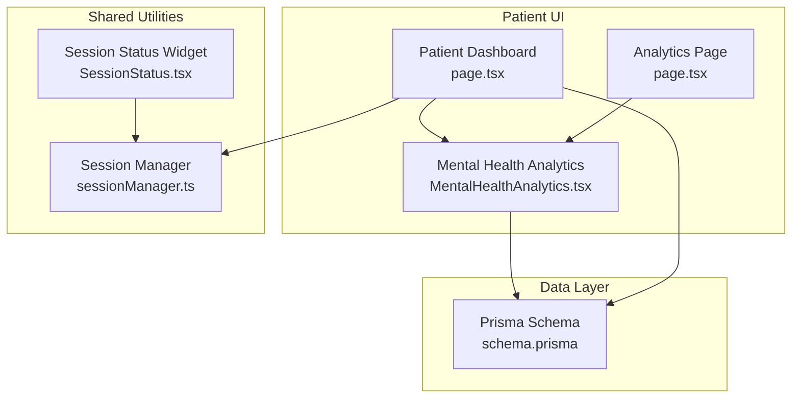
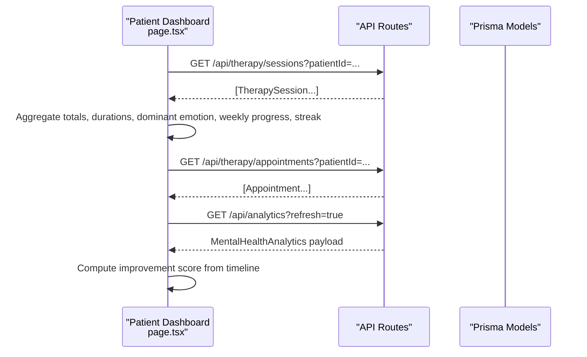
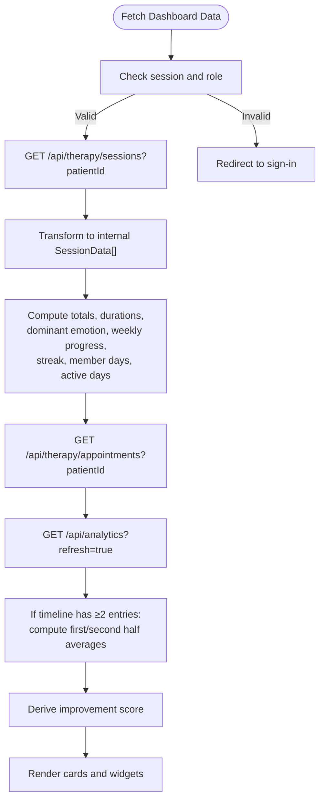
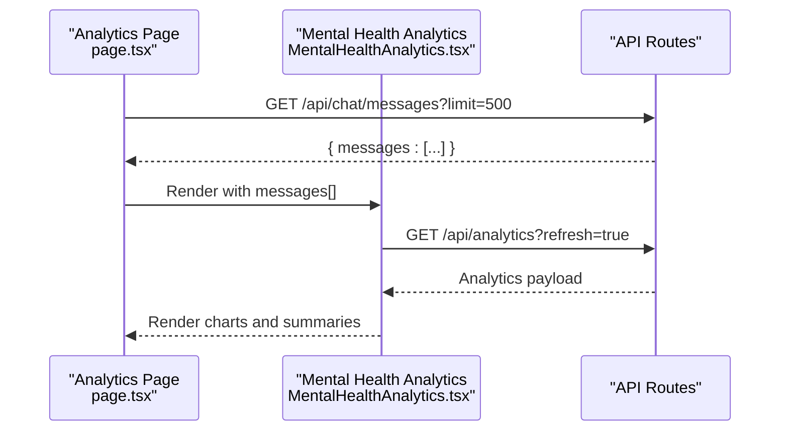
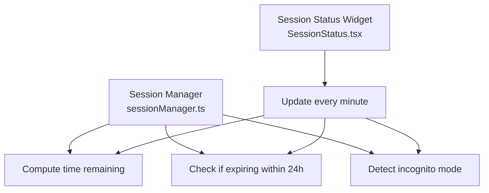
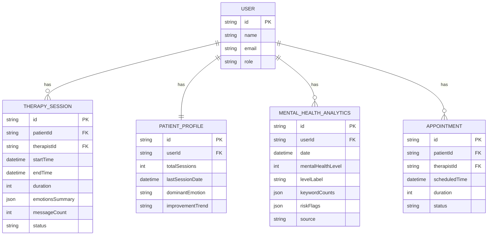

# Patient Management

<cite>
**Referenced Files in This Document**
- [schema.prisma](file://WEBAPP/prisma/schema.prisma)
- [page.tsx](file://WEBAPP/src/app/patient/dashboard/page.tsx)
- [page.tsx](file://WEBAPP/src/app/patient/analytics/page.tsx)
- [MentalHealthAnalytics.tsx](file://WEBAPP/src/components/MentalHealthAnalytics.tsx)
- [sessionManager.ts](file://WEBAPP/src/lib/sessionManager.ts)
- [SessionStatus.tsx](file://WEBAPP/src/components/SessionStatus.tsx)
</cite>

## Table of Contents
1. [Introduction](#introduction)
2. [Project Structure](#project-structure)
3. [Core Components](#core-components)
4. [Architecture Overview](#architecture-overview)
5. [Detailed Component Analysis](#detailed-component-analysis)
6. [Dependency Analysis](#dependency-analysis)
7. [Performance Considerations](#performance-considerations)
8. [Troubleshooting Guide](#troubleshooting-guide)
9. [Conclusion](#conclusion)

## Introduction
This document explains the patient management system, focusing on how patients view and interact with their data, progress analytics, and integration with therapy session records. It covers:
- Patient listing and individual views
- Data structures for patient profiles and progress metrics
- Filtering, sorting, search, and status indicators
- Integration with therapy session data and analytics
- Access controls and privacy considerations
- Relationship between patient management and session scheduling

## Project Structure
The patient-facing surfaces are implemented as Next.js app router pages and client components:
- Patient dashboard aggregates session history, appointments, and analytics
- Analytics page renders advanced NLP insights
- Shared analytics component handles data fetching and visualization
- Session utilities manage session lifecycle and visibility

**Diagram sources**
- [page.tsx](file://WEBAPP/src/app/patient/dashboard/page.tsx#L1-L1172)
- [page.tsx](file://WEBAPP/src/app/patient/analytics/page.tsx#L1-L127)
- [MentalHealthAnalytics.tsx](file://WEBAPP/src/components/MentalHealthAnalytics.tsx#L1-L942)
- [sessionManager.ts](file://WEBAPP/src/lib/sessionManager.ts#L1-L78)
- [SessionStatus.tsx](file://WEBAPP/src/components/SessionStatus.tsx#L1-L187)
- [schema.prisma](file://WEBAPP/prisma/schema.prisma#L1-L330)

**Section sources**
- [page.tsx](file://WEBAPP/src/app/patient/dashboard/page.tsx#L1-L1172)
- [page.tsx](file://WEBAPP/src/app/patient/analytics/page.tsx#L1-L127)
- [MentalHealthAnalytics.tsx](file://WEBAPP/src/components/MentalHealthAnalytics.tsx#L1-L942)
- [sessionManager.ts](file://WEBAPP/src/lib/sessionManager.ts#L1-L78)
- [SessionStatus.tsx](file://WEBAPP/src/components/SessionStatus.tsx#L1-L187)
- [schema.prisma](file://WEBAPP/prisma/schema.prisma#L1-L330)

## Core Components
- Patient Dashboard: Loads and displays session history, upcoming appointments, and analytics-derived metrics such as wellness score, dominant emotion, weekly progress, streak, and membership/activity days.
- Analytics Page: Provides an advanced NLP view of conversation patterns and keyword trends.
- Mental Health Analytics Component: Centralized analytics renderer with refresh, assessment flow, and risk alerts.
- Session Manager: Computes session expiry, remaining time, and incognito mode detection; sets up event handlers for session lifecycle.
- Session Status Widget: Visualizes session status and scenarios under which sessions are deleted.

Key data structures and fields:
- PatientProfile: totalSessions, lastSessionDate, dominantEmotion, improvementTrend
- TherapySession: startTime, endTime, duration, status, emotionsSummary, messageCount
- MentalHealthAnalytics: mentalHealthLevel, levelLabel, keywordCounts, riskFlags, timeline entries
- AssessmentSession: totalScore, maxScore, mentalHealthLevel, levelLabel, answers

**Section sources**
- [schema.prisma](file://WEBAPP/prisma/schema.prisma#L213-L227)
- [schema.prisma](file://WEBAPP/prisma/schema.prisma#L140-L161)
- [schema.prisma](file://WEBAPP/prisma/schema.prisma#L229-L249)
- [schema.prisma](file://WEBAPP/prisma/schema.prisma#L251-L266)
- [page.tsx](file://WEBAPP/src/app/patient/dashboard/page.tsx#L45-L108)
- [MentalHealthAnalytics.tsx](file://WEBAPP/src/components/MentalHealthAnalytics.tsx#L29-L76)

## Architecture Overview
The patient management system integrates UI pages with Prisma models via API routes. The dashboard fetches:
- Therapy sessions filtered by patientId
- Appointments filtered by patientId
- Analytics refreshed on demand

**Diagram sources**
- [page.tsx](file://WEBAPP/src/app/patient/dashboard/page.tsx#L125-L276)
- [schema.prisma](file://WEBAPP/prisma/schema.prisma#L140-L161)
- [schema.prisma](file://WEBAPP/prisma/schema.prisma#L186-L211)
- [schema.prisma](file://WEBAPP/prisma/schema.prisma#L229-L249)

## Detailed Component Analysis

### Patient Dashboard
Responsibilities:
- Enforces patient role via session guard
- Loads therapy sessions and computes derived stats
- Loads appointments
- Loads analytics and computes an improvement score from timeline halves
- Formats durations and dates for display
- Renders emotion emoji and dominant emotion

Processing logic highlights:
- Aggregates completed sessions to compute total duration, weekly progress, and streak
- Calculates membership days and unique active days
- Derives dominant emotion across all sessions
- Computes improvement score by comparing first-half vs second-half average levels

**Diagram sources**
- [page.tsx](file://WEBAPP/src/app/patient/dashboard/page.tsx#L55-L276)

**Section sources**
- [page.tsx](file://WEBAPP/src/app/patient/dashboard/page.tsx#L55-L276)

### Analytics Page and Component
Responsibilities:
- Analytics Page: loads chat messages for the patient and renders the Mental Health Analytics component
- Mental Health Analytics Component: fetches analytics, supports refresh, assessment flow, and risk flag alerts

Key behaviors:
- Dynamic import of the analytics dashboard to avoid SSR issues
- Fetches messages from the chat API and passes to the analytics component
- Renders keyword breakdown, level timeline, latest results, and level guide
- Supports manual refresh and assessment completion triggers

**Diagram sources**
- [page.tsx](file://WEBAPP/src/app/patient/analytics/page.tsx#L20-L59)
- [MentalHealthAnalytics.tsx](file://WEBAPP/src/components/MentalHealthAnalytics.tsx#L135-L164)

**Section sources**
- [page.tsx](file://WEBAPP/src/app/patient/analytics/page.tsx#L1-L127)
- [MentalHealthAnalytics.tsx](file://WEBAPP/src/components/MentalHealthAnalytics.tsx#L1-L942)

### Session Management and Status
Responsibilities:
- Session Manager: determines time remaining, whether expiring soon, and detects incognito mode; sets up event listeners for storage, focus, and unload
- Session Status Widget: displays current session expiry, deletion scenarios, and security tips

**Diagram sources**
- [sessionManager.ts](file://WEBAPP/src/lib/sessionManager.ts#L3-L76)
- [SessionStatus.tsx](file://WEBAPP/src/components/SessionStatus.tsx#L11-L49)

**Section sources**
- [sessionManager.ts](file://WEBAPP/src/lib/sessionManager.ts#L1-L78)
- [SessionStatus.tsx](file://WEBAPP/src/components/SessionStatus.tsx#L1-L187)

## Dependency Analysis
The dashboard depends on:
- TherapySession model for session records
- PatientProfile model for aggregated metrics
- MentalHealthAnalytics model for computed insights
- Appointment model for scheduling integration

**Diagram sources**
- [schema.prisma](file://WEBAPP/prisma/schema.prisma#L39-L69)
- [schema.prisma](file://WEBAPP/prisma/schema.prisma#L140-L161)
- [schema.prisma](file://WEBAPP/prisma/schema.prisma#L213-L227)
- [schema.prisma](file://WEBAPP/prisma/schema.prisma#L229-L249)
- [schema.prisma](file://WEBAPP/prisma/schema.prisma#L186-L211)

**Section sources**
- [schema.prisma](file://WEBAPP/prisma/schema.prisma#L1-L330)

## Performance Considerations
- Dashboard aggregation runs client-side computations on fetched datasets; keep datasets reasonably sized to avoid UI lag.
- Analytics refresh triggers recomputation of improvement score and rendering; debounce or limit refresh frequency if needed.
- Session status updates every minute; ensure intervals are cleared on unmount to prevent memory leaks.
- Analytics page dynamically imports the visualization component to avoid SSR overhead.

[No sources needed since this section provides general guidance]

## Troubleshooting Guide
Common issues and remedies:
- Role mismatch: Dashboard redirects unauthenticated or non-patient users to sign-in.
- Session expiry: Use Session Manager helpers to detect expiry and incognito mode; rely on focus handler to validate session.
- Analytics empty state: Trigger refresh or take an assessment to generate data.
- Missing messages: Ensure chat messages API returns non-empty arrays; otherwise, analytics page shows an empty-state prompt.

**Section sources**
- [page.tsx](file://WEBAPP/src/app/patient/dashboard/page.tsx#L65-L70)
- [sessionManager.ts](file://WEBAPP/src/lib/sessionManager.ts#L43-L75)
- [MentalHealthAnalytics.tsx](file://WEBAPP/src/components/MentalHealthAnalytics.tsx#L173-L199)
- [page.tsx](file://WEBAPP/src/app/patient/analytics/page.tsx#L61-L72)

## Conclusion
The patient management system centers on a responsive dashboard that aggregates therapy session data, appointments, and analytics to present a comprehensive view of a patient’s mental health journey. Robust session utilities ensure secure and transparent session lifecycle handling, while the analytics pipeline delivers actionable insights and risk flags. Access controls enforce role-based routing, and the Prisma schema defines clear relationships between users, sessions, profiles, and analytics.