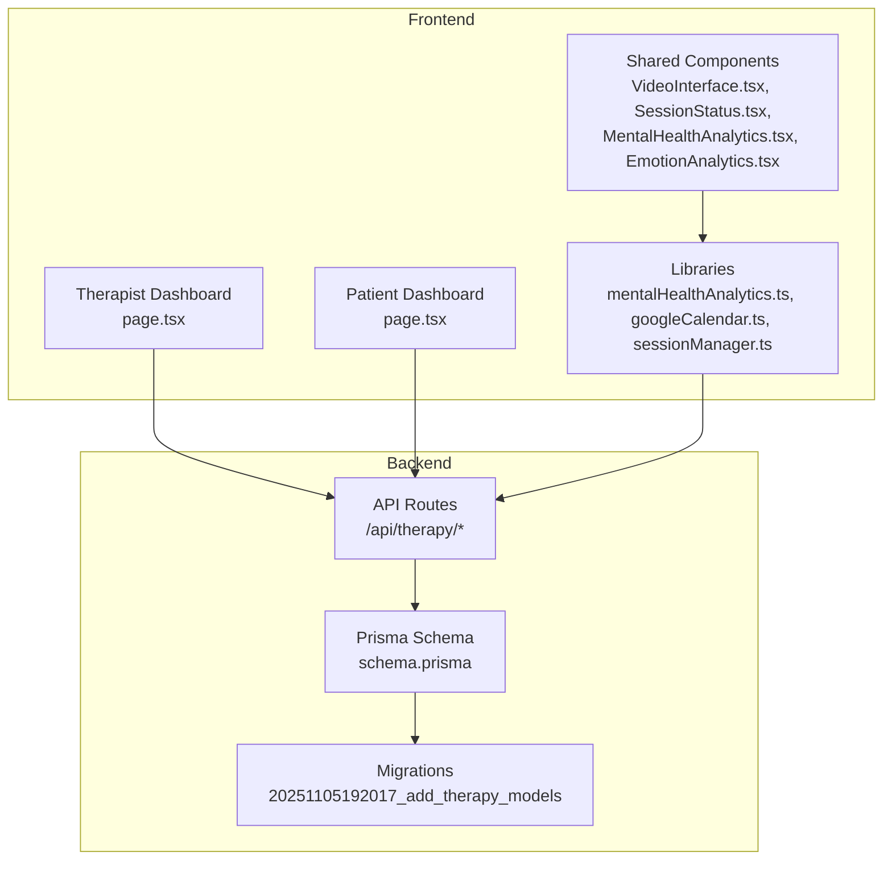
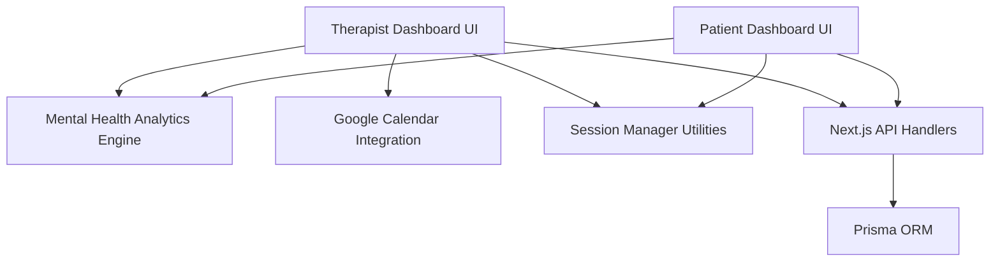
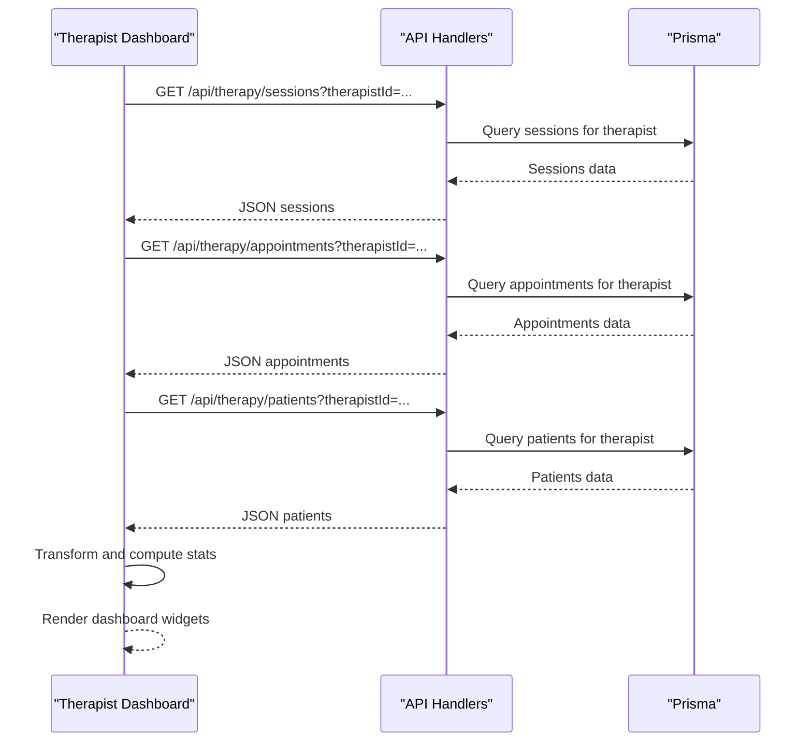
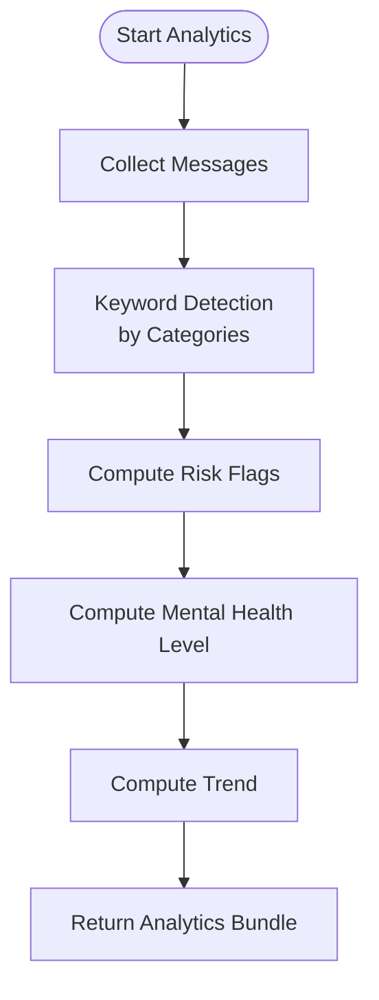
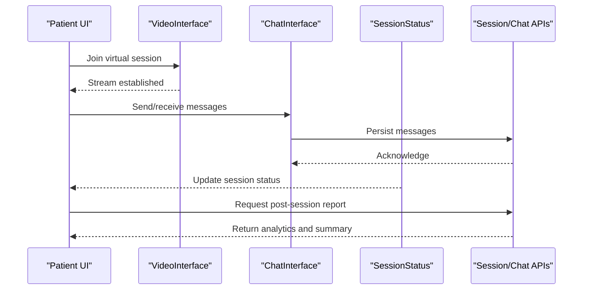
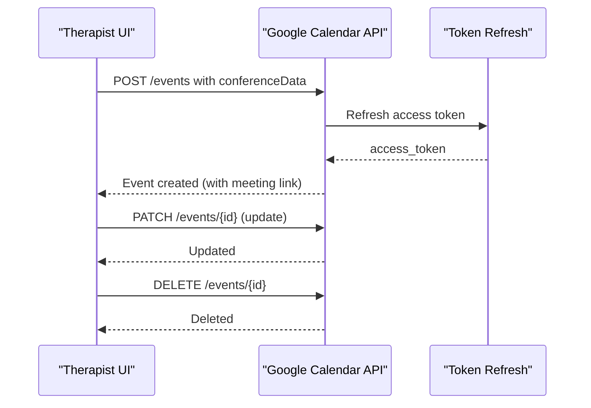
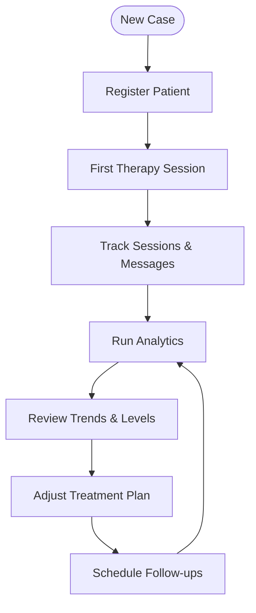
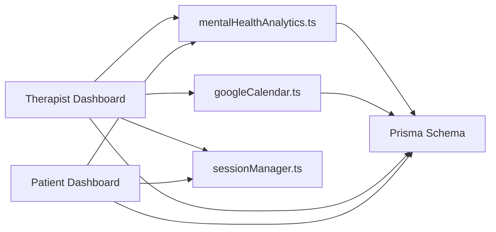

# Professional Features

<cite>
**Referenced Files in This Document**
- [therapist-dashboard.page.tsx](file://WEBAPP/src/app/therapist/dashboard/page.tsx)
- [patient-dashboard.page.tsx](file://WEBAPP/src/app/patient/dashboard/page.tsx)
- [mentalHealthAnalytics.ts](file://WEBAPP/src/lib/mentalHealthAnalytics.ts)
- [googleCalendar.ts](file://WEBAPP/src/lib/googleCalendar.ts)
- [sessionManager.ts](file://WEBAPP/src/lib/sessionManager.ts)
- [VideoInterface.tsx](file://WEBAPP/src/components/VideoInterface.tsx)
- [MentalHealthDashboard.tsx](file://WEBAPP/src/components/analytics/MentalHealthDashboard.tsx)
- [EmotionAnalytics.tsx](file://WEBAPP/src/components/EmotionAnalytics.tsx)
- [MentalHealthAnalytics.tsx](file://WEBAPP/src/components/MentalHealthAnalytics.tsx)
- [SessionStatus.tsx](file://WEBAPP/src/components/SessionStatus.tsx)
- [ChatInterface.tsx](file://WEBAPP/src/components/ChatInterface.tsx)
- [ChatHistory.tsx](file://WEBAPP/src/components/ChatHistory.tsx)
- [ClientSessionProvider.tsx](file://WEBAPP/src/components/ClientSessionProvider.tsx)
- [db.ts](file://WEBAPP/src/lib/db.ts)
- [api.ts](file://WEBAPP/src/lib/api.ts)
- [email.ts](file://WEBAPP/src/lib/email.ts)
- [schema.prisma](file://WEBAPP/prisma/schema.prisma)
- [migration.sql](file://WEBAPP/prisma/migrations/20251105192017_add_therapy_models/migration.sql)
- [seed.ts](file://WEBAPP/prisma/seed.ts)
- [README.md](file://README.md)
</cite>

## Table of Contents
1. [Introduction](#introduction)
2. [Project Structure](#project-structure)
3. [Core Components](#core-components)
4. [Architecture Overview](#architecture-overview)
5. [Detailed Component Analysis](#detailed-component-analysis)
6. [Dependency Analysis](#dependency-analysis)
7. [Performance Considerations](#performance-considerations)
8. [Troubleshooting Guide](#troubleshooting-guide)
9. [HIPAA Compliance and Professional Liability](#hipaa-compliance-and-professional-liability)
10. [Conclusion](#conclusion)

## Introduction
This document explains the professional features designed for therapists and healthcare providers within the MindBridge platform. It covers the therapist dashboard for managing patients, scheduling sessions, and reviewing analytics; the patient-facing analytics system for progress tracking and mood patterns; virtual session management including video consultations and post-session documentation; appointment scheduling integration with Google Calendar and automated reminders; professional reporting and case management workflows; secure communication tools; and compliance considerations for HIPAA and professional liability.

## Project Structure
The professional features span frontend pages, shared analytics libraries, calendar integrations, and backend data models. The Next.js app router organizes routes by role (therapist, patient), while shared components and libraries provide reusable functionality across roles.

**Diagram sources**
- [therapist-dashboard.page.tsx](file://WEBAPP/src/app/therapist/dashboard/page.tsx#L68-L171)
- [patient-dashboard.page.tsx](file://WEBAPP/src/app/patient/dashboard/page.tsx#L55-L276)
- [mentalHealthAnalytics.ts](file://WEBAPP/src/lib/mentalHealthAnalytics.ts#L1-L884)
- [googleCalendar.ts](file://WEBAPP/src/lib/googleCalendar.ts#L1-L226)
- [sessionManager.ts](file://WEBAPP/src/lib/sessionManager.ts#L1-L78)
- [schema.prisma](file://WEBAPP/prisma/schema.prisma#L1-L200)
- [migration.sql](file://WEBAPP/prisma/migrations/20251105192017_add_therapy_models/migration.sql#L1-L500)

**Section sources**
- [therapist-dashboard.page.tsx](file://WEBAPP/src/app/therapist/dashboard/page.tsx#L68-L171)
- [patient-dashboard.page.tsx](file://WEBAPP/src/app/patient/dashboard/page.tsx#L55-L276)
- [mentalHealthAnalytics.ts](file://WEBAPP/src/lib/mentalHealthAnalytics.ts#L1-L884)
- [googleCalendar.ts](file://WEBAPP/src/lib/googleCalendar.ts#L1-L226)
- [sessionManager.ts](file://WEBAPP/src/lib/sessionManager.ts#L1-L78)
- [schema.prisma](file://WEBAPP/prisma/schema.prisma#L1-L200)
- [migration.sql](file://WEBAPP/prisma/migrations/20251105192017_add_therapy_models/migration.sql#L1-L500)

## Core Components
- Therapist Dashboard: Loads and displays patient lists, session histories, upcoming appointments, and aggregated statistics. Supports inline actions to confirm/cancel appointments and navigate to analytics and scheduling.
- Patient Dashboard: Presents personal analytics, weekly progress, mental health level, keyword breakdowns, and quick actions to start sessions, view analytics, book appointments, and access peer support.
- Analytics Engine: Provides keyword-based categorization, assessment scoring, sentiment analysis, lexical diversity, temporal decay weighting, and emotion classification for progress tracking and treatment effectiveness metrics.
- Calendar Integration: Creates, updates, and deletes Google Calendar events with integrated Hangouts Meet conference links and configurable reminders.
- Session Management: Handles session lifecycle checks, expiration warnings, incognito mode detection, and automatic validation on focus.
- Virtual Session Tools: Video interface component and chat/history components enable real-time communication during sessions.

**Section sources**
- [therapist-dashboard.page.tsx](file://WEBAPP/src/app/therapist/dashboard/page.tsx#L48-L90)
- [patient-dashboard.page.tsx](file://WEBAPP/src/app/patient/dashboard/page.tsx#L45-L108)
- [mentalHealthAnalytics.ts](file://WEBAPP/src/lib/mentalHealthAnalytics.ts#L176-L350)
- [googleCalendar.ts](file://WEBAPP/src/lib/googleCalendar.ts#L102-L161)
- [sessionManager.ts](file://WEBAPP/src/lib/sessionManager.ts#L3-L76)
- [VideoInterface.tsx](file://WEBAPP/src/components/VideoInterface.tsx#L1-L200)
- [ChatInterface.tsx](file://WEBAPP/src/components/ChatInterface.tsx#L1-L200)
- [ChatHistory.tsx](file://WEBAPP/src/components/ChatHistory.tsx#L1-L200)

## Architecture Overview
The professional features follow a layered architecture:
- Presentation Layer: Role-specific dashboards and shared components.
- Business Logic Layer: Analytics engine, calendar integration, and session manager utilities.
- Data Access Layer: Prisma schema and migrations define the domain model for therapy-related entities.
- External Integrations: Google Calendar API for scheduling and reminders.

**Diagram sources**
- [therapist-dashboard.page.tsx](file://WEBAPP/src/app/therapist/dashboard/page.tsx#L92-L171)
- [patient-dashboard.page.tsx](file://WEBAPP/src/app/patient/dashboard/page.tsx#L125-L276)
- [mentalHealthAnalytics.ts](file://WEBAPP/src/lib/mentalHealthAnalytics.ts#L199-L350)
- [googleCalendar.ts](file://WEBAPP/src/lib/googleCalendar.ts#L68-L161)
- [sessionManager.ts](file://WEBAPP/src/lib/sessionManager.ts#L4-L76)
- [schema.prisma](file://WEBAPP/prisma/schema.prisma#L1-L200)

## Detailed Component Analysis

### Therapist Dashboard
The therapist dashboard aggregates:
- Statistics: total patients, completed sessions, average session duration, weekly appointments, active patients.
- Today’s schedule: filtered upcoming appointments with status badges and quick actions.
- Patient list: shows total sessions, last session date, dominant emotion, and improvement trend.
- Session history: includes message counts, dominant emotion, and status with download/report actions.
- Quick actions: link to analytics, scheduling, and settings.

**Diagram sources**
- [therapist-dashboard.page.tsx](file://WEBAPP/src/app/therapist/dashboard/page.tsx#L92-L171)

**Section sources**
- [therapist-dashboard.page.tsx](file://WEBAPP/src/app/therapist/dashboard/page.tsx#L48-L90)
- [therapist-dashboard.page.tsx](file://WEBAPP/src/app/therapist/dashboard/page.tsx#L114-L162)
- [therapist-dashboard.page.tsx](file://WEBAPP/src/app/therapist/dashboard/page.tsx#L520-L640)

### Patient Analytics System
The analytics system provides:
- Mental health level with color-coded severity and description.
- Keyword breakdown by categories (stress, anxiety, depression, anger, self-harm risk, loneliness, positive).
- Trend computation (improving/worsening/stable) from historical levels.
- Risk flags for self-harm mention, crisis language, and comorbid indicators.
- Sentiment analysis and lexical diversity metrics for deeper insights.
- Temporal decay weighting to emphasize recent conversations.

**Diagram sources**
- [mentalHealthAnalytics.ts](file://WEBAPP/src/lib/mentalHealthAnalytics.ts#L199-L350)

**Section sources**
- [patient-dashboard.page.tsx](file://WEBAPP/src/app/patient/dashboard/page.tsx#L110-L123)
- [patient-dashboard.page.tsx](file://WEBAPP/src/app/patient/dashboard/page.tsx#L241-L267)
- [mentalHealthAnalytics.ts](file://WEBAPP/src/lib/mentalHealthAnalytics.ts#L176-L350)

### Virtual Session Management
Virtual sessions integrate:
- Video interface component for video consultation setup.
- Chat interface and chat history for real-time communication.
- Session status tracking and session lifecycle utilities.
- Post-session documentation via downloadable reports and analytics summaries.

**Diagram sources**
- [VideoInterface.tsx](file://WEBAPP/src/components/VideoInterface.tsx#L1-L200)
- [ChatInterface.tsx](file://WEBAPP/src/components/ChatInterface.tsx#L1-L200)
- [ChatHistory.tsx](file://WEBAPP/src/components/ChatHistory.tsx#L1-L200)
- [SessionStatus.tsx](file://WEBAPP/src/components/SessionStatus.tsx#L1-L200)
- [sessionManager.ts](file://WEBAPP/src/lib/sessionManager.ts#L4-L76)

**Section sources**
- [VideoInterface.tsx](file://WEBAPP/src/components/VideoInterface.tsx#L1-L200)
- [ChatInterface.tsx](file://WEBAPP/src/components/ChatInterface.tsx#L1-L200)
- [ChatHistory.tsx](file://WEBAPP/src/components/ChatHistory.tsx#L1-L200)
- [SessionStatus.tsx](file://WEBAPP/src/components/SessionStatus.tsx#L1-L200)
- [sessionManager.ts](file://WEBAPP/src/lib/sessionManager.ts#L3-L76)

### Appointment Scheduling and Google Calendar Integration
The system supports:
- Creating calendar events with Hangouts Meet conference data.
- Configurable reminders (popup and email).
- Updating and deleting events.
- Automated reminders for appointments.

**Diagram sources**
- [googleCalendar.ts](file://WEBAPP/src/lib/googleCalendar.ts#L68-L161)
- [googleCalendar.ts](file://WEBAPP/src/lib/googleCalendar.ts#L183-L225)

**Section sources**
- [googleCalendar.ts](file://WEBAPP/src/lib/googleCalendar.ts#L54-L161)
- [googleCalendar.ts](file://WEBAPP/src/lib/googleCalendar.ts#L163-L225)

### Case Management Workflows
Case management is supported through:
- Patient list with session history and analytics summaries.
- Appointment management with status updates (confirmed/pending/cancelled).
- Analytics-driven insights enabling treatment effectiveness metrics and progress tracking.

[No sources needed since this diagram shows conceptual workflow, not actual code structure]

**Section sources**
- [therapist-dashboard.page.tsx](file://WEBAPP/src/app/therapist/dashboard/page.tsx#L642-L772)
- [patient-dashboard.page.tsx](file://WEBAPP/src/app/patient/dashboard/page.tsx#L781-L800)

### Secure Communication Tools
Secure communication features include:
- Session lifecycle monitoring and expiration warnings.
- Incognito/private mode detection to warn about session persistence.
- Automatic session validation on focus to maintain security.

**Section sources**
- [sessionManager.ts](file://WEBAPP/src/lib/sessionManager.ts#L3-L76)

## Dependency Analysis
The professional features depend on:
- Shared analytics library for consistent mental health scoring and trend computation.
- Calendar integration for external scheduling and reminders.
- Prisma schema for persistent storage of therapy data.
- Client components for UI presentation and user interaction.

**Diagram sources**
- [therapist-dashboard.page.tsx](file://WEBAPP/src/app/therapist/dashboard/page.tsx#L92-L171)
- [patient-dashboard.page.tsx](file://WEBAPP/src/app/patient/dashboard/page.tsx#L125-L276)
- [mentalHealthAnalytics.ts](file://WEBAPP/src/lib/mentalHealthAnalytics.ts#L1-L884)
- [googleCalendar.ts](file://WEBAPP/src/lib/googleCalendar.ts#L1-L226)
- [sessionManager.ts](file://WEBAPP/src/lib/sessionManager.ts#L1-L78)
- [schema.prisma](file://WEBAPP/prisma/schema.prisma#L1-L200)

**Section sources**
- [therapist-dashboard.page.tsx](file://WEBAPP/src/app/therapist/dashboard/page.tsx#L92-L171)
- [patient-dashboard.page.tsx](file://WEBAPP/src/app/patient/dashboard/page.tsx#L125-L276)
- [mentalHealthAnalytics.ts](file://WEBAPP/src/lib/mentalHealthAnalytics.ts#L1-L884)
- [googleCalendar.ts](file://WEBAPP/src/lib/googleCalendar.ts#L1-L226)
- [sessionManager.ts](file://WEBAPP/src/lib/sessionManager.ts#L1-L78)
- [schema.prisma](file://WEBAPP/prisma/schema.prisma#L1-L200)

## Performance Considerations
- Analytics computations: Keyword detection, sentiment analysis, and lexical diversity are computed client-side for responsiveness; consider debouncing heavy analytics calls and caching results where appropriate.
- API calls: Batch requests and transform data efficiently to minimize network overhead.
- Calendar operations: Token refresh and API calls should be cached and retried with backoff to handle transient failures.
- Session monitoring: Debounce periodic checks and avoid redundant validations.

[No sources needed since this section provides general guidance]

## Troubleshooting Guide
Common issues and resolutions:
- Google Calendar integration errors: Verify environment variables and refresh token configuration; check token refresh endpoint responses.
- Session expiration: Use session manager utilities to detect expiring sessions and incognito mode; ensure focus validation triggers sign-in redirects.
- Analytics not updating: Confirm analytics API endpoints are reachable and that data transformations align with expected schemas.
- Dashboard loading: Implement robust error boundaries and fallback UIs for loading states.

**Section sources**
- [googleCalendar.ts](file://WEBAPP/src/lib/googleCalendar.ts#L68-L100)
- [sessionManager.ts](file://WEBAPP/src/lib/sessionManager.ts#L4-L76)
- [patient-dashboard.page.tsx](file://WEBAPP/src/app/patient/dashboard/page.tsx#L268-L276)

## HIPAA Compliance and Professional Liability
Key considerations for HIPAA compliance and professional liability:
- Access controls: Role-based routing ensures therapists and patients access only authorized views. Authentication and authorization must be enforced at the API layer.
- Data minimization: Collect only necessary clinical data; anonymize or de-identify data where possible for analytics.
- Audit logging: Track access and modifications to protected health information (PHI) with timestamps and user identifiers.
- Secure transmission: Enforce HTTPS and secure cookies; validate tokens and prevent session fixation.
- Data retention and deletion: Implement policies for data retention and secure deletion upon request.
- Provider liability: Include terms of service and disclaimers; ensure AI-generated insights are presented as supportive tools, not definitive diagnoses.
- Training and policies: Educate providers on PHI handling, incident response, and ethical use of AI tools.

[No sources needed since this section provides general guidance]

## Conclusion
MindBridge’s professional features combine a therapist dashboard, patient analytics, virtual session tools, and Google Calendar integration to streamline case management and improve treatment outcomes. Robust analytics, secure session handling, and external scheduling capabilities support evidence-based practice while maintaining usability. For production deployment, ensure strict adherence to HIPAA requirements and establish clear professional liability safeguards.