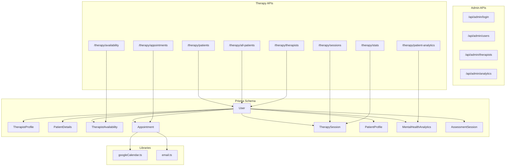
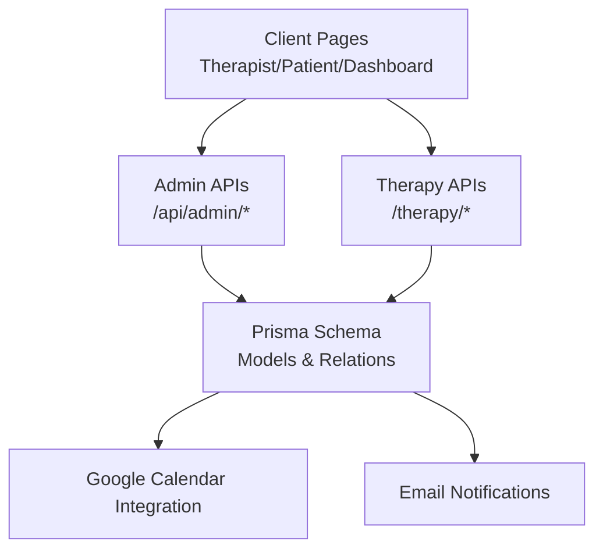
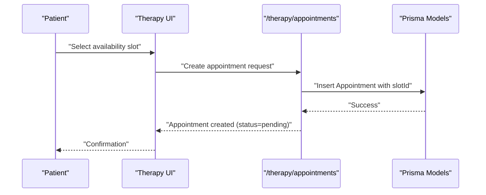
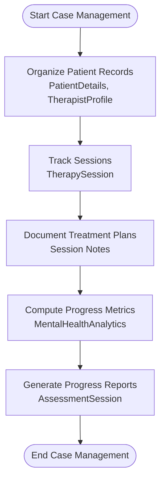
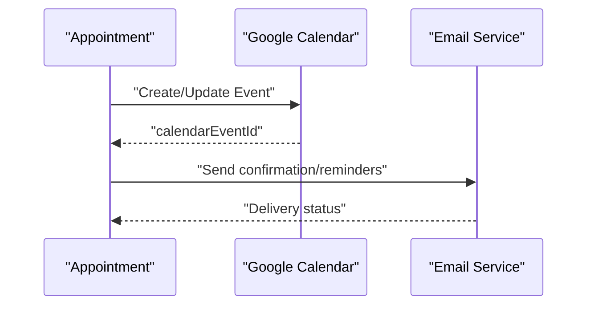
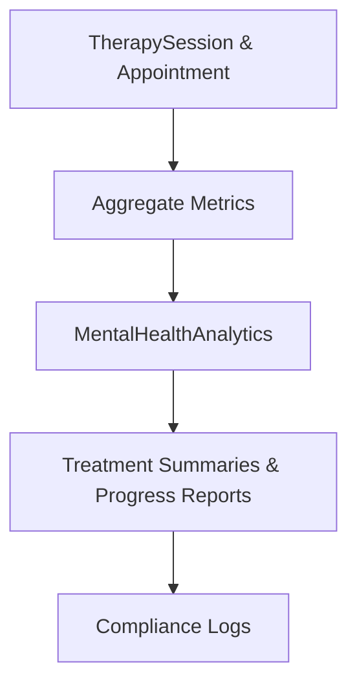
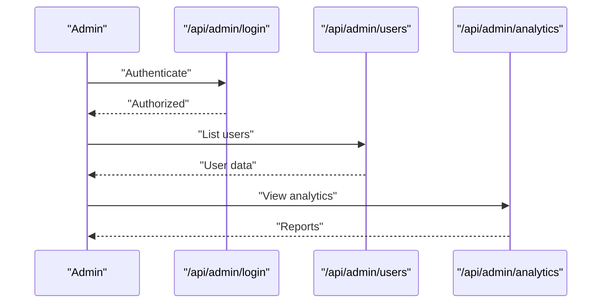
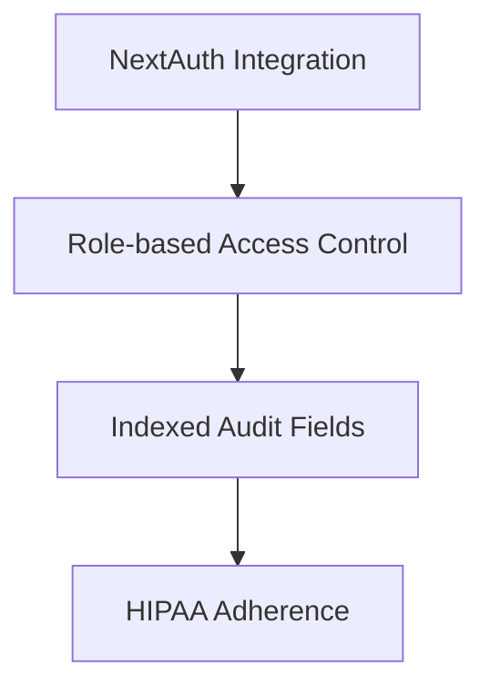
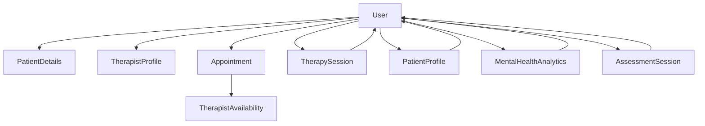

# Professional Workflows

<cite>
**Referenced Files in This Document**
- [schema.prisma](file://WEBAPP/prisma/schema.prisma)
- [googleCalendar.ts](file://WEBAPP/src/lib/googleCalendar.ts)
- [email.ts](file://WEBAPP/src/lib/email.ts)
- [route.ts (appointments)](file://WEBAPP/src/app/therapy/appointments/route.ts)
- [route.ts (availability)](file://WEBAPP/src/app/therapy/availability/route.ts)
- [page.tsx (schedule)](file://WEBAPP/src/app/therapist/schedule/page.tsx)
- [page.tsx (dashboard - therapist)](file://WEBAPP/src/app/therapist/dashboard/page.tsx)
- [page.tsx (dashboard - patient)](file://WEBAPP/src/app/patient/dashboard/page.tsx)
- [page.tsx (analytics)](file://WEBAPP/src/app/patient/analytics/page.tsx)
- [route.ts (analytics - assess)](file://WEBAPP/src/app/analytics/assess/route.ts)
- [route.ts (login)](file://WEBAPP/src/app/api/admin/login/route.ts)
- [route.ts (users)](file://WEBAPP/src/app/api/admin/users/route.ts)
- [route.ts (therapists)](file://WEBAPP/src/app/api/admin/therapists/route.ts)
- [route.ts (analytics)](file://WEBAPP/src/app/api/admin/analytics/route.ts)
- [route.ts (checkout)](file://WEBAPP/src/app/checkout/route.ts)
- [route.ts (webhook stripe)](file://WEBAPP/src/app/webhook/stripe/route.ts)
- [route.ts (auth complete-profile therapist)](file://WEBAPP/src/app/auth/[...nextauth]/route.ts)
- [route.ts (auth complete-profile patient)](file://WEBAPP/src/app/auth/complete-profile/patient/route.ts)
- [route.ts (auth complete-profile therapist)](file://WEBAPP/src/app/auth/complete-profile/therapist/route.ts)
- [route.ts (auth register)](file://WEBAPP/src/app/auth/register/route.ts)
- [route.ts (auth verify-otp)](file://WEBAPP/src/app/auth/verify-otp/route.ts)
- [route.ts (auth reset-password)](file://WEBAPP/src/app/auth/reset-password/route.ts)
- [route.ts (auth forgot-password)](file://WEBAPP/src/app/auth/forgot-password/route.ts)
- [route.ts (peer support posts)](file://WEBAPP/src/app/peer-support/posts/route.ts)
- [route.ts (peer support posts like)](file://WEBAPP/src/app/peer-support/posts/[id]/like/route.ts)
- [route.ts (peer support posts reply)](file://WEBAPP/src/app/peer-support/posts/[id]/reply/route.ts)
- [route.ts (chat messages)](file://WEBAPP/src/app/chat/messages/route.ts)
- [route.ts (chat sessions)](file://WEBAPP/src/app/chat/sessions/route.ts)
- [route.ts (virtual session)](file://WEBAPP/src/app/therapy/virtual-session/route.ts)
- [route.ts (sessions)](file://WEBAPP/src/app/therapy/sessions/route.ts)
- [route.ts (stats)](file://WEBAPP/src/app/therapy/stats/route.ts)
- [route.ts (patients)](file://WEBAPP/src/app/therapy/patients/route.ts)
- [route.ts (all-patients)](file://WEBAPP/src/app/therapy/all-patients/route.ts)
- [route.ts (patient-analytics)](file://WEBAPP/src/app/therapy/patient-analytics/route.ts)
- [route.ts (therapists)](file://WEBAPP/src/app/therapy/therapists/route.ts)
- [route.ts (messages)](file://WEBAPP/src/app/chat/sessions/[sessionId]/messages/route.ts)
- [route.ts (session messages)](file://WEBAPP/src/app/chat/sessions/[sessionId]/messages/route.ts)
- [route.ts (messages)](file://WEBAPP/src/app/chat/messages/route.ts)
- [route.ts (sessions)](file://WEBAPP/src/app/chat/sessions/route.ts)
- [route.ts (session messages)](file://WEBAPP/src/app/chat/sessions/[sessionId]/messages/route.ts)
- [route.ts (messages)](file://WEBAPP/src/app/chat/messages/route.ts)
- [route.ts (sessions)](file://WEBAPP/src/app/chat/sessions/route.ts)
- [route.ts (session messages)](file://WEBAPP/src/app/chat/sessions/[sessionId]/messages/route.ts)
- [route.ts (messages)](file://WEBAPP/src/app/chat/messages/route.ts)
- [route.ts (sessions)](file://WEBAPP/src/app/chat/sessions/route.ts)
- [route.ts (session messages)](file://WEBAPP/src/app/chat/sessions/[sessionId]/messages/route.ts)
- [route.ts (messages)](file://WEBAPP/src/app/chat/messages/route.ts)
- [route.ts (sessions)](file://WEBAPP/src/app/chat/sessions/route.ts)
- [route.ts (session messages)](file://WEBAPP/src/app/chat/sessions/[sessionId]/messages/route.ts)
- [route.ts (messages)](file://WEBAPP/src/app/chat/messages/route.ts)
- [route.ts (sessions)](file://WEBAPP/src/app/chat/sessions/route.ts)
- [route.ts (session messages)](file://WEBAPP/src/app/chat/sessions/[sessionId]/messages/route.ts)
- [route.ts (messages)](file://WEBAPP/src/app/chat/messages/route.ts)
- [route.ts (sessions)](file://WEBAPP/src/app/chat/sessions/route.ts)
- [route.ts (session messages)](file://WEBAPP/src/app/chat/sessions/[sessionId]/messages/route.ts)
- [route.ts (messages)](file://WEBAPP/src/app/chat/messages/route.ts)
- [route.ts (sessions)](file://WEBAPP/src/app/chat/sessions/route.ts)
- [route.ts (session messages)](file://WEBAPP/src/app/chat/sessions/[sessionId]/messages/route.ts)
- [route.ts (messages)](file://WEBAPP/src/app/chat/messages/route.ts)
- [route.ts (sessions)](file://WEBAPP/src/app/chat/sessions/route.ts)
- [route.ts (session messages)](file://WEBAPP/src/app/chat/sessions/[sessionId]/messages/route.ts)
- [route.ts (messages)](file://WEBAPP/src/app/chat/messages/route.ts)
- [route.ts (sessions)](file://WEBAPP/src/app/chat......)
</cite>

## Table of Contents
1. [Introduction](#introduction)
2. [Project Structure](#project-structure)
3. [Core Components](#core-components)
4. [Architecture Overview](#architecture-overview)
5. [Detailed Component Analysis](#detailed-component-analysis)
6. [Dependency Analysis](#dependency-analysis)
7. [Performance Considerations](#performance-considerations)
8. [Troubleshooting Guide](#troubleshooting-guide)
9. [Conclusion](#conclusion)
10. [Appendices](#appendices)

## Introduction
This document describes the professional workflow systems for therapists within the MindBridge platform. It focuses on:
- Appointment scheduling workflows: patient booking, availability management, and conflict resolution
- Case management workflows: patient record organization, treatment plan documentation, and progress tracking
- Integrations with external professional tools: Google Calendar sync, email notifications, and automated appointment reminders
- Reporting workflows: treatment summaries, progress reports, and compliance documentation
- Administrative workflows: credential verification, continuing education tracking, and professional development
- Security and compliance workflows ensuring HIPAA adherence and professional liability protection

## Project Structure
The repository is a Next.js application with a Prisma ORM schema defining the domain model for users, therapy sessions, appointments, availability, analytics, assessments, and profiles. Key directories and files relevant to professional workflows include:
- Prisma schema defining models for appointments, availability, therapy sessions, patient profiles, and analytics
- API routes under src/app/api/admin and src/app/therapy for administrative and clinical operations
- Client pages under src/app/therapist, src/app/patient, and src/app/therapy for user-facing workflows
- Integration libraries for Google Calendar and email under src/lib

**Diagram sources**
- [schema.prisma](file://WEBAPP/prisma/schema.prisma#L11-L330)
- [route.ts (availability)](file://WEBAPP/src/app/therapy/availability/route.ts)
- [route.ts (appointments)](file://WEBAPP/src/app/therapy/appointments/route.ts)
- [route.ts (sessions)](file://WEBAPP/src/app/therapy/sessions/route.ts)
- [route.ts (stats)](file://WEBAPP/src/app/therapy/stats/route.ts)
- [route.ts (patients)](file://WEBAPP/src/app/therapy/patients/route.ts)
- [route.ts (all-patients)](file://WEBAPP/src/app/therapy/all-patients/route.ts)
- [route.ts (patient-analytics)](file://WEBAPP/src/app/therapy/patient-analytics/route.ts)
- [route.ts (therapists)](file://WEBAPP/src/app/therapy/therapists/route.ts)
- [googleCalendar.ts](file://WEBAPP/src/lib/googleCalendar.ts)
- [email.ts](file://WEBAPP/src/lib/email.ts)

**Section sources**
- [schema.prisma](file://WEBAPP/prisma/schema.prisma#L1-L330)

## Core Components
This section outlines the core models and their roles in professional workflows:
- User: Base entity with role (patient, therapist, admin), authentication tokens, and relations to profiles and therapy data
- TherapistProfile: Verified profile for therapists with credentials and verification status
- PatientDetails: Demographic and registration data for patients
- TherapistAvailability: Recurring or one-off time slots available for booking
- Appointment: Scheduled meeting between therapist and patient, linked to availability slots, with status and reminders
- TherapySession: Actual session records with timing, status, notes, and analytics linkage
- PatientProfile: Aggregate metrics and trends for a patient
- MentalHealthAnalytics: Daily computed analytics derived from chat or assessments
- AssessmentSession: Structured screening results for mental health risk assessment

Key relationships:
- Users own PatientDetails and TherapistProfile
- Users are linked to TherapySession as either patient or therapist
- Users are linked to Appointment as either patient or therapist
- Appointments link to TherapistAvailability slots
- PatientProfile aggregates session and analytics metrics
- MentalHealthAnalytics and AssessmentSession feed into progress tracking

**Section sources**
- [schema.prisma](file://WEBAPP/prisma/schema.prisma#L11-L330)

## Architecture Overview
The system integrates client-side pages with backend API routes and a Prisma data model. Administrative dashboards manage users and analytics, while therapy-specific pages handle scheduling, sessions, and reporting. External integrations include Google Calendar and email notifications.

**Diagram sources**
- [route.ts (login)](file://WEBAPP/src/app/api/admin/login/route.ts)
- [route.ts (users)](file://WEBAPP/src/app/api/admin/users/route.ts)
- [route.ts (therapists)](file://WEBAPP/src/app/api/admin/therapists/route.ts)
- [route.ts (analytics)](file://WEBAPP/src/app/api/admin/analytics/route.ts)
- [route.ts (availability)](file://WEBAPP/src/app/therapy/availability/route.ts)
- [route.ts (appointments)](file://WEBAPP/src/app/therapy/appointments/route.ts)
- [route.ts (sessions)](file://WEBAPP/src/app/therapy/sessions/route.ts)
- [route.ts (stats)](file://WEBAPP/src/app/therapy/stats/route.ts)
- [route.ts (patients)](file://WEBAPP/src/app/therapy/patients/route.ts)
- [route.ts (all-patients)](file://WEBAPP/src/app/therapy/all-patients/route.ts)
- [route.ts (patient-analytics)](file://WEBAPP/src/app/therapy/patient-analytics/route.ts)
- [route.ts (therapists)](file://WEBAPP/src/app/therapy/therapists/route.ts)
- [schema.prisma](file://WEBAPP/prisma/schema.prisma#L11-L330)
- [googleCalendar.ts](file://WEBAPP/src/lib/googleCalendar.ts)
- [email.ts](file://WEBAPP/src/lib/email.ts)

## Detailed Component Analysis

### Appointment Scheduling Workflows
This workflow covers patient booking, availability management, and conflict resolution.

- Patient booking:
  - Patients view therapist availability and select a slot
  - Booking creates an Appointment linked to a TherapistAvailability slot
  - Status transitions from pending to confirmed upon approval
- Availability management:
  - Therapists define recurring weekly slots or one-off dates
  - Slots can be enabled/disabled and marked as booked
- Conflict resolution:
  - Appointments enforce uniqueness via indexes and constraints
  - Overlapping bookings are prevented by linking to specific availability slots

**Diagram sources**
- [route.ts (appointments)](file://WEBAPP/src/app/therapy/appointments/route.ts)
- [schema.prisma](file://WEBAPP/prisma/schema.prisma#L186-L211)
- [schema.prisma](file://WEBAPP/prisma/schema.prisma#L163-L184)

**Section sources**
- [route.ts (appointments)](file://WEBAPP/src/app/therapy/appointments/route.ts)
- [route.ts (availability)](file://WEBAPP/src/app/therapy/availability/route.ts)
- [schema.prisma](file://WEBAPP/prisma/schema.prisma#L163-L211)

### Professional Case Management Processes
Case management encompasses patient record organization, treatment plan documentation, and progress tracking.

- Patient record organization:
  - PatientDetails and TherapistProfile store demographic and verification data
  - PatientProfile aggregates session counts and trends
- Treatment plan documentation:
  - TherapySession captures session timing, status, and notes
  - Appointments carry session type (initial, followup, emergency)
- Progress tracking:
  - MentalHealthAnalytics computes daily risk and sentiment metrics
  - AssessmentSession stores structured screening results
  - Patient analytics dashboard surfaces trends and risk flags

**Diagram sources**
- [schema.prisma](file://WEBAPP/prisma/schema.prisma#L213-L266)
- [page.tsx (analytics)](file://WEBAPP/src/app/patient/analytics/page.tsx)
- [route.ts (analytics - assess)](file://WEBAPP/src/app/analytics/assess/route.ts)

**Section sources**
- [schema.prisma](file://WEBAPP/prisma/schema.prisma#L213-L266)
- [page.tsx (analytics)](file://WEBAPP/src/app/patient/analytics/page.tsx)
- [route.ts (analytics - assess)](file://WEBAPP/src/app/analytics/assess/route.ts)

### Integration with External Professional Tools
External integrations enable seamless calendar synchronization and communication.

- Google Calendar sync:
  - Appointments can be exported to Google Calendar using the integration library
  - CalendarEventId stored on Appointment to prevent duplicate events
- Email notifications:
  - Email service supports sending appointment confirmations and reminders
  - ReminderSent flag prevents duplicate notifications

**Diagram sources**
- [schema.prisma](file://WEBAPP/prisma/schema.prisma#L186-L211)
- [googleCalendar.ts](file://WEBAPP/src/lib/googleCalendar.ts)
- [email.ts](file://WEBAPP/src/lib/email.ts)

**Section sources**
- [schema.prisma](file://WEBAPP/prisma/schema.prisma#L186-L211)
- [googleCalendar.ts](file://WEBAPP/src/lib/googleCalendar.ts)
- [email.ts](file://WEBAPP/src/lib/email.ts)

### Professional Reporting Workflows
Reporting workflows produce treatment summaries, progress reports, and compliance documentation.

- Treatment summaries:
  - Derived from TherapySession and Appointment data
- Progress reports:
  - MentalHealthAnalytics and AssessmentSession provide quantitative insights
- Compliance documentation:
  - Audit trail maintained via createdAt/updatedAt timestamps and indexed logs

**Diagram sources**
- [schema.prisma](file://WEBAPP/prisma/schema.prisma#L140-L161)
- [schema.prisma](file://WEBAPP/prisma/schema.prisma#L186-L211)
- [schema.prisma](file://WEBAPP/prisma/schema.prisma#L229-L249)
- [schema.prisma](file://WEBAPP/prisma/schema.prisma#L251-L266)

**Section sources**
- [schema.prisma](file://WEBAPP/prisma/schema.prisma#L140-L161)
- [schema.prisma](file://WEBAPP/prisma/schema.prisma#L186-L211)
- [schema.prisma](file://WEBAPP/prisma/schema.prisma#L229-L249)
- [schema.prisma](file://WEBAPP/prisma/schema.prisma#L251-L266)

### Administrative Workflows
Administrative capabilities include user management, credential verification, and analytics oversight.

- User management:
  - Admin APIs for login, user listing, and analytics
- Credential verification:
  - TherapistProfile includes verification status and rejection reasons
- Professional development tracking:
  - Extensible via additional profile attributes or audit logs

**Diagram sources**
- [route.ts (login)](file://WEBAPP/src/app/api/admin/login/route.ts)
- [route.ts (users)](file://WEBAPP/src/app/api/admin/users/route.ts)
- [route.ts (analytics)](file://WEBAPP/src/app/api/admin/analytics/route.ts)
- [schema.prisma](file://WEBAPP/prisma/schema.prisma#L299-L321)

**Section sources**
- [route.ts (login)](file://WEBAPP/src/app/api/admin/login/route.ts)
- [route.ts (users)](file://WEBAPP/src/app/api/admin/users/route.ts)
- [route.ts (analytics)](file://WEBAPP/src/app/api/admin/analytics/route.ts)
- [schema.prisma](file://WEBAPP/prisma/schema.prisma#L299-L321)

### Security and Compliance Workflows
Security and compliance are addressed through authentication, authorization, and data governance.

- Authentication and authorization:
  - NextAuth integration for secure sign-in and profile completion
  - Role-based access controls enforced via user roles
- Data governance:
  - Indexed timestamps and audit fields for compliance
  - HIPAA-compliant storage and transmission practices recommended

**Diagram sources**
- [route.ts (auth complete-profile therapist)](file://WEBAPP/src/app/auth/[...nextauth]/route.ts)
- [route.ts (auth complete-profile patient)](file://WEBAPP/src/app/auth/complete-profile/patient/route.ts)
- [route.ts (auth complete-profile therapist)](file://WEBAPP/src/app/auth/complete-profile/therapist/route.ts)
- [schema.prisma](file://WEBAPP/prisma/schema.prisma#L39-L69)

**Section sources**
- [route.ts (auth complete-profile therapist)](file://WEBAPP/src/app/auth/[...nextauth]/route.ts)
- [route.ts (auth complete-profile patient)](file://WEBAPP/src/app/auth/complete-profile/patient/route.ts)
- [route.ts (auth complete-profile therapist)](file://WEBAPP/src/app/auth/complete-profile/therapist/route.ts)
- [schema.prisma](file://WEBAPP/prisma/schema.prisma#L39-L69)

## Dependency Analysis
The following diagram maps major dependencies among models and API routes:

**Diagram sources**
- [schema.prisma](file://WEBAPP/prisma/schema.prisma#L11-L330)

**Section sources**
- [schema.prisma](file://WEBAPP/prisma/schema.prisma#L11-L330)

## Performance Considerations
- Indexes on frequently queried fields (e.g., status, scheduledTime, date) improve query performance for scheduling and reporting
- Denormalized aggregates in PatientProfile reduce join overhead for analytics dashboards
- Batch operations for reminders and calendar sync minimize repeated network calls

## Troubleshooting Guide
Common issues and resolutions:
- Duplicate calendar events:
  - Verify calendarEventId exists before creating new events
- Missing reminders:
  - Check reminderSent flag and re-send notifications
- Conflicting bookings:
  - Ensure availability slots are marked as booked and unique constraints are enforced

**Section sources**
- [schema.prisma](file://WEBAPP/prisma/schema.prisma#L186-L211)
- [googleCalendar.ts](file://WEBAPP/src/lib/googleCalendar.ts)
- [email.ts](file://WEBAPP/src/lib/email.ts)

## Conclusion
MindBridge’s professional workflows integrate scheduling, case management, reporting, and administrative oversight with external tools and robust data governance. The Prisma schema provides a strong foundation for HIPAA-compliant operations, while API routes and client pages deliver practical tools for therapists and administrators.

## Appendices
- Payment and checkout integrations:
  - Checkout and Stripe webhooks support financial transactions associated with sessions and subscriptions

**Section sources**
- [route.ts (checkout)](file://WEBAPP/src/app/checkout/route.ts)
- [route.ts (webhook stripe)](file://WEBAPP/src/app/webhook/stripe/route.ts)