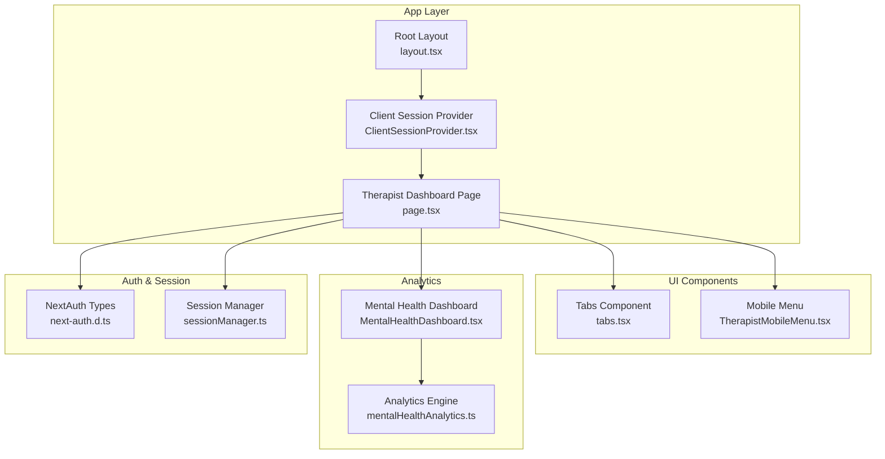
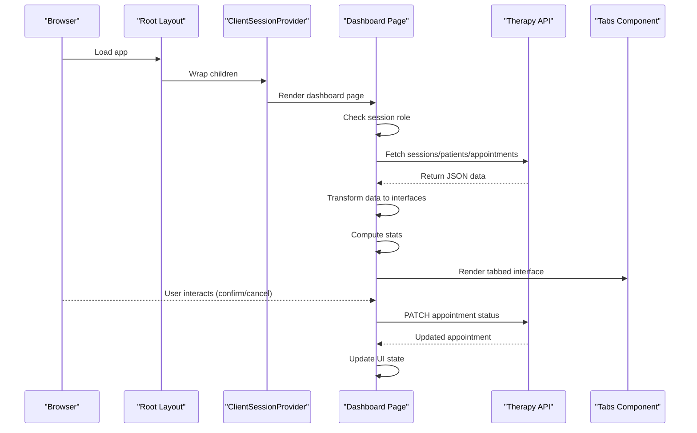
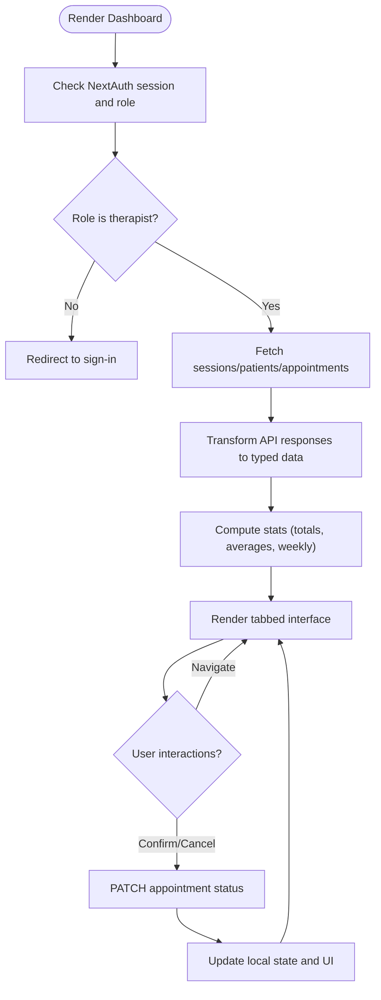
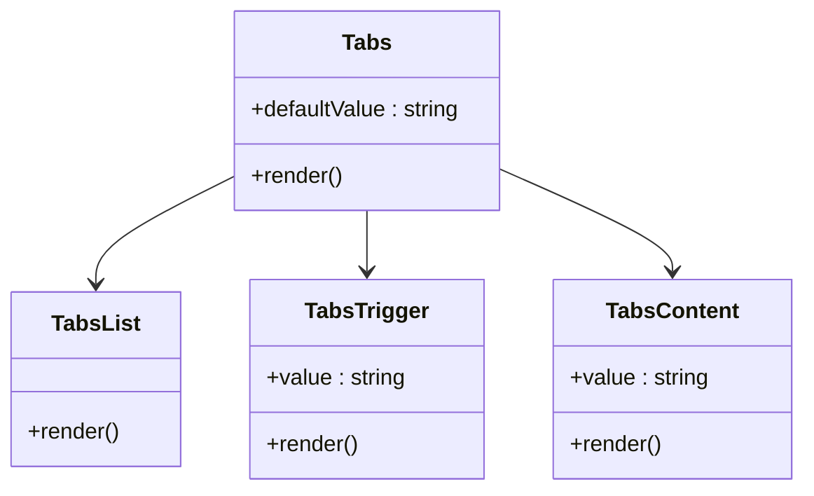
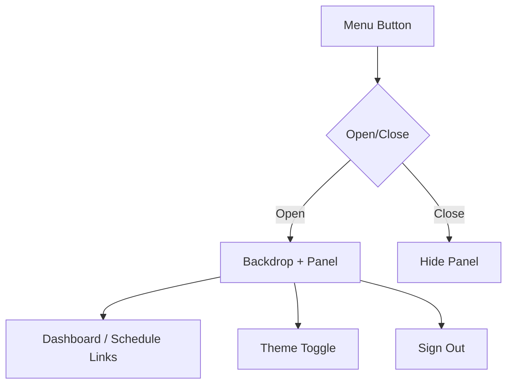
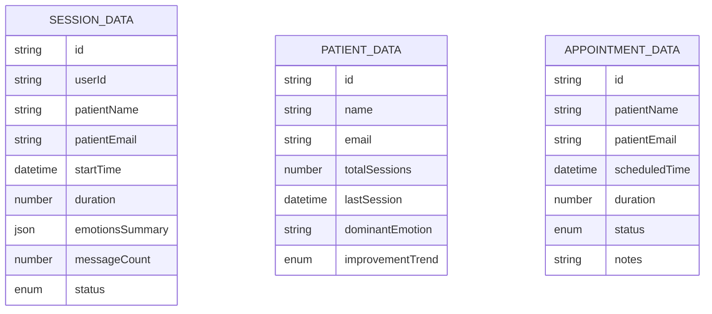
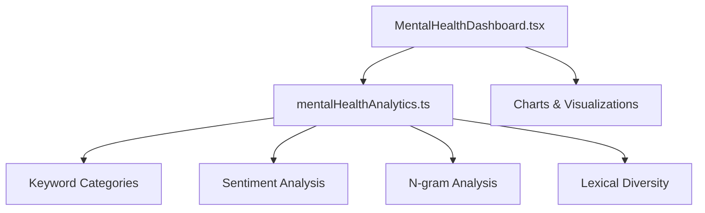
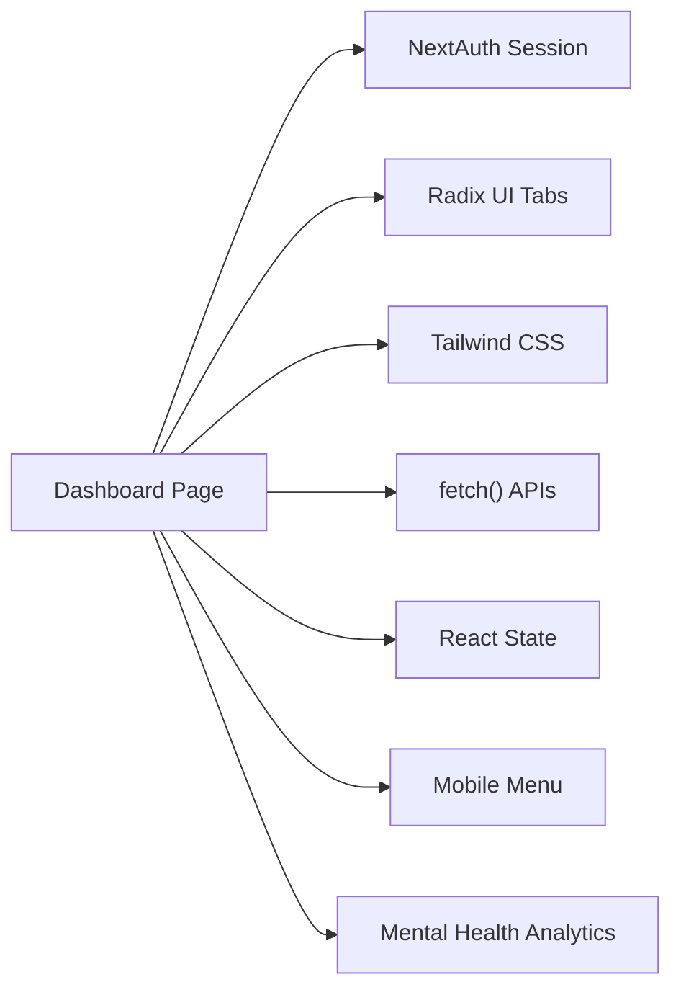

# Therapist Dashboard

<cite>
**Referenced Files in This Document**
- [page.tsx](file://src/app/therapist/dashboard/page.tsx)
- [tabs.tsx](file://src/components/ui/tabs.tsx)
- [TherapistMobileMenu.tsx](file://src/components/TherapistMobileMenu.tsx)
- [layout.tsx](file://src/app/layout.tsx)
- [ClientSessionProvider.tsx](file://src/components/ClientSessionProvider.tsx)
- [next-auth.d.ts](file://src/types/next-auth.d.ts)
- [sessionManager.ts](file://src/lib/sessionManager.ts)
- [globals.css](file://src/app/globals.css)
- [MentalHealthDashboard.tsx](file://src/components/analytics/MentalHealthDashboard.tsx)
- [mentalHealthAnalytics.ts](file://src/lib/mentalHealthAnalytics.ts)
</cite>

## Table of Contents
1. [Introduction](#introduction)
2. [Project Structure](#project-structure)
3. [Core Components](#core-components)
4. [Architecture Overview](#architecture-overview)
5. [Detailed Component Analysis](#detailed-component-analysis)
6. [Dependency Analysis](#dependency-analysis)
7. [Performance Considerations](#performance-considerations)
8. [Troubleshooting Guide](#troubleshooting-guide)
9. [Conclusion](#conclusion)

## Introduction
This document explains the therapist dashboard system, focusing on the main dashboard interface, real-time data fetching, interactive components, tabbed navigation, responsive design, data transformation logic, and authentication enforcement. The dashboard presents overview statistics, manages patients and sessions, displays schedules, and integrates advanced analytics for mental health insights.

## Project Structure
The dashboard is implemented as a Next.js app page with reusable UI components and analytics utilities. It leverages NextAuth for session management and Tailwind CSS for responsive styling.

**Diagram sources**
- [layout.tsx](file://src/app/layout.tsx#L36-L54)
- [ClientSessionProvider.tsx](file://src/components/ClientSessionProvider.tsx#L1-L12)
- [page.tsx](file://src/app/therapist/dashboard/page.tsx#L68-L959)
- [tabs.tsx](file://src/components/ui/tabs.tsx#L1-L67)
- [TherapistMobileMenu.tsx](file://src/components/TherapistMobileMenu.tsx#L1-L129)
- [MentalHealthDashboard.tsx](file://src/components/analytics/MentalHealthDashboard.tsx#L1-L541)
- [mentalHealthAnalytics.ts](file://src/lib/mentalHealthAnalytics.ts#L1-L884)
- [next-auth.d.ts](file://src/types/next-auth.d.ts#L1-L28)
- [sessionManager.ts](file://src/lib/sessionManager.ts#L1-L78)

**Section sources**
- [layout.tsx](file://src/app/layout.tsx#L36-L54)
- [ClientSessionProvider.tsx](file://src/components/ClientSessionProvider.tsx#L1-L12)
- [page.tsx](file://src/app/therapist/dashboard/page.tsx#L68-L959)
- [tabs.tsx](file://src/components/ui/tabs.tsx#L1-L67)
- [TherapistMobileMenu.tsx](file://src/components/TherapistMobileMenu.tsx#L1-L129)
- [MentalHealthDashboard.tsx](file://src/components/analytics/MentalHealthDashboard.tsx#L1-L541)
- [mentalHealthAnalytics.ts](file://src/lib/mentalHealthAnalytics.ts#L1-L884)
- [next-auth.d.ts](file://src/types/next-auth.d.ts#L1-L28)
- [sessionManager.ts](file://src/lib/sessionManager.ts#L1-L78)

## Core Components
- Dashboard page orchestrates data fetching, state management, and UI rendering.
- Tabbed interface organizes content into Overview, Patients, Sessions, Schedule, and Analytics.
- Real-time data is fetched via client-side fetch calls to therapy endpoints.
- Responsive design supports desktop and mobile with a dedicated mobile menu.
- Authentication enforces therapist-only access using NextAuth session data.
- Analytics components visualize mental health insights derived from conversation data.

**Section sources**
- [page.tsx](file://src/app/therapist/dashboard/page.tsx#L68-L959)
- [tabs.tsx](file://src/components/ui/tabs.tsx#L1-L67)
- [TherapistMobileMenu.tsx](file://src/components/TherapistMobileMenu.tsx#L1-L129)
- [next-auth.d.ts](file://src/types/next-auth.d.ts#L1-L28)
- [sessionManager.ts](file://src/lib/sessionManager.ts#L1-L78)

## Architecture Overview
The dashboard follows a client-side architecture pattern:
- Root layout wraps the app with theme and session providers.
- The dashboard page initializes session checks, fetches data, transforms it, and renders UI.
- Interactive actions update appointment statuses via PATCH requests.
- Analytics components consume conversation data and produce visualizations.

**Diagram sources**
- [layout.tsx](file://src/app/layout.tsx#L36-L54)
- [ClientSessionProvider.tsx](file://src/components/ClientSessionProvider.tsx#L1-L12)
- [page.tsx](file://src/app/therapist/dashboard/page.tsx#L68-L959)
- [tabs.tsx](file://src/components/ui/tabs.tsx#L1-L67)

## Detailed Component Analysis

### Dashboard Page
The dashboard page implements:
- Role-based authentication: redirects unauthenticated or non-therapist users.
- Real-time data fetching: retrieves sessions, patients, and appointments.
- Data transformation: maps raw API responses to typed interfaces.
- Statistics computation: totals, averages, and weekly metrics.
- Interactive controls: confirm/cancel appointments with immediate UI updates.
- Responsive UI: desktop navigation and mobile menu.

**Diagram sources**
- [page.tsx](file://src/app/therapist/dashboard/page.tsx#L68-L959)

**Section sources**
- [page.tsx](file://src/app/therapist/dashboard/page.tsx#L68-L959)

### Tabbed Interface System
The dashboard uses a custom tabs component to organize five sections:
- Overview: statistics cards, today’s schedule, quick actions.
- Patients: patient list with progress indicators.
- Sessions: session history with emotion badges and status.
- Schedule: upcoming appointments with action buttons.
- Analytics: mental health analytics integration.

**Diagram sources**
- [tabs.tsx](file://src/components/ui/tabs.tsx#L1-L67)

**Section sources**
- [tabs.tsx](file://src/components/ui/tabs.tsx#L1-L67)
- [page.tsx](file://src/app/therapist/dashboard/page.tsx#L461-L936)

### Mobile Navigation
The mobile menu provides a slide-out panel with links to dashboard and schedule, theme toggle, and sign-out.

**Diagram sources**
- [TherapistMobileMenu.tsx](file://src/components/TherapistMobileMenu.tsx#L1-L129)

**Section sources**
- [TherapistMobileMenu.tsx](file://src/components/TherapistMobileMenu.tsx#L1-L129)
- [page.tsx](file://src/app/therapist/dashboard/page.tsx#L444-L444)

### Data Transformation Logic
The dashboard transforms three primary data types:
- SessionData: maps patient info, timestamps, durations, emotion summaries, message counts, and status.
- PatientData: maps profile, session counts, last session, dominant emotion, and trend.
- AppointmentData: maps patient identifiers, scheduled time, duration, status, and optional notes.

**Diagram sources**
- [page.tsx](file://src/app/therapist/dashboard/page.tsx#L36-L66)

**Section sources**
- [page.tsx](file://src/app/therapist/dashboard/page.tsx#L113-L144)

### Analytics Integration
The dashboard integrates advanced NLP analytics for mental health insights:
- MentalHealthDashboard renders sentiment timelines, emotion distributions, radar charts, and keyword breakdowns.
- mentalHealthAnalytics provides keyword categorization, sentiment analysis, n-gram extraction, lexical diversity, and severity scoring.

**Diagram sources**
- [MentalHealthDashboard.tsx](file://src/components/analytics/MentalHealthDashboard.tsx#L1-L541)
- [mentalHealthAnalytics.ts](file://src/lib/mentalHealthAnalytics.ts#L1-L884)

**Section sources**
- [MentalHealthDashboard.tsx](file://src/components/analytics/MentalHealthDashboard.tsx#L1-L541)
- [mentalHealthAnalytics.ts](file://src/lib/mentalHealthAnalytics.ts#L1-L884)

## Dependency Analysis
The dashboard depends on:
- NextAuth for session management and role enforcement.
- Radix UI Tabs for tabbed navigation.
- Tailwind CSS for responsive styling and theming.
- Client-side fetch for API communication.
- Local state for UI interactivity and temporary data.

**Diagram sources**
- [page.tsx](file://src/app/therapist/dashboard/page.tsx#L68-L959)
- [tabs.tsx](file://src/components/ui/tabs.tsx#L1-L67)
- [globals.css](file://src/app/globals.css#L1-L132)
- [TherapistMobileMenu.tsx](file://src/components/TherapistMobileMenu.tsx#L1-L129)
- [MentalHealthDashboard.tsx](file://src/components/analytics/MentalHealthDashboard.tsx#L1-L541)

**Section sources**
- [page.tsx](file://src/app/therapist/dashboard/page.tsx#L68-L959)
- [tabs.tsx](file://src/components/ui/tabs.tsx#L1-L67)
- [globals.css](file://src/app/globals.css#L1-L132)
- [TherapistMobileMenu.tsx](file://src/components/TherapistMobileMenu.tsx#L1-L129)
- [MentalHealthDashboard.tsx](file://src/components/analytics/MentalHealthDashboard.tsx#L1-L541)

## Performance Considerations
- Minimize re-renders by structuring state updates efficiently (e.g., updating only affected appointment entries).
- Debounce or batch UI updates after API responses to avoid excessive re-renders.
- Use memoization for computed stats and transformations to prevent redundant calculations.
- Lazy load analytics components when not immediately visible to reduce initial payload.
- Optimize chart rendering by limiting data points and using responsive containers.

## Troubleshooting Guide
Common issues and resolutions:
- Authentication failures: Verify NextAuth session presence and role. The dashboard redirects unauthorized users to the sign-in page.
- Session expiration: Use the session manager to detect expiring sessions and refresh or redirect as needed.
- API errors: Inspect network responses and handle non-OK statuses gracefully. The dashboard logs errors during data fetch.
- Mobile menu not opening: Ensure the mobile breakpoint and overlay click handlers are functioning correctly.
- Analytics not rendering: Confirm that conversation data is present and formatted correctly for the analytics engine.

**Section sources**
- [page.tsx](file://src/app/therapist/dashboard/page.tsx#L68-L959)
- [sessionManager.ts](file://src/lib/sessionManager.ts#L1-L78)
- [next-auth.d.ts](file://src/types/next-auth.d.ts#L1-L28)

## Conclusion
The therapist dashboard provides a comprehensive, role-secured, and responsive interface for managing therapy workflows and accessing advanced analytics. Its modular design, robust data transformation, and interactive components enable efficient clinical oversight and informed decision-making.