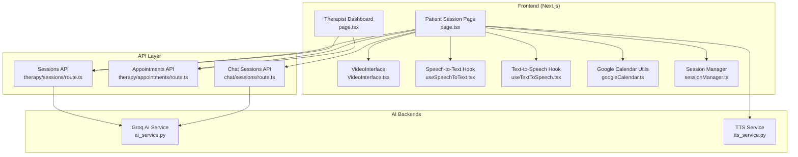
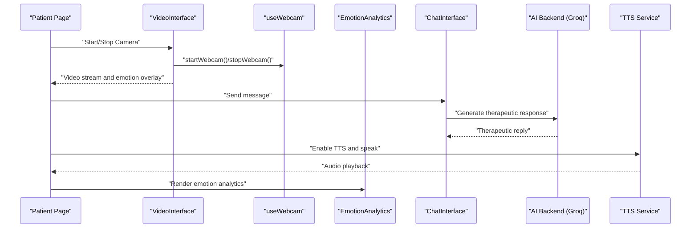
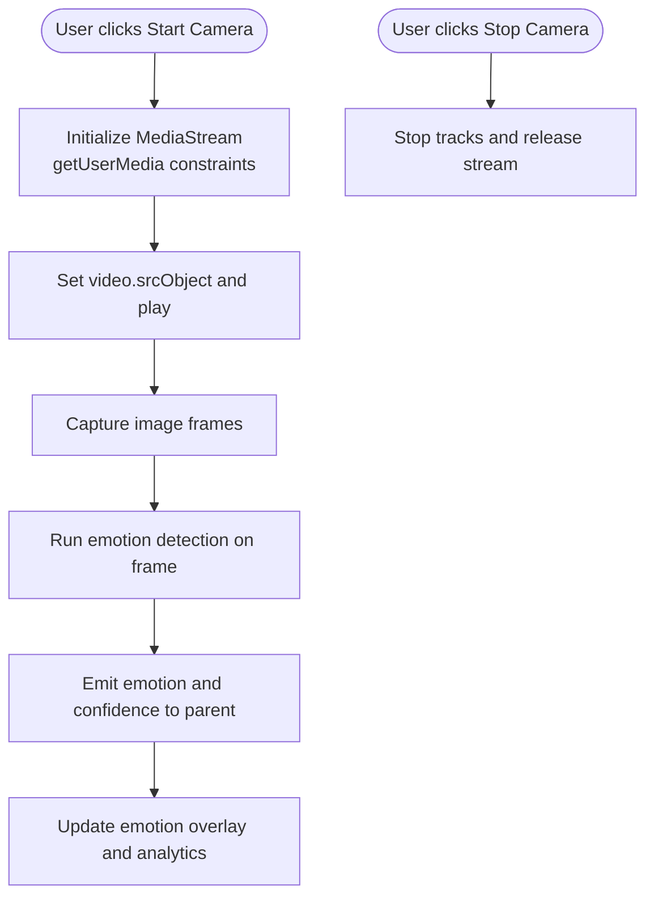
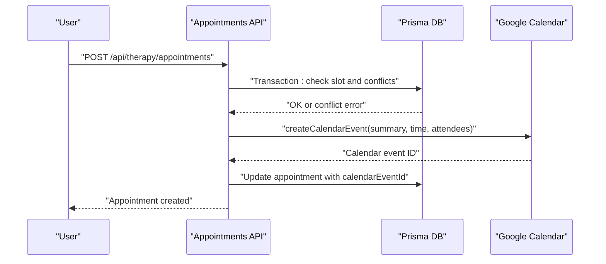
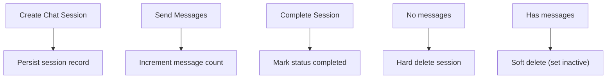
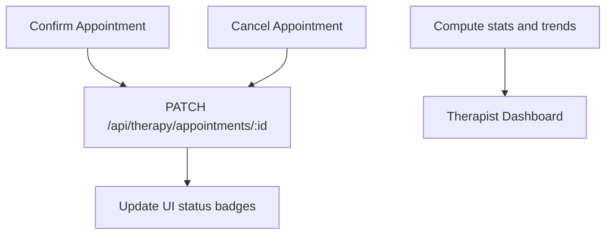
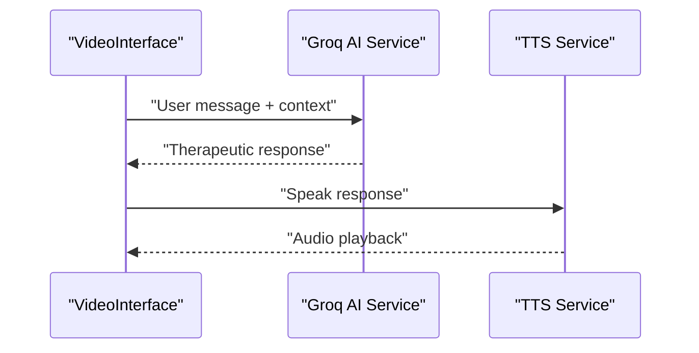
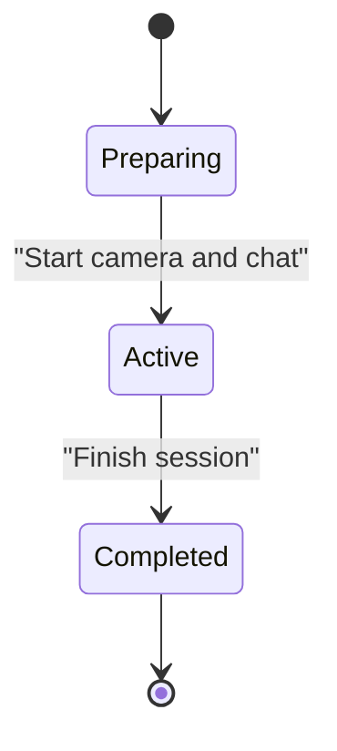
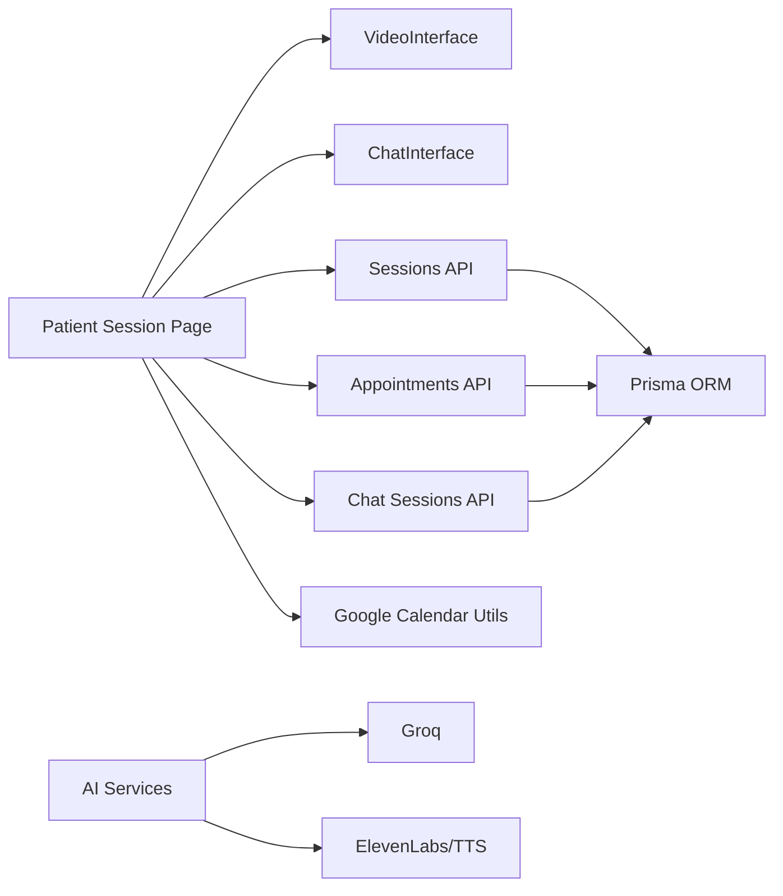

# Virtual Session Management

<cite>
**Referenced Files in This Document**
- [page.tsx](file://WEBAPP/src/app/patient/session/page.tsx)
- [page.tsx](file://WEBAPP/src/app/therapist/dashboard/page.tsx)
- [route.ts](file://WEBAPP/src/app/api/therapy/sessions/route.ts)
- [route.ts](file://WEBAPP/src/app/api/therapy/appointments/route.ts)
- [route.ts](file://WEBAPP/src/app/api/chat/sessions/route.ts)
- [googleCalendar.ts](file://WEBAPP/src/lib/googleCalendar.ts)
- [sessionManager.ts](file://WEBAPP/src/lib/sessionManager.ts)
- [VideoInterface.tsx](file://WEBAPP/src/components/VideoInterface.tsx)
- [useWebcam.ts](file://WEBAPP/src/hooks/useWebcam.ts)
- [useSpeechToText.tsx](file://WEBAPP/src/hooks/useSpeechToText.tsx)
- [useTextToSpeech.tsx](file://WEBAPP/src/hooks/useTextToSpeech.tsx)
- [EmotionAnalytics.tsx](file://WEBAPP/src/components/EmotionAnalytics.tsx)
- [ai_service.py](file://ai-backend/services/groq_ai_service.py)
- [ai_service.py](file://ai-backend/services/ai_service.py)
- [tts_service.py](file://ai-backend/services/tts_service.py)
</cite>

## Table of Contents
1. [Introduction](#introduction)
2. [Project Structure](#project-structure)
3. [Core Components](#core-components)
4. [Architecture Overview](#architecture-overview)
5. [Detailed Component Analysis](#detailed-component-analysis)
6. [Dependency Analysis](#dependency-analysis)
7. [Performance Considerations](#performance-considerations)
8. [Troubleshooting Guide](#troubleshooting-guide)
9. [Conclusion](#conclusion)
10. [Appendices](#appendices)

## Introduction
This document describes the virtual session management system for MindBridge, focusing on the video consultation interface, session scheduling and reminders, session recording and documentation, post-session follow-up, AI backend integrations for emotion detection and therapeutic responses, quality monitoring, troubleshooting, and end-to-end session lifecycle management from booking to completion.

## Project Structure
The system spans a Next.js frontend (WEBAPP) and Python-based AI/ML backends (ai-backend). Key areas:
- Frontend pages for patient and therapist dashboards
- Real-time emotion detection and video/audio controls
- Google Calendar integration for scheduling and reminders
- AI services for therapy responses and text-to-speech
- Prisma-backed API endpoints for sessions, appointments, and chat sessions

**Diagram sources**
- [page.tsx](file://WEBAPP/src/app/patient/session/page.tsx#L1-L283)
- [page.tsx](file://WEBAPP/src/app/therapist/dashboard/page.tsx#L1-L959)
- [VideoInterface.tsx](file://WEBAPP/src/components/VideoInterface.tsx#L1-L207)
- [useSpeechToText.tsx](file://WEBAPP/src/hooks/useSpeechToText.tsx#L1-L129)
- [useTextToSpeech.tsx](file://WEBAPP/src/hooks/useTextToSpeech.tsx#L1-L42)
- [googleCalendar.ts](file://WEBAPP/src/lib/googleCalendar.ts#L1-L226)
- [sessionManager.ts](file://WEBAPP/src/lib/sessionManager.ts#L1-L78)
- [route.ts](file://WEBAPP/src/app/api/therapy/sessions/route.ts#L1-L80)
- [route.ts](file://WEBAPP/src/app/api/therapy/appointments/route.ts#L1-L181)
- [route.ts](file://WEBAPP/src/app/api/chat/sessions/route.ts#L1-L187)
- [ai_service.py](file://ai-backend/services/ai_service.py#L1-L293)
- [tts_service.py](file://ai-backend/services/tts_service.py#L1-L280)

**Section sources**
- [page.tsx](file://WEBAPP/src/app/patient/session/page.tsx#L1-L283)
- [page.tsx](file://WEBAPP/src/app/therapist/dashboard/page.tsx#L1-L959)
- [VideoInterface.tsx](file://WEBAPP/src/components/VideoInterface.tsx#L1-L207)
- [useSpeechToText.tsx](file://WEBAPP/src/hooks/useSpeechToText.tsx#L1-L129)
- [useTextToSpeech.tsx](file://WEBAPP/src/hooks/useTextToSpeech.tsx#L1-L42)
- [googleCalendar.ts](file://WEBAPP/src/lib/googleCalendar.ts#L1-L226)
- [sessionManager.ts](file://WEBAPP/src/lib/sessionManager.ts#L1-L78)
- [route.ts](file://WEBAPP/src/app/api/therapy/sessions/route.ts#L1-L80)
- [route.ts](file://WEBAPP/src/app/api/therapy/appointments/route.ts#L1-L181)
- [route.ts](file://WEBAPP/src/app/api/chat/sessions/route.ts#L1-L187)
- [ai_service.py](file://ai-backend/services/ai_service.py#L1-L293)
- [tts_service.py](file://ai-backend/services/tts_service.py#L1-L280)

## Core Components
- Patient session page orchestrates the AI therapy experience, chat history, avatar display, and settings for TTS and avatar video.
- Therapist dashboard displays analytics, sessions, patients, and schedule with quick actions.
- VideoInterface integrates webcam and emotion detection, with controls to start/stop camera and toggle overlays.
- Hooks provide speech-to-text and text-to-speech capabilities.
- Google Calendar utilities create, update, and delete calendar events with Hangouts Meet conference data and reminders.
- Session manager utilities detect expiring sessions, compute remaining time, and handle incognito/private mode scenarios.
- AI backends provide therapeutic responses via Groq and synthetic speech via ElevenLabs/TTS service.

**Section sources**
- [page.tsx](file://WEBAPP/src/app/patient/session/page.tsx#L27-L283)
- [page.tsx](file://WEBAPP/src/app/therapist/dashboard/page.tsx#L68-L171)
- [VideoInterface.tsx](file://WEBAPP/src/components/VideoInterface.tsx#L13-L50)
- [useWebcam.ts](file://WEBAPP/src/hooks/useWebcam.ts#L9-L88)
- [useSpeechToText.tsx](file://WEBAPP/src/hooks/useSpeechToText.tsx#L56-L126)
- [useTextToSpeech.tsx](file://WEBAPP/src/hooks/useTextToSpeech.tsx#L3-L39)
- [googleCalendar.ts](file://WEBAPP/src/lib/googleCalendar.ts#L102-L161)
- [sessionManager.ts](file://WEBAPP/src/lib/sessionManager.ts#L3-L76)
- [ai_service.py](file://ai-backend/services/ai_service.py#L72-L192)
- [tts_service.py](file://ai-backend/services/tts_service.py#L53-L145)

## Architecture Overview
The system follows a modular architecture:
- Frontend pages coordinate UI and user interactions
- Hooks encapsulate browser APIs (camera, speech)
- API routes connect to Prisma for persistence
- AI backends provide external services for therapy and TTS
- Calendar integration synchronizes appointments

**Diagram sources**
- [page.tsx](file://WEBAPP/src/app/patient/session/page.tsx#L194-L201)
- [VideoInterface.tsx](file://WEBAPP/src/components/VideoInterface.tsx#L53-L68)
- [useWebcam.ts](file://WEBAPP/src/hooks/useWebcam.ts#L17-L52)
- [EmotionAnalytics.tsx](file://WEBAPP/src/components/EmotionAnalytics.tsx#L18-L88)
- [ai_service.py](file://ai-backend/services/ai_service.py#L131-L192)
- [tts_service.py](file://ai-backend/services/tts_service.py#L53-L145)

## Detailed Component Analysis

### Video Consultation Interface
- Camera setup: useWebcam hook initializes getUserMedia with constraints and manages stream lifecycle.
- Audio controls: microphone is disabled by default; audio controls are managed via UI switches.
- Real-time emotion detection: VideoInterface captures frames and emits detected emotion to parent; overlay shows current emotion and confidence.
- Emotion analytics: EmotionAnalytics aggregates distribution, average confidence, and recent trends.

**Diagram sources**
- [useWebcam.ts](file://WEBAPP/src/hooks/useWebcam.ts#L17-L52)
- [VideoInterface.tsx](file://WEBAPP/src/components/VideoInterface.tsx#L53-L68)
- [EmotionAnalytics.tsx](file://WEBAPP/src/components/EmotionAnalytics.tsx#L23-L88)

**Section sources**
- [useWebcam.ts](file://WEBAPP/src/hooks/useWebcam.ts#L1-L89)
- [VideoInterface.tsx](file://WEBAPP/src/components/VideoInterface.tsx#L1-L207)
- [EmotionAnalytics.tsx](file://WEBAPP/src/components/EmotionAnalytics.tsx#L1-L212)

### Session Scheduling and Reminders
- Booking flow: POST to appointments endpoint validates slot and time conflicts, creates appointment, and attempts to sync with Google Calendar.
- Calendar integration: createCalendarEvent constructs event with Hangouts Meet and reminder overrides; updates include partial patching; deletions remove calendar entries.
- Automated reminders: reminders array defines popup and email reminders before the event.

**Diagram sources**
- [route.ts](file://WEBAPP/src/app/api/therapy/appointments/route.ts#L38-L163)
- [googleCalendar.ts](file://WEBAPP/src/lib/googleCalendar.ts#L102-L161)

**Section sources**
- [route.ts](file://WEBAPP/src/app/api/therapy/appointments/route.ts#L1-L181)
- [googleCalendar.ts](file://WEBAPP/src/lib/googleCalendar.ts#L102-L161)

### Session Recording and Documentation
- Chat sessions: API supports CRUD operations for chat sessions, including hard delete when empty and soft delete otherwise.
- Session metadata: sessions API returns session records with patient/therapist linkage and ordering by start time.
- Documentation: therapist dashboard displays session history with message counts and statuses; download actions are exposed in UI.

**Diagram sources**
- [route.ts](file://WEBAPP/src/app/api/chat/sessions/route.ts#L42-L135)
- [route.ts](file://WEBAPP/src/app/api/therapy/sessions/route.ts#L5-L42)
- [page.tsx](file://WEBAPP/src/app/therapist/dashboard/page.tsx#L697-L771)

**Section sources**
- [route.ts](file://WEBAPP/src/app/api/chat/sessions/route.ts#L1-L187)
- [route.ts](file://WEBAPP/src/app/api/therapy/sessions/route.ts#L1-L80)
- [page.tsx](file://WEBAPP/src/app/therapist/dashboard/page.tsx#L697-L771)

### Post-Session Follow-Up Tools
- Appointment status management: PATCH endpoints confirm or cancel appointments; UI reflects status badges and actions.
- Analytics and insights: therapist dashboard computes totals, averages, and trend indicators; emotion analytics provide session insights.

**Diagram sources**
- [page.tsx](file://WEBAPP/src/app/therapist/dashboard/page.tsx#L349-L387)
- [route.ts](file://WEBAPP/src/app/api/therapy/appointments/route.ts#L1-L181)
- [page.tsx](file://WEBAPP/src/app/therapist/dashboard/page.tsx#L150-L162)

**Section sources**
- [page.tsx](file://WEBAPP/src/app/therapist/dashboard/page.tsx#L349-L387)
- [route.ts](file://WEBAPP/src/app/api/therapy/appointments/route.ts#L1-L181)

### AI Backend Integrations
- Emotion detection: VideoInterface triggers periodic emotion inference on captured frames and emits results.
- Therapeutic responses: GroqService generates contextual responses using conversation history and optional RAG augmentation.
- Text-to-speech: TTS service generates audio via ElevenLabs or falls back to dummy audio; audio files cleaned periodically.

**Diagram sources**
- [VideoInterface.tsx](file://WEBAPP/src/components/VideoInterface.tsx#L46-L50)
- [ai_service.py](file://ai-backend/services/ai_service.py#L131-L192)
- [tts_service.py](file://ai-backend/services/tts_service.py#L53-L145)

**Section sources**
- [ai_service.py](file://ai-backend/services/ai_service.py#L72-L192)
- [tts_service.py](file://ai-backend/services/tts_service.py#L1-L280)

### Session Lifecycle Management
- Preparation: camera and emotion detection enabled; avatar settings toggled; chat session initialized.
- Execution: real-time emotion overlay, therapeutic chat, and optional TTS playback.
- Completion: session marked completed, chat session persisted, calendar event synced.

[No sources needed since this diagram shows conceptual workflow, not actual code structure]

## Dependency Analysis
- Frontend depends on hooks for camera and speech, components for emotion analytics, and API routes for persistence.
- API routes depend on Prisma for ORM and Google Calendar utilities for synchronization.
- AI backends depend on external providers (Groq, ElevenLabs) with graceful fallbacks.

**Diagram sources**
- [page.tsx](file://WEBAPP/src/app/patient/session/page.tsx#L194-L201)
- [VideoInterface.tsx](file://WEBAPP/src/components/VideoInterface.tsx#L1-L207)
- [route.ts](file://WEBAPP/src/app/api/chat/sessions/route.ts#L1-L187)
- [route.ts](file://WEBAPP/src/app/api/therapy/sessions/route.ts#L1-L80)
- [route.ts](file://WEBAPP/src/app/api/therapy/appointments/route.ts#L1-L181)
- [googleCalendar.ts](file://WEBAPP/src/lib/googleCalendar.ts#L1-L226)
- [ai_service.py](file://ai-backend/services/ai_service.py#L1-L293)
- [tts_service.py](file://ai-backend/services/tts_service.py#L1-L280)

**Section sources**
- [page.tsx](file://WEBAPP/src/app/patient/session/page.tsx#L1-L283)
- [route.ts](file://WEBAPP/src/app/api/chat/sessions/route.ts#L1-L187)
- [route.ts](file://WEBAPP/src/app/api/therapy/sessions/route.ts#L1-L80)
- [route.ts](file://WEBAPP/src/app/api/therapy/appointments/route.ts#L1-L181)
- [googleCalendar.ts](file://WEBAPP/src/lib/googleCalendar.ts#L1-L226)
- [ai_service.py](file://ai-backend/services/ai_service.py#L1-L293)
- [tts_service.py](file://ai-backend/services/tts_service.py#L1-L280)

## Performance Considerations
- Emotion detection frequency: configurable interval to balance responsiveness and CPU usage.
- Media constraints: optimal width/height reduce bandwidth and processing overhead.
- TTS fallback: dummy audio ensures continuity when external services are unavailable.
- Calendar sync: non-blocking operation prevents UI stalls; errors logged and ignored to avoid blocking.

[No sources needed since this section provides general guidance]

## Troubleshooting Guide
- Camera errors: useWebcam sets error state; VideoInterface displays alerts and disables controls until resolved.
- Speech recognition: useSpeechToText warns unsupported browsers and logs errors; ensure HTTPS and modern browser.
- Session validation: sessionManager listens for focus and storage events to detect expiration and reloads as needed.
- Calendar sync failures: appointments API catches and warns; appointment remains in DB; manual sync recommended.

**Section sources**
- [useWebcam.ts](file://WEBAPP/src/hooks/useWebcam.ts#L37-L40)
- [VideoInterface.tsx](file://WEBAPP/src/components/VideoInterface.tsx#L131-L140)
- [useSpeechToText.tsx](file://WEBAPP/src/hooks/useSpeechToText.tsx#L94-L96)
- [sessionManager.ts](file://WEBAPP/src/lib/sessionManager.ts#L43-L75)
- [route.ts](file://WEBAPP/src/app/api/therapy/appointments/route.ts#L159-L161)

## Conclusion
MindBridge’s virtual session management integrates a responsive frontend with robust AI backends, enabling real-time emotion-aware therapy, seamless scheduling with Google Calendar, and comprehensive post-session documentation. The system emphasizes reliability through fallbacks, privacy-aware session handling, and modular components for maintainability.

[No sources needed since this section summarizes without analyzing specific files]

## Appendices

### API Definitions
- Sessions API
  - GET /api/therapy/sessions?therapistId=&patientId=
  - POST /api/therapy/sessions (requires therapistId, patientId, startTime)
- Appointments API
  - GET /api/therapy/appointments?therapistId=&patientId=
  - POST /api/therapy/appointments (validates slot and time conflicts, syncs calendar)
- Chat Sessions API
  - GET /api/chat/sessions
  - POST /api/chat/sessions
  - PATCH /api/chat/sessions
  - DELETE /api/chat/sessions?sessionId=

**Section sources**
- [route.ts](file://WEBAPP/src/app/api/therapy/sessions/route.ts#L1-L80)
- [route.ts](file://WEBAPP/src/app/api/therapy/appointments/route.ts#L1-L181)
- [route.ts](file://WEBAPP/src/app/api/chat/sessions/route.ts#L1-L187)