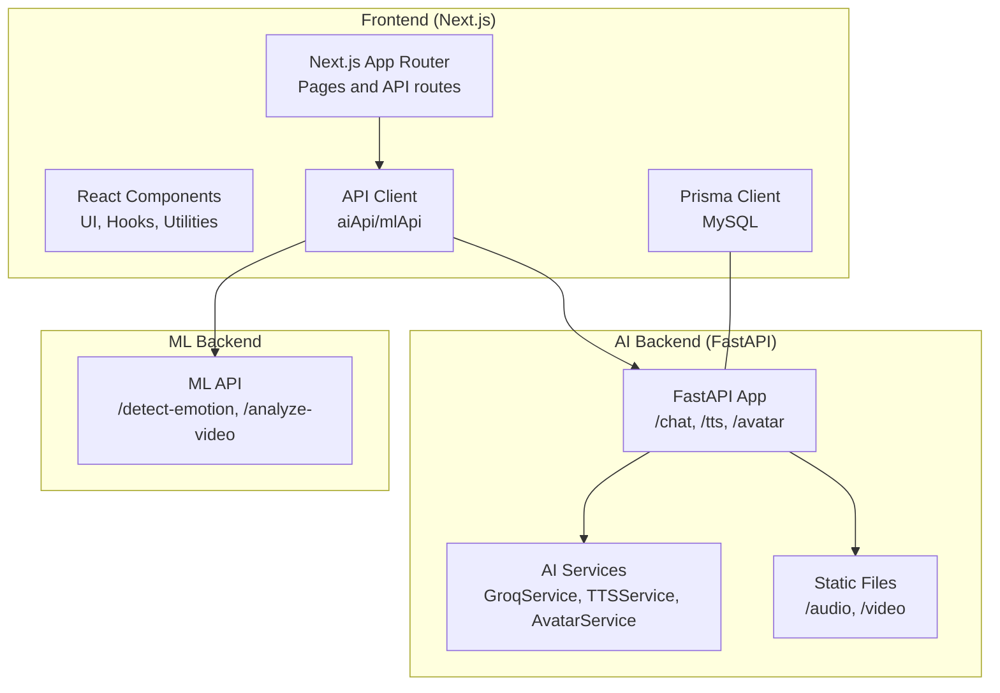
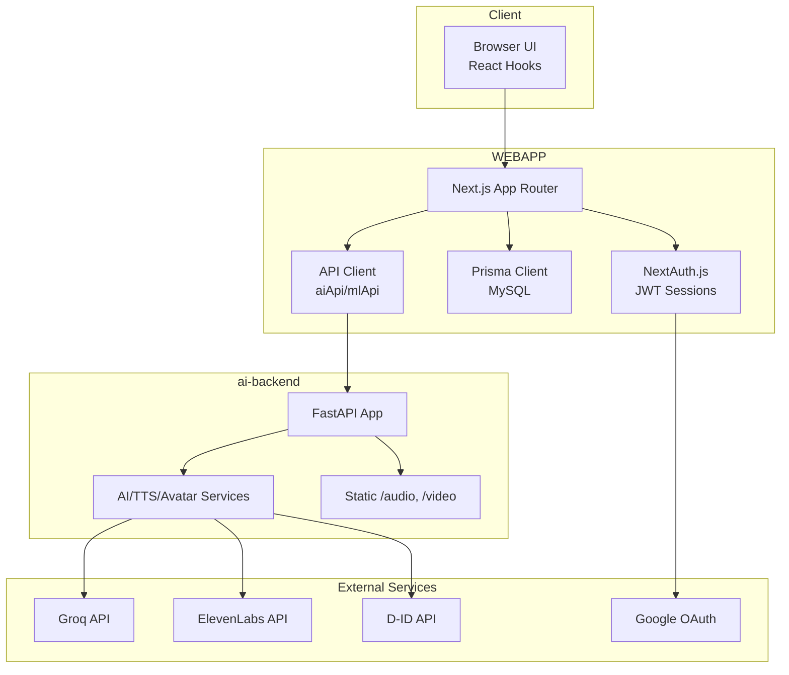
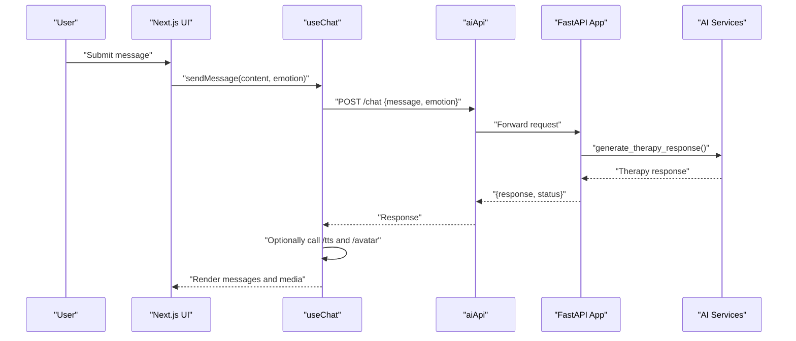
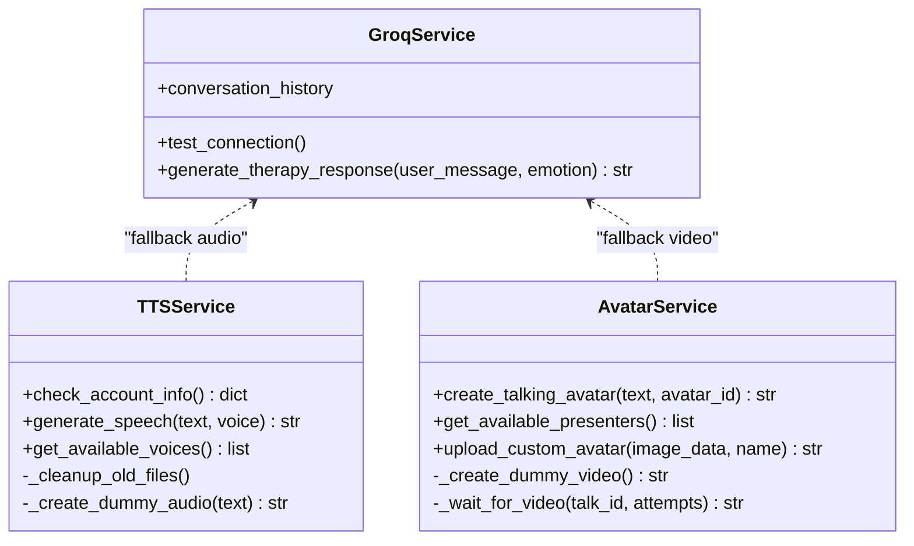
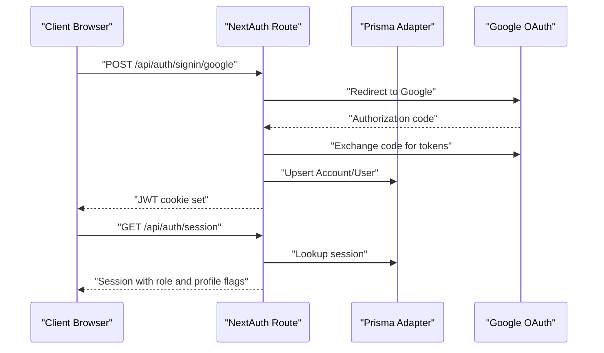
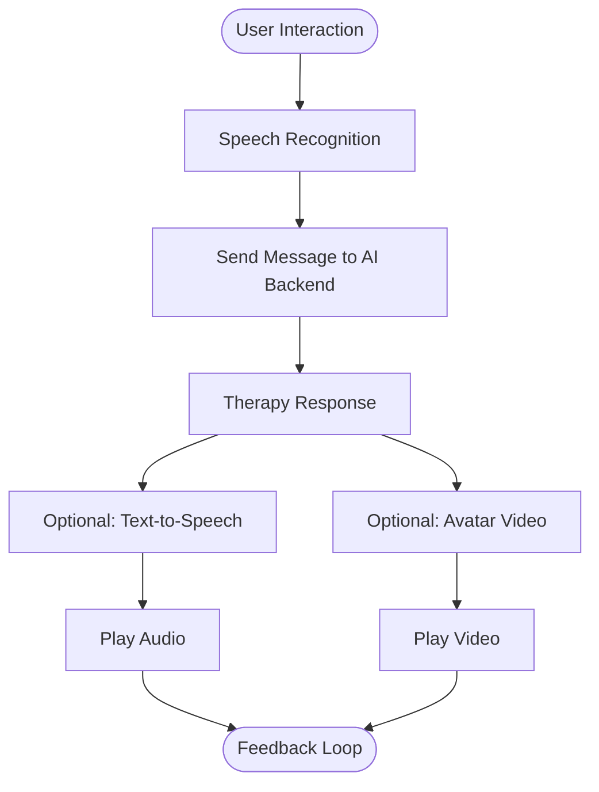
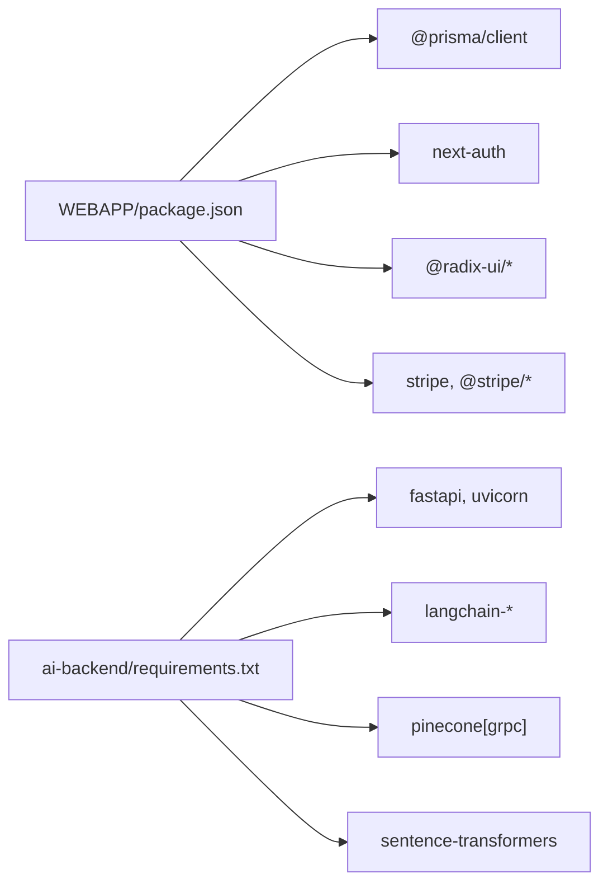

# Architecture Overview

<cite>
**Referenced Files in This Document**
- [package.json](file://WEBAPP/package.json)
- [next.config.ts](file://WEBAPP/next.config.ts)
- [schema.prisma](file://WEBAPP/prisma/schema.prisma)
- [db.ts](file://WEBAPP/src/lib/db.ts)
- [api.ts](file://WEBAPP/src/lib/api.ts)
- [route.ts](file://WEBAPP/src/app/api/auth/[...nextauth]/route.ts)
- [useChat.ts](file://WEBAPP/src/hooks/useChat.ts)
- [useSpeechToText.tsx](file://WEBAPP/src/hooks/useSpeechToText.tsx)
- [useTextToSpeech.tsx](file://WEBAPP/src/hooks/useTextToSpeech.tsx)
- [useWebcam.ts](file://WEBAPP/src/hooks/useWebcam.ts)
- [app.py](file://ai-backend/app.py)
- [ai_service.py](file://ai-backend/services/ai_service.py)
- [tts_service.py](file://ai-backend/services/tts_service.py)
- [avatar_service.py](file://ai-backend/services/avatar_service.py)
- [config.py](file://ai-backend/config.py)
- [requirements.txt](file://ai-backend/requirements.txt)
</cite>

## Table of Contents
1. [Introduction](#introduction)
2. [Project Structure](#project-structure)
3. [Core Components](#core-components)
4. [Architecture Overview](#architecture-overview)
5. [Detailed Component Analysis](#detailed-component-analysis)
6. [Dependency Analysis](#dependency-analysis)
7. [Performance Considerations](#performance-considerations)
8. [Troubleshooting Guide](#troubleshooting-guide)
9. [Conclusion](#conclusion)
10. [Appendices](#appendices)

## Introduction
MindBridge AI is a mental health platform designed to provide accessible, scalable therapeutic support through a modern web application and integrated AI services. The system follows a layered architecture:
- Frontend: Next.js 15 application with React 19, TypeScript, and TailwindCSS
- Backend: FastAPI microservices for AI capabilities (RAG, TTS, Avatar generation)
- Data: MySQL via Prisma ORM with comprehensive user, session, and analytics models
- Authentication: NextAuth.js with Prisma adapter supporting Google OAuth and Credentials providers
- Real-time and media: Browser APIs for speech, webcam, and static asset serving

The platform emphasizes user safety, scalability, and modularity, enabling independent scaling of AI services and the web frontend.

## Project Structure
The repository is organized into three primary areas:
- WEBAPP: Next.js frontend with routing, components, hooks, and Prisma schema
- ai-backend: FastAPI microservices for AI therapy, TTS, and Avatar generation
- ml-backend: Separate machine learning backend for emotion/video analytics (referenced in API configuration)

**Diagram sources**
- [next.config.ts](file://WEBAPP/next.config.ts#L1-L45)
- [api.ts](file://WEBAPP/src/lib/api.ts#L1-L142)
- [app.py](file://ai-backend/app.py#L1-L154)
- [ai_service.py](file://ai-backend/services/ai_service.py#L72-L192)
- [tts_service.py](file://ai-backend/services/tts_service.py#L10-L145)
- [avatar_service.py](file://ai-backend/services/avatar_service.py#L11-L68)

**Section sources**
- [package.json](file://WEBAPP/package.json#L1-L88)
- [next.config.ts](file://WEBAPP/next.config.ts#L1-L45)
- [schema.prisma](file://WEBAPP/prisma/schema.prisma#L1-L330)

## Core Components
- Next.js Frontend
  - App Router pages and API routes under src/app
  - Shared hooks for chat, speech-to-text, text-to-speech, and webcam
  - Prisma client configured for MySQL
- AI Backend (FastAPI)
  - REST endpoints for therapy chat, TTS, and Avatar generation
  - Lazy-initialized services with fallbacks for offline scenarios
  - Static file serving for generated audio/video
- Authentication
  - NextAuth.js with Prisma adapter and JWT sessions
  - Providers: Google OAuth and Credentials
- Database
  - Prisma schema defines user roles, chat sessions, therapy sessions, appointments, analytics, and peer support models
- API Clients
  - aiApi and mlApi encapsulate backend URLs and request utilities

**Section sources**
- [api.ts](file://WEBAPP/src/lib/api.ts#L1-L142)
- [db.ts](file://WEBAPP/src/lib/db.ts#L1-L15)
- [route.ts](file://WEBAPP/src/app/api/auth/[...nextauth]/route.ts#L1-L240)
- [app.py](file://ai-backend/app.py#L1-L154)
- [schema.prisma](file://WEBAPP/prisma/schema.prisma#L1-L330)

## Architecture Overview
High-level system boundaries and interactions:
- Internal boundaries
  - WEBAPP: Next.js application, Prisma ORM, and API clients
  - ai-backend: FastAPI microservices for AI
  - ml-backend: ML inference endpoints (emotion detection and video analysis)
- External boundaries
  - AI providers: Groq (LLM), ElevenLabs (TTS), D-ID (Avatar)
  - Identity provider: Google OAuth
  - Database: MySQL

**Diagram sources**
- [api.ts](file://WEBAPP/src/lib/api.ts#L1-L142)
- [route.ts](file://WEBAPP/src/app/api/auth/[...nextauth]/route.ts#L1-L240)
- [app.py](file://ai-backend/app.py#L1-L154)
- [ai_service.py](file://ai-backend/services/ai_service.py#L72-L192)
- [tts_service.py](file://ai-backend/services/tts_service.py#L10-L145)
- [avatar_service.py](file://ai-backend/services/avatar_service.py#L11-L68)

## Detailed Component Analysis

### Next.js Frontend Layer
- App Router and Pages
  - Dedicated pages for roles (patient, therapist, admin) and features (dashboard, sessions, analytics)
  - API routes under src/app/api for authentication and feature endpoints
- Authentication Flow
  - NextAuth.js handles sign-in/sign-out, JWT token management, and session persistence
  - Supports Google OAuth and Credentials providers; integrates with Prisma adapter
- Database Access
  - Prisma client instantiated once globally with environment-aware logging
- API Clients
  - aiApi targets ai-backend endpoints (/chat, /tts, /avatar)
  - mlApi targets ml-backend endpoints (/detect-emotion, /analyze-video)
- Hooks
  - useChat orchestrates therapy messaging, optional TTS, and avatar playback
  - useSpeechToText and useTextToSpeech wrap browser APIs
  - useWebcam captures images for analytics

**Diagram sources**
- [useChat.ts](file://WEBAPP/src/hooks/useChat.ts#L40-L116)
- [api.ts](file://WEBAPP/src/lib/api.ts#L75-L113)
- [app.py](file://ai-backend/app.py#L81-L94)
- [ai_service.py](file://ai-backend/services/ai_service.py#L131-L192)

**Section sources**
- [route.ts](file://WEBAPP/src/app/api/auth/[...nextauth]/route.ts#L1-L240)
- [db.ts](file://WEBAPP/src/lib/db.ts#L1-L15)
- [api.ts](file://WEBAPP/src/lib/api.ts#L1-L142)
- [useChat.ts](file://WEBAPP/src/hooks/useChat.ts#L1-L150)
- [useSpeechToText.tsx](file://WEBAPP/src/hooks/useSpeechToText.tsx#L1-L129)
- [useTextToSpeech.tsx](file://WEBAPP/src/hooks/useTextToSpeech.tsx#L1-L42)
- [useWebcam.ts](file://WEBAPP/src/hooks/useWebcam.ts#L1-L89)

### AI Backend Microservices
- FastAPI Application
  - Root and health endpoints
  - CORS enabled for development and deployment flexibility
  - Static file mounts for audio and video under /audio and /video
  - Lazy initialization of AI services to avoid import-time failures
- AI Service (Groq)
  - Maintains conversation history
  - Optional RAG integration with Pinecone vector store
  - Async-friendly execution with executor fallbacks
- TTS Service (ElevenLabs)
  - Generates speech with fallback to dummy audio when API key is missing
  - Periodic cleanup of temporary audio files
  - Voice selection and account info checks
- Avatar Service (D-ID)
  - Creates talking avatar videos with fallback to dummy video
  - Presenter management and custom avatar upload helpers
  - Robust error handling and placeholder generation

**Diagram sources**
- [ai_service.py](file://ai-backend/services/ai_service.py#L72-L192)
- [tts_service.py](file://ai-backend/services/tts_service.py#L10-L145)
- [avatar_service.py](file://ai-backend/services/avatar_service.py#L11-L68)

**Section sources**
- [app.py](file://ai-backend/app.py#L1-L154)
- [ai_service.py](file://ai-backend/services/ai_service.py#L1-L293)
- [tts_service.py](file://ai-backend/services/tts_service.py#L1-L280)
- [avatar_service.py](file://ai-backend/services/avatar_service.py#L1-L237)
- [config.py](file://ai-backend/config.py#L1-L49)
- [requirements.txt](file://ai-backend/requirements.txt#L1-L81)

### Database Architecture with Prisma ORM and MySQL
- Schema Overview
  - Users with roles (patient, therapist, admin), profiles, and related entities
  - Chat sessions and messages with metadata
  - Therapy sessions, appointments, availability, and analytics
  - Peer support posts and replies
  - OTP tokens and admin users
- Client Initialization
  - Singleton Prisma client with environment-aware logging
  - Global caching in non-production environments
- Integration
  - NextAuth adapter uses the same Prisma client for session storage
  - All domain models are defined centrally for consistency

```mermaid
erDiagram
USER {
string id PK
string email UK
string name
datetime emailVerified
string role
boolean isProfileComplete
boolean isBanned
datetime createdAt
}
ACCOUNT {
string id PK
string userId FK
string provider
string providerAccountId
}
SESSION {
string id PK
string sessionToken UK
string userId FK
datetime expires
}
CHAT_SESSION {
string id PK
string userId FK
string title
boolean isActive
datetime createdAt
datetime updatedAt
}
CHAT_MESSAGE {
string id PK
string userId FK
string sessionId FK
string role
text content
json metadata
datetime timestamp
}
THERAPY_SESSION {
string id PK
string therapistId FK
string patientId FK
datetime startTime
datetime endTime
int duration
json emotionsSummary
int messageCount
string status
text notes
datetime createdAt
datetime updatedAt
}
APPOINTMENT {
string id PK
string therapistId FK
string patientId FK
string slotId FK
datetime scheduledTime
int duration
string status
string type
text notes
boolean reminderSent
string calendarEventId
datetime createdAt
datetime updatedAt
}
MENTAL_HEALTH_ANALYTICS {
string id PK
string userId FK
date date
int mentalHealthLevel
string levelLabel
json keywordsDetected
json keywordCounts
int totalMessages
int positiveCount
int negativeCount
json riskFlags
string source
datetime createdAt
}
PEER_SUPPORT_POST {
string id PK
text content
string category
int likes
string anonymousId
string ipHash
boolean isActive
datetime createdAt
datetime updatedAt
}
REPLY {
string id PK
text content
datetime timestamp
boolean isVolunteer
string anonymousId
string postId FK
}
USER ||--o{ ACCOUNT : "has"
USER ||--o{ SESSION : "has"
USER ||--o{ CHAT_SESSION : "owns"
CHAT_SESSION ||--o{ CHAT_MESSAGE : "contains"
USER ||--o{ THERAPY_SESSION : "as therapist"
USER ||--o{ THERAPY_SESSION : "as patient"
APPOINTMENT }o--|| USER : "booked by"
APPOINTMENT }o--|| USER : "booked for"
USER ||--o{ MENTAL_HEALTH_ANALYTICS : "analyzed"
PEER_SUPPORT_POST ||--o{ REPLY : "has"
```

**Diagram sources**
- [schema.prisma](file://WEBAPP/prisma/schema.prisma#L1-L330)

**Section sources**
- [schema.prisma](file://WEBAPP/prisma/schema.prisma#L1-L330)
- [db.ts](file://WEBAPP/src/lib/db.ts#L1-L15)

### Authentication Flow with NextAuth
- Providers
  - Google OAuth with authorization parameters and account linking
  - Credentials provider with bcrypt comparison against stored hashes
- Session Management
  - JWT strategy with configurable max age and update age
  - Cookie configuration supports both HTTP and HTTPS environments
- Adapter and Storage
  - Prisma adapter persists sessions and accounts
  - User records include role, profile completion flag, and ban status
- Events and Monitoring
  - Logging for sign-in, sign-out, and session access events

**Diagram sources**
- [route.ts](file://WEBAPP/src/app/api/auth/[...nextauth]/route.ts#L1-L240)

**Section sources**
- [route.ts](file://WEBAPP/src/app/api/auth/[...nextauth]/route.ts#L1-L240)

### Real-Time Communication Patterns
- Browser APIs
  - SpeechRecognition for speech-to-text
  - SpeechSynthesis for text-to-speech
  - MediaDevices getUserMedia for webcam capture
- Streaming and Playback
  - FastAPI serves generated audio/video via static mounts
  - Frontend consumes URLs returned by AI backend endpoints
- Asynchronous Workflows
  - AI services operate asynchronously with fallbacks for resilience
  - Hooks coordinate UI updates and media playback

**Diagram sources**
- [useSpeechToText.tsx](file://WEBAPP/src/hooks/useSpeechToText.tsx#L56-L126)
- [useTextToSpeech.tsx](file://WEBAPP/src/hooks/useTextToSpeech.tsx#L3-L42)
- [useWebcam.ts](file://WEBAPP/src/hooks/useWebcam.ts#L1-L89)
- [api.ts](file://WEBAPP/src/lib/api.ts#L75-L113)
- [app.py](file://ai-backend/app.py#L96-L122)

**Section sources**
- [useSpeechToText.tsx](file://WEBAPP/src/hooks/useSpeechToText.tsx#L1-L129)
- [useTextToSpeech.tsx](file://WEBAPP/src/hooks/useTextToSpeech.tsx#L1-L42)
- [useWebcam.ts](file://WEBAPP/src/hooks/useWebcam.ts#L1-L89)
- [api.ts](file://WEBAPP/src/lib/api.ts#L1-L142)
- [app.py](file://ai-backend/app.py#L1-L154)

### External Service Integrations
- AI and Media
  - Groq for therapeutic responses with optional RAG augmentation
  - ElevenLabs for TTS with fallback audio generation
  - D-ID for avatar video creation with dummy fallback
- Identity
  - Google OAuth for sign-in and profile linking
- Infrastructure
  - MySQL via Prisma for persistent data
  - Static file serving for media assets

**Section sources**
- [ai_service.py](file://ai-backend/services/ai_service.py#L1-L293)
- [tts_service.py](file://ai-backend/services/tts_service.py#L1-L280)
- [avatar_service.py](file://ai-backend/services/avatar_service.py#L1-L237)
- [route.ts](file://WEBAPP/src/app/api/auth/[...nextauth]/route.ts#L1-L240)
- [schema.prisma](file://WEBAPP/prisma/schema.prisma#L1-L330)

## Dependency Analysis
- Frontend Dependencies
  - Next.js, React, Prisma Client, NextAuth, Radix UI, Stripe SDKs, and TailwindCSS
- AI Backend Dependencies
  - FastAPI, uvicorn, httpx, dotenv, sentence-transformers, langchain, pinecone
- Database and Tools
  - mysql2 driver, Prisma CLI, ts-node for seeding

**Diagram sources**
- [package.json](file://WEBAPP/package.json#L15-L86)
- [requirements.txt](file://ai-backend/requirements.txt#L70-L81)

**Section sources**
- [package.json](file://WEBAPP/package.json#L1-L88)
- [requirements.txt](file://ai-backend/requirements.txt#L1-L81)

## Performance Considerations
- Scalability
  - AI backend runs as independent microservices; scale horizontally behind a reverse proxy
  - Use worker processes and keep concurrency low for stability on Windows
- Caching and Resilience
  - AI services include fallbacks for TTS and Avatar when external APIs are unavailable
  - Temporary media files are cleaned periodically to manage disk usage
- Database
  - Indexes on frequently queried fields (user, session, timestamps) improve query performance
  - Use Prisma client pooling and environment-specific logging
- Network
  - Static file serving for audio/video reduces latency and offloads compute
  - CORS and headers configured for development and external access

[No sources needed since this section provides general guidance]

## Troubleshooting Guide
- Authentication
  - Verify NEXTAUTH_URL and secure cookie settings for HTTPS environments
  - Check Prisma adapter mappings and user roles
- AI Backend
  - Confirm environment variables for Groq, ElevenLabs, and D-ID keys
  - Health check endpoint helps validate service readiness
- Media Generation
  - TTS fallback generates dummy audio when API key is missing
  - Avatar fallback serves pre-bundled video files
- Database
  - Ensure DATABASE_URL is set and reachable
  - Run Prisma migrations and seed as needed

**Section sources**
- [route.ts](file://WEBAPP/src/app/api/auth/[...nextauth]/route.ts#L1-L240)
- [app.py](file://ai-backend/app.py#L77-L79)
- [tts_service.py](file://ai-backend/services/tts_service.py#L53-L145)
- [avatar_service.py](file://ai-backend/services/avatar_service.py#L19-L68)
- [schema.prisma](file://WEBAPP/prisma/schema.prisma#L1-L330)

## Conclusion
MindBridge AI employs a clean separation of concerns across frontend, AI microservices, and data layers. The Next.js frontend integrates tightly with FastAPI services for therapy, TTS, and avatar generation, backed by a robust Prisma/MySQL schema. NextAuth manages identity securely with flexible providers and session strategies. The modular design enables independent scaling, resilient fallbacks, and a strong foundation for future enhancements.

[No sources needed since this section summarizes without analyzing specific files]

## Appendices
- Technology Stack Decisions
  - Next.js for productivity, SSR/SSG, and App Router
  - FastAPI for lightweight, asynchronous AI microservices
  - Prisma for type-safe database operations and schema evolution
  - MySQL for relational data and mature tooling
  - Browser APIs for speech/webcam to minimize backend load

[No sources needed since this section provides general guidance]