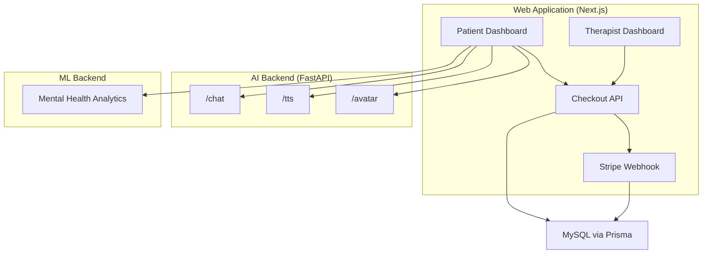
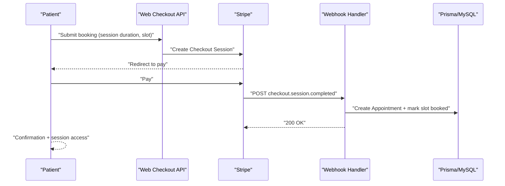
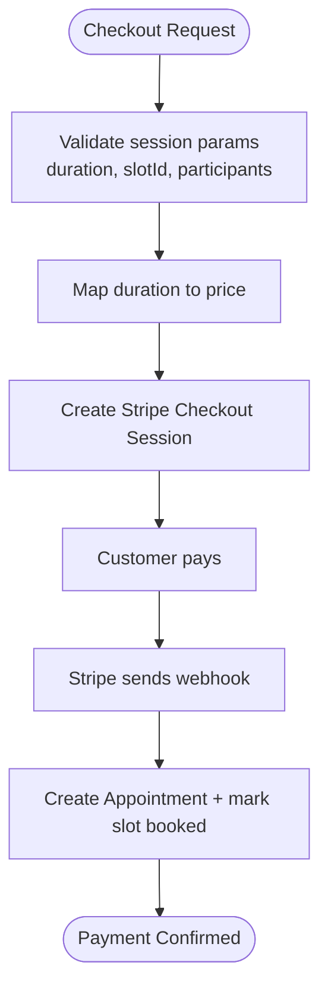
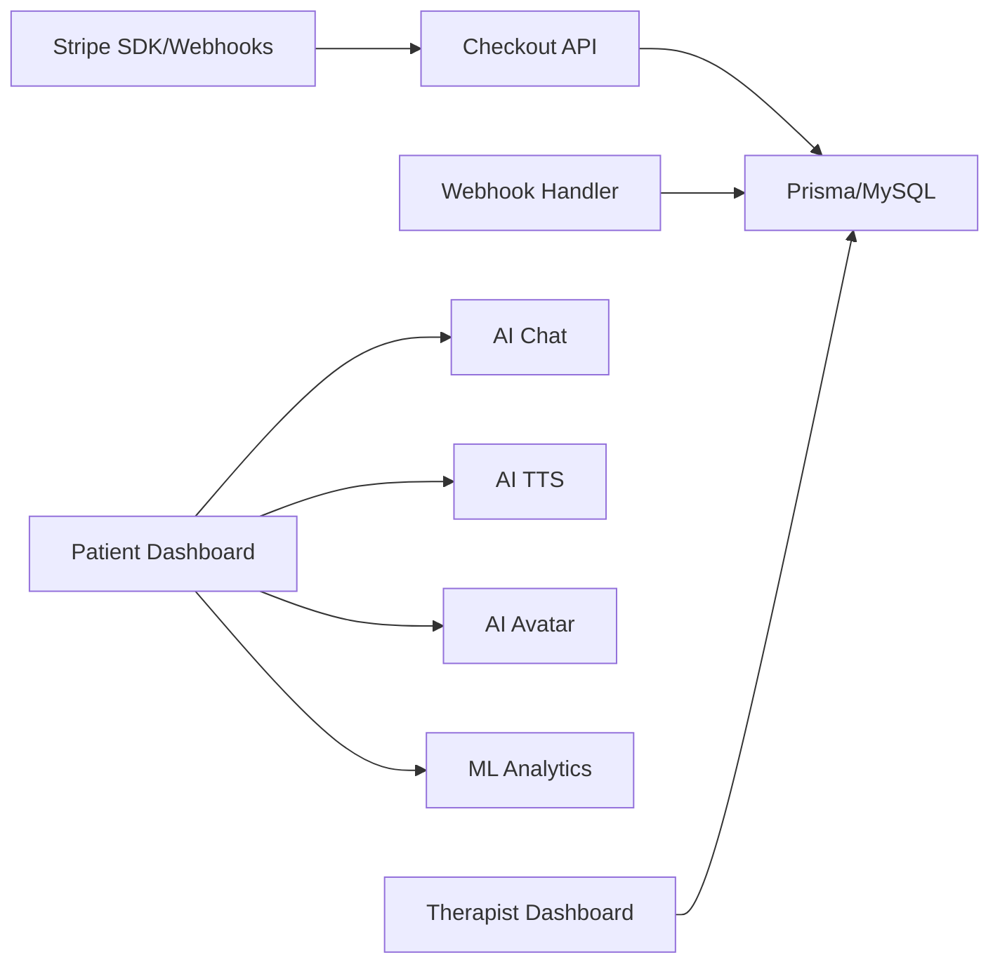

# Business Model

<cite>
**Referenced Files in This Document**
- [README.md](file://README.md)
- [package.json](file://WEBAPP/package.json)
- [schema.prisma](file://WEBAPP/prisma/schema.prisma)
- [.env.example](file://WEBAPP/.env.example)
- [route.ts (Stripe checkout)](file://WEBAPP/src/app/api/checkout/route.ts)
- [route.ts (Stripe webhook)](file://WEBAPP/src/app/api/webhook/stripe/route.ts)
- [app.py (AI backend)](file://ai-backend/app.py)
- [page.tsx (Patient dashboard)](file://WEBAPP/src/app/patient/dashboard/page.tsx)
- [page.tsx (Therapist dashboard)](file://WEBAPP/src/app/therapist/dashboard/page.tsx)
</cite>

## Table of Contents
1. [Introduction](#introduction)
2. [Project Structure](#project-structure)
3. [Core Components](#core-components)
4. [Architecture Overview](#architecture-overview)
5. [Detailed Component Analysis](#detailed-component-analysis)
6. [Dependency Analysis](#dependency-analysis)
7. [Performance Considerations](#performance-considerations)
8. [Troubleshooting Guide](#troubleshooting-guide)
9. [Conclusion](#conclusion)
10. [Appendices](#appendices)

## Introduction
This document presents a comprehensive business model for the MindBridge AI platform. It synthesizes observable features and integrations from the repository to define revenue streams, pricing strategy, monetization approaches, cost structure, market positioning, growth projections, sustainability levers, and compliance considerations grounded in the healthcare technology domain.

## Project Structure
MindBridge comprises:
- Frontend web application (Next.js) with user dashboards for patients and therapists, integrated payment and analytics features
- AI backend (FastAPI) providing therapy chat, text-to-speech, and avatar generation
- Machine learning backend (Flask/FastAPI) for mental health analytics
- Database schema (Prisma/MySQL) modeling users, therapy sessions, appointments, and analytics
- Payment infrastructure via Stripe (checkout and webhooks)

**Diagram sources**
- [page.tsx (Patient dashboard)](file://WEBAPP/src/app/patient/dashboard/page.tsx#L1-L120)
- [page.tsx (Therapist dashboard)](file://WEBAPP/src/app/therapist/dashboard/page.tsx#L1-L120)
- [route.ts (Stripe checkout)](file://WEBAPP/src/app/api/checkout/route.ts#L1-L82)
- [route.ts (Stripe webhook)](file://WEBAPP/src/app/api/webhook/stripe/route.ts#L1-L67)
- [app.py (AI backend)](file://ai-backend/app.py#L1-L154)
- [schema.prisma](file://WEBAPP/prisma/schema.prisma#L1-L330)

**Section sources**
- [README.md](file://README.md#L1-L3)
- [package.json](file://WEBAPP/package.json#L1-L88)
- [schema.prisma](file://WEBAPP/prisma/schema.prisma#L1-L330)
- [.env.example](file://WEBAPP/.env.example#L1-L16)

## Core Components
- Subscription-based therapy sessions: The checkout API defines per-session pricing tiers and integrates Stripe for payment. Appointments are created upon successful payment via webhook.
- Premium features: The presence of analytics dashboards and advanced NLP analytics indicates premium capabilities accessible to subscribed users.
- Professional service fees: Therapists are modeled as users with profiles, availability, and appointments; monetization occurs through session bookings and possibly professional service fees (to be defined).
- AI/ML services: The AI backend exposes chat, TTS, and avatar generation endpoints; the ML backend computes analytics. These services underpin the platform’s value proposition.

**Section sources**
- [route.ts (Stripe checkout)](file://WEBAPP/src/app/api/checkout/route.ts#L9-L15)
- [route.ts (Stripe webhook)](file://WEBAPP/src/app/api/webhook/stripe/route.ts#L24-L63)
- [schema.prisma](file://WEBAPP/prisma/schema.prisma#L140-L211)
- [page.tsx (Patient dashboard)](file://WEBAPP/src/app/patient/dashboard/page.tsx#L760-L775)
- [page.tsx (Therapist dashboard)](file://WEBAPP/src/app/therapist/dashboard/page.tsx#L600-L638)
- [app.py (AI backend)](file://ai-backend/app.py#L81-L122)

## Architecture Overview
The business architecture centers on three pillars:
- Revenue engine: Stripe checkout and webhooks for session payments; appointment lifecycle management
- Product engine: AI backend for therapy interactions; ML backend for analytics; web dashboards for patients and therapists
- Data engine: Prisma-managed MySQL storing users, sessions, appointments, and analytics

**Diagram sources**
- [route.ts (Stripe checkout)](file://WEBAPP/src/app/api/checkout/route.ts#L17-L81)
- [route.ts (Stripe webhook)](file://WEBAPP/src/app/api/webhook/stripe/route.ts#L11-L66)
- [schema.prisma](file://WEBAPP/prisma/schema.prisma#L186-L211)

## Detailed Component Analysis

### Revenue Streams and Pricing Strategy
- Subscription-based therapy sessions:
  - Tiered pricing by session duration is defined in the checkout API. Prices are mapped per-second amounts for 30, 60, 90, and 120-minute slots.
  - Payments are processed via Stripe; successful payments trigger webhook-based creation of confirmed appointments and marking of availability slots as booked.
- Premium features:
  - Dashboards expose analytics and advanced NLP insights, indicating premium tiers for enhanced reporting and deeper insights.
- Professional service fees:
  - Therapists maintain profiles and schedules; monetization can be realized through session fees and optional professional services.

**Diagram sources**
- [route.ts (Stripe checkout)](file://WEBAPP/src/app/api/checkout/route.ts#L17-L81)
- [route.ts (Stripe webhook)](file://WEBAPP/src/app/api/webhook/stripe/route.ts#L24-L63)

**Section sources**
- [route.ts (Stripe checkout)](file://WEBAPP/src/app/api/checkout/route.ts#L9-L15)
- [route.ts (Stripe checkout)](file://WEBAPP/src/app/api/checkout/route.ts#L42-L71)
- [route.ts (Stripe webhook)](file://WEBAPP/src/app/api/webhook/stripe/route.ts#L24-L63)
- [schema.prisma](file://WEBAPP/prisma/schema.prisma#L186-L211)

### Monetization Approaches by User Segment
- Patients:
  - Pay-per-session for AI-assisted therapy and virtual sessions; access to analytics dashboards as part of premium offering.
- Therapists:
  - Earn from scheduled sessions; potential for professional service fees for specialized analytics or extended consultations.
- Organizations:
  - Enterprise plans for corporate wellness or health systems could include aggregated analytics and administrative dashboards.

[No sources needed since this section aggregates from previously cited sections]

### Cost Structure
- AI service costs:
  - The AI backend exposes endpoints for chat, TTS, and avatar generation. Operational costs include compute and external API usage for AI providers.
- Hosting expenses:
  - Next.js frontend, FastAPI backend, and MySQL database require cloud hosting; environment variables indicate backend URLs for local development.
- Professional staffing:
  - Therapists are first-class users; staffing costs include verification, training, and support.

**Section sources**
- [app.py (AI backend)](file://ai-backend/app.py#L17-L79)
- [.env.example](file://WEBAPP/.env.example#L13-L16)
- [schema.prisma](file://WEBAPP/prisma/schema.prisma#L299-L321)

### Market Analysis and Competitive Positioning
- Positioning:
  - AI-first mental health platform combining conversational therapy, emotion analytics, and virtual sessions.
- Differentiators:
  - Integrated analytics dashboards, emotion-aware AI responses, and streamlined booking with payment.
- Competitive landscape:
  - Competes with digital therapeutics and online therapy platforms; advantages lie in AI-driven personalization and analytics depth.

[No sources needed since this section provides general positioning without quoting specific files]

### Growth Projections and Sustainability
- Growth levers:
  - Expand session tiers, introduce team/group sessions, and enterprise plans.
  - Enhance ML analytics to drive retention and upsell premium tiers.
- Sustainability:
  - Balanced pricing across tiers, operational cost controls, and scalable cloud infrastructure.

[No sources needed since this section provides general guidance]

### Regulatory Compliance Implications
- Healthcare tech considerations:
  - Data privacy and security (e.g., HIPAA-compliant storage and processing), consent management, and secure payment handling.
  - Transparent pricing, refund policies, and user control over data deletion.

[No sources needed since this section provides general compliance guidance]

## Dependency Analysis
Key dependencies and their roles:
- Stripe SDK and webhooks for payment processing and appointment lifecycle
- Prisma/MySQL for user, session, appointment, and analytics persistence
- AI backend services for therapy interactions
- Next.js dashboards for patient and therapist experiences

**Diagram sources**
- [route.ts (Stripe checkout)](file://WEBAPP/src/app/api/checkout/route.ts#L1-L82)
- [route.ts (Stripe webhook)](file://WEBAPP/src/app/api/webhook/stripe/route.ts#L1-L67)
- [schema.prisma](file://WEBAPP/prisma/schema.prisma#L1-L330)
- [page.tsx (Patient dashboard)](file://WEBAPP/src/app/patient/dashboard/page.tsx#L1-L120)
- [page.tsx (Therapist dashboard)](file://WEBAPP/src/app/therapist/dashboard/page.tsx#L1-L120)
- [app.py (AI backend)](file://ai-backend/app.py#L1-L154)

**Section sources**
- [package.json](file://WEBAPP/package.json#L46-L69)
- [schema.prisma](file://WEBAPP/prisma/schema.prisma#L1-L330)
- [app.py (AI backend)](file://ai-backend/app.py#L1-L154)

## Performance Considerations
- Payment throughput: Ensure Stripe checkout and webhook handlers scale with concurrent users.
- AI backend latency: Optimize chat, TTS, and avatar generation endpoints; consider caching and asynchronous processing.
- Database queries: Indexes on user, session, and appointment tables are essential for dashboard performance.

[No sources needed since this section provides general guidance]

## Troubleshooting Guide
- Payment failures:
  - Verify Stripe secret and webhook secrets; inspect checkout API errors and webhook logs.
- Appointment creation:
  - Confirm metadata correctness and availability slot updates after payment completion.
- Session access:
  - Validate AI backend endpoints and static audio/video serving paths.

**Section sources**
- [route.ts (Stripe checkout)](file://WEBAPP/src/app/api/checkout/route.ts#L74-L81)
- [route.ts (Stripe webhook)](file://WEBAPP/src/app/api/webhook/stripe/route.ts#L17-L23)
- [route.ts (Stripe webhook)](file://WEBAPP/src/app/api/webhook/stripe/route.ts#L57-L62)
- [app.py (AI backend)](file://ai-backend/app.py#L38-L40)

## Conclusion
MindBridge’s business model leverages a clear payment pipeline for therapy sessions, premium analytics, and professional service monetization. The architecture integrates Stripe, a robust database schema, and AI/ML services to deliver a scalable, data-driven mental health platform. Future enhancements should focus on tier expansion, enterprise plans, and strengthening compliance and operational excellence.

[No sources needed since this section summarizes without analyzing specific files]

## Appendices
- Financial planning guidance:
  - Track cost per acquisition, lifetime value by tier, and churn by segment; allocate budgets for AI/ML model training and backend scaling.
- ROI considerations:
  - Align pricing with perceived value; measure retention and engagement metrics to justify premium tiers.
- Compliance checklist:
  - Implement encryption, audit logs, and data minimization; establish clear terms for payment refunds and data deletion.

[No sources needed since this section provides general guidance]