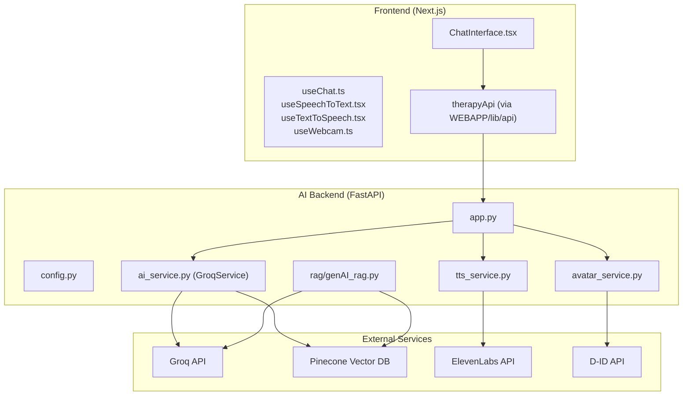
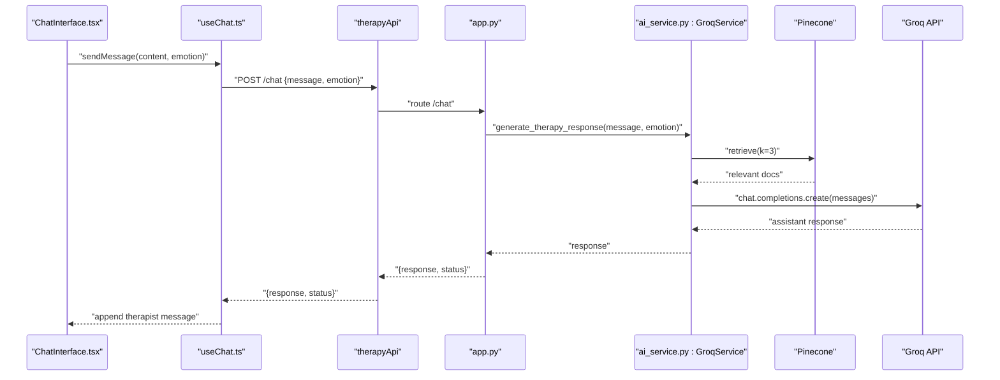
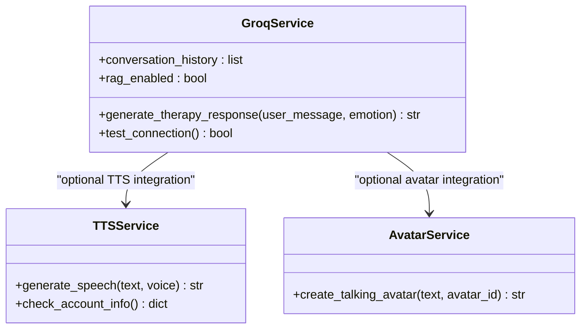
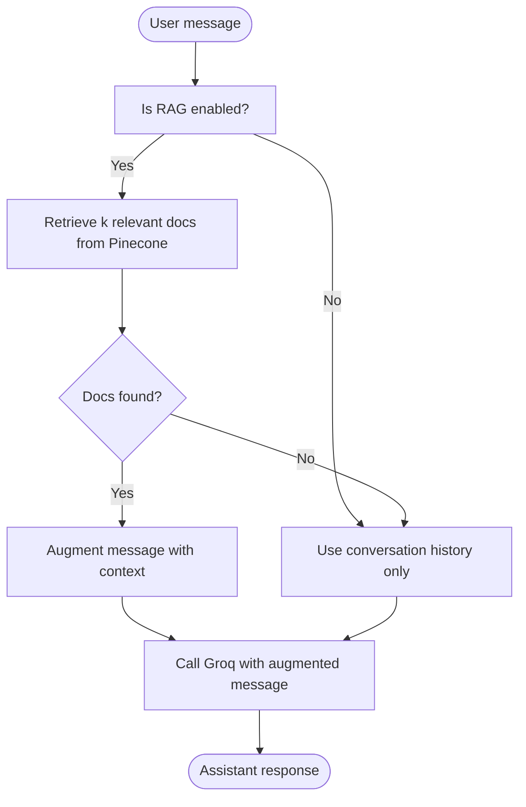
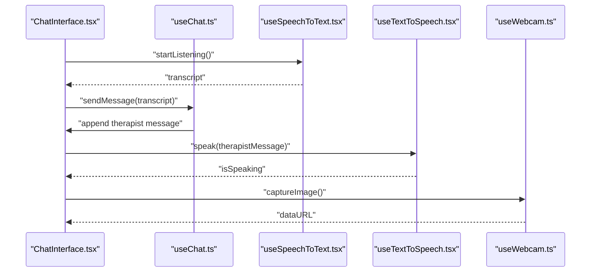
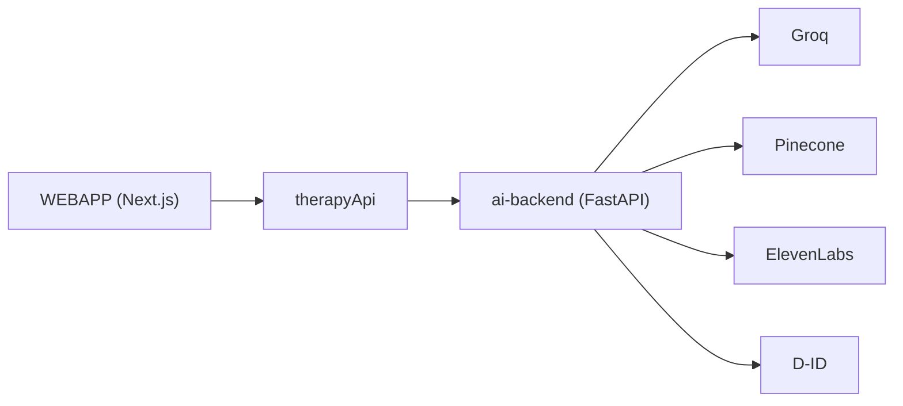

# AI Therapy Chat System

<cite>
**Referenced Files in This Document**
- [README.md](file://README.md)
- [package.json](file://WEBAPP/package.json)
- [app.py](file://ai-backend/app.py)
- [config.py](file://ai-backend/config.py)
- [ai_service.py](file://ai-backend/services/ai_service.py)
- [groq_ai_service.py](file://ai-backend/services/groq_ai_service.py)
- [tts_service.py](file://ai-backend/services/tts_service.py)
- [avatar_service.py](file://ai-backend/services/avatar_service.py)
- [genAI_rag.py](file://ai-backend/rag/genAI_rag.py)
- [useChat.ts](file://WEBAPP/src/hooks/useChat.ts)
- [useSpeechToText.tsx](file://WEBAPP/src/hooks/useSpeechToText.tsx)
- [useTextToSpeech.tsx](file://WEBAPP/src/hooks/useTextToSpeech.tsx)
- [useWebcam.ts](file://WEBAPP/src/hooks/useWebcam.ts)
- [ChatInterface.tsx](file://WEBAPP/src/components/ChatInterface.tsx)
</cite>

## Table of Contents
1. [Introduction](#introduction)
2. [Project Structure](#project-structure)
3. [Core Components](#core-components)
4. [Architecture Overview](#architecture-overview)
5. [Detailed Component Analysis](#detailed-component-analysis)
6. [Dependency Analysis](#dependency-analysis)
7. [Performance Considerations](#performance-considerations)
8. [Troubleshooting Guide](#troubleshooting-guide)
9. [Conclusion](#conclusion)
10. [Appendices](#appendices)

## Introduction
This document describes the AI therapy chat system, focusing on the RAG-powered conversation flow using Groq LLaMA 3.1 with Pinecone vector database integration, emotion-aware response mechanisms, real-time chat functionality, and session management. It also covers speech-to-text and text-to-speech integration, webcam-based emotion detection, and multi-modal communication features. The document explains chat interface components, message persistence, session creation/deletion, conversation context handling, AI service integration, RAG enhancement pipeline, and real-time WebSocket communication patterns. Finally, it addresses user experience considerations, accessibility features, and performance optimization strategies.

## Project Structure
The system is split into three primary areas:
- Frontend (Next.js application) containing chat UI, hooks for speech/webcam, and session/message persistence APIs
- AI backend (FastAPI) exposing endpoints for chat, text-to-speech, and avatar generation
- ML/RAG backend integrating Pinecone and LangChain for retrieval-augmented generation

**Diagram sources**
- [app.py](file://ai-backend/app.py#L1-L154)
- [ai_service.py](file://ai-backend/services/ai_service.py#L72-L192)
- [tts_service.py](file://ai-backend/services/tts_service.py#L10-L280)
- [avatar_service.py](file://ai-backend/services/avatar_service.py#L11-L237)
- [genAI_rag.py](file://ai-backend/rag/genAI_rag.py#L1-L76)
- [ChatInterface.tsx](file://WEBAPP/src/components/ChatInterface.tsx#L1-L567)
- [useChat.ts](file://WEBAPP/src/hooks/useChat.ts#L1-L150)

**Section sources**
- [README.md](file://README.md#L1-L3)
- [package.json](file://WEBAPP/package.json#L1-L88)

## Core Components
- AI Backend API (FastAPI):
  - Chat endpoint generates therapeutic responses using Groq LLaMA 3.1
  - Text-to-Speech endpoint converts responses to audio via ElevenLabs
  - Avatar endpoint creates talking avatar videos via D-ID or dummy fallback
  - Health checks and static audio/video serving
- AI Service Layer:
  - GroqService integrates RAG with Pinecone and maintains conversation history
  - Fallbacks for missing API keys or unavailable services
- Speech/Webcam Hooks:
  - Speech-to-text, text-to-speech, and webcam capture utilities
- Chat Interface:
  - Real-time messaging, assessment prompts, and multi-modal rendering
  - Persistence via session-specific message endpoints

**Section sources**
- [app.py](file://ai-backend/app.py#L73-L123)
- [ai_service.py](file://ai-backend/services/ai_service.py#L72-L192)
- [tts_service.py](file://ai-backend/services/tts_service.py#L10-L280)
- [avatar_service.py](file://ai-backend/services/avatar_service.py#L11-L237)
- [useChat.ts](file://WEBAPP/src/hooks/useChat.ts#L33-L150)
- [ChatInterface.tsx](file://WEBAPP/src/components/ChatInterface.tsx#L42-L567)

## Architecture Overview
The system follows a client-server architecture with a frontend Next.js app communicating with a FastAPI backend. The backend orchestrates AI services and external APIs, while the frontend manages UI state, persistence, and multi-modal outputs.

**Diagram sources**
- [ChatInterface.tsx](file://WEBAPP/src/components/ChatInterface.tsx#L255-L310)
- [useChat.ts](file://WEBAPP/src/hooks/useChat.ts#L40-L116)
- [app.py](file://ai-backend/app.py#L81-L94)
- [ai_service.py](file://ai-backend/services/ai_service.py#L131-L192)

## Detailed Component Analysis

### AI Backend API (FastAPI)
- Endpoints:
  - GET "/" and GET "/health" for service status
  - POST "/chat" for therapeutic responses
  - POST "/tts" for audio synthesis
  - POST "/avatar" for talking avatar video
- Static file serving for audio and video under "/audio" and "/video"
- Lazy initialization of services to avoid import-time issues

**Section sources**
- [app.py](file://ai-backend/app.py#L17-L154)

### GroqService (RAG + Conversation History)
- Maintains a conversation history buffer seeded with a system prompt
- Integrates Pinecone via LangChain retriever when available
- Augments user messages with retrieved context before calling Groq
- Provides graceful fallbacks when RAG is unavailable

**Diagram sources**
- [ai_service.py](file://ai-backend/services/ai_service.py#L72-L192)
- [tts_service.py](file://ai-backend/services/tts_service.py#L10-L280)
- [avatar_service.py](file://ai-backend/services/avatar_service.py#L11-L237)

**Section sources**
- [ai_service.py](file://ai-backend/services/ai_service.py#L72-L192)

### Pinecone RAG Pipeline
- Uses HuggingFace embeddings and a prebuilt index named "healthai"
- Retrieves top-k relevant documents and augments the user message
- Falls back to conversation history-only if retrieval fails

**Diagram sources**
- [ai_service.py](file://ai-backend/services/ai_service.py#L146-L191)
- [genAI_rag.py](file://ai-backend/rag/genAI_rag.py#L30-L55)

**Section sources**
- [ai_service.py](file://ai-backend/services/ai_service.py#L82-L119)
- [genAI_rag.py](file://ai-backend/rag/genAI_rag.py#L30-L55)

### Text-to-Speech Integration (ElevenLabs)
- Generates speech asynchronously and saves to a temp directory
- Returns a static URL for audio playback
- Provides fallback audio when API key is missing or quota exceeded

**Section sources**
- [tts_service.py](file://ai-backend/services/tts_service.py#L53-L145)

### Avatar Generation (D-ID)
- Creates talking avatar videos via D-ID API or serves a dummy video
- Includes presenter management and placeholder generation

**Section sources**
- [avatar_service.py](file://ai-backend/services/avatar_service.py#L19-L121)

### Frontend Chat Interface and Hooks
- useChat manages messages, loading states, and multi-modal outputs
- ChatInterface renders messages, assessment prompts/questions/results, and handles persistence
- useSpeechToText and useTextToSpeech integrate browser APIs for speech input/output
- useWebcam captures images for potential emotion analysis

**Diagram sources**
- [ChatInterface.tsx](file://WEBAPP/src/components/ChatInterface.tsx#L255-L310)
- [useChat.ts](file://WEBAPP/src/hooks/useChat.ts#L40-L116)
- [useSpeechToText.tsx](file://WEBAPP/src/hooks/useSpeechToText.tsx#L56-L129)
- [useTextToSpeech.tsx](file://WEBAPP/src/hooks/useTextToSpeech.tsx#L3-L42)
- [useWebcam.ts](file://WEBAPP/src/hooks/useWebcam.ts#L17-L89)

**Section sources**
- [useChat.ts](file://WEBAPP/src/hooks/useChat.ts#L33-L150)
- [ChatInterface.tsx](file://WEBAPP/src/components/ChatInterface.tsx#L42-L567)
- [useSpeechToText.tsx](file://WEBAPP/src/hooks/useSpeechToText.tsx#L56-L129)
- [useTextToSpeech.tsx](file://WEBAPP/src/hooks/useTextToSpeech.tsx#L3-L42)
- [useWebcam.ts](file://WEBAPP/src/hooks/useWebcam.ts#L9-L89)

### Session Management and Message Persistence
- ChatInterface loads messages for a given session and persists new messages
- Uses session-specific endpoints to fetch/save messages
- Supports assessment prompts/questions/results with metadata

**Section sources**
- [ChatInterface.tsx](file://WEBAPP/src/components/ChatInterface.tsx#L106-L147)
- [ChatInterface.tsx](file://WEBAPP/src/components/ChatInterface.tsx#L154-L250)

### Emotion-Aware Response Mechanism
- Emotion is captured via speech-to-text hooks and passed to the backend
- The backend currently preserves emotion in the message metadata but does not alter the LLM prompt
- Future enhancements can inject emotion into the system prompt or message augmentation

**Section sources**
- [useSpeechToText.tsx](file://WEBAPP/src/hooks/useSpeechToText.tsx#L56-L129)
- [useChat.ts](file://WEBAPP/src/hooks/useChat.ts#L40-L116)
- [app.py](file://ai-backend/app.py#L87-L91)

### Multi-Modal Communication Features
- Text-to-Speech: optional TTS generation and playback
- Avatar: optional talking avatar video generation
- Webcam: image capture for potential emotion analysis
- Assessment prompts/questions/results embedded in chat UI

**Section sources**
- [useChat.ts](file://WEBAPP/src/hooks/useChat.ts#L82-L101)
- [ChatInterface.tsx](file://WEBAPP/src/components/ChatInterface.tsx#L154-L250)
- [useWebcam.ts](file://WEBAPP/src/hooks/useWebcam.ts#L54-L71)

## Dependency Analysis
- Frontend depends on:
  - Next.js runtime and UI primitives
  - Local hooks for speech/webcam
  - API client for backend endpoints
- Backend depends on:
  - Groq SDK for LLM calls
  - LangChain and Pinecone for RAG
  - ElevenLabs and D-ID for media generation
  - Pydantic settings for environment configuration

**Diagram sources**
- [package.json](file://WEBAPP/package.json#L15-L86)
- [app.py](file://ai-backend/app.py#L1-L154)
- [ai_service.py](file://ai-backend/services/ai_service.py#L1-L20)
- [config.py](file://ai-backend/config.py#L1-L49)

**Section sources**
- [package.json](file://WEBAPP/package.json#L15-L86)
- [config.py](file://ai-backend/config.py#L5-L49)

## Performance Considerations
- RAG retrieval:
  - Use k=3 to balance relevance and latency
  - Cache embeddings and index locally during initialization
  - Monitor Pinecone query latency and consider pagination for large histories
- API calls:
  - Use async I/O for ElevenLabs and D-ID to avoid blocking
  - Implement retry/backoff for transient failures
- Audio/video:
  - Serve static files from temp directory to reduce API overhead
  - Clean up old audio/video files periodically
- Frontend:
  - Debounce input and avoid unnecessary re-renders
  - Virtualize long message lists
  - Preload assets for avatar/video fallbacks

[No sources needed since this section provides general guidance]

## Troubleshooting Guide
- Missing environment variables:
  - Ensure GROQ_API_KEY, PINECONE_API_KEY, ELEVENLABS_API_KEY, D-ID credentials are configured
- RAG initialization failures:
  - Verify Pinecone API key and index name
  - Confirm embeddings and index availability
- API quota limits:
  - ElevenLabs quota exceeded triggers fallback audio
- CORS errors:
  - Confirm allowed origins in backend settings
- Audio/video not playing:
  - Check static file serving under "/audio" and "/video"
  - Validate file permissions and cleanup policies

**Section sources**
- [config.py](file://ai-backend/config.py#L12-L35)
- [ai_service.py](file://ai-backend/services/ai_service.py#L108-L118)
- [tts_service.py](file://ai-backend/services/tts_service.py#L107-L144)
- [avatar_service.py](file://ai-backend/services/avatar_service.py#L24-L67)

## Conclusion
The AI therapy chat system integrates a responsive frontend with a robust FastAPI backend to deliver a multi-modal, emotion-aware therapeutic experience. The RAG pipeline enhances responses using Pinecone, while optional TTS and avatar features enrich user engagement. Session management and message persistence enable continuity across conversations. With careful attention to performance and reliability, the system supports scalable deployment and future enhancements.

[No sources needed since this section summarizes without analyzing specific files]

## Appendices

### API Endpoints Summary
- POST /chat: Generate therapeutic response using Groq (emotion-aware)
- POST /tts: Convert text to speech via ElevenLabs
- POST /avatar: Create talking avatar via D-ID or dummy fallback
- GET /health: Health check for backend service

**Section sources**
- [app.py](file://ai-backend/app.py#L77-L123)

### Environment Variables
- GROQ_API_KEY: Groq API key
- PINECONE_API_KEY: Pinecone API key
- ELEVENLABS_API_KEY: ElevenLabs API key
- D-ID credentials: D-ID API key and presenter ID
- Allowed origins: Configure CORS for frontend domains

**Section sources**
- [config.py](file://ai-backend/config.py#L12-L43)