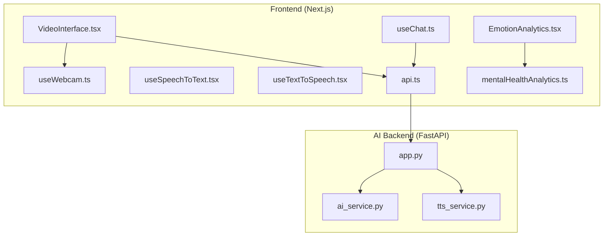
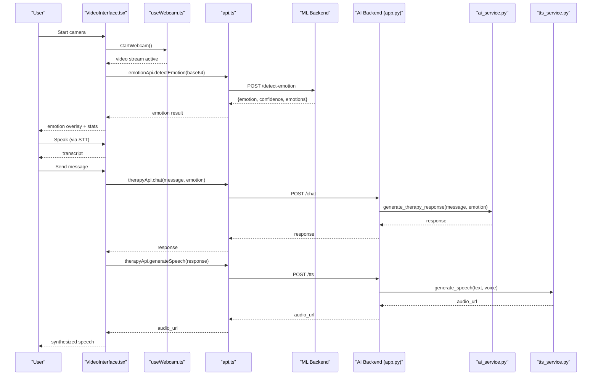
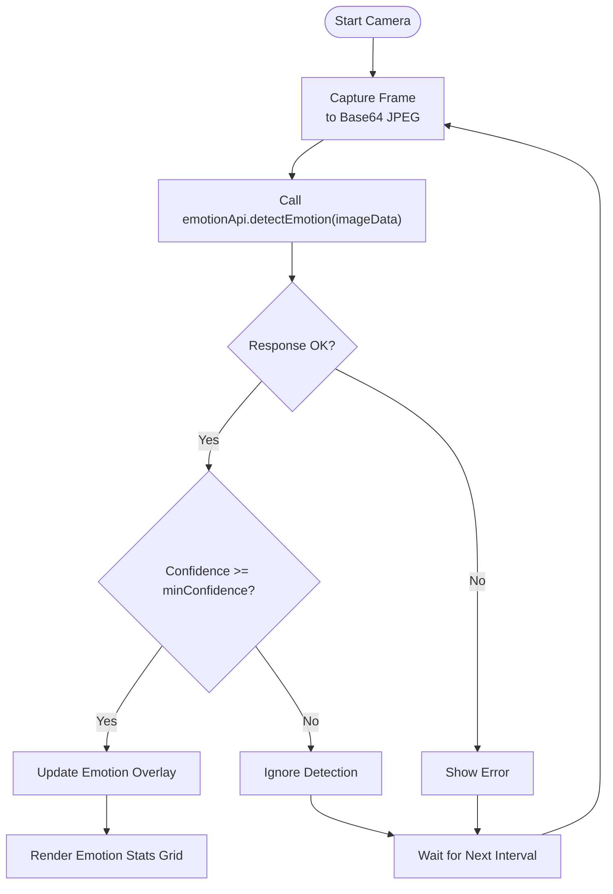
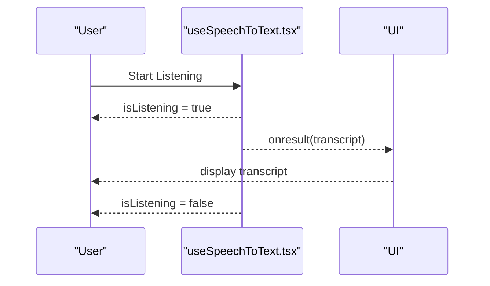
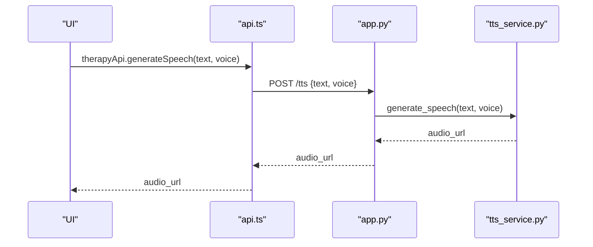
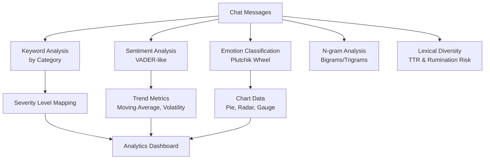
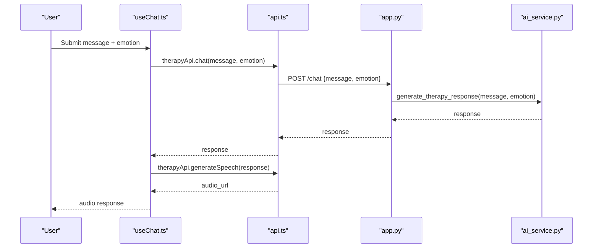
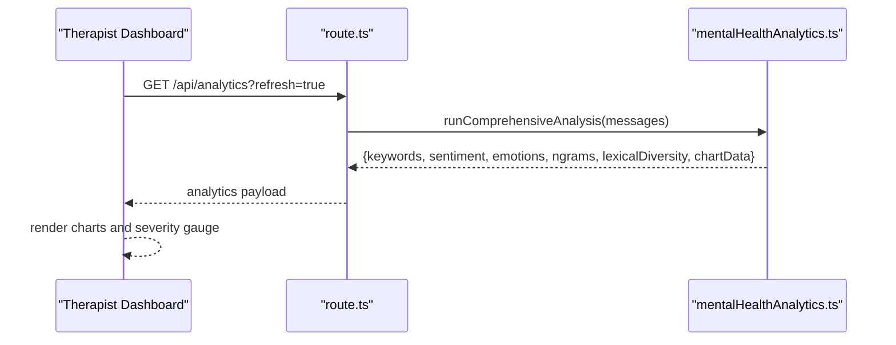
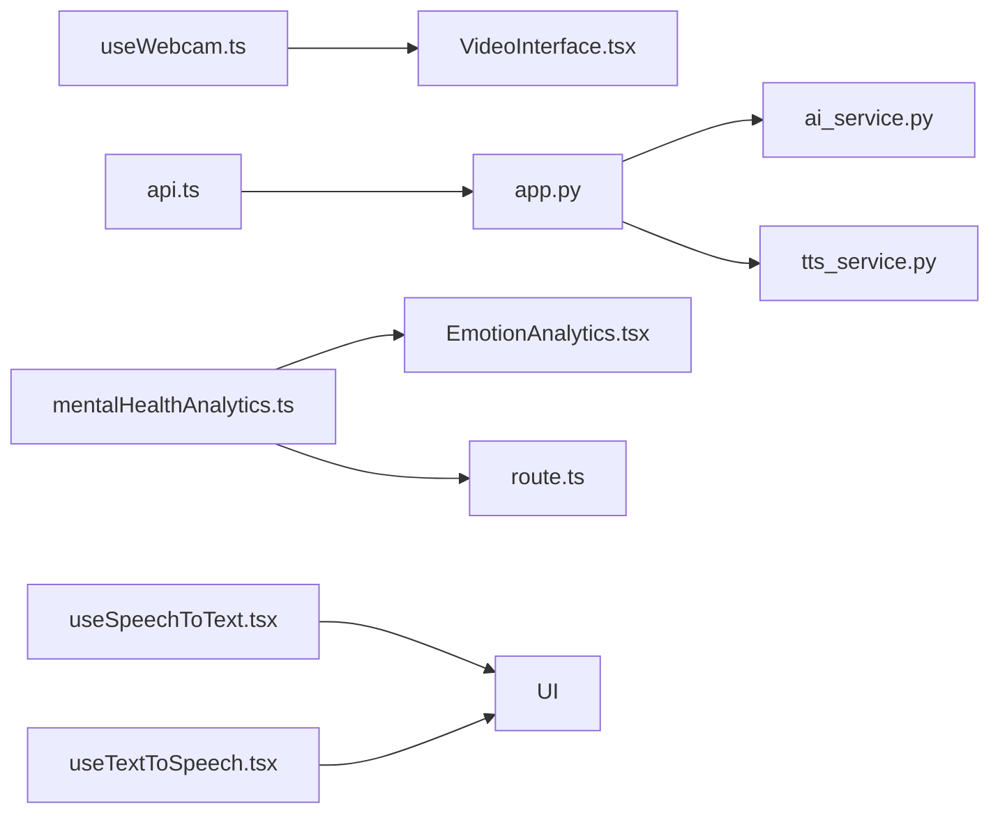

# Emotion-Aware Response System

<cite>
**Referenced Files in This Document**
- [VideoInterface.tsx](file://WEBAPP/src/components/VideoInterface.tsx)
- [useWebcam.ts](file://WEBAPP/src/hooks/useWebcam.ts)
- [useSpeechToText.tsx](file://WEBAPP/src/hooks/useSpeechToText.tsx)
- [useTextToSpeech.tsx](file://WEBAPP/src/hooks/useTextToSpeech.tsx)
- [api.ts](file://WEBAPP/src/lib/api.ts)
- [mentalHealthAnalytics.ts](file://WEBAPP/src/lib/mentalHealthAnalytics.ts)
- [EmotionAnalytics.tsx](file://WEBAPP/src/components/EmotionAnalytics.tsx)
- [app.ts](file://ai-backend/app.py)
- [ai_service.py](file://ai-backend/services/ai_service.py)
- [tts_service.py](file://ai-backend/services/tts_service.py)
- [route.ts](file://WEBAPP/src/app/api/analytics/route.ts)
- [page.tsx](file://WEBAPP/src/app/therapist/patient-analytics/page.tsx)
- [useChat.ts](file://WEBAPP/src/hooks/useChat.ts)
</cite>

## Table of Contents
1. [Introduction](#introduction)
2. [Project Structure](#project-structure)
3. [Core Components](#core-components)
4. [Architecture Overview](#architecture-overview)
5. [Detailed Component Analysis](#detailed-component-analysis)
6. [Dependency Analysis](#dependency-analysis)
7. [Performance Considerations](#performance-considerations)
8. [Troubleshooting Guide](#troubleshooting-guide)
9. [Conclusion](#conclusion)
10. [Appendices](#appendices)

## Introduction
This document describes the emotion-aware response system that integrates webcam-based emotion detection, speech-to-text for vocal emotion analysis, and sentiment scoring algorithms. It explains the real-time emotion processing pipeline, confidence thresholding, and adaptive response generation. It also documents the integration with mental health analytics, including emotion trend tracking and therapeutic response personalization, along with implementation details for emotion classification models, data preprocessing, and response modulation based on detected emotional states.

## Project Structure
The emotion-aware system spans three primary areas:
- Frontend (Next.js) for UI, webcam capture, speech recognition/synthesis, emotion overlay, and analytics dashboards
- AI backend (FastAPI) for therapeutic chat, text-to-speech, and avatar generation
- ML backend for emotion classification APIs

**Diagram sources**
- [VideoInterface.tsx](file://WEBAPP/src/components/VideoInterface.tsx#L1-L187)
- [useWebcam.ts](file://WEBAPP/src/hooks/useWebcam.ts#L1-L89)
- [useSpeechToText.tsx](file://WEBAPP/src/hooks/useSpeechToText.tsx#L1-L129)
- [useTextToSpeech.tsx](file://WEBAPP/src/hooks/useTextToSpeech.tsx#L1-L41)
- [api.ts](file://WEBAPP/src/lib/api.ts#L50-L95)
- [mentalHealthAnalytics.ts](file://WEBAPP/src/lib/mentalHealthAnalytics.ts#L1-L200)
- [EmotionAnalytics.tsx](file://WEBAPP/src/components/EmotionAnalytics.tsx#L93-L211)
- [app.ts](file://ai-backend/app.py#L1-L154)
- [ai_service.py](file://ai-backend/services/ai_service.py#L124-L154)
- [tts_service.py](file://ai-backend/services/tts_service.py#L62-L191)
- [useChat.ts](file://WEBAPP/src/hooks/useChat.ts#L85-L122)

**Section sources**
- [VideoInterface.tsx](file://WEBAPP/src/components/VideoInterface.tsx#L1-L187)
- [useWebcam.ts](file://WEBAPP/src/hooks/useWebcam.ts#L1-L89)
- [api.ts](file://WEBAPP/src/lib/api.ts#L50-L95)
- [app.ts](file://ai-backend/app.py#L1-L154)

## Core Components
- Webcam capture and emotion overlay: Captures frames, converts to base64, and triggers periodic emotion detection with confidence thresholds.
- Speech-to-text integration: Uses browser Web Speech API to transcribe user speech into text.
- Text-to-speech synthesis: Browser-based synthesis and AI backend ElevenLabs TTS for avatar audio.
- Emotion classification and analytics: Plutchik-style emotion wheel classification and keyword-based mental health scoring.
- Therapeutic response generation: Emotion-aware chat responses via AI backend service.
- Analytics dashboards: Emotion trends, keyword categories, sentiment volatility, and severity gauges.

**Section sources**
- [VideoInterface.tsx](file://WEBAPP/src/components/VideoInterface.tsx#L18-L50)
- [useSpeechToText.tsx](file://WEBAPP/src/hooks/useSpeechToText.tsx#L56-L126)
- [useTextToSpeech.tsx](file://WEBAPP/src/hooks/useTextToSpeech.tsx#L1-L41)
- [mentalHealthAnalytics.ts](file://WEBAPP/src/lib/mentalHealthAnalytics.ts#L506-L808)
- [useChat.ts](file://WEBAPP/src/hooks/useChat.ts#L85-L122)

## Architecture Overview
The system orchestrates real-time emotion detection and therapeutic responses across frontend and backend services.

**Diagram sources**
- [VideoInterface.tsx](file://WEBAPP/src/components/VideoInterface.tsx#L52-L68)
- [useWebcam.ts](file://WEBAPP/src/hooks/useWebcam.ts#L17-L41)
- [api.ts](file://WEBAPP/src/lib/api.ts#L54-L90)
- [app.ts](file://ai-backend/app.py#L81-L122)
- [ai_service.py](file://ai-backend/services/ai_service.py#L131-L154)
- [tts_service.py](file://ai-backend/services/tts_service.py#L62-L191)

## Detailed Component Analysis

### Webcam-Based Emotion Detection Pipeline
- Capture frames at intervals, convert to base64 JPEG, and trigger emotion detection.
- Confidence thresholding filters low-confidence detections.
- Emotion overlay displays current emotion and per-emotion confidences.

**Diagram sources**
- [VideoInterface.tsx](file://WEBAPP/src/components/VideoInterface.tsx#L25-L50)
- [useWebcam.ts](file://WEBAPP/src/hooks/useWebcam.ts#L54-L71)
- [api.ts](file://WEBAPP/src/lib/api.ts#L54-L73)

**Section sources**
- [VideoInterface.tsx](file://WEBAPP/src/components/VideoInterface.tsx#L18-L50)
- [useWebcam.ts](file://WEBAPP/src/hooks/useWebcam.ts#L17-L71)
- [api.ts](file://WEBAPP/src/lib/api.ts#L54-L73)

### Speech-to-Text Integration
- Uses browser Web Speech API to transcribe speech into text.
- Provides callbacks for final results to auto-send messages.

**Diagram sources**
- [useSpeechToText.tsx](file://WEBAPP/src/hooks/useSpeechToText.tsx#L56-L126)

**Section sources**
- [useSpeechToText.tsx](file://WEBAPP/src/hooks/useSpeechToText.tsx#L56-L126)

### Text-to-Speech Synthesis
- Browser-based synthesis for quick feedback.
- AI backend ElevenLabs TTS for avatar audio generation.

**Diagram sources**
- [api.ts](file://WEBAPP/src/lib/api.ts#L85-L90)
- [app.ts](file://ai-backend/app.py#L96-L109)
- [tts_service.py](file://ai-backend/services/tts_service.py#L62-L191)

**Section sources**
- [useTextToSpeech.tsx](file://WEBAPP/src/hooks/useTextToSpeech.tsx#L1-L41)
- [tts_service.py](file://ai-backend/services/tts_service.py#L62-L191)

### Emotion Classification and Sentiment Scoring
- Keyword-based categorization (stress, anxiety, depression, anger, self-harm risk, loneliness, positive).
- Plutchik’s emotion wheel classification with keyword sets and color mapping.
- VADER-like sentiment analysis with negation handling, intensifiers, normalization, and trend analysis (moving average, volatility).
- N-gram extraction (bigrams/trigrams) and lexical diversity (Type-Token Ratio) for rumination risk.

**Diagram sources**
- [mentalHealthAnalytics.ts](file://WEBAPP/src/lib/mentalHealthAnalytics.ts#L12-L92)
- [mentalHealthAnalytics.ts](file://WEBAPP/src/lib/mentalHealthAnalytics.ts#L506-L631)
- [mentalHealthAnalytics.ts](file://WEBAPP/src/lib/mentalHealthAnalytics.ts#L760-L808)
- [mentalHealthAnalytics.ts](file://WEBAPP/src/lib/mentalHealthAnalytics.ts#L636-L681)
- [mentalHealthAnalytics.ts](file://WEBAPP/src/lib/mentalHealthAnalytics.ts#L684-L708)
- [mentalHealthAnalytics.ts](file://WEBAPP/src/lib/mentalHealthAnalytics.ts#L839-L883)

**Section sources**
- [mentalHealthAnalytics.ts](file://WEBAPP/src/lib/mentalHealthAnalytics.ts#L12-L92)
- [mentalHealthAnalytics.ts](file://WEBAPP/src/lib/mentalHealthAnalytics.ts#L506-L631)
- [mentalHealthAnalytics.ts](file://WEBAPP/src/lib/mentalHealthAnalytics.ts#L760-L808)
- [mentalHealthAnalytics.ts](file://WEBAPP/src/lib/mentalHealthAnalytics.ts#L636-L708)
- [EmotionAnalytics.tsx](file://WEBAPP/src/components/EmotionAnalytics.tsx#L93-L211)

### Therapeutic Response Generation
- Emotion-aware chat responses generated via AI backend service.
- Optional TTS and avatar generation for immersive experience.

**Diagram sources**
- [useChat.ts](file://WEBAPP/src/hooks/useChat.ts#L85-L122)
- [api.ts](file://WEBAPP/src/lib/api.ts#L76-L90)
- [app.ts](file://ai-backend/app.py#L81-L95)
- [ai_service.py](file://ai-backend/services/ai_service.py#L131-L154)

**Section sources**
- [useChat.ts](file://WEBAPP/src/hooks/useChat.ts#L85-L122)
- [ai_service.py](file://ai-backend/services/ai_service.py#L131-L154)

### Mental Health Analytics Dashboard
- Real-time emotion statistics, recent activity, and severity gauges.
- Backend endpoint aggregates analytics for patient views.

**Diagram sources**
- [page.tsx](file://WEBAPP/src/app/therapist/patient-analytics/page.tsx#L118-L136)
- [route.ts](file://WEBAPP/src/app/api/analytics/route.ts#L229-L252)
- [mentalHealthAnalytics.ts](file://WEBAPP/src/lib/mentalHealthAnalytics.ts#L845-L883)

**Section sources**
- [EmotionAnalytics.tsx](file://WEBAPP/src/components/EmotionAnalytics.tsx#L93-L211)
- [route.ts](file://WEBAPP/src/app/api/analytics/route.ts#L229-L252)
- [page.tsx](file://WEBAPP/src/app/therapist/patient-analytics/page.tsx#L118-L162)

## Dependency Analysis
- Frontend depends on:
  - MediaDevices for webcam capture
  - Web Speech API for STT/TTS
  - Custom APIs for emotion detection and therapy services
  - Analytics library for mental health insights
- AI backend depends on:
  - Groq service for therapeutic responses
  - ElevenLabs TTS service for audio synthesis
  - Static file serving for audio/video assets

**Diagram sources**
- [useWebcam.ts](file://WEBAPP/src/hooks/useWebcam.ts#L1-L89)
- [VideoInterface.tsx](file://WEBAPP/src/components/VideoInterface.tsx#L1-L187)
- [api.ts](file://WEBAPP/src/lib/api.ts#L50-L95)
- [app.ts](file://ai-backend/app.py#L1-L154)
- [ai_service.py](file://ai-backend/services/ai_service.py#L124-L154)
- [tts_service.py](file://ai-backend/services/tts_service.py#L62-L191)
- [mentalHealthAnalytics.ts](file://WEBAPP/src/lib/mentalHealthAnalytics.ts#L1-L200)
- [EmotionAnalytics.tsx](file://WEBAPP/src/components/EmotionAnalytics.tsx#L93-L211)
- [route.ts](file://WEBAPP/src/app/api/analytics/route.ts#L229-L252)
- [useSpeechToText.tsx](file://WEBAPP/src/hooks/useSpeechToText.tsx#L1-L129)
- [useTextToSpeech.tsx](file://WEBAPP/src/hooks/useTextToSpeech.tsx#L1-L41)

**Section sources**
- [VideoInterface.tsx](file://WEBAPP/src/components/VideoInterface.tsx#L1-L187)
- [api.ts](file://WEBAPP/src/lib/api.ts#L50-L95)
- [app.ts](file://ai-backend/app.py#L1-L154)
- [mentalHealthAnalytics.ts](file://WEBAPP/src/lib/mentalHealthAnalytics.ts#L1-L200)

## Performance Considerations
- Emotion detection interval: Configured to balance responsiveness and resource usage.
- Confidence thresholding: Reduces false positives and UI noise.
- Streaming vs. polling: Prefer continuous capture with throttled detection.
- Audio generation: Cache or reuse audio clips when possible to reduce latency.
- Analytics computations: Use moving averages and lightweight lexicon lookups to minimize CPU load.

[No sources needed since this section provides general guidance]

## Troubleshooting Guide
- Webcam errors: Verify permissions and device availability; ensure HTTPS for MediaDevices.
- Speech recognition errors: Confirm browser support and microphone permissions.
- Emotion detection failures: Validate base64 image format and network connectivity to ML backend.
- TTS failures: Check ElevenLabs API key and network; fall back to browser TTS when unavailable.
- Analytics rendering issues: Ensure messages array is populated and endpoint returns expected structure.

**Section sources**
- [VideoInterface.tsx](file://WEBAPP/src/components/VideoInterface.tsx#L130-L140)
- [useSpeechToText.tsx](file://WEBAPP/src/hooks/useSpeechToText.tsx#L88-L96)
- [useTextToSpeech.tsx](file://WEBAPP/src/hooks/useTextToSpeech.tsx#L28-L30)
- [route.ts](file://WEBAPP/src/app/api/analytics/route.ts#L229-L252)

## Conclusion
The emotion-aware response system integrates real-time webcam emotion detection, speech-to-text, and robust mental health analytics to deliver personalized therapeutic experiences. Confidence thresholding and adaptive response generation enhance user safety and engagement, while comprehensive analytics enable long-term trend tracking and clinical insights.

[No sources needed since this section summarizes without analyzing specific files]

## Appendices

### Implementation Details: Emotion Classification Models
- Keyword-based categories with weighted severity and color coding.
- Plutchik emotion wheel with curated keyword lists mapped to emotions.
- Sentiment scoring with negation and intensifier handling, normalized to [-1, +1].
- N-gram and lexical diversity metrics to identify repetitive or ruminative language.

**Section sources**
- [mentalHealthAnalytics.ts](file://WEBAPP/src/lib/mentalHealthAnalytics.ts#L12-L92)
- [mentalHealthAnalytics.ts](file://WEBAPP/src/lib/mentalHealthAnalytics.ts#L760-L808)
- [mentalHealthAnalytics.ts](file://WEBAPP/src/lib/mentalHealthAnalytics.ts#L506-L631)
- [mentalHealthAnalytics.ts](file://WEBAPP/src/lib/mentalHealthAnalytics.ts#L636-L708)

### Implementation Details: Data Preprocessing
- Tokenization and normalization for sentiment and keyword analysis.
- Negation scope handling and intensifier multipliers.
- Weighted keyword counts and category breakdowns for severity scoring.

**Section sources**
- [mentalHealthAnalytics.ts](file://WEBAPP/src/lib/mentalHealthAnalytics.ts#L506-L631)
- [mentalHealthAnalytics.ts](file://WEBAPP/src/lib/mentalHealthAnalytics.ts#L199-L200)

### Implementation Details: Response Modulation Based on Emotional States
- Emotion-aware prompts passed to AI backend for therapeutic responses.
- Optional avatar and audio synthesis for immersive delivery.

**Section sources**
- [ai_service.py](file://ai-backend/services/ai_service.py#L131-L154)
- [useChat.ts](file://WEBAPP/src/hooks/useChat.ts#L85-L122)