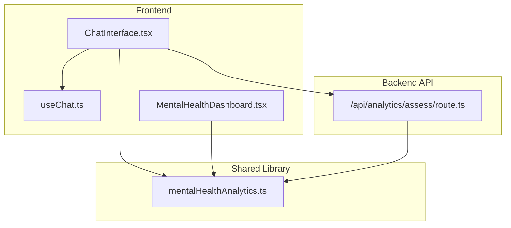
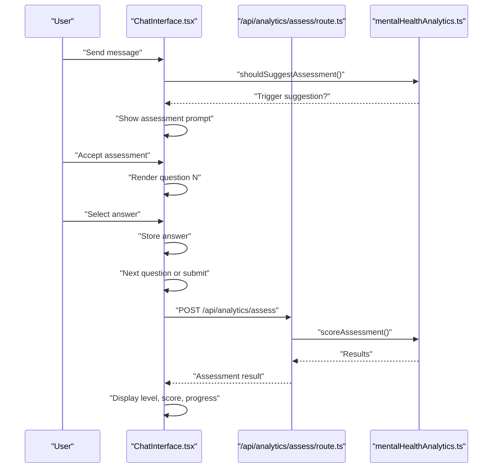
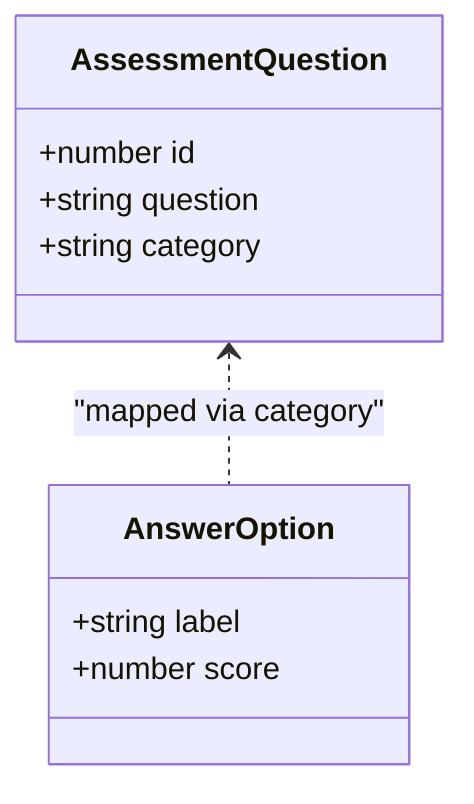
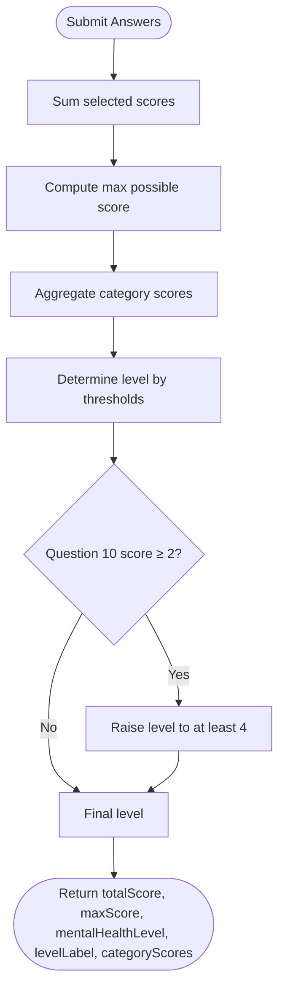
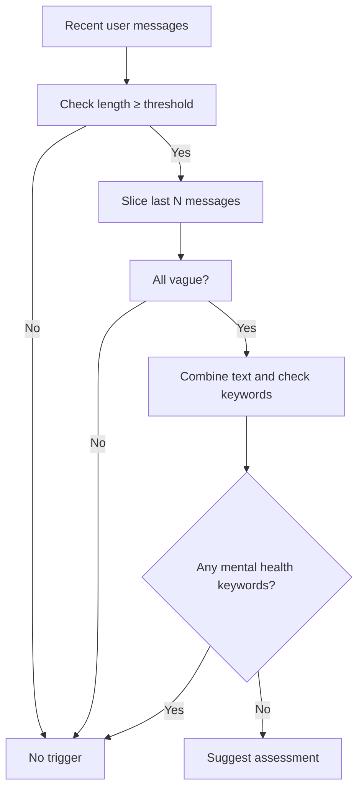
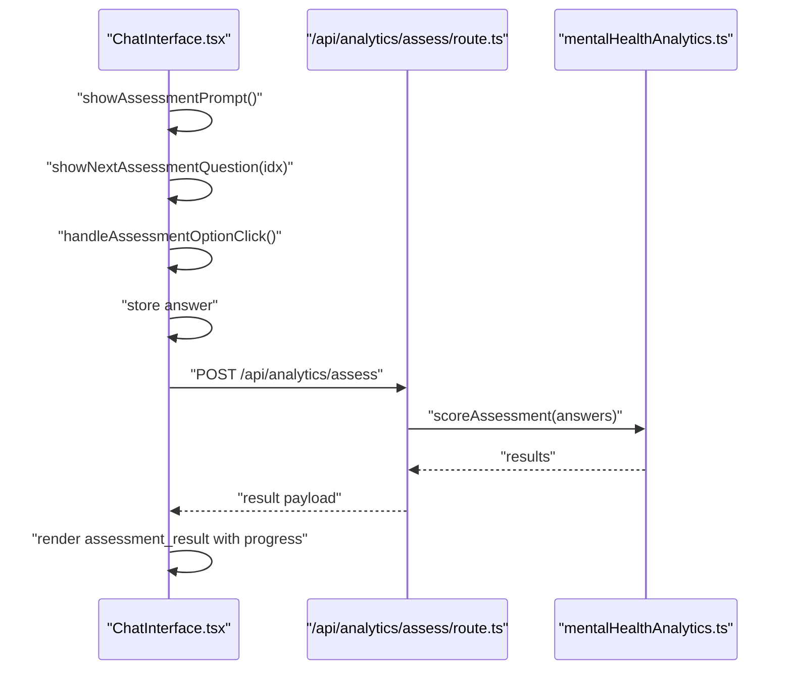
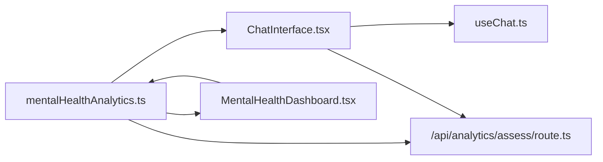

# Mental Health Assessment System

<cite>
**Referenced Files in This Document**
- [mentalHealthAnalytics.ts](file://WEBAPP/src/lib/mentalHealthAnalytics.ts)
- [ChatInterface.tsx](file://WEBAPP/src/components/ChatInterface.tsx)
- [route.ts](file://WEBAPP/src/app/api/analytics/assess/route.ts)
- [MentalHealthDashboard.tsx](file://WEBAPP/src/components/analytics/MentalHealthDashboard.tsx)
- [useChat.ts](file://WEBAPP/src/hooks/useChat.ts)
- [api.ts](file://WEBAPP/src/lib/api.ts)
</cite>

## Table of Contents
1. [Introduction](#introduction)
2. [Project Structure](#project-structure)
3. [Core Components](#core-components)
4. [Architecture Overview](#architecture-overview)
5. [Detailed Component Analysis](#detailed-component-analysis)
6. [Dependency Analysis](#dependency-analysis)
7. [Performance Considerations](#performance-considerations)
8. [Troubleshooting Guide](#troubleshooting-guide)
9. [Conclusion](#conclusion)

## Introduction
This document describes the mental health assessment system integrated into the chat interface. It explains the 10-question PHQ-9/GAD-7-inspired framework, scoring algorithms, and mental health level determination. It documents automatic assessment triggering based on conversation patterns, user response analysis, and confusion detection heuristics. Implementation details cover question presentation, answer collection, real-time scoring calculation, and result visualization with progress indicators. Ethical considerations, crisis intervention protocols, and integration with professional care recommendations are addressed.

## Project Structure
The assessment system spans frontend UI components, backend APIs, and shared analytics utilities:
- Frontend chat interface manages the assessment flow and displays results
- Backend API validates and scores assessments and persists results
- Shared analytics library provides scoring, keyword analysis, and trend computation

**Diagram sources**
- [ChatInterface.tsx](file://WEBAPP/src/components/ChatInterface.tsx#L1-L567)
- [useChat.ts](file://WEBAPP/src/hooks/useChat.ts#L1-L150)
- [MentalHealthDashboard.tsx](file://WEBAPP/src/components/analytics/MentalHealthDashboard.tsx#L1-L541)
- [mentalHealthAnalytics.ts](file://WEBAPP/src/lib/mentalHealthAnalytics.ts#L1-L884)
- [route.ts](file://WEBAPP/src/app/api/analytics/assess/route.ts#L1-L121)

**Section sources**
- [ChatInterface.tsx](file://WEBAPP/src/components/ChatInterface.tsx#L1-L567)
- [mentalHealthAnalytics.ts](file://WEBAPP/src/lib/mentalHealthAnalytics.ts#L1-L884)
- [route.ts](file://WEBAPP/src/app/api/analytics/assess/route.ts#L1-L121)

## Core Components
- Assessment questions and answer options define the 10-question PHQ-9/GAD-7-inspired instrument
- Scoring engine computes total and category scores and determines mental health level
- Confusion detection triggers assessment prompts based on vague user messages
- Real-time result visualization displays level, score, and progress bars
- Backend API validates submissions, computes results, and persists analytics

**Section sources**
- [mentalHealthAnalytics.ts](file://WEBAPP/src/lib/mentalHealthAnalytics.ts#L112-L170)
- [mentalHealthAnalytics.ts](file://WEBAPP/src/lib/mentalHealthAnalytics.ts#L308-L350)
- [mentalHealthAnalytics.ts](file://WEBAPP/src/lib/mentalHealthAnalytics.ts#L404-L425)
- [ChatInterface.tsx](file://WEBAPP/src/components/ChatInterface.tsx#L153-L250)
- [route.ts](file://WEBAPP/src/app/api/analytics/assess/route.ts#L9-L16)
- [route.ts](file://WEBAPP/src/app/api/analytics/assess/route.ts#L25-L120)

## Architecture Overview
The assessment workflow integrates frontend UI, backend API, and shared analytics utilities.

**Diagram sources**
- [ChatInterface.tsx](file://WEBAPP/src/components/ChatInterface.tsx#L153-L345)
- [route.ts](file://WEBAPP/src/app/api/analytics/assess/route.ts#L25-L120)
- [mentalHealthAnalytics.ts](file://WEBAPP/src/lib/mentalHealthAnalytics.ts#L308-L350)

## Detailed Component Analysis

### Assessment Framework and Questions
- 10-question PHQ-9/GAD-7-inspired instrument covering depression, anxiety, stress, and self-harm risk
- Four-point Likert scale: "Not at all" to "Nearly every day"
- Categories: depression, anxiety, stress, self_harm, loneliness, anger, positive (protective)

**Diagram sources**
- [mentalHealthAnalytics.ts](file://WEBAPP/src/lib/mentalHealthAnalytics.ts#L112-L170)

**Section sources**
- [mentalHealthAnalytics.ts](file://WEBAPP/src/lib/mentalHealthAnalytics.ts#L112-L170)

### Scoring Algorithm and Mental Health Level Determination
- Total score computed by summing selected answer scores
- Maximum possible score equals number of questions × 3
- Category-wise scores derived from question categories
- Level thresholds: 1 (Minimal ≤4), 2 (Mild ≤9), 3 (Moderate ≤14), 4 (Moderately Severe ≤19), 5 (Severe ≥20)
- Self-harm question escalation: any score ≥2 on question 10 raises level to at least 4
- Risk flags: self-harm mention escalates to level 5; comorbid indicators and crisis language detected via keyword analysis

**Diagram sources**
- [mentalHealthAnalytics.ts](file://WEBAPP/src/lib/mentalHealthAnalytics.ts#L308-L350)

**Section sources**
- [mentalHealthAnalytics.ts](file://WEBAPP/src/lib/mentalHealthAnalytics.ts#L308-L350)

### Automatic Assessment Triggering and Confusion Detection
- Confusion detection identifies vague user messages using pattern matching and keyword filtering
- Trigger condition: three or more consecutive vague messages with no mental health keywords
- Suggestion prompt appears after the last of these messages

**Diagram sources**
- [mentalHealthAnalytics.ts](file://WEBAPP/src/lib/mentalHealthAnalytics.ts#L404-L425)
- [ChatInterface.tsx](file://WEBAPP/src/components/ChatInterface.tsx#L305-L310)

**Section sources**
- [mentalHealthAnalytics.ts](file://WEBAPP/src/lib/mentalHealthAnalytics.ts#L376-L425)
- [ChatInterface.tsx](file://WEBAPP/src/components/ChatInterface.tsx#L305-L310)

### Assessment Presentation, Answer Collection, and Real-Time Scoring
- Prompt: "Would you like me to run a quick mental health check-in?"
- Question rendering: "📋 Question X of 10" with four answer options
- Answer collection stored locally until submission
- Submission triggers backend API with validation and scoring
- Result message includes level, score, and guidance; progress bar shown

**Diagram sources**
- [ChatInterface.tsx](file://WEBAPP/src/components/ChatInterface.tsx#L153-L345)
- [route.ts](file://WEBAPP/src/app/api/analytics/assess/route.ts#L25-L120)
- [mentalHealthAnalytics.ts](file://WEBAPP/src/lib/mentalHealthAnalytics.ts#L308-L350)

**Section sources**
- [ChatInterface.tsx](file://WEBAPP/src/components/ChatInterface.tsx#L153-L345)
- [route.ts](file://WEBAPP/src/app/api/analytics/assess/route.ts#L25-L120)

### Result Visualization and Progress Indicators
- Assessment result bubbles display level number, label, and score
- Horizontal progress bar shows percentage of total score
- Color-coded level indicator and descriptive text included
- Dashboard components visualize trends, keyword breakdowns, and emotion distributions

**Section sources**
- [ChatInterface.tsx](file://WEBAPP/src/components/ChatInterface.tsx#L408-L434)
- [MentalHealthDashboard.tsx](file://WEBAPP/src/components/analytics/MentalHealthDashboard.tsx#L358-L385)

### Backend API Validation and Persistence
- GET endpoint returns questions, answer options, and maximum score
- POST endpoint validates answers array length and score ranges
- Scores answers, persists assessment session, and creates analytics entry
- Returns success payload with detailed answers and computed metrics

**Section sources**
- [route.ts](file://WEBAPP/src/app/api/analytics/assess/route.ts#L9-L16)
- [route.ts](file://WEBAPP/src/app/api/analytics/assess/route.ts#L25-L120)

### Integration with Professional Care Recommendations
- Guidance embedded in assessment result messages for levels 4–5
- Dashboard highlights risk flags and provides actionable insights
- Integration with AI therapy backend supports conversational responses

**Section sources**
- [ChatInterface.tsx](file://WEBAPP/src/components/ChatInterface.tsx#L217-L220)
- [MentalHealthDashboard.tsx](file://WEBAPP/src/components/analytics/MentalHealthDashboard.tsx#L380-L404)
- [api.ts](file://WEBAPP/src/lib/api.ts#L76-L113)

## Dependency Analysis
The system exhibits clear separation of concerns:
- Frontend UI depends on shared analytics utilities for scoring and keyword analysis
- Backend API depends on shared analytics for scoring and validation
- Dashboard consumes analytics outputs for visualization

**Diagram sources**
- [mentalHealthAnalytics.ts](file://WEBAPP/src/lib/mentalHealthAnalytics.ts#L1-L884)
- [ChatInterface.tsx](file://WEBAPP/src/components/ChatInterface.tsx#L1-L567)
- [MentalHealthDashboard.tsx](file://WEBAPP/src/components/analytics/MentalHealthDashboard.tsx#L1-L541)
- [route.ts](file://WEBAPP/src/app/api/analytics/assess/route.ts#L1-L121)
- [useChat.ts](file://WEBAPP/src/hooks/useChat.ts#L1-L150)

**Section sources**
- [mentalHealthAnalytics.ts](file://WEBAPP/src/lib/mentalHealthAnalytics.ts#L1-L884)
- [ChatInterface.tsx](file://WEBAPP/src/components/ChatInterface.tsx#L1-L567)
- [MentalHealthDashboard.tsx](file://WEBAPP/src/components/analytics/MentalHealthDashboard.tsx#L1-L541)
- [route.ts](file://WEBAPP/src/app/api/analytics/assess/route.ts#L1-L121)
- [useChat.ts](file://WEBAPP/src/hooks/useChat.ts#L1-L150)

## Performance Considerations
- Keyword analysis and sentiment computations scale linearly with message count
- N-gram extraction and lexical diversity calculations are O(n·w) where n is messages and w is words
- Backend validation ensures minimal payload processing overhead
- Frontend rendering updates only on state changes; avoid unnecessary re-renders by memoizing analytics

## Troubleshooting Guide
Common issues and resolutions:
- Assessment submission errors: verify answers array length and score ranges; check network connectivity to backend
- Missing assessment prompt: ensure recent user messages meet vague message criteria and lack mental health keywords
- Incorrect level calculation: confirm question IDs and scores match expected ranges; review self-harm escalation logic
- Dashboard anomalies: refresh analytics to regenerate comprehensive analysis; verify message history completeness

**Section sources**
- [route.ts](file://WEBAPP/src/app/api/analytics/assess/route.ts#L42-L61)
- [ChatInterface.tsx](file://WEBAPP/src/components/ChatInterface.tsx#L305-L310)
- [mentalHealthAnalytics.ts](file://WEBAPP/src/lib/mentalHealthAnalytics.ts#L335-L340)

## Conclusion
The mental health assessment system integrates seamlessly with the chat interface, offering automatic prompting, structured question delivery, real-time scoring, and meaningful visualization. Its modular design leverages shared analytics utilities for consistency across frontend and backend. Ethical safeguards include explicit crisis guidance and risk flag highlighting, while professional care recommendations are embedded within results and dashboards.