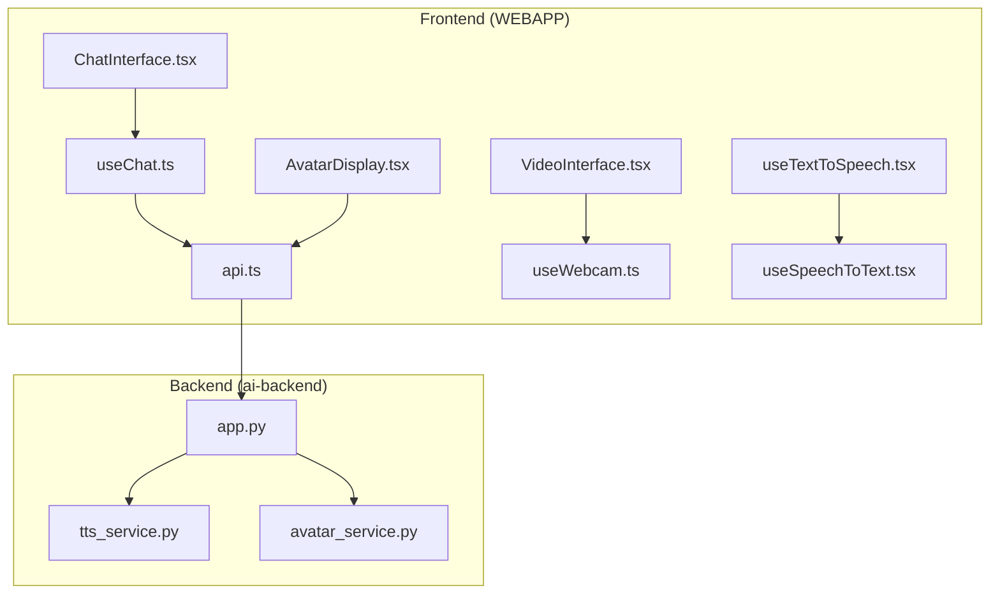
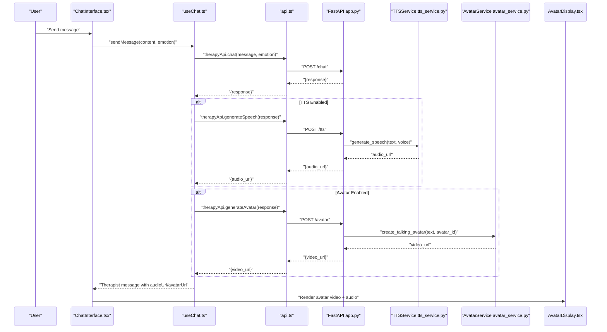
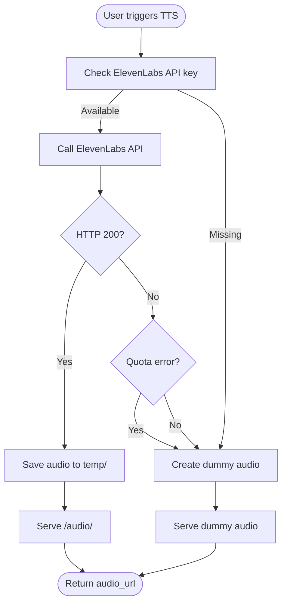
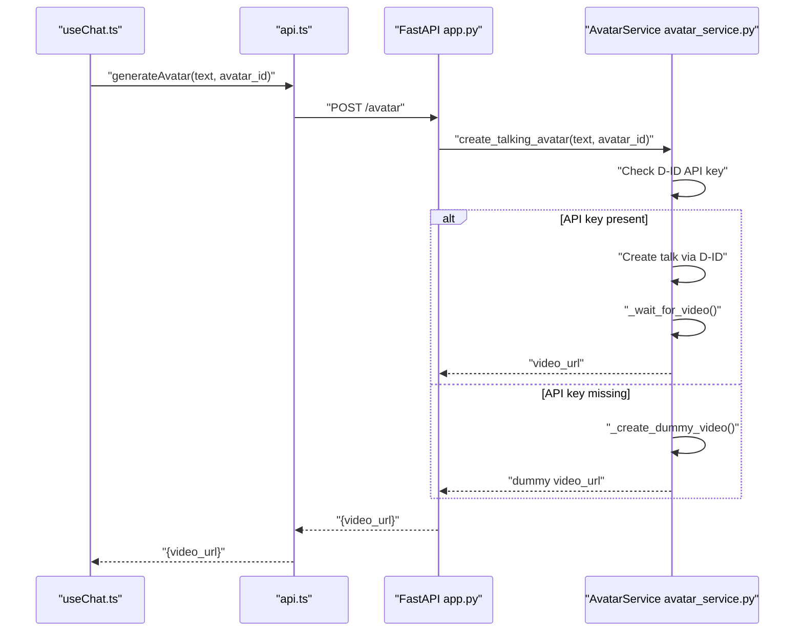
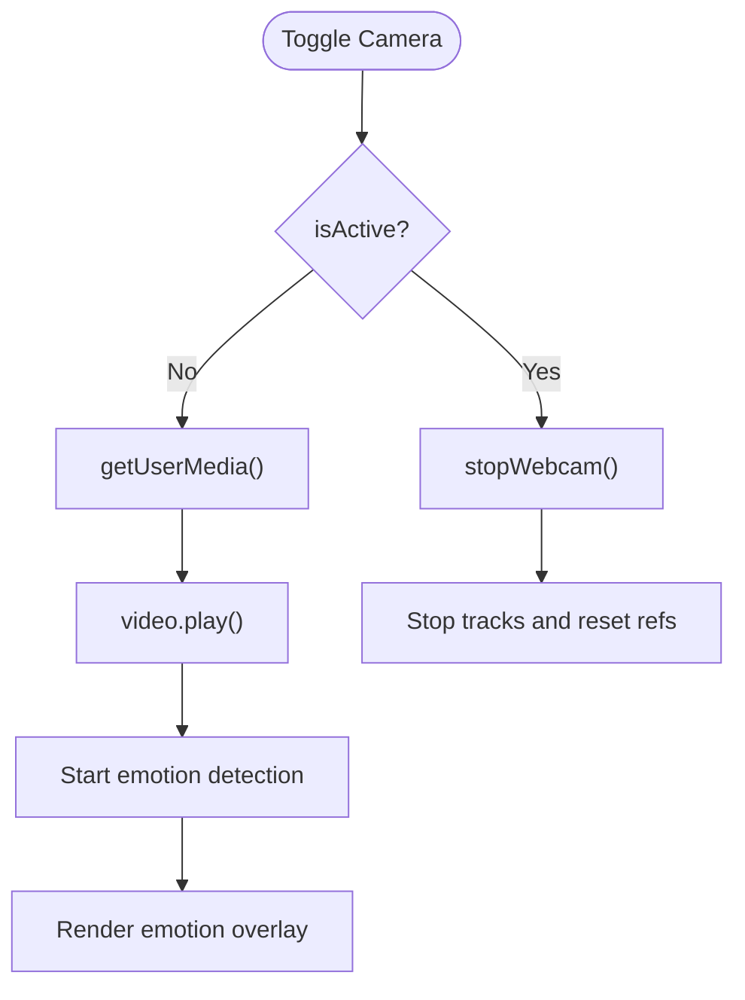
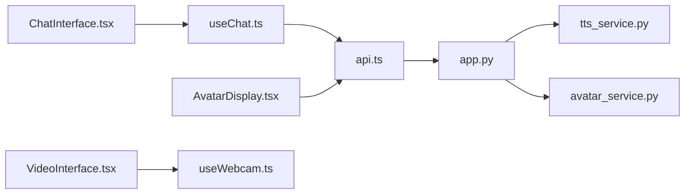

# Multi-modal Communication Features

<cite>
**Referenced Files in This Document**
- [useTextToSpeech.tsx](file://WEBAPP/src/hooks/useTextToSpeech.tsx)
- [tts_service.py](file://ai-backend/services/tts_service.py)
- [avatar_service.py](file://ai-backend/services/avatar_service.py)
- [AvatarDisplay.tsx](file://WEBAPP/src/components/AvatarDisplay.tsx)
- [VideoInterface.tsx](file://WEBAPP/src/components/VideoInterface.tsx)
- [app.py](file://ai-backend/app.py)
- [api.ts](file://WEBAPP/src/lib/api.ts)
- [useChat.ts](file://WEBAPP/src/hooks/useChat.ts)
- [useWebcam.ts](file://WEBAPP/src/hooks/useWebcam.ts)
- [useSpeechToText.tsx](file://WEBAPP/src/hooks/useSpeechToText.tsx)
- [ChatInterface.tsx](file://WEBAPP/src/components/ChatInterface.tsx)
- [mentalHealthAnalytics.ts](file://WEBAPP/src/lib/mentalHealthAnalytics.ts)
</cite>

## Table of Contents
1. [Introduction](#introduction)
2. [Project Structure](#project-structure)
3. [Core Components](#core-components)
4. [Architecture Overview](#architecture-overview)
5. [Detailed Component Analysis](#detailed-component-analysis)
6. [Dependency Analysis](#dependency-analysis)
7. [Performance Considerations](#performance-considerations)
8. [Troubleshooting Guide](#troubleshooting-guide)
9. [Conclusion](#conclusion)

## Introduction
This document explains the multi-modal communication capabilities of the system, focusing on:
- Text-to-speech integration with ElevenLabs API
- Avatar generation and video synthesis workflows
- Real-time video interface components
- Synchronization between text, audio, and visual modalities
- Lip-syncing, facial animation coordination, and audio-visual feedback loops
- TTS quality settings, voice selection options, avatar customization features
- Performance optimization for real-time multi-modal delivery

## Project Structure
The multi-modal pipeline spans the frontend (React) and backend (FastAPI) layers:
- Frontend: React components and hooks orchestrate user input, TTS playback, avatar display, and webcam/video interface.
- Backend: FastAPI serves endpoints for therapy responses, TTS generation, and avatar video creation, integrating with external APIs (ElevenLabs, D-ID).



**Diagram sources**
- [ChatInterface.tsx](file://WEBAPP/src/components/ChatInterface.tsx#L1-L567)
- [useChat.ts](file://WEBAPP/src/hooks/useChat.ts#L1-L150)
- [api.ts](file://WEBAPP/src/lib/api.ts#L1-L142)
- [AvatarDisplay.tsx](file://WEBAPP/src/components/AvatarDisplay.tsx#L1-L210)
- [VideoInterface.tsx](file://WEBAPP/src/components/VideoInterface.tsx#L1-L207)
- [useTextToSpeech.tsx](file://WEBAPP/src/hooks/useTextToSpeech.tsx#L1-L42)
- [useWebcam.ts](file://WEBAPP/src/hooks/useWebcam.ts#L1-L89)
- [useSpeechToText.tsx](file://WEBAPP/src/hooks/useSpeechToText.tsx#L1-L129)
- [app.py](file://ai-backend/app.py#L1-L154)
- [tts_service.py](file://ai-backend/services/tts_service.py#L1-L280)
- [avatar_service.py](file://ai-backend/services/avatar_service.py#L1-L237)

**Section sources**
- [ChatInterface.tsx](file://WEBAPP/src/components/ChatInterface.tsx#L1-L567)
- [useChat.ts](file://WEBAPP/src/hooks/useChat.ts#L1-L150)
- [api.ts](file://WEBAPP/src/lib/api.ts#L1-L142)
- [AvatarDisplay.tsx](file://WEBAPP/src/components/AvatarDisplay.tsx#L1-L210)
- [VideoInterface.tsx](file://WEBAPP/src/components/VideoInterface.tsx#L1-L207)
- [useTextToSpeech.tsx](file://WEBAPP/src/hooks/useTextToSpeech.tsx#L1-L42)
- [useWebcam.ts](file://WEBAPP/src/hooks/useWebcam.ts#L1-L89)
- [useSpeechToText.tsx](file://WEBAPP/src/hooks/useSpeechToText.tsx#L1-L129)
- [app.py](file://ai-backend/app.py#L1-L154)
- [tts_service.py](file://ai-backend/services/tts_service.py#L1-L280)
- [avatar_service.py](file://ai-backend/services/avatar_service.py#L1-L237)

## Core Components
- Text-to-Speech (ElevenLabs):
  - Backend service generates audio via ElevenLabs API with configurable voice settings and fallback to dummy audio when unavailable.
  - Frontend hook exposes a simple speak API with callbacks for speech end events.
- Avatar Generation (D-ID):
  - Backend service orchestrates avatar video creation using D-ID API or returns a development dummy video.
  - Frontend component renders the avatar video and synchronized audio, with auto-play and error handling.
- Real-time Video Interface:
  - Webcam capture and emotion overlay display powered by hooks and UI components.
- API Orchestration:
  - FastAPI endpoints expose chat, TTS, and avatar generation, serving static audio/video assets from a temp directory.

**Section sources**
- [tts_service.py](file://ai-backend/services/tts_service.py#L53-L144)
- [useTextToSpeech.tsx](file://WEBAPP/src/hooks/useTextToSpeech.tsx#L7-L31)
- [avatar_service.py](file://ai-backend/services/avatar_service.py#L19-L67)
- [AvatarDisplay.tsx](file://WEBAPP/src/components/AvatarDisplay.tsx#L37-L72)
- [VideoInterface.tsx](file://WEBAPP/src/components/VideoInterface.tsx#L18-L68)
- [app.py](file://ai-backend/app.py#L96-L122)

## Architecture Overview
The multi-modal pipeline integrates frontend UI, hooks, and backend services:



**Diagram sources**
- [ChatInterface.tsx](file://WEBAPP/src/components/ChatInterface.tsx#L255-L310)
- [useChat.ts](file://WEBAPP/src/hooks/useChat.ts#L40-L116)
- [api.ts](file://WEBAPP/src/lib/api.ts#L75-L97)
- [app.py](file://ai-backend/app.py#L81-L122)
- [tts_service.py](file://ai-backend/services/tts_service.py#L53-L106)
- [avatar_service.py](file://ai-backend/services/avatar_service.py#L19-L67)
- [AvatarDisplay.tsx](file://WEBAPP/src/components/AvatarDisplay.tsx#L37-L72)

## Detailed Component Analysis

### Text-to-Speech Integration (ElevenLabs)
- Backend:
  - TTSService handles ElevenLabs API requests, voice selection, and fallback to dummy audio when the API key is missing or quota is exceeded.
  - Voice settings include stability and similarity boost parameters; model defaults to a monolingual model.
  - Audio files are saved to a temp directory and served via FastAPI static mounts.
- Frontend:
  - useTextToSpeech provides a speak function using the Web Speech API, with rate, pitch, and volume tuned for naturalness.
  - Callbacks allow chaining actions after speech ends.



**Diagram sources**
- [tts_service.py](file://ai-backend/services/tts_service.py#L53-L144)

**Section sources**
- [tts_service.py](file://ai-backend/services/tts_service.py#L10-L21)
- [tts_service.py](file://ai-backend/services/tts_service.py#L53-L106)
- [tts_service.py](file://ai-backend/services/tts_service.py#L146-L191)
- [useTextToSpeech.tsx](file://WEBAPP/src/hooks/useTextToSpeech.tsx#L7-L31)
- [app.py](file://ai-backend/app.py#L38-L40)

### Avatar Generation and Video Synthesis
- Backend:
  - AvatarService integrates with D-ID API to create talking avatar videos, with presenter selection and polling for completion.
  - Provides fallback to a development dummy video when the D-ID API key is missing.
- Frontend:
  - AvatarDisplay renders the avatar video and synchronized audio, auto-plays on new content, and loops video while audio is playing.
  - Includes controls for replay and audio-only playback, plus status indicators and error handling.



**Diagram sources**
- [useChat.ts](file://WEBAPP/src/hooks/useChat.ts#L96-L101)
- [api.ts](file://WEBAPP/src/lib/api.ts#L92-L97)
- [app.py](file://ai-backend/app.py#L110-L122)
- [avatar_service.py](file://ai-backend/services/avatar_service.py#L19-L67)
- [avatar_service.py](file://ai-backend/services/avatar_service.py#L122-L155)
- [AvatarDisplay.tsx](file://WEBAPP/src/components/AvatarDisplay.tsx#L37-L72)

**Section sources**
- [avatar_service.py](file://ai-backend/services/avatar_service.py#L11-L17)
- [avatar_service.py](file://ai-backend/services/avatar_service.py#L19-L67)
- [avatar_service.py](file://ai-backend/services/avatar_service.py#L122-L155)
- [AvatarDisplay.tsx](file://WEBAPP/src/components/AvatarDisplay.tsx#L12-L72)
- [AvatarDisplay.tsx](file://WEBAPP/src/components/AvatarDisplay.tsx#L125-L144)

### Real-time Video Interface Components
- VideoInterface displays the webcam feed, overlays current emotion classification, and provides controls to start/stop camera and toggle emotion display.
- useWebcam manages media device access, capturing images, and lifecycle cleanup.
- Emotion detection is integrated via a hook that captures frames and emits results to the parent component.



**Diagram sources**
- [VideoInterface.tsx](file://WEBAPP/src/components/VideoInterface.tsx#L52-L68)
- [useWebcam.ts](file://WEBAPP/src/hooks/useWebcam.ts#L17-L52)

**Section sources**
- [VideoInterface.tsx](file://WEBAPP/src/components/VideoInterface.tsx#L18-L68)
- [useWebcam.ts](file://WEBAPP/src/hooks/useWebcam.ts#L9-L52)

### Synchronization Between Modalities
- Audio-Visual Playback:
  - AvatarDisplay coordinates video and audio playback, muting video when audio is present and looping video while audio continues.
  - Audio end events pause the video to maintain synchronization.
- Lip-syncing and Facial Animation:
  - The D-ID API generates synchronized mouth movements and facial animations during video creation.
  - Frontend playback ensures lip movement aligns with synthesized audio timing.
- Feedback Loops:
  - useTextToSpeech triggers automatic listening after speech completes, enabling conversational continuity.
  - Emotion overlay updates periodically to reflect real-time user state.

```mermaid
sequenceDiagram
participant AD as "AvatarDisplay.tsx"
participant V as "Video Element"
participant A as "Audio Element"
AD->>V : "currentTime=0; play()"
AD->>A : "currentTime=0; play()"
V-->>AD : "onended"
alt Audio still playing
AD->>V : "currentTime=0; play() (loop)"
else Audio ended
AD->>V : "pause()"
end
A-->>AD : "onended"
AD->>AD : "setIsPlaying(false)"
```

**Diagram sources**
- [AvatarDisplay.tsx](file://WEBAPP/src/components/AvatarDisplay.tsx#L37-L72)

**Section sources**
- [AvatarDisplay.tsx](file://WEBAPP/src/components/AvatarDisplay.tsx#L37-L72)
- [useTextToSpeech.tsx](file://WEBAPP/src/hooks/useTextToSpeech.tsx#L18-L25)

### TTS Quality Settings and Voice Selection
- ElevenLabs Voice Settings:
  - Stability and similarity boost parameters influence voice consistency and likeness.
  - Model selection uses a monolingual model optimized for clarity.
- Voice Selection:
  - Default voice ID is configurable via environment variable; callers can override voice per request.
- Frontend Tuning:
  - Web Speech API settings adjust rate, pitch, and volume for natural delivery.

**Section sources**
- [tts_service.py](file://ai-backend/services/tts_service.py#L71-L78)
- [tts_service.py](file://ai-backend/services/tts_service.py#L14-L14)
- [useTextToSpeech.tsx](file://WEBAPP/src/hooks/useTextToSpeech.tsx#L13-L16)

### Avatar Customization Features
- Presenter Selection:
  - AvatarService supports selecting a default or custom presenter ID for avatar generation.
- Custom Avatar Upload:
  - D-ID image upload capability is exposed for custom avatars, returning an identifier for future use.
- Fallback Behavior:
  - Dummy video is returned during development or when API keys are missing, ensuring uninterrupted UX.

**Section sources**
- [avatar_service.py](file://ai-backend/services/avatar_service.py#L13-L15)
- [avatar_service.py](file://ai-backend/services/avatar_service.py#L29-L29)
- [avatar_service.py](file://ai-backend/services/avatar_service.py#L206-L236)
- [avatar_service.py](file://ai-backend/services/avatar_service.py#L69-L121)

### Audio-Visual Feedback Loops
- Speech Recognition to Chat:
  - useSpeechToText captures speech and emits final transcripts to trigger chat submission.
- Post-Speech Actions:
  - useTextToSpeech invokes a callback after speech ends, enabling subsequent actions (e.g., auto-listening).
- Emotion-Aware Responses:
  - Emotion overlay informs chat context; while emotion detection is handled by ML backend, the frontend integrates emotion data into chat flows.

**Section sources**
- [useSpeechToText.tsx](file://WEBAPP/src/hooks/useSpeechToText.tsx#L79-L85)
- [useTextToSpeech.tsx](file://WEBAPP/src/hooks/useTextToSpeech.tsx#L22-L25)
- [VideoInterface.tsx](file://WEBAPP/src/components/VideoInterface.tsx#L46-L50)

## Dependency Analysis
- Frontend dependencies:
  - ChatInterface depends on useChat for orchestration, which in turn calls api.ts endpoints.
  - AvatarDisplay consumes audio/video URLs produced by backend services.
  - VideoInterface relies on useWebcam and emotion detection hooks.
- Backend dependencies:
  - app.py mounts static audio/video directories and delegates to lazy-initialized services.
  - TTSService and AvatarService encapsulate external API integrations and fallback logic.



**Diagram sources**
- [ChatInterface.tsx](file://WEBAPP/src/components/ChatInterface.tsx#L66-L79)
- [useChat.ts](file://WEBAPP/src/hooks/useChat.ts#L33-L39)
- [api.ts](file://WEBAPP/src/lib/api.ts#L75-L97)
- [app.py](file://ai-backend/app.py#L48-L71)
- [tts_service.py](file://ai-backend/services/tts_service.py#L10-L21)
- [avatar_service.py](file://ai-backend/services/avatar_service.py#L11-L17)
- [AvatarDisplay.tsx](file://WEBAPP/src/components/AvatarDisplay.tsx#L12-L21)
- [VideoInterface.tsx](file://WEBAPP/src/components/VideoInterface.tsx#L3-L6)

**Section sources**
- [useChat.ts](file://WEBAPP/src/hooks/useChat.ts#L33-L39)
- [api.ts](file://WEBAPP/src/lib/api.ts#L75-L97)
- [app.py](file://ai-backend/app.py#L48-L71)
- [tts_service.py](file://ai-backend/services/tts_service.py#L10-L21)
- [avatar_service.py](file://ai-backend/services/avatar_service.py#L11-L17)

## Performance Considerations
- Asynchronous Workflows:
  - Backend services use async HTTP clients to avoid blocking; polling for video completion is bounded with retries.
- Resource Management:
  - Audio/video temp directory cleanup prevents disk bloat; unique filenames avoid caching conflicts.
- Frontend Responsiveness:
  - Auto-play delays and muted video when audio is present reduce startup latency and resource contention.
- Streaming and Static Serving:
  - FastAPI static mounts serve audio/video efficiently; ensure appropriate caching headers for production.

[No sources needed since this section provides general guidance]

## Troubleshooting Guide
- ElevenLabs API Issues:
  - Missing API key or quota errors trigger fallback to dummy audio; verify environment variables and account limits.
- D-ID API Failures:
  - Missing API key returns a dummy video; otherwise, errors are logged and a placeholder is created.
- Audio/Video Playback:
  - AvatarDisplay logs audio load/play events and errors; ensure proper MIME types and CORS for static files.
- Webcam Access:
  - useWebcam handles permission errors and cleanup; verify HTTPS and permissions for media devices.

**Section sources**
- [tts_service.py](file://ai-backend/services/tts_service.py#L107-L144)
- [avatar_service.py](file://ai-backend/services/avatar_service.py#L64-L67)
- [avatar_service.py](file://ai-backend/services/avatar_service.py#L113-L120)
- [AvatarDisplay.tsx](file://WEBAPP/src/components/AvatarDisplay.tsx#L131-L143)
- [useWebcam.ts](file://WEBAPP/src/hooks/useWebcam.ts#L37-L40)

## Conclusion
The system delivers a cohesive multi-modal experience by combining:
- High-quality TTS with ElevenLabs and tunable voice settings
- Avatar video synthesis with D-ID and presenter customization
- Real-time video interface with emotion overlay and controls
- Tight synchronization between audio and visuals, with robust fallbacks and performance optimizations

This foundation supports scalable, responsive therapy sessions with rich audio-visual feedback.