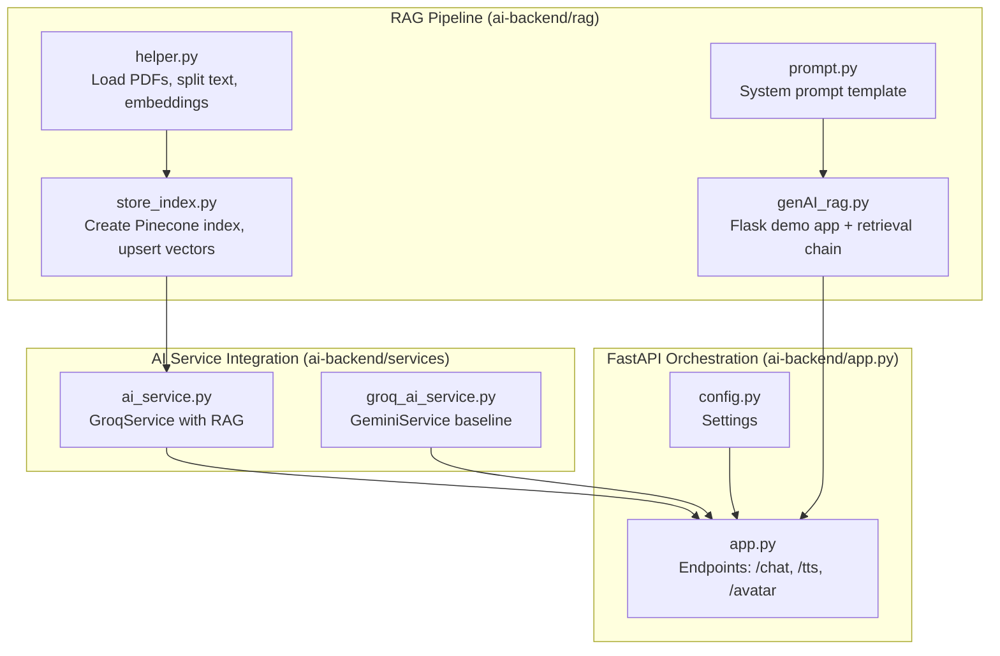
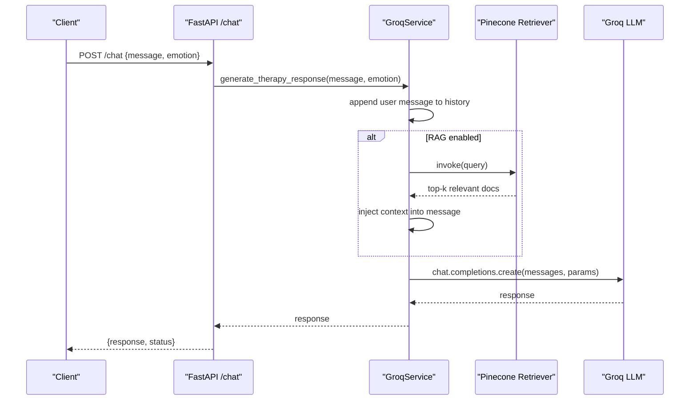
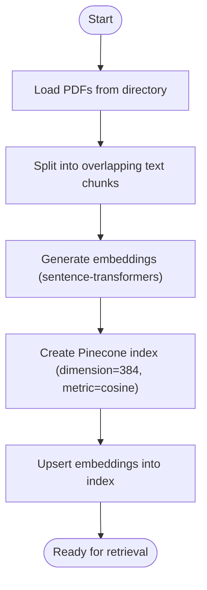
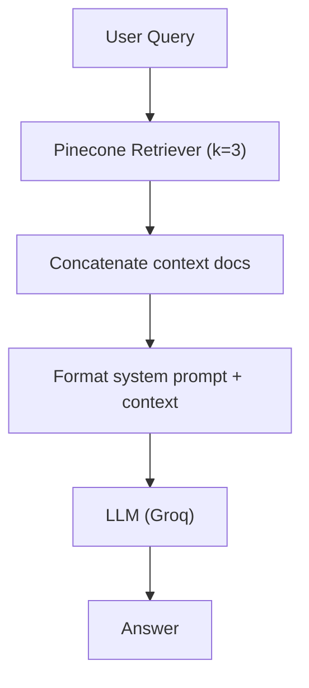
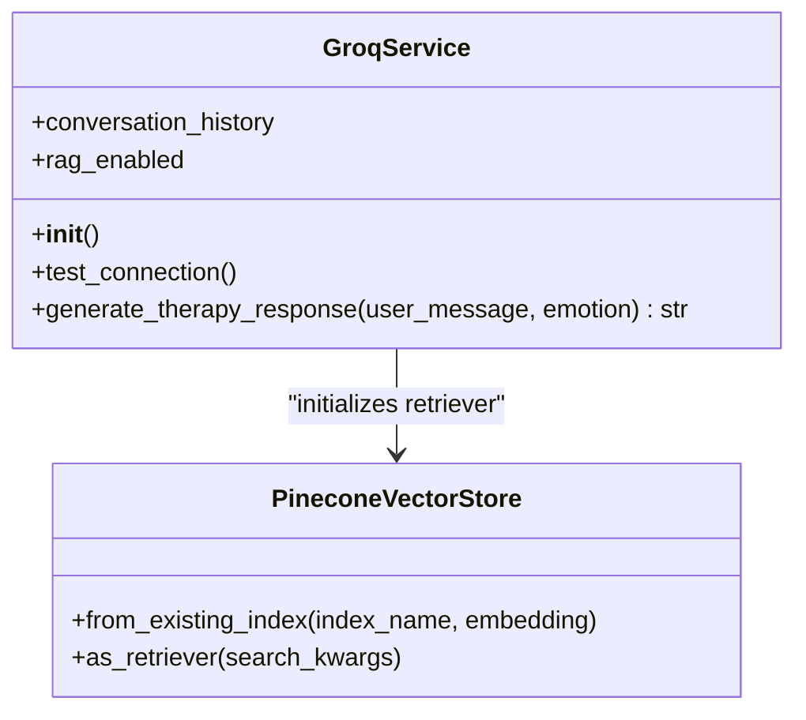
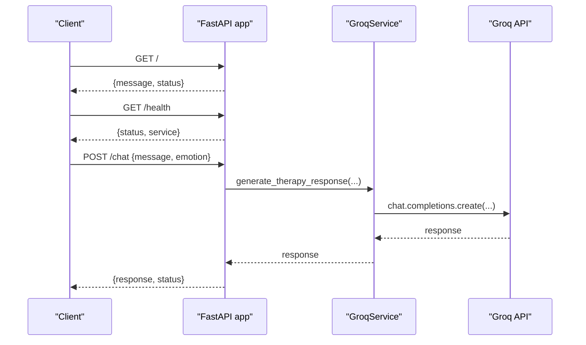
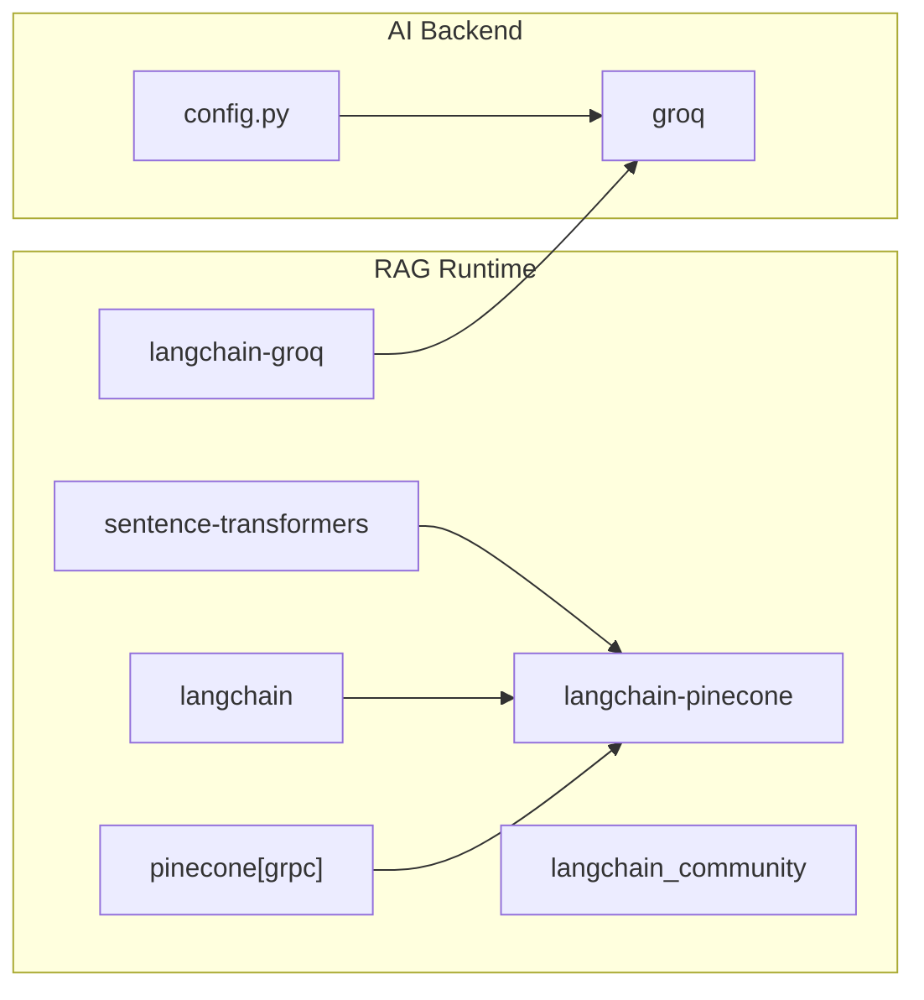

# RAG Integration & Knowledge Base

<cite>
**Referenced Files in This Document**
- [genAI_rag.py](file://ai-backend/rag/genAI_rag.py)
- [helper.py](file://ai-backend/rag/helper.py)
- [prompt.py](file://ai-backend/rag/prompt.py)
- [store_index.py](file://ai-backend/rag/store_index.py)
- [requirements.txt (RAG)](file://ai-backend/rag/requirements.txt)
- [ai_service.py](file://ai-backend/services/ai_service.py)
- [groq_ai_service.py](file://ai-backend/services/groq_ai_service.py)
- [app.py](file://ai-backend/app.py)
- [config.py](file://ai-backend/config.py)
- [data.txt](file://ai-backend/rag/Data/data.txt)
- [quesAns.csv](file://ai-backend/rag/csvData/quesAns.csv)
</cite>

## Table of Contents
1. [Introduction](#introduction)
2. [Project Structure](#project-structure)
3. [Core Components](#core-components)
4. [Architecture Overview](#architecture-overview)
5. [Detailed Component Analysis](#detailed-component-analysis)
6. [Dependency Analysis](#dependency-analysis)
7. [Performance Considerations](#performance-considerations)
8. [Troubleshooting Guide](#troubleshooting-guide)
9. [Conclusion](#conclusion)
10. [Appendices](#appendices)

## Introduction
This document explains the Retrieval-Augmented Generation (RAG) system integrated into the AI backend. It covers the Pinecone vector database setup, embedding generation using sentence-transformers, the retrieval pipeline that enriches AI responses with relevant mental health resources, and the prompt engineering and context injection strategies. It also documents the data preprocessing workflow, index storage mechanisms, query processing algorithms, and how the system improves therapeutic conversations by providing evidence-based resources while maintaining conversational coherence.

## Project Structure
The RAG system spans two main areas:
- RAG pipeline and index management under ai-backend/rag
- AI service integration under ai-backend/services, with FastAPI orchestration under ai-backend/app.py

**Diagram sources**
- [helper.py](file://ai-backend/rag/helper.py#L1-L29)
- [store_index.py](file://ai-backend/rag/store_index.py#L1-L40)
- [prompt.py](file://ai-backend/rag/prompt.py#L1-L11)
- [genAI_rag.py](file://ai-backend/rag/genAI_rag.py#L1-L76)
- [ai_service.py](file://ai-backend/services/ai_service.py#L72-L192)
- [groq_ai_service.py](file://ai-backend/services/groq_ai_service.py#L70-L112)
- [app.py](file://ai-backend/app.py#L1-L154)
- [config.py](file://ai-backend/config.py#L1-L49)

**Section sources**
- [genAI_rag.py](file://ai-backend/rag/genAI_rag.py#L1-L76)
- [helper.py](file://ai-backend/rag/helper.py#L1-L29)
- [prompt.py](file://ai-backend/rag/prompt.py#L1-L11)
- [store_index.py](file://ai-backend/rag/store_index.py#L1-L40)
- [ai_service.py](file://ai-backend/services/ai_service.py#L72-L192)
- [groq_ai_service.py](file://ai-backend/services/groq_ai_service.py#L70-L112)
- [app.py](file://ai-backend/app.py#L1-L154)
- [config.py](file://ai-backend/config.py#L1-L49)

## Core Components
- Data ingestion and preprocessing: Loads PDFs, splits into chunks, generates embeddings using sentence-transformers.
- Vector index creation and storage: Creates a Pinecone index and upserts document embeddings.
- Retrieval pipeline: Retrieves top-k relevant chunks for user queries and augments prompts.
- Prompt engineering: Uses a concise, context-aware system prompt to constrain responses.
- AI service integration: GroqService wraps retrieval and conversation history to produce therapeutic responses.
- FastAPI orchestration: Exposes endpoints for chat, TTS, and avatar generation.

**Section sources**
- [helper.py](file://ai-backend/rag/helper.py#L1-L29)
- [store_index.py](file://ai-backend/rag/store_index.py#L1-L40)
- [prompt.py](file://ai-backend/rag/prompt.py#L1-L11)
- [ai_service.py](file://ai-backend/services/ai_service.py#L72-L192)
- [app.py](file://ai-backend/app.py#L81-L94)

## Architecture Overview
The RAG architecture integrates LangChain with Pinecone and Groq. At runtime, user messages are embedded and matched against the index to retrieve relevant context, which is injected into the prompt template. The Groq model produces a response that remains coherent with prior conversation history.

**Diagram sources**
- [app.py](file://ai-backend/app.py#L81-L94)
- [ai_service.py](file://ai-backend/services/ai_service.py#L131-L192)

## Detailed Component Analysis

### Data Preprocessing and Index Storage
- PDF ingestion: Loads PDFs from a directory and extracts raw text.
- Chunking: Recursively splits documents into overlapping text chunks sized for embeddings.
- Embedding model: sentence-transformers all-MiniLM-L6-v2 returns 384-dimensional vectors.
- Index creation: Creates a serverless Pinecone index with cosine similarity and upserts embeddings for all chunks.

**Diagram sources**
- [helper.py](file://ai-backend/rag/helper.py#L7-L29)
- [store_index.py](file://ai-backend/rag/store_index.py#L15-L40)

**Section sources**
- [helper.py](file://ai-backend/rag/helper.py#L7-L29)
- [store_index.py](file://ai-backend/rag/store_index.py#L15-L40)

### Retrieval Pipeline and Prompt Engineering
- Retrieval: Uses PineconeVectorStore with a retriever configured to fetch top-k matches.
- Prompt template: A concise system prompt instructs the model to use retrieved context and limit response length.
- Chain composition: LangChain chains combine retriever and LLM with the prompt template.

**Diagram sources**
- [genAI_rag.py](file://ai-backend/rag/genAI_rag.py#L38-L55)
- [prompt.py](file://ai-backend/rag/prompt.py#L3-L11)

**Section sources**
- [genAI_rag.py](file://ai-backend/rag/genAI_rag.py#L38-L55)
- [prompt.py](file://ai-backend/rag/prompt.py#L3-L11)

### AI Service Integration with RAG
- GroqService initializes embeddings and a retriever from an existing Pinecone index.
- On each request, it optionally augments the user message with retrieved context and appends the combined message to conversation history.
- Calls Groq to generate a response respecting the system prompt and prior context.

**Diagram sources**
- [ai_service.py](file://ai-backend/services/ai_service.py#L72-L192)

**Section sources**
- [ai_service.py](file://ai-backend/services/ai_service.py#L72-L192)

### FastAPI Orchestration and Endpoint Flow
- Root and health endpoints expose service status.
- /chat endpoint delegates to GroqService and returns a JSON response.
- Static audio/video serving via mounted directories.

**Diagram sources**
- [app.py](file://ai-backend/app.py#L73-L94)

**Section sources**
- [app.py](file://ai-backend/app.py#L73-L94)

### Data Sources and Knowledge Base Content
- Structured Q&A dataset: A CSV containing context-response pairs supports retrieval-grounded answers.
- Unstructured text: A plain text file with question-answer pairs provides additional knowledge for embedding and retrieval.

**Section sources**
- [quesAns.csv](file://ai-backend/rag/csvData/quesAns.csv#L1-L221)
- [data.txt](file://ai-backend/rag/Data/data.txt#L1-L17)

## Dependency Analysis
- RAG runtime dependencies include sentence-transformers, langchain, pinecone gRPC client, and langchain integrations.
- The AI backend FastAPI app depends on Groq SDK and environment configuration.

**Diagram sources**
- [requirements.txt (RAG)](file://ai-backend/rag/requirements.txt#L1-L12)
- [config.py](file://ai-backend/config.py#L1-L49)

**Section sources**
- [requirements.txt (RAG)](file://ai-backend/rag/requirements.txt#L1-L12)
- [config.py](file://ai-backend/config.py#L1-L49)

## Performance Considerations
- Embedding dimension: 384 reduces storage and compute costs while maintaining retrieval effectiveness.
- Retrieval k: Top-3 matches balance relevance and latency.
- Async execution: GroqService uses thread pool execution for synchronous Groq calls to avoid blocking the event loop.
- Index locality: Serverless Pinecone index scales automatically; ensure query latency remains acceptable under load.
- Prompt size: Keep injected context concise to fit within token limits and maintain responsiveness.

[No sources needed since this section provides general guidance]

## Troubleshooting Guide
- Missing Pinecone API key: Initialization logs warnings and continues without RAG.
- Missing Groq API key: Raises explicit error during service initialization.
- RAG retrieval failures: Logged warnings; system falls back to conversation history only.
- Environment configuration: Verify .env variables for API keys and ports.

**Section sources**
- [ai_service.py](file://ai-backend/services/ai_service.py#L85-L118)
- [ai_service.py](file://ai-backend/services/ai_service.py#L166-L168)
- [config.py](file://ai-backend/config.py#L12-L15)

## Conclusion
The RAG system integrates sentence-transformers embeddings, Pinecone vector storage, and a Groq-powered LLM to deliver evidence-based, context-aware responses. The GroqService orchestrates retrieval augmentation while preserving conversational continuity. With structured datasets and robust error handling, the system enhances therapeutic conversations by grounding responses in reliable mental health resources.

[No sources needed since this section summarizes without analyzing specific files]

## Appendices

### Prompt Engineering and Context Injection
- System prompt constrains model behavior to be supportive, concise, and non-clinical.
- Context injection augments user messages with retrieved knowledge to improve accuracy and relevance.

**Section sources**
- [prompt.py](file://ai-backend/rag/prompt.py#L3-L11)
- [ai_service.py](file://ai-backend/services/ai_service.py#L157-L162)

### Example Workflows
- Index creation: Load data → split → embed → create index → upsert.
- Query processing: Embed query → retrieve top-k → inject context → call LLM → update history.

**Section sources**
- [store_index.py](file://ai-backend/rag/store_index.py#L15-L40)
- [ai_service.py](file://ai-backend/services/ai_service.py#L142-L192)