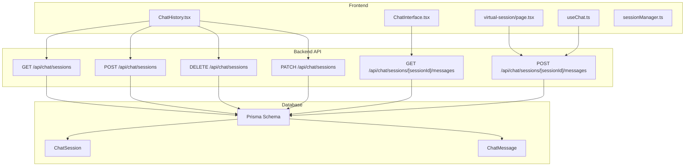
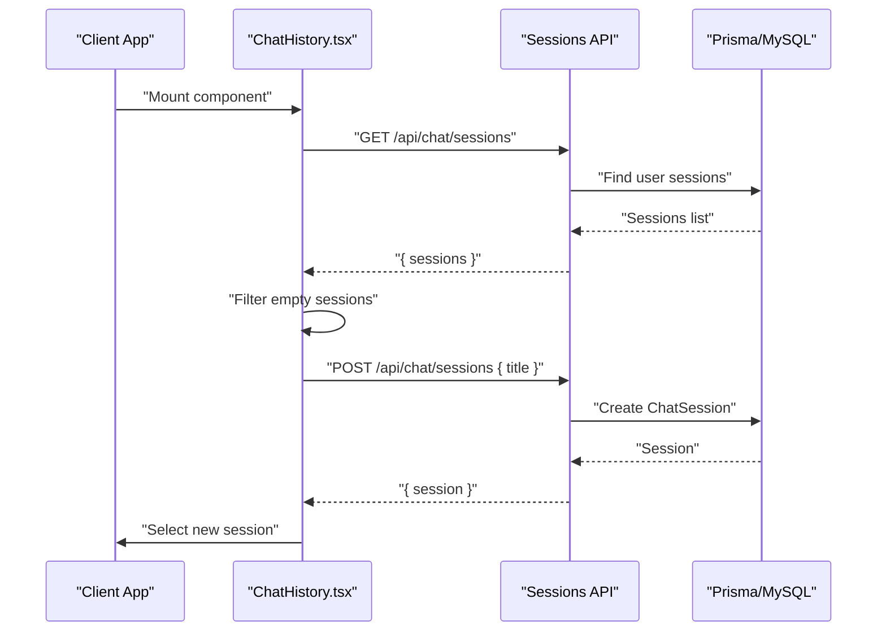
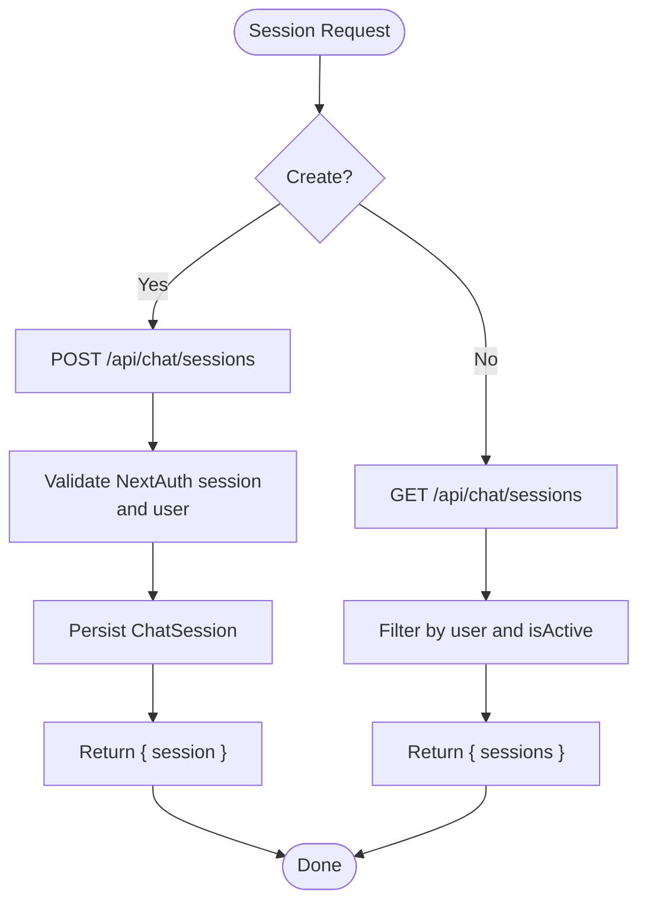
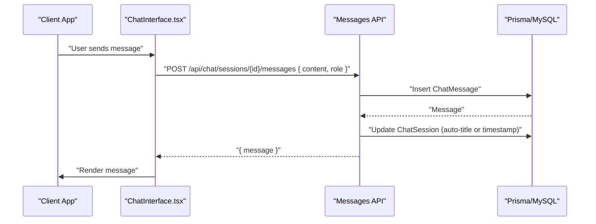
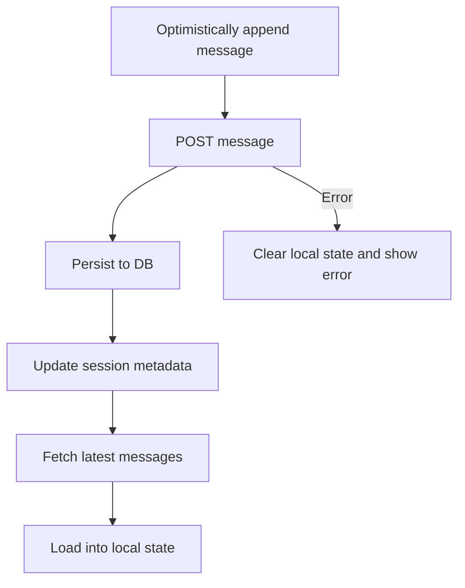
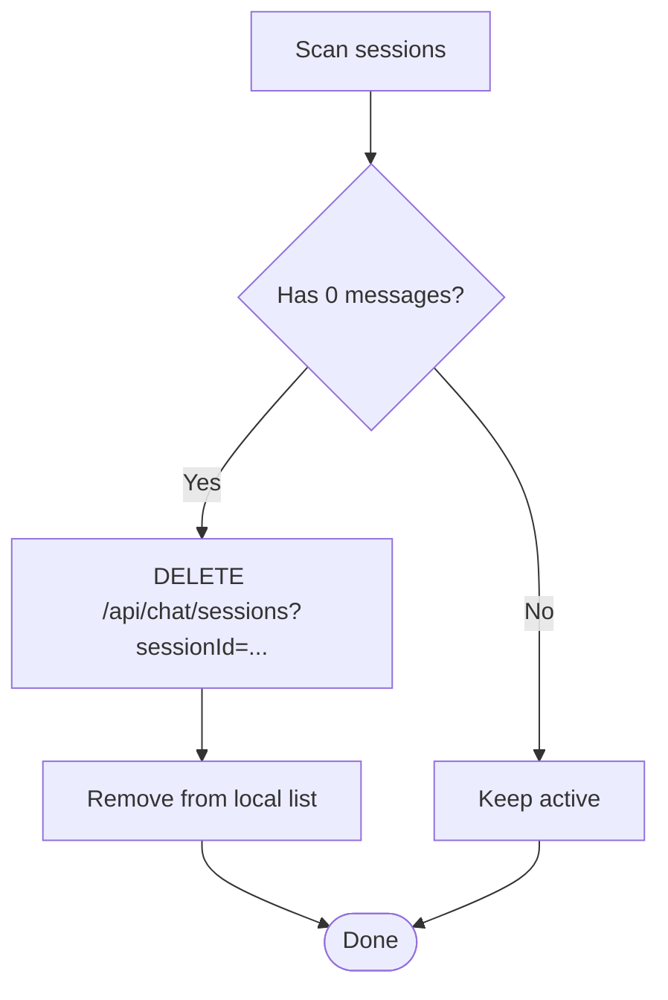
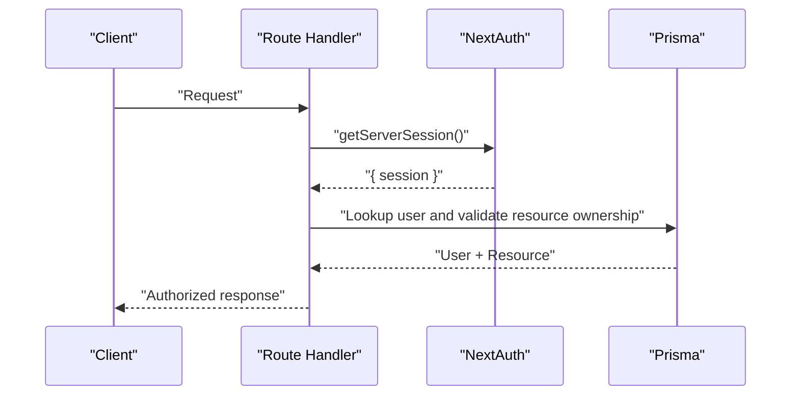
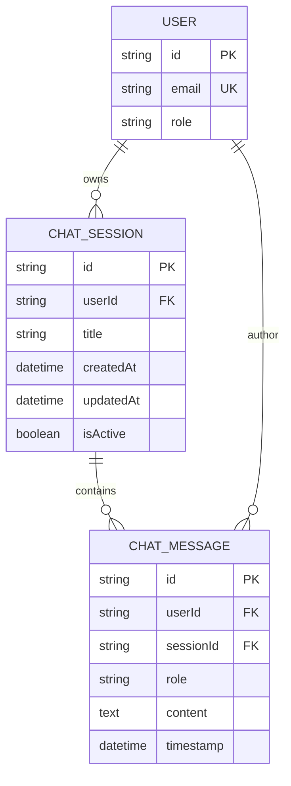

# Real-time Communication & Sessions

<cite>
**Referenced Files in This Document**
- [schema.prisma](file://prisma/schema.prisma)
- [sessions/route.ts](file://WEBAPP/src/app/api/chat/sessions/route.ts)
- [messages/route.ts](file://WEBAPP/src/app/api/chat/sessions/[sessionId]/messages/route.ts)
- [ChatHistory.tsx](file://WEBAPP/src/components/ChatHistory.tsx)
- [ChatInterface.tsx](file://WEBAPP/src/components/ChatInterface.tsx)
- [useChat.ts](file://WEBAPP/src/hooks/useChat.ts)
- [sessionManager.ts](file://WEBAPP/src/lib/sessionManager.ts)
- [migrate-messages-to-sessions.ts](file://WEBAPP/scripts/migrate-messages-to-sessions.ts)
- [virtual-session/page.tsx](file://WEBAPP/src/app/patient/virtual-session/page.tsx)
</cite>

## Table of Contents
1. [Introduction](#introduction)
2. [Project Structure](#project-structure)
3. [Core Components](#core-components)
4. [Architecture Overview](#architecture-overview)
5. [Detailed Component Analysis](#detailed-component-analysis)
6. [Dependency Analysis](#dependency-analysis)
7. [Performance Considerations](#performance-considerations)
8. [Troubleshooting Guide](#troubleshooting-guide)
9. [Conclusion](#conclusion)

## Introduction
This document explains the real-time communication and session infrastructure for chat and virtual therapy experiences. It focuses on:
- How sessions are created, persisted, and managed
- How messages are stored and retrieved
- Conversation state handling across multiple clients
- Offline message handling and session cleanup
- Scalability and performance considerations for concurrent therapy sessions

Notably, the current implementation relies on REST APIs for message streaming and session management. There is no WebSocket-based real-time streaming in the referenced code; instead, clients poll for updates and rely on database-backed state.

## Project Structure
The real-time chat and session system spans frontend components, React hooks, and backend API routes backed by Prisma ORM and a MySQL database.

**Diagram sources**
- [ChatHistory.tsx](file://WEBAPP/src/components/ChatHistory.tsx#L57-L90)
- [ChatInterface.tsx](file://WEBAPP/src/components/ChatInterface.tsx#L106-L128)
- [useChat.ts](file://WEBAPP/src/hooks/useChat.ts#L40-L116)
- [virtual-session/page.tsx](file://WEBAPP/src/app/patient/virtual-session/page.tsx#L183-L196)
- [sessions/route.ts](file://WEBAPP/src/app/api/chat/sessions/route.ts#L6-L40)
- [sessions/route.ts](file://WEBAPP/src/app/api/chat/sessions/route.ts#L42-L74)
- [sessions/route.ts](file://WEBAPP/src/app/api/chat/sessions/route.ts#L77-L135)
- [sessions/route.ts](file://WEBAPP/src/app/api/chat/sessions/route.ts#L138-L187)
- [messages/route.ts](file://WEBAPP/src/app/api/chat/sessions/[sessionId]/messages/route.ts#L5-L50)
- [messages/route.ts](file://WEBAPP/src/app/api/chat/sessions/[sessionId]/messages/route.ts#L52-L137)
- [schema.prisma](file://prisma/schema.prisma#L108-L138)

**Section sources**
- [ChatHistory.tsx](file://WEBAPP/src/components/ChatHistory.tsx#L53-L211)
- [ChatInterface.tsx](file://WEBAPP/src/components/ChatInterface.tsx#L85-L128)
- [useChat.ts](file://WEBAPP/src/hooks/useChat.ts#L1-L150)
- [virtual-session/page.tsx](file://WEBAPP/src/app/patient/virtual-session/page.tsx#L164-L208)
- [sessions/route.ts](file://WEBAPP/src/app/api/chat/sessions/route.ts#L1-L187)
- [messages/route.ts](file://WEBAPP/src/app/api/chat/sessions/[sessionId]/messages/route.ts#L1-L137)
- [schema.prisma](file://prisma/schema.prisma#L108-L138)

## Core Components
- Session management API:
  - List sessions, create sessions, delete sessions, update titles
- Message management API:
  - Retrieve messages for a session, append messages to a session
- Frontend session orchestration:
  - Auto-create sessions, clean up empty sessions, switch sessions
- Conversation state:
  - Local message arrays, optimistic updates, and server sync via polling
- Authentication and authorization:
  - NextAuth session used to scope resources to the logged-in user

Key implementation references:
- Session lifecycle: [sessions/route.ts](file://WEBAPP/src/app/api/chat/sessions/route.ts#L6-L40), [sessions/route.ts](file://WEBAPP/src/app/api/chat/sessions/route.ts#L42-L74), [sessions/route.ts](file://WEBAPP/src/app/api/chat/sessions/route.ts#L77-L135), [sessions/route.ts](file://WEBAPP/src/app/api/chat/sessions/route.ts#L138-L187)
- Message persistence: [messages/route.ts](file://WEBAPP/src/app/api/chat/sessions/[sessionId]/messages/route.ts#L5-L50), [messages/route.ts](file://WEBAPP/src/app/api/chat/sessions/[sessionId]/messages/route.ts#L52-L137)
- Frontend session creation/cleanup: [ChatHistory.tsx](file://WEBAPP/src/components/ChatHistory.tsx#L75-L90), [ChatHistory.tsx](file://WEBAPP/src/components/ChatHistory.tsx#L121-L146), [ChatHistory.tsx](file://WEBAPP/src/components/ChatHistory.tsx#L198-L211)
- Message retrieval and local state: [ChatInterface.tsx](file://WEBAPP/src/components/ChatInterface.tsx#L106-L128), [useChat.ts](file://WEBAPP/src/hooks/useChat.ts#L119-L132)
- Authentication gating: [messages/route.ts](file://WEBAPP/src/app/api/chat/sessions/[sessionId]/messages/route.ts#L11-L23), [sessions/route.ts](file://WEBAPP/src/app/api/chat/sessions/route.ts#L8-L20)

**Section sources**
- [sessions/route.ts](file://WEBAPP/src/app/api/chat/sessions/route.ts#L6-L187)
- [messages/route.ts](file://WEBAPP/src/app/api/chat/sessions/[sessionId]/messages/route.ts#L5-L137)
- [ChatHistory.tsx](file://WEBAPP/src/components/ChatHistory.tsx#L75-L211)
- [ChatInterface.tsx](file://WEBAPP/src/components/ChatInterface.tsx#L106-L128)
- [useChat.ts](file://WEBAPP/src/hooks/useChat.ts#L119-L132)

## Architecture Overview
The system uses a REST-first approach:
- Clients call session endpoints to manage conversations
- Clients call message endpoints to load and append messages
- Backend enforces user scoping and session validity
- Database stores sessions and messages with appropriate indexes

**Diagram sources**
- [ChatHistory.tsx](file://WEBAPP/src/components/ChatHistory.tsx#L57-L90)
- [sessions/route.ts](file://WEBAPP/src/app/api/chat/sessions/route.ts#L6-L40)
- [sessions/route.ts](file://WEBAPP/src/app/api/chat/sessions/route.ts#L42-L74)

## Detailed Component Analysis

### Session Lifecycle Management
- Creation:
  - Frontend triggers POST to create a session with a generated or provided title
  - Backend validates NextAuth session, scopes to user, persists session
- Listing:
  - Frontend requests sessions; backend filters by active sessions and user
- Deletion:
  - Empty sessions are hard-deleted; non-empty sessions are soft-deleted by deactivating
- Updates:
  - Titles can be updated; timestamps refreshed on message insert

**Diagram sources**
- [sessions/route.ts](file://WEBAPP/src/app/api/chat/sessions/route.ts#L42-L74)
- [sessions/route.ts](file://WEBAPP/src/app/api/chat/sessions/route.ts#L6-L40)

**Section sources**
- [sessions/route.ts](file://WEBAPP/src/app/api/chat/sessions/route.ts#L6-L187)
- [ChatHistory.tsx](file://WEBAPP/src/components/ChatHistory.tsx#L75-L90)
- [ChatHistory.tsx](file://WEBAPP/src/components/ChatHistory.tsx#L121-L146)
- [ChatHistory.tsx](file://WEBAPP/src/components/ChatHistory.tsx#L198-L211)

### Message Persistence and Retrieval
- Retrieval:
  - Frontend loads messages for a session via GET
  - Backend verifies session ownership and activity, orders by timestamp
- Insertion:
  - Frontend posts messages; backend validates content, persists, and updates session metadata
  - On first user message, session title is auto-populated from content

**Diagram sources**
- [messages/route.ts](file://WEBAPP/src/app/api/chat/sessions/[sessionId]/messages/route.ts#L52-L137)
- [ChatInterface.tsx](file://WEBAPP/src/components/ChatInterface.tsx#L106-L128)

**Section sources**
- [messages/route.ts](file://WEBAPP/src/app/api/chat/sessions/[sessionId]/messages/route.ts#L5-L137)
- [ChatInterface.tsx](file://WEBAPP/src/components/ChatInterface.tsx#L106-L128)
- [virtual-session/page.tsx](file://WEBAPP/src/app/patient/virtual-session/page.tsx#L183-L196)

### Conversation State Management
- Local state:
  - React hooks maintain an in-memory message array
  - Optimistic appends occur before server acknowledgment
- Sync:
  - On session switch, messages are fetched and loaded into local state
  - Errors clear local state and log failures

**Diagram sources**
- [useChat.ts](file://WEBAPP/src/hooks/useChat.ts#L40-L116)
- [ChatInterface.tsx](file://WEBAPP/src/components/ChatInterface.tsx#L106-L128)

**Section sources**
- [useChat.ts](file://WEBAPP/src/hooks/useChat.ts#L119-L132)
- [ChatInterface.tsx](file://WEBAPP/src/components/ChatInterface.tsx#L106-L128)

### Offline Message Handling and Cleanup
- Empty session cleanup:
  - Frontend detects sessions with zero messages and deletes them
  - Backend distinguishes between hard-delete (no messages) and soft-delete (archive)
- One-time migration:
  - A script migrates legacy messages without a session into a default session for continuity

**Diagram sources**
- [ChatHistory.tsx](file://WEBAPP/src/components/ChatHistory.tsx#L99-L118)
- [sessions/route.ts](file://WEBAPP/src/app/api/chat/sessions/route.ts#L117-L128)
- [migrate-messages-to-sessions.ts](file://WEBAPP/scripts/migrate-messages-to-sessions.ts#L34-L132)

**Section sources**
- [ChatHistory.tsx](file://WEBAPP/src/components/ChatHistory.tsx#L99-L118)
- [sessions/route.ts](file://WEBAPP/src/app/api/chat/sessions/route.ts#L117-L128)
- [migrate-messages-to-sessions.ts](file://WEBAPP/scripts/migrate-messages-to-sessions.ts#L1-L140)

### Authentication and Authorization
- All endpoints require a valid NextAuth session; user identity scopes all operations
- Session ownership checks ensure clients cannot access other users’ sessions

**Diagram sources**
- [messages/route.ts](file://WEBAPP/src/app/api/chat/sessions/[sessionId]/messages/route.ts#L11-L23)
- [sessions/route.ts](file://WEBAPP/src/app/api/chat/sessions/route.ts#L8-L20)

**Section sources**
- [messages/route.ts](file://WEBAPP/src/app/api/chat/sessions/[sessionId]/messages/route.ts#L11-L23)
- [sessions/route.ts](file://WEBAPP/src/app/api/chat/sessions/route.ts#L8-L20)

## Dependency Analysis
- Frontend depends on:
  - API routes for CRUD operations on sessions and messages
  - Prisma models for schema correctness and indexing
- Backend depends on:
  - NextAuth for session validation
  - Prisma client for database operations
- Database models:
  - ChatSession and ChatMessage define the conversation graph with foreign keys and indexes

**Diagram sources**
- [schema.prisma](file://prisma/schema.prisma#L108-L138)

**Section sources**
- [schema.prisma](file://prisma/schema.prisma#L108-L138)

## Performance Considerations
- Indexes:
  - ChatMessage: userId, sessionId, timestamp
  - ChatSession: userId, createdAt
  These support efficient filtering and ordering for message lists and session listings
- Pagination:
  - Current message retrieval returns all messages ordered by timestamp
  - For large histories, consider cursor-based pagination to reduce payload sizes
- Caching:
  - Frontend caches recent session/message lists; invalidate on mutation
- Concurrency:
  - Use database transactions for message insert + session update to prevent race conditions
- Scalability:
  - Horizontal scaling requires shared state for real-time updates (see Recommendations)
  - For high concurrency, shard by user or session and add read replicas for reads

[No sources needed since this section provides general guidance]

## Troubleshooting Guide
- Unauthorized or not found:
  - Ensure NextAuth session is present and user exists
  - Verify session ownership before mutating
- Empty sessions:
  - Confirm cleanup logic runs; empty sessions are removed automatically
- Migration issues:
  - Re-run the migration script to attach orphaned messages to default sessions
- Session validation:
  - Use the session manager to detect expired sessions and reload pages accordingly

**Section sources**
- [messages/route.ts](file://WEBAPP/src/app/api/chat/sessions/[sessionId]/messages/route.ts#L11-L23)
- [sessions/route.ts](file://WEBAPP/src/app/api/chat/sessions/route.ts#L8-L20)
- [ChatHistory.tsx](file://WEBAPP/src/components/ChatHistory.tsx#L99-L118)
- [migrate-messages-to-sessions.ts](file://WEBAPP/scripts/migrate-messages-to-sessions.ts#L34-L132)
- [sessionManager.ts](file://WEBAPP/src/lib/sessionManager.ts#L42-L75)

## Conclusion
The current implementation provides a robust, REST-based foundation for chat sessions and message persistence. It ensures user-scoped access, maintains conversation continuity, and supports session lifecycle management. For true real-time collaboration across multiple clients, consider integrating a WebSocket layer alongside the existing REST APIs to push updates and synchronize state efficiently.

[No sources needed since this section summarizes without analyzing specific files]