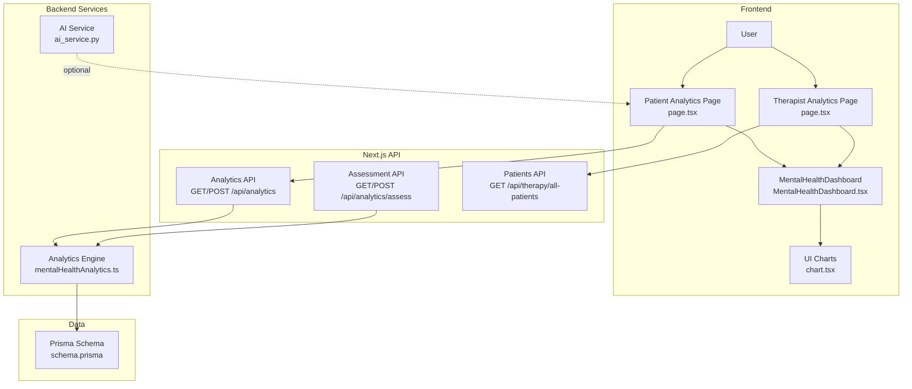
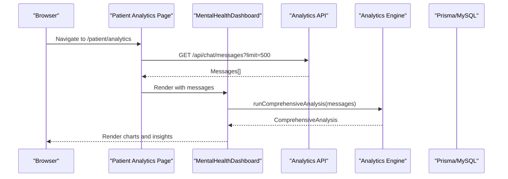
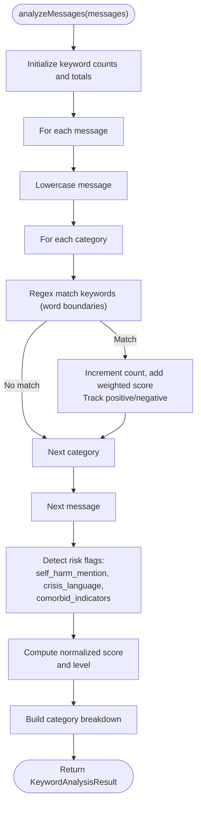
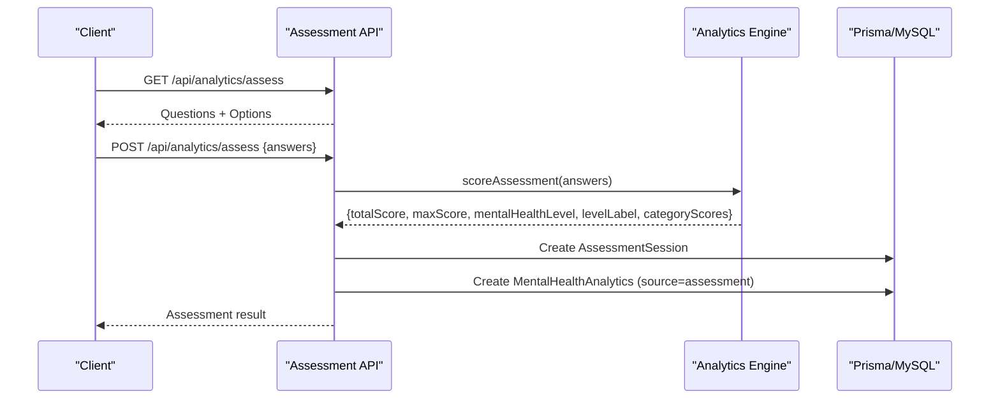
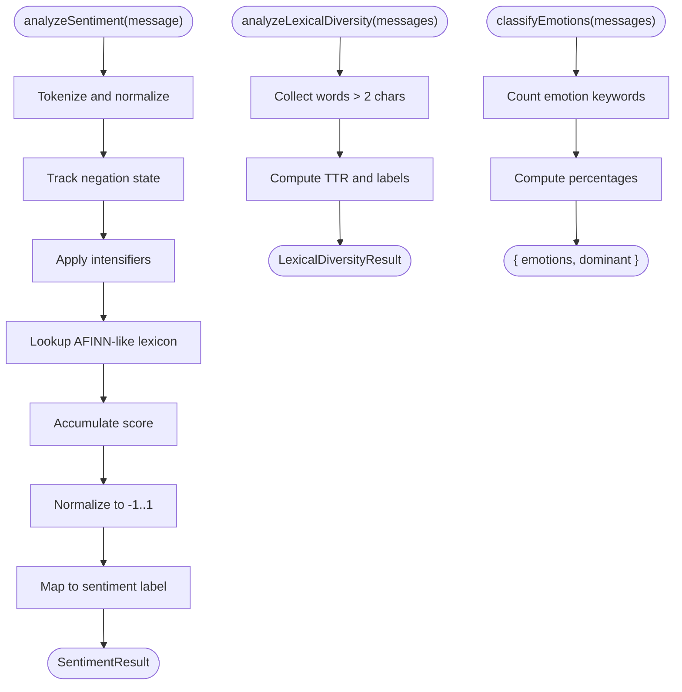
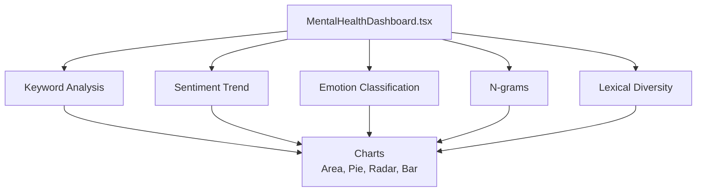
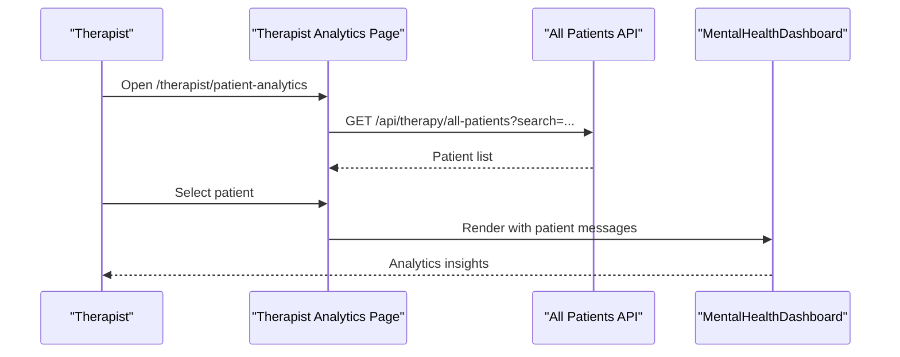
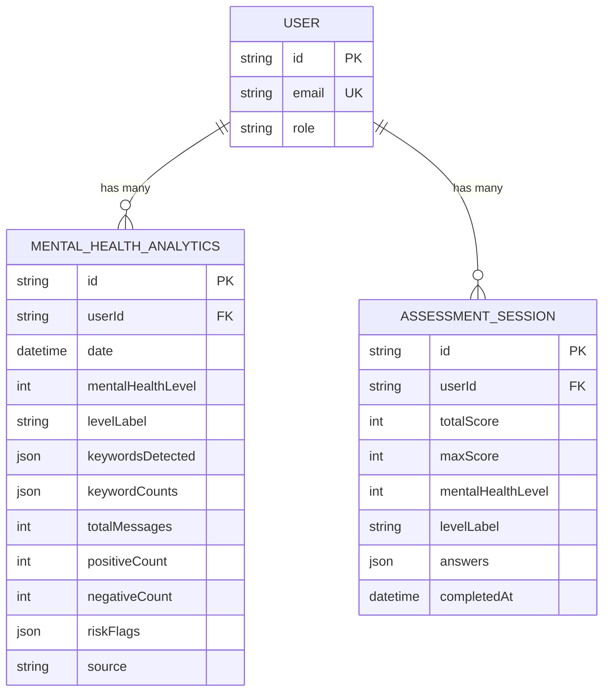
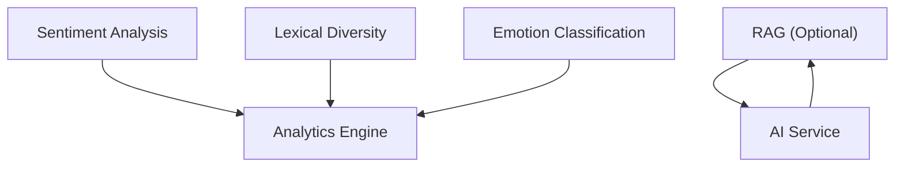
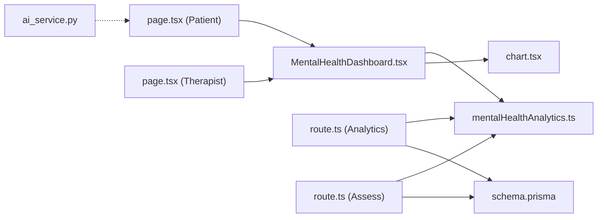

# Analytics & Progress Tracking

<cite>
**Referenced Files in This Document**
- [mentalHealthAnalytics.ts](file://WEBAPP/src/lib/mentalHealthAnalytics.ts)
- [MentalHealthDashboard.tsx](file://WEBAPP/src/components/analytics/MentalHealthDashboard.tsx)
- [MentalHealthAnalytics.tsx](file://WEBAPP/src/components/MentalHealthAnalytics.tsx)
- [page.tsx (Patient Analytics)](file://WEBAPP/src/app/patient/analytics/page.tsx)
- [page.tsx (Therapist Analytics)](file://WEBAPP/src/app/therapist/patient-analytics/page.tsx)
- [route.ts (Analytics API)](file://WEBAPP/src/app/api/analytics/route.ts)
- [route.ts (Assessment API)](file://WEBAPP/src/app/api/analytics/assess/route.ts)
- [route.ts (All Patients API)](file://WEBAPP/src/app/api/therapy/all-patients/route.ts)
- [schema.prisma](file://WEBAPP/prisma/schema.prisma)
- [chart.tsx](file://WEBAPP/src/components/ui/chart.tsx)
- [ai_service.py](file://ai-backend/services/ai_service.py)
</cite>

## Table of Contents
1. [Introduction](#introduction)
2. [Project Structure](#project-structure)
3. [Core Components](#core-components)
4. [Architecture Overview](#architecture-overview)
5. [Detailed Component Analysis](#detailed-component-analysis)
6. [Dependency Analysis](#dependency-analysis)
7. [Performance Considerations](#performance-considerations)
8. [Troubleshooting Guide](#troubleshooting-guide)
9. [Conclusion](#conclusion)
10. [Appendices](#appendices)

## Introduction
This document explains the mental health analytics and progress tracking system. It covers the 5-level severity scoring, keyword analysis across seven categories, risk flag detection, and trend tracking. It documents the PHQ-9/GAD-7 inspired assessment implementation, data visualization components, and progress reporting features. It also outlines the analytics dashboard functionality, customizable reporting filters, and export capabilities. Machine learning integration for sentiment analysis, mood tracking algorithms, and predictive insights is addressed alongside data privacy considerations, HIPAA compliance for protected health information (PHI), and secure data retention policies.

## Project Structure
The analytics system spans frontend React components, Next.js API routes, a Prisma data model, and backend AI services:
- Frontend: React components render dashboards and charts, integrating with the analytics engine.
- Backend: Next.js API routes orchestrate data retrieval, computation, and persistence.
- Data Layer: Prisma schema defines entities for chat messages, analytics history, and assessments.
- AI Services: External AI providers power therapeutic responses and optional RAG augmentation.

**Diagram sources**
- [page.tsx (Patient Analytics)](file://WEBAPP/src/app/patient/analytics/page.tsx#L1-L127)
- [page.tsx (Therapist Analytics)](file://WEBAPP/src/app/therapist/patient-analytics/page.tsx#L1-L417)
- [MentalHealthDashboard.tsx](file://WEBAPP/src/components/analytics/MentalHealthDashboard.tsx#L1-L541)
- [chart.tsx](file://WEBAPP/src/components/ui/chart.tsx#L1-L363)
- [route.ts (Analytics API)](file://WEBAPP/src/app/api/analytics/route.ts#L1-L253)
- [route.ts (Assessment API)](file://WEBAPP/src/app/api/analytics/assess/route.ts#L1-L121)
- [route.ts (All Patients API)](file://WEBAPP/src/app/api/therapy/all-patients/route.ts#L1-L82)
- [mentalHealthAnalytics.ts](file://WEBAPP/src/lib/mentalHealthAnalytics.ts#L1-L884)
- [schema.prisma](file://WEBAPP/prisma/schema.prisma#L229-L266)
- [ai_service.py](file://ai-backend/services/ai_service.py#L1-L293)

**Section sources**
- [page.tsx (Patient Analytics)](file://WEBAPP/src/app/patient/analytics/page.tsx#L1-L127)
- [page.tsx (Therapist Analytics)](file://WEBAPP/src/app/therapist/patient-analytics/page.tsx#L1-L417)
- [MentalHealthDashboard.tsx](file://WEBAPP/src/components/analytics/MentalHealthDashboard.tsx#L1-L541)
- [chart.tsx](file://WEBAPP/src/components/ui/chart.tsx#L1-L363)
- [route.ts (Analytics API)](file://WEBAPP/src/app/api/analytics/route.ts#L1-L253)
- [route.ts (Assessment API)](file://WEBAPP/src/app/api/analytics/assess/route.ts#L1-L121)
- [route.ts (All Patients API)](file://WEBAPP/src/app/api/therapy/all-patients/route.ts#L1-L82)
- [mentalHealthAnalytics.ts](file://WEBAPP/src/lib/mentalHealthAnalytics.ts#L1-L884)
- [schema.prisma](file://WEBAPP/prisma/schema.prisma#L229-L266)
- [ai_service.py](file://ai-backend/services/ai_service.py#L1-L293)

## Core Components
- Analytics Engine: Implements keyword categorization, severity scoring, risk flags, sentiment analysis, lexical diversity, n-gram extraction, temporal decay weighting, and emotion classification.
- Dashboard Components: Render severity cards, radar charts, pie charts, bar charts, sentiment timelines, and summary metrics.
- API Routes: Serve analytics data, trigger fresh analyses, and manage assessments with validation and persistence.
- Data Model: Defines entities for chat messages, analytics history, and assessments with appropriate indexing and relationships.
- AI Service: Provides therapeutic responses via external AI APIs and optional RAG augmentation.

**Section sources**
- [mentalHealthAnalytics.ts](file://WEBAPP/src/lib/mentalHealthAnalytics.ts#L1-L884)
- [MentalHealthDashboard.tsx](file://WEBAPP/src/components/analytics/MentalHealthDashboard.tsx#L1-L541)
- [route.ts (Analytics API)](file://WEBAPP/src/app/api/analytics/route.ts#L1-L253)
- [route.ts (Assessment API)](file://WEBAPP/src/app/api/analytics/assess/route.ts#L1-L121)
- [schema.prisma](file://WEBAPP/prisma/schema.prisma#L229-L266)
- [ai_service.py](file://ai-backend/services/ai_service.py#L1-L293)

## Architecture Overview
The system follows a layered architecture:
- Presentation Layer: Next.js pages and React components.
- Application Layer: API routes orchestrating business logic and data access.
- Domain Layer: Analytics engine encapsulating NLP and scoring logic.
- Persistence Layer: Prisma ORM mapping to relational storage.
- Integration Layer: AI service for therapeutic responses and optional RAG.

**Diagram sources**
- [page.tsx (Patient Analytics)](file://WEBAPP/src/app/patient/analytics/page.tsx#L1-L127)
- [MentalHealthDashboard.tsx](file://WEBAPP/src/components/analytics/MentalHealthDashboard.tsx#L1-L541)
- [route.ts (Analytics API)](file://WEBAPP/src/app/api/analytics/route.ts#L1-L253)
- [mentalHealthAnalytics.ts](file://WEBAPP/src/lib/mentalHealthAnalytics.ts#L826-L884)

## Detailed Component Analysis

### Analytics Engine: Keyword Categories, Severity Scoring, and Risk Flags
The engine defines seven keyword categories with weights and colors, computes a normalized weighted score, and maps it to a 5-level severity scale. Risk flags detect critical language and comorbid patterns. It also supports temporal decay weighting for recent messages.

**Diagram sources**
- [mentalHealthAnalytics.ts](file://WEBAPP/src/lib/mentalHealthAnalytics.ts#L199-L289)

**Section sources**
- [mentalHealthAnalytics.ts](file://WEBAPP/src/lib/mentalHealthAnalytics.ts#L12-L92)
- [mentalHealthAnalytics.ts](file://WEBAPP/src/lib/mentalHealthAnalytics.ts#L294-L303)
- [mentalHealthAnalytics.ts](file://WEBAPP/src/lib/mentalHealthAnalytics.ts#L250-L289)

### PHQ-9/GAD-7 Inspired Assessment Implementation
The assessment endpoint serves questions and answer options, validates submissions, scores responses, and persists both assessment results and a corresponding analytics entry for timeline visualization.

**Diagram sources**
- [route.ts (Assessment API)](file://WEBAPP/src/app/api/analytics/assess/route.ts#L1-L121)
- [mentalHealthAnalytics.ts](file://WEBAPP/src/lib/mentalHealthAnalytics.ts#L308-L350)

**Section sources**
- [route.ts (Assessment API)](file://WEBAPP/src/app/api/analytics/assess/route.ts#L1-L121)
- [mentalHealthAnalytics.ts](file://WEBAPP/src/lib/mentalHealthAnalytics.ts#L112-L170)
- [mentalHealthAnalytics.ts](file://WEBAPP/src/lib/mentalHealthAnalytics.ts#L308-L350)

### Sentiment Analysis, Lexical Diversity, and Emotion Classification
The engine includes:
- Sentiment analysis with negation and intensifier handling, moving averages, and volatility.
- Lexical diversity (type-token ratio) to detect rumination risk.
- Plutchik’s wheel emotion classification across messages.

**Diagram sources**
- [mentalHealthAnalytics.ts](file://WEBAPP/src/lib/mentalHealthAnalytics.ts#L535-L594)
- [mentalHealthAnalytics.ts](file://WEBAPP/src/lib/mentalHealthAnalytics.ts#L695-L723)
- [mentalHealthAnalytics.ts](file://WEBAPP/src/lib/mentalHealthAnalytics.ts#L800-L824)

**Section sources**
- [mentalHealthAnalytics.ts](file://WEBAPP/src/lib/mentalHealthAnalytics.ts#L435-L594)
- [mentalHealthAnalytics.ts](file://WEBAPP/src/lib/mentalHealthAnalytics.ts#L687-L723)
- [mentalHealthAnalytics.ts](file://WEBAPP/src/lib/mentalHealthAnalytics.ts#L763-L824)

### Analytics Dashboard: Visualization and Reporting
The dashboard renders:
- Severity level cards with color-coded backgrounds and descriptions.
- Overall sentiment, volatility, and trend indicators.
- Dominant emotion and lexical diversity metrics.
- Risk flags banner.
- Interactive charts: sentiment over time (area + moving average), emotion distribution (pie), mental health radar, category breakdown (bar), and severity gauge.
- N-gram analysis (bigrams/trigrams) and detected keywords by category.
- Summary cards for messages analyzed, positive/concerning counts, and unique words.

**Diagram sources**
- [MentalHealthDashboard.tsx](file://WEBAPP/src/components/analytics/MentalHealthDashboard.tsx#L1-L541)
- [mentalHealthAnalytics.ts](file://WEBAPP/src/lib/mentalHealthAnalytics.ts#L826-L884)

**Section sources**
- [MentalHealthDashboard.tsx](file://WEBAPP/src/components/analytics/MentalHealthDashboard.tsx#L1-L541)
- [chart.tsx](file://WEBAPP/src/components/ui/chart.tsx#L1-L363)

### Therapist Analytics: Patient Selection and Filtering
Therapists can:
- Search and filter patients by name or email.
- View aggregated metrics (sessions, messages, dominant emotion, improvement trend).
- Select a patient to view their NLP analytics dashboard.
- See loading states and error messaging.

**Diagram sources**
- [page.tsx (Therapist Analytics)](file://WEBAPP/src/app/therapist/patient-analytics/page.tsx#L1-L417)
- [route.ts (All Patients API)](file://WEBAPP/src/app/api/therapy/all-patients/route.ts#L1-L82)

**Section sources**
- [page.tsx (Therapist Analytics)](file://WEBAPP/src/app/therapist/patient-analytics/page.tsx#L1-L417)
- [route.ts (All Patients API)](file://WEBAPP/src/app/api/therapy/all-patients/route.ts#L1-L82)

### Data Persistence and Timeline Management
Analytics and assessments are persisted with timestamps and used to compute trends and display historical data.

**Diagram sources**
- [schema.prisma](file://WEBAPP/prisma/schema.prisma#L229-L266)

**Section sources**
- [schema.prisma](file://WEBAPP/prisma/schema.prisma#L229-L266)
- [route.ts (Analytics API)](file://WEBAPP/src/app/api/analytics/route.ts#L195-L252)
- [route.ts (Assessment API)](file://WEBAPP/src/app/api/analytics/assess/route.ts#L80-L104)

### Machine Learning Integration and Predictive Insights
- Sentiment analysis leverages a lexicon-based approach with negation and intensifier handling.
- Emotion classification aligns with Plutchik’s wheel.
- Optional RAG augmentation in the AI service enriches responses with relevant knowledge.
- Temporal decay weighting emphasizes recent messages for severity computation.

**Diagram sources**
- [mentalHealthAnalytics.ts](file://WEBAPP/src/lib/mentalHealthAnalytics.ts#L535-L631)
- [mentalHealthAnalytics.ts](file://WEBAPP/src/lib/mentalHealthAnalytics.ts#L695-L723)
- [mentalHealthAnalytics.ts](file://WEBAPP/src/lib/mentalHealthAnalytics.ts#L800-L824)
- [ai_service.py](file://ai-backend/services/ai_service.py#L72-L192)

**Section sources**
- [mentalHealthAnalytics.ts](file://WEBAPP/src/lib/mentalHealthAnalytics.ts#L535-L631)
- [mentalHealthAnalytics.ts](file://WEBAPP/src/lib/mentalHealthAnalytics.ts#L695-L723)
- [mentalHealthAnalytics.ts](file://WEBAPP/src/lib/mentalHealthAnalytics.ts#L800-L824)
- [ai_service.py](file://ai-backend/services/ai_service.py#L72-L192)

## Dependency Analysis
- Frontend components depend on the analytics engine for computations and on chart primitives for rendering.
- API routes depend on Prisma for data access and on the analytics engine for scoring and analysis.
- The AI service is decoupled and can operate independently of the analytics pipeline.

**Diagram sources**
- [MentalHealthDashboard.tsx](file://WEBAPP/src/components/analytics/MentalHealthDashboard.tsx#L1-L541)
- [mentalHealthAnalytics.ts](file://WEBAPP/src/lib/mentalHealthAnalytics.ts#L1-L884)
- [chart.tsx](file://WEBAPP/src/components/ui/chart.tsx#L1-L363)
- [page.tsx (Patient Analytics)](file://WEBAPP/src/app/patient/analytics/page.tsx#L1-L127)
- [page.tsx (Therapist Analytics)](file://WEBAPP/src/app/therapist/patient-analytics/page.tsx#L1-L417)
- [route.ts (Analytics API)](file://WEBAPP/src/app/api/analytics/route.ts#L1-L253)
- [route.ts (Assessment API)](file://WEBAPP/src/app/api/analytics/assess/route.ts#L1-L121)
- [schema.prisma](file://WEBAPP/prisma/schema.prisma#L229-L266)
- [ai_service.py](file://ai-backend/services/ai_service.py#L1-L293)

**Section sources**
- [MentalHealthDashboard.tsx](file://WEBAPP/src/components/analytics/MentalHealthDashboard.tsx#L1-L541)
- [mentalHealthAnalytics.ts](file://WEBAPP/src/lib/mentalHealthAnalytics.ts#L1-L884)
- [chart.tsx](file://WEBAPP/src/components/ui/chart.tsx#L1-L363)
- [page.tsx (Patient Analytics)](file://WEBAPP/src/app/patient/analytics/page.tsx#L1-L127)
- [page.tsx (Therapist Analytics)](file://WEBAPP/src/app/therapist/patient-analytics/page.tsx#L1-L417)
- [route.ts (Analytics API)](file://WEBAPP/src/app/api/analytics/route.ts#L1-L253)
- [route.ts (Assessment API)](file://WEBAPP/src/app/api/analytics/assess/route.ts#L1-L121)
- [schema.prisma](file://WEBAPP/prisma/schema.prisma#L229-L266)
- [ai_service.py](file://ai-backend/services/ai_service.py#L1-L293)

## Performance Considerations
- Keyword matching uses word-boundary regex for accuracy and avoids false positives.
- Sentiment and lexical diversity computations iterate over messages linearly; consider batching or caching for large histories.
- Moving averages and volatility calculations are O(n) over message count.
- Temporal decay weighting duplicates messages proportionally to recency; tune half-life minutes to balance emphasis.
- Dashboard rendering uses responsive charts; defer heavy computations to server-side where feasible.

[No sources needed since this section provides general guidance]

## Troubleshooting Guide
Common issues and resolutions:
- Unauthorized access: Ensure session validation and role checks in API routes.
- Missing messages: Verify chat message retrieval and filtering logic.
- Assessment validation errors: Confirm answer arrays length and score ranges.
- Risk flags not appearing: Check keyword lists and detection logic for self-harm and comorbid indicators.
- Dashboard empty state: Confirm analytics history exists or trigger a fresh analysis.

**Section sources**
- [route.ts (Analytics API)](file://WEBAPP/src/app/api/analytics/route.ts#L13-L161)
- [route.ts (Assessment API)](file://WEBAPP/src/app/api/analytics/assess/route.ts#L25-L61)
- [MentalHealthDashboard.tsx](file://WEBAPP/src/components/analytics/MentalHealthDashboard.tsx#L147-L167)

## Conclusion
The analytics and progress tracking system integrates robust NLP techniques with intuitive visualizations to support both patients and therapists. It provides actionable insights through keyword analysis, sentiment metrics, emotion classification, and trend tracking, while maintaining extensibility for future enhancements such as export capabilities and advanced predictive modeling.

[No sources needed since this section summarizes without analyzing specific files]

## Appendices

### Data Privacy and HIPAA Compliance Considerations
- Access Control: API routes enforce session-based authentication and role-based access (patients vs. therapists).
- Data Minimization: Analytics queries limit history windows and message counts.
- Secure Storage: Prisma schema defines structured entities with appropriate indices; sensitive fields should be encrypted at rest.
- Retention Policies: Define and enforce automatic deletion of PHI after specified periods; ensure audit logs for data access.
- Consent and Transparency: Display clear notices about data usage and retention; provide opt-out mechanisms where applicable.
- Secure Data Handling: Avoid logging PHI; sanitize inputs; use HTTPS; restrict API exposure.

**Section sources**
- [route.ts (Analytics API)](file://WEBAPP/src/app/api/analytics/route.ts#L13-L25)
- [route.ts (Assessment API)](file://WEBAPP/src/app/api/analytics/assess/route.ts#L27-L37)
- [schema.prisma](file://WEBAPP/prisma/schema.prisma#L39-L69)

### Export Capabilities
Current implementation focuses on in-app visualization. To add export:
- Extend API endpoints to produce CSV/JSON/PDF reports containing analytics history, assessments, and summaries.
- Implement server-side generation with pagination and filtering options.
- Enforce access controls and data retention policies for exported datasets.

[No sources needed since this section provides general guidance]