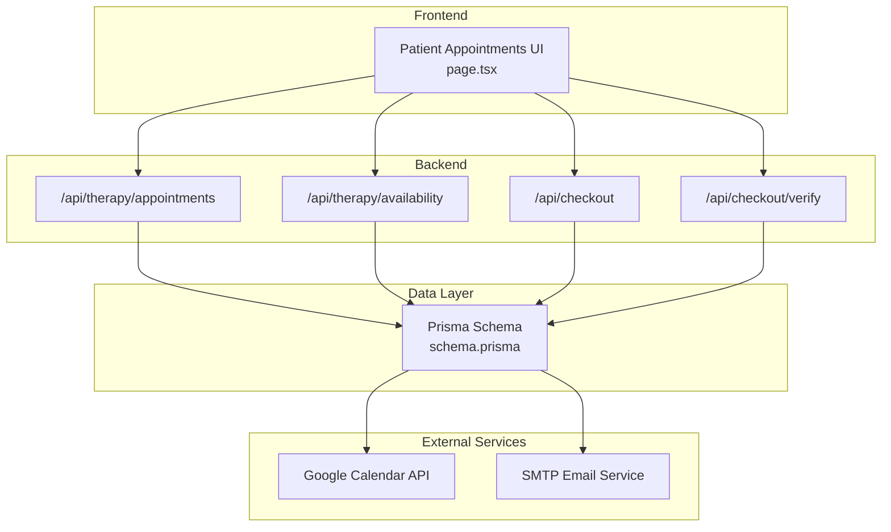
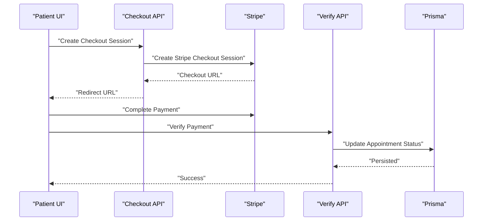
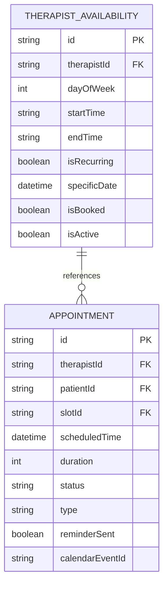
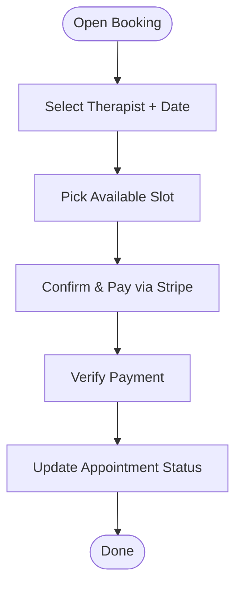
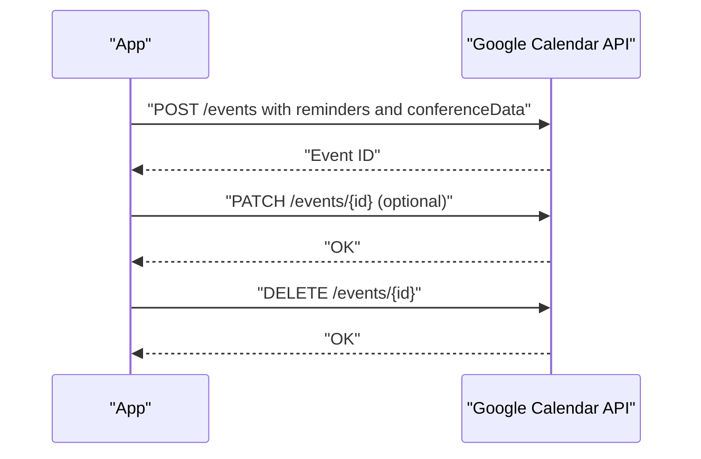
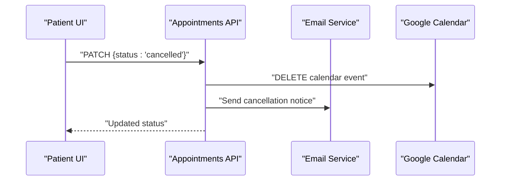
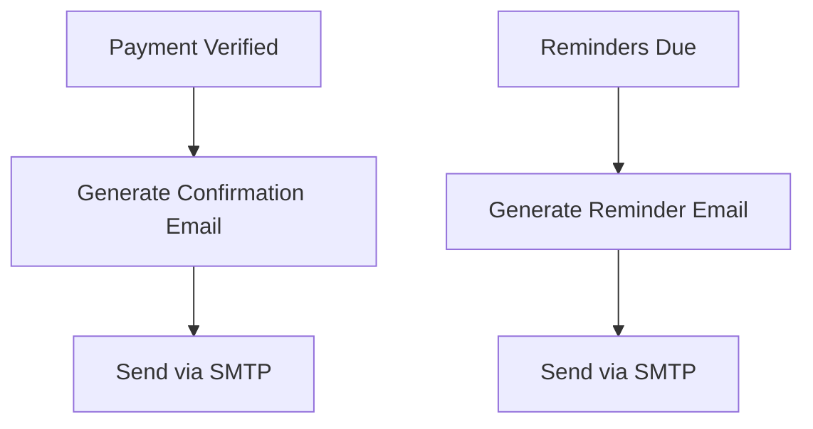
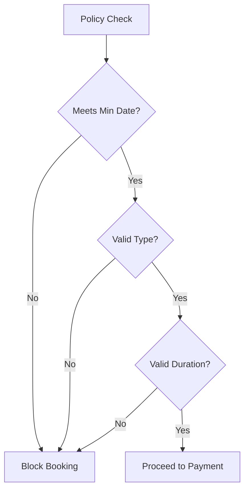
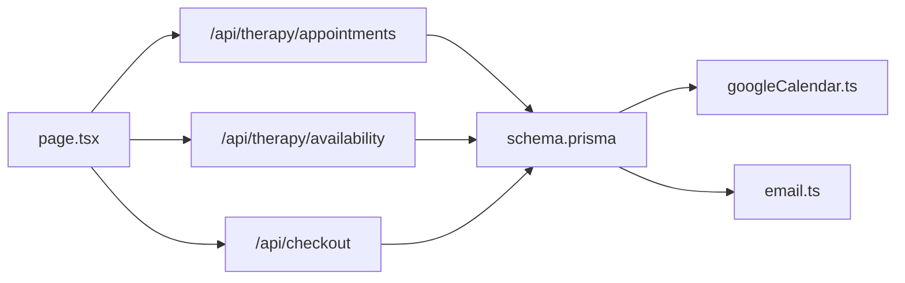

# Appointment Scheduling System

<cite>
**Referenced Files in This Document**
- [googleCalendar.ts](file://WEBAPP/src/lib/googleCalendar.ts)
- [email.ts](file://WEBAPP/src/lib/email.ts)
- [schema.prisma](file://WEBAPP/prisma/schema.prisma)
- [page.tsx](file://WEBAPP/src/app/patient/appointments/page.tsx)
</cite>

## Table of Contents
1. [Introduction](#introduction)
2. [Project Structure](#project-structure)
3. [Core Components](#core-components)
4. [Architecture Overview](#architecture-overview)
5. [Detailed Component Analysis](#detailed-component-analysis)
6. [Dependency Analysis](#dependency-analysis)
7. [Performance Considerations](#performance-considerations)
8. [Troubleshooting Guide](#troubleshooting-guide)
9. [Conclusion](#conclusion)

## Introduction
This document describes the appointment scheduling system for MindBridge, focusing on therapist availability management, patient booking workflows, calendar integration with Google Calendar, confirmation and cancellation processes, automated email notifications, and reminder systems. It also covers availability slot creation, conflict detection, resource management, integration patterns with external calendar services, timezone handling, recurring appointment support, scheduling policies, waitlist management, and rescheduling procedures.

## Project Structure
The scheduling system spans frontend React components, backend API routes (not shown here but referenced), and a Prisma schema that defines the data model. Key areas include:
- Frontend patient booking UI and state management
- Backend API endpoints for appointments and availability
- Prisma models for appointments, availability, and users
- Utilities for Google Calendar integration and email notifications

**Diagram sources**
- [page.tsx](file://WEBAPP/src/app/patient/appointments/page.tsx#L135-L177)
- [schema.prisma](file://WEBAPP/prisma/schema.prisma#L163-L211)
- [googleCalendar.ts](file://WEBAPP/src/lib/googleCalendar.ts#L102-L161)
- [email.ts](file://WEBAPP/src/lib/email.ts#L27-L48)

**Section sources**
- [page.tsx](file://WEBAPP/src/app/patient/appointments/page.tsx#L1-L120)
- [schema.prisma](file://WEBAPP/prisma/schema.prisma#L163-L211)

## Core Components
- Availability model: Defines therapist weekly or one-off availability slots with recurrence and active flags.
- Appointment model: Links patients and therapists to availability slots, tracks status, type, duration, and calendar event IDs.
- Google Calendar integration: Creates, updates, and deletes events with reminders and Meet links.
- Email notifications: Generates booking confirmation and reminder emails with localized date/time formatting.
- Frontend booking flow: Multi-step UI for selecting therapist, date, available slots, and payment.

**Section sources**
- [schema.prisma](file://WEBAPP/prisma/schema.prisma#L163-L211)
- [googleCalendar.ts](file://WEBAPP/src/lib/googleCalendar.ts#L102-L161)
- [email.ts](file://WEBAPP/src/lib/email.ts#L136-L200)
- [page.tsx](file://WEBAPP/src/app/patient/appointments/page.tsx#L507-L800)

## Architecture Overview
The system follows a layered architecture:
- Presentation: Patient UI handles selection and booking.
- Application: API routes orchestrate persistence and external integrations.
- Persistence: Prisma models define entities and relationships.
- Integration: Google Calendar and SMTP services for calendar sync and email.

**Diagram sources**
- [page.tsx](file://WEBAPP/src/app/patient/appointments/page.tsx#L90-L126)
- [page.tsx](file://WEBAPP/src/app/patient/appointments/page.tsx#L224-L258)

## Detailed Component Analysis

### Availability Management
- Data model: Weekly recurring slots with day-of-week and time range; optional specificDate for exceptions; isBooked and isActive flags.
- Recurrence: isRecurring toggles weekly repetition; specificDate supports one-off exceptions.
- Conflict detection: The UI filters out isBooked=true slots; backend should enforce uniqueness and overlap checks during creation.
- Active management: isActive allows therapists to temporarily disable slots.

**Diagram sources**
- [schema.prisma](file://WEBAPP/prisma/schema.prisma#L163-L211)

**Section sources**
- [schema.prisma](file://WEBAPP/prisma/schema.prisma#L163-L184)

### Patient Booking Workflow
- Multi-step UI:
  - Step 1: Select therapist, date, session type, and duration.
  - Step 2: Pick an available slot; slots auto-refresh every 15 seconds.
  - Step 3: Confirm details and pay via Stripe; payment success triggers verification and appointment confirmation.
- Real-time updates: Polling every 30 seconds for appointment lists; immediate refresh on slot selection.
- Payment flow: Creates a Stripe Checkout session and redirects; verifies after payment completion.

**Diagram sources**
- [page.tsx](file://WEBAPP/src/app/patient/appointments/page.tsx#L507-L800)
- [page.tsx](file://WEBAPP/src/app/patient/appointments/page.tsx#L90-L126)

**Section sources**
- [page.tsx](file://WEBAPP/src/app/patient/appointments/page.tsx#L179-L208)
- [page.tsx](file://WEBAPP/src/app/patient/appointments/page.tsx#L210-L258)
- [page.tsx](file://WEBAPP/src/app/patient/appointments/page.tsx#L135-L177)

### Calendar Integration with Google Calendar
- Event creation: Builds event with start/end time and timezone, adds Meet link, sets reminders, and posts to primary calendar.
- Event deletion: Removes calendar events by ID.
- Event updates: Patches summary/description/timezone-aware start/end.
- Timezone handling: Uses local browser timezone for calendar events.

**Diagram sources**
- [googleCalendar.ts](file://WEBAPP/src/lib/googleCalendar.ts#L102-L161)
- [googleCalendar.ts](file://WEBAPP/src/lib/googleCalendar.ts#L183-L225)

**Section sources**
- [googleCalendar.ts](file://WEBAPP/src/lib/googleCalendar.ts#L54-L66)
- [googleCalendar.ts](file://WEBAPP/src/lib/googleCalendar.ts#L102-L161)
- [googleCalendar.ts](file://WEBAPP/src/lib/googleCalendar.ts#L183-L225)

### Appointment Confirmation and Cancellation
- Confirmation: Email template for booking confirmation with date/time and duration.
- Cancellation: UI triggers PATCH to set status to cancelled; updates UI state immediately.
- Calendar sync: On confirmation/cancellation, create/update/delete calendar events via Google Calendar integration.

**Diagram sources**
- [page.tsx](file://WEBAPP/src/app/patient/appointments/page.tsx#L260-L279)
- [email.ts](file://WEBAPP/src/lib/email.ts#L136-L200)
- [googleCalendar.ts](file://WEBAPP/src/lib/googleCalendar.ts#L163-L181)

**Section sources**
- [page.tsx](file://WEBAPP/src/app/patient/appointments/page.tsx#L260-L279)
- [email.ts](file://WEBAPP/src/lib/email.ts#L136-L200)
- [googleCalendar.ts](file://WEBAPP/src/lib/googleCalendar.ts#L163-L181)

### Automated Email Notifications and Reminders
- Templates: Booking confirmation and reminder emails with localized date/time and dynamic content.
- Triggering: Send confirmation upon payment verification; reminders can be scheduled prior to the session.
- Delivery: Nodemailer transport configured via environment variables.

**Diagram sources**
- [email.ts](file://WEBAPP/src/lib/email.ts#L136-L200)
- [email.ts](file://WEBAPP/src/lib/email.ts#L50-L134)

**Section sources**
- [email.ts](file://WEBAPP/src/lib/email.ts#L10-L18)
- [email.ts](file://WEBAPP/src/lib/email.ts#L136-L200)
- [email.ts](file://WEBAPP/src/lib/email.ts#L50-L134)

### Resource Management and Business Rules
- Scheduling policies:
  - Minimum booking horizon: UI enforces minimum date selection.
  - Session types: initial, followup, emergency with distinct handling.
  - Durations: predefined options mapped to pricing.
- Waitlist management: Not present in current schema; can be modeled by extending availability or adding a queue table.
- Rescheduling: Implemented via cancellation and rebooking; future enhancements could include direct reschedule with policy checks.

**Diagram sources**
- [page.tsx](file://WEBAPP/src/app/patient/appointments/page.tsx#L284-L288)
- [page.tsx](file://WEBAPP/src/app/patient/appointments/page.tsx#L601-L626)

**Section sources**
- [page.tsx](file://WEBAPP/src/app/patient/appointments/page.tsx#L284-L288)
- [page.tsx](file://WEBAPP/src/app/patient/appointments/page.tsx#L601-L626)

## Dependency Analysis
- Frontend depends on:
  - API endpoints for availability and appointments
  - Stripe for payment
  - Prisma models for data
- Backend integrates with:
  - Prisma for persistence
  - Google Calendar for external sync
  - SMTP for email delivery
- Data model relationships:
  - Availability to Appointment via slotId
  - User to Appointment via patientId/therapistId

**Diagram sources**
- [page.tsx](file://WEBAPP/src/app/patient/appointments/page.tsx#L135-L177)
- [schema.prisma](file://WEBAPP/prisma/schema.prisma#L163-L211)
- [googleCalendar.ts](file://WEBAPP/src/lib/googleCalendar.ts#L102-L161)
- [email.ts](file://WEBAPP/src/lib/email.ts#L27-L48)

**Section sources**
- [page.tsx](file://WEBAPP/src/app/patient/appointments/page.tsx#L135-L177)
- [schema.prisma](file://WEBAPP/prisma/schema.prisma#L163-L211)

## Performance Considerations
- Real-time updates: Polling intervals balance freshness and load; adjust based on traffic.
- Slot refresh: Auto-refresh every 15 seconds reduces race conditions while minimizing requests.
- Calendar operations: Batch or debounce create/update/delete calls to avoid rate limits.
- Email throughput: Use a dedicated SMTP provider and queue asynchronous sends.

## Troubleshooting Guide
- Google Calendar integration:
  - Missing credentials cause token retrieval failures; ensure environment variables are set.
  - Refresh token errors indicate misconfiguration; follow OAuth setup steps.
  - Timezone mismatches can be resolved by ensuring consistent timezone usage.
- Email delivery:
  - Missing SMTP credentials prevent sending; configure EMAIL_USER and EMAIL_PASS.
  - Transport errors require checking host/port/security settings.
- Frontend booking:
  - Payment verification failures: check Stripe session ID and endpoint responses.
  - Slot availability stale: ensure auto-refresh is enabled and network is stable.

**Section sources**
- [googleCalendar.ts](file://WEBAPP/src/lib/googleCalendar.ts#L68-L100)
- [googleCalendar.ts](file://WEBAPP/src/lib/googleCalendar.ts#L163-L181)
- [email.ts](file://WEBAPP/src/lib/email.ts#L27-L48)
- [page.tsx](file://WEBAPP/src/app/patient/appointments/page.tsx#L90-L126)

## Conclusion
The MindBridge appointment scheduling system combines a robust data model with a responsive frontend and integrations to Google Calendar and SMTP. It supports therapist availability management, patient booking workflows, confirmation and cancellation, and automated notifications. Enhancements such as waitlist management, stricter conflict detection, and centralized rescheduling policies would further strengthen the system.