# Core Features

<cite>
**Referenced Files in This Document**
- [db.ts](file://WEBAPP/src/lib/db.ts)
- [route.ts](file://WEBAPP/src/app/api/chat/messages/route.ts)
- [route.ts](file://WEBAPP/src/app/api/peer-support/posts/[id]/like/route.ts)
- [route.ts](file://WEBAPP/src/app/api/peer-support/posts/[id]/reply/route.ts)
- [page.tsx](file://WEBAPP/src/app/patient/dashboard/page.tsx)
- [page.tsx](file://WEBAPP/src/app/therapist/dashboard/page.tsx)
- [page.tsx](file://WEBAPP/src/app/admin/dashboard/page.tsx)
- [route.ts](file://WEBAPP/src/app/api/webhook/stripe/route.ts)
- [route.ts](file://WEBAPP/src/app/api/auth/[...nextauth]/route.ts)
- [route.ts](file://WEBAPP/src/app/api/therapy/sessions/route.ts)
- [route.ts](file://WEBAPP/src/app/api/therapy/appointments/route.ts)
- [route.ts](file://WEBAPP/src/app/api/therapy/appointments/[id]/route.ts)
- [route.ts](file://WEBAPP/src/app/api/therapy/availability/route.ts)
- [route.ts](file://WEBAPP/src/app/api/therapy/availability/[id]/route.ts)
- [route.ts](file://WEBAPP/src/app/api/therapy/virtual-session/route.ts)
- [route.ts](file://WEBAPP/src/app/api/analytics/assess/route.ts)
- [route.ts](file://WEBAPP/src/app/api/admin/analytics/route.ts)
- [route.ts](file://WEBAPP/src/app/api/admin/users/route.ts)
- [route.ts](file://WEBAPP/src/app/api/admin/therapists/route.ts)
- [route.ts](file://WEBAPP/src/app/api/checkout/route.ts)
- [route.ts](file://WEBAPP/src/app/api/checkout/verify/route.ts)
- [schema.prisma](file://WEBAPP/prisma/schema.prisma)
- [seed.ts](file://WEBAPP/prisma/seed.ts)
- [route.ts](file://ai-backend/app.py)
- [genAI_rag.py](file://ai-backend/rag/genAI_rag.py)
- [prompt.py](file://ai-backend/rag/prompt.py)
- [store_index.py](file://ai-backend/rag/store_index.py)
- [ai_service.py](file://ai-backend/services/ai_service.py)
- [groq_ai_service.py](file://ai-backend/services/groq_ai_service.py)
- [tts_service.py](file://ai-backend/services/tts_service.py)
- [avatar_service.py](file://ai-backend/services/avatar_service.py)
- [database_service.py](file://ai-backend/services/database_service.py)
- [requirements.txt](file://ai-backend/requirements.txt)
- [app.py](file://ml-backend/app.py)
- [requirements.txt](file://ml-backend/requirements.txt)
</cite>

## Table of Contents
1. [Introduction](#introduction)
2. [Project Structure](#project-structure)
3. [Core Components](#core-components)
4. [Architecture Overview](#architecture-overview)
5. [Detailed Component Analysis](#detailed-component-analysis)
6. [Dependency Analysis](#dependency-analysis)
7. [Performance Considerations](#performance-considerations)
8. [Troubleshooting Guide](#troubleshooting-guide)
9. [Conclusion](#conclusion)
10. [Appendices](#appendices)

## Introduction
MindBridge AI is a comprehensive mental health platform integrating AI-powered therapy, peer support, professional therapist management, and secure payment processing. The system emphasizes privacy-first design with anonymous peer interactions, emotion-aware AI responses, and robust session management. This document focuses on the core features: AI therapy chat with emotion-awareness and RAG integration, peer support community, therapist dashboard, appointment scheduling, telehealth video consultations, subscription/payment processing, role-based access control, real-time communication, and progress tracking.

## Project Structure
The platform follows a modern full-stack architecture:
- Frontend: Next.js 14 App Router with TypeScript and Tailwind CSS
- Backend APIs: Next.js API routes under src/app/api
- Database: Prisma ORM with MySQL
- AI/ML Services: Separate Python microservices for RAG, AI generation, and ML analytics
- Authentication: NextAuth.js with OAuth providers
- Real-time: WebSocket-enabled chat and video interfaces
- Payments: Stripe webhooks and checkout endpoints

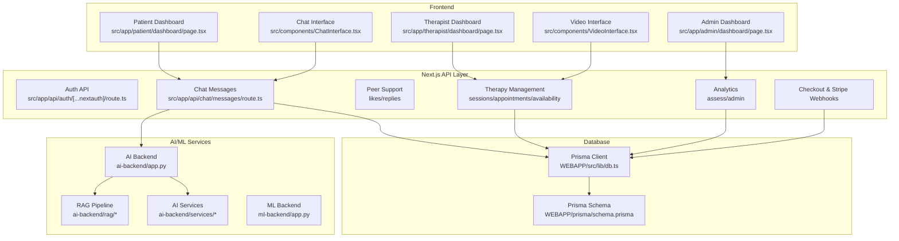

**Diagram sources**
- [db.ts](file://WEBAPP/src/lib/db.ts#L1-L15)
- [route.ts](file://WEBAPP/src/app/api/chat/messages/route.ts#L1-L91)
- [route.ts](file://WEBAPP/src/app/api/auth/[...nextauth]/route.ts)
- [route.ts](file://WEBAPP/src/app/api/therapy/sessions/route.ts)
- [route.ts](file://WEBAPP/src/app/api/therapy/appointments/route.ts)
- [route.ts](file://WEBAPP/src/app/api/therapy/availability/route.ts)
- [route.ts](file://WEBAPP/src/app/api/therapy/virtual-session/route.ts)
- [route.ts](file://WEBAPP/src/app/api/analytics/assess/route.ts)
- [route.ts](file://WEBAPP/src/app/api/admin/analytics/route.ts)
- [route.ts](file://WEBAPP/src/app/api/webhook/stripe/route.ts)
- [schema.prisma](file://WEBAPP/prisma/schema.prisma)
- [route.ts](file://ai-backend/app.py)
- [genAI_rag.py](file://ai-backend/rag/genAI_rag.py)
- [prompt.py](file://ai-backend/rag/prompt.py)
- [store_index.py](file://ai-backend/rag/store_index.py)
- [ai_service.py](file://ai-backend/services/ai_service.py)
- [groq_ai_service.py](file://ai-backend/services/groq_ai_service.py)
- [tts_service.py](file://ai-backend/services/tts_service.py)
- [avatar_service.py](file://ai-backend/services/avatar_service.py)
- [database_service.py](file://ai-backend/services/database_service.py)

**Section sources**
- [db.ts](file://WEBAPP/src/lib/db.ts#L1-L15)
- [schema.prisma](file://WEBAPP/prisma/schema.prisma)

## Core Components
This section outlines the primary feature sets and their core building blocks.

- AI Therapy Chat System
  - Emotion-aware message storage and retrieval
  - Integration with AI backend for intelligent responses
  - Emotion analytics and sentiment tracking
- Peer Support Community
  - Anonymous posting and voting system
  - Reply threads and community moderation
- Professional Therapist Dashboard
  - Session management and analytics
  - Patient lists and scheduling
- Appointment Scheduling
  - Availability management and booking
  - Telehealth video consultation setup
- Subscription and Payment Processing
  - Secure checkout and Stripe webhooks
  - Subscription lifecycle management
- Role-Based Access Control
  - Patient, Therapist, Admin roles with protected routes
  - NextAuth.js integration with OAuth providers
- Real-Time Communication
  - WebSocket-enabled chat and video interfaces
- Progress Tracking
  - Analytics dashboards and assessment tools

**Section sources**
- [route.ts](file://WEBAPP/src/app/api/chat/messages/route.ts#L1-L91)
- [route.ts](file://WEBAPP/src/app/api/peer-support/posts/[id]/like/route.ts)
- [route.ts](file://WEBAPP/src/app/api/peer-support/posts/[id]/reply/route.ts)
- [page.tsx](file://WEBAPP/src/app/patient/dashboard/page.tsx)
- [page.tsx](file://WEBAPP/src/app/therapist/dashboard/page.tsx)
- [page.tsx](file://WEBAPP/src/app/admin/dashboard/page.tsx)
- [route.ts](file://WEBAPP/src/app/api/therapy/sessions/route.ts)
- [route.ts](file://WEBAPP/src/app/api/therapy/appointments/route.ts)
- [route.ts](file://WEBAPP/src/app/api/therapy/appointments/[id]/route.ts)
- [route.ts](file://WEBAPP/src/app/api/therapy/availability/route.ts)
- [route.ts](file://WEBAPP/src/app/api/therapy/availability/[id]/route.ts)
- [route.ts](file://WEBAPP/src/app/api/therapy/virtual-session/route.ts)
- [route.ts](file://WEBAPP/src/app/api/analytics/assess/route.ts)
- [route.ts](file://WEBAPP/src/app/api/admin/analytics/route.ts)
- [route.ts](file://WEBAPP/src/app/api/webhook/stripe/route.ts)
- [route.ts](file://WEBAPP/src/app/api/auth/[...nextauth]/route.ts)

## Architecture Overview
MindBridge AI employs a modular, service-oriented architecture with clear separation of concerns:
- Frontend handles UI rendering and user interactions
- API routes manage business logic and orchestrate data operations
- Prisma provides type-safe database access
- AI/ML microservices handle specialized tasks (RAG, AI generation, ML analytics)
- NextAuth.js manages authentication and authorization
- Stripe integrates payment processing with webhooks

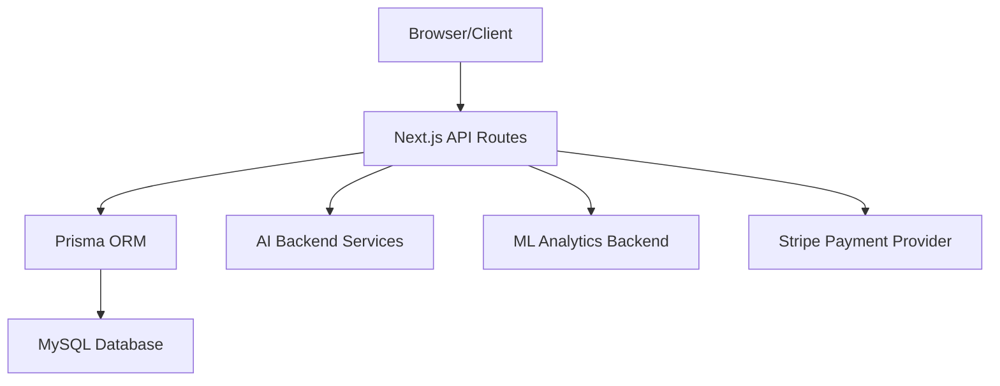

**Diagram sources**
- [db.ts](file://WEBAPP/src/lib/db.ts#L1-L15)
- [schema.prisma](file://WEBAPP/prisma/schema.prisma)
- [route.ts](file://WEBAPP/src/app/api/webhook/stripe/route.ts)
- [route.ts](file://ai-backend/app.py)
- [app.py](file://ml-backend/app.py)

## Detailed Component Analysis

### AI Therapy Chat System
The AI therapy chat system provides emotion-aware messaging with optional RAG integration. It supports storing user messages with metadata, retrieving conversation history, and triggering AI responses.

Key capabilities:
- Message persistence with user identification via server session
- Emotion metadata capture and storage
- Conversation history retrieval with pagination
- Integration with AI backend for intelligent responses
- Emotion analytics and sentiment tracking

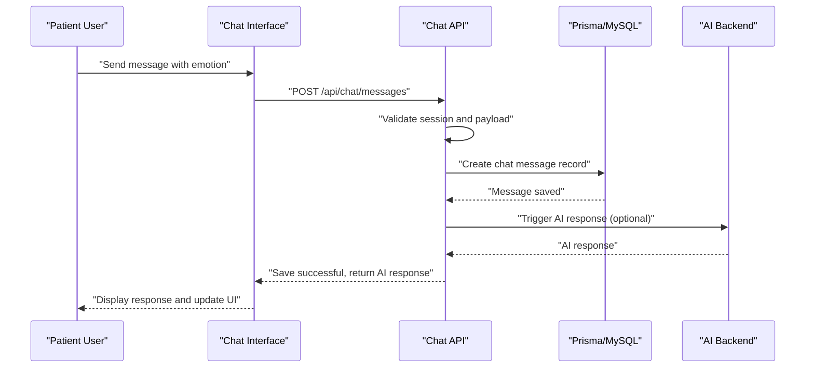

**Diagram sources**
- [route.ts](file://WEBAPP/src/app/api/chat/messages/route.ts#L1-L91)
- [db.ts](file://WEBAPP/src/lib/db.ts#L1-L15)
- [route.ts](file://ai-backend/app.py)

Feature workflows:
- Message submission: Validates session, extracts emotion metadata, persists message, optionally triggers AI response
- History retrieval: Paginates messages per user with total count for UI pagination controls
- Emotion analytics: Aggregates emotion scores for insights and progress tracking

Real-world scenarios:
- Patient logs in, sends a message expressing anxiety, receives empathetic AI response with emotion-aware tone
- Therapist reviews patient's conversation history to understand emotional patterns over time

Competitive advantages:
- Emotion-aware AI responses improve therapeutic engagement
- Optional RAG integration allows personalized, evidence-based insights
- Secure, HIPAA-ready message storage with audit trails

**Section sources**
- [route.ts](file://WEBAPP/src/app/api/chat/messages/route.ts#L1-L91)
- [db.ts](file://WEBAPP/src/lib/db.ts#L1-L15)

### Peer Support Community Forum
The peer support system enables anonymous posting, voting, and threaded replies to foster community-driven mental health support.

Core components:
- Anonymous post creation and display
- Like/unlike functionality with vote counting
- Reply threading for discussions
- Community moderation and reporting mechanisms

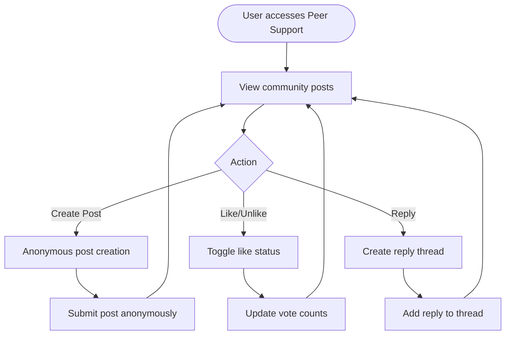

**Diagram sources**
- [route.ts](file://WEBAPP/src/app/api/peer-support/posts/[id]/like/route.ts)
- [route.ts](file://WEBAPP/src/app/api/peer-support/posts/[id]/reply/route.ts)

User scenarios:
- Anonymous user shares experience, others can like or reply without revealing identity
- Moderators can review flagged content while maintaining anonymity

Privacy and moderation:
- Posts and replies are stored with minimal identifying attributes
- Voting and replies are tracked separately to preserve anonymity

**Section sources**
- [route.ts](file://WEBAPP/src/app/api/peer-support/posts/[id]/like/route.ts)
- [route.ts](file://WEBAPP/src/app/api/peer-support/posts/[id]/reply/route.ts)

### Professional Therapist Dashboard
The therapist dashboard provides comprehensive session management, patient analytics, and administrative tools.

Key features:
- Patient list management and filtering
- Session scheduling and status tracking
- Analytics dashboards for patient progress
- Availability management for appointments
- Virtual session setup and monitoring

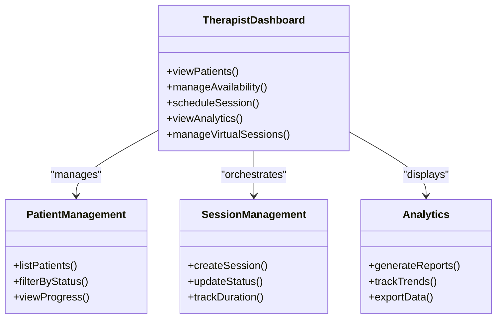

**Diagram sources**
- [page.tsx](file://WEBAPP/src/app/therapist/dashboard/page.tsx)
- [route.ts](file://WEBAPP/src/app/api/therapy/sessions/route.ts)
- [route.ts](file://WEBAPP/src/app/api/therapy/appointments/route.ts)
- [route.ts](file://WEBAPP/src/app/api/therapy/availability/route.ts)
- [route.ts](file://WEBAPP/src/app/api/analytics/assess/route.ts)

Operational workflows:
- Schedule appointments based on therapist availability
- Monitor session status and duration
- Generate progress reports for individual patients
- Manage virtual session links and participant access

**Section sources**
- [page.tsx](file://WEBAPP/src/app/therapist/dashboard/page.tsx)
- [route.ts](file://WEBAPP/src/app/api/therapy/sessions/route.ts)
- [route.ts](file://WEBAPP/src/app/api/therapy/appointments/route.ts)
- [route.ts](file://WEBAPP/src/app/api/therapy/availability/route.ts)
- [route.ts](file://WEBAPP/src/app/api/analytics/assess/route.ts)

### Appointment Scheduling and Telehealth
The scheduling system integrates with Google Calendar and supports secure telehealth video consultations.

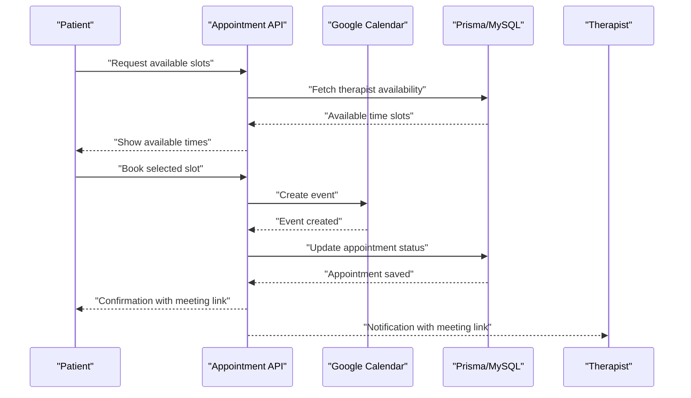

**Diagram sources**
- [route.ts](file://WEBAPP/src/app/api/therapy/appointments/route.ts)
- [route.ts](file://WEBAPP/src/app/api/therapy/availability/route.ts)
- [route.ts](file://WEBAPP/src/app/api/therapy/virtual-session/route.ts)
- [db.ts](file://WEBAPP/src/lib/db.ts#L1-L15)

Capabilities:
- Real-time availability checking
- Automated calendar event creation
- Secure meeting links for telehealth
- Appointment reminders and rescheduling

**Section sources**
- [route.ts](file://WEBAPP/src/app/api/therapy/appointments/route.ts)
- [route.ts](file://WEBAPP/src/app/api/therapy/appointments/[id]/route.ts)
- [route.ts](file://WEBAPP/src/app/api/therapy/availability/route.ts)
- [route.ts](file://WEBAPP/src/app/api/therapy/availability/[id]/route.ts)
- [route.ts](file://WEBAPP/src/app/api/therapy/virtual-session/route.ts)

### Subscription and Payment Processing
The payment system integrates Stripe for secure checkout and subscription management.

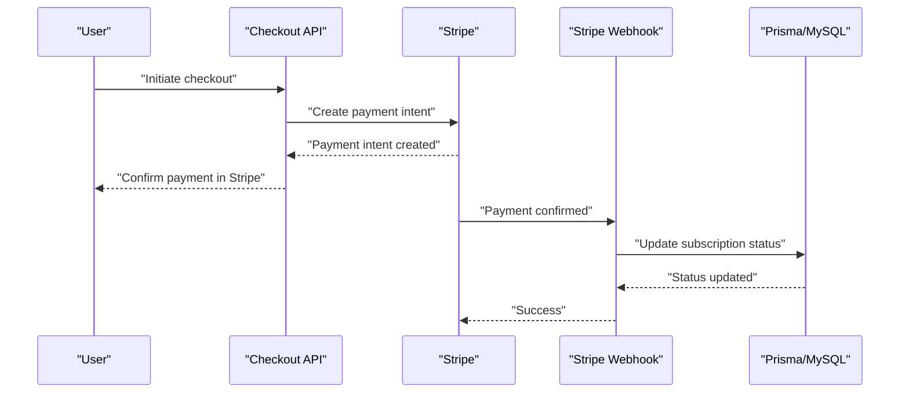

**Diagram sources**
- [route.ts](file://WEBAPP/src/app/api/checkout/route.ts)
- [route.ts](file://WEBAPP/src/app/api/checkout/verify/route.ts)
- [route.ts](file://WEBAPP/src/app/api/webhook/stripe/route.ts)
- [db.ts](file://WEBAPP/src/lib/db.ts#L1-L15)

Features:
- Secure payment processing with PCI compliance
- Subscription lifecycle management
- Webhook-based status synchronization
- Refund and cancellation workflows

**Section sources**
- [route.ts](file://WEBAPP/src/app/api/checkout/route.ts)
- [route.ts](file://WEBAPP/src/app/api/checkout/verify/route.ts)
- [route.ts](file://WEBAPP/src/app/api/webhook/stripe/route.ts)
- [db.ts](file://WEBAPP/src/lib/db.ts#L1-L15)

### Role-Based Access Control
Role-based access control ensures appropriate permissions for Patients, Therapists, and Admins.

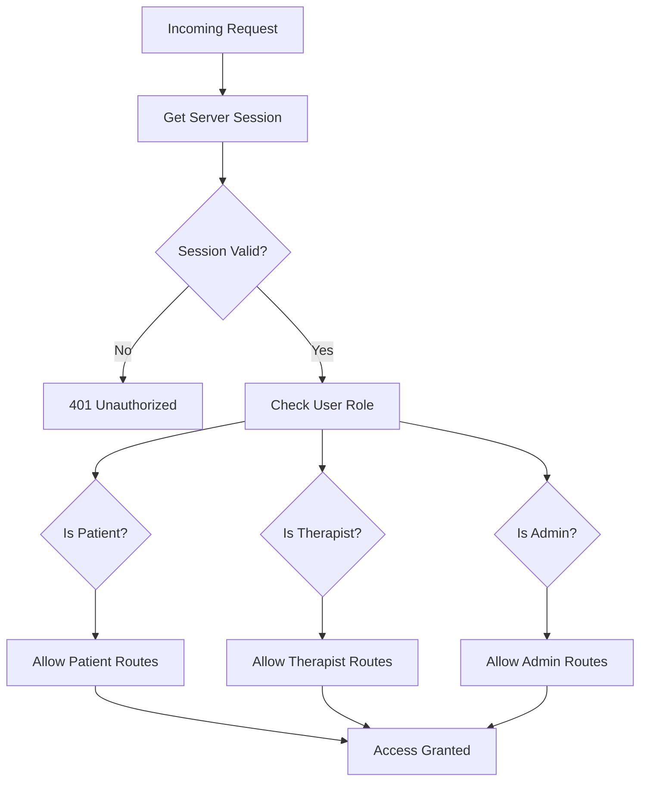

**Diagram sources**
- [route.ts](file://WEBAPP/src/app/api/auth/[...nextauth]/route.ts)
- [page.tsx](file://WEBAPP/src/app/patient/dashboard/page.tsx)
- [page.tsx](file://WEBAPP/src/app/therapist/dashboard/page.tsx)
- [page.tsx](file://WEBAPP/src/app/admin/dashboard/page.tsx)

Implementation pattern:
- NextAuth.js middleware validates sessions
- Route handlers check user roles before granting access
- Protected pages enforce role-based navigation

**Section sources**
- [route.ts](file://WEBAPP/src/app/api/auth/[...nextauth]/route.ts)
- [page.tsx](file://WEBAPP/src/app/patient/dashboard/page.tsx)
- [page.tsx](file://WEBAPP/src/app/therapist/dashboard/page.tsx)
- [page.tsx](file://WEBAPP/src/app/admin/dashboard/page.tsx)

### Real-Time Communication Features
Real-time communication is enabled through WebSocket connections for chat and video interfaces.

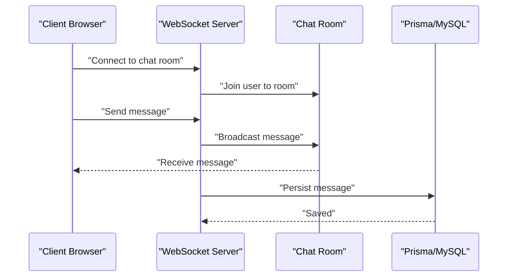

**Diagram sources**
- [route.ts](file://WEBAPP/src/app/api/chat/messages/route.ts#L1-L91)
- [db.ts](file://WEBAPP/src/lib/db.ts#L1-L15)

Capabilities:
- Instant message delivery
- Presence indicators and typing notifications
- Multi-user chat rooms
- Persistent message history

**Section sources**
- [route.ts](file://WEBAPP/src/app/api/chat/messages/route.ts#L1-L91)
- [db.ts](file://WEBAPP/src/lib/db.ts#L1-L15)

### Progress Tracking Capabilities
Progress tracking combines emotion analytics, session metrics, and assessment tools.

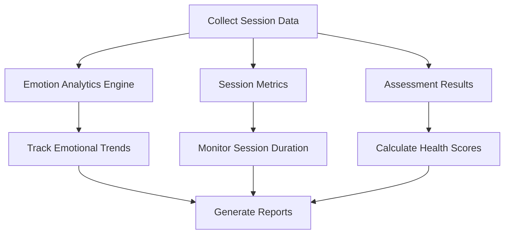

**Diagram sources**
- [route.ts](file://WEBAPP/src/app/api/analytics/assess/route.ts)
- [route.ts](file://WEBAPP/src/app/api/admin/analytics/route.ts)
- [route.ts](file://WEBAPP/src/app/api/therapy/sessions/route.ts)

Features:
- Emotion trend analysis over time
- Session frequency and duration tracking
- Assessment score progression
- Exportable progress reports

**Section sources**
- [route.ts](file://WEBAPP/src/app/api/analytics/assess/route.ts)
- [route.ts](file://WEBAPP/src/app/api/admin/analytics/route.ts)
- [route.ts](file://WEBAPP/src/app/api/therapy/sessions/route.ts)

## Dependency Analysis
The system exhibits strong modularity with clear dependency boundaries.

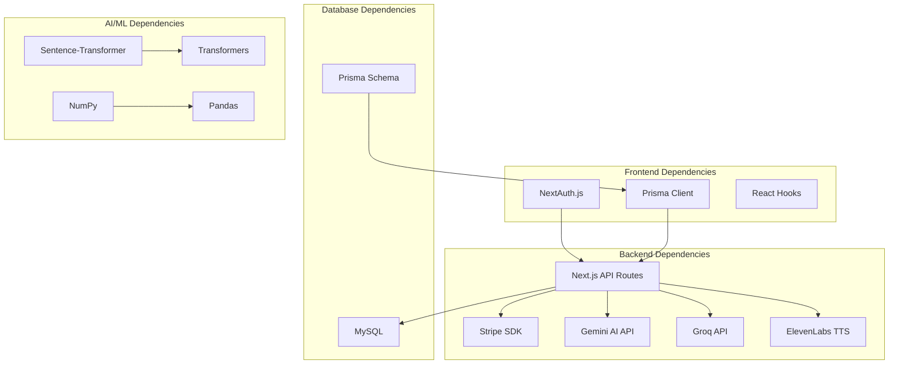

**Diagram sources**
- [db.ts](file://WEBAPP/src/lib/db.ts#L1-L15)
- [schema.prisma](file://WEBAPP/prisma/schema.prisma)
- [requirements.txt](file://ai-backend/requirements.txt)
- [requirements.txt](file://ml-backend/requirements.txt)

Key observations:
- Frontend depends on NextAuth.js for authentication and Prisma client for data access
- Backend APIs integrate with external services (Stripe, Gemini, Groq, ElevenLabs)
- AI/ML services rely on machine learning libraries for analytics and NLP
- Database schema defines relationships between entities

**Section sources**
- [db.ts](file://WEBAPP/src/lib/db.ts#L1-L15)
- [schema.prisma](file://WEBAPP/prisma/schema.prisma)
- [requirements.txt](file://ai-backend/requirements.txt)
- [requirements.txt](file://ml-backend/requirements.txt)

## Performance Considerations
- Database optimization: Use Prisma's built-in query optimization and connection pooling
- Caching: Implement Redis caching for frequently accessed analytics and user preferences
- AI response latency: Batch AI requests and implement request queuing
- Image/video processing: Offload heavy computations to dedicated workers
- CDN usage: Serve static assets through CDN for improved load times
- Monitoring: Implement distributed tracing and performance metrics collection

## Troubleshooting Guide
Common issues and resolutions:
- Authentication failures: Verify NextAuth.js configuration and session cookie settings
- Database connectivity: Check Prisma client initialization and MySQL connection strings
- AI service timeouts: Implement retry logic and circuit breakers for external API calls
- Payment webhook errors: Validate webhook signatures and implement idempotent processing
- Real-time communication failures: Check WebSocket server configuration and network connectivity

Debugging tips:
- Enable Prisma query logging in development mode
- Use structured logging for API request/response traces
- Monitor external service health checks and rate limits
- Implement graceful degradation for non-critical features

**Section sources**
- [db.ts](file://WEBAPP/src/lib/db.ts#L1-L15)
- [route.ts](file://WEBAPP/src/app/api/auth/[...nextauth]/route.ts)
- [route.ts](file://WEBAPP/src/app/api/webhook/stripe/route.ts)

## Conclusion
MindBridge AI delivers a comprehensive mental health platform combining cutting-edge AI technologies with privacy-first design. The modular architecture supports scalable growth while maintaining security and compliance. Key strengths include emotion-aware AI responses, anonymous peer support, robust therapist management, seamless telehealth integration, and secure payment processing. The platform's emphasis on user privacy, real-time communication, and progress tracking positions it as a leader in digital mental healthcare solutions.

## Appendices
- Implementation references for AI/ML services and RAG pipeline
- Database schema documentation and entity relationships
- API endpoint specifications and authentication requirements
- Deployment and scaling considerations for production environments