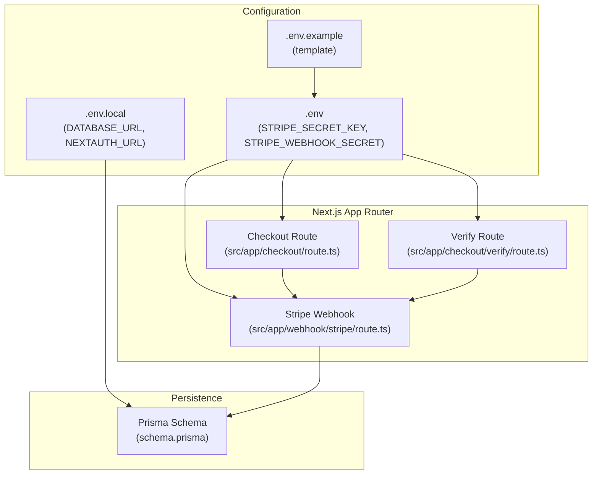
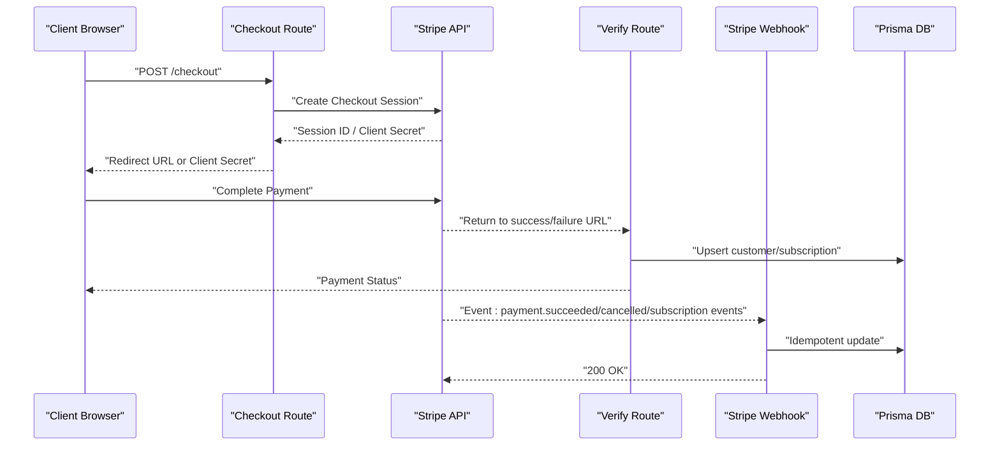
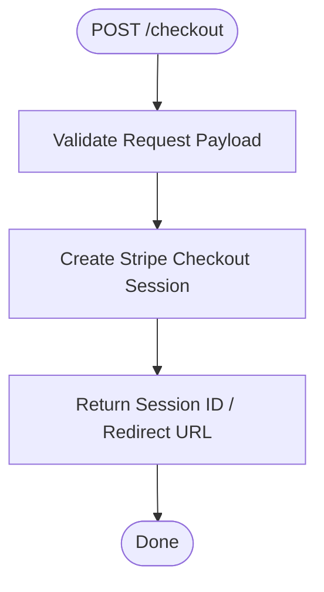
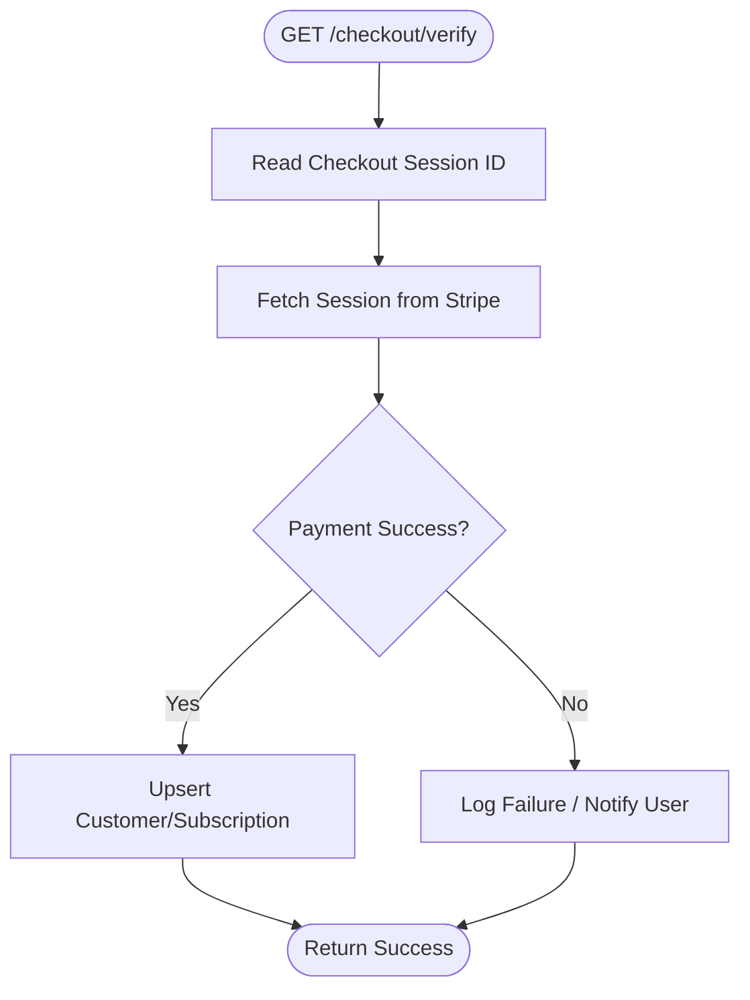
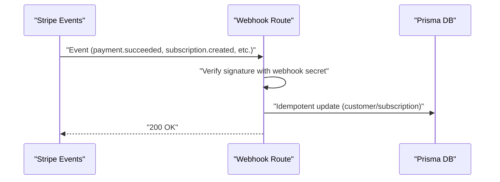
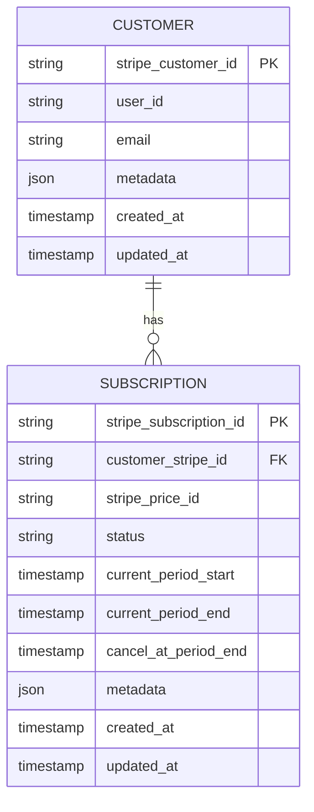
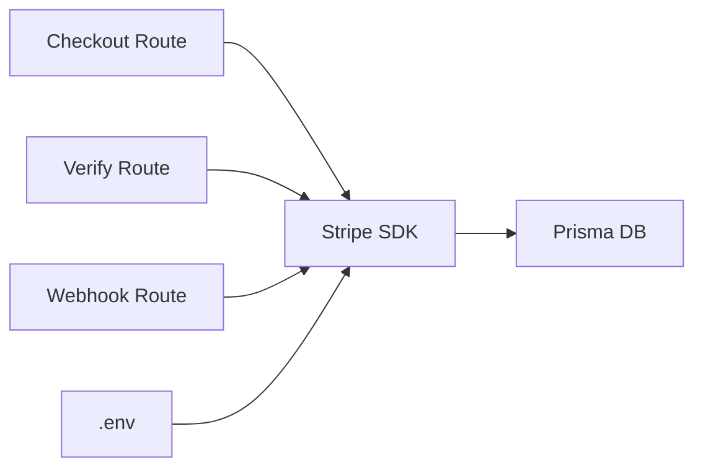

# Payment & Subscription System

<cite>
**Referenced Files in This Document**
- [.env](file://WEBAPP/.env)
- [.env.local](file://WEBAPP/.env.local)
- [.env.example](file://WEBAPP/.env.example)
- [prisma/schema.prisma](file://WEBAPP/prisma/schema.prisma)
- [stripe webhook route](file://WEBAPP/src/app/webhook/stripe/route.ts)
- [checkout route](file://WEBAPP/src/app/checkout/route.ts)
- [checkout verify route](file://WEBAPP/src/app/checkout/verify/route.ts)
</cite>

## Table of Contents
1. [Introduction](#introduction)
2. [Project Structure](#project-structure)
3. [Core Components](#core-components)
4. [Architecture Overview](#architecture-overview)
5. [Detailed Component Analysis](#detailed-component-analysis)
6. [Dependency Analysis](#dependency-analysis)
7. [Performance Considerations](#performance-considerations)
8. [Troubleshooting Guide](#troubleshooting-guide)
9. [Conclusion](#conclusion)
10. [Appendices](#appendices)

## Introduction
This document describes the payment and subscription management system built with Stripe integration in the MindBridge web application. It covers secure payment processing, subscription tier management, recurring billing workflows, checkout and verification flows, webhook handling for payment events, and operational guidance for refunds, upgrades/downgrades, and international payments. The system leverages environment variables for Stripe credentials and integrates with a database schema for storing customer and subscription metadata.

## Project Structure
The payment system is primarily implemented in the Next.js app router under the WEBAPP directory. Key areas include:
- Stripe configuration via environment variables
- Checkout endpoints for initiating payments and verifying outcomes
- Stripe webhook endpoint for asynchronous event handling
- Prisma schema for persisting subscription and customer data

**Diagram sources**
- [stripe webhook route](file://WEBAPP/src/app/webhook/stripe/route.ts)
- [checkout route](file://WEBAPP/src/app/checkout/route.ts)
- [checkout verify route](file://WEBAPP/src/app/checkout/verify/route.ts)
- [.env](file://WEBAPP/.env)
- [.env.local](file://WEBAPP/.env.local)
- [.env.example](file://WEBAPP/.env.example)
- [prisma/schema.prisma](file://WEBAPP/prisma/schema.prisma)

**Section sources**
- [.env](file://WEBAPP/.env#L29-L31)
- [.env.local](file://WEBAPP/.env.local#L1-L20)
- [.env.example](file://WEBAPP/.env.example#L1-L16)
- [prisma/schema.prisma](file://WEBAPP/prisma/schema.prisma)

## Core Components
- Stripe configuration: Secret key and webhook signing secret are loaded from environment variables for secure API access and webhook verification.
- Checkout initiation: An endpoint creates a Stripe checkout session and returns a client secret or redirect URL for the frontend to complete payment.
- Verification: A dedicated endpoint validates the outcome of a payment attempt and updates internal records accordingly.
- Webhook handling: A serverless route listens for Stripe events (payment confirmations, failures, subscriptions, cancellations) and updates the database synchronously.
- Persistence: Prisma schema defines entities for customers and subscriptions, enabling durable storage of payment and subscription state.

Key implementation references:
- Stripe keys and webhook secret: [Stripe configuration](file://WEBAPP/.env#L29-L31)
- Checkout route: [Checkout Route](file://WEBAPP/src/app/checkout/route.ts)
- Verification route: [Checkout Verify Route](file://WEBAPP/src/app/checkout/verify/route.ts)
- Webhook route: [Stripe Webhook Route](file://WEBAPP/src/app/webhook/stripe/route.ts)
- Database schema: [Prisma Schema](file://WEBAPP/prisma/schema.prisma)

**Section sources**
- [.env](file://WEBAPP/.env#L29-L31)
- [prisma/schema.prisma](file://WEBAPP/prisma/schema.prisma)

## Architecture Overview
The payment system follows a modern pattern:
- Frontend initiates checkout via the checkout route, receiving a session identifier or client secret.
- Stripe handles payment collection securely outside the application.
- Upon completion, Stripe redirects the user to the verify route or sends events to the webhook.
- The webhook ensures idempotent updates to subscription and customer records in the database.

**Diagram sources**
- [checkout route](file://WEBAPP/src/app/checkout/route.ts)
- [checkout verify route](file://WEBAPP/src/app/checkout/verify/route.ts)
- [stripe webhook route](file://WEBAPP/src/app/webhook/stripe/route.ts)
- [prisma/schema.prisma](file://WEBAPP/prisma/schema.prisma)

## Detailed Component Analysis

### Stripe Configuration and Environment Management
- Stripe secret key and webhook secret are configured via environment variables for secure access to Stripe APIs and to verify webhook signatures.
- Local and example environment templates ensure consistent configuration across environments.

Implementation references:
- Stripe keys: [Stripe configuration](file://WEBAPP/.env#L29-L31)
- Local overrides: [Local environment](file://WEBAPP/.env.local#L1-L20)
- Template guidance: [Environment template](file://WEBAPP/.env.example#L1-L16)

**Section sources**
- [.env](file://WEBAPP/.env#L29-L31)
- [.env.local](file://WEBAPP/.env.local#L1-L20)
- [.env.example](file://WEBAPP/.env.example#L1-L16)

### Checkout Initiation Workflow
- The checkout route creates a Stripe checkout session configured with price IDs, success and cancel URLs, and customer data.
- The response provides either a redirect URL to Stripe-hosted checkout or a client secret for client-side payment collection.

**Diagram sources**
- [checkout route](file://WEBAPP/src/app/checkout/route.ts)

**Section sources**
- [checkout route](file://WEBAPP/src/app/checkout/route.ts)

### Payment Verification and Post-Payment Handling
- The verify route receives the result of a payment attempt and performs idempotent updates to customer and subscription records.
- It ensures the payment outcome aligns with the expected state and communicates success or failure to the client.

**Diagram sources**
- [checkout verify route](file://WEBAPP/src/app/checkout/verify/route.ts)

**Section sources**
- [checkout verify route](file://WEBAPP/src/app/checkout/verify/route.ts)

### Stripe Webhook Handling
- The webhook route listens for Stripe events such as payment confirmations, subscription creation/modification/cancellation, and invoice attempts.
- It verifies webhook signatures using the webhook secret, applies idempotency checks, and updates the database accordingly.

**Diagram sources**
- [stripe webhook route](file://WEBAPP/src/app/webhook/stripe/route.ts)
- [prisma/schema.prisma](file://WEBAPP/prisma/schema.prisma)

**Section sources**
- [stripe webhook route](file://WEBAPP/src/app/webhook/stripe/route.ts)

### Database Schema for Subscriptions and Customers
- The Prisma schema defines entities for customers and subscriptions, enabling durable storage of Stripe identifiers, statuses, and timestamps.
- These entities support subscription lifecycle management, including creation, updates, and cancellations.

**Diagram sources**
- [prisma/schema.prisma](file://WEBAPP/prisma/schema.prisma)

**Section sources**
- [prisma/schema.prisma](file://WEBAPP/prisma/schema.prisma)

## Dependency Analysis
- Stripe SDK: Used for creating checkout sessions, retrieving sessions, and handling payment intents.
- Prisma: Provides type-safe database access for customer and subscription persistence.
- Environment variables: Supply Stripe keys and webhook secrets, ensuring separation of secrets from code.

**Diagram sources**
- [checkout route](file://WEBAPP/src/app/checkout/route.ts)
- [checkout verify route](file://WEBAPP/src/app/checkout/verify/route.ts)
- [stripe webhook route](file://WEBAPP/src/app/webhook/stripe/route.ts)
- [.env](file://WEBAPP/.env#L29-L31)
- [prisma/schema.prisma](file://WEBAPP/prisma/schema.prisma)

**Section sources**
- [.env](file://WEBAPP/.env#L29-L31)
- [prisma/schema.prisma](file://WEBAPP/prisma/schema.prisma)

## Performance Considerations
- Asynchronous webhook processing prevents blocking the initial checkout response.
- Idempotency in webhook handlers avoids duplicate updates and race conditions.
- Caching frequently accessed customer and subscription data reduces database load.
- Stripe’s hosted checkout minimizes server-side rendering and improves conversion rates.

## Troubleshooting Guide
Common issues and resolutions:
- Webhook signature verification failures: Ensure the webhook secret matches the environment variable and is correctly configured in the Stripe dashboard.
- Duplicate events: Implement idempotency keys and skip updates when the record already reflects the latest state.
- Payment session mismatches: Validate the session ID and client secret against stored state before updating records.
- Database connectivity: Confirm DATABASE_URL and Prisma schema migrations are applied.

Operational references:
- Webhook secret configuration: [Stripe configuration](file://WEBAPP/.env#L31)
- Local database URL: [Local environment](file://WEBAPP/.env.local#L4)
- Prisma schema: [Prisma Schema](file://WEBAPP/prisma/schema.prisma)

**Section sources**
- [.env](file://WEBAPP/.env#L31)
- [.env.local](file://WEBAPP/.env.local#L4)
- [prisma/schema.prisma](file://WEBAPP/prisma/schema.prisma)

## Conclusion
The payment and subscription system integrates Stripe securely for checkout, verification, and recurring billing. It uses environment-driven configuration, robust webhook handling, and a durable database schema to manage customer and subscription lifecycles. The architecture supports scalability, idempotent updates, and clear separation of concerns between frontend, backend, and Stripe.

## Appendices
- International payments: Configure Stripe multi-currency pricing and locales in Stripe Price configurations; ensure the checkout route passes appropriate currency and locale parameters.
- Fraud prevention: Enable Radar rules in Stripe and consider 3D Secure for card payments; monitor webhook events for risk indicators.
- PCI compliance: Use Stripe-hosted experiences (checkout, iDeal, SEPA, etc.) to avoid handling raw card data; maintain minimal logging of sensitive information.
- Refunds: Process refunds via Stripe SDK; synchronize refund events through the webhook to update subscription and invoice records.
- Upgrades/downgrades: Use Stripe’s subscription modification APIs; handle proration and pending invoice items in the webhook.
- Usage-based billing: Create metered prices in Stripe; emit usage records and reconcile with invoices via webhooks.