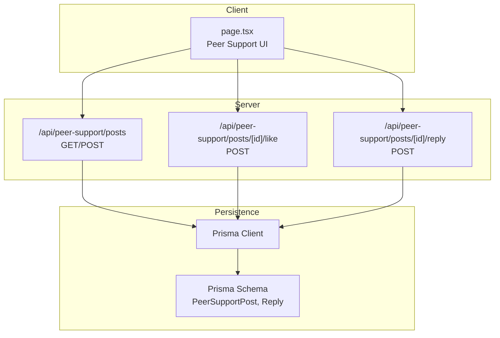
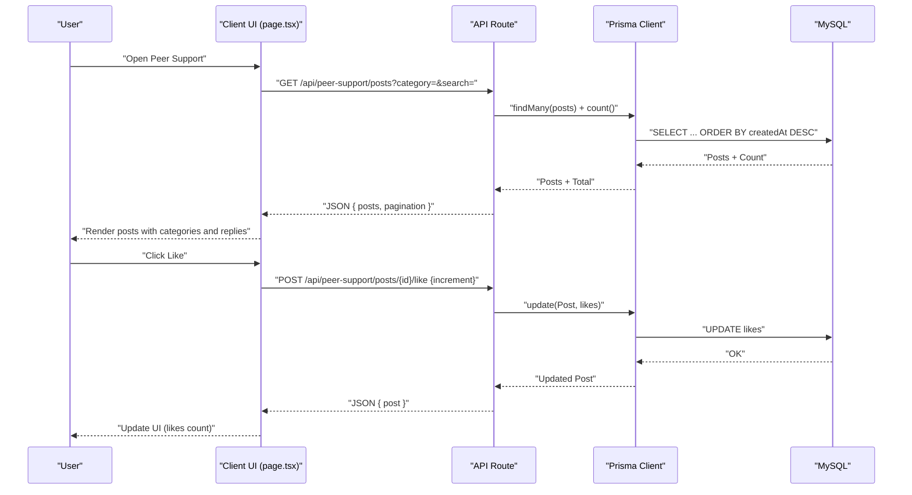
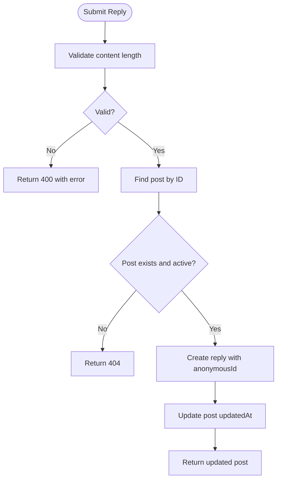
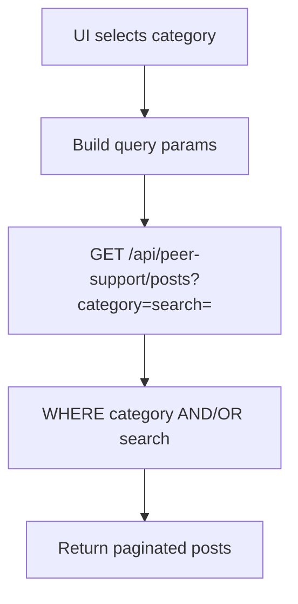
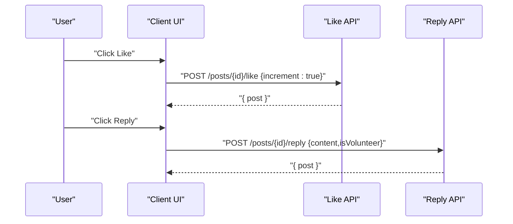
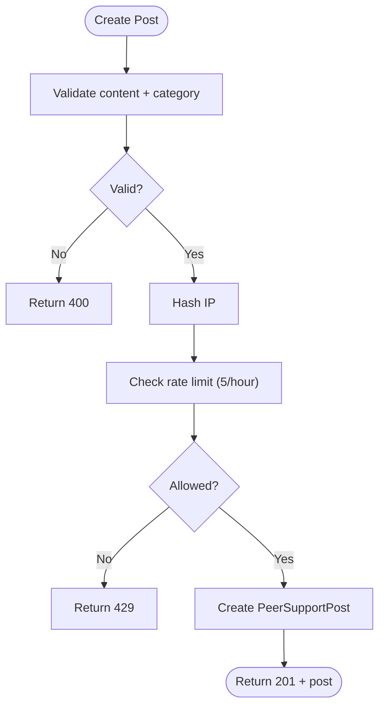
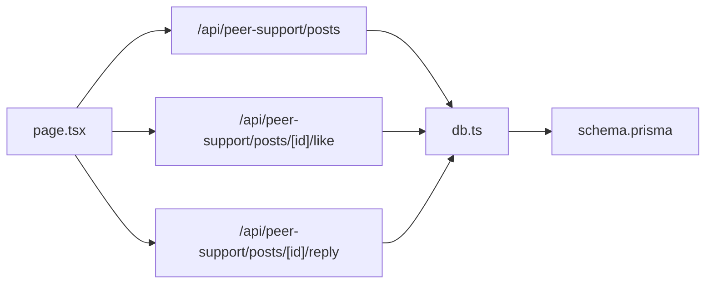

# Peer Support Community

<cite>
**Referenced Files in This Document**
- [page.tsx](file://WEBAPP/src/app/peer-support/page.tsx)
- [posts/route.ts](file://WEBAPP/src/app/api/peer-support/posts/route.ts)
- [posts/[id]/like/route.ts](file://WEBAPP/src/app/api/peer-support/posts/[id]/like/route.ts)
- [posts/[id]/reply/route.ts](file://WEBAPP/src/app/api/peer-support/posts/[id]/reply/route.ts)
- [db.ts](file://WEBAPP/src/lib/db.ts)
- [schema.prisma](file://WEBAPP/prisma/schema.prisma)
- [route.ts](file://WEBAPP/src/app/api/analytics/route.ts)
- [page.tsx](file://WEBAPP/src/app/patient/dashboard/page.tsx)
</cite>

## Table of Contents
1. [Introduction](#introduction)
2. [Project Structure](#project-structure)
3. [Core Components](#core-components)
4. [Architecture Overview](#architecture-overview)
5. [Detailed Component Analysis](#detailed-component-analysis)
6. [Dependency Analysis](#dependency-analysis)
7. [Performance Considerations](#performance-considerations)
8. [Troubleshooting Guide](#troubleshooting-guide)
9. [Conclusion](#conclusion)
10. [Appendices](#appendices)

## Introduction
This document explains the peer support community forum, focusing on the anonymous posting system, category-based content organization, and community interaction features such as likes and replies. It also documents the post management workflow, content moderation capabilities, user engagement metrics, anonymous user handling, content filtering, spam prevention mechanisms, forum navigation, search functionality, and notification systems. Privacy considerations, content policy enforcement, and community guidelines integration are addressed throughout.

## Project Structure
The peer support forum is implemented as a Next.js app with:
- A client-side page component that renders the UI, handles user interactions, and manages filters/search.
- API routes under /api/peer-support that implement CRUD-like operations for posts and replies, and like toggling.
- A Prisma schema defining the database model for posts and replies.
- A shared Prisma client module for database access.

**Diagram sources**
- [page.tsx](file://WEBAPP/src/app/peer-support/page.tsx#L1-L523)
- [posts/route.ts](file://WEBAPP/src/app/api/peer-support/posts/route.ts#L1-L161)
- [posts/[id]/like/route.ts](file://WEBAPP/src/app/api/peer-support/posts/[id]/like/route.ts#L1-L58)
- [posts/[id]/reply/route.ts](file://WEBAPP/src/app/api/peer-support/posts/[id]/reply/route.ts#L1-L100)
- [db.ts](file://WEBAPP/src/lib/db.ts#L1-L15)
- [schema.prisma](file://WEBAPP/prisma/schema.prisma#L79-L106)

**Section sources**
- [page.tsx](file://WEBAPP/src/app/peer-support/page.tsx#L1-L523)
- [posts/route.ts](file://WEBAPP/src/app/api/peer-support/posts/route.ts#L1-L161)
- [posts/[id]/like/route.ts](file://WEBAPP/src/app/api/peer-support/posts/[id]/like/route.ts#L1-L58)
- [posts/[id]/reply/route.ts](file://WEBAPP/src/app/api/peer-support/posts/[id]/reply/route.ts#L1-L100)
- [db.ts](file://WEBAPP/src/lib/db.ts#L1-L15)
- [schema.prisma](file://WEBAPP/prisma/schema.prisma#L79-L106)

## Core Components
- Anonymous posting and replies:
  - Posts and replies are associated with an anonymous identifier generated per entity.
  - The client generates an anonymous ID for new posts and replies.
  - The server also generates anonymous IDs for replies to ensure consistency.
- Category-based organization:
  - Categories include Academic Stress, Social & Emotional, Time Management, Career Anxiety, Relationships, Health & Wellness, and General.
  - Filtering and search are supported via API query parameters.
- Community interactions:
  - Users can like/unlike posts and reply to posts.
  - Replies are displayed under each post with timestamps and anonymous identifiers.
- Moderation and safety:
  - Posts are marked active/inactive; API checks for active posts.
  - Validation enforces minimum/maximum lengths and required fields.
  - Rate limiting prevents spam by IP-based hashing and hourly caps.
- Engagement metrics:
  - Likes count is maintained per post.
  - Pagination supports browsing posts in descending chronological order.
- Navigation and discovery:
  - Category filter buttons and a text search bar enable targeted discovery.
  - Refresh button reloads posts.
- Privacy and policy:
  - Community guidelines are displayed prominently.
  - Reporting is available via a flag icon per post.

**Section sources**
- [page.tsx](file://WEBAPP/src/app/peer-support/page.tsx#L28-L37)
- [page.tsx](file://WEBAPP/src/app/peer-support/page.tsx#L108-L136)
- [page.tsx](file://WEBAPP/src/app/peer-support/page.tsx#L139-L166)
- [page.tsx](file://WEBAPP/src/app/peer-support/page.tsx#L169-L193)
- [posts/route.ts](file://WEBAPP/src/app/api/peer-support/posts/route.ts#L96-L107)
- [posts/[id]/reply/route.ts](file://WEBAPP/src/app/api/peer-support/posts/[id]/reply/route.ts#L20-L72)
- [posts/[id]/like/route.ts](file://WEBAPP/src/app/api/peer-support/posts/[id]/like/route.ts#L4-L58)
- [schema.prisma](file://WEBAPP/prisma/schema.prisma#L80-L106)

## Architecture Overview
The system follows a client-server architecture:
- The client renders the UI, applies filters/search, and submits requests to API endpoints.
- API routes validate inputs, enforce rate limits, and interact with the database via Prisma.
- The Prisma schema defines the data model for posts and replies, including indexes for performance.

**Diagram sources**
- [page.tsx](file://WEBAPP/src/app/peer-support/page.tsx#L53-L76)
- [page.tsx](file://WEBAPP/src/app/peer-support/page.tsx#L169-L193)
- [posts/route.ts](file://WEBAPP/src/app/api/peer-support/posts/route.ts#L22-L75)
- [posts/[id]/like/route.ts](file://WEBAPP/src/app/api/peer-support/posts/[id]/like/route.ts#L4-L58)
- [db.ts](file://WEBAPP/src/lib/db.ts#L1-L15)

## Detailed Component Analysis

### Anonymous Posting and Replies
- Anonymous identifiers:
  - Client-side generation for posts and replies ensures immediate display.
  - Server-side generation for replies guarantees consistency and uniqueness.
- Validation:
  - Posts require non-empty content within a character limit and a valid category.
  - Replies require content with minimum and maximum lengths.
- Rate limiting:
  - Per-IP hashing and hourly cap prevent spam.
- Safety checks:
  - API verifies post existence and active status before updates.

**Diagram sources**
- [posts/[id]/reply/route.ts](file://WEBAPP/src/app/api/peer-support/posts/[id]/reply/route.ts#L20-L72)
- [posts/[id]/reply/route.ts](file://WEBAPP/src/app/api/peer-support/posts/[id]/reply/route.ts#L83-L99)

**Section sources**
- [page.tsx](file://WEBAPP/src/app/peer-support/page.tsx#L78-L85)
- [page.tsx](file://WEBAPP/src/app/peer-support/page.tsx#L139-L166)
- [posts/[id]/reply/route.ts](file://WEBAPP/src/app/api/peer-support/posts/[id]/reply/route.ts#L7-L15)
- [posts/[id]/reply/route.ts](file://WEBAPP/src/app/api/peer-support/posts/[id]/reply/route.ts#L29-L42)
- [posts/[id]/reply/route.ts](file://WEBAPP/src/app/api/peer-support/posts/[id]/reply/route.ts#L44-L62)

### Category-Based Content Organization
- Categories are defined in the UI and validated server-side.
- Filtering and search are applied server-side to posts and replies.

**Diagram sources**
- [page.tsx](file://WEBAPP/src/app/peer-support/page.tsx#L28-L37)
- [page.tsx](file://WEBAPP/src/app/peer-support/page.tsx#L56-L58)
- [posts/route.ts](file://WEBAPP/src/app/api/peer-support/posts/route.ts#L30-L45)

**Section sources**
- [page.tsx](file://WEBAPP/src/app/peer-support/page.tsx#L28-L37)
- [posts/route.ts](file://WEBAPP/src/app/api/peer-support/posts/route.ts#L145-L159)

### Community Interaction Features: Likes and Replies
- Likes:
  - Toggle endpoint accepts a boolean increment flag.
  - Ensures likes do not drop below zero.
- Replies:
  - Nested creation of replies under a post.
  - Anonymous identifiers generated per reply.

**Diagram sources**
- [page.tsx](file://WEBAPP/src/app/peer-support/page.tsx#L169-L193)
- [posts/[id]/like/route.ts](file://WEBAPP/src/app/api/peer-support/posts/[id]/like/route.ts#L4-L58)
- [page.tsx](file://WEBAPP/src/app/peer-support/page.tsx#L139-L166)
- [posts/[id]/reply/route.ts](file://WEBAPP/src/app/api/peer-support/posts/[id]/reply/route.ts#L20-L72)

**Section sources**
- [page.tsx](file://WEBAPP/src/app/peer-support/page.tsx#L169-L193)
- [posts/[id]/like/route.ts](file://WEBAPP/src/app/api/peer-support/posts/[id]/like/route.ts#L13-L28)
- [page.tsx](file://WEBAPP/src/app/peer-support/page.tsx#L139-L166)
- [posts/[id]/reply/route.ts](file://WEBAPP/src/app/api/peer-support/posts/[id]/reply/route.ts#L44-L62)

### Post Management Workflow
- Creation:
  - Client sends content and category.
  - Server validates, computes IP hash, checks rate limit, and creates the post with an anonymousId.
- Retrieval:
  - Server paginates posts and includes replies ordered by timestamp.
- Updates:
  - Likes are incremented/decremented atomically.
- Deactivation:
  - Posts include an active flag; API checks active status for replies and likes.

**Diagram sources**
- [posts/route.ts](file://WEBAPP/src/app/api/peer-support/posts/route.ts#L80-L129)
- [posts/route.ts](file://WEBAPP/src/app/api/peer-support/posts/route.ts#L132-L159)
- [posts/route.ts](file://WEBAPP/src/app/api/peer-support/posts/route.ts#L16-L19)
- [posts/route.ts](file://WEBAPP/src/app/api/peer-support/posts/route.ts#L96-L107)

**Section sources**
- [page.tsx](file://WEBAPP/src/app/peer-support/page.tsx#L108-L136)
- [posts/route.ts](file://WEBAPP/src/app/api/peer-support/posts/route.ts#L80-L129)
- [posts/route.ts](file://WEBAPP/src/app/api/peer-support/posts/route.ts#L132-L159)

### Content Moderation and Safety
- Active status:
  - Posts include an active flag; API routes check active status for replies and likes.
- Validation:
  - Strict validation for content length and presence.
- Reporting:
  - UI exposes a flag icon per post for reporting.

**Section sources**
- [schema.prisma](file://WEBAPP/prisma/schema.prisma#L87-L87)
- [posts/[id]/like/route.ts](file://WEBAPP/src/app/api/peer-support/posts/[id]/like/route.ts#L18-L24)
- [posts/[id]/reply/route.ts](file://WEBAPP/src/app/api/peer-support/posts/[id]/reply/route.ts#L35-L42)
- [page.tsx](file://WEBAPP/src/app/peer-support/page.tsx#L382-L388)

### User Engagement Metrics
- Likes:
  - Increment/decrement tracked per post.
- Pagination:
  - Current page, total pages, and “hasMore” returned by the API.
- Analytics integration:
  - Separate analytics API aggregates mental health metrics and trends; while distinct from peer support, it demonstrates the platform’s analytics capability.

**Section sources**
- [posts/[id]/like/route.ts](file://WEBAPP/src/app/api/peer-support/posts/[id]/like/route.ts#L26-L39)
- [posts/route.ts](file://WEBAPP/src/app/api/peer-support/posts/route.ts#L62-L69)
- [route.ts](file://WEBAPP/src/app/api/analytics/route.ts#L108-L252)
- [page.tsx](file://WEBAPP/src/app/patient/dashboard/page.tsx#L244-L594)

### Anonymous User Handling
- Anonymous identifiers:
  - Generated client-side for posts and server-side for replies.
- Display:
  - Anonymous IDs are shown alongside category-colored avatars.

**Section sources**
- [page.tsx](file://WEBAPP/src/app/peer-support/page.tsx#L78-L85)
- [page.tsx](file://WEBAPP/src/app/peer-support/page.tsx#L367-L368)
- [posts/[id]/reply/route.ts](file://WEBAPP/src/app/api/peer-support/posts/[id]/reply/route.ts#L7-L15)

### Content Filtering and Search
- Client-side:
  - Text search term and category filter are appended to the API URL.
- Server-side:
  - Search matches post content and reply content.
  - Category filter narrows results.
  - Pagination controls page size and offset.

**Section sources**
- [page.tsx](file://WEBAPP/src/app/peer-support/page.tsx#L56-L58)
- [posts/route.ts](file://WEBAPP/src/app/api/peer-support/posts/route.ts#L40-L45)
- [posts/route.ts](file://WEBAPP/src/app/api/peer-support/posts/route.ts#L47-L60)

### Spam Prevention Mechanisms
- IP hashing:
  - SHA-256 hash of client IP plus a secret is stored with each post.
- Rate limiting:
  - Maximum 5 posts per hour per hashed IP.
- Reply validation:
  - Minimum and maximum length enforced.

**Section sources**
- [posts/route.ts](file://WEBAPP/src/app/api/peer-support/posts/route.ts#L16-L19)
- [posts/route.ts](file://WEBAPP/src/app/api/peer-support/posts/route.ts#L96-L107)
- [posts/[id]/reply/route.ts](file://WEBAPP/src/app/api/peer-support/posts/[id]/reply/route.ts#L83-L99)

### Forum Navigation, Search, and Notifications
- Navigation:
  - Category filter buttons and a refresh button.
- Search:
  - Text input that triggers filtered queries.
- Notifications:
  - No explicit notification system is present in the peer support code; analytics and risk flags exist elsewhere in the platform.

**Section sources**
- [page.tsx](file://WEBAPP/src/app/peer-support/page.tsx#L264-L271)
- [page.tsx](file://WEBAPP/src/app/peer-support/page.tsx#L277-L291)
- [page.tsx](file://WEBAPP/src/app/peer-support/page.tsx#L232-L238)

### Privacy Considerations and Community Guidelines
- Privacy:
  - Anonymous identifiers replace personal identities.
  - IP is hashed for anti-spam measures.
- Policy:
  - Community guidelines are displayed prominently in the UI.
  - Reporting is available via the flag icon.

**Section sources**
- [page.tsx](file://WEBAPP/src/app/peer-support/page.tsx#L501-L517)
- [page.tsx](file://WEBAPP/src/app/peer-support/page.tsx#L382-L388)

## Dependency Analysis
- Client depends on API routes for all actions.
- API routes depend on Prisma for persistence.
- Prisma connects to MySQL via the schema definition.

**Diagram sources**
- [page.tsx](file://WEBAPP/src/app/peer-support/page.tsx#L1-L523)
- [posts/route.ts](file://WEBAPP/src/app/api/peer-support/posts/route.ts#L1-L161)
- [posts/[id]/like/route.ts](file://WEBAPP/src/app/api/peer-support/posts/[id]/like/route.ts#L1-L58)
- [posts/[id]/reply/route.ts](file://WEBAPP/src/app/api/peer-support/posts/[id]/reply/route.ts#L1-L100)
- [db.ts](file://WEBAPP/src/lib/db.ts#L1-L15)
- [schema.prisma](file://WEBAPP/prisma/schema.prisma#L79-L106)

**Section sources**
- [page.tsx](file://WEBAPP/src/app/peer-support/page.tsx#L1-L523)
- [posts/route.ts](file://WEBAPP/src/app/api/peer-support/posts/route.ts#L1-L161)
- [posts/[id]/like/route.ts](file://WEBAPP/src/app/api/peer-support/posts/[id]/like/route.ts#L1-L58)
- [posts/[id]/reply/route.ts](file://WEBAPP/src/app/api/peer-support/posts/[id]/reply/route.ts#L1-L100)
- [db.ts](file://WEBAPP/src/lib/db.ts#L1-L15)
- [schema.prisma](file://WEBAPP/prisma/schema.prisma#L79-L106)

## Performance Considerations
- Indexes:
  - Category and createdAt are indexed on posts to optimize filtering and sorting.
- Pagination:
  - Fixed page size with skip/take reduces payload size.
- Asynchronous operations:
  - Parallel count and findMany improve responsiveness.
- Recommendations:
  - Consider caching popular categories or recent posts.
  - Monitor rate-limit thresholds and adjust based on traffic.

**Section sources**
- [schema.prisma](file://WEBAPP/prisma/schema.prisma#L92-L94)
- [posts/route.ts](file://WEBAPP/src/app/api/peer-support/posts/route.ts#L47-L60)

## Troubleshooting Guide
- Common errors:
  - Validation failures return 400 with an error message.
  - Rate limit exceeded returns 429.
  - Post not found returns 404 for likes/replies.
- UI feedback:
  - Alerts inform users of failures during post/reply creation.
  - Loading indicators show during fetches and submissions.
- Debugging tips:
  - Inspect network tab for API responses.
  - Verify category values match allowed list.
  - Confirm content length constraints.

**Section sources**
- [posts/route.ts](file://WEBAPP/src/app/api/peer-support/posts/route.ts#L85-L89)
- [posts/route.ts](file://WEBAPP/src/app/api/peer-support/posts/route.ts#L105-L107)
- [posts/[id]/like/route.ts](file://WEBAPP/src/app/api/peer-support/posts/[id]/like/route.ts#L22-L24)
- [posts/[id]/reply/route.ts](file://WEBAPP/src/app/api/peer-support/posts/[id]/reply/route.ts#L40-L42)
- [page.tsx](file://WEBAPP/src/app/peer-support/page.tsx#L126-L132)
- [page.tsx](file://WEBAPP/src/app/peer-support/page.tsx#L157-L163)

## Conclusion
The peer support community integrates anonymous posting, category-based organization, and interactive features like likes and replies. Robust validation, rate limiting, and safety checks protect the community. The modular API and Prisma-backed persistence enable scalable growth. While no dedicated notification system is present in the peer support module, the platform’s analytics infrastructure demonstrates broader monitoring capabilities.

## Appendices

### API Definitions
- GET /api/peer-support/posts
  - Query parameters: category (all, general, academic-stress, social-emotional, time-management, career-anxiety, relationships, health-wellness), search (text), page (integer, default 1)
  - Returns: posts array and pagination object
- POST /api/peer-support/posts
  - Body: { content (string), category (string) }
  - Returns: created post (201) or error (400/429/500)
- POST /api/peer-support/posts/[id]/like
  - Body: { increment (boolean) }
  - Returns: updated post or error (400/404/500)
- POST /api/peer-support/posts/[id]/reply
  - Body: { content (string), isVolunteer (boolean, optional) }
  - Returns: updated post or error (400/404/500)

**Section sources**
- [posts/route.ts](file://WEBAPP/src/app/api/peer-support/posts/route.ts#L22-L75)
- [posts/route.ts](file://WEBAPP/src/app/api/peer-support/posts/route.ts#L80-L129)
- [posts/[id]/like/route.ts](file://WEBAPP/src/app/api/peer-support/posts/[id]/like/route.ts#L4-L58)
- [posts/[id]/reply/route.ts](file://WEBAPP/src/app/api/peer-support/posts/[id]/reply/route.ts#L20-L72)