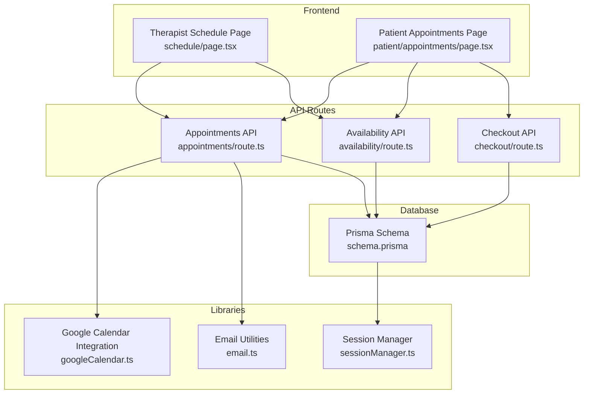
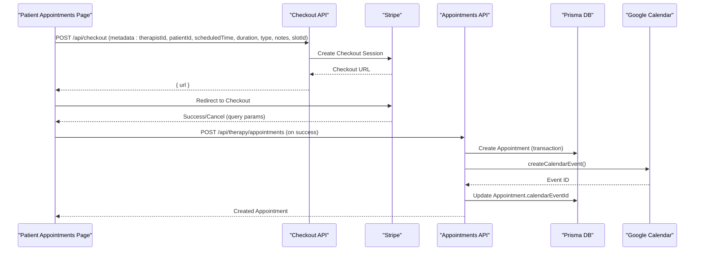
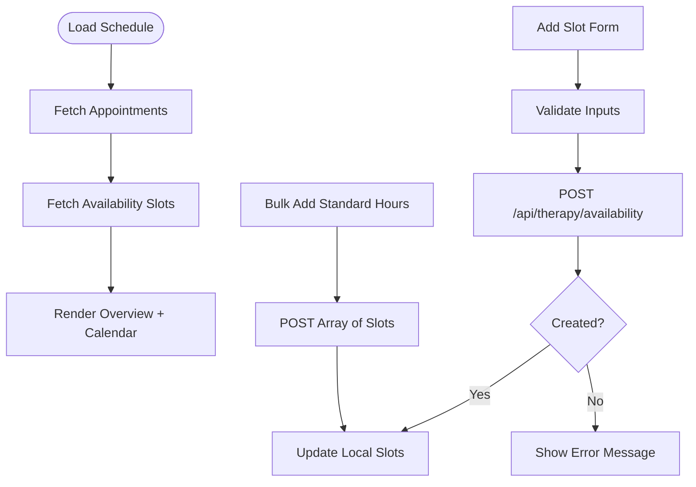
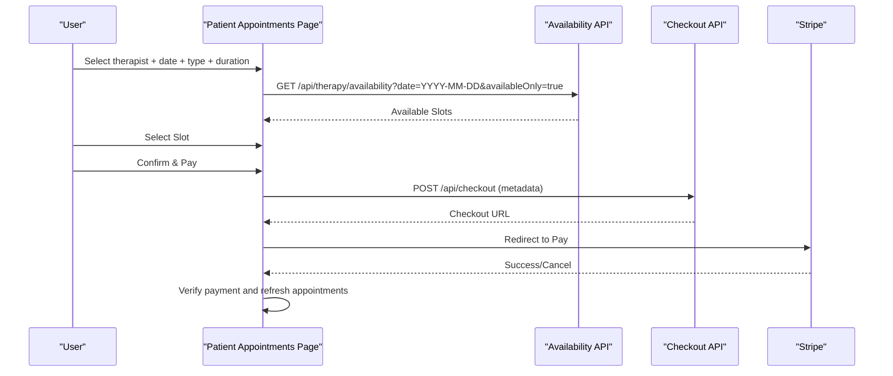
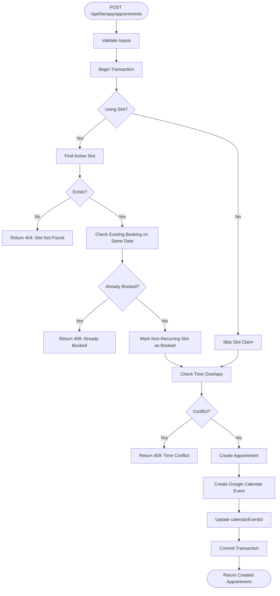
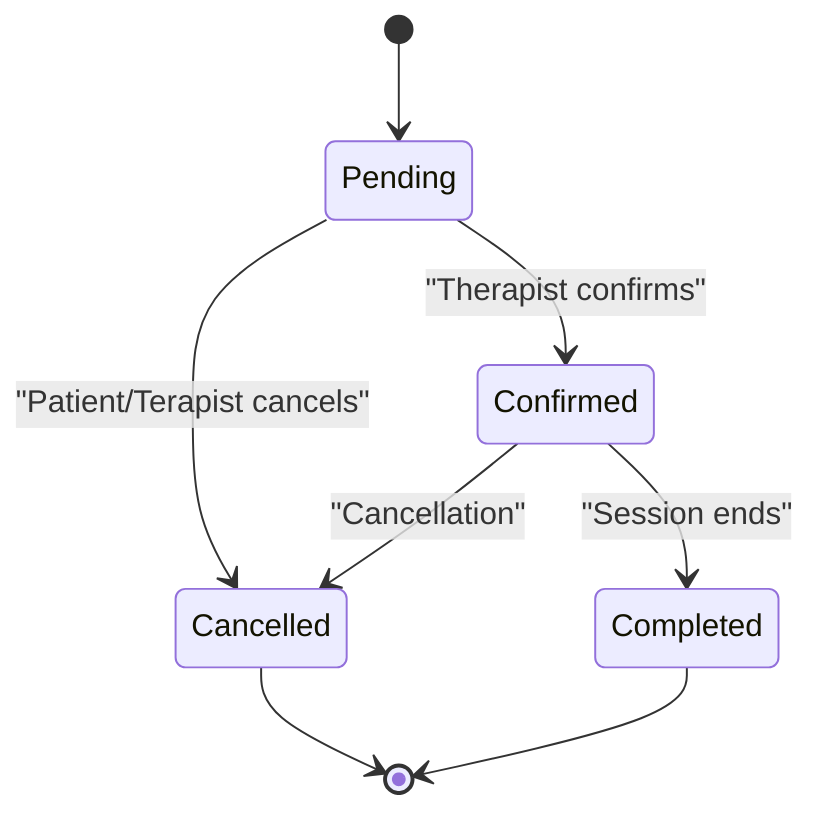
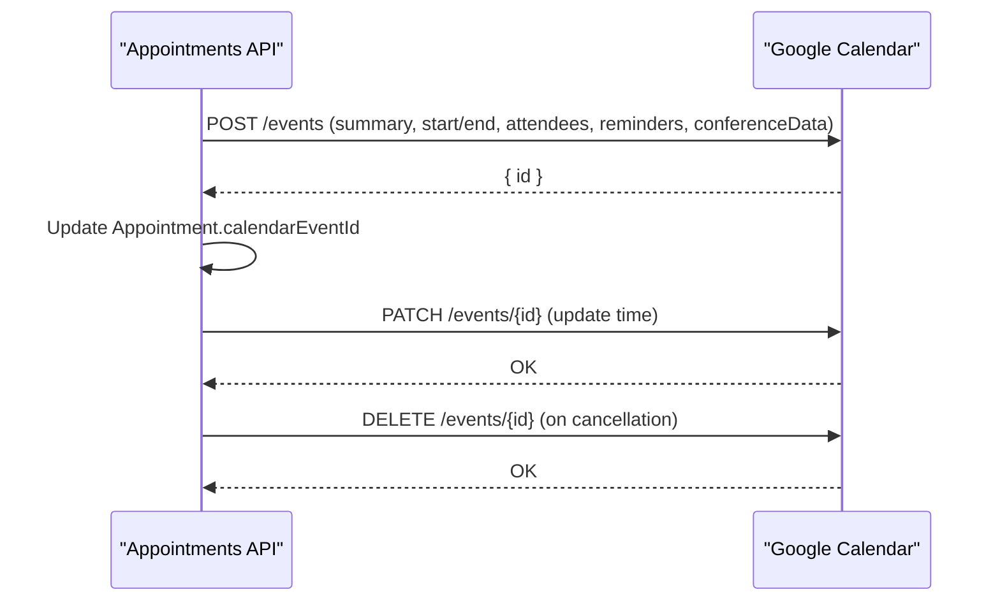
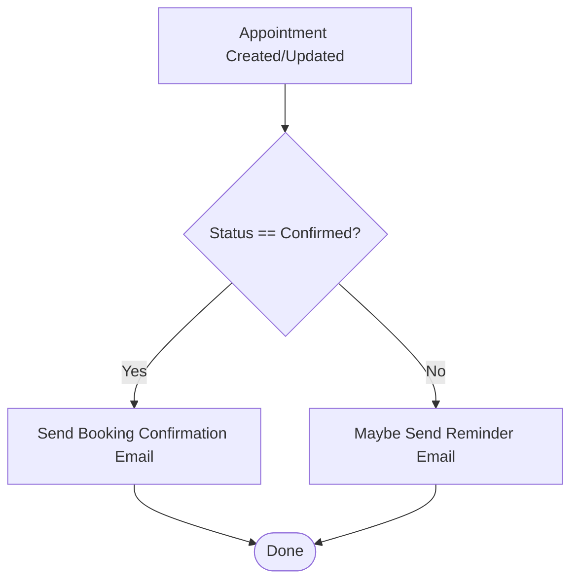
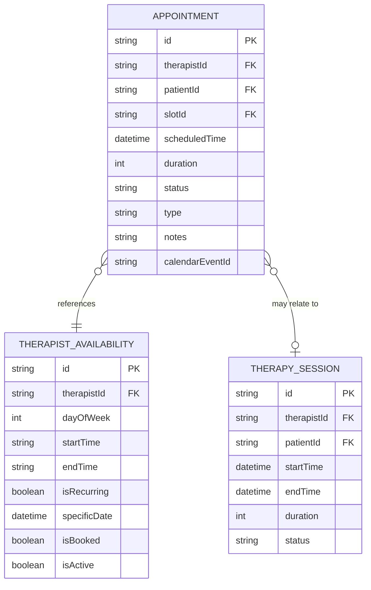
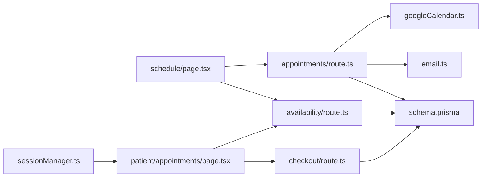

# Appointment Scheduling

<cite>
**Referenced Files in This Document**
- [schedule/page.tsx](file://WEBAPP/src/app/therapist/schedule/page.tsx)
- [appointments/route.ts](file://WEBAPP/src/app/api/therapy/appointments/route.ts)
- [availability/route.ts](file://WEBAPP/src/app/api/therapy/availability/route.ts)
- [googleCalendar.ts](file://WEBAPP/src/lib/googleCalendar.ts)
- [email.ts](file://WEBAPP/src/lib/email.ts)
- [schema.prisma](file://WEBAPP/prisma/schema.prisma)
- [patient/appointments/page.tsx](file://WEBAPP/src/app/patient/appointments/page.tsx)
- [checkout/route.ts](file://WEBAPP/src/app/api/checkout/route.ts)
- [sessionManager.ts](file://WEBAPP/src/lib/sessionManager.ts)
</cite>

## Table of Contents
1. [Introduction](#introduction)
2. [Project Structure](#project-structure)
3. [Core Components](#core-components)
4. [Architecture Overview](#architecture-overview)
5. [Detailed Component Analysis](#detailed-component-analysis)
6. [Dependency Analysis](#dependency-analysis)
7. [Performance Considerations](#performance-considerations)
8. [Troubleshooting Guide](#troubleshooting-guide)
9. [Conclusion](#conclusion)

## Introduction
This document explains the therapist appointment scheduling system in MindBridge. It covers the calendar interface for managing availability, patient booking workflows, conflict detection, status management (pending, confirmed, cancelled, completed), integration with external calendar systems, automated reminders, and the relationship between scheduling and session creation. It also documents capacity management for concurrent sessions, rescheduling workflows, and integration with the Google Calendar API.

## Project Structure
The scheduling system spans frontend pages, API routes, database models, and supporting libraries:
- Frontend pages for therapists and patients manage calendars, availability, and appointments.
- API routes implement booking, availability management, and checkout.
- Prisma models define the data schema for appointments, availability, and related entities.
- Libraries integrate with Google Calendar and send email notifications.

**Diagram sources**
- [schedule/page.tsx](file://WEBAPP/src/app/therapist/schedule/page.tsx#L74-L144)
- [patient/appointments/page.tsx](file://WEBAPP/src/app/patient/appointments/page.tsx#L61-L177)
- [appointments/route.ts](file://WEBAPP/src/app/api/therapy/appointments/route.ts#L6-L36)
- [availability/route.ts](file://WEBAPP/src/app/api/therapy/availability/route.ts#L5-L94)
- [checkout/route.ts](file://WEBAPP/src/app/api/checkout/route.ts#L17-L81)
- [googleCalendar.ts](file://WEBAPP/src/lib/googleCalendar.ts#L102-L161)
- [email.ts](file://WEBAPP/src/lib/email.ts#L27-L48)
- [sessionManager.ts](file://WEBAPP/src/lib/sessionManager.ts#L43-L76)
- [schema.prisma](file://WEBAPP/prisma/schema.prisma#L163-L211)

**Section sources**
- [schedule/page.tsx](file://WEBAPP/src/app/therapist/schedule/page.tsx#L74-L144)
- [patient/appointments/page.tsx](file://WEBAPP/src/app/patient/appointments/page.tsx#L61-L177)
- [appointments/route.ts](file://WEBAPP/src/app/api/therapy/appointments/route.ts#L6-L36)
- [availability/route.ts](file://WEBAPP/src/app/api/therapy/availability/route.ts#L5-L94)
- [checkout/route.ts](file://WEBAPP/src/app/api/checkout/route.ts#L17-L81)
- [googleCalendar.ts](file://WEBAPP/src/lib/googleCalendar.ts#L102-L161)
- [email.ts](file://WEBAPP/src/lib/email.ts#L27-L48)
- [sessionManager.ts](file://WEBAPP/src/lib/sessionManager.ts#L43-L76)
- [schema.prisma](file://WEBAPP/prisma/schema.prisma#L163-L211)

## Core Components
- Therapist Schedule Page: Provides overview cards, today/upcoming lists, calendar view, and availability management controls.
- Patient Appointments Page: Implements a three-step booking flow (select therapist/date/type/duration, pick available slot, confirm and pay), payment via Stripe, and cancellation.
- Appointments API: Handles listing, creating, and updating appointments with conflict detection and Google Calendar synchronization.
- Availability API: Manages therapist availability slots, including recurring and one-off dates, with overlap checks.
- Google Calendar Integration: Creates, updates, and deletes calendar events with meeting links and reminders.
- Email Utilities: Generates reminder and booking confirmation emails.
- Prisma Models: Define Appointment, TherapistAvailability, TherapySession, and related relations.
- Session Manager: Validates session state and handles incognito/browser events.

**Section sources**
- [schedule/page.tsx](file://WEBAPP/src/app/therapist/schedule/page.tsx#L48-L103)
- [patient/appointments/page.tsx](file://WEBAPP/src/app/patient/appointments/page.tsx#L30-L84)
- [appointments/route.ts](file://WEBAPP/src/app/api/therapy/appointments/route.ts#L38-L180)
- [availability/route.ts](file://WEBAPP/src/app/api/therapy/availability/route.ts#L96-L180)
- [googleCalendar.ts](file://WEBAPP/src/lib/googleCalendar.ts#L102-L161)
- [email.ts](file://WEBAPP/src/lib/email.ts#L50-L134)
- [schema.prisma](file://WEBAPP/prisma/schema.prisma#L163-L211)
- [sessionManager.ts](file://WEBAPP/src/lib/sessionManager.ts#L43-L76)

## Architecture Overview
The system integrates a frontend-driven booking flow with backend APIs and persistence. Payments are handled via Stripe, and calendar events are synchronized with Google Calendar.

**Diagram sources**
- [patient/appointments/page.tsx](file://WEBAPP/src/app/patient/appointments/page.tsx#L90-L126)
- [checkout/route.ts](file://WEBAPP/src/app/api/checkout/route.ts#L17-L81)
- [appointments/route.ts](file://WEBAPP/src/app/api/therapy/appointments/route.ts#L38-L180)
- [googleCalendar.ts](file://WEBAPP/src/lib/googleCalendar.ts#L102-L161)
- [schema.prisma](file://WEBAPP/prisma/schema.prisma#L186-L211)

## Detailed Component Analysis

### Therapist Calendar and Availability Management
- Calendar interface displays today’s schedule, upcoming appointments, and a calendar view for a selected date.
- Availability management allows adding single or bulk recurring slots, toggling activation, and deleting slots.
- Conflict detection ensures therapists cannot book overlapping availability.
- Recurring slots support per-date overrides; availability queries filter by date and availability status.

**Diagram sources**
- [schedule/page.tsx](file://WEBAPP/src/app/therapist/schedule/page.tsx#L104-L151)
- [schedule/page.tsx](file://WEBAPP/src/app/therapist/schedule/page.tsx#L244-L350)
- [availability/route.ts](file://WEBAPP/src/app/api/therapy/availability/route.ts#L96-L180)

**Section sources**
- [schedule/page.tsx](file://WEBAPP/src/app/therapist/schedule/page.tsx#L74-L144)
- [schedule/page.tsx](file://WEBAPP/src/app/therapist/schedule/page.tsx#L244-L350)
- [availability/route.ts](file://WEBAPP/src/app/api/therapy/availability/route.ts#L5-L94)
- [availability/route.ts](file://WEBAPP/src/app/api/therapy/availability/route.ts#L96-L180)

### Patient Booking Workflow and Capacity Management
- Three-step booking: select therapist/date/type/duration, pick available slot, confirm and pay.
- Availability is fetched for a specific date and filtered to exclude booked slots.
- Payment is processed via Stripe; on success, the page verifies and confirms the appointment.
- Capacity is managed implicitly by preventing double-booking of the same slot on the same date and by time-range overlap checks during booking.

**Diagram sources**
- [patient/appointments/page.tsx](file://WEBAPP/src/app/patient/appointments/page.tsx#L179-L208)
- [patient/appointments/page.tsx](file://WEBAPP/src/app/patient/appointments/page.tsx#L210-L258)
- [availability/route.ts](file://WEBAPP/src/app/api/therapy/availability/route.ts#L36-L82)
- [checkout/route.ts](file://WEBAPP/src/app/api/checkout/route.ts#L17-L81)

**Section sources**
- [patient/appointments/page.tsx](file://WEBAPP/src/app/patient/appointments/page.tsx#L61-L177)
- [patient/appointments/page.tsx](file://WEBAPP/src/app/patient/appointments/page.tsx#L179-L208)
- [patient/appointments/page.tsx](file://WEBAPP/src/app/patient/appointments/page.tsx#L210-L258)
- [availability/route.ts](file://WEBAPP/src/app/api/therapy/availability/route.ts#L36-L82)
- [checkout/route.ts](file://WEBAPP/src/app/api/checkout/route.ts#L17-L81)

### Appointment Creation, Conflict Resolution, and Status Management
- Creating an appointment uses a transaction to atomically claim a slot (if applicable) and prevent time conflicts.
- Conflict detection checks for overlapping time ranges and existing non-cancelled appointments.
- On success, a Google Calendar event is created asynchronously; the appointment record is updated with the calendar event ID.
- Status transitions are supported via PATCH requests: pending → confirmed or cancelled; confirmed → completed.

**Diagram sources**
- [appointments/route.ts](file://WEBAPP/src/app/api/therapy/appointments/route.ts#L38-L180)
- [googleCalendar.ts](file://WEBAPP/src/lib/googleCalendar.ts#L102-L161)

**Section sources**
- [appointments/route.ts](file://WEBAPP/src/app/api/therapy/appointments/route.ts#L38-L180)
- [googleCalendar.ts](file://WEBAPP/src/lib/googleCalendar.ts#L102-L161)

### Status Management: Pending, Confirmed, Cancelled, Completed
- Pending: Initial state after booking until confirmed by therapist or auto-confirmed.
- Confirmed: Therapist confirms the appointment; patient receives confirmation email.
- Cancelled: Either party cancels; Google Calendar event can be deleted.
- Completed: Therapist marks session as completed after session.

**Diagram sources**
- [appointments/route.ts](file://WEBAPP/src/app/api/therapy/appointments/route.ts#L193-L242)
- [schedule/page.tsx](file://WEBAPP/src/app/therapist/schedule/page.tsx#L193-L242)

**Section sources**
- [appointments/route.ts](file://WEBAPP/src/app/api/therapy/appointments/route.ts#L193-L242)
- [schedule/page.tsx](file://WEBAPP/src/app/therapist/schedule/page.tsx#L193-L242)

### Integration with Google Calendar API
- Access token is refreshed using stored credentials and a refresh token.
- Events are created with pop-up and email reminders and a Google Meet link.
- Updates and deletions are supported for rescheduling and cancellations.

**Diagram sources**
- [googleCalendar.ts](file://WEBAPP/src/lib/googleCalendar.ts#L68-L100)
- [googleCalendar.ts](file://WEBAPP/src/lib/googleCalendar.ts#L102-L161)
- [googleCalendar.ts](file://WEBAPP/src/lib/googleCalendar.ts#L163-L181)
- [googleCalendar.ts](file://WEBAPP/src/lib/googleCalendar.ts#L183-L225)

**Section sources**
- [googleCalendar.ts](file://WEBAPP/src/lib/googleCalendar.ts#L68-L100)
- [googleCalendar.ts](file://WEBAPP/src/lib/googleCalendar.ts#L102-L161)
- [googleCalendar.ts](file://WEBAPP/src/lib/googleCalendar.ts#L163-L181)
- [googleCalendar.ts](file://WEBAPP/src/lib/googleCalendar.ts#L183-L225)

### Automated Reminders and Patient Confirmations
- Email utilities generate reminder and booking confirmation templates for both patients and therapists.
- Reminders include formatted date/time, duration, and links to dashboards.
- Confirmations reflect the current status (booked vs confirmed) and include session details.

**Diagram sources**
- [email.ts](file://WEBAPP/src/lib/email.ts#L50-L134)
- [email.ts](file://WEBAPP/src/lib/email.ts#L136-L200)

**Section sources**
- [email.ts](file://WEBAPP/src/lib/email.ts#L50-L134)
- [email.ts](file://WEBAPP/src/lib/email.ts#L136-L200)

### Relationship Between Scheduling and Session Creation
- Appointments are stored with a status field; sessions are tracked separately with their own lifecycle.
- The system supports linking calendar events to appointments and sending notifications upon creation/updates.

**Diagram sources**
- [schema.prisma](file://WEBAPP/prisma/schema.prisma#L186-L211)
- [schema.prisma](file://WEBAPP/prisma/schema.prisma#L163-L184)
- [schema.prisma](file://WEBAPP/prisma/schema.prisma#L140-L161)

**Section sources**
- [schema.prisma](file://WEBAPP/prisma/schema.prisma#L186-L211)
- [schema.prisma](file://WEBAPP/prisma/schema.prisma#L163-L184)
- [schema.prisma](file://WEBAPP/prisma/schema.prisma#L140-L161)

## Dependency Analysis
- Therapist Schedule Page depends on Appointments and Availability APIs for data and actions.
- Patient Appointments Page depends on Availability, Checkout, and Appointments APIs.
- Appointments API depends on Prisma for persistence and Google Calendar library for external sync.
- Availability API depends on Prisma for slot management and conflict checks.
- Email utilities depend on environment configuration for SMTP transport.
- Session Manager listens for session changes and validates session health.

**Diagram sources**
- [schedule/page.tsx](file://WEBAPP/src/app/therapist/schedule/page.tsx#L104-L151)
- [patient/appointments/page.tsx](file://WEBAPP/src/app/patient/appointments/page.tsx#L179-L208)
- [appointments/route.ts](file://WEBAPP/src/app/api/therapy/appointments/route.ts#L38-L180)
- [availability/route.ts](file://WEBAPP/src/app/api/therapy/availability/route.ts#L96-L180)
- [checkout/route.ts](file://WEBAPP/src/app/api/checkout/route.ts#L17-L81)
- [googleCalendar.ts](file://WEBAPP/src/lib/googleCalendar.ts#L102-L161)
- [email.ts](file://WEBAPP/src/lib/email.ts#L27-L48)
- [sessionManager.ts](file://WEBAPP/src/lib/sessionManager.ts#L43-L76)
- [schema.prisma](file://WEBAPP/prisma/schema.prisma#L163-L211)

**Section sources**
- [schedule/page.tsx](file://WEBAPP/src/app/therapist/schedule/page.tsx#L104-L151)
- [patient/appointments/page.tsx](file://WEBAPP/src/app/patient/appointments/page.tsx#L179-L208)
- [appointments/route.ts](file://WEBAPP/src/app/api/therapy/appointments/route.ts#L38-L180)
- [availability/route.ts](file://WEBAPP/src/app/api/therapy/availability/route.ts#L96-L180)
- [checkout/route.ts](file://WEBAPP/src/app/api/checkout/route.ts#L17-L81)
- [googleCalendar.ts](file://WEBAPP/src/lib/googleCalendar.ts#L102-L161)
- [email.ts](file://WEBAPP/src/lib/email.ts#L27-L48)
- [sessionManager.ts](file://WEBAPP/src/lib/sessionManager.ts#L43-L76)
- [schema.prisma](file://WEBAPP/prisma/schema.prisma#L163-L211)

## Performance Considerations
- Real-time polling: Both therapist and patient pages poll for updates every 30 seconds to keep UI in sync.
- Availability polling: Patient page polls every 15 seconds when viewing slots to reflect live availability.
- Transactions: Booking uses Prisma transactions to ensure atomicity and avoid race conditions.
- Asynchronous calendar sync: Google Calendar operations are non-blocking to avoid slowing down booking responses.

[No sources needed since this section provides general guidance]

## Troubleshooting Guide
- Unauthorized access: API routes check NextAuth session and roles; ensure proper authentication.
- Missing fields: Booking requires therapistId, patientId, scheduledTime, and slotId; missing fields return 400.
- Slot not found or inactive: Returns 404; ensure the slot exists and is active.
- Slot already booked: Returns 409; choose another slot or date.
- Time conflict: Returns 409; adjust timing or duration.
- Google Calendar credentials: Ensure client ID, client secret, and refresh token are configured; token refresh failures will prevent calendar sync.
- Email not configured: SMTP credentials must be present; otherwise, emails are skipped with warnings.
- Session validation: Session manager reloads the page if session cookies change or become invalid.

**Section sources**
- [appointments/route.ts](file://WEBAPP/src/app/api/therapy/appointments/route.ts#L6-L36)
- [appointments/route.ts](file://WEBAPP/src/app/api/therapy/appointments/route.ts#L164-L180)
- [availability/route.ts](file://WEBAPP/src/app/api/therapy/availability/route.ts#L96-L180)
- [googleCalendar.ts](file://WEBAPP/src/lib/googleCalendar.ts#L68-L100)
- [email.ts](file://WEBAPP/src/lib/email.ts#L27-L48)
- [sessionManager.ts](file://WEBAPP/src/lib/sessionManager.ts#L43-L76)

## Conclusion
The MindBridge appointment scheduling system provides a robust, real-time experience for therapists and patients. It enforces scheduling integrity through transactional booking and conflict detection, integrates with Google Calendar for external visibility, and automates reminders and confirmations via email. The modular design separates concerns across frontend pages, API routes, and supporting libraries, enabling maintainability and extensibility.