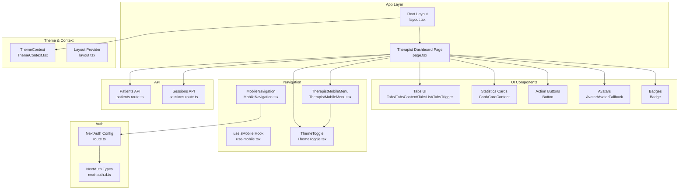
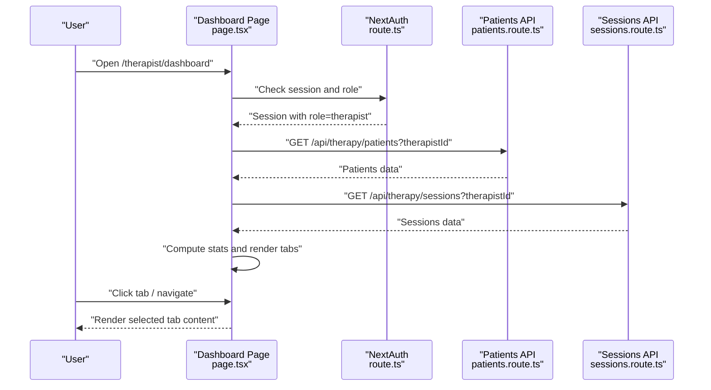
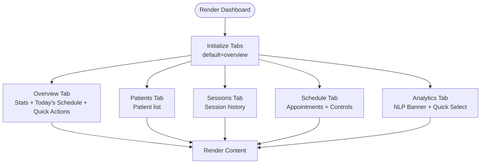
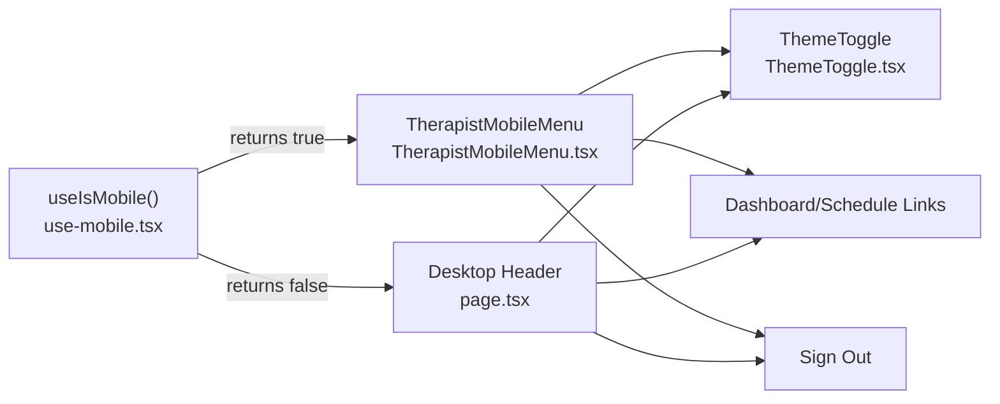
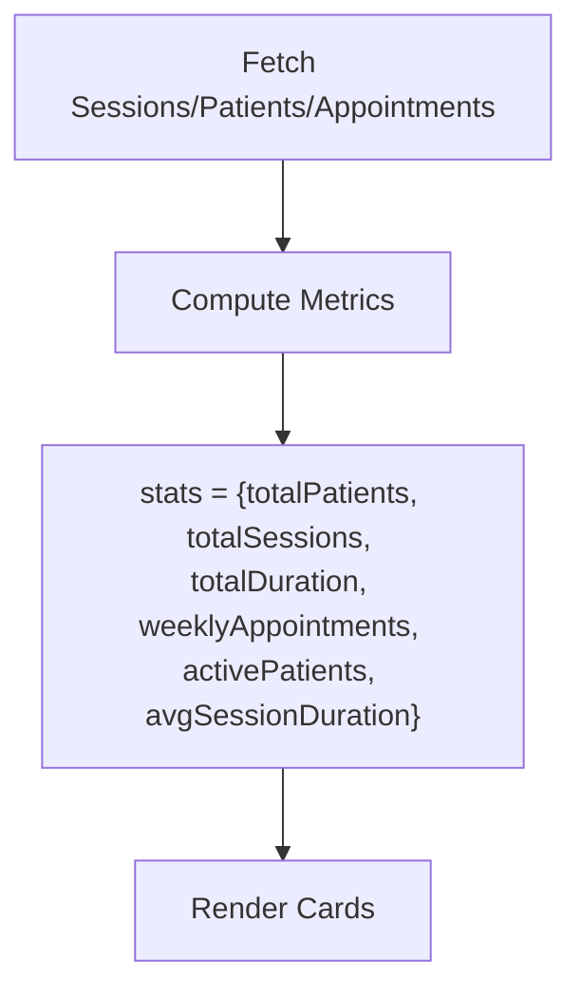
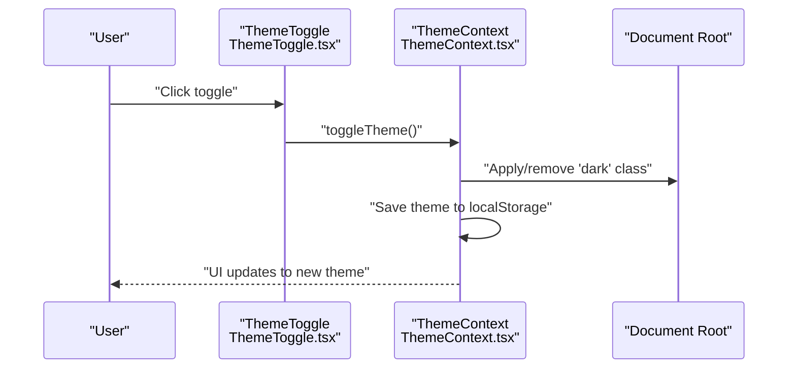
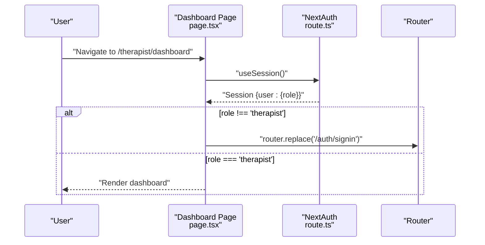
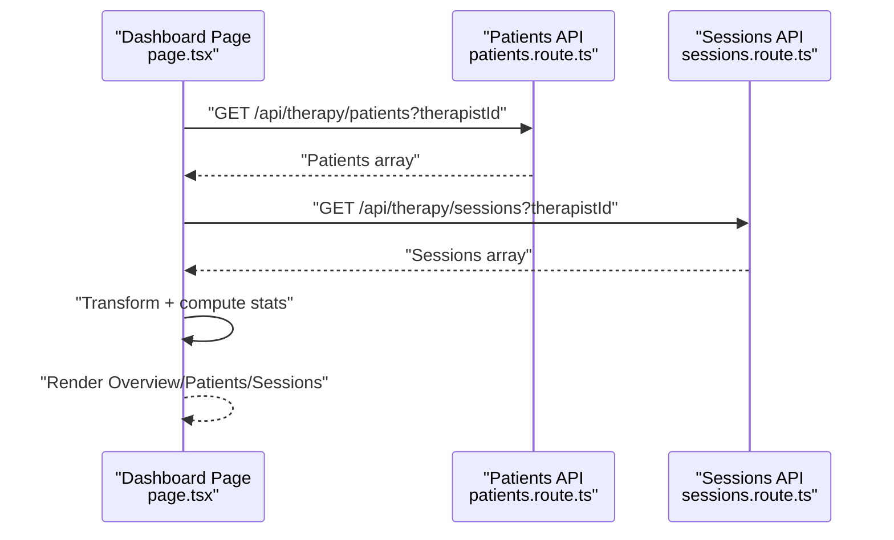
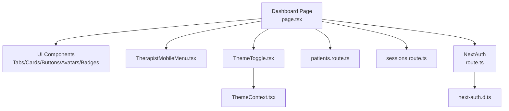

# Dashboard Navigation & Interface

<cite>
**Referenced Files in This Document**
- [page.tsx](file://WEBAPP/src/app/therapist/dashboard/page.tsx)
- [TherapistMobileMenu.tsx](file://WEBAPP/src/components/TherapistMobileMenu.tsx)
- [MobileNavigation.tsx](file://WEBAPP/src/components/MobileNavigation.tsx)
- [use-mobile.tsx](file://WEBAPP/src/components/ui/use-mobile.tsx)
- [ThemeToggle.tsx](file://WEBAPP/src/components/ThemeToggle.tsx)
- [ThemeContext.tsx](file://WEBAPP/src/contexts/ThemeContext.tsx)
- [layout.tsx](file://WEBAPP/src/app/layout.tsx)
- [route.ts](file://WEBAPP/src/app/api/auth/[...nextauth]/route.ts)
- [next-auth.d.ts](file://WEBAPP/src/types/next-auth.d.ts)
- [patients.route.ts](file://WEBAPP/src/app/api/therapy/patients/route.ts)
- [sessions.route.ts](file://WEBAPP/src/app/api/therapy/sessions/route.ts)
</cite>

## Table of Contents
1. [Introduction](#introduction)
2. [Project Structure](#project-structure)
3. [Core Components](#core-components)
4. [Architecture Overview](#architecture-overview)
5. [Detailed Component Analysis](#detailed-component-analysis)
6. [Dependency Analysis](#dependency-analysis)
7. [Performance Considerations](#performance-considerations)
8. [Troubleshooting Guide](#troubleshooting-guide)
9. [Conclusion](#conclusion)

## Introduction
This document describes the therapist dashboard navigation system and user interface components. It covers the tabbed interface structure, responsive design for desktop and mobile, dashboard statistics cards, quick action buttons, theme switching, logout processes, navigation between therapist-specific pages, and integration with NextAuth for role-based access control with automatic redirection for unauthorized access attempts.

## Project Structure
The therapist dashboard is implemented as a Next.js app page with a tabbed interface and integrates with shared UI components and theme/context providers. Authentication is handled via NextAuth with role-based access control.

**Diagram sources**
- [page.tsx](file://WEBAPP/src/app/therapist/dashboard/page.tsx#L1-L959)
- [TherapistMobileMenu.tsx](file://WEBAPP/src/components/TherapistMobileMenu.tsx#L1-L129)
- [MobileNavigation.tsx](file://WEBAPP/src/components/MobileNavigation.tsx#L1-L120)
- [use-mobile.tsx](file://WEBAPP/src/components/ui/use-mobile.tsx#L1-L20)
- [ThemeToggle.tsx](file://WEBAPP/src/components/ThemeToggle.tsx#L1-L55)
- [ThemeContext.tsx](file://WEBAPP/src/contexts/ThemeContext.tsx#L1-L67)
- [layout.tsx](file://WEBAPP/src/app/layout.tsx#L1-L55)
- [route.ts](file://WEBAPP/src/app/api/auth/[...nextauth]/route.ts#L1-L240)
- [next-auth.d.ts](file://WEBAPP/src/types/next-auth.d.ts#L1-L28)
- [patients.route.ts](file://WEBAPP/src/app/api/therapy/patients/route.ts#L1-L61)
- [sessions.route.ts](file://WEBAPP/src/app/api/therapy/sessions/route.ts#L1-L80)

**Section sources**
- [page.tsx](file://WEBAPP/src/app/therapist/dashboard/page.tsx#L1-L959)
- [layout.tsx](file://WEBAPP/src/app/layout.tsx#L1-L55)

## Core Components
- Tabbed Interface: Grid of five tabs (Overview, Patients, Sessions, Schedule, Analytics) using a UI tabs component.
- Statistics Cards: Four summary cards for total patients, total sessions, average session duration, and weekly appointments.
- Quick Actions: Three action cards for patient analytics, scheduling new sessions, and settings.
- Responsive Navigation: Desktop links and a dedicated mobile menu for therapists.
- Theme Toggle: Persistent light/dark mode switch integrated across the dashboard.
- Role-Based Access Control: Automatic redirection for unauthorized users via NextAuth.

**Section sources**
- [page.tsx](file://WEBAPP/src/app/therapist/dashboard/page.tsx#L461-L937)
- [TherapistMobileMenu.tsx](file://WEBAPP/src/components/TherapistMobileMenu.tsx#L1-L129)
- [ThemeToggle.tsx](file://WEBAPP/src/components/ThemeToggle.tsx#L1-L55)
- [route.ts](file://WEBAPP/src/app/api/auth/[...nextauth]/route.ts#L1-L240)

## Architecture Overview
The dashboard orchestrates data fetching from therapy APIs, computes statistics, renders a tabbed UI, and manages navigation and theme. Authentication ensures only authorized users can access therapist pages.

**Diagram sources**
- [page.tsx](file://WEBAPP/src/app/therapist/dashboard/page.tsx#L68-L171)
- [route.ts](file://WEBAPP/src/app/api/auth/[...nextauth]/route.ts#L69-L96)
- [patients.route.ts](file://WEBAPP/src/app/api/therapy/patients/route.ts#L5-L55)
- [sessions.route.ts](file://WEBAPP/src/app/api/therapy/sessions/route.ts#L5-L41)

## Detailed Component Analysis

### Tabbed Interface Structure
The dashboard uses a grid-based tab list with five triggers mapped to tab content areas. Each tab corresponds to a functional area:
- Overview: Statistics cards, today’s schedule, and quick actions.
- Patients: List of linked patients with summary metrics.
- Sessions: Historical therapy sessions with status and engagement metrics.
- Schedule: Upcoming appointments with confirmation/cancellation controls.
- Analytics: NLP analytics banner and quick patient selection.

**Diagram sources**
- [page.tsx](file://WEBAPP/src/app/therapist/dashboard/page.tsx#L461-L937)

**Section sources**
- [page.tsx](file://WEBAPP/src/app/therapist/dashboard/page.tsx#L461-L937)

### Responsive Design Implementation
- Desktop view: Header with theme toggle, external links, and a sign-out button.
- Mobile view: A dedicated therapist mobile menu with dashboard and schedule links, theme toggle, and sign-out.
- Breakpoint hook: A small utility determines mobile mode based on screen width.

**Diagram sources**
- [use-mobile.tsx](file://WEBAPP/src/components/ui/use-mobile.tsx#L1-L20)
- [TherapistMobileMenu.tsx](file://WEBAPP/src/components/TherapistMobileMenu.tsx#L1-L129)
- [page.tsx](file://WEBAPP/src/app/therapist/dashboard/page.tsx#L414-L444)

**Section sources**
- [TherapistMobileMenu.tsx](file://WEBAPP/src/components/TherapistMobileMenu.tsx#L1-L129)
- [use-mobile.tsx](file://WEBAPP/src/components/ui/use-mobile.tsx#L1-L20)
- [page.tsx](file://WEBAPP/src/app/therapist/dashboard/page.tsx#L414-L444)

### Dashboard Statistics Cards
The Overview tab displays four key metrics:
- Total Patients: Count of unique patients linked to the therapist.
- Total Sessions: Completed therapy sessions.
- Average Session Duration: Rounded average in minutes.
- Weekly Appointments: Scheduled appointments within the last seven days.
- Active Patients: Patients who had sessions within the last seven days.

These are computed from fetched session and patient data and rendered in a responsive grid of cards.

**Diagram sources**
- [page.tsx](file://WEBAPP/src/app/therapist/dashboard/page.tsx#L93-L171)

**Section sources**
- [page.tsx](file://WEBAPP/src/app/therapist/dashboard/page.tsx#L83-L162)

### Quick Action Buttons
The Overview tab includes three quick action cards:
- Patient Analytics: Link to detailed analytics page.
- Schedule Session: Link to schedule page.
- Settings: Placeholder for configuration.

These provide direct navigation to related functionality.

**Section sources**
- [page.tsx](file://WEBAPP/src/app/therapist/dashboard/page.tsx#L594-L638)

### Theme Switching Functionality
- Theme provider persists user preference in local storage and applies the appropriate class to the document root.
- Theme toggle component switches between light and dark modes and reflects current theme state.
- Both desktop and mobile menus include a theme toggle for consistent UX.

**Diagram sources**
- [ThemeToggle.tsx](file://WEBAPP/src/components/ThemeToggle.tsx#L1-L55)
- [ThemeContext.tsx](file://WEBAPP/src/contexts/ThemeContext.tsx#L23-L66)
- [layout.tsx](file://WEBAPP/src/app/layout.tsx#L46-L50)

**Section sources**
- [ThemeToggle.tsx](file://WEBAPP/src/components/ThemeToggle.tsx#L1-L55)
- [ThemeContext.tsx](file://WEBAPP/src/contexts/ThemeContext.tsx#L1-L67)
- [layout.tsx](file://WEBAPP/src/app/layout.tsx#L1-L55)

### Logout Processes
- Desktop header and mobile menu both expose a sign-out action.
- Clicking sign-out invokes the NextAuth sign-out flow with a redirect to the home page.

**Section sources**
- [page.tsx](file://WEBAPP/src/app/therapist/dashboard/page.tsx#L435-L440)
- [TherapistMobileMenu.tsx](file://WEBAPP/src/components/TherapistMobileMenu.tsx#L114-L122)
- [MobileNavigation.tsx](file://WEBAPP/src/components/MobileNavigation.tsx#L100-L112)

### Navigation Between Pages
- Desktop navigation includes links to patient analytics, schedule, peer support, and sign-out.
- Mobile menu provides links to dashboard and schedule.
- Quick action cards offer direct navigation to analytics and scheduling.

**Section sources**
- [page.tsx](file://WEBAPP/src/app/therapist/dashboard/page.tsx#L417-L434)
- [TherapistMobileMenu.tsx](file://WEBAPP/src/components/TherapistMobileMenu.tsx#L76-L102)
- [page.tsx](file://WEBAPP/src/app/therapist/dashboard/page.tsx#L602-L623)

### Role-Based Access Control and Redirection
- The dashboard checks the session role and redirects unauthenticated or non-therapist users to the sign-in page.
- NextAuth stores role in the session and JWT token, enabling server-side and client-side checks.
- The authentication configuration supports multiple providers and enforces role constraints during authorization.

**Diagram sources**
- [page.tsx](file://WEBAPP/src/app/therapist/dashboard/page.tsx#L68-L77)
- [route.ts](file://WEBAPP/src/app/api/auth/[...nextauth]/route.ts#L69-L96)

**Section sources**
- [page.tsx](file://WEBAPP/src/app/therapist/dashboard/page.tsx#L68-L77)
- [route.ts](file://WEBAPP/src/app/api/auth/[...nextauth]/route.ts#L99-L213)
- [next-auth.d.ts](file://WEBAPP/src/types/next-auth.d.ts#L1-L28)

### Data Fetching and API Integration
- The dashboard fetches:
  - Sessions for the logged-in therapist.
  - Appointments for the logged-in therapist.
  - Patients linked to the therapist.
- Computed stats include totals, averages, and weekly counts.
- The UI renders lists and cards based on the fetched data.

**Diagram sources**
- [page.tsx](file://WEBAPP/src/app/therapist/dashboard/page.tsx#L96-L171)
- [patients.route.ts](file://WEBAPP/src/app/api/therapy/patients/route.ts#L5-L55)
- [sessions.route.ts](file://WEBAPP/src/app/api/therapy/sessions/route.ts#L5-L41)

**Section sources**
- [page.tsx](file://WEBAPP/src/app/therapist/dashboard/page.tsx#L96-L171)
- [patients.route.ts](file://WEBAPP/src/app/api/therapy/patients/route.ts#L1-L61)
- [sessions.route.ts](file://WEBAPP/src/app/api/therapy/sessions/route.ts#L1-L80)

## Dependency Analysis
The dashboard depends on:
- UI primitives (tabs, cards, buttons, avatars, badges) for rendering.
- Shared components (TherapistMobileMenu, ThemeToggle) for navigation and theming.
- ThemeContext for persistent theme state.
- NextAuth for session and role management.
- Therapy APIs for data.

**Diagram sources**
- [page.tsx](file://WEBAPP/src/app/therapist/dashboard/page.tsx#L1-L959)
- [TherapistMobileMenu.tsx](file://WEBAPP/src/components/TherapistMobileMenu.tsx#L1-L129)
- [ThemeToggle.tsx](file://WEBAPP/src/components/ThemeToggle.tsx#L1-L55)
- [ThemeContext.tsx](file://WEBAPP/src/contexts/ThemeContext.tsx#L1-L67)
- [route.ts](file://WEBAPP/src/app/api/auth/[...nextauth]/route.ts#L1-L240)
- [next-auth.d.ts](file://WEBAPP/src/types/next-auth.d.ts#L1-L28)
- [patients.route.ts](file://WEBAPP/src/app/api/therapy/patients/route.ts#L1-L61)
- [sessions.route.ts](file://WEBAPP/src/app/api/therapy/sessions/route.ts#L1-L80)

**Section sources**
- [page.tsx](file://WEBAPP/src/app/therapist/dashboard/page.tsx#L1-L959)
- [route.ts](file://WEBAPP/src/app/api/auth/[...nextauth]/route.ts#L1-L240)

## Performance Considerations
- Client-side data fetching: Debounce or batch requests if additional filters are introduced.
- Memoization: Consider memoizing computed stats and transformed data to avoid unnecessary re-renders.
- Lazy loading: Defer non-critical content (e.g., analytics placeholders) until after initial render.
- Theme persistence: Local storage reads/writes are lightweight but ensure they occur only on state changes.

## Troubleshooting Guide
- Unauthorized access attempts: The dashboard redirects to the sign-in page if the session role is missing or not therapist.
- Session errors: Verify NextAuth callbacks populate role and id in the session/token.
- API failures: Check therapy endpoints for required query parameters (therapistId) and error responses.
- Mobile menu not opening: Confirm the mobile breakpoint and click handlers are active; ensure the overlay backdrop closes the menu.

**Section sources**
- [page.tsx](file://WEBAPP/src/app/therapist/dashboard/page.tsx#L68-L77)
- [route.ts](file://WEBAPP/src/app/api/auth/[...nextauth]/route.ts#L174-L213)
- [patients.route.ts](file://WEBAPP/src/app/api/therapy/patients/route.ts#L5-L17)
- [sessions.route.ts](file://WEBAPP/src/app/api/therapy/sessions/route.ts#L5-L18)
- [TherapistMobileMenu.tsx](file://WEBAPP/src/components/TherapistMobileMenu.tsx#L13-L27)

## Conclusion
The therapist dashboard provides a comprehensive, role-secured interface with a tabbed overview, responsive navigation, and integrated analytics. Its modular design leverages shared UI components, a robust theme system, and NextAuth-based access control to deliver a cohesive user experience across devices.