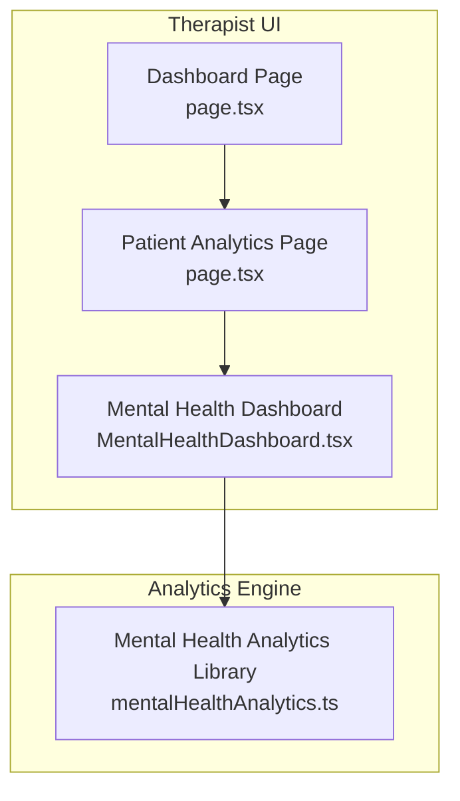
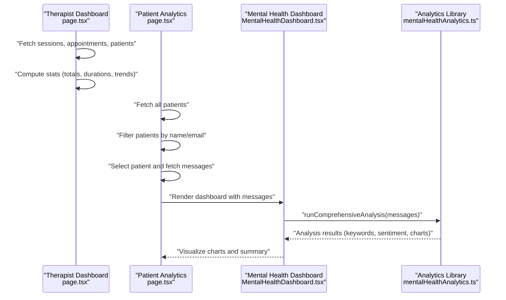
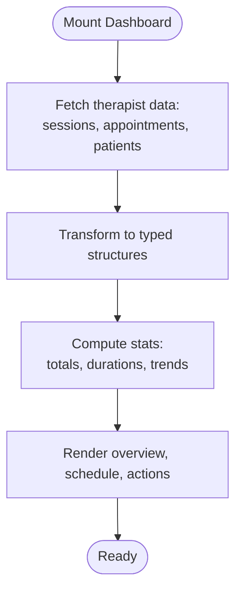
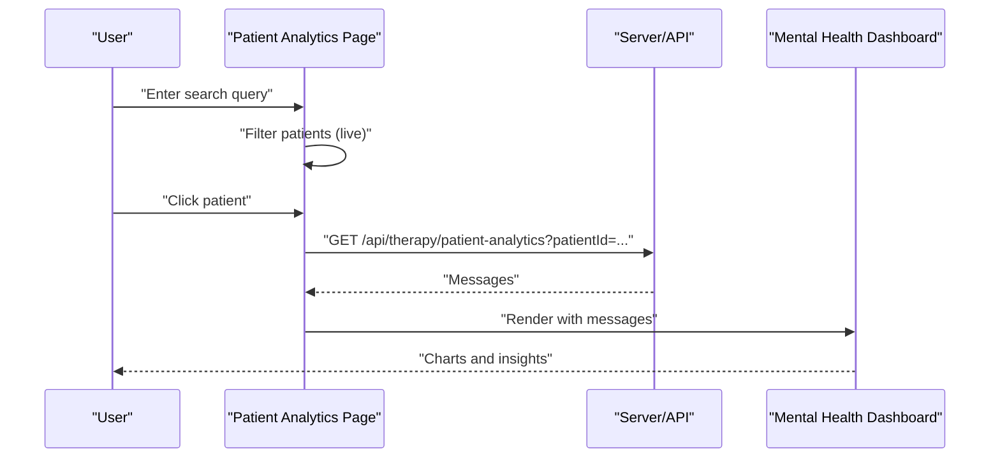
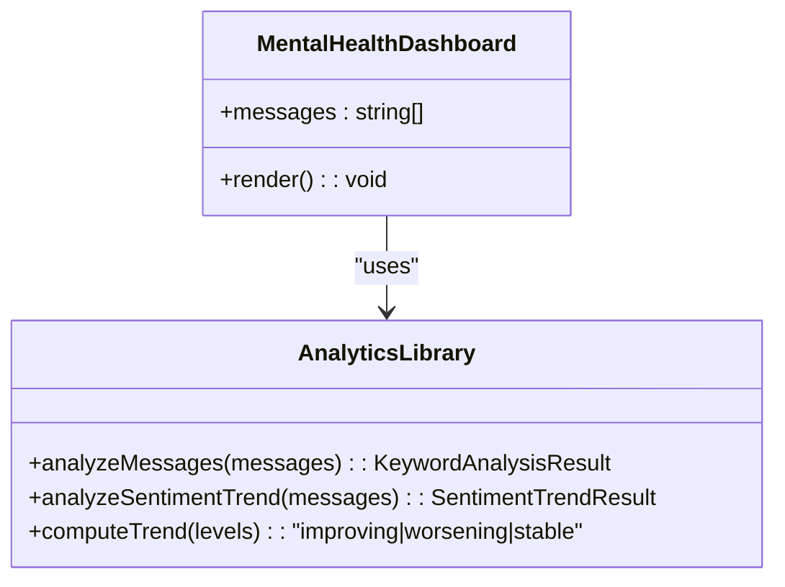
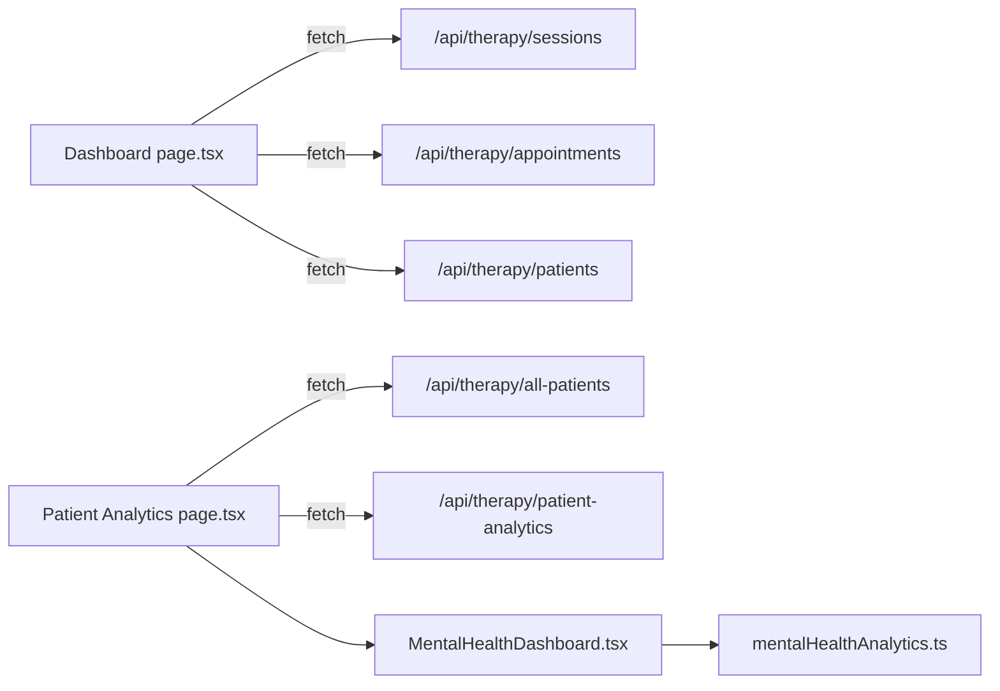

# Patient Management

<cite>
**Referenced Files in This Document**
- [page.tsx](file://WEBAPP/src/app/therapist/dashboard/page.tsx)
- [page.tsx](file://WEBAPP/src/app/therapist/patient-analytics/page.tsx)
- [MentalHealthDashboard.tsx](file://WEBAPP/src/components/analytics/MentalHealthDashboard.tsx)
- [mentalHealthAnalytics.ts](file://WEBAPP/src/lib/mentalHealthAnalytics.ts)
</cite>

## Table of Contents
1. [Introduction](#introduction)
2. [Project Structure](#project-structure)
3. [Core Components](#core-components)
4. [Architecture Overview](#architecture-overview)
5. [Detailed Component Analysis](#detailed-component-analysis)
6. [Dependency Analysis](#dependency-analysis)
7. [Performance Considerations](#performance-considerations)
8. [Troubleshooting Guide](#troubleshooting-guide)
9. [Conclusion](#conclusion)

## Introduction
This document describes the patient management system within the therapist dashboard. It covers the patient listing interface, search and filtering, patient profile viewing, and progress tracking. It also documents the underlying patient data model, engagement metrics, integration with emotion analytics, synchronization with AI therapy sessions, onboarding workflows, verification processes, and data privacy considerations for therapist access.

## Project Structure
The therapist dashboard is implemented as a Next.js app with TypeScript. Key areas relevant to patient management:
- Therapist dashboard overview and navigation
- Patient analytics and search
- Emotion analytics dashboard powered by NLP
- Mental health analytics library for keyword detection, sentiment, and trends

**Diagram sources**
- [page.tsx](file://WEBAPP/src/app/therapist/dashboard/page.tsx#L68-L171)
- [page.tsx](file://WEBAPP/src/app/therapist/patient-analytics/page.tsx#L48-L99)
- [MentalHealthDashboard.tsx](file://WEBAPP/src/components/analytics/MentalHealthDashboard.tsx#L47-L51)
- [mentalHealthAnalytics.ts](file://WEBAPP/src/lib/mentalHealthAnalytics.ts#L199-L289)

**Section sources**
- [page.tsx](file://WEBAPP/src/app/therapist/dashboard/page.tsx#L68-L171)
- [page.tsx](file://WEBAPP/src/app/therapist/patient-analytics/page.tsx#L48-L99)
- [MentalHealthDashboard.tsx](file://WEBAPP/src/components/analytics/MentalHealthDashboard.tsx#L47-L51)
- [mentalHealthAnalytics.ts](file://WEBAPP/src/lib/mentalHealthAnalytics.ts#L199-L289)

## Core Components
- Therapist Dashboard: Loads therapist-specific data (patients, sessions, appointments), computes stats, and renders lists with quick actions.
- Patient Analytics: Provides a searchable list of all patients, selection of a patient for detailed analytics, and an NLP-powered mental health dashboard.
- Mental Health Analytics: Implements keyword categorization, sentiment analysis, n-gram extraction, lexical diversity, and severity scoring.
- Emotion Analytics: Visualizes emotion distributions and trends derived from chat messages.

**Section sources**
- [page.tsx](file://WEBAPP/src/app/therapist/dashboard/page.tsx#L68-L171)
- [page.tsx](file://WEBAPP/src/app/therapist/patient-analytics/page.tsx#L48-L99)
- [MentalHealthDashboard.tsx](file://WEBAPP/src/components/analytics/MentalHealthDashboard.tsx#L47-L51)
- [mentalHealthAnalytics.ts](file://WEBAPP/src/lib/mentalHealthAnalytics.ts#L199-L289)

## Architecture Overview
The system integrates therapist-facing pages with analytics components and a shared analytics engine. The dashboard fetches therapist-scoped data, while the analytics page fetches broader patient data and then drills into a selected patient’s message stream for NLP analysis.

**Diagram sources**
- [page.tsx](file://WEBAPP/src/app/therapist/dashboard/page.tsx#L96-L171)
- [page.tsx](file://WEBAPP/src/app/therapist/patient-analytics/page.tsx#L72-L136)
- [MentalHealthDashboard.tsx](file://WEBAPP/src/components/analytics/MentalHealthDashboard.tsx#L47-L51)
- [mentalHealthAnalytics.ts](file://WEBAPP/src/lib/mentalHealthAnalytics.ts#L199-L289)

## Detailed Component Analysis

### Therapist Dashboard: Patient Listing and Overview
- Data loading: On mount, the dashboard fetches therapist-scoped sessions, appointments, and patients via API endpoints and transforms them into typed structures.
- Stats computation: Totals, averages, weekly appointments, and active patients are computed from fetched data.
- Rendering:
  - Patient cards display total sessions, last session date, dominant emotion, and improvement trend.
  - Session list shows status, duration or “In progress”, message count, dominant emotion, and action buttons.
  - Today’s schedule filters and displays confirmed/pending appointments for the current day.

**Diagram sources**
- [page.tsx](file://WEBAPP/src/app/therapist/dashboard/page.tsx#L96-L171)

**Section sources**
- [page.tsx](file://WEBAPP/src/app/therapist/dashboard/page.tsx#L68-L171)

### Patient Analytics: Search, Filtering, and Profile Viewing
- Patient list: Displays all patients with session counts, message counts, dominant emotion, and last session date.
- Search and filtering: Real-time filtering by name or email using a debounced query.
- Profile view: Selecting a patient loads the last N messages and renders the mental health dashboard.

**Diagram sources**
- [page.tsx](file://WEBAPP/src/app/therapist/patient-analytics/page.tsx#L102-L136)
- [MentalHealthDashboard.tsx](file://WEBAPP/src/components/analytics/MentalHealthDashboard.tsx#L47-L51)

**Section sources**
- [page.tsx](file://WEBAPP/src/app/therapist/patient-analytics/page.tsx#L48-L136)

### Emotion Analytics and Progress Tracking
- Emotion analytics: The mental health dashboard consumes analysis results and renders:
  - Severity level gauge
  - Overall sentiment and volatility
  - Dominant emotion and emotion distribution pie chart
  - Keyword category radar and bar charts
  - Bigrams/trigrams and keyword lists
- Improvement trends: The library supports computing trends from severity levels and can be used to derive “up/down/stable” indicators for patients.

**Diagram sources**
- [MentalHealthDashboard.tsx](file://WEBAPP/src/components/analytics/MentalHealthDashboard.tsx#L47-L51)
- [mentalHealthAnalytics.ts](file://WEBAPP/src/lib/mentalHealthAnalytics.ts#L199-L289)
- [mentalHealthAnalytics.ts](file://WEBAPP/src/lib/mentalHealthAnalytics.ts#L354-L370)

**Section sources**
- [MentalHealthDashboard.tsx](file://WEBAPP/src/components/analytics/MentalHealthDashboard.tsx#L47-L51)
- [mentalHealthAnalytics.ts](file://WEBAPP/src/lib/mentalHealthAnalytics.ts#L199-L289)
- [mentalHealthAnalytics.ts](file://WEBAPP/src/lib/mentalHealthAnalytics.ts#L354-L370)

### Patient Data Model and Engagement Metrics
- Patient entity fields:
  - Identifier, name, email
  - totalSessions: integer
  - lastSession: ISO date string or null
  - dominantEmotion: string
  - improvementTrend: "up" | "down" | "stable"
  - messageCount: optional integer
- Engagement metrics surfaced:
  - Session counts
  - Emotional state tracking (dominant emotion)
  - Activity indicators (last session date, weekly appointments)

**Section sources**
- [page.tsx](file://WEBAPP/src/app/therapist/patient-analytics/page.tsx#L37-L46)
- [page.tsx](file://WEBAPP/src/app/therapist/dashboard/page.tsx#L48-L56)

### Integration with Emotion Analytics and AI Therapy Sessions
- Data pipeline:
  - Sessions and messages are aggregated per patient.
  - The analytics page requests a patient’s messages and passes them to the mental health analytics engine.
  - The engine produces keyword categories, sentiment, emotion distributions, and severity levels.
- AI therapy alignment:
  - The emotion wheel and keyword categories align with Plutchik’s emotions and clinical indicators.
  - Severity levels and risk flags support early intervention decisions during AI-guided therapy.

**Section sources**
- [page.tsx](file://WEBAPP/src/app/therapist/patient-analytics/page.tsx#L112-L136)
- [MentalHealthDashboard.tsx](file://WEBAPP/src/components/analytics/MentalHealthDashboard.tsx#L47-L51)
- [mentalHealthAnalytics.ts](file://WEBAPP/src/lib/mentalHealthAnalytics.ts#L763-L796)
- [mentalHealthAnalytics.ts](file://WEBAPP/src/lib/mentalHealthAnalytics.ts#L12-L92)

### Onboarding Workflows, Verification, and Privacy
- Role-based access:
  - Pages enforce authentication and role checks; therapists are directed to sign-in if unauthorized.
- Verification:
  - Authentication routes and verification flows exist under the auth namespace; therapist dashboards rely on session-based guards.
- Privacy:
  - Data is scoped to the logged-in therapist’s patients.
  - Analytics are derived from chat messages and do not expose raw transcripts beyond the dashboard context.

**Section sources**
- [page.tsx](file://WEBAPP/src/app/therapist/dashboard/page.tsx#L69-L77)
- [page.tsx](file://WEBAPP/src/app/therapist/patient-analytics/page.tsx#L60-L66)

## Dependency Analysis
- Dashboard depends on:
  - API endpoints for sessions, appointments, and patients
  - Utilities for formatting dates/durations and mapping statuses/emotions
- Analytics page depends on:
  - API endpoint for retrieving all patients and a selected patient’s messages
  - Mental health dashboard component
- Mental health dashboard depends on:
  - Analytics library for keyword analysis, sentiment, and trend computation

**Diagram sources**
- [page.tsx](file://WEBAPP/src/app/therapist/dashboard/page.tsx#L101-L111)
- [page.tsx](file://WEBAPP/src/app/therapist/patient-analytics/page.tsx#L75-L121)
- [MentalHealthDashboard.tsx](file://WEBAPP/src/components/analytics/MentalHealthDashboard.tsx#L47-L51)
- [mentalHealthAnalytics.ts](file://WEBAPP/src/lib/mentalHealthAnalytics.ts#L199-L289)

**Section sources**
- [page.tsx](file://WEBAPP/src/app/therapist/dashboard/page.tsx#L96-L171)
- [page.tsx](file://WEBAPP/src/app/therapist/patient-analytics/page.tsx#L72-L136)
- [MentalHealthDashboard.tsx](file://WEBAPP/src/components/analytics/MentalHealthDashboard.tsx#L47-L51)
- [mentalHealthAnalytics.ts](file://WEBAPP/src/lib/mentalHealthAnalytics.ts#L199-L289)

## Performance Considerations
- Client-side filtering: Live filtering in the analytics page is efficient for moderate-sized lists; consider server-side pagination for very large datasets.
- Chart rendering: Charts are rendered client-side; defer heavy computations until messages are loaded to avoid blocking.
- Data freshness: Stats and lists update on mount; consider caching and background refresh for frequently accessed dashboards.

## Troubleshooting Guide
- Authentication errors:
  - Unauthorized access redirects to sign-in; ensure the session carries the correct role.
- Empty analytics:
  - If a patient has no messages, the dashboard indicates “No messages yet.”
- Network failures:
  - Errors during patient or session fetch are handled with user-visible messages; verify API endpoints and network connectivity.

**Section sources**
- [page.tsx](file://WEBAPP/src/app/therapist/dashboard/page.tsx#L69-L77)
- [page.tsx](file://WEBAPP/src/app/therapist/patient-analytics/page.tsx#L89-L136)
- [MentalHealthDashboard.tsx](file://WEBAPP/src/components/analytics/MentalHealthDashboard.tsx#L391-L410)

## Conclusion
The therapist dashboard provides a comprehensive view of patients, sessions, and schedules, with integrated emotion analytics powered by a robust NLP engine. The system supports real-time search, detailed patient profiles, and actionable insights to track progress and guide AI-assisted therapy sessions. Privacy and access controls ensure data remains within the authorized therapist’s scope.