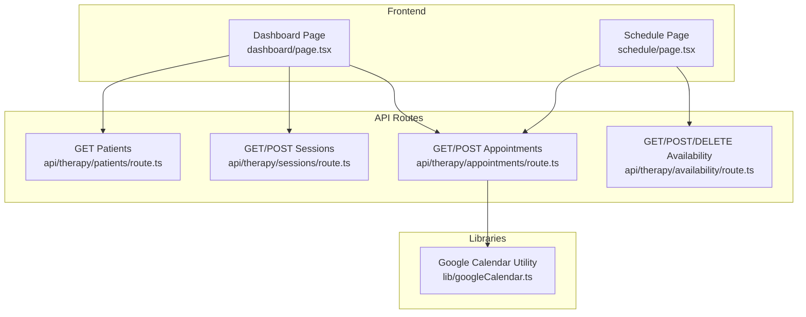
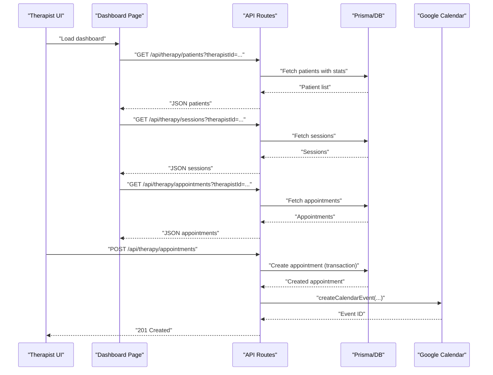
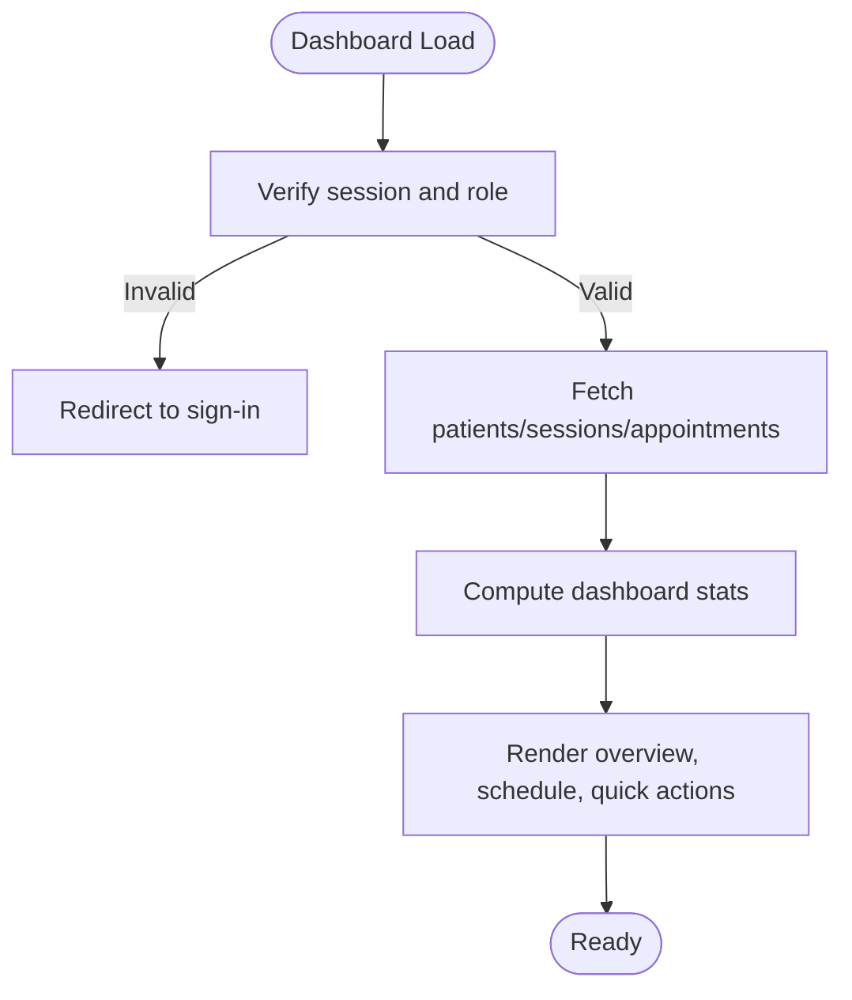
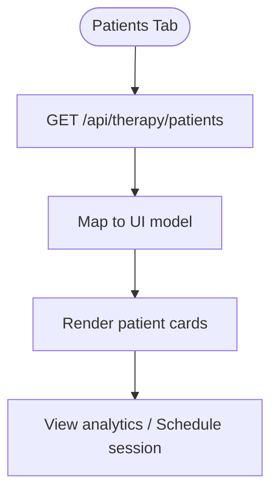
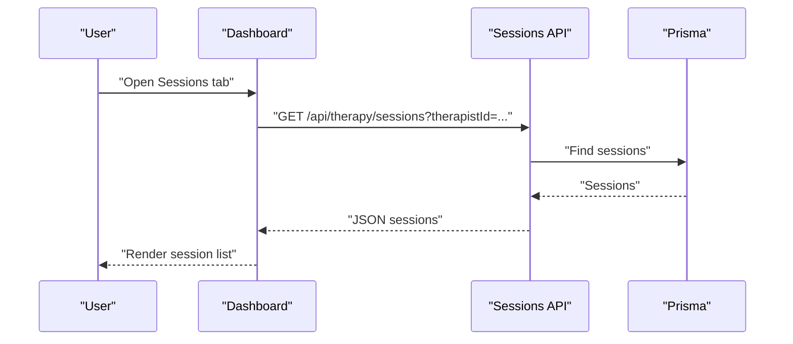
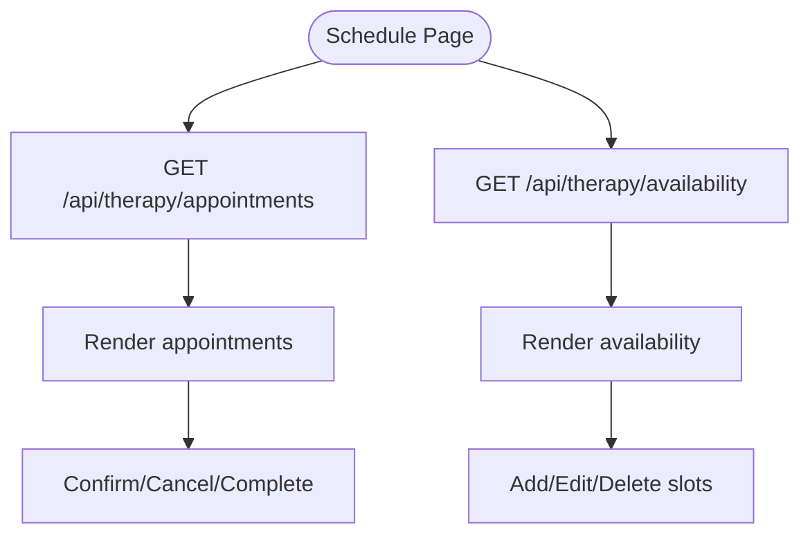
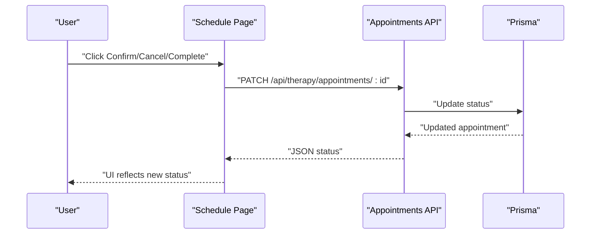
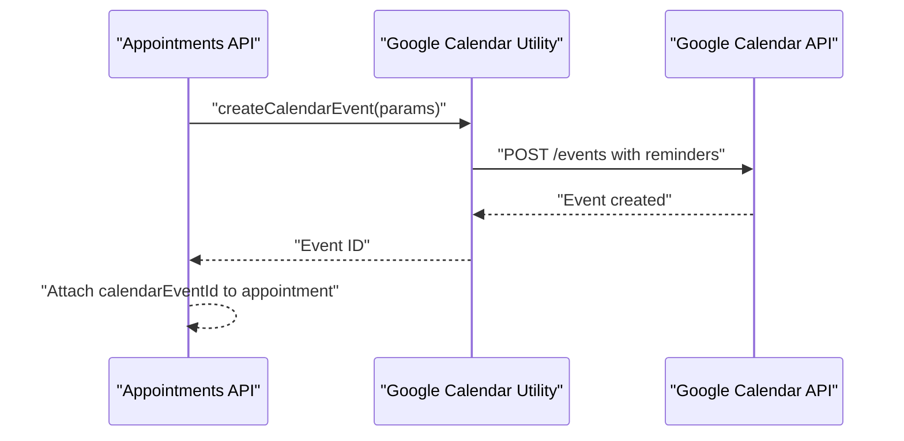
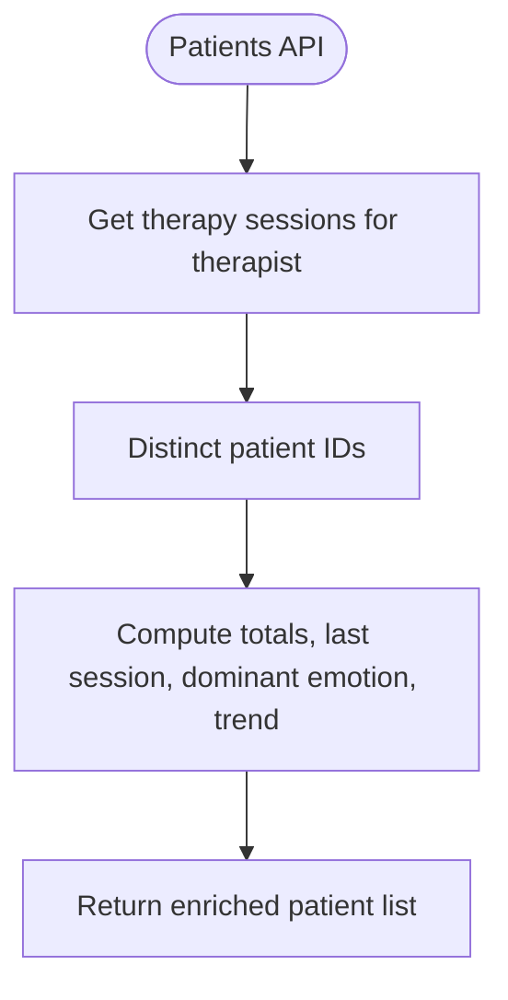
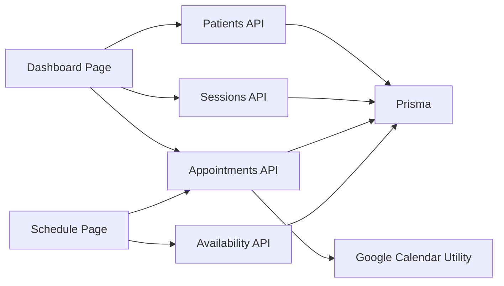

# Professional Dashboard

<cite>
**Referenced Files in This Document**
- [dashboard/page.tsx](file://WEBAPP/src/app/therapist/dashboard/page.tsx)
- [schedule/page.tsx](file://WEBAPP/src/app/therapist/schedule/page.tsx)
- [appointments/route.ts](file://WEBAPP/src/app/api/therapy/appointments/route.ts)
- [patients/route.ts](file://WEBAPP/src/app/api/therapy/patients/route.ts)
- [sessions/route.ts](file://WEBAPP/src/app/api/therapy/sessions/route.ts)
- [availability/route.ts](file://WEBAPP/src/app/api/therapy/availability/route.ts)
- [googleCalendar.ts](file://WEBAPP/src/lib/googleCalendar.ts)
</cite>

## Table of Contents
1. [Introduction](#introduction)
2. [Project Structure](#project-structure)
3. [Core Components](#core-components)
4. [Architecture Overview](#architecture-overview)
5. [Detailed Component Analysis](#detailed-component-analysis)
6. [Dependency Analysis](#dependency-analysis)
7. [Performance Considerations](#performance-considerations)
8. [Troubleshooting Guide](#troubleshooting-guide)
9. [Conclusion](#conclusion)

## Introduction
This document describes the therapist professional dashboard, focusing on patient management, schedule and availability control, appointment confirmation workflows, and session analytics. It also covers therapist-specific features such as patient tracking, session history review, progress monitoring tools, dashboard navigation, data visualization components, administrative controls, integration with the appointment scheduling system, Google Calendar sync, automated reminders, and therapist onboarding and verification workflows.

## Project Structure
The therapist dashboard is implemented as a Next.js app with TypeScript. The frontend pages are located under WEBAPP/src/app/therapist, while backend API routes are under WEBAPP/src/app/api/therapy. Shared utilities for Google Calendar integration live under WEBAPP/src/lib.

**Diagram sources**
- [dashboard/page.tsx](file://WEBAPP/src/app/therapist/dashboard/page.tsx#L68-L171)
- [schedule/page.tsx](file://WEBAPP/src/app/therapist/schedule/page.tsx#L74-L144)
- [appointments/route.ts](file://WEBAPP/src/app/api/therapy/appointments/route.ts#L6-L36)
- [patients/route.ts](file://WEBAPP/src/app/api/therapy/patients/route.ts#L5-L55)
- [sessions/route.ts](file://WEBAPP/src/app/api/therapy/sessions/route.ts#L5-L42)
- [availability/route.ts](file://WEBAPP/src/app/api/therapy/availability/route.ts#L6-L94)
- [googleCalendar.ts](file://WEBAPP/src/lib/googleCalendar.ts#L102-L161)

**Section sources**
- [dashboard/page.tsx](file://WEBAPP/src/app/therapist/dashboard/page.tsx#L68-L171)
- [schedule/page.tsx](file://WEBAPP/src/app/therapist/schedule/page.tsx#L74-L144)
- [appointments/route.ts](file://WEBAPP/src/app/api/therapy/appointments/route.ts#L6-L36)
- [patients/route.ts](file://WEBAPP/src/app/api/therapy/patients/route.ts#L5-L55)
- [sessions/route.ts](file://WEBAPP/src/app/api/therapy/sessions/route.ts#L5-L42)
- [availability/route.ts](file://WEBAPP/src/app/api/therapy/availability/route.ts#L6-L94)
- [googleCalendar.ts](file://WEBAPP/src/lib/googleCalendar.ts#L102-L161)

## Core Components
- Dashboard overview with statistics cards, today’s schedule, and quick actions.
- Patient management tab displaying patient profiles, session counts, last session, dominant emotion, and trend indicators.
- Session history tab showing session details, durations, message counts, dominant emotion, and status badges.
- Schedule management with appointment listing, filtering, confirmation/cancellation/completion actions, calendar view, and availability slot management.
- Availability management supporting single and bulk slot creation, toggling active/inactive, and deletion.
- Google Calendar integration for creating, updating, and deleting events with automated reminders.

**Section sources**
- [dashboard/page.tsx](file://WEBAPP/src/app/therapist/dashboard/page.tsx#L472-L640)
- [dashboard/page.tsx](file://WEBAPP/src/app/therapist/dashboard/page.tsx#L642-L772)
- [schedule/page.tsx](file://WEBAPP/src/app/therapist/schedule/page.tsx#L447-L625)
- [schedule/page.tsx](file://WEBAPP/src/app/therapist/schedule/page.tsx#L627-L800)
- [availability/route.ts](file://WEBAPP/src/app/api/therapy/availability/route.ts#L96-L180)
- [googleCalendar.ts](file://WEBAPP/src/lib/googleCalendar.ts#L102-L161)

## Architecture Overview
The dashboard integrates frontend UI components with backend API routes. Data flows from Prisma-backed API endpoints to the dashboard pages, which render statistics, lists, and interactive controls. Availability and appointment operations are protected by session checks and role validation. Google Calendar synchronization is performed after successful appointment creation.

**Diagram sources**
- [dashboard/page.tsx](file://WEBAPP/src/app/therapist/dashboard/page.tsx#L96-L111)
- [patients/route.ts](file://WEBAPP/src/app/api/therapy/patients/route.ts#L19-L53)
- [sessions/route.ts](file://WEBAPP/src/app/api/therapy/sessions/route.ts#L24-L35)
- [appointments/route.ts](file://WEBAPP/src/app/api/therapy/appointments/route.ts#L38-L163)
- [googleCalendar.ts](file://WEBAPP/src/lib/googleCalendar.ts#L102-L161)

## Detailed Component Analysis

### Dashboard Overview and Navigation
- Role gating ensures only therapists can access the dashboard.
- Real-time data is fetched from three API endpoints: patients, sessions, and appointments.
- Statistics computed client-side include total patients, total sessions, average session duration, weekly appointments, and active patients.
- Navigation includes desktop and mobile menus linking to analytics, schedule, peer support, and sign out.

**Diagram sources**
- [dashboard/page.tsx](file://WEBAPP/src/app/therapist/dashboard/page.tsx#L69-L77)
- [dashboard/page.tsx](file://WEBAPP/src/app/therapist/dashboard/page.tsx#L96-L171)

**Section sources**
- [dashboard/page.tsx](file://WEBAPP/src/app/therapist/dashboard/page.tsx#L68-L171)
- [dashboard/page.tsx](file://WEBAPP/src/app/therapist/dashboard/page.tsx#L414-L456)

### Patient Management
- Lists all patients associated with the therapist, including total sessions, last session, dominant emotion, and improvement trend.
- Provides quick actions to view analytics and schedule sessions.
- Emotion and trend indicators are rendered with emoji and icons.

**Diagram sources**
- [dashboard/page.tsx](file://WEBAPP/src/app/therapist/dashboard/page.tsx#L642-L695)
- [patients/route.ts](file://WEBAPP/src/app/api/therapy/patients/route.ts#L19-L53)

**Section sources**
- [dashboard/page.tsx](file://WEBAPP/src/app/therapist/dashboard/page.tsx#L642-L695)
- [patients/route.ts](file://WEBAPP/src/app/api/therapy/patients/route.ts#L5-L60)

### Session History Review
- Displays therapy sessions with patient name, start time, duration, message count, dominant emotion, and status.
- Supports downloading session reports and viewing details.

**Diagram sources**
- [dashboard/page.tsx](file://WEBAPP/src/app/therapist/dashboard/page.tsx#L697-L772)
- [sessions/route.ts](file://WEBAPP/src/app/api/therapy/sessions/route.ts#L5-L42)

**Section sources**
- [dashboard/page.tsx](file://WEBAPP/src/app/therapist/dashboard/page.tsx#L697-L772)
- [sessions/route.ts](file://WEBAPP/src/app/api/therapy/sessions/route.ts#L5-L42)

### Schedule and Availability Control
- Appointment listing with filtering by search term and status, plus confirmation/cancellation/completion actions.
- Calendar view allows selecting a date to see appointments.
- Availability management supports adding single or bulk slots, toggling activation, and deleting slots.

**Diagram sources**
- [schedule/page.tsx](file://WEBAPP/src/app/therapist/schedule/page.tsx#L105-L144)
- [schedule/page.tsx](file://WEBAPP/src/app/therapist/schedule/page.tsx#L119-L133)
- [schedule/page.tsx](file://WEBAPP/src/app/therapist/schedule/page.tsx#L185-L191)
- [availability/route.ts](file://WEBAPP/src/app/api/therapy/availability/route.ts#L96-L180)

**Section sources**
- [schedule/page.tsx](file://WEBAPP/src/app/therapist/schedule/page.tsx#L74-L144)
- [schedule/page.tsx](file://WEBAPP/src/app/therapist/schedule/page.tsx#L185-L242)
- [schedule/page.tsx](file://WEBAPP/src/app/therapist/schedule/page.tsx#L322-L350)
- [availability/route.ts](file://WEBAPP/src/app/api/therapy/availability/route.ts#L96-L180)

### Appointment Confirmation Workflows
- Pending appointments can be confirmed or cancelled; confirmed appointments can be marked completed.
- Updates are applied client-side immediately upon success, ensuring responsive UI feedback.

**Diagram sources**
- [schedule/page.tsx](file://WEBAPP/src/app/therapist/schedule/page.tsx#L193-L242)
- [appointments/route.ts](file://WEBAPP/src/app/api/therapy/appointments/route.ts#L38-L180)

**Section sources**
- [schedule/page.tsx](file://WEBAPP/src/app/therapist/schedule/page.tsx#L193-L242)
- [appointments/route.ts](file://WEBAPP/src/app/api/therapy/appointments/route.ts#L38-L180)

### Google Calendar Sync and Automated Reminders
- On successful appointment creation, the system attempts to create a Google Calendar event with reminders and a Meet link.
- Events can be updated or deleted as needed.

**Diagram sources**
- [appointments/route.ts](file://WEBAPP/src/app/api/therapy/appointments/route.ts#L144-L161)
- [googleCalendar.ts](file://WEBAPP/src/lib/googleCalendar.ts#L102-L161)

**Section sources**
- [appointments/route.ts](file://WEBAPP/src/app/api/therapy/appointments/route.ts#L144-L161)
- [googleCalendar.ts](file://WEBAPP/src/lib/googleCalendar.ts#L102-L161)

### Progress Monitoring Tools
- Patient analytics are derived from aggregated session data and stored in patient profiles.
- The dashboard surfaces dominant emotion and improvement trend per patient.

**Diagram sources**
- [patients/route.ts](file://WEBAPP/src/app/api/therapy/patients/route.ts#L19-L53)

**Section sources**
- [patients/route.ts](file://WEBAPP/src/app/api/therapy/patients/route.ts#L5-L60)

### Administrative Controls Available to Therapists
- Role-based access control ensures only therapists can manage availability and create appointments.
- Bulk availability creation streamlines setting up standard business hours.
- Slot deactivation via soft delete maintains auditability.

**Section sources**
- [availability/route.ts](file://WEBAPP/src/app/api/therapy/availability/route.ts#L96-L180)
- [availability/route.ts](file://WEBAPP/src/app/api/therapy/availability/route.ts#L182-L216)
- [appointments/route.ts](file://WEBAPP/src/app/api/therapy/appointments/route.ts#L96-L120)

## Dependency Analysis
The dashboard components depend on:
- API routes for data retrieval and mutations.
- Google Calendar utility for external calendar synchronization.
- Prisma for database operations.

**Diagram sources**
- [dashboard/page.tsx](file://WEBAPP/src/app/therapist/dashboard/page.tsx#L96-L111)
- [schedule/page.tsx](file://WEBAPP/src/app/therapist/schedule/page.tsx#L105-L133)
- [patients/route.ts](file://WEBAPP/src/app/api/therapy/patients/route.ts#L5-L55)
- [sessions/route.ts](file://WEBAPP/src/app/api/therapy/sessions/route.ts#L5-L42)
- [appointments/route.ts](file://WEBAPP/src/app/api/therapy/appointments/route.ts#L6-L36)
- [availability/route.ts](file://WEBAPP/src/app/api/therapy/availability/route.ts#L6-L94)
- [googleCalendar.ts](file://WEBAPP/src/lib/googleCalendar.ts#L102-L161)

**Section sources**
- [dashboard/page.tsx](file://WEBAPP/src/app/therapist/dashboard/page.tsx#L96-L111)
- [schedule/page.tsx](file://WEBAPP/src/app/therapist/schedule/page.tsx#L105-L133)
- [patients/route.ts](file://WEBAPP/src/app/api/therapy/patients/route.ts#L5-L55)
- [sessions/route.ts](file://WEBAPP/src/app/api/therapy/sessions/route.ts#L5-L42)
- [appointments/route.ts](file://WEBAPP/src/app/api/therapy/appointments/route.ts#L6-L36)
- [availability/route.ts](file://WEBAPP/src/app/api/therapy/availability/route.ts#L6-L94)
- [googleCalendar.ts](file://WEBAPP/src/lib/googleCalendar.ts#L102-L161)

## Performance Considerations
- Client-side polling for appointments is implemented with a 30-second interval; consider debouncing or reducing frequency if traffic increases.
- Filtering and sorting on the client reduce server load but may impact responsiveness with very large datasets—consider server-side pagination and filtering.
- Batch operations for availability (bulk creation) improve UX and reduce API round trips.

## Troubleshooting Guide
- Unauthorized access: Ensure the session includes a valid therapist role; otherwise, the UI redirects to sign-in.
- Appointment conflicts: Creation fails if time overlaps with existing appointments; adjust timing or cancel conflicting bookings.
- Slot not found or already booked: When booking via a slot, ensure the slot exists, is active, and not already reserved for the selected date.
- Google Calendar sync failures: Verify environment variables and token refresh; errors are logged and do not block appointment creation.

**Section sources**
- [dashboard/page.tsx](file://WEBAPP/src/app/therapist/dashboard/page.tsx#L69-L77)
- [appointments/route.ts](file://WEBAPP/src/app/api/therapy/appointments/route.ts#L164-L179)
- [availability/route.ts](file://WEBAPP/src/app/api/therapy/availability/route.ts#L142-L161)
- [googleCalendar.ts](file://WEBAPP/src/lib/googleCalendar.ts#L68-L100)

## Conclusion
The therapist professional dashboard provides a comprehensive toolkit for managing patients, sessions, and schedules, with integrated analytics and Google Calendar synchronization. Its modular design leverages Next.js app routing and API handlers to deliver a responsive, role-aware experience suitable for clinical workflows.