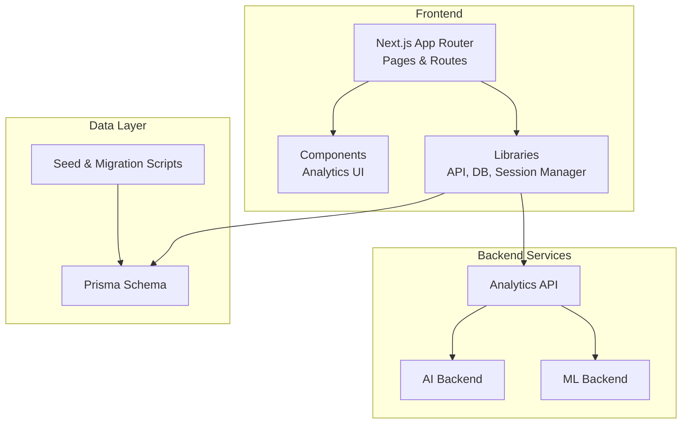
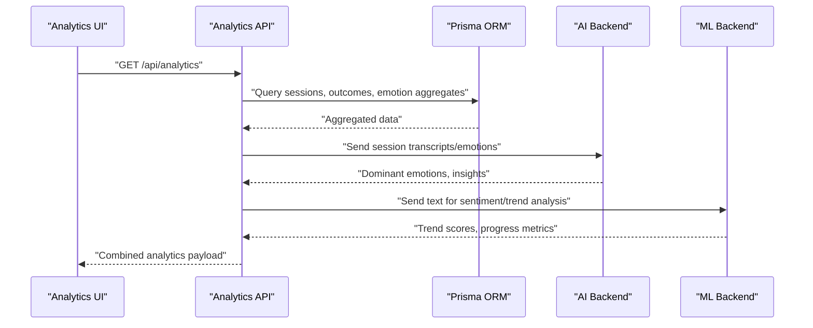
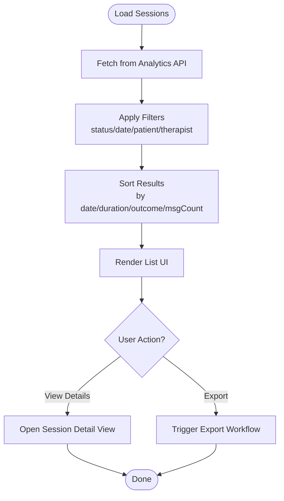
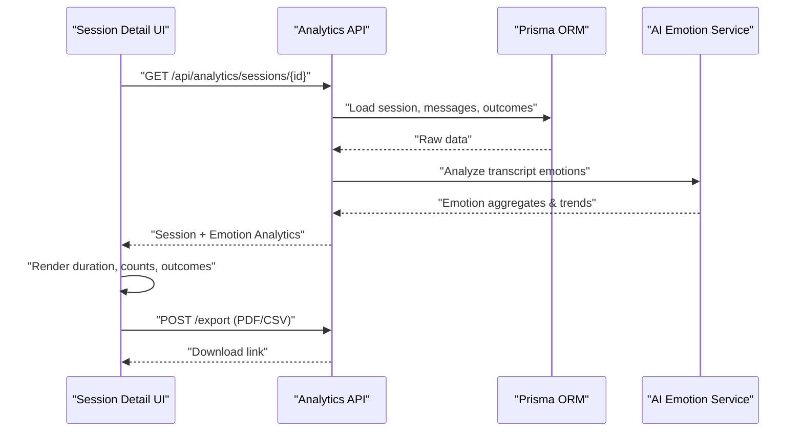
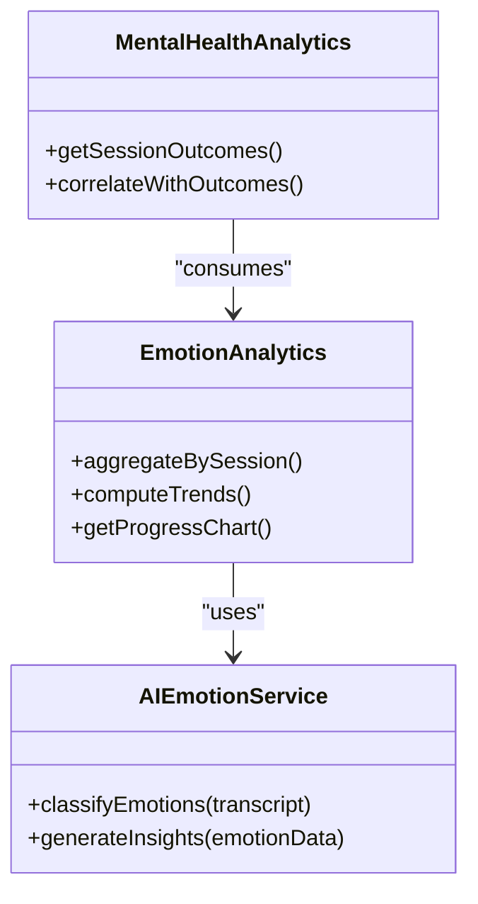
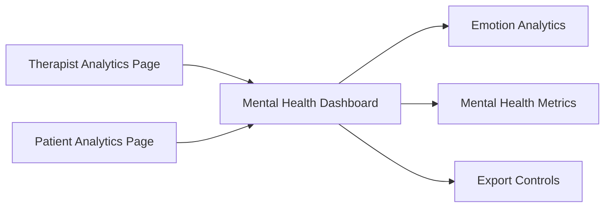
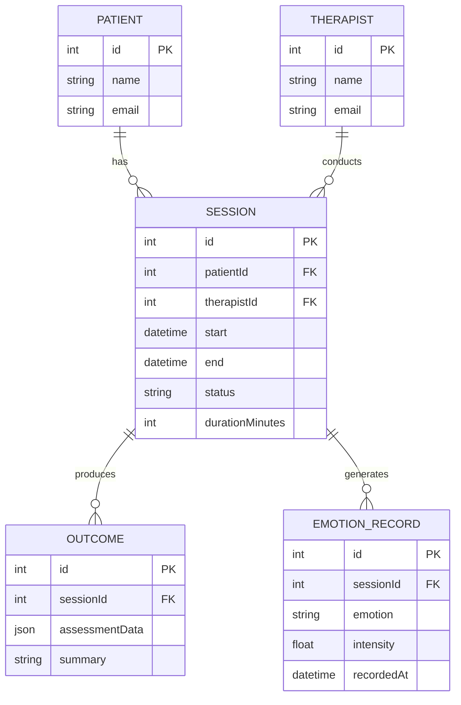
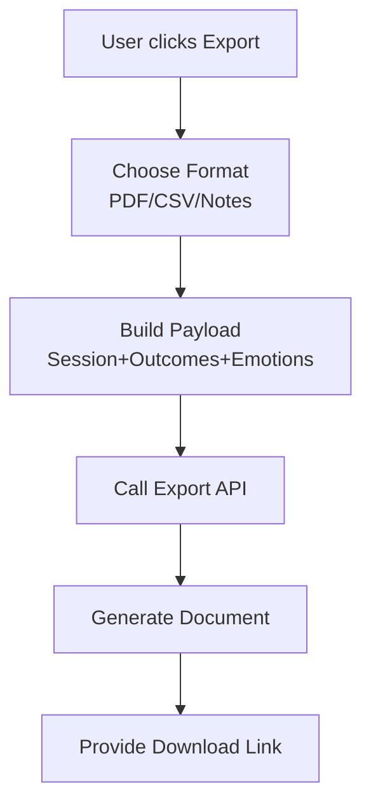
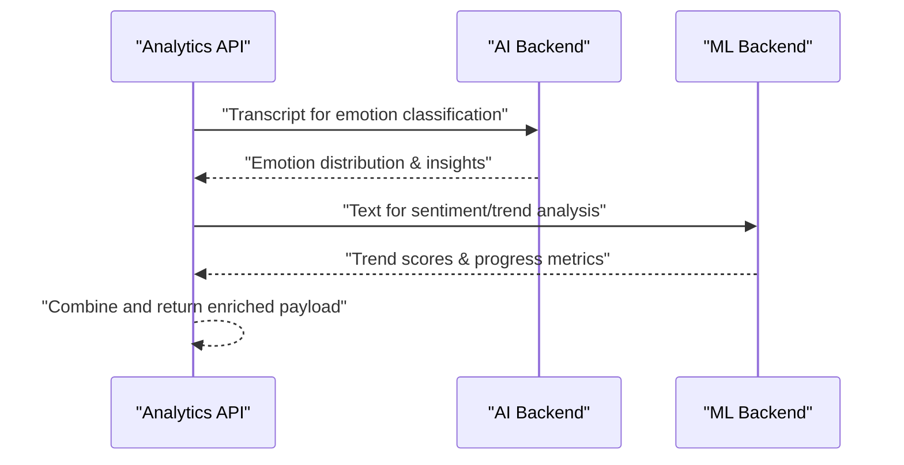
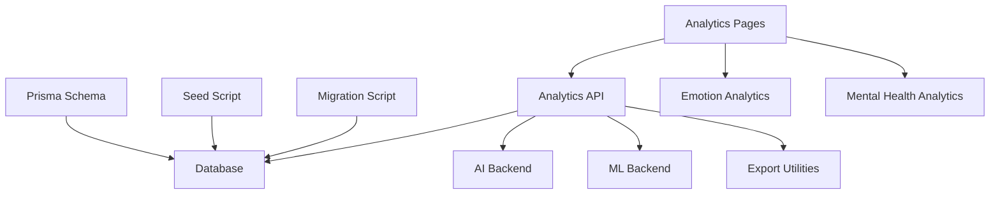

# Session History & Analytics

<cite>
**Referenced Files in This Document**
- [schema.prisma](file://WEBAPP/prisma/schema.prisma)
- [seed.ts](file://WEBAPP/prisma/seed.ts)
- [migrate-messages-to-sessions.ts](file://WEBAPP/scripts/migrate-messages-to-sessions.ts)
- [route.ts](file://WEBAPP/src/app/api/analytics/route.ts)
- [route.ts](file://WEBAPP/src/app/therapy/sessions/route.ts)
- [page.tsx](file://WEBAPP/src/app/therapist/patient-analytics/page.tsx)
- [page.tsx](file://WEBAPP/src/app/patient/analytics/page.tsx)
- [MentalHealthDashboard.tsx](file://WEBAPP/src/components/analytics/MentalHealthDashboard.tsx)
- [EmotionAnalytics.tsx](file://WEBAPP/src/components/EmotionAnalytics.tsx)
- [MentalHealthAnalytics.tsx](file://WEBAPP/src/components/MentalHealthAnalytics.tsx)
- [ChatHistory.tsx](file://WEBAPP/src/components/ChatHistory.tsx)
- [sessionManager.ts](file://WEBAPP/src/lib/sessionManager.ts)
- [mentalHealthAnalytics.ts](file://WEBAPP/src/lib/mentalHealthAnalytics.ts)
- [api.ts](file://WEBAPP/src/lib/api.ts)
- [db.ts](file://WEBAPP/src/lib/db.ts)
- [app.py](file://ai-backend/app.py)
- [ai_service.py](file://ai-backend/services/ai_service.py)
- [groq_ai_service.py](file://ai-backend/services/groq_ai_service.py)
- [app.py](file://ml-backend/app.py)
</cite>

## Table of Contents
1. [Introduction](#introduction)
2. [Project Structure](#project-structure)
3. [Core Components](#core-components)
4. [Architecture Overview](#architecture-overview)
5. [Detailed Component Analysis](#detailed-component-analysis)
6. [Dependency Analysis](#dependency-analysis)
7. [Performance Considerations](#performance-considerations)
8. [Troubleshooting Guide](#troubleshooting-guide)
9. [Conclusion](#conclusion)
10. [Appendices](#appendices)

## Introduction
This document describes the session history and analytics dashboard for the MindBridge platform. It covers:
- Session listing with filtering and sorting across completed, active, and scheduled states
- Session details including duration tracking, message counts, emotion analysis summaries, and outcomes
- Integration with emotion analytics for dominant emotions, trend analysis, and progress visualization
- Patient analytics dashboards for individual progress, improvement trends, and therapeutic outcomes
- Export functionality for session reports, progress documentation, and clinical notes
- Correlation between session data and outcomes, automated insights generation, and AI therapy system integration

## Project Structure
The analytics and session history features span frontend Next.js pages and components, backend analytics APIs, Prisma data models, and external AI/ML services.

**Diagram sources**
- [route.ts](file://WEBAPP/src/app/api/analytics/route.ts)
- [schema.prisma](file://WEBAPP/prisma/schema.prisma)
- [seed.ts](file://WEBAPP/prisma/seed.ts)
- [app.py](file://ai-backend/app.py)
- [app.py](file://ml-backend/app.py)

**Section sources**
- [schema.prisma](file://WEBAPP/prisma/schema.prisma)
- [seed.ts](file://WEBAPP/prisma/seed.ts)
- [route.ts](file://WEBAPP/src/app/api/analytics/route.ts)

## Core Components
- Prisma data model defines therapy-related entities and relationships
- Analytics API exposes endpoints for retrieving session and patient metrics
- Frontend pages for therapist and patient analytics dashboards
- Emotion analytics components for visualization and summaries
- Session manager and utilities for session lifecycle and data aggregation
- AI/ML backend services for emotion analysis and insights generation

**Section sources**
- [schema.prisma](file://WEBAPP/prisma/schema.prisma)
- [route.ts](file://WEBAPP/src/app/api/analytics/route.ts)
- [MentalHealthDashboard.tsx](file://WEBAPP/src/components/analytics/MentalHealthDashboard.tsx)
- [EmotionAnalytics.tsx](file://WEBAPP/src/components/EmotionAnalytics.tsx)
- [sessionManager.ts](file://WEBAPP/src/lib/sessionManager.ts)

## Architecture Overview
The analytics pipeline integrates frontend dashboards, backend analytics endpoints, emotion analytics services, and AI/ML systems.

**Diagram sources**
- [route.ts](file://WEBAPP/src/app/api/analytics/route.ts)
- [schema.prisma](file://WEBAPP/prisma/schema.prisma)
- [app.py](file://ai-backend/app.py)
- [app.py](file://ml-backend/app.py)

## Detailed Component Analysis

### Session Listing Interface
The session listing supports filtering and sorting across states:
- Completed: sessions with finalized outcomes and recorded duration
- Active: current ongoing sessions
- Scheduled: upcoming sessions awaiting start

Key capabilities:
- Filter by date range, patient, therapist, and status
- Sort by date, duration, outcome score, and message count
- Paginate large lists efficiently

**Diagram sources**
- [route.ts](file://WEBAPP/src/app/api/analytics/route.ts)
- [sessionManager.ts](file://WEBAPP/src/lib/sessionManager.ts)

**Section sources**
- [route.ts](file://WEBAPP/src/app/therapy/sessions/route.ts)
- [route.ts](file://WEBAPP/src/app/api/analytics/route.ts)
- [sessionManager.ts](file://WEBAPP/src/lib/sessionManager.ts)

### Session Details View
Each session detail displays:
- Duration tracking: computed from start/end timestamps
- Message counts: total and categorized by speaker
- Emotion analysis summary: dominant emotion, frequency, and trend
- Outcome metrics: structured assessment scores and qualitative feedback
- Export options: PDF report, CSV progress, and clinical notes

**Diagram sources**
- [route.ts](file://WEBAPP/src/app/api/analytics/route.ts)
- [schema.prisma](file://WEBAPP/prisma/schema.prisma)
- [app.py](file://ai-backend/app.py)

**Section sources**
- [route.ts](file://WEBAPP/src/app/api/analytics/route.ts)
- [EmotionAnalytics.tsx](file://WEBAPP/src/components/EmotionAnalytics.tsx)
- [MentalHealthAnalytics.tsx](file://WEBAPP/src/components/MentalHealthAnalytics.tsx)

### Emotion Analytics Integration
The emotion analytics module:
- Aggregates emotion distributions per session and over time
- Provides trend analysis across multiple sessions
- Visualizes progress with configurable charts and summaries
- Integrates with AI backend for emotion classification and insights

**Diagram sources**
- [EmotionAnalytics.tsx](file://WEBAPP/src/components/EmotionAnalytics.tsx)
- [MentalHealthAnalytics.tsx](file://WEBAPP/src/components/MentalHealthAnalytics.tsx)
- [app.py](file://ai-backend/app.py)

**Section sources**
- [EmotionAnalytics.tsx](file://WEBAPP/src/components/EmotionAnalytics.tsx)
- [MentalHealthAnalytics.tsx](file://WEBAPP/src/components/MentalHealthAnalytics.tsx)
- [mentalHealthAnalytics.ts](file://WEBAPP/src/lib/mentalHealthAnalytics.ts)
- [app.py](file://ai-backend/app.py)

### Patient Analytics Dashboard
Two dashboards are provided:
- Therapist dashboard: view patient progress, outcomes, and group analytics
- Patient dashboard: personal insights, trend charts, and outcome summaries

Features:
- Individual progress charts (sessions vs. time)
- Improvement trends (e.g., reduced negative emotion, increased positive)
- Outcome metrics: standardized assessment scores and qualitative summaries
- Exportable progress documentation and clinical notes

**Diagram sources**
- [page.tsx](file://WEBAPP/src/app/therapist/patient-analytics/page.tsx)
- [page.tsx](file://WEBAPP/src/app/patient/analytics/page.tsx)
- [MentalHealthDashboard.tsx](file://WEBAPP/src/components/analytics/MentalHealthDashboard.tsx)
- [EmotionAnalytics.tsx](file://WEBAPP/src/components/EmotionAnalytics.tsx)

**Section sources**
- [page.tsx](file://WEBAPP/src/app/therapist/patient-analytics/page.tsx)
- [page.tsx](file://WEBAPP/src/app/patient/analytics/page.tsx)
- [MentalHealthDashboard.tsx](file://WEBAPP/src/components/analytics/MentalHealthDashboard.tsx)

### Data Model and Migration
The Prisma schema defines core entities for sessions, patients, therapists, outcomes, and emotion records. A migration script initializes the therapy models, and a seed script populates initial data. A dedicated migration script migrates legacy messages into sessions.

**Diagram sources**
- [schema.prisma](file://WEBAPP/prisma/schema.prisma)
- [seed.ts](file://WEBAPP/prisma/seed.ts)
- [migrate-messages-to-sessions.ts](file://WEBAPP/scripts/migrate-messages-to-sessions.ts)

**Section sources**
- [schema.prisma](file://WEBAPP/prisma/schema.prisma)
- [seed.ts](file://WEBAPP/prisma/seed.ts)
- [migrate-messages-to-sessions.ts](file://WEBAPP/scripts/migrate-messages-to-sessions.ts)

### Export Functionality
Export endpoints support generating:
- Session reports (PDF/CSV)
- Progress documentation across multiple sessions
- Clinical notes summarizing outcomes and emotion trends

**Diagram sources**
- [route.ts](file://WEBAPP/src/app/api/analytics/route.ts)
- [api.ts](file://WEBAPP/src/lib/api.ts)

**Section sources**
- [route.ts](file://WEBAPP/src/app/api/analytics/route.ts)
- [api.ts](file://WEBAPP/src/lib/api.ts)

### AI Therapy System Integration
The AI backend provides emotion classification and insights generation. The ML backend performs sentiment and trend analysis. Both feed into the analytics API to enrich session details and dashboards.

**Diagram sources**
- [route.ts](file://WEBAPP/src/app/api/analytics/route.ts)
- [app.py](file://ai-backend/app.py)
- [app.py](file://ml-backend/app.py)

**Section sources**
- [route.ts](file://WEBAPP/src/app/api/analytics/route.ts)
- [app.py](file://ai-backend/app.py)
- [app.py](file://ml-backend/app.py)

## Dependency Analysis
The analytics system depends on:
- Prisma for data modeling and queries
- Analytics API for consolidated metrics
- Emotion and mental health analytics components for UI
- AI/ML backends for emotion classification and insights
- Export utilities for generating documents

**Diagram sources**
- [schema.prisma](file://WEBAPP/prisma/schema.prisma)
- [seed.ts](file://WEBAPP/prisma/seed.ts)
- [migrate-messages-to-sessions.ts](file://WEBAPP/scripts/migrate-messages-to-sessions.ts)
- [route.ts](file://WEBAPP/src/app/api/analytics/route.ts)
- [EmotionAnalytics.tsx](file://WEBAPP/src/components/EmotionAnalytics.tsx)
- [MentalHealthAnalytics.tsx](file://WEBAPP/src/components/MentalHealthAnalytics.tsx)
- [app.py](file://ai-backend/app.py)
- [app.py](file://ml-backend/app.py)

**Section sources**
- [schema.prisma](file://WEBAPP/prisma/schema.prisma)
- [route.ts](file://WEBAPP/src/app/api/analytics/route.ts)

## Performance Considerations
- Use indexed fields for filtering (patientId, therapistId, status, start date)
- Apply pagination and limit result sets for large histories
- Cache frequently accessed analytics aggregates
- Stream exports for large datasets to avoid timeouts
- Offload heavy AI/ML computations asynchronously

## Troubleshooting Guide
Common issues and resolutions:
- Missing emotion data: verify AI backend is reachable and emotion classification is enabled
- Slow analytics queries: confirm Prisma indexes exist and optimize filters
- Export failures: check export API permissions and storage connectivity
- Inconsistent durations: reconcile session timestamps and timezone handling

**Section sources**
- [route.ts](file://WEBAPP/src/app/api/analytics/route.ts)
- [db.ts](file://WEBAPP/src/lib/db.ts)

## Conclusion
The session history and analytics dashboard integrates session lifecycle management, emotion analytics, and AI/ML insights to deliver actionable patient progress views and exportable documentation. The modular design allows for scalable enhancements and robust performance tuning.

## Appendices
- API endpoints and payloads are defined in the analytics route and supported by Prisma models
- Emotion analytics components encapsulate visualization and summary computation
- Export utilities integrate with the analytics API to produce standardized reports