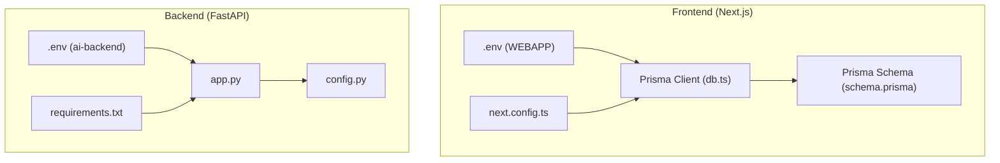
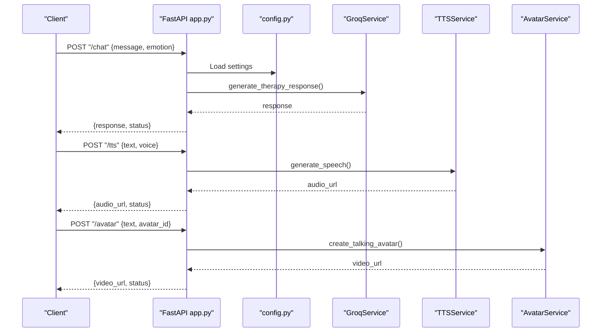
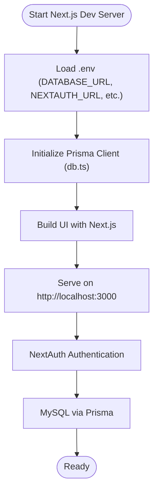
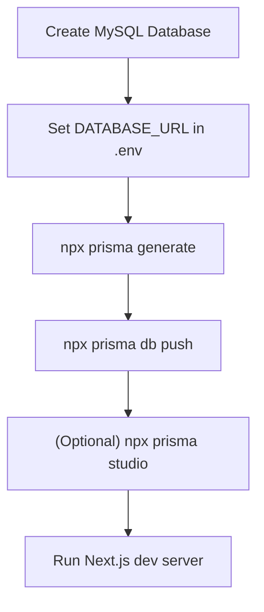

# Getting Started

<cite>
**Referenced Files in This Document**
- [README.md](file://README.md)
- [WEBAPP/.env.example](file://WEBAPP/.env.example)
- [WEBAPP/package.json](file://WEBAPP/package.json)
- [WEBAPP/MY_SQL_INFO.md](file://WEBAPP/MY_SQL_INFO.md)
- [WEBAPP/next.config.ts](file://WEBAPP/next.config.ts)
- [WEBAPP/src/lib/db.ts](file://WEBAPP/src/lib/db.ts)
- [WEBAPP/prisma/schema.prisma](file://WEBAPP/prisma/schema.prisma)
- [ai-backend/.env.example](file://ai-backend/.env.example)
- [ai-backend/app.py](file://ai-backend/app.py)
- [ai-backend/config.py](file://ai-backend/config.py)
- [ai-backend/requirements.txt](file://ai-backend/requirements.txt)
- [WEBAPP/GOOGLE_OAUTH_SETUP.md](file://WEBAPP/GOOGLE_OAUTH_SETUP.md)
</cite>

## Table of Contents
1. [Introduction](#introduction)
2. [Project Structure](#project-structure)
3. [Prerequisites and System Requirements](#prerequisites-and-system-requirements)
4. [Environment Setup](#environment-setup)
5. [Backend: AI Backend (Python)](#backend-ai-backend-python)
6. [Frontend: Next.js Web App](#frontend-nextjs-web-app)
7. [Database Configuration](#database-configuration)
8. [External API Keys and Services](#external-api-keys-and-services)
9. [Quick Start Examples](#quick-start-examples)
10. [Verification Steps](#verification-steps)
11. [Troubleshooting Guide](#troubleshooting-guide)
12. [Conclusion](#conclusion)

## Introduction
This guide helps you install and run the MindBridge AI platform locally. It covers both the frontend (Next.js) and backend (Python/FastAPI) components, environment configuration, database setup, and external service keys. By the end, you will have a working development environment, seeded database, and verified integrations.

**Section sources**
- [README.md](file://README.md#L1-L3)

## Project Structure
The repository is organized into three main parts:
- WEBAPP: Next.js frontend using Prisma for MySQL and NextAuth for authentication.
- ai-backend: Python/FastAPI backend providing AI chat, text-to-speech, and avatar generation.
- ml-backend: Machine learning backend (not covered here due to missing example file).

**Diagram sources**
- [WEBAPP/.env.example](file://WEBAPP/.env.example#L1-L16)
- [WEBAPP/next.config.ts](file://WEBAPP/next.config.ts#L1-L45)
- [WEBAPP/src/lib/db.ts](file://WEBAPP/src/lib/db.ts#L1-L15)
- [WEBAPP/prisma/schema.prisma](file://WEBAPP/prisma/schema.prisma#L1-L330)
- [ai-backend/.env.example](file://ai-backend/.env.example#L1-L20)
- [ai-backend/app.py](file://ai-backend/app.py#L1-L154)
- [ai-backend/config.py](file://ai-backend/config.py#L1-L49)
- [ai-backend/requirements.txt](file://ai-backend/requirements.txt#L1-L81)

**Section sources**
- [WEBAPP/package.json](file://WEBAPP/package.json#L1-L88)
- [WEBAPP/prisma/schema.prisma](file://WEBAPP/prisma/schema.prisma#L1-L330)
- [ai-backend/app.py](file://ai-backend/app.py#L1-L154)
- [ai-backend/config.py](file://ai-backend/config.py#L1-L49)

## Prerequisites and System Requirements
- Operating systems: Windows, macOS, Linux
- Node.js and npm: For the Next.js frontend
- Python 3.x: For the FastAPI backend
- MySQL: Required by the frontend via Prisma
- MongoDB: Required by the backend for emotion analytics
- Git: To clone the repository
- Optional: Redis (for caching), Stripe CLI (for webhooks)

Installers and package managers:
- Node.js and npm: https://nodejs.org/
- Python: https://www.python.org/downloads/
- MySQL: https://dev.mysql.com/downloads/installer/
- MongoDB: https://www.mongodb.com/docs/manual/installation/

**Section sources**
- [WEBAPP/package.json](file://WEBAPP/package.json#L1-L88)
- [ai-backend/requirements.txt](file://ai-backend/requirements.txt#L1-L81)

## Environment Setup
Create and configure environment files for both frontend and backend.

- Frontend environment
  - Copy the example file to .env and edit DATABASE_URL with your MySQL credentials.
  - Configure NEXTAUTH_URL and NEXTAUTH_SECRET for local development.
  - Optionally set AI_BACKEND_URL and ML_BACKEND_URL to match backend ports.

- Backend environment
  - Copy the example file to .env and fill in API keys for Groq, ElevenLabs, and optional Gemini/OpenAI.
  - Set MONGODB_URL to your MongoDB instance.
  - Adjust PORT and DEBUG as needed.

**Section sources**
- [WEBAPP/.env.example](file://WEBAPP/.env.example#L1-L16)
- [ai-backend/.env.example](file://ai-backend/.env.example#L1-L20)

## Backend: AI Backend (Python)
The AI backend is a FastAPI application providing:
- Health check endpoint
- Chat endpoint using Groq
- Text-to-speech endpoint using ElevenLabs
- Avatar video generation endpoint

Key configuration:
- CORS allows all origins for development.
- Static file mounts serve audio/video assets from a temp directory.
- Services are lazily initialized to avoid import issues.

How to run:
- Install dependencies from requirements.txt.
- Start the server with Uvicorn on the configured port.

**Diagram sources**
- [ai-backend/app.py](file://ai-backend/app.py#L73-L123)
- [ai-backend/config.py](file://ai-backend/config.py#L5-L49)

**Section sources**
- [ai-backend/app.py](file://ai-backend/app.py#L1-L154)
- [ai-backend/config.py](file://ai-backend/config.py#L1-L49)
- [ai-backend/requirements.txt](file://ai-backend/requirements.txt#L1-L81)

## Frontend: Next.js Web App
The frontend uses:
- Next.js 15 with React 19
- Prisma for MySQL
- NextAuth for authentication
- TailwindCSS and Radix UI components
- Stripe for payments

Key configuration:
- next.config.ts disables image optimization by default and sets CORS headers.
- Prisma client connects to MySQL using DATABASE_URL from .env.
- The app exposes environment variables to the client via next.config.ts env block.

How to run:
- Install dependencies from package.json.
- Run the development server with npm run dev.

**Diagram sources**
- [WEBAPP/next.config.ts](file://WEBAPP/next.config.ts#L1-L45)
- [WEBAPP/src/lib/db.ts](file://WEBAPP/src/lib/db.ts#L1-L15)
- [WEBAPP/.env.example](file://WEBAPP/.env.example#L1-L16)

**Section sources**
- [WEBAPP/package.json](file://WEBAPP/package.json#L1-L88)
- [WEBAPP/next.config.ts](file://WEBAPP/next.config.ts#L1-L45)
- [WEBAPP/src/lib/db.ts](file://WEBAPP/src/lib/db.ts#L1-L15)

## Database Configuration
The frontend uses MySQL with Prisma. Follow these steps:

- Create the database in MySQL.
- Configure DATABASE_URL in .env.
- Generate Prisma client and apply schema.
- Optionally open Prisma Studio to inspect data.

**Diagram sources**
- [WEBAPP/MY_SQL_INFO.md](file://WEBAPP/MY_SQL_INFO.md#L35-L48)
- [WEBAPP/.env.example](file://WEBAPP/.env.example#L1-L16)
- [WEBAPP/prisma/schema.prisma](file://WEBAPP/prisma/schema.prisma#L1-L330)

**Section sources**
- [WEBAPP/MY_SQL_INFO.md](file://WEBAPP/MY_SQL_INFO.md#L1-L123)
- [WEBAPP/prisma/schema.prisma](file://WEBAPP/prisma/schema.prisma#L1-L330)

## External API Keys and Services
Configure the following keys in the backend .env:

- Groq: GROQ_API_KEY
- ElevenLabs: ELEVENLABS_API_KEY, ELEVENLABS_VOICE_ID
- Optional Gemini: GEMINI_API_KEY, GEMINI_MODEL
- MongoDB: MONGODB_URL
- Server: PORT, DEBUG

Frontend .env supports:
- DATABASE_URL for MySQL
- NEXTAUTH_URL and NEXTAUTH_SECRET
- Optional AI_BACKEND_URL and ML_BACKEND_URL

Google OAuth for Sign-In:
- Configure Google OAuth client ID and secret in .env.
- Add authorized origins and redirect URIs in Google Cloud Console.
- Test sign-in at http://localhost:3000/api/auth/signin.

Stripe:
- The frontend depends on Stripe packages; configure API keys and webhooks as needed in your environment.

**Section sources**
- [ai-backend/.env.example](file://ai-backend/.env.example#L1-L20)
- [WEBAPP/.env.example](file://WEBAPP/.env.example#L1-L16)
- [WEBAPP/GOOGLE_OAUTH_SETUP.md](file://WEBAPP/GOOGLE_OAUTH_SETUP.md#L1-L74)

## Quick Start Examples
Follow these steps to get up and running quickly:

1. Backend (Python)
   - Install dependencies: pip install -r ai-backend/requirements.txt
   - Start the backend server: python ai-backend/app.py

2. Frontend (Next.js)
   - Install dependencies: npm install
   - Start the dev server: npm run dev

3. Database
   - Create MySQL database and set DATABASE_URL in .env
   - Run Prisma commands to generate and push schema
   - Seed the database if applicable

4. Access the application
   - Frontend: http://localhost:3000
   - Backend: http://localhost:8001 (or configured PORT)

**Section sources**
- [ai-backend/requirements.txt](file://ai-backend/requirements.txt#L1-L81)
- [ai-backend/app.py](file://ai-backend/app.py#L143-L154)
- [WEBAPP/package.json](file://WEBAPP/package.json#L5-L11)
- [WEBAPP/MY_SQL_INFO.md](file://WEBAPP/MY_SQL_INFO.md#L35-L48)

## Verification Steps
After installation, verify each component:

- Backend health
  - Call GET /health on the backend to confirm it is running.

- Database connectivity
  - Confirm Prisma can connect to MySQL using the configured DATABASE_URL.
  - Use Prisma Studio to inspect tables.

- Authentication
  - Complete Google OAuth setup and sign in to the frontend.
  - Check that NextAuth cookies and sessions are created.

- External services
  - Ensure Groq and ElevenLabs keys are valid.
  - Test chat and TTS endpoints to receive responses and audio URLs.

- CORS and static assets
  - Confirm CORS headers are set in next.config.ts.
  - Verify audio/video static file serving from backend temp directory.

**Section sources**
- [ai-backend/app.py](file://ai-backend/app.py#L77-L79)
- [WEBAPP/MY_SQL_INFO.md](file://WEBAPP/MY_SQL_INFO.md#L88-L95)
- [WEBAPP/GOOGLE_OAUTH_SETUP.md](file://WEBAPP/GOOGLE_OAUTH_SETUP.md#L56-L61)
- [WEBAPP/next.config.ts](file://WEBAPP/next.config.ts#L21-L41)

## Troubleshooting Guide
Common issues and resolutions:

- MySQL connection failures
  - Ensure MySQL is running and DATABASE_URL is correct.
  - Recreate the database if missing.

- Prisma client errors
  - Re-run npx prisma generate after schema changes.
  - Restart your IDE/editor.

- Google OAuth redirect mismatch
  - Verify Authorized JavaScript origins and redirect URIs in Google Cloud Console.
  - Ensure NEXTAUTH_URL matches your origin.

- Backend service errors
  - Confirm API keys for Groq/ElevenLabs are set.
  - Check backend logs for exceptions raised by endpoints.

- CORS issues
  - Review next.config.ts CORS headers.
  - Ensure frontend and backend origins match expectations.

**Section sources**
- [WEBAPP/MY_SQL_INFO.md](file://WEBAPP/MY_SQL_INFO.md#L97-L114)
- [WEBAPP/GOOGLE_OAUTH_SETUP.md](file://WEBAPP/GOOGLE_OAUTH_SETUP.md#L70-L74)
- [ai-backend/app.py](file://ai-backend/app.py#L93-L94)
- [WEBAPP/next.config.ts](file://WEBAPP/next.config.ts#L21-L41)

## Conclusion
You now have a complete local setup for the MindBridge AI platform. The frontend and backend are configured, the database is ready, and external services are integrated. Proceed to explore the UI, test authentication, and integrate additional features as needed.